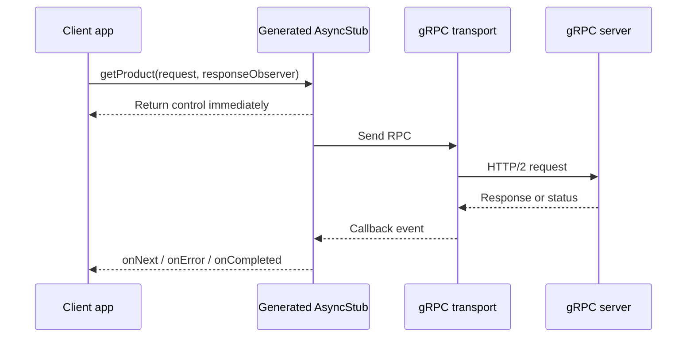

# AsyncStub and StreamObserver

## 1. Why Is AsyncStub Needed?

gRPC Java generates stub types from protobuf services. Each type serves a different invocation model:

- **Blocking stub** waits for the RPC result and returns the response directly. It is simple to use, but the calling thread is held while waiting.
- **Future stub** returns a future for unary RPCs with compatible result types.
- **Async stub** receives callbacks via `StreamObserver`. The RPC invocation method returns control immediately; results arrive later via callbacks.

Async stubs are suitable when an application needs to handle many concurrent RPCs, integrate with an event-driven flow, or use streaming. It does not mean all code inside the service runs asynchronously automatically; the application must still manage threads, resources, and processing order.

For a generated stub named `ProductQueryServiceGrpc`, Java typically generates the async stub class `ProductQueryServiceStub` and factory method `newStub(channel)`. The exact names are derived from the service name in the proto file.



## 2. The StreamObserver Contract

`StreamObserver<T>` is the core callback interface in gRPC Java:

```java
public interface StreamObserver<V> {
    void onNext(V value);
    void onError(Throwable t);
    void onCompleted();
}
```

The three methods have distinct meanings:

- `onNext(value)` sends or receives one message. A stream may have zero, one, or many messages depending on the RPC type.
- `onError(error)` terminates the stream with an error. After this call, no further messages may be sent and `onCompleted()` must not be called.
- `onCompleted()` terminates the stream normally. After this call, no further messages or errors may be sent.

`onError` and `onCompleted` are mutually exclusive terminal signals. Each stream direction terminates only once. For a unary RPC, a successful response typically has exactly one `onNext` followed by `onCompleted`; an error has only `onError`.

Do not treat `onNext` as the completion signal. A client should only publish the final result after `onCompleted` if the flow depends on knowing the entire response has arrived.

## 3. Unary RPC with AsyncStub

Suppose protobuf defines:

```protobuf
service ProductQueryService {
  rpc GetProduct(GetProductRequest) returns (GetProductResponse);
}
```

The async stub invokes the method with a request and a response observer:

```java
ProductQueryServiceGrpc.ProductQueryServiceStub asyncStub =
        ProductQueryServiceGrpc.newStub(channel);

StreamObserver<GetProductResponse> responseObserver =
        new StreamObserver<>() {
            @Override
            public void onNext(GetProductResponse response) {
                renderProduct(response);
            }

            @Override
            public void onError(Throwable error) {
                Status status = Status.fromThrowable(error);
                reportFailure(status.getCode(), status.getDescription());
            }

            @Override
            public void onCompleted() {
                markRequestFinished();
            }
        };

asyncStub.withDeadlineAfter(500, TimeUnit.MILLISECONDS)
        .getProduct(request, responseObserver);

// The application continues other work while the RPC is running.
continueWorkflow();
```

The `getProduct(...)` method does not return a response. The result is delivered to the observer later. For a unary response, `onNext` is called at most once; success ends with `onCompleted`. If the server returns an error status, the client receives `onError`.

Do not call `await()` or wait on a latch on an event-loop thread to turn an async call into a blocking call. If you need to wait in tests, only wait on the test thread and always set a timeout.

## 4. Implementing a Unary Service on the Server Side

The generated base class accepts a `StreamObserver<Response>` to send results back to the client. The service must emit exactly one response and then complete, or emit an error:

```java
@Override
public void getProduct(
        GetProductRequest request,
        StreamObserver<GetProductResponse> responseObserver) {

    if (request.getProductId().isBlank()) {
        responseObserver.onError(
                Status.INVALID_ARGUMENT
                        .withDescription("product_id must not be blank")
                        .asRuntimeException());
        return;
    }

    Product product = productRepository.findById(request.getProductId())
            .orElse(null);

    if (product == null) {
        responseObserver.onError(
                Status.NOT_FOUND
                        .withDescription("Product not found")
                        .asRuntimeException());
        return;
    }

    GetProductResponse response = GetProductResponse.newBuilder()
            .setProductId(product.id())
            .setName(product.name())
            .build();

    responseObserver.onNext(response);
    responseObserver.onCompleted();
}
```

Do not call both `onError` and `onCompleted` for the same RPC. After sending a terminal signal, emit no further responses. Business errors should be mapped to appropriate gRPC statuses; do not send stack traces or sensitive information in the description.

In this example, the repository is assumed to return quickly. If processing requires long I/O, use an appropriate async mechanism or offload processing to a managed executor; do not hold the transport thread in a long-running blocking operation.

## 5. Server-Streaming RPC

With server streaming, the client sends one request while the server can emit multiple responses:

```protobuf
rpc WatchProductStock(WatchStockRequest)
    returns (stream StockUpdate);
```

The generated async stub accepts a response observer just like unary:

```java
asyncStub.watchProductStock(
        request,
        new StreamObserver<StockUpdate>() {
            @Override
            public void onNext(StockUpdate update) {
                updateStockView(update);
            }

            @Override
            public void onError(Throwable error) {
                showStreamFailure(Status.fromThrowable(error));
            }

            @Override
            public void onCompleted() {
                closeStockFeed();
            }
        });
```

The server calls `onNext` for each update and calls `onCompleted` when the data source finishes. If the source fails, it calls `onError` and stops emitting. For indefinite subscriptions, the server can keep the stream open until the client cancels or the server applies a termination policy; there must be a mechanism to clean up subscriptions when the RPC is cancelled.

Do not accumulate every update into an unbounded list on the client. Process each message individually, bound buffers, and use flow control when the producer rate can exceed the consumer rate.

## 6. Client-Streaming and Bidirectional Streaming

With client streaming, the client sends multiple requests through a request observer and receives a single final response:

```protobuf
rpc UploadEvents(stream EventChunk) returns (UploadSummary);
```

```java
StreamObserver<EventChunk> requestObserver =
        asyncStub.uploadEvents(new StreamObserver<UploadSummary>() {
            @Override
            public void onNext(UploadSummary summary) {
                showUploadSummary(summary);
            }

            @Override
            public void onError(Throwable error) {
                reportUploadFailure(Status.fromThrowable(error));
            }

            @Override
            public void onCompleted() {
                finishUpload();
            }
        });

requestObserver.onNext(firstChunk);
requestObserver.onNext(secondChunk);
requestObserver.onNext(finalChunk);
requestObserver.onCompleted(); // Half-close the client outbound side.
```

After `requestObserver.onCompleted()`, the client sends no more chunks. The server can process the received data and return the summary; the response stream closes separately via `onCompleted` on the client's response observer.

Bidirectional streaming has independent request and response streams:

```protobuf
rpc Exchange(stream ClientMessage) returns (stream ServerMessage);
```

```java
StreamObserver<ClientMessage> outbound = asyncStub.exchange(
        new StreamObserver<ServerMessage>() {
            @Override
            public void onNext(ServerMessage message) {
                handleServerMessage(message);
            }

            @Override
            public void onError(Throwable error) {
                closeConversationWithError(error);
            }

            @Override
            public void onCompleted() {
                closeServerResponseStream();
            }
        });

outbound.onNext(firstMessage);
outbound.onNext(secondMessage);
outbound.onCompleted(); // Close only the outbound side.
```

Half-closing the outbound side does not automatically terminate the inbound side. The server can continue sending responses until completion or error. The two stream directions can progress independently, while message ordering within each direction is preserved in send order.

## 7. Server-Side StreamObserver for Streaming

In client-streaming or bidi streaming, the generated service base method returns an observer to receive request messages. Example:

```java
@Override
public StreamObserver<EventChunk> uploadEvents(
        StreamObserver<UploadSummary> responseObserver) {

    return new StreamObserver<>() {
        private long received;
        private boolean failed;

        @Override
        public void onNext(EventChunk chunk) {
            if (failed) {
                return;
            }
            try {
                eventProcessor.accept(chunk);
                received += chunk.getEventsCount();
            } catch (RuntimeException error) {
                failed = true;
                responseObserver.onError(
                        Status.INVALID_ARGUMENT
                                .withDescription("Invalid chunk")
                                .asRuntimeException());
            }
        }

        @Override
        public void onError(Throwable error) {
            // Client cancelled or terminated the outbound side with an error.
            releaseUploadResources();
        }

        @Override
        public void onCompleted() {
            if (failed) {
                return;
            }

            responseObserver.onNext(
                    UploadSummary.newBuilder()
                            .setReceivedEvents(received)
                            .build());
            responseObserver.onCompleted();
            releaseUploadResources();
        }
    };
}
```

This illustrative example should be extended with transactions, size limits, validation, and cleanup appropriate to the business logic. When processing a chunk fails, the server emits a terminal error and does not continue writing responses. Cleanup must be safe when the stream is cancelled or errors out.

With bidi streaming, the server can emit responses on each request `onNext`, or process asynchronously and emit responses later. Do not assume the server must wait for the client to half-close before sending responses; that depends on the application protocol.

## 8. Threading and Observer Invocation Safety

`StreamObserver` is not inherently thread-safe. Calls to `onNext`, `onError`, and `onCompleted` on the same observer must be serialized.

Key principles:

- Do not call the same response observer concurrently from multiple worker threads.
- If multiple data sources emit messages together, funnel them through a queue and a single writer executor.
- Do not perform heavy CPU work or blocking I/O inside client callbacks; offload that work to an appropriate executor.
- Do not hold locks for long while processing messages; locks should only guard event emission ordering if truly needed.
- Do not use mutable fields in a singleton service to hold per-RPC state. Keep state in a per-stream object.

gRPC callbacks are invoked on an executor managed by the runtime; do not rely on a fixed thread name or assume the callback runs on the thread that invoked the stub. If the application needs to update UI, MDC, tracing, or security context, transfer the required context using a supported mechanism.

## 9. Flow Control and Backpressure

In streaming, a producer can emit messages faster than a consumer can process them. Without rate limits or bounded buffers, memory can grow continuously and degrade stability.

The basic `StreamObserver` does not expose full flow-control APIs on the client side. Under heavy load, gRPC Java provides specialized observers such as `ClientResponseObserver` and `ClientCallStreamObserver` to control inbound demand, send readiness, and on-ready callbacks. On the server side, `ServerCallStreamObserver` provides the corresponding mechanisms.

The design should:

1. Limit the number of buffered messages or bytes.
2. Only read/push more data when the receiving side has capacity to process it.
3. Use on-ready notifications to resume sending when the transport is ready, rather than busy loops.
4. Define behavior when the queue is full: pause the producer, drop by policy, or terminate the stream with an appropriate status.
5. Monitor message sizes, queue depth, processing time, and cancellations.

HTTP/2 flow control regulates data transmission at the transport layer; it does not replace queue bounds and backpressure in application logic.

## 10. Deadlines, Cancellation, and Cleanup

Async does not mean an RPC is allowed to run forever. Set deadlines according to the SLA:

```java
ProductQueryServiceGrpc.ProductQueryServiceStub boundedStub =
        asyncStub.withDeadlineAfter(700, TimeUnit.MILLISECONDS);

boundedStub.getProduct(request, responseObserver);
```

When a deadline expires or the caller cancels the call, the callback typically receives an error with the corresponding status, such as `DEADLINE_EXCEEDED` or `CANCELLED`. The server should stop unnecessary work and release subscriptions, timers, queues, or related resources.

The server can use `ServerCallStreamObserver` to observe cancellation and readiness. Register a cancellation handler to cancel background tasks or subscriptions; do not continue emitting messages after the client has left the stream.

Do not stop at merely receiving `onError` on the client. Ensure cancellation propagates to background work and cleanup runs exactly once. If there are multiple termination paths (complete, error, cancel), use explicit state or an idempotent mechanism to avoid duplicate resource cleanup.

## 11. Integrating AsyncStub in Spring gRPC

Spring should manage channels according to the application lifecycle. Create an async stub from a named channel via the channel factory:

```java
import org.springframework.context.annotation.Bean;
import org.springframework.context.annotation.Configuration;
import org.springframework.grpc.client.GrpcChannelFactory;

@Configuration
public class ProductGrpcClientConfiguration {

    @Bean
    ProductQueryServiceGrpc.ProductQueryServiceStub productAsyncStub(
            GrpcChannelFactory channelFactory) {

        return ProductQueryServiceGrpc.newStub(
                channelFactory.createChannel("catalog"));
    }
}
```

The `catalog` channel must be configured with target, resolver, and TLS according to the Spring gRPC starter version in use. Do not create a new channel per request. If a per-RPC Bearer token is required, attach `CallCredentials` to a derived stub or call; do not store user tokens in singleton fields.

When the application shuts down, let Spring manage closing the channel via its lifecycle. If you create a channel manually outside the factory, you must own and close it explicitly; never close a shared Spring-managed channel from an arbitrary service.

## 12. Testing AsyncStub and StreamObserver

Asynchronous callbacks should be tested in an event-driven manner rather than using sleep to guess when callbacks run. Use a `CountDownLatch` with a timeout, `AtomicReference` to store responses/statuses, and always verify the terminal event.

Scenarios to cover:

| Scenario | What to Verify |
| --- | --- |
| Unary success | One `onNext`, followed by `onCompleted`. |
| Unary NOT_FOUND | `onError` with status `NOT_FOUND`; no `onCompleted`. |
| Server streaming | Multiple messages received in order, followed by a terminal event. |
| Client streaming | Multiple requests sent, half-close, final summary received. |
| Bidi streaming | Both directions operate independently; half-closing requests does not immediately end responses. |
| Deadline | Client receives `DEADLINE_EXCEEDED` and server stops work appropriately. |
| Cancellation | Subscriptions/background tasks are cleaned up. |
| Concurrent producers | Observer still receives messages sequentially, with no concurrent writes. |
| Slow consumer | Buffers remain bounded and flow control/backpressure work. |

Example unary test skeleton with in-process transport:

```java
CountDownLatch terminal = new CountDownLatch(1);
AtomicReference<GetProductResponse> result = new AtomicReference<>();
AtomicReference<Status> failure = new AtomicReference<>();

asyncStub.getProduct(request, new StreamObserver<>() {
    @Override
    public void onNext(GetProductResponse response) {
        result.set(response);
    }

    @Override
    public void onError(Throwable error) {
        failure.set(Status.fromThrowable(error));
        terminal.countDown();
    }

    @Override
    public void onCompleted() {
        terminal.countDown();
    }
});

assertTrue(terminal.await(2, TimeUnit.SECONDS));
assertNull(failure.get());
assertNotNull(result.get());
```

In-process transport is useful for testing observer lifecycle and status mapping. It does not exercise DNS, TCP, TLS, or HTTP/2 proxies; add Netty-based integration tests when network transport verification is needed. Do not use unbounded latches and do not let test threads wait without a timeout.

## 13. Common Pitfalls

1. **Waiting for a direct return value from AsyncStub.** Async methods do not return a response. Handle results via the observer, or pick a blocking/future stub if appropriate.
2. **Forgetting to call onCompleted after onNext.** The client never receives the stream-completion signal. Terminate successfully exactly once.
3. **Calling onNext after onError/onCompleted.** Violates the lifecycle contract and can corrupt the stream. Maintain explicit terminal state.
4. **Treating client half-close as ending the entire bidi stream.** Both directions are independent. Wait for the response observer to receive its terminal event.
5. **Calling an observer concurrently from multiple threads.** StreamObserver is not thread-safe. Serialize writers.
6. **Blocking I/O inside callbacks.** Stalls the executor processing callbacks. Offload heavy work.
7. **Unbounded buffers when a consumer is slow.** Easily exhausts memory. Use flow control and bounded queues.
8. **Not setting deadlines or handling cancellation.** RPCs/subscriptions can linger too long. Set deadlines and clean up on cancellation.
9. **Closing a Spring-managed channel from a service.** Breaks other stubs sharing the channel. Let the factory/lifecycle manage it.
10. **Using sleep in async tests.** Tests become flaky due to timing. Synchronize with latches/futures that have timeouts.

## 14. Hands-On Exercise

Implement an async client for `ProductQueryService` and a streaming RPC:

1. Create the `catalog` channel using `GrpcChannelFactory` and construct `ProductQueryServiceStub` via `newStub(channel)`.
2. Call unary `GetProduct` with a deadline; handle the response, error status, and completion using `StreamObserver`.
3. Implement server-streaming `WatchProductStock`; render each update without unbounded accumulation.
4. Add client-streaming `UploadEvents` to send multiple chunks and receive a summary after half-closing.
5. Add bidi `Exchange`; demonstrate that half-closing requests does not automatically terminate the response stream.
6. Serialize observer calls when multiple producers exist; handle slow consumers with flow control/backpressure.
7. Write tests for success, NOT_FOUND, deadline, cancellation, message ordering, and terminal events; use timeouts instead of sleep.

**Self-Check:** AsyncStub initiates RPCs and delivers results through StreamObserver. Each stream direction emits zero or more onNext calls and terminates exactly once with onCompleted or onError. Client-streaming and bidi have their own request observer; half-closing closes only the outbound direction. Reliable operation requires serializing observer calls, bounding buffers, setting deadlines, handling cancellation, and managing channels through Spring's lifecycle.
