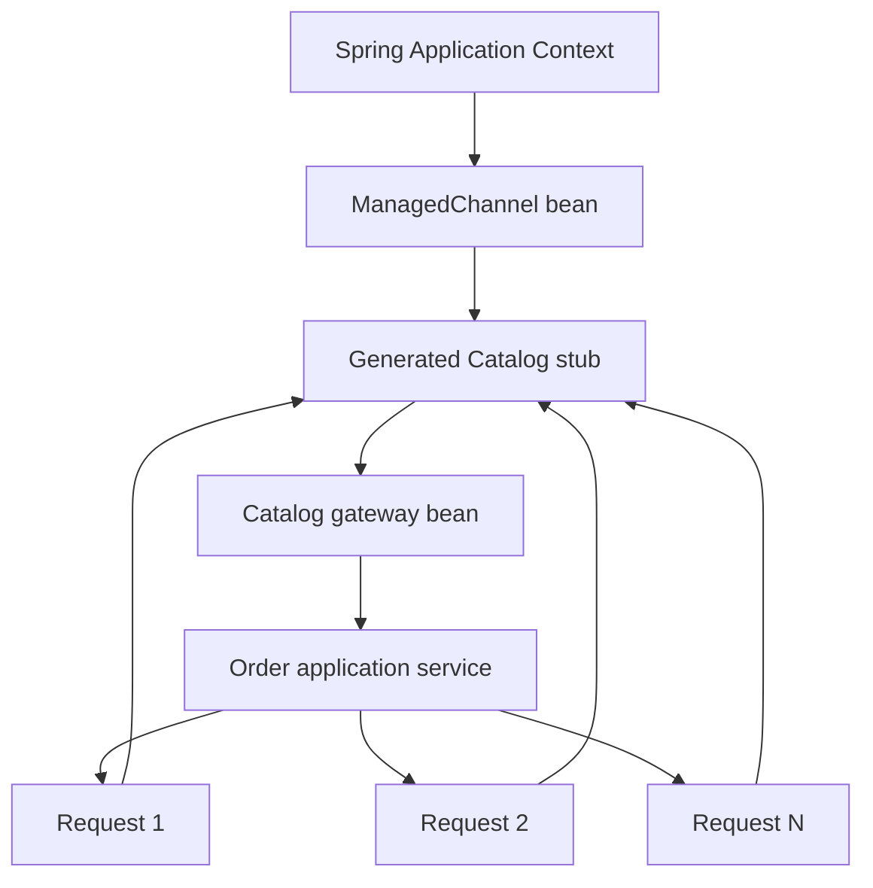

# Reusing Stubs in Application Services

## 1. Objectives

In a Spring gRPC application, many business requests may call the same RPC service on the same destination server. If every request creates a new `ManagedChannel` and generated stub, the application duplicates transport configuration, increases connection counts, and makes the channel lifecycle hard to control.

**Reusing stubs in application services** means creating the client stub from a managed channel, injecting the stub into Spring beans via dependency injection, and reusing it across many RPC invocations. Generated stubs in gRPC Java are immutable; multiple threads can share a stub. When a call needs its own deadline or call options, create a derived stub for that call instead of mutating shared stub state.

After this lesson, you can:

- Inject generated stubs into application services using constructor injection.
- Reuse channels and stubs across multiple concurrent requests.
- Distinguish shared configuration from per-RPC call options.
- Manage deadlines, metadata, and credentials without leaking state across calls.
- Choose blocking or asynchronous stubs based on the application's execution model.
- Keep channel lifecycle management in the owning component and shut it down at the right time.
- Test application services without coupling directly to the transport.

## 2. Why Reuse Stubs?

Suppose `OrderApplicationService` needs to call Catalog to fetch product details. If every call to `getOrderDetails()` creates a channel and stub:

```java
public Product getProduct(String id) {
    ManagedChannel channel = ManagedChannelBuilder
            .forAddress("catalog.internal", 9090)
            .useTransportSecurity()
            .build();

    try {
        var stub = CatalogServiceGrpc.newBlockingStub(channel);
        return stub.getProduct(
                GetProductRequest.newBuilder()
                        .setProductId(id)
                        .build());
    } finally {
        channel.shutdown();
    }
}
```

This approach creates and tears down the transport for every single call. It increases connection setup, TLS handshakes, name resolution, and shutdown overhead; concurrent requests can also spawn many unnecessary channels.

A better design:

1. One component creates and owns the `ManagedChannel` for the Catalog target.
2. A client configuration creates the generated stub from the channel.
3. Spring injects the stub into the gateway/application service.
4. Each request reuses the injected stub.
5. Each call builds its own request and can create a derived stub with its own deadline.



Many RPCs can share one channel and multiplex over the HTTP/2 connection. Creating a stub does not open a new socket.

## 3. Stubs and Channels Can Be Shared Safely

Generated stubs in gRPC Java extend `AbstractStub`. Stubs are immutable: call-option configuration methods do not mutate the original object, returning a new stub of the same type instead.

Example:

```java
CatalogServiceGrpc.CatalogServiceBlockingStub baseStub =
        CatalogServiceGrpc.newBlockingStub(channel);

var shortCallStub =
        baseStub.withDeadlineAfter(300, TimeUnit.MILLISECONDS);

var normalCallStub =
        baseStub.withDeadlineAfter(2, TimeUnit.SECONDS);
```

`baseStub` is unchanged. `shortCallStub` and `normalCallStub` share the original channel while carrying different call options.

Channels and generated stubs are designed to be shared across threads. Therefore, a Spring singleton gateway can hold the stub in a `final` field and serve many concurrent requests.

Objects that must NOT be shared mutably across calls:

- Protobuf request builders currently being modified.
- `Metadata` containing request-specific data.
- A `StreamObserver` for a streaming call.
- Result lists or buffers tied to a single caller.
- Correlation IDs, tenant IDs, or tokens stored in singleton fields.

Create a separate request, metadata instance, and observer per call. Never store request-specific data in mutable fields of an application service or singleton interceptor.

## 4. Creating Channels and Stubs in Spring Configuration

Channels should be managed according to the application context lifecycle. Example configuration of a channel for Catalog:

```java
@Configuration
public class CatalogGrpcClientConfiguration {

    @Bean(name = "catalogChannel", destroyMethod = "shutdown")
    ManagedChannel catalogChannel() {
        return ManagedChannelBuilder
                .forAddress("catalog.internal", 9090)
                .useTransportSecurity()
                .build();
    }

    @Bean
    CatalogServiceGrpc.CatalogServiceBlockingStub catalogBlockingStub(
            @Qualifier("catalogChannel") ManagedChannel channel) {
        return CatalogServiceGrpc.newBlockingStub(channel);
    }
}
```

The stub bean is created once from the channel and can be injected into multiple beans. Hostnames, ports, trust configuration, and transport settings must come from the appropriate environment configuration. When using a Spring gRPC starter that provides a channel factory or client auto-configuration, use the starter's lifecycle/configuration API instead of creating a competing channel for the same target.

`destroyMethod = "shutdown"` tells Spring to call `shutdown()` when the bean is destroyed. If graceful shutdown with a wait timeout is needed, use a dedicated lifecycle bean or the shutdown mechanism supported by the starter to call `awaitTermination()` before forcing `shutdownNow()`.

Never let a gateway close the channel itself if the gateway merely receives the channel via constructor injection. Only the component that creates or owns the channel is responsible for closing it.

## 5. Injecting Stubs into Application Services

An application service focuses on business use cases. It does not need to know how to construct TLS channels or generated stubs:

```java
@Service
public class OrderApplicationService {

    private final CatalogServiceGrpc.CatalogServiceBlockingStub catalogStub;
    private final OrderRepository orderRepository;

    public OrderApplicationService(
            CatalogServiceGrpc.CatalogServiceBlockingStub catalogStub,
            OrderRepository orderRepository) {
        this.catalogStub = catalogStub;
        this.orderRepository = orderRepository;
    }

    public OrderDetails getOrderDetails(String orderId) {
        Order order = orderRepository.findById(orderId)
                .orElseThrow(() ->
                        new OrderNotFoundException(orderId));

        GetProductRequest request = GetProductRequest.newBuilder()
                .setProductId(order.productId())
                .build();

        Product product = catalogStub
                .withDeadlineAfter(700, TimeUnit.MILLISECONDS)
                .getProduct(request);

        return OrderDetails.from(order, product);
    }
}
```

Each invocation of `getOrderDetails()` builds a fresh request and uses a derived stub with a 700 ms deadline. The injected stub remains the shared base stub.

In larger systems, you can place the generated stub behind a gateway such as `CatalogGrpcClient`. This allows the application service to depend on an internal interface or API while the gateway handles domain request/response translation, gRPC status mapping, and call options. The benefit is clearest when multiple use cases call the same service or when generated contracts need to evolve without leaking changes into the application layer.

## 6. Using a Gateway to Isolate Generated APIs

Example of a small gateway:

```java
public interface CatalogClient {
    ProductDetails getProduct(String productId);
}
```

Implementation:

```java
@Component
public class GrpcCatalogClient implements CatalogClient {

    private final CatalogServiceGrpc.CatalogServiceBlockingStub baseStub;

    public GrpcCatalogClient(
            CatalogServiceGrpc.CatalogServiceBlockingStub baseStub) {
        this.baseStub = baseStub;
    }

    @Override
    public ProductDetails getProduct(String productId) {
        var request = GetProductRequest.newBuilder()
                .setProductId(productId)
                .build();

        try {
            Product response = baseStub
                    .withDeadlineAfter(700, TimeUnit.MILLISECONDS)
                    .getProduct(request);

            return new ProductDetails(
                    response.getProductId(),
                    response.getName());
        } catch (StatusRuntimeException ex) {
            throw CatalogCallException.from(ex);
        }
    }
}
```

The application service injects `CatalogClient`, without depending on `CatalogServiceGrpc` or Protobuf-generated classes. The gateway translates transport errors into exceptions suited for the application layer.

This is a useful boundary when the domain should not depend on transport details. However, if a module is small and has only one caller, injecting the stub directly can also be reasonable; avoid adding extra layers just to wrap one line of code.

## 7. Setting Per-Call Deadlines

The base stub should hold shared configuration. Deadlines usually depend on the use case's latency budget, so set them on a derived stub:

```java
Product fastProduct = catalogStub
        .withDeadlineAfter(250, TimeUnit.MILLISECONDS)
        .getProduct(request);

Product normalProduct = catalogStub
        .withDeadlineAfter(900, TimeUnit.MILLISECONDS)
        .getProduct(request);
```

Do not set a deadline once on a shared stub and expect to reassign it for subsequent requests. Immutable stubs make creating derived instances safe and prevent one call from affecting another.

Downstream deadlines must fit within the remaining budget of the current request. If an inbound request only has 200 ms remaining, do not issue a Catalog call with a 2-second deadline. Retrieve the remaining deadline from the request context or pass a budget from the application layer, bounded by dependency policy.

When a deadline expires, gRPC typically returns `DEADLINE_EXCEEDED`. The application layer must decide whether to retry, fall back to cache, or return an error to the caller. Do not retry automatically if the operation has side effects or lacks idempotency guarantees.

## 8. Per-Call Metadata and Credentials

Metadata often carries correlation IDs, tenant context, or control data. Because this data varies per request, attach it at call scope rather than storing it in a field of a shared stub.

A client interceptor can read the current context and attach metadata for each call. A simple example illustrating per-call metadata creation:

```java
Metadata headers = new Metadata();
headers.put(
        Metadata.Key.of(
                "x-request-id",
                Metadata.ASCII_STRING_MARSHALLER),
        requestId);

var callStub = catalogStub.withInterceptors(
        MetadataUtils.newAttachHeadersInterceptor(headers));
```

This snippet is suitable when `headers` is created specifically for a single call and is not mutated after the interceptor uses it. In an application serving many concurrent requests, never keep `headers` in a singleton field and overwrite the request ID for each caller.

For bearer tokens or credentials requiring refresh, prefer `CallCredentials` or a credential provider mechanism designed for gRPC. Do not hard-code tokens into stub beans. Credentials must reflect the caller's identity or service account according to security policy.

If metadata is added by a singleton interceptor, the interceptor must handle state per call; never use instance fields to hold request IDs, user IDs, or tokens.

## 9. Shared Interceptors vs. Per-Client Interceptors

Cross-cutting concerns such as tracing, metrics, and logging are typically attached to a channel wrapper before creating stubs:

```java
Channel observedChannel = ClientInterceptors.intercept(
        channel,
        tracingInterceptor,
        metricsInterceptor);

CatalogServiceGrpc.CatalogServiceBlockingStub stub =
        CatalogServiceGrpc.newBlockingStub(observedChannel);
```

If multiple gateways share the wrapped channel, all calls passing through the wrapper are observed. The interceptor does not replace the stub; it wraps the channel's call lifecycle.

Distinction:

| Concern | Appropriate Location |
|---|---|
| TLS, target, load balancing | Channel configuration |
| Tracing/metrics shared across all RPCs | Channel interceptor |
| Per-use-case deadline | Derived stub/call options |
| Request-varying metadata | Call interceptor or call credentials |
| Request/response mapping | Gateway/application adapter |
| Business logic | Application/domain service |

Avoid registering the same interceptor at multiple layers if doing so causes an RPC to record metrics or spans twice. Define interceptor ordering clearly and test behavior when a channel is wrapped in multiple layers.

## 10. Blocking or Asynchronous Stubs in Application Services?

Reusing stubs does not mean every application service must use a blocking stub. Choose the stub type according to the execution model:

| Stub Type | Suitable For | Notes |
|---|---|---|
| Blocking | Synchronous flows with dedicated waiting threads | Do not block event loops or overly small thread pools |
| Async | Streaming or callback/event-driven flows | Must handle observer lifecycle and errors |
| Future | Unary RPCs needing `ListenableFuture` | Future stubs do not support streaming |

With Spring MVC running on a servlet thread pool, blocking stubs can be appropriate if deadlines and concurrency are bounded. With WebFlux or an event loop, do not block event-processing threads; use async APIs or offload blocking calls to a dedicated scheduler/executor.

Async stubs can also be injected and reused:

```java
@Component
public class CatalogAsyncClient {

    private final CatalogServiceGrpc.CatalogServiceStub baseStub;

    public CatalogAsyncClient(
            CatalogServiceGrpc.CatalogServiceStub baseStub) {
        this.baseStub = baseStub;
    }

    public void getProduct(
            String productId,
            StreamObserver<Product> observer) {
        var request = GetProductRequest.newBuilder()
                .setProductId(productId)
                .build();

        baseStub.withDeadlineAfter(700, TimeUnit.MILLISECONDS)
                .getProduct(request, observer);
    }
}
```

The observer must belong to the current call. Do not reuse one observer across multiple independent RPCs unless it is explicitly designed to coordinate those results.

## 11. Error Handling at the Application Boundary

Stubs can throw `StatusRuntimeException` carrying a gRPC status. Do not let every application service parse statuses independently with inconsistent mappings.

A gateway can standardize translation:

```java
static CatalogCallException from(StatusRuntimeException error) {
    return switch (error.getStatus().getCode()) {
        case NOT_FOUND ->
                new CatalogProductNotFoundException(error);
        case INVALID_ARGUMENT ->
                new CatalogRequestRejectedException(error);
        case UNAVAILABLE, DEADLINE_EXCEEDED ->
                new CatalogTemporarilyUnavailableException(error);
        case UNAUTHENTICATED, PERMISSION_DENIED ->
                new CatalogAccessDeniedException(error);
        default ->
                new CatalogCallException(error);
    };
}
```

Mapping must align with Catalog's and the application's semantics. Do not treat every `UNAVAILABLE` as blindly retryable; retries also depend on the operation, idempotency, remaining deadline, and retry policy. Do not expose internal server descriptions or sensitive metadata directly to end users.

## 12. Testing Application Services When Stubs Are Reused

If an application service injects a generated stub directly, unit tests can inject a stub backed by a fake/test channel or mock the appropriate API. If using a gateway interface, you can mock the interface without depending on the gRPC runtime.

Example with a gateway interface:

```java
@ExtendWith(MockitoExtension.class)
class OrderApplicationServiceTest {

    @Mock
    CatalogClient catalogClient;

    @Mock
    OrderRepository orderRepository;

    @Test
    void loadsProductThroughReusableCatalogClient() {
        when(orderRepository.findById("order-7"))
                .thenReturn(Optional.of(order("order-7", "product-42")));
        when(catalogClient.getProduct("product-42"))
                .thenReturn(new ProductDetails("product-42", "Keyboard"));

        var service = new OrderApplicationService(
                catalogClient, orderRepository);

        OrderDetails result = service.getOrderDetails("order-7");

        assertEquals("Keyboard", result.productName());
        verify(catalogClient).getProduct("product-42");
    }
}
```

This is a unit test for application orchestration; it does not test the gRPC transport. Separate integration tests are needed to verify:

- Stubs are created from a channel pointing to the right target.
- Server methods are registered and callable.
- Interceptors are applied exactly once.
- Deadlines and credentials are sent as configured.
- The channel remains usable across many consecutive requests.
- Application shutdown closes the Spring-owned channel.

A valuable test is issuing multiple sequential and concurrent RPCs through the same gateway and verifying that request IDs, tenant metadata, and deadlines do not leak across calls.

## 13. Common Pitfalls

| Symptom | Cause | Fix |
|---|---|---|
| Every request opens extra connections | Creating channels/stubs inside business methods | Manage channels and stubs as Spring beans |
| Concurrent requests mix up metadata | Storing metadata in mutable fields | Create metadata per call |
| One call's deadline affects another | Attempting to mutate shared configuration | Use immutable derived stubs |
| Channel closed prematurely | Gateway shuts down an injected channel | Only the channel owner manages lifecycle |
| Channel never closed on app stop | No owner or destroy lifecycle configured | Register bean lifecycle/graceful shutdown |
| WebFlux stalls | Calling a blocking stub on the event loop | Use async or a dedicated executor |
| Retries cause duplicate side effects | Retrying without checking idempotency | Define retry policy per operation |
| Metrics/tracing recorded twice | Interceptor registered at multiple layers | Standardize where the channel is wrapped |
| Application service coupled too deeply to generated models | Calling gRPC directly everywhere | Use a gateway to isolate contracts where beneficial |
| Unit tests pass but transport fails | Only mocking gateways/stubs | Add integration tests against a real server |

## 14. Hands-On Exercise

**Scenario:** `OrderApplicationService` calls Catalog to fetch products and Pricing to calculate prices. Many concurrent requests use both dependencies; each dependency has its own deadline, TLS identity, and tracing policy.

Complete the following:

1. Create channel beans for Catalog and Pricing; configure each channel with the right target and TLS settings.
2. Create generated stub beans from each channel and inject them via constructor injection.
3. Place RPC calls behind dedicated gateways if the application service needs separation between transport and domain models.
4. Reuse base stubs across requests; never create channels inside business methods.
5. Create derived stubs with separate deadlines for Catalog and Pricing.
6. Attach tracing/metrics interceptors at the channel wrapper; create metadata per call.
7. Write concurrent-request tests verifying that request IDs, deadlines, and responses do not bleed across calls.
8. Test status mapping, timeouts, and conditional retries.
9. Close the Spring context and verify the channels are shut down by their owner after in-flight calls have an opportunity to complete.

**Completion criteria:** the application service reuses stubs safely; each call has isolated state and deadline; channel lifecycles have clear owners; transport concerns are isolated; tests separate unit orchestration from gRPC integration.

## 15. Takeaways

Create generated stubs from a channel once in client configuration, then inject and reuse those stubs in application services or gateways. gRPC Java stubs are immutable and thread-safe; many requests can share a base stub. Call-specific deadlines, metadata, and credentials must be attached per call via derived stubs, interceptors, or call credentials—never by storing request-specific state in singletons. Channels are lifecycle-managed by their owning component and shut down when the application stops. Choose blocking, async, or future stubs according to cardinality and execution model. Reusing stubs reduces connection overhead, clarifies Spring bean responsibilities, and keeps application logic testable independently of transport.
