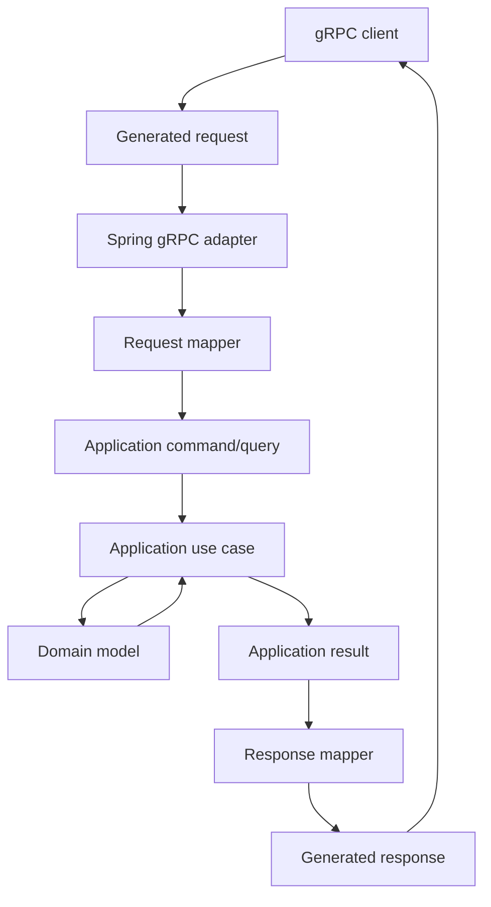

# Mapping Generated Types to Application Types

## 1. Objectives

In Spring gRPC, the Protobuf compiler and gRPC Java plugin generate Java classes for requests, responses, enums, and services. Those classes represent the wire contract exchanged between client and server. Application services and domain models, by contrast, need data types that express the system's business concepts, invariants, and rules.

**Mapping generated types to application types** means converting data between Protobuf-generated classes and the types used by the application/domain layer. This conversion typically lives in the gRPC adapter or gateway, at the boundary between transport and application. The adapter receives the generated request, validates it, and converts it into a command/query; after the use case returns a result, the adapter converts the application result into a generated response.

Separating the two models allows the Protobuf contract to evolve without forcing the domain model to change with every field, package, or generator option. It also prevents transport concepts such as ByteString, Timestamp, generated enums, and StatusRuntimeException from leaking into business logic.

After this lesson, you can:

- Distinguish generated Protobuf types from application/domain types.
- Design bidirectional mappers at the gRPC adapter boundary.
- Convert scalars, repeated fields, maps, bytes, timestamps, and durations.
- Preserve field presence, oneofs, and unknown enum semantics.
- Apply validation when converting requests into application commands.
- Avoid data loss or incorrect defaults when mapping responses.
- Test mappers in isolation and verify mapping through real RPCs.

## 2. Why Are Separate Application Types Needed?

Suppose Protobuf defines:

```proto
syntax = "proto3";

package catalog.v1;
option java_package = "dev.example.catalog.v1";
option java_multiple_files = true;

service CatalogService {
  rpc GetProduct(GetProductRequest) returns (Product);
}

message GetProductRequest {
  string product_id = 1;
}

message Product {
  string product_id = 1;
  string display_name = 2;
  ProductStatus status = 3;
}

enum ProductStatus {
  PRODUCT_STATUS_UNSPECIFIED = 0;
  PRODUCT_STATUS_ACTIVE = 1;
  PRODUCT_STATUS_DISCONTINUED = 2;
}
```

The generated Java API will contain GetProductRequest, Product, ProductStatus, and their corresponding builders/accessors. If the domain uses these classes directly, business logic becomes coupled to:

- Protobuf package names and Java package names.
- Generator naming conventions for fields/accessors.
- Enum representations and the UNRECOGNIZED value.
- How Protobuf models presence, defaults, and oneofs.
- Protobuf runtime and generated API versions.

The application model can express the same information in business terms:

```java
public record ProductId(String value) {
    public ProductId {
        if (value == null || value.isBlank()) {
            throw new IllegalArgumentException(
                    "product id must not be blank");
        }
    }
}

public enum ProductState {
    ACTIVE,
    DISCONTINUED,
    UNKNOWN
}

public record ProductDetails(
        ProductId id,
        String displayName,
        ProductState state) {
}
```

The domain does not need to import generated classes. If the schema renames display_name while the business meaning stays the same, the mapper can absorb that change without forcing every application service to change.

## 3. Placing Mappers at the Transport Boundary

A common structure:



The mapper belongs to the adapter layer because it knows both sides: generated Protobuf types and application types. The domain layer should not depend on Protobuf to convert itself. Application use cases should also avoid accepting Message, ByteString, or generated requests if the goal is to keep the boundary transport-independent.

A gRPC service implementation can orchestrate the steps:

1. Receive the generated request.
2. Convert the request to an application command/query.
3. Invoke the use case.
4. Convert the result to a generated response.
5. Send the response or gRPC status via StreamObserver.

For small systems, mappers can be private methods in the adapter. When multiple methods share mapping rules, extract them into dedicated mapper classes for easier testing and to avoid duplicate mapping logic.

## 4. Mapping Scalars and Value Objects

Protobuf scalars generally generate corresponding Java primitives or wrapper types:

| Protobuf | Typical Generated Java API | Possible Application Type |
|---|---|---|
| string | String | String, ProductId, EmailAddress |
| bool | boolean | boolean or value object |
| int32 | int | int, quantity, bounded integer |
| int64 | long | long, sequence, or typed identifier |
| float | float | float if business accepts precision |
| double | double | double for appropriate measurements |
| bytes | ByteString | byte array, immutable binary value |

Not every scalar should stay a raw type. For instance, product_id is a string on the wire but can be a ProductId in the application model. The mapper constructs the value object and lets the constructor/factory enforce invariants:

```java
static ProductId toProductId(GetProductRequest request) {
    return new ProductId(request.getProductId());
}
```

Numeric types also need clear business semantics. An int32 quantity may need to be non-negative and bounded; a long account_id should not necessarily be treated as a number for arithmetic. Mappers or application-type factories should validate ranges and invariants before calling the use case.

Do not automatically turn empty strings into null unless the contract specifies that behavior. For proto3 scalars without presence, an empty string may be the default value; if the business logic needs to distinguish absent from empty, the schema must model presence explicitly.

## 5. Mapping Repeated and Map Fields

Repeated fields are exposed by the generated API as read-only collections from the message:

```proto
message SearchResponse {
  repeated Product products = 1;
  map<string, int32> stock_by_warehouse = 2;
}
```

The application model can use List and Map:

```java
public record SearchResult(
        List<ProductDetails> products,
        Map<String, Integer> stockByWarehouse) {
    public SearchResult {
        products = List.copyOf(products);
        stockByWarehouse = Map.copyOf(stockByWarehouse);
    }
}
```

Mapping the response:

```java
static SearchResult toApplication(SearchResponse response) {
    List<ProductDetails> products = response.getProductsList()
            .stream()
            .map(ProductMapper::toApplication)
            .toList();

    Map<String, Integer> stock =
            Map.copyOf(response.getStockByWarehouseMap());

    return new SearchResult(products, stock);
}
```

Generated repeated/map accessors return collections managed by Protobuf. If the application model requires immutability, create independent collections or use List.copyOf()/Map.copyOf(). Those collection factories reject null elements/keys/values; that usually fits Protobuf data well, though it must remain consistent with the model.

When mapping from application to Protobuf, use a builder:

```java
SearchResponse.Builder response = SearchResponse.newBuilder();

result.products().stream()
        .map(ProductMapper::toProto)
        .forEach(response::addProducts);

response.putAllStockByWarehouse(result.stockByWarehouse());
```

Never keep a shared builder across multiple requests. Builders are mutable and belong to a single mapping operation.

## 6. Field Presence and Default Values

This is one of the most important differences when converting generated types to application types.

For proto3 scalars not declared optional, the generated API typically returns defaults when a field was not sent:

- string → empty string.
- bool → false.
- Numbers → 0.
- Enums → numeric value 0.

The application cannot tell from the getter alone whether the caller omitted the field or explicitly sent the default value. If distinguishing them is necessary, declare the field optional:

```proto
message UpdateProductRequest {
  string product_id = 1;
  optional string display_name = 2;
  optional int32 reorder_level = 3;
}
```

The generated API provides presence methods such as hasDisplayName() and hasReorderLevel():

```java
Optional<String> displayName =
        request.hasDisplayName()
                ? Optional.of(request.getDisplayName())
                : Optional.empty();

OptionalInt reorderLevel =
        request.hasReorderLevel()
                ? OptionalInt.of(request.getReorderLevel())
                : OptionalInt.empty();
```

Application command:

```java
public record UpdateProductCommand(
        ProductId productId,
        Optional<String> displayName,
        OptionalInt reorderLevel) {
}
```

In update APIs, absence usually means “leave the field unchanged,” whereas an explicit empty string or zero can mean “clear the name” or “set reorder level to 0.” If a mapper calls getters while ignoring presence, those two meanings collapse into one.

Message fields such as Timestamp or nested messages have presence; check hasX() before converting to Optional. Repeated and map fields do not have per-field presence: an empty collection typically represents no elements.

## 7. Mapping Oneofs to Application Types

Protobuf oneof represents one of several mutually exclusive choices:

```proto
message SearchFilter {
  oneof criterion {
    string category = 1;
    string seller_id = 2;
  }
}
```

Generated Java provides a case enum, such as getCriterionCase(). The application can model this with a sealed interface:

```java
public sealed interface SearchCriterion
        permits CategoryCriterion, SellerCriterion {
}

public record CategoryCriterion(String value)
        implements SearchCriterion {
}

public record SellerCriterion(String sellerId)
        implements SearchCriterion {
}
```

Mapper:

```java
static Optional<SearchCriterion> toApplication(
        SearchFilter filter) {
    return switch (filter.getCriterionCase()) {
        case CATEGORY -> Optional.of(
                new CategoryCriterion(filter.getCategory()));
        case SELLER_ID -> Optional.of(
                new SellerCriterion(filter.getSellerId()));
        case CRITERION_NOT_SET -> Optional.empty();
    };
}
```

If business rules disallow a missing criterion, the mapper or use case must reject Optional.empty() with explicit validation. Do not silently pick a default branch, as that can broaden a query unexpectedly.

When a newer schema adds a oneof alternative, newer generated code knows that case, whereas older code may parse the new field as an unknown field and report CRITERION_NOT_SET. When cross-version compatibility matters, do not interpret NOT_SET as “the caller definitely chose no filter” if requests can arrive from newer clients. Consider capability/version routing or preserve safe semantics.

## 8. Mapping Enums and Unknown Values

Do not pass generated enums straight into the domain. Application enums can use stable business names:

```java
static ProductState toApplication(ProductStatus status) {
    return switch (status) {
        case PRODUCT_STATUS_ACTIVE -> ProductState.ACTIVE;
        case PRODUCT_STATUS_DISCONTINUED ->
                ProductState.DISCONTINUED;
        case PRODUCT_STATUS_UNSPECIFIED, UNRECOGNIZED ->
                ProductState.UNKNOWN;
    };
}
```

In Protobuf Java proto3, generated enums include UNRECOGNIZED for unknown numeric values. If you need to retain the numeric value for logging or forward-compatible handling, getters such as getStatusValue() provide the raw integer. Never coerce a new enum value into ACTIVE or another meaningful state.

Depending on business rules, safe options include:

- Mapping to UNKNOWN to continue processing in a restricted mode.
- Rejecting the request/response if an unknown state affects permissions or money.
- Preserving the raw numeric value inside an application wrapper type if round-tripping is required.

When mapping back from an application enum to a Protobuf enum, mapping must be exhaustive and deterministic. If the application has UNKNOWN, choose the wire value defined by the contract; never rely on Java enum ordinals.

## 9. Mapping Timestamp and Duration

Protobuf provides well-known types for time:

- google.protobuf.Timestamp represents a UTC instant.
- google.protobuf.Duration represents a span of time.

In Java, com.google.protobuf.util.Timestamps and Durations provide conversions to java.time:

```java
Instant createdAt =
        Timestamps.toInstant(product.getCreatedAt());

Duration cacheTtl =
        Durations.toDuration(policy.getCacheTtl());
```

Because message fields have presence, check hasCreatedAt() or hasCacheTtl() before converting. Do not treat epoch timestamps or zero durations as “no value” if the schema permits callers to send those exact values.

When mapping an Instant back, preserve both seconds and nanos instead of converting through milliseconds:

```java
Timestamp timestamp = Timestamp.newBuilder()
        .setSeconds(createdAt.getEpochSecond())
        .setNanos(createdAt.getNano())
        .build();

com.google.protobuf.Duration protoDuration =
        Durations.fromNanos(cacheTtl.toNanos());
```

This Durations.fromNanos example assumes a positive TTL within the range Duration.toNanos() can represent as a long; for larger spans, convert seconds/nanos with range checks. Conversions must respect the valid ranges of Protobuf Timestamp/Duration and the bounds of Instant/Duration. Avoid truncating instants to milliseconds if business logic requires nanosecond precision.

## 10. Mapping Bytes and Binary Data

Protobuf bytes are represented in generated Java as ByteString. The application can use a byte array or a binary value object:

```java
byte[] content = request.getContent().toByteArray();
```

toByteArray() creates a byte array that the application can own. Do not assume ByteString is a byte[]; the two types have different APIs and semantics.

When mapping back:

```java
ByteString content = ByteString.copyFrom(binaryContent);
```

For large payloads, watch memory copies. Never concatenate an entire stream of chunks into one giant byte array. For uploads/downloads, map per message/chunk and enforce size limits, flow control, and cancellation.

If bytes contain a UUID, hash, image, or document, the application type should express that specific meaning and validate size/format at the boundary. Do not use arbitrary bytes as a dumping ground for untyped JSON or object serialization without a clear contract.

## 11. Mapping Money and Decimal Numbers

Protobuf has no built-in decimal scalar type. Never use double to represent money when decimal precision is required.

A contract can use a structure such as:

```proto
message Money {
  string currency_code = 1;
  int64 units = 2;
  int32 nanos = 3;
}
```

The application can use BigDecimal paired with currency:

```java
public record MoneyAmount(
        Currency currency,
        BigDecimal amount) {
}
```

When mapping, validate the currency code, the currency's scale rules, and the sign/range invariants of units/nanos. With a units+nanos representation, you can compute the exact decimal value via BigDecimal addition with a scale-9 nanos component; never pass through double.

If the system uses google.type.Money, follow that type's exact semantics and range rules. Never assume every currency shares the same number of decimal places or accepts arbitrary scales.

## 12. Request Mapping and Validation

A generated message proves the bytes parsed according to the schema; it does not prove the data is valid for business rules. The mapper or request validator must check:

- Non-empty IDs with valid formats.
- Enums not left UNRECOGNIZED when a known value is required.
- Valid quantities, monetary amounts, and numeric ranges.
- Timestamps within allowed business bounds.
- Required oneof selections present.
- Collections within maximum element counts.
- Strings within length limits and free of disallowed values.

Example mapper building a command:

```java
static CreateProductCommand toCommand(
        CreateProductRequest request) {
    ProductId id = new ProductId(request.getProductId());
    String name = request.getDisplayName().strip();

    if (name.isEmpty()) {
        throw new InvalidProductRequest(
                "display name must not be blank");
    }

    return new CreateProductCommand(id, name);
}
```

Validation exceptions should be translated by the adapter into an appropriate gRPC status, typically INVALID_ARGUMENT. Never let technical exceptions or internal stack traces pass directly back to the client.

## 13. Mapping Responses Back to Generated Types

Response mappers convert application results into Protobuf builders:

```java
static Product toProto(ProductDetails details) {
    return Product.newBuilder()
            .setProductId(details.id().value())
            .setDisplayName(details.displayName())
            .setStatus(toProto(details.state()))
            .build();
}

static ProductStatus toProto(ProductState state) {
    return switch (state) {
        case ACTIVE -> ProductStatus.PRODUCT_STATUS_ACTIVE;
        case DISCONTINUED ->
                ProductStatus.PRODUCT_STATUS_DISCONTINUED;
        case UNKNOWN ->
                ProductStatus.PRODUCT_STATUS_UNSPECIFIED;
    };
}
```

Response mappers should not query databases or call other services. They only convert representations. The use case must finish all business work before the mapper builds the response.

For optional fields, call the setter only when the application value is present:

```java
UpdateProductResponse.Builder response =
        UpdateProductResponse.newBuilder()
                .setProductId(result.id().value());

result.displayName().ifPresent(response::setDisplayName);
if (result.reorderLevel().isPresent()) {
    response.setReorderLevel(result.reorderLevel().getAsInt());
}
```

Never pass null to a setter. Protobuf builders do not use null to represent absence; omit the setter call or use the appropriate clear method.

## 14. Mapping Errors and Statuses at the Adapter

Data mapping and error mapping are related but distinct responsibilities. Mappers convert types; the gRPC adapter translates application exceptions into statuses:

| Application Outcome | Typical gRPC Status |
|---|---|
| Malformed request or invariant violation | INVALID_ARGUMENT |
| Resource does not exist | NOT_FOUND |
| Caller not authenticated | UNAUTHENTICATED |
| Caller lacks permission | PERMISSION_DENIED |
| Business conflict | ALREADY_EXISTS or FAILED_PRECONDITION |
| Dependency temporarily unavailable | UNAVAILABLE |
| Unexpected error | INTERNAL |

Choose statuses according to contract semantics. Never map every exception to INTERNAL, and do not return INVALID_ARGUMENT for system failures. Descriptions should be helpful without leaking queries, tokens, SQL, or sensitive stack traces.

## 15. Testing Mappers and Adapters

### Unit Testing Mappers

Mapper tests do not need to start a gRPC server. Construct generated messages with builders and assert on the resulting application types:

```java
@Test
void mapsGeneratedProductToApplicationModel() {
    Product proto = Product.newBuilder()
            .setProductId("p-42")
            .setDisplayName("Keyboard")
            .setStatus(ProductStatus.PRODUCT_STATUS_ACTIVE)
            .build();

    ProductDetails result = ProductMapper.toApplication(proto);

    assertEquals("p-42", result.id().value());
    assertEquals("Keyboard", result.displayName());
    assertEquals(ProductState.ACTIVE, result.state());
}
```

Cases to test explicitly:

- Optional fields absent vs. present with default values.
- Empty strings vs. absent if the contract distinguishes them.
- Every oneof branch and NOT_SET.
- UNSPECIFIED and UNRECOGNIZED enums.
- Boundary timestamps/durations and nanosecond precision.
- Empty collections, large collections, and maps.
- Empty bytes and oversized payloads.
- Negative money amounts, invalid currencies, and invalid scales.

### Adapter Integration Tests

Start a fake/in-process gRPC server or Spring context to verify:

- Generated requests map properly to commands.
- Use cases receive the right value objects and presence semantics.
- Application results map properly to responses.
- Validation exceptions become the expected statuses.
- Unknown enums/oneofs do not cause the server to apply unintended defaults.

Unit tests on mappers do not prove that the service bean registered the right method or that responses actually pass through the gRPC marshaller. Keep at least one RPC integration test for the adapter.

## 16. Common Pitfalls

| Symptom | Cause | Fix |
|---|---|---|
| Domain depends on generated classes | Using Protobuf messages as domain entities | Map to application types in the adapter |
| Absent treated as empty/zero | Only reading proto3 scalar getters | Use optional/presence when semantics require it |
| Updates accidentally clear fields | Not distinguishing absent from explicit defaults | Map presence to Optional/patch semantics |
| New enum mapped to wrong valid state | Not handling UNRECOGNIZED | Map to UNKNOWN or reject per policy |
| New oneof treated as no filter selected | Older code sees NOT_SET | Apply capability/version policy and test forward compatibility |
| Timestamps lose precision | Converting through milliseconds | Preserve nanosecond precision when needed |
| Money off by fractional units | Using double | Use BigDecimal and exact decimal representations |
| Bytes payloads spike memory | Copying entire streams into one byte array | Process chunks and bound buffers |
| Mapper contains business logic/DB access | Mixing mapping with use cases | Keep mappers pure; let use cases handle business logic |
| Mapper tests pass yet RPC fails | Not testing the adapter/transport | Add generated-stub integration tests |

## 17. Hands-On Exercise

**Scenario:** Catalog has an UpdateProduct RPC. The Protobuf request uses product_id, optional display_name, optional reorder_level, and enum ProductStatus. The application layer uses ProductId, Optional<String>, OptionalInt, and ProductState.

Complete the following:

1. Create an application command with no dependency on generated Protobuf classes.
2. Write a request-to-command mapper preserving absent/present semantics of optional fields.
3. Validate ID, name, reorder level, and enum values before calling the use case.
4. Handle UNRECOGNIZED according to the chosen policy; never map it arbitrarily to ACTIVE.
5. Write a use case that accepts the command and returns an application result.
6. Write a response mapper from the application result to the generated response builder.
7. Handle timestamps, bytes, or money if the contract includes those fields.
8. Write mapper unit tests covering absent optionals, explicit empty/zero values, unknown enums, and invalid inputs.
9. Write an integration test calling the adapter with a generated stub and verifying response/status.
10. Confirm the domain/application module does not need to import generated packages.

**Completion criteria:** bidirectional mapping is clean; application types enforce invariants and semantics; presence/oneof/unknown enums are not lost; money and time convert accurately; validation and statuses are handled at the boundary; tests cover both mappers and the RPC adapter.

## 18. Takeaways

Generated Protobuf types represent the wire contract; application types express use-case and domain data and invariants. Place mappers in the gRPC adapter or gateway to convert requests into commands and application results into responses. Pay close attention to proto3 scalar presence, optional fields, oneof cases, and UNRECOGNIZED enums; a default getter value does not always mean the caller sent that value. Use Instant/Duration for time, controlled ByteString conversions for binary data, and BigDecimal rather than double for money. Mappers should be pure and free of business logic or repository access. Test mappers independently, then test the adapter through generated stubs to verify mapping actually works across the RPC boundary.
