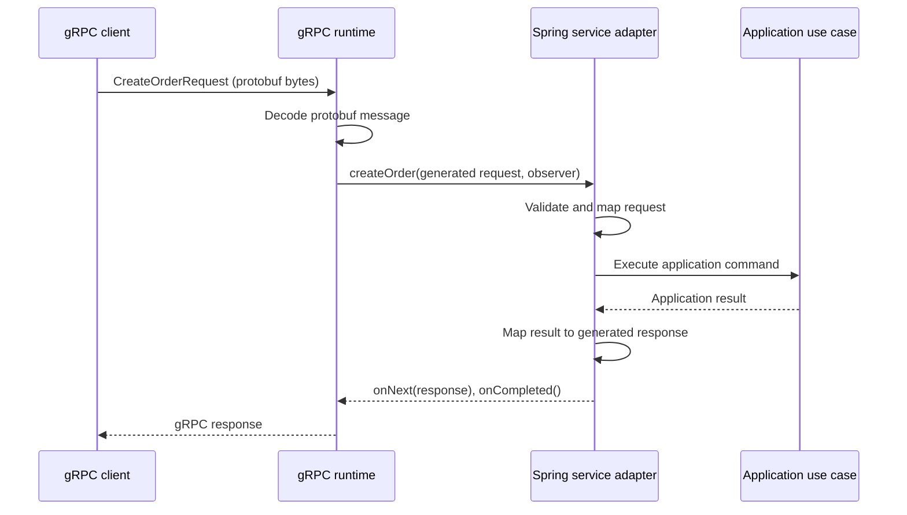

# Service Adapter Receiving a Generated Request

**Chapter:** Spring service adapter  
**Scope:** Spring gRPC (`SPRING_GRPC`) using Protocol Buffers contracts, generated Java code, and unary or streaming RPCs. This lesson focuses on the moment a server service adapter receives a generated request, how to read the message already decoded by gRPC, convert it into application-layer input, and build a generated response to return to the client.

## 1. How Is a Generated Request Created and Passed to the Adapter?

In gRPC, a `.proto` file describes services and messages. The Protocol Buffers plugin generates Java classes for messages along with a base service class. When a client sends a request over HTTP/2, the gRPC runtime reads frames, decodes the protobuf payload into the corresponding Java object, and invokes the method on the service implementation.

For a unary RPC, the generated service base has a method that receives a generated request and a response observer:

```java
public void createOrder(
        CreateOrderRequest request,
        StreamObserver<CreateOrderResponse> responseObserver)
```

The `request` argument is already a strongly typed protobuf object. The adapter does not need to read sockets manually, split HTTP/2 frames, or parse byte arrays. The adapter's job is to understand the transport contract, validate input data at the API boundary, convert it to the application model, and send the result using the exact generated response type.

Processing flow:



The generated request is a model of the protobuf API. It should not become the domain model for the entire application; the adapter is the place to convert between the two worlds.

## 2. Declaring the Contract and Identifying Generated Java Classes

Order creation contract example:

```proto
syntax = "proto3";

package orders.v1;

option java_package = "com.example.orders.grpc";
option java_multiple_files = true;

service OrderService {
  rpc CreateOrder(CreateOrderRequest)
      returns (CreateOrderResponse);
}

message CreateOrderRequest {
  string customer_id = 1;
  repeated OrderLine items = 2;
  optional string note = 3;
}

message OrderLine {
  string product_id = 1;
  int32 quantity = 2;
}

message CreateOrderResponse {
  string order_id = 1;
  OrderStatus status = 2;
}

enum OrderStatus {
  ORDER_STATUS_UNSPECIFIED = 0;
  ORDER_STATUS_CREATED = 1;
}
```

With `java_package` and `java_multiple_files` as shown above, Java code typically uses:

- `CreateOrderRequest`, `OrderLine`, `CreateOrderResponse`: generated message classes.
- `OrderStatus`: generated enum.
- `OrderServiceGrpc.OrderServiceImplBase`: base class containing the method the server must override.
- `OrderServiceGrpc.OrderServiceBlockingStub` or `OrderServiceGrpc.OrderServiceStub`: corresponding client stubs.

Specific package and class names are determined by the protobuf configuration. Use the exact generated sources of the contract in the project; do not create a separate Java class manually and assume the gRPC runtime will invoke it.

## 3. Spring Adapter Extending the Generated Service Base

In Spring gRPC, a service implementation is typically a Spring bean annotated with an annotation provided by the starter, such as `@GrpcService`. The adapter extends the generated base class and receives application-layer dependencies via constructor injection:

```java
import io.grpc.Status;
import io.grpc.stub.StreamObserver;
import net.devh.boot.grpc.server.service.GrpcService;

@GrpcService
public class OrderGrpcService
        extends OrderServiceGrpc.OrderServiceImplBase {

    private final CreateOrderUseCase createOrderUseCase;
    private final OrderRequestMapper requestMapper;
    private final OrderResponseMapper responseMapper;

    public OrderGrpcService(
            CreateOrderUseCase createOrderUseCase,
            OrderRequestMapper requestMapper,
            OrderResponseMapper responseMapper) {
        this.createOrderUseCase = createOrderUseCase;
        this.requestMapper = requestMapper;
        this.responseMapper = responseMapper;
    }

    @Override
    public void createOrder(
            CreateOrderRequest request,
            StreamObserver<CreateOrderResponse> responseObserver) {
        try {
            CreateOrderCommand command = requestMapper.toCommand(request);
            OrderResult result = createOrderUseCase.execute(command);
            CreateOrderResponse response = responseMapper.toProto(result);

            responseObserver.onNext(response);
            responseObserver.onCompleted();
        } catch (RequestValidationException invalid) {
            responseObserver.onError(
                    Status.INVALID_ARGUMENT
                            .withDescription("Invalid order creation data")
                            .asRuntimeException());
        } catch (CustomerNotFoundException missing) {
            responseObserver.onError(
                    Status.NOT_FOUND
                            .withDescription("Customer not found")
                            .asRuntimeException());
        }
    }
}
```

The example uses the annotation package of a common Spring gRPC starter; actual imports depend on the project's starter/version. The architectural role remains unchanged: Spring manages the adapter lifecycle, the gRPC runtime invokes the generated base method, and the adapter coordinates the mappers and use case.

The adapter should not execute database queries directly or contain all business rules. It should keep responsibilities at the protocol boundary: receive the request, validate data shape, convert, invoke the use case, and complete the RPC.

## 4. Reading a Generated Request Correctly

Generated protobuf messages are immutable objects. Once created, the adapter reads values through getters; it does not directly modify the request received from the runtime.

### Scalar fields

For regular proto3 scalar fields, getters return the default value if the client did not send the field:

```java
String customerId = request.getCustomerId();
int quantity = request.getItems(0).getQuantity();
```

For example, `getCustomerId()` may return an empty string. Therefore, if the contract requires a non-empty value, the server must validate it before calling the use case.

### Fields with presence

Regular proto3 scalars cannot always distinguish between "not sent" and "sent with the default value". With `optional`, the generated API provides a presence method:

```java
if (!request.hasNote()) {
    // Client did not send note.
} else {
    String note = request.getNote();
    // Client sent note, even when it is an empty string.
}
```

Do not use `getNote().isBlank()` to infer whether the client sent the field; those are two different questions.

### Repeated fields

A `repeated` field is read via a list getter:

```java
List<OrderLine> lines = request.getItemsList();
for (OrderLine line : lines) {
    String productId = line.getProductId();
    int requestedQuantity = line.getQuantity();
}
```

The list provided by the generated message is immutable. The adapter can iterate over it and map it to an application collection/command; do not attempt to add or remove elements on that list.

### Enums and unknown values

If a client sends a new numeric enum value that the current server does not yet know, the generated enum accessor may return `UNRECOGNIZED`. Do not assume every enum value is one of the values the server compiled with:

```java
if (request.getRequestedMode() == RequestedMode.UNRECOGNIZED) {
    throw new RequestValidationException("Unsupported requested mode");
}
```

For enums used in requests, clearly define how new values are handled to support API evolution. Do not silently interpret an unrecognized value as a default mode if doing so changes the meaning of the operation.

### Oneof

If protobuf uses `oneof`, the generated API provides a case enum to identify which branch was sent:

```java
switch (request.getDestinationCase()) {
    case ACCOUNT_ID -> useAccount(request.getAccountId());
    case EXTERNAL_ADDRESS -> useAddress(request.getExternalAddress());
    case DESTINATION_NOT_SET ->
            throw new RequestValidationException(
                    "A destination is required");
}
```

Reading via the case helps the adapter distinguish among the alternatives as well as the case where no branch was sent.

## 5. Mapping a Generated Request to an Application Command

The application layer should receive a command with application data types and semantics, instead of depending directly on generated protobuf classes:

```java
public record CreateOrderLine(String productId, int quantity) {}

public record CreateOrderCommand(
        String customerId,
        List<CreateOrderLine> items,
        Optional<String> note) {}
```

The mapper converts the protobuf message into the command:

```java
@Component
public class OrderRequestMapper {

    public CreateOrderCommand toCommand(CreateOrderRequest request) {
        if (request.getCustomerId().isBlank()) {
            throw new RequestValidationException(
                    "customer_id must not be blank");
        }
        if (request.getItemsCount() == 0) {
            throw new RequestValidationException(
                    "at least one order item is required");
        }

        List<CreateOrderLine> items = request.getItemsList().stream()
                .map(this::toCommandLine)
                .toList();

        Optional<String> note = request.hasNote()
                ? Optional.of(request.getNote())
                : Optional.empty();

        return new CreateOrderCommand(
                request.getCustomerId(),
                items,
                note);
    }

    public CreateOrderLine toCommandLine(OrderLine line) {
        if (line.getProductId().isBlank()) {
            throw new RequestValidationException(
                    "product_id must not be blank");
        }
        if (line.getQuantity() <= 0) {
            throw new RequestValidationException(
                    "quantity must be greater than zero");
        }
        return new CreateOrderLine(
                line.getProductId(),
                line.getQuantity());
    }
}
```

This is validation at the API boundary: required fields, item counts, positive values, and presence. Rules such as whether the customer exists or whether a product is in stock belong to the application/domain layer because they require reading system state.

If using a Java version that does not support `Stream.toList()`, replace it with an appropriate collector. There is no need to let generated protobuf classes reach deep into repositories or domain entities.

## 6. Mapping an Application Result to a Generated Response

The reverse conversion uses the generated message's builder:

```java
@Component
public class OrderResponseMapper {

    public CreateOrderResponse toProto(OrderResult result) {
        return CreateOrderResponse.newBuilder()
                .setOrderId(result.orderId())
                .setStatus(OrderStatus.ORDER_STATUS_CREATED)
                .build();
    }
}
```

Generated messages are typically constructed using `newBuilder()`, setting fields, and calling `build()`. Do not instantiate generated messages with arbitrary constructors or mutate them after building.

The response mapper also needs deliberate handling:

- Do not expose internal domain entity fields in the response if the API does not publish them.
- Convert domain enums to protobuf enums using an explicit mapping table.
- Convert time values to `google.protobuf.Timestamp` or `google.protobuf.Duration` according to contract semantics.
- Convert binary data to `ByteString` and avoid putting unnecessarily large data into responses.
- Choose explicitly how to represent optional/oneof fields when the result has no value.

## 7. Protobuf Requests and gRPC Metadata Are Two Distinct Inputs

A generated request represents the message payload declared in `.proto`. Metadata is call-level information on the RPC, such as bearer tokens, correlation IDs, or tracing headers. The service adapter should not look for a token inside a protobuf field if the authentication contract specifies that credentials live in metadata.

Typically, an authentication interceptor reads metadata, validates credentials, and attaches the principal to the gRPC Context. The adapter receives the generated request along with the response observer; if it needs the identity, it retrieves it from the Context or an application security abstraction according to the server design.

Separating these two parts helps:

- Keep protobuf messages focused on the business data of the RPC.
- Let interceptors handle call-wide concerns such as identity and tracing.
- Prevent clients from having to repeat tokens as fields in every message, especially in streaming.
- Prevent request payload logs from accidentally recording credentials.

## 8. Adapter for Streaming Requests

For a client-streaming RPC, the generated service base has a method that receives a response observer and returns an inbound `StreamObserver`:

```java
import io.grpc.Status;
import io.grpc.stub.StreamObserver;
import java.util.ArrayList;
import java.util.List;
import java.util.concurrent.atomic.AtomicBoolean;

@Override
public StreamObserver<OrderLine> uploadOrderLines(
        StreamObserver<UploadSummary> responseObserver) {

    List<CreateOrderLine> lines = new ArrayList<>();
    AtomicBoolean terminated = new AtomicBoolean(false);

    return new StreamObserver<>() {
        @Override
        public void onNext(OrderLine requestLine) {
            if (terminated.get()) {
                return;
            }
            try {
                lines.add(requestMapper.toCommandLine(requestLine));
            } catch (RequestValidationException invalid) {
                if (terminated.compareAndSet(false, true)) {
                    responseObserver.onError(
                            Status.INVALID_ARGUMENT
                                    .withDescription("Invalid order line")
                                    .asRuntimeException());
                }
            }
        }

        @Override
        public void onError(Throwable error) {
            // Inbound stream ended with error/cancellation; release state.
            terminated.set(true);
            lines.clear();
        }

        @Override
        public void onCompleted() {
            if (!terminated.compareAndSet(false, true)) {
                return;
            }
            UploadSummary summary;
            try {
                summary = applicationService.finishUpload(lines);
            } catch (Exception failure) {
                responseObserver.onError(exceptionMapper.map(failure));
                return;
            }
            responseObserver.onNext(toProto(summary));
            responseObserver.onCompleted();
        }
    };
}
```

This skeleton illustrates that each inbound message is also a generated request message. Production code must have a terminal-state guard so it does not continue processing after a validation error, does not call `onError` multiple times, and does not run `onCompleted` after a terminal error. If a batch can be large, do not keep all messages in memory; use a bounded buffer or write in batches with appropriate transaction/cleanup handling.

For bidirectional streaming, the request observer and response observer may stay active throughout the call lifecycle. State must belong to each individual RPC, not be stored in mutable fields of a singleton Spring service. If processing is offloaded to a worker, serialize calls to the response observer and apply flow control/backpressure.

## 9. Common Adapter Pitfalls

| Pitfall | Consequence | Resolution |
| --- | --- | --- |
| Using a generated request as a domain object | Domain depends on transport and protobuf | Map to an internal command/DTO |
| Trusting default values as client-sent fields | Missing fields go unnoticed | Use presence with `optional`/oneof when needed |
| Not checking `UNRECOGNIZED` enum values | Incorrect handling of values from newer clients | Define a policy for unknown enums |
| Modifying a repeated list from a generated message | Error due to immutable collection | Create a new collection when mutation is needed |
| Putting tokens inside the request payload | Mixes authentication with business data | Use gRPC metadata and interceptors |
| Placing business logic/database queries in the adapter | Hard to reuse and test | Invoke an application use case |
| Calling both `onError` and `onCompleted` | RPC receives multiple terminal signals | Guard terminal state |
| Storing streaming state in a singleton field | Data across multiple RPCs can leak into one another | Create state in method/call scope |

## 10. Testing the Service Adapter

Testing should cover three levels:

| Level | What to verify |
| --- | --- |
| Mapper unit test | Generated requests map to the right command; presence, repeated, enum, and oneof are handled properly |
| Adapter unit/in-process test | RPC invokes the right use case and returns the expected generated response or status |
| Contract/integration test | Client uses the actual generated stub to send requests; server returns the right message/status per the protobuf contract |

Request mapping test example:

```java
class OrderRequestMapperTest {

    private final OrderRequestMapper mapper = new OrderRequestMapper();

    @Test
    void mapsOptionalNotePresence() {
        CreateOrderRequest request = CreateOrderRequest.newBuilder()
                .setCustomerId("customer-1")
                .addItems(OrderLine.newBuilder()
                        .setProductId("product-1")
                        .setQuantity(2))
                .setNote("")
                .build();

        CreateOrderCommand command = mapper.toCommand(request);

        assertTrue(command.note().isPresent());
        assertEquals("", command.note().orElseThrow());
    }

    @Test
    void rejectsRequestWithoutItems() {
        CreateOrderRequest request = CreateOrderRequest.newBuilder()
                .setCustomerId("customer-1")
                .build();

        assertThrows(
                RequestValidationException.class,
                () -> mapper.toCommand(request));
    }
}
```

Presence tests are especially important: an unsent `note` and a `note` sent as an empty string can carry two different meanings. Adapter tests over an in-process channel should verify that `INVALID_ARGUMENT` maps to the right status and that the use case is not called when the request violates validation.

## 11. Self-Practice

1. Why does a service adapter receive `CreateOrderRequest` instead of parsing protobuf bytes itself?
2. Distinguish between `getNote()` and `hasNote()` when a field is declared `optional`.
3. A newer client sends a numeric enum value that the server does not yet know. How should the adapter handle `UNRECOGNIZED`?
4. Design a mapper that converts `CreateOrderRequest` into a command without letting generated classes enter the domain layer.
5. For client streaming, why must state receiving messages be created inside each RPC's method rather than stored in a singleton field?

**Key takeaway:** The gRPC runtime decodes the protobuf payload and invokes the service implementation with a strongly typed generated request. A Spring service adapter extends the generated service base, reads and validates the request, maps it to an application command, calls the use case, and maps the result into a generated response. Keep protobuf at the transport boundary; pay attention to field presence, repeated/enum/oneof, metadata separated from payload, and streaming terminal lifecycle.
