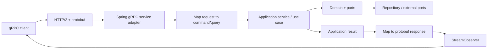

# Calling an Application Service

## 1. Role of the Spring Service Adapter

In Spring gRPC, the service adapter is the application's entry point over the gRPC protocol. It receives protobuf requests, transforms data into the application's use case model, calls the application service, and converts results or errors into protobuf responses/gRPC statuses.

The adapter maintains the boundary between transport and business logic:

- The gRPC layer understands services/methods, metadata, protobuf, StreamObserver, and io.grpc.Status.
- The application layer understands commands/queries, use cases, business rules, and transactions.
- The domain layer holds core models and invariants, independent of gRPC or Spring transport.

Do not place repository queries, pricing calculations, business permission checks, or orchestration of multiple use cases directly inside the adapter. The adapter coordinates the call to the application service and handles data conversion at the boundary.



The running example uses the unary RPC GetProduct: the client sends GetProductRequest, the adapter invokes the product lookup use case, and then returns GetProductResponse.

## 2. Defining an Application Service Independent of gRPC

The application service should accept application-layer data types instead of protobuf generated classes. This allows the use case to be called from a REST adapter, message consumer, scheduler, or tests without depending on gRPC.

Contract example:

```java
public record GetProductQuery(String productId) {}

public record ProductView(
        String productId,
        String name,
        long priceInMinorUnit,
        String currency) {}

public interface GetProductUseCase {
    ProductView execute(GetProductQuery query);
}
```

The use case implements the application workflow: validating input at the business level, calling domain services/ports, checking conditions, and returning the result. It does not need to know whether the original request arrived via protobuf, HTTP JSON, or a message queue.

A Spring implementation can place the transaction boundary at the application service:

```java
import org.springframework.stereotype.Service;
import org.springframework.transaction.annotation.Transactional;

@Service
public class GetProductService implements GetProductUseCase {

    private final ProductRepository productRepository;

    public GetProductService(ProductRepository productRepository) {
        this.productRepository = productRepository;
    }

    @Override
    @Transactional(readOnly = true)
    public ProductView execute(GetProductQuery query) {
        Product product = productRepository.findById(query.productId())
                .orElseThrow(() ->
                        new ProductNotFoundException(query.productId()));

        return new ProductView(
                product.id(),
                product.name(),
                product.priceInMinorUnit(),
                product.currency());
    }
}
```

The example assumes ProductRepository is a port used by the application service and Product is a domain model. The transaction belongs to the use case because it marks the boundary of the business operation; the adapter does not need to open its own transaction merely to convert protobuf.

For write operations, the application service typically manages a read-write transaction, enforces invariants, and coordinates domain behavior. Do not let the adapter call multiple repositories directly and end up with a fragmented business transaction.

## 3. Calling the Application Service from a Generated gRPC Service

Generated gRPC code provides a base class for the service. The adapter extends the base class and injects the application service via constructor:

```java
import io.grpc.Status;
import io.grpc.stub.StreamObserver;
import org.springframework.grpc.server.service.GrpcService;

@GrpcService
public class ProductQueryGrpcAdapter
        extends ProductQueryServiceGrpc.ProductQueryServiceImplBase {

    private final GetProductUseCase getProductUseCase;

    public ProductQueryGrpcAdapter(
            GetProductUseCase getProductUseCase) {
        this.getProductUseCase = getProductUseCase;
    }

    @Override
    public void getProduct(
            GetProductRequest request,
            StreamObserver<GetProductResponse> responseObserver) {

        try {
            GetProductQuery query = toQuery(request);
            ProductView result = getProductUseCase.execute(query);

            responseObserver.onNext(toResponse(result));
            responseObserver.onCompleted();

        } catch (ProductNotFoundException notFound) {
            responseObserver.onError(
                    Status.NOT_FOUND
                            .withDescription("Product was not found")
                            .asRuntimeException());

        } catch (InvalidProductQueryException invalid) {
            responseObserver.onError(
                    Status.INVALID_ARGUMENT
                            .withDescription("Product query is invalid")
                            .asRuntimeException());
        }
    }

    private GetProductQuery toQuery(GetProductRequest request) {
        String productId = request.getProductId();

        if (productId.isBlank()) {
            throw new InvalidProductQueryException();
        }
        return new GetProductQuery(productId);
    }

    private GetProductResponse toResponse(ProductView product) {
        return GetProductResponse.newBuilder()
                .setProductId(product.productId())
                .setName(product.name())
                .setPriceInMinorUnit(product.priceInMinorUnit())
                .setCurrency(product.currency())
                .build();
    }
}
```

GrpcService registers the adapter into the Spring gRPC server using the starter's mechanism. Package imports and registration must match the Spring gRPC version in use. When the framework manages the server, do not manually create a second server just to register services.

The processing flow in the method has four steps:

1. Read and validate the request structure at the transport boundary.
2. Convert the protobuf request into a query/command.
3. Call exactly one application use case for that operation.
4. Convert the application result into a protobuf response and complete the observer.

The adapter should not know concrete repositories or how the use case fetches data. It depends on the application service interface, making it easy to swap implementations or mock in tests.

## 4. Mapping Protobuf Requests to Commands/Queries

Protobuf is an external contract, so mapping must be intentional:

- Convert fields, enums, timestamps, decimal representations, and nested messages into appropriate application types.
- Validate required data and formats at the boundary; for example, empty IDs, unsupported enums, or out-of-range timestamps.
- Preserve presence semantics. In proto3, scalar fields without optional typically return a default value when absent; if you need to distinguish not sent from sending a default value, use presence-aware fields or oneof per the contract.
- Do not pass raw protobuf messages into the domain or repository.
- Do not put business rules into mappers. For example, whether an ID format is structurally valid belongs to transport; whether a product is eligible for sale belongs to the use case/domain.

For write RPCs, map requests into commands expressing intent:

```java
public record CreateOrderCommand(
        String customerId,
        List<OrderLineCommand> lines,
        String idempotencyKey) {}

public record OrderLineCommand(
        String productId,
        int quantity) {}
```

The adapter reads protobuf, maps lines into OrderLineCommand, and invokes CreateOrderUseCase. The application service is responsible for validating quantities, inventory, purchase permissions, pricing, and order invariants.

Do not use protobuf generated objects as internal objects throughout the system. Doing so causes wire contract changes to leak into application/domain and makes layers hard to test independently.

## 5. Mapping Application Results to Protobuf Responses

The response mapper converts the use case result into the wire contract. This is also where you decide which fields are exposed externally:

```java
private GetProductResponse toResponse(ProductView result) {
    return GetProductResponse.newBuilder()
            .setProductId(result.productId())
            .setName(result.name())
            .setPriceInMinorUnit(result.priceInMinorUnit())
            .setCurrency(result.currency())
            .build();
}
```

Do not serialize JPA entities or domain aggregates directly into protobuf. Entities may contain lazy relations, internal fields, personal data, or structures that are not part of the public API. Create explicit response DTOs to control outbound data.

If an application result has nullable fields, decide how to represent them in protobuf: optional, oneof, wrapper types, or a sub-message. Do not silently convert null into an empty string or zero if those two states carry different meanings.

Enum mapping must also handle unsupported values. Do not cast Java enum ordinals to protobuf numeric enums because the ordering of the two enums can differ and protobuf enums have their own numbering rules. Use explicit mapping with a defined fallback.

## 6. Mapping Application Errors to gRPC Statuses

The application service should not depend on io.grpc.StatusRuntimeException. Use cases throw exceptions with business meaning; the adapter maps those exceptions to statuses at the transport boundary.

Mapping example:

| Application outcome | Commonly used gRPC status | Meaning to client |
| --- | --- | --- |
| Invalid input per contract/use case | INVALID_ARGUMENT | Client needs to fix the request. |
| Resource not found | NOT_FOUND | The requested resource does not exist. |
| Resource already exists or known unique constraint violation | ALREADY_EXISTS | Conflict with current state. |
| Current state does not allow the operation | FAILED_PRECONDITION | State must change before retrying. |
| Caller is authenticated but lacks permission | PERMISSION_DENIED | Not permitted to perform the action. |
| Missing or invalid credentials | UNAUTHENTICATED | Re-authentication required. Typically handled in auth interceptor. |
| Overload or quota exceeded | RESOURCE_EXHAUSTED | Client must reduce load or wait per policy. |
| Dependency temporarily unavailable | UNAVAILABLE | Can retry if RPC and policy allow. |
| Deadline expired | DEADLINE_EXCEEDED | Result did not complete within allowed time. |
| Unexpected error | INTERNAL | Server-side error; do not disclose internal details. |

Centralize mapping into a dedicated mapper when multiple adapters share the same policy:

```java
public final class GrpcStatusMapper {

    private GrpcStatusMapper() {}

    public static Status toStatus(Throwable error) {
        if (error instanceof ProductNotFoundException) {
            return Status.NOT_FOUND
                    .withDescription("Product was not found");
        }
        if (error instanceof InvalidProductQueryException) {
            return Status.INVALID_ARGUMENT
                    .withDescription("Product query is invalid");
        }
        if (error instanceof ProductAlreadyExistsException) {
            return Status.ALREADY_EXISTS
                    .withDescription("Product already exists");
        }
        if (error instanceof ProductAccessDeniedException) {
            return Status.PERMISSION_DENIED
                    .withDescription("Access is denied");
        }
        return Status.INTERNAL
                .withDescription("Internal server error");
    }
}
```

The adapter uses the mapper to finish the call:

```java
catch (RuntimeException error) {
    Status status = GrpcStatusMapper.toStatus(error);
    if (status.getCode() == Status.Code.INTERNAL) {
        log.error("Unexpected failure while handling GetProduct", error);
    }
    responseObserver.onError(status.asRuntimeException());
}
```

In production code, catch specific exceptions and log once at the appropriate boundary. Do not log tokens, sensitive metadata, payloads containing personal data, or return stack traces in status descriptions. Do not map every RuntimeException to INVALID_ARGUMENT; programming bugs and infrastructure failures must be classified accurately.

## 7. Transaction Boundary and Response Timing

For synchronous unary RPCs, the adapter invokes the application service and only sends the response after the use case call returns successfully. If the use case is proxied by Spring with @Transactional, the transaction interceptor completes commit/rollback before the call returns to the adapter. That prevents the adapter from sending a success response before the transaction commits.

Do not open a transaction in the adapter just to wrap onNext/onCompleted. Callbacks may run after the method returns or on another thread; thread-bound transactions do not automatically span across callbacks. With streaming, you especially should not hold a database transaction open across the entire stream lifetime unless there is a specific business requirement.

For commands requiring idempotency, the application service handles the idempotency key and transaction. The adapter only forwards the key from metadata/request according to the defined contract. Client retries may resend the command; if the operation is not idempotent, duplicate-prevention must be designed before enabling retries.

## 8. Deadlines, Cancellation, and Downstream Work

Clients should set finite deadlines. The server adapter must respect cancellation and avoid continuing resource-intensive work once the caller has cancelled the RPC.

For fast synchronous handling, deadline/cancellation is managed by gRPC on the call; however, a blocking repository or HTTP call does not automatically stop merely because the client cancelled. The application service and outbound ports need appropriate timeouts, cancellation, or deadline propagation.

Context can be checked during long-running processing:

```java
if (io.grpc.Context.current().isCancelled()) {
    return;
}
```

This is only a status check point. If a blocking task does not inspect cancellation, it keeps running. For long work, use APIs that support timeout/cancel or design async execution so cancellation propagates down to dependencies.

Do not catch CANCELLED and then return a successful business response. Once the RPC is terminal or the client has left the stream, the adapter must not continue writing to the observer.

## 9. Calling an Application Service Asynchronously

If the application service returns a CompletionStage, the adapter can complete the observer inside the callback. Capture the gRPC context before switching threads and ensure only one terminal event is emitted:

```java
Context rpcContext = Context.current();

getProductUseCase.executeAsync(query)
        .whenComplete((result, failure) -> rpcContext.run(() -> {
            if (rpcContext.isCancelled()) {
                return;
            }

            if (failure != null) {
                Throwable cause = unwrap(failure);
                responseObserver.onError(
                        GrpcStatusMapper.toStatus(cause)
                                .asRuntimeException());
                return;
            }

            responseObserver.onNext(toResponse(result));
            responseObserver.onCompleted();
        }));
```

executeAsync, unwrap, and mapper are illustrative application APIs/helpers. Capturing Context allows callbacks to read the right RPC context even when running on another executor. However, cancelling the RPC does not automatically cancel the CompletionStage; register a cancellation listener and cancel the underlying task if downstream APIs support it.

Do not emit responses concurrently from multiple callbacks. If multiple tasks contribute data to one stream, use a single writer/serialization point to preserve StreamObserver ordering and terminal semantics.

## 10. Testing the Adapter and Application Service

Adapter tests should verify conversion and coordination, while the application service has separate tests for business logic.

**Adapter unit tests** use a mocked GetProductUseCase to verify:

- Protobuf request is mapped to the right GetProductQuery.
- Use case is called exactly once.
- Application result is mapped with all fields to the protobuf response.
- Business exceptions are mapped to the right status.
- Unexpected errors do not leak exception details to the client.
- Observer receives the right terminal sequence: response then completion, or error.

Unary observer test example:

```java
@Test
void mapsApplicationResultToGrpcResponse() {
    when(getProductUseCase.execute(
            new GetProductQuery("p-100")))
            .thenReturn(new ProductView(
                    "p-100", "Keyboard", 12900, "USD"));

    RecordingObserver<GetProductResponse> observer =
            new RecordingObserver<>();

    adapter.getProduct(
            GetProductRequest.newBuilder()
                    .setProductId("p-100")
                    .build(),
            observer);

    assertEquals(1, observer.values().size());
    assertEquals("p-100", observer.values().get(0).getProductId());
    assertTrue(observer.completed());
    assertNull(observer.error());
    verify(getProductUseCase).execute(
            new GetProductQuery("p-100"));
}
```

RecordingObserver is a test helper that records onNext, onError, and onCompleted. Add tests when the use case throws ProductNotFoundException, for blank requests, and for internal errors. Verify there is no onNext after onError and that both terminal signals are not invoked.

**Integration tests** boot the Spring context, register the adapter in a test gRPC server, and invoke via a generated stub. These tests verify annotation/registration, constructor injection, protobuf serialization, interceptor chain, and statuses flowing over transport as configured. When TLS verification is needed, use Netty TCP transport; in-process transport does not exercise the TLS handshake.

## 11. Common Pitfalls

1. **Putting all business logic in the gRPC adapter.** The adapter becomes hard to test and coupled to transport. Move rules into the application service/domain.
2. **Letting the application service accept protobuf generated classes.** The application layer gets locked into the wire contract. Map to internal commands/queries.
3. **Having the adapter call repositories directly.** Bypasses the use case and transaction boundary. Inject the appropriate application service/port.
4. **Returning JPA entities directly as protobuf.** May expose internal fields or trigger lazy relations. Map to an explicit response DTO.
5. **Sending the response before transaction commit.** Clients may see success even though commit failed. Let the application service manage the transaction and send the response only after it returns.
6. **Converting every exception into INVALID_ARGUMENT.** Hides server failures and causes clients to handle errors improperly. Map exceptions deliberately.
7. **Putting stack traces in status descriptions.** Leaks implementation and internal data. Return safe descriptions and log details on the server.
8. **Not handling cancellation/deadlines.** Downstream tasks keep running after the client leaves. Propagate timeouts/cancellation to supporting ports.
9. **Holding a transaction open across the entire streaming lifetime.** Can hold connections and locks for too long. Split work into short business transactions.
10. **Unit testing only mappers.** Misses Spring service registration or transport bugs. Add integration tests through an actual gRPC server.

## 12. Practice Exercise

Build an adapter for unary GetProduct:

1. Define GetProductUseCase, GetProductQuery, and ProductView in the application layer.
2. Write the application service calling the repository port and placing a read-only transaction on the use case.
3. Create ProductQueryGrpcAdapter extending the generated ProductQueryServiceImplBase, injecting the use case via constructor.
4. Map GetProductRequest to the query; map ProductView to GetProductResponse.
5. Map ProductNotFoundException to NOT_FOUND, invalid input to INVALID_ARGUMENT, and unexpected errors to INTERNAL.
6. Register the adapter using the Spring gRPC service mechanism for your version.
7. Write mapping/exception unit tests and an integration test calling via the generated stub.
8. Verify deadlines, cancellation, and that logs do not expose sensitive data.

**Self-check:** A Spring gRPC service adapter receives protobuf requests, maps them to commands/queries, calls the application service via dependency injection, and converts results/errors into protobuf responses or gRPC statuses. The application service owns business logic and transaction boundaries; the adapter owns transport responsibilities. Test both mapping in unit tests and real registration/calls in integration tests to ensure the boundary between gRPC and the application layer is preserved.
