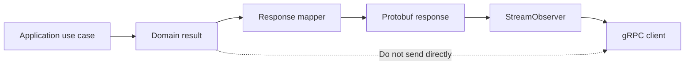

# Converting Domain Results into Protobuf Responses

## 1. Why Do We Need a Response Conversion Layer?

In Spring gRPC, the application service executes a use case and returns a result belonging to the application/domain model. The gRPC adapter converts that result into a protobuf message to send over the wire. This is the boundary between the internal model and the API seen by clients.

The two models serve different purposes:

- **Domain result** represents business concepts and rules. It may contain value objects, aggregates, internal state, and relationships supporting business logic.
- **Protobuf response** is a stable communication contract. It should only expose data the client needs and can understand according to the API version.

Do not serialize JPA entities or domain aggregates directly into protobuf. Doing so easily exposes internal fields, lazy relationships, sensitive data, and domain structures never designed as a public API. Write an explicit mapper to select fields, convert types, and define semantics for each value.



The running example is the `GetProduct` use case: the application service returns a product view; the adapter converts it into `ProductResponse` and calls `responseObserver.onNext(...)`.

## 2. Designing Protobuf Responses Around Client Needs

A protobuf contract should describe public data, not copy Java class structures verbatim. For example:

```protobuf
syntax = "proto3";

package catalog.v1;

import "google/protobuf/timestamp.proto";

enum ProductStatus {
  PRODUCT_STATUS_UNSPECIFIED = 0;
  PRODUCT_STATUS_ACTIVE = 1;
  PRODUCT_STATUS_OUT_OF_STOCK = 2;
  PRODUCT_STATUS_DISCONTINUED = 3;
}

message Money {
  int64 amount_minor_units = 1;
  string currency_code = 2;
}

message ProductImage {
  string url = 1;
  string alt_text = 2;
}

message ProductResponse {
  string product_id = 1;
  string name = 2;
  Money price = 3;
  ProductStatus status = 4;
  google.protobuf.Timestamp created_at = 5;
  optional string description = 6;
  repeated ProductImage images = 7;
}
```

This contract represents the information clients need to display a product. It does not expose entity versions, internal database keys, private moderation statuses, or persistence relationships.

Key design decisions:

- Use sub-messages such as `Money` and `ProductImage` when a concept has multiple fields or dedicated semantics.
- Use enums whose zero value means unspecified/unknown. Do not assign a concrete business state to zero.
- Use `optional` when clients need to distinguish an absent field from a field with a default value.
- Use `repeated` for ordered lists; use `map` only when element order has no meaning.
- For mutually exclusive response shapes, consider `oneof` to represent explicitly which state is present.

The response contract should serve client use cases and does not need to mirror the entire domain object. Two use cases can return different response DTOs even when reading the same aggregate.

## 3. Defining Domain Results Independent of Protobuf

The application layer can return its own data types:

```java
import java.time.Instant;
import java.util.List;
import java.util.Optional;
import java.util.Objects;

public record ProductDetails(
        String id,
        String name,
        Money price,
        ProductStatus status,
        Instant createdAt,
        Optional<String> description,
        List<ProductImageDetails> images) {

    public ProductDetails {
        Objects.requireNonNull(description);
        images = List.copyOf(images);
    }
}

public record Money(
        long amountMinorUnits,
        String currencyCode) {}

public enum ProductStatus {
    ACTIVE,
    OUT_OF_STOCK,
    DISCONTINUED
}

public record ProductImageDetails(
        String url,
        String altText) {}
```

The example uses `amountMinorUnits` to avoid floating-point rounding errors when transmitting money. Minor units depend on the currency and monetary rules; do not assume every currency has two decimal places. The `Money` value object must ensure the amount and currency are valid per domain policy.

`ProductDetails` is an application result tailored to the use case. It does not import protobuf generated classes and does not depend on gRPC. As a result, the same use case can be reused by other adapters without pulling in the wire contract.

You do not necessarily need to return the domain aggregate directly. Often it is better to create a result/view containing exactly the data the use case needs to publish. This limits outbound data and avoids having the mapper traverse a large object graph.

## 4. Writing an Explicit Response Mapper

The mapper is responsible for transferring each field from the domain/application result to the protobuf builder. For example:

```java
import com.google.protobuf.Timestamp;
import com.google.protobuf.util.Timestamps;
import catalog.v1.ProductResponse;
import com.example.catalog.application.ProductDetails;
import com.example.catalog.application.ProductImageDetails;

public final class ProductResponseMapper {

    public ProductResponse toResponse(ProductDetails product) {
        ProductResponse.Builder response = ProductResponse.newBuilder()
                .setProductId(product.id())
                .setName(product.name())
                .setPrice(toProtoMoney(product.price()))
                .setStatus(toProtoStatus(product.status()))
                .setCreatedAt(toProtoTimestamp(product.createdAt()));

        product.description().ifPresent(response::setDescription);

        product.images().stream()
                .map(this::toProtoImage)
                .forEach(response::addImages);

        return response.build();
    }

    private catalog.v1.Money toProtoMoney(
            com.example.catalog.application.Money money) {
        return catalog.v1.Money.newBuilder()
                .setAmountMinorUnits(money.amountMinorUnits())
                .setCurrencyCode(money.currencyCode())
                .build();
    }

    private catalog.v1.ProductStatus toProtoStatus(
            com.example.catalog.application.ProductStatus status) {
        return switch (status) {
            case ACTIVE -> catalog.v1.ProductStatus.PRODUCT_STATUS_ACTIVE;
            case OUT_OF_STOCK ->
                    catalog.v1.ProductStatus.PRODUCT_STATUS_OUT_OF_STOCK;
            case DISCONTINUED ->
                    catalog.v1.ProductStatus.PRODUCT_STATUS_DISCONTINUED;
        };
    }

    private Timestamp toProtoTimestamp(java.time.Instant instant) {
        Timestamp timestamp = Timestamp.newBuilder()
                .setSeconds(instant.getEpochSecond())
                .setNanos(instant.getNano())
                .build();

        try {
            return Timestamps.checkValid(timestamp);
        } catch (IllegalArgumentException invalidTimestamp) {
            throw new ResponseMappingException(
                    "created_at is outside protobuf Timestamp range",
                    invalidTimestamp);
        }
    }

    private catalog.v1.ProductImage toProtoImage(
            ProductImageDetails image) {
        return catalog.v1.ProductImage.newBuilder()
                .setUrl(image.url())
                .setAltText(image.altText())
                .build();
    }
}
```

`ResponseMappingException` is an adapter-internal exception used to represent a domain result that cannot be converted into the wire contract. It must not be sent verbatim to the client:

```java
public final class ResponseMappingException extends RuntimeException {

    public ResponseMappingException(String message, Throwable cause) {
        super(message, cause);
    }
}
```

The illustrative code assumes generated Java classes live in package `catalog.v1` and domain types live in a separate application package. If both protobuf and domain define classes named `Money` or `ProductStatus`, use qualified imports or distinct Java names to avoid type confusion.

`Timestamps.checkValid(...)` belongs to the `protobuf-java-util` artifact; add this dependency if the project does not already have it. The function checks that seconds/nanos fall within the valid range of `google.protobuf.Timestamp`, preventing sending a Java instant that protobuf cannot represent.

The mapper should be a pure component: it accepts a result, builds a response, and does not call repositories, the network, or application services. It can be registered as a Spring bean if injection is desired; it does not need to be a singleton with mutable state.

## 5. Converting Data Types with Dedicated Semantics

### Money and decimals

Do not transmit money using `float` or `double`. Binary floating-point numbers cannot accurately represent many decimal values. Use integer minor units or a decimal representation with explicit scale rules.

For contracts using `amount_minor_units`, the domain and API must agree on how values are interpreted per currency. For example, 1299 minor units mean different things depending on the currency. If the business supports currencies with special scales, the scale rule must live in currency metadata/domain policy rather than hardcoding division by 100 in the adapter.

### Time

Use `google.protobuf.Timestamp` for absolute instants. Convert from `Instant` using seconds and nanos to preserve precision; do not treat a local date-time without timezone as if it were a UTC instant.

If the business needs calendar dates such as birthdates or delivery dates, use `google.type.Date` if contract dependencies support it, or define an appropriate year/month/day message. Do not arbitrarily turn calendar dates into midnight UTC.

### Enums

Use an explicit `switch` mapping between domain enums and protobuf enums. Do not rely on Java enum ordinals because enum declaration order is not a wire contract.

Proto enums may receive new numeric values from future servers. Older clients may observe `UNRECOGNIZED`; clients should handle that branch rather than assuming all values are known. On the server response side, the mapper must make an explicit decision when the domain produces a state not yet supported by the API: upgrade the contract, map to an already defined public equivalent state, or raise an internal mapping error. Do not silently turn an unknown state into ACTIVE.

### Optional and field presence

With `optional string description`, generated Java provides `hasDescription()`. The mapper only calls `setDescription(...)` when the domain has a value. If description is absent, do not call the setter; if it is an empty string and the contract permits it, presence is still preserved.

Do not confuse proto3 default values with actual domain data. For scalar fields without presence, clients cannot tell "not sent" apart from "sent zero/empty". Choose `optional`, wrappers, or sub-messages when that distinction matters.

## 6. Mapping Collections, Nested Messages, and Oneof

Domain lists must be mapped to protobuf `repeated` fields in meaningful order:

```java
List<catalog.v1.ProductImage> images = product.images().stream()
        .map(image -> catalog.v1.ProductImage.newBuilder()
                .setUrl(image.url())
                .setAltText(image.altText())
                .build())
        .toList();

ProductResponse response = ProductResponse.newBuilder()
        .addAllImages(images)
        .build();
```

Preserve order if clients rely on it for display or priority. If order is not guaranteed by the domain query, sort by a documented rule before mapping; do not rely on incidental database ordering.

For potentially very large relations, do not put the entire collection into one response. Use pagination or streaming RPCs per the contract. Bound message sizes and element counts to prevent oversized responses.

`oneof` is appropriate when a response has mutually exclusive data shapes, such as a pricing result that is either a fixed price or a price range. The mapper must set exactly one branch. Calling a setter for another branch causes the protobuf builder to replace the currently selected branch; write tests for each variant.

## 7. Preserving Domain Boundaries and Preventing Internal Data Leaks

The mapper is the control point for published data. Map only the fields needed by the client:

- Do not return password hashes, internal database IDs, access tokens, private notes, or internal audit details.
- Do not serialize the entire aggregate simply because protobuf happens to have similar fields.
- Do not invoke getters that trigger cascading lazy loading after the transaction has ended.
- Do not return stack traces or exception details in responses.
- Do not let clients depend on class names, package names, or database table structures.

If the domain result contains sensitive data, produce a permission-filtered application response model before the adapter maps it to protobuf. Authorization determines whether the caller may view a field; the mapper should not guess permissions from request data.

Do not use reflection mappers or BeanUtils as the default mechanism for public APIs. Implicit mapping can automatically expose new domain fields on the wire response without review. Explicit mappers let reviewers see exactly which data is published.

## 8. Calling the Mapper in a Spring gRPC Adapter

The adapter receives the application service result, invokes the mapper, and completes the unary response:

```java
@GrpcService
public class ProductQueryGrpcAdapter
        extends ProductQueryServiceGrpc.ProductQueryServiceImplBase {

    private final GetProductUseCase getProductUseCase;
    private final ProductResponseMapper responseMapper;

    public ProductQueryGrpcAdapter(
            GetProductUseCase getProductUseCase,
            ProductResponseMapper responseMapper) {
        this.getProductUseCase = getProductUseCase;
        this.responseMapper = responseMapper;
    }

    @Override
    public void getProduct(
            GetProductRequest request,
            StreamObserver<ProductResponse> responseObserver) {

        try {
            GetProductQuery query =
                    new GetProductQuery(request.getProductId());

            ProductDetails result = getProductUseCase.execute(query);
            ProductResponse response =
                    responseMapper.toResponse(result);

            responseObserver.onNext(response);
            responseObserver.onCompleted();

        } catch (ProductNotFoundException notFound) {
            responseObserver.onError(
                    Status.NOT_FOUND
                            .withDescription("Product was not found")
                            .asRuntimeException());

        } catch (ResponseMappingException mappingFailure) {
            log.error("Could not map product response", mappingFailure);
            responseObserver.onError(
                    Status.INTERNAL
                            .withDescription("Could not create response")
                            .asRuntimeException());
        }
    }
}
```

The example focuses on the success path and two known errors. In production, the adapter or a shared exception mapper must handle input errors, use case errors, and unexpected errors according to the system's status policy. Do not send the response before the application service finishes its transaction. If the use case is asynchronous, ensure callbacks emit only one terminal event and preserve the proper gRPC Context.

The mapper should not call `onNext` or `onCompleted`; it only returns the protobuf message. The adapter retains control over the lifecycle of `StreamObserver`, making mapping independently testable and reusable across multiple transport handlers.

## 9. Compatibility and Evolution of Protobuf Responses

Domain models may change more frequently than public APIs. Protobuf responses must evolve compatibly:

- Never change published field numbers and never reuse deleted field numbers.
- When removing a field, mark old numbers and names as `reserved`.
- Add new fields additively; older clients ignore unknown fields per protobuf semantics.
- Never change the meaning of published enum numeric values and never reuse old enum numbers.
- Keep the zero enum value as the unspecified/unknown state.
- Never change the units or timezone semantics of a field without explicit versioning/migration.

When the mapper converts domain results into responses, it is the place to enforce the contract version. If API v1 and v2 have different structures, use separate mappers for each response type rather than one mapper tangled with version branches.

One caveat: converting protobuf to domain and rebuilding a response can strip unknown fields that an intermediary client does not understand. If a service acts as a proxy that must preserve unknown fields, consider keeping the protobuf message/`UnknownFieldSet` or designing an appropriate pass-through. For normal business adapters, a domain-to-protobuf mapper deliberately selects public fields; it does not promise to preserve unknown wire data.

## 10. Testing the Response Mapper

Because the mapper is a pure component, it can be unit tested without a Spring context or gRPC server.

Cases to verify:

| Case | What to verify |
| --- | --- |
| Full domain result | ID, name, price, status, and created_at are mapped accurately. |
| Absent description | hasDescription() is false. |
| Description with empty string but present | Presence is preserved per contract if domain allows it. |
| Timestamp with nanos | Seconds and nanos do not lose precision. |
| Each domain enum | Maps to the exact protobuf enum numeric value. |
| Image list | Element count and order are preserved. |
| Sensitive fields in domain | Do not appear in the protobuf response. |
| Unrepresentable domain state | Mapping reports an explicit error rather than silently picking the wrong state. |

Test example:

```java
@Test
void mapsDomainProductToPublicResponse() {
    ProductDetails product = new ProductDetails(
            "p-100",
            "Keyboard",
            new Money(1299, "USD"),
            ProductStatus.ACTIVE,
            Instant.parse("2026-01-02T03:04:05.123456789Z"),
            Optional.empty(),
            List.of());

    ProductResponse response = mapper.toResponse(product);

    assertEquals("p-100", response.getProductId());
    assertEquals(1299, response.getPrice().getAmountMinorUnits());
    assertEquals("USD", response.getPrice().getCurrencyCode());
    assertEquals(
            catalog.v1.ProductStatus.PRODUCT_STATUS_ACTIVE,
            response.getStatus());
    assertFalse(response.hasDescription());
    assertEquals(123456789, response.getCreatedAt().getNanos());
}
```

In addition to mapper unit tests, adapter tests should verify that the use case is called, the mapper is used, and the observer receives the expected response followed by completion. Integration tests through a gRPC server verify protobuf serialization, service registration, and actual statuses. You do not need network tests for every simple mapping; choose tests at the right boundary to verify.

## 11. Common Pitfalls

1. **Returning JPA entities or domain aggregates directly.** Easily leaks data and couples to persistence. Build an explicit response mapper.
2. **Letting the domain import protobuf generated classes.** Locks the domain to the wire contract. Convert at the adapter boundary.
3. **Using double for money.** Suffers representation error. Use integer minor units or a decimal contract with a defined scale.
4. **Converting Instant to local date-time.** Can lose timezone or precision. Use Timestamp with seconds/nanos.
5. **Mapping enums by ordinal.** Changing order breaks wire values. Use an explicit switch mapping.
6. **Ignoring field presence.** Clients cannot distinguish absent from default. Use optional/wrapper/oneof with proper semantics.
7. **Mapping unbounded collections.** Responses can grow too large or trigger lazy loading. Use pagination/streaming and cap element counts.
8. **Using reflection mappers for public APIs.** New internal fields can be exposed unintentionally. Map explicitly.
9. **Changing published field numbers or enum numbers.** Breaks wire compatibility. Keep old numbers and reserve removed ones.
10. **Mixing the mapper with observer lifecycle.** Hard to test and prone to emitting wrong terminal events. The mapper only builds the message; the adapter controls the observer.

## 12. Practice Exercise

Build response mapping for `GetProduct`:

1. Define `ProductDetails`, `Money`, `ProductStatus`, and `ProductImageDetails` in the application/domain model.
2. Design the `ProductResponse` protobuf with money, enum, timestamp, optional description, and repeated images.
3. Write `ProductResponseMapper` converting each value object into a protobuf message.
4. Preserve currency minor units, timestamp nanos, enum mappings, and field presence accurately.
5. Do not map internal database fields or sensitive data into the response.
6. Inject the mapper into `ProductQueryGrpcAdapter`; only invoke the observer after the use case and mapper finish.
7. Write unit tests for full fields, optional presence, timestamps, enums, list order, and field redaction.
8. Write adapter/integration tests verifying the response is serialized and sent properly through the generated stub.

**Self-check:** Application/domain results represent business concepts; protobuf responses are the public wire contract. An explicit response mapper selects and converts fields, value objects, enums, money, time, presence, and collections. Keep transactions and business logic in the application service, keep observer lifecycle in the gRPC adapter, and test both mapping and protobuf compatibility so the domain can evolve without accidentally breaking the API.
