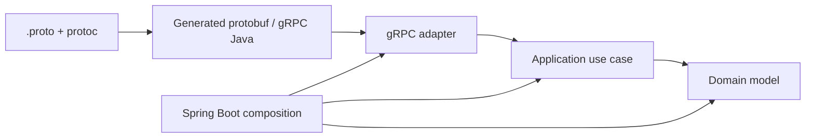

# Keeping Generated Classes Out of the Domain

In **SPRING_GRPC**, Java code generated from Protocol Buffers provides message classes, enums, descriptors, and gRPC stubs. These classes are useful at the communication boundary, but if you bring them into the domain model or application use cases, business rules become coupled to the schema and generator. A change in the proto contract could then force modifications across the domain, persistence, and unrelated non-gRPC adapters.

The architectural rule is to **keep generated classes in the communication layer**. The gRPC adapter receives a protobuf request, converts it into a plain Java command or value object, calls the application service, and converts the business result into a protobuf response. The domain does not import `com.google.protobuf`, `io.grpc`, or packages containing generated code.

## 1. Why Do Generated Classes Not Belong in the Domain?

Generated classes describe the data transport contract. The domain describes business concepts and rules. The two models have different purposes and lifecycles.

For example, the schema might declare:

```proto
message ReserveStockRequest {
  string sku = 1;
  int64 quantity = 2;
  optional string idempotency_key = 3;
}
```

The generator creates `ReserveStockRequest` along with its builder, getters, parser, descriptor, and presence API. If the domain directly accepts this request:

```java
// Do not place this signature in a domain/application service.
Reservation reserve(ReserveStockRequest request);
```

the domain now depends on the Java package decided by `java_package`, how the generator represents optional/enum/oneof, the `protobuf-java` runtime, and the generated code API. The domain model might then have to change merely because the API team changed a protobuf package or added a transport field.

## 2. Placing Generated Code at the Proper Boundary

A typical module layout:

```text
inventory-domain/
  Sku.java
  Quantity.java
  Stock.java
  StockNotFoundException.java

inventory-application/
  ReserveStockCommand.java
  ReservationResult.java
  ReserveStockUseCase.java

inventory-grpc-adapter/
  proto/inventory.proto
  generated/
  InventoryProtoMapper.java
  InventoryGrpcService.java

inventory-boot/
  Spring Boot configuration
```

Dependency direction:



`inventory-grpc-adapter` depends on application and generated code. Application may depend on domain. Domain does not depend on adapter, Spring, gRPC, or protobuf.

If generated code is packaged into a shared contract JAR, only adapters should compile against that JAR. Do not add the contract JAR to the domain merely for convenience to reuse a message class.

## 3. Using Plain Java Commands and Value Objects

The boundary schema has `string sku` and `int64 quantity`. The domain can represent them using value objects to enforce invariants:

```java
public record Sku(String value) {
    public Sku {
        if (value == null || value.isBlank()) {
            throw new InvalidSkuException();
        }
        value = value.trim();
        if (!value.matches("[A-Z0-9-]{3,32}")) {
            throw new InvalidSkuException();
        }
    }
}

public record Quantity(long value) {
    public Quantity {
        if (value <= 0) {
            throw new InvalidQuantityException();
        }
    }
}
```

Application commands and results contain only Java/domain types:

```java
public record ReserveStockCommand(
        Sku sku,
        Quantity quantity,
        Optional<String> idempotencyKey) {
}

public record ReservationResult(
        String reservationId,
        Sku sku,
        long remainingQuantity) {
}

public interface ReserveStockUseCase {
    ReservationResult reserve(ReserveStockCommand command);
}
```

These types know nothing about protobuf field numbers, generated builders, or gRPC transport. The use case can be invoked from gRPC, REST, a message consumer, a scheduler, or tests without constructing protobuf messages.

## 4. Converting at the gRPC Adapter

The mapper is where protobuf requests are converted into application commands and business results are converted into protobuf responses.

```java
import org.springframework.stereotype.Component;

@Component
public class InventoryProtoMapper {

    public ReserveStockCommand toCommand(
            ReserveStockRequest request) {

        Optional<String> key = request.hasIdempotencyKey()
                ? Optional.of(request.getIdempotencyKey())
                : Optional.empty();

        return new ReserveStockCommand(
                new Sku(request.getSku()),
                new Quantity(request.getQuantity()),
                key);
    }

    public ReserveStockReply toProto(
            ReservationResult result) {

        return ReserveStockReply.newBuilder()
                .setReservationId(result.reservationId())
                .setSku(result.sku().value())
                .setRemaining(result.remainingQuantity())
                .build();
    }
}
```

The service adapter coordinates the mapper and the use case:

```java
@Service
public class InventoryGrpcService
        extends InventoryServiceGrpc.InventoryServiceImplBase {

    private final ReserveStockUseCase reserveStock;
    private final InventoryProtoMapper mapper;

    public InventoryGrpcService(
            ReserveStockUseCase reserveStock,
            InventoryProtoMapper mapper) {
        this.reserveStock = reserveStock;
        this.mapper = mapper;
    }

    @Override
    public void reserveStock(
            ReserveStockRequest request,
            StreamObserver<ReserveStockReply> observer) {
        try {
            ReserveStockCommand command = mapper.toCommand(request);
            ReservationResult result = reserveStock.reserve(command);

            observer.onNext(mapper.toProto(result));
            observer.onCompleted();
        } catch (InvalidSkuException | InvalidQuantityException error) {
            observer.onError(Status.INVALID_ARGUMENT
                    .withDescription("Invalid stock request")
                    .asRuntimeException());
        } catch (RuntimeException error) {
            observer.onError(Status.INTERNAL
                    .withDescription("Internal server error")
                    .asRuntimeException());
        }
    }
}
```

This condensed example illustrates where mapping sits. In a real application, known domain errors must be mapped according to the service's error contract; unexpected errors must be logged in the adapter/interceptor with a correlation ID. The key architectural point is that `ReserveStockUseCase` does not accept `ReserveStockRequest`, does not return `ReserveStockReply`, and knows nothing about `StreamObserver`.

## 5. Handling Presence, Oneof, and Enums at the Boundary

Generated APIs have semantics that the domain should not have to inherit verbatim.

### Optional scalars

For regular proto3 scalars, getters return default values when the field is absent. If business logic needs to distinguish "not sent" from "sent with default value", declare `optional` and check `hasX()` inside the mapper.

```proto
message SearchRequest {
  optional int32 page_size = 1;
}
```

The mapper converts this into `OptionalInt` or an equivalent application type. Do not pass the entire protobuf request into the domain so the domain calls `hasPageSize()` itself.

### Oneof

`oneof` generates dedicated case/accessor APIs. Convert it into an explicit business type:

```proto
message PaymentMethod {
  oneof method {
    CardPayment card = 1;
    BankTransfer bank_transfer = 2;
  }
}
```

The domain can use a sealed interface or value objects:

```java
public sealed interface PaymentInstrument
        permits CardInstrument, BankInstrument {
}

public record CardInstrument(String tokenReference)
        implements PaymentInstrument {
}

public record BankInstrument(String accountReference)
        implements PaymentInstrument {
}
```

The mapper switches on `getMethodCase()` and creates the corresponding domain type. The `METHOD_NOT_SET` branch must be handled explicitly: reject the request if business logic requires a payment method, or map to an unselected state if the use case allows it.

### Enums and unknown values

Do not use `ordinal()` to map protobuf enums to domain enums. Numeric values in protobuf are part of the wire contract; Java enum declaration order is not a stable contract.

Use an explicit switch and handle `UNRECOGNIZED`/new values according to your compatibility policy. If a newer client sends an enum value that an older server does not know, the adapter can return `INVALID_ARGUMENT` or apply a defined business fallback. The domain should not hold generated enums just to carry unrecognized values.

## 6. Converting Special Protobuf Types

| Protobuf type | Appropriate application/domain type | Notes |
| --- | --- | --- |
| `string` | `String` or value object | Normalize and validate at boundary/domain |
| `int32`, `int64` | `int`, `long`, or value object | Check overflow when narrowing types |
| `repeated T` | `List<T>` | Copy into an immutable collection if needed |
| `map<K,V>` | `Map<K,V>` | Do not retain the generated map view |
| `Timestamp` | `Instant` | Preserve seconds/nanos precision |
| `Duration` | `java.time.Duration` | Define negative/positive rules per business logic |
| `ByteString` | `byte[]` or binary value object | Copy data and protect immutability |
| `Any` | Known business type or dedicated adapter payload | Do not couple domain to arbitrary type URLs |
| `FieldMask` | Set of business fields/paths | Validate paths and update permissions |

Example converting `Timestamp` in the adapter:

```java
Instant toInstant(com.google.protobuf.Timestamp value) {
    return Instant.ofEpochSecond(
            value.getSeconds(),
            value.getNanos());
}
```

If using protobuf's built-in utilities, you can use `Timestamps.toInstant(value)` inside the adapter module. Do not put `com.google.protobuf.Timestamp` into domain entities or repositories.

For `ByteString`, `toByteArray()` creates a byte array to pass across the boundary. If the domain stores binary data, value objects need defensive copying so callers cannot mutate the data after object creation.

## 7. Keeping gRPC APIs Out of Application Contracts

The following types also belong to transport/adapters, not the domain:

- `StreamObserver`, `Status`, `StatusRuntimeException`.
- `Metadata`, `CallOptions`, `Channel`, `ManagedChannel`.
- `ServerCall`, `ServerInterceptor`, `Context`.
- `Message`, `GeneratedMessageV3`, `Descriptors`.
- `ByteString`, `UnknownFieldSet`, and protobuf descriptors.

An application streaming contract can return `Iterable<StockSnapshot>`, `Flow.Publisher<StockSnapshot>`, or an abstraction fitting the application architecture. The adapter is responsible for converting each item into a protobuf message and sending it via the observer. Do not pass `StreamObserver` into a use case so the domain controls the gRPC lifecycle.

Similarly, cancellation/deadlines from gRPC can be translated by the adapter into an application cancellation signal or deadline abstraction. The domain does not need to read `io.grpc.Context.current()`.

## 8. Keeping Persistence Models Independent of Protobuf

Do not use generated messages as JPA entities or persistence documents merely because their current fields look similar.

If entities are derived directly from protobuf:

- Transport schema changes can force persistence migrations.
- Protobuf presence/default semantics can differ from database nullability.
- Generated messages are immutable and builder-oriented, whereas persistence needs its own lifecycle/identity.
- API-facing fields may not belong in persisted data.
- Domain validation is easily bypassed when parsing messages directly.

Map along the chain:

`protobuf request → application command → domain model → persistence model`

On the return path:

`persistence/domain result → application result → protobuf response`

You do not necessarily need a distinct DTO for every single layer if models genuinely coincide without creating coupling. However, the domain/application boundary should not accept generated types just to save a few lines of mapping.

## 9. Testing Mappers and Architectural Boundaries

### Unit testing the mapper

Test mapping for both valid values and presence:

```java
@Test
void mapsRequestToApplicationCommand() {
    ReserveStockRequest request = ReserveStockRequest.newBuilder()
            .setSku("BOOK-101")
            .setQuantity(3)
            .setIdempotencyKey("req-123")
            .build();

    ReserveStockCommand command = mapper.toCommand(request);

    assertEquals(new Sku("BOOK-101"), command.sku());
    assertEquals(new Quantity(3), command.quantity());
    assertEquals(Optional.of("req-123"), command.idempotencyKey());
}

@Test
void preservesAbsentOptionalField() {
    ReserveStockRequest request = ReserveStockRequest.newBuilder()
            .setSku("BOOK-101")
            .setQuantity(3)
            .build();

    ReserveStockCommand command = mapper.toCommand(request);

    assertEquals(Optional.empty(), command.idempotencyKey());
}
```

Domain unit tests construct only `Sku`, `Quantity`, and plain Java domain objects. No protobuf runtime or gRPC test server is needed.

### Architecture testing with ArchUnit

You can add a rule preventing the domain/application from depending on transport:

```java
@AnalyzeClasses(packages = "com.example.inventory")
class ArchitectureRulesTest {

    @ArchTest
    static final ArchRule domainAndApplicationDoNotDependOnGrpc =
            noClasses()
                    .that().resideInAnyPackage(
                            "..domain..",
                            "..application..")
                    .should().dependOnClassesThat()
                    .resideInAnyPackage(
                            "io.grpc..",
                            "com.google.protobuf..",
                            "com.example.inventory.grpc.v1..");
}
```

Replace `com.example.inventory.grpc.v1..` with the actual Java package configured in `java_package`. This rule detects direct imports and bytecode dependencies on generated code. If a module has multiple contract packages, list all of them or organize generated code under a dedicated namespace.

### Integration testing the adapter

Start a test gRPC server, call the generated stub, and verify:

- Protobuf requests are mapped into the right command by the mapper.
- Use cases receive domain value objects, not protobuf messages.
- Protobuf responses reflect application results.
- Domain exceptions are converted by the adapter into statuses per contract.
- Streaming adapters convert each domain item into a message and follow the proper lifecycle.

Integration tests prove adapter wiring; architecture tests protect dependency direction over time.

## 10. Module and Build Dependency Rules

In multi-module Gradle/Maven builds, set dependencies in this direction:

| Module | Allowed dependencies | Disallowed dependencies |
| --- | --- | --- |
| `inventory-domain` | JDK and pure domain libraries | gRPC, protobuf, Spring, generated contract |
| `inventory-application` | domain and application ports | generated protobuf, `io.grpc` |
| `inventory-grpc-adapter` | application, domain, generated code, grpc runtime | — |
| `inventory-boot` | adapters and application for composition | Do not place business logic in bootstrap |

Generated sources should be built inside the adapter module or a dedicated contract module. If the contract module is a standalone artifact, client/server adapters depend on it; domain/application still need no knowledge of that artifact.

You can inspect the dependency graph with Gradle `dependencies` or Maven `dependency:tree`. If `inventory-domain` pulls in `protobuf-java` or `grpc-api` transitively, find the offending dependency and fix the dependency direction instead of blindly adding exclusions.

## 11. When Can Protobuf Types Be Shared?

Some small systems use protobuf messages directly in the application layer to reduce mapping. This is an architectural choice with trade-offs, not the default rule.

Consider it only when:
- The application has a single transport and protobuf was deliberately chosen as the application contract.
- The team accepts coupling domain/application to the schema, generator, and protobuf runtime.
- The schema is governed as a stable internal API with a compatibility policy.
- There is no need to reuse use cases from REST, message consumers, or batch jobs without dragging in the protobuf runtime.

Even when choosing this approach, avoid making entities and domain invariants depend on generated classes if they have independent lifecycles. For systems with a rich domain model or multiple adapters, keeping mapping at the boundary usually limits the blast radius of transport changes.

## 12. Practice Exercises

1. Create `inventory-domain`, `inventory-application`, and `inventory-grpc-adapter` modules.
2. Generate `ReserveStockRequest` and `ReserveStockReply` in the adapter.
3. Create `Sku`, `Quantity`, commands, and results using plain Java.
4. Write protobuf-to-command and result-to-protobuf mappers.
5. Add an `optional` field and verify the mapper distinguishes absent from default values.
6. Add a `oneof` and an enum; handle unset cases and unrecognized enums.
7. Write an ArchUnit rule forbidding domain/application from depending on `io.grpc`, `com.google.protobuf`, and generated packages.
8. Run a dependency report to confirm the domain module does not pull in protobuf/grpc runtime.
9. Write an integration test invoking the generated stub and verifying the application use case receives only command/domain types.
10. Change `java_package` or add a transport-only field; confirm the domain module needs no edits.

### Key takeaway

**Generated classes are the protocol model, not the domain model.** Keep protobuf messages, gRPC stubs, observers, statuses, and metadata inside the adapter. Convert requests into plain Java commands/value objects before invoking use cases; convert business results into protobuf responses after use cases finish. Use mappers, module dependency direction, and architecture tests to ensure proto changes never leak into the domain.

## References

- [Protocol Buffers — Java Generated Code](https://protobuf.dev/reference/java/java-generated/)
- [Protocol Buffers — Proto3 Language Guide](https://protobuf.dev/programming-guides/proto3/)
- [gRPC Java — Generated Code](https://grpc.io/docs/languages/java/generated-code/)
- [ArchUnit — User Guide](https://www.archunit.org/userguide/html/000_Index.html)
