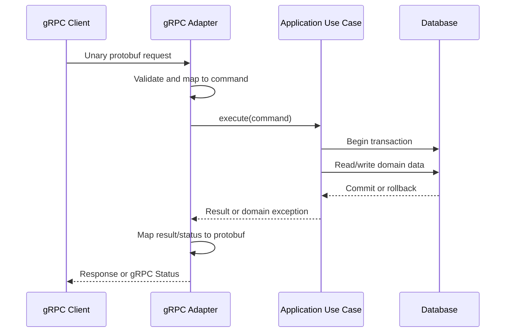

# Transactions in the Adapter

In **SPRING_GRPC**, the gRPC service adapter receives protobuf requests, converts them into application commands, calls the use case, and sends responses via `StreamObserver`. When a use case reads or writes to a database, you must determine which business portion the transaction wraps and when the transaction commits relative to returning the RPC result.

An RPC is not automatically a database transaction. gRPC manages the call lifecycle and delivers statuses/messages; Spring transactions manage the consistency of resources such as databases. This lesson focuses on transaction boundaries for unary and streaming RPCs, where to place `@Transactional`, handling rollbacks when mapping errors to gRPC Status, and testing commit/rollback behavior in Spring gRPC applications.

## 1. Transactions Belong to Application Operations, Not Transport

A unary flow typically has these steps:

1. Receive the protobuf request and validate structure/format.
2. Convert the request into a command or value object.
3. Call the application use case to execute business logic.
4. The use case reads/writes repositories inside a transaction.
5. Once the use case finishes, the adapter converts the result into a protobuf response.
6. The adapter sends the response or status to the client.

A transaction should wrap the unit of business work that must be atomic—usually the application use case. The adapter is the transport entry point and should not hold a transaction open while waiting on the network, sending responses, or processing metadata.



Placing the boundary at the use case has these benefits:

- Domain and application remain independent of gRPC.
- The same use case can be invoked from REST, message consumers, or batch jobs.
- Transactions can be tested independently of transport.
- The adapter only converts protocols and coordinates calls.
- Transaction duration is not prolonged by sending responses over the network.

## 2. Placing `@Transactional` on the Application Service

For example, a stock reservation use case needs to read current quantity, check invariants, and update inventory. These operations must occur within the same transaction:

```java
@Service
public class ReserveStockService implements ReserveStockUseCase {

    private final StockRepository stocks;
    private final ReservationRepository reservations;

    public ReserveStockService(
            StockRepository stocks,
            ReservationRepository reservations) {
        this.stocks = stocks;
        this.reservations = reservations;
    }

    @Override
    @Transactional
    public ReservationResult reserve(ReserveStockCommand command) {
        Stock stock = stocks.findBySku(command.sku())
                .orElseThrow(() ->
                        new StockNotFoundException(command.sku()));

        stock.reserve(command.quantity());

        Reservation reservation =
                Reservation.create(command.sku(), command.quantity());

        stocks.save(stock);
        reservations.save(reservation);

        return ReservationResult.from(reservation, stock);
    }
}
```

Spring opens a transaction when the call passes through the transaction proxy. When the method finishes normally, the transaction commits; if an unchecked exception escapes, Spring marks it for rollback by default. Repositories using the same transaction manager/data source participate in the active transaction under the default `REQUIRED` propagation.

Data reads can use:

```java
@Transactional(readOnly = true)
public StockSnapshot findStock(Sku sku) {
    return stocks.findBySku(sku)
            .map(StockSnapshot::from)
            .orElseThrow(() -> new StockNotFoundException(sku));
}
```

`readOnly = true` is a hint to the transaction manager/provider and can optimize data access. It does not replace authorization, validation, or guarantee that every database blocks writes.

## 3. Calling the Use Case and Converting Results After the Transaction

The adapter does not need to open a transaction itself if the use case already defines the proper boundary:

```java
@Service
public class StockGrpcService
        extends StockServiceGrpc.StockServiceImplBase {

    private final ReserveStockUseCase reserveStock;
    private final StockProtoMapper mapper;
    private final GrpcStatusMapper statuses;

    public StockGrpcService(
            ReserveStockUseCase reserveStock,
            StockProtoMapper mapper,
            GrpcStatusMapper statuses) {
        this.reserveStock = reserveStock;
        this.mapper = mapper;
        this.statuses = statuses;
    }

    @Override
    public void reserve(
            ReserveStockRequest request,
            StreamObserver<ReserveStockReply> observer) {
        try {
            ReserveStockCommand command = mapper.toCommand(request);
            ReservationResult result = reserveStock.reserve(command);

            observer.onNext(mapper.toProto(result));
            observer.onCompleted();
        } catch (StockDomainException error) {
            observer.onError(statuses.map(error));
        }
    }
}
```

When `reserveStock.reserve()` returns, the use case's transaction has already committed. Only then does the adapter build the protobuf response and invoke the observer. If serializing/sending the response fails after commit, the database transaction does not automatically roll back because RPC transport and the database do not share a distributed transaction.

This behavior requires deliberate design: the server may have completed the business work while the client misses the response due to a network interruption. For commands with side effects such as creating orders, payments, or reserving stock, use an idempotency key so clients can safely retry without duplicating effects.

## 4. When Should `@Transactional` Be Placed on the Adapter?

You can place `@Transactional` on a public method of a gRPC adapter if the adapter truly serves as the application boundary and the call goes through a Spring proxy. However, doing so ties the transaction to the transport handler and easily creates discrepancies when the use case is invoked from another entry point.

If you choose this approach, verify that:

- The adapter is a Spring-managed bean.
- Invocations from the gRPC runtime pass through the Spring AOP proxy.
- The method visibility and structure are compatible with the proxy mode in use.
- Transactional methods are not invoked via self-invocation on the same object.
- Transactions are not held open while waiting on callbacks, the network, or long-lived streams.

Do not place `@Transactional` on a private method expecting the Spring proxy to apply. Also avoid marking the entire adapter class transactional if some RPCs are read-only, streaming, or do not touch the database.

Practical rule: place transactions on the application service/use case; put them on the adapter only when there is a clear reason and you have verified server proxying/lifecycle.

## 5. Rollback When the Adapter Translates Exceptions to Status

This is a common mistake: an exception is caught inside a transactional method, the adapter translates it into `observer.onError(...)`, and the method returns normally. Spring sees the method exit normally and may commit the transaction.

Unsafe example:

```java
@Transactional
public void reserve(
        ReserveStockRequest request,
        StreamObserver<ReserveStockReply> observer) {
    try {
        applicationService.reserve(mapper.toCommand(request));
        observer.onCompleted();
    } catch (StockDomainException error) {
        observer.onError(statuses.map(error));
        // Method returns normally: transaction may commit.
    }
}
```

The better approach is to let the exception escape the transactional use case. The transaction interceptor handles rollback before the adapter catches the exception and maps it to a status:

```java
@Transactional
public ReservationResult reserve(ReserveStockCommand command) {
    Stock stock = stocks.findBySku(command.sku())
            .orElseThrow(() -> new StockNotFoundException(command.sku()));

    stock.reserve(command.quantity());
    reservations.save(Reservation.create(command));

    return ReservationResult.from(stock);
}
```

The adapter catches the exception after the use case call:

```java
try {
    ReservationResult result = useCase.reserve(command);
    observer.onNext(mapper.toProto(result));
    observer.onCompleted();
} catch (StockDomainException error) {
    observer.onError(statuses.map(error));
}
```

If you must catch an exception inside the same transactional method, explicitly mark the transaction rollback-only or rethrow an exception matching the rollback rules. Do not rely on calling `observer.onError()` for Spring to know it must roll back; the observer is a gRPC API, not a transaction API.

## 6. Rollback Rules and Checked Exceptions

By default, Spring rolls back a transaction when an unchecked exception (`RuntimeException`) or `Error` escapes a transactional method. Checked exceptions do not automatically trigger rollback in the default configuration.

If a use case throws a checked exception and must roll back:

```java
@Transactional(rollbackFor = Exception.class)
public ReservationResult reserve(ReserveStockCommand command)
        throws StockOperationException {
    // Reads/writes in the same transaction.
}
```

Only add `rollbackFor` based on actual semantics. If a checked exception represents a business outcome that permits a partial commit, do not roll back all checked exceptions. For domain exceptions, many applications choose a hierarchy extending `RuntimeException` so default transaction rollback aligns with business failures that abort the operation.

If using `noRollbackFor`, be sure the data state after the exception remains valid. Never alter rollback rules merely to make adapter status mapping easier to write.

## 7. Multiple Repositories and Transaction Managers

A use case may write to multiple tables or aggregates in the same database. Repositories must participate in the same transaction manager so atomicity is guaranteed.

Example:

```java
@Transactional
public OrderResult placeOrder(PlaceOrderCommand command) {
    Order order = orderRepository.save(Order.create(command));
    inventoryRepository.reserve(command.items());
    paymentAttemptRepository.save(PaymentAttempt.pending(order.id()));

    return OrderResult.from(order);
}
```

If all three repositories share one relational database and the same transaction manager, changes commit/roll back together. If each repository uses a different data source/transaction manager, a single `@Transactional` does not automatically create a distributed transaction.

Avoid calling an external service or a downstream gRPC service while holding a database transaction open whenever possible. Network calls have independent latency and failures; long-running transactions hold locks/connections and increase contention. Common alternatives include writing to an outbox in the same transaction and publishing after commit, or designing a saga/compensation flow for multi-service processes.

## 8. Transactions in Streaming RPCs

Streaming has a different lifecycle from unary RPCs. A server-streaming RPC may keep a connection open for seconds or minutes; client-streaming may send messages at an uneven pace. You should not open one database transaction and hold it across the entire stream.

Risks of holding a transaction too long:

- Holds database connections and locks while waiting on the network.
- Increases the risk of deadlocks and transaction timeouts.
- Keeps a large persistence context alive when streaming many messages.
- Client cancellation does not automatically roll back all already-completed work.
- An error late in the stream is hard to undo for side effects already emitted outward.

### 8.1. Server streaming: paged reads, short transactions

The application service reads one page of data inside a transaction and returns plain Java snapshots:

```java
@Transactional(readOnly = true)
public List<StockSnapshot> loadPage(Sku sku, PageRequest page) {
    return repository.findSnapshots(sku, page);
}
```

The adapter fetches each page and sends messages after the page-read transaction has ended:

```java
PageRequest page = PageRequest.first(100);

while (page.hasNext()) {
    List<StockSnapshot> items = queryService.loadPage(sku, page);
    if (items.isEmpty()) {
        break;
    }

    for (StockSnapshot item : items) {
        observer.onNext(mapper.toProto(item));
    }

    page = page.next();
}
observer.onCompleted();
```

In a real application, this example needs cancellation handling, backpressure, and per-page error handling. If a consistent snapshot across multiple pages is required, choose an explicit strategy such as a snapshot/version token or an intentional isolation level; do not default to holding a transaction open for the entire stream delivery.

### 8.2. Client streaming: choosing per-message or batch transactions

For client-streaming, each `onNext` can invoke a short application operation with its own transaction:

```java
@Override
public StreamObserver<UploadChunk> upload(
        StreamObserver<UploadResult> responseObserver) {

    return new StreamObserver<>() {
        @Override
        public void onNext(UploadChunk chunk) {
            uploadUseCase.storeChunk(toCommand(chunk));
        }

        @Override
        public void onError(Throwable error) {
            uploadUseCase.markInterrupted(uploadId);
        }

        @Override
        public void onCompleted() {
            UploadResult result = uploadUseCase.complete(uploadId);
            responseObserver.onNext(mapper.toProto(result));
            responseObserver.onCompleted();
        }
    };
}
```

In the example, `storeChunk` and `complete` are application methods with independent transactions. This is a per-chunk commit model; if the stream is interrupted midway, committed chunks still exist and require upload state for resume or cleanup.

If the entire upload must be atomic, you cannot simply hold a transaction open from the first `onNext` to the final `onCompleted`. Write data into a staging area/session, validate upon completion, and commit the final state in one short transaction; or use a workflow with compensation. Limit size, duration, and chunk count to prevent unbounded buffering.

## 9. Thread Boundaries, Async Callbacks, and Reactive Transactions

Standard Spring transactions with JDBC/JPA are bound to the current thread. When code switches to another executor, the transaction does not automatically propagate to the new thread.

For example, if the adapter receives a callback and dispatches work to an executor:

- Do not open a transaction on the callback thread and expect the worker thread to share it.
- Invoke a public `@Transactional` application method from the worker thread so the transaction opens on the proper thread.
- Do not share an `EntityManager`, JDBC connection, or managed persistence entity across threads.
- When handling streaming callbacks, each use case invocation needs an explicit transaction boundary.

With a reactive stack using R2DBC, transactions are typically managed via Reactor Context and `ReactiveTransactionManager`, not thread-bound like JDBC/JPA. Use a reactive transaction operator or `@Transactional` on the reactive pipeline according to the appropriate Spring configuration. Do not mix blocking JPA on an event loop and expect reactive context to manage the transaction.

## 10. Deadlines, Cancellation, and Transaction Timeouts

A gRPC deadline limits how long the client waits for the RPC. A database transaction timeout limits how long a transaction may stay alive. The two timeouts are related but do not automatically align.

- Set RPC deadlines from the client.
- Set appropriate timeouts for application/database operations.
- When a request is cancelled, stop work that can be safely aborted and avoid generating further side effects.
- Check cancellation before starting the next write step in a streaming workflow.
- Do not assume a client timeout means the server transaction rolled back.

An important case: the server commits successfully, but the response arrives after the deadline. The client receives `DEADLINE_EXCEEDED` and cannot be sure whether the operation committed. For non-idempotent operations, require an idempotency key or a status query API so the client can determine the outcome before retrying.

## 11. Retries and Transaction Boundaries

Retries usually need a fresh transaction for each attempt. If an exception has already marked the current transaction rollback-only, catching the error and retrying inside the same transaction can cause commit failure or `UnexpectedRollbackException`.

Safe design:

1. Identify retryable errors and whether the operation is idempotent.
2. Let each use case execution run in its own transaction.
3. If the transaction rolls back, perform the retry in an orchestration layer outside the transaction.
4. Apply backoff, cap retry attempts, and respect deadlines.
5. For side effects outside the database, use an outbox, idempotency, or compensation.

Do not automatically retry `INVALID_ARGUMENT`, `PERMISSION_DENIED`, or permanent business errors. `UNAVAILABLE`/`ABORTED` may warrant retries depending on semantics and whether repetition is safe.

## 12. Testing Transactions over gRPC

Unit tests for application services verifying business logic and rollback can use a test transaction manager. Integration tests over gRPC have a crucial difference: server calls typically execute on a different thread than the test thread.

If a test method is annotated with `@Transactional`, the test's transaction does not wrap transactions opened on the server thread. Therefore, do not rely on end-of-test rollback to clean up data committed by the RPC.

An integration test should verify database state after the RPC:

- Successful RPC: related data is fully committed.
- Domain exception after some writes: all changes in the use case transaction are rolled back.
- Unexpected exception: no partial write state remains.
- Response mapping failure after commit: verify idempotency/status query because the transaction has already finished.
- Mid-stream cancellation: confirm partial commit/resume/cleanup policy matches the design.

Test skeleton example:

```java
@SpringBootTest
class StockGrpcTransactionTest {

    @Autowired
    StockServiceGrpc.StockServiceBlockingStub client;

    @Autowired
    StockRepository stocks;

    @Test
    void successfulRpcCommitsReservation() {
        client.reserve(validRequest());

        assertThat(stocks.findBySku(new Sku("BOOK-101")))
                .get()
                .extracting(Stock::available)
                .isEqualTo(7);
    }

    @Test
    void failedUseCaseRollsBackAllWrites() {
        assertThatThrownBy(() -> client.reserve(requestThatFails()))
                .isInstanceOf(StatusRuntimeException.class);

        assertThat(stocks.findBySku(new Sku("BOOK-101")))
                .get()
                .extracting(Stock::available)
                .isEqualTo(10);
    }
}
```

This is an illustrative skeleton; prepare independent fixtures and database state for each test. When the server runs on its own thread, clean up data using a separate transaction or reset fixtures explicitly after each test.

## 13. Common Transaction Mistakes

| Design mistake | Consequence | Fix |
| --- | --- | --- |
| Wrapping an entire stream in a transaction | Holds locks/connections too long | Use short transactions per page, chunk, or finalize |
| Catching exceptions and only calling `observer.onError` inside a transactional method | Method exits normally and may commit | Let exceptions escape the use case or mark rollback-only |
| Calling a transactional method via self-invocation | Bypasses proxy so annotation has no expected effect | Separate into another bean/use case or call via proxy |
| Using a test transaction to wrap the RPC server thread | Server commits outside the test transaction | Assert database state and clean up separately |
| Calling downstream gRPC while holding a DB transaction | Locks/connections held during slow network calls | Use outbox, saga, or separate steps |
| Retrying inside a rollback-only transaction | Retry stays in an errored transaction state | Retry outside the boundary with a fresh transaction per attempt |
| Assuming deadline expiration rolls back the transaction | Server may have already committed | Use idempotency keys and status queries |
| Sharing entities/JPA sessions across callback threads | Thread-safety and persistence context errors | Pass commands/value objects and open transactions per thread |

## 14. Practice Exercises

1. Write `ReserveStockUseCase` with `@Transactional` to update stock and save the reservation in the same transaction.
2. Keep the gRPC adapter from accessing repositories directly; the adapter only maps requests/responses and invokes the use case.
3. Throw a domain exception after a write operation; confirm the transaction rolls back.
4. Catch the exception in the adapter after the use case fails and map it to a gRPC Status; confirm no partial writes remain in the database.
5. Try catching the exception inside a transactional method and returning normally; observe why default rollback does not happen without marking rollback-only.
6. Write a server-streaming use case that reads by page and sends each page outside the transaction.
7. Write a client-streaming upload by chunk, documenting the partial commit and resume policy when the stream is cancelled.
8. Run an application call on another executor; confirm the transaction opens on the worker thread.
9. Write an integration test calling the generated stub and asserting database state after success/failure.
10. Simulate a client deadline expiring after server commit; use an idempotency key to determine whether the operation already ran.

### Key takeaway

**Transactions should wrap atomic application operations, not the lifetime of a gRPC connection.** Let the use case manage `@Transactional`, let exceptions escape across the transaction boundary before the adapter converts them to Status, and keep streaming transactions short. Deadlines, network responses, and database commits are independent events; use idempotency, outboxes, and integration tests to handle cases where the RPC outcome does not definitively reflect commit state.

## References

- [Spring Framework — Declarative Transaction Management](https://docs.spring.io/spring-framework/reference/data-access/transaction/declarative.html)
- [Spring Framework — Transaction Propagation](https://docs.spring.io/spring-framework/reference/data-access/transaction/declarative/tx-propagation.html)
- [Spring Framework — Transaction Rollback Rules](https://docs.spring.io/spring-framework/reference/data-access/transaction/declarative/rolling-back.html)
- [gRPC — Deadlines](https://grpc.io/docs/guides/deadlines/)
- [gRPC — Cancellation](https://grpc.io/docs/guides/cancellation/)
