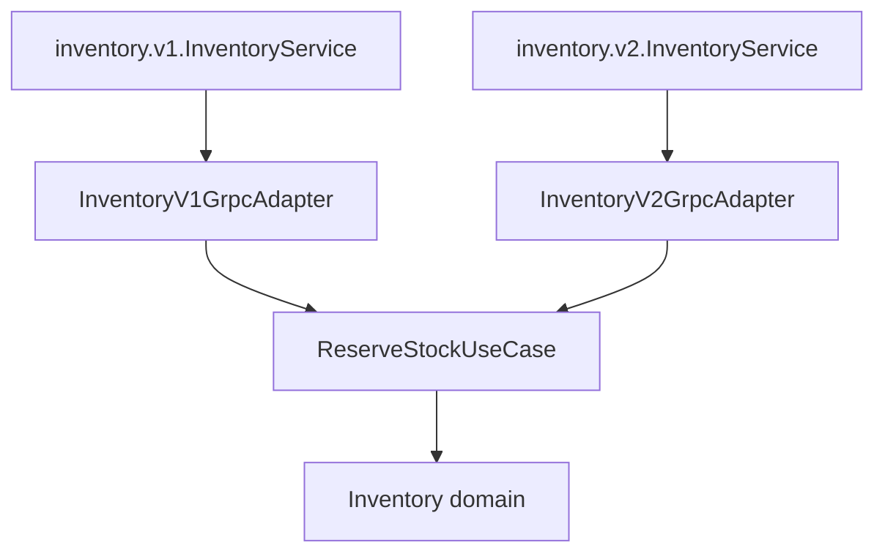

# Splitting Adapters by Service

In **SPRING_GRPC**, each service is exposed via a gRPC contract with its own service name, RPC methods, and messages. When an application has multiple services such as inventory, orders, and pricing, organize gRPC adapters per service contract. Each adapter is responsible for implementing one generated service base class, converting protobuf requests/responses, and calling the corresponding application use cases.

This separation clarifies API ownership, mappers, authorization, and testing. Adapters can still share domain models, application services, and appropriate infrastructure components. The goal is to keep each service adapter small with clear responsibilities rather than turning one giant gRPC class into the home for the entire system's API.

## 1. Boundary of a Service Adapter

A gRPC service is identified by its protobuf package and service name. For example:

```proto
syntax = "proto3";

package inventory.v1;

option java_package = "com.acme.contract.inventory.v1";
option java_multiple_files = true;

service InventoryService {
  rpc GetStock(GetStockRequest) returns (GetStockReply);
  rpc ReserveStock(ReserveStockRequest) returns (ReserveStockReply);
}
```

The inventory service has two RPCs yet remains a single service contract: **inventory.v1.InventoryService**. Generated code produces the corresponding base class and message types. The adapter implements that base class, performs mapping, and invokes the application layer.

Another service has an independent contract:

```proto
syntax = "proto3";

package pricing.v1;

option java_package = "com.acme.contract.pricing.v1";
option java_multiple_files = true;

service PricingService {
  rpc GetPrice(GetPriceRequest) returns (GetPriceReply);
}
```

Both contracts can run in the same Spring Boot process, but they have two separate adapters. Each adapter is registered as an independent gRPC service on the server.

## 2. Package Structure by Service

A discoverable and extensible layout:

```text
com.acme.store
├── domain
│   ├── inventory
│   ├── pricing
│   └── order
├── application
│   ├── inventory
│   │   ├── GetStockUseCase.java
│   │   └── ReserveStockUseCase.java
│   ├── pricing
│   │   └── GetPriceUseCase.java
│   └── order
└── adapter
    └── grpc
        ├── inventory
        │   ├── InventoryGrpcService.java
        │   ├── InventoryProtoMapper.java
        │   └── InventoryStatusMapper.java
        ├── pricing
        │   ├── PricingGrpcService.java
        │   └── PricingProtoMapper.java
        └── common
            ├── GrpcErrorMapper.java
            └── RequestMetadata.java
```

You can use separate packages for generated contracts, such as **com.acme.contract.inventory.v1** and **com.acme.contract.pricing.v1**. Do not place generated sources into domain or application packages.

Package names should reflect the service/contract, not necessarily implementation class names. What matters is that developers can trace from a protobuf service to its adapter, mapper, and use cases without digging through one oversized class.

## 3. One Adapter Implements One Generated Service

Inventory adapter example:

```java
import io.grpc.Status;
import io.grpc.stub.StreamObserver;
import org.springframework.grpc.server.service.GrpcService;

@GrpcService
public class InventoryGrpcService
        extends InventoryServiceGrpc.InventoryServiceImplBase {

    private final GetStockUseCase getStock;
    private final ReserveStockUseCase reserveStock;
    private final InventoryProtoMapper mapper;
    private final GrpcErrorMapper errors;

    public InventoryGrpcService(
            GetStockUseCase getStock,
            ReserveStockUseCase reserveStock,
            InventoryProtoMapper mapper,
            GrpcErrorMapper errors) {
        this.getStock = getStock;
        this.reserveStock = reserveStock;
        this.mapper = mapper;
        this.errors = errors;
    }

    @Override
    public void getStock(
            GetStockRequest request,
            StreamObserver<GetStockReply> observer) {
        try {
            StockView result =
                    getStock.execute(mapper.toQuery(request));

            observer.onNext(mapper.toProto(result));
            observer.onCompleted();
        } catch (RuntimeException error) {
            observer.onError(errors.toStatus(error));
        }
    }

    @Override
    public void reserveStock(
            ReserveStockRequest request,
            StreamObserver<ReserveStockReply> observer) {
        try {
            ReservationView result =
                    reserveStock.execute(mapper.toCommand(request));

            observer.onNext(mapper.toProto(result));
            observer.onCompleted();
        } catch (RuntimeException error) {
            observer.onError(errors.toStatus(error));
        }
    }
}
```

The pricing adapter has its own responsibility:

```java
import io.grpc.stub.StreamObserver;
import org.springframework.grpc.server.service.GrpcService;

@GrpcService
public class PricingGrpcService
        extends PricingServiceGrpc.PricingServiceImplBase {

    private final GetPriceUseCase getPrice;
    private final PricingProtoMapper mapper;
    private final GrpcErrorMapper errors;

    public PricingGrpcService(
            GetPriceUseCase getPrice,
            PricingProtoMapper mapper,
            GrpcErrorMapper errors) {
        this.getPrice = getPrice;
        this.mapper = mapper;
        this.errors = errors;
    }

    @Override
    public void getPrice(
            GetPriceRequest request,
            StreamObserver<GetPriceReply> observer) {
        try {
            PriceView result =
                    getPrice.execute(mapper.toQuery(request));

            observer.onNext(mapper.toProto(result));
            observer.onCompleted();
        } catch (RuntimeException error) {
            observer.onError(errors.toStatus(error));
        }
    }
}
```

These two classes are two Spring beans and two gRPC service registrations. They do not call each other directly; if inventory logic needs pricing, the inventory use case calls an appropriate application port or a downstream client gateway, depending on deployment boundaries.

The examples condense logging and exception classification. In production, map only known errors per the error contract; log unexpected errors at one place with a correlation ID and return a safe status. Do not catch exceptions only to return the same status for every case.

## 4. Split by Service Contract, Not Arbitrarily by Method

A service contract typically groups RPCs sharing one capability and API ownership. For example, **InventoryService** has **GetStock** and **ReserveStock** because both operate on the inventory capability.

Do not split two methods of the same protobuf service into two independent implementations that both register the full service name. The server expects one service definition per service name. Two implementations binding **inventory.v1.InventoryService** will cause registration conflicts or undefined behavior depending on server configuration.

If an implementation class grows too large, keep one façade implementing the generated base class and delegate internally:

```java
@GrpcService
public class InventoryGrpcService
        extends InventoryServiceGrpc.InventoryServiceImplBase {

    private final StockQueryRpcHandler queries;
    private final StockCommandRpcHandler commands;

    public InventoryGrpcService(
            StockQueryRpcHandler queries,
            StockCommandRpcHandler commands) {
        this.queries = queries;
        this.commands = commands;
    }

    @Override
    public void getStock(
            GetStockRequest request,
            StreamObserver<GetStockReply> observer) {
        queries.getStock(request, observer);
    }

    @Override
    public void reserveStock(
            ReserveStockRequest request,
            StreamObserver<ReserveStockReply> observer) {
        commands.reserveStock(request, observer);
    }
}
```

**StockQueryRpcHandler** and **StockCommandRpcHandler** are internal collaborators, not registered as separate gRPC services. This splits code by operation group while keeping exactly one implementation for the **InventoryService** contract.

When a capability has a distinctly different lifecycle, owner, security policy, or rate of change, consider splitting it into an independent protobuf service. Do not create a new service merely to trim a few methods from a class.

## 5. Keep Adapters Thin and Share the Application Layer

Each adapter should handle protocol-boundary tasks:

- Receive protobuf requests and validate structural conditions.
- Map requests to application queries/commands.
- Invoke the corresponding use case.
- Map application results to protobuf responses.
- Translate exceptions to gRPC statuses.
- Coordinate metadata, deadlines, cancellation, and streaming lifecycles at the adapter layer.

Business rules, transactions, and business authorization belong in the application/domain layer. For instance, **ReserveStockUseCase** does not accept **ReserveStockRequest**, does not return **ReserveStockReply**, and knows nothing about **StreamObserver**.

If both REST and gRPC expose the reserve operation, both adapters invoke the same **ReserveStockUseCase**. Never copy reservation logic into **InventoryGrpcService** and maintain another version inside a REST controller.

## 6. Per-Service Mappers and Error Policies

Each service can have its own mapper because protobuf schemas and semantics differ:

```java
@Component
public class InventoryProtoMapper {

    public ReserveStockCommand toCommand(
            ReserveStockRequest request) {
        return new ReserveStockCommand(
                new Sku(request.getSku()),
                new Quantity(request.getQuantity()));
    }

    public ReserveStockReply toProto(ReservationView result) {
        return ReserveStockReply.newBuilder()
                .setReservationId(result.id())
                .setSku(result.sku())
                .setReserved(result.quantity())
                .build();
    }
}
```

**PricingProtoMapper** can convert currencies, price breakdowns, or promotion fields per the pricing contract. Do not build one giant mapper with dozens of overloads and conditionals keyed on service names.

Error mappers can be shared for common technical errors such as validation, unauthenticated, or internal failures. However, domain error mapping must respect each capability's semantics. For example, **StockNotFound** may be **NOT_FOUND** in the Inventory API; **PriceUnavailable** may be **FAILED_PRECONDITION** or **UNAVAILABLE** depending on whether it is a fixed business state or a transient dependency issue.

Do not make one service adapter depend on another service's mapper. If truly shared mapping exists, move it into a shared component in the adapter layer without pulling service A's generated types into service B's package.

## 7. Per-Service Interceptors and Policies

A server can combine cross-cutting global policies with service-specific policies:

| Scope | Example | Organization |
| --- | --- | --- |
| Server-wide | Trace propagation, request ID, logging | Global server interceptor |
| Group of services | Authentication for internal APIs | Interceptor/policy attached by service group |
| Single service | Stock reservation permission differs from price read permission | Authorization by full method name or service policy |
| Single RPC | Method-specific validation | Adapter or application validator |

Do not duplicate authentication, tracing, and metrics inside every method. At the same time, do not apply an overly broad authorization rule across all services when permissions differ.

When registering per-service interceptors, use the registration mechanism supported by your Spring gRPC version and verify the interceptor actually runs for the intended service/method. Regardless of where policies live, the application service must still enforce critical invariants and business permissions; adapter interceptors do not replace use case checks when use cases are called from other entry points.

## 8. Splitting Modules by Service When Deployment Boundaries Require It

In small applications, multiple adapters can reside in the same **grpc-adapter** module. When services have distinct owners, release cadences, or dependencies, split modules:

```text
inventory-contract/
inventory-application/
inventory-grpc-adapter/

pricing-contract/
pricing-application/
pricing-grpc-adapter/

store-boot/
  -> inventory-grpc-adapter
  -> pricing-grpc-adapter
  -> shared infrastructure
```

Not every service needs its own module. Split only when it creates valuable dependency, ownership, or deployment boundaries. If all modules still form circular dependencies or always release together, module splitting only complicates builds.

Contract modules hold only protos, generated code, and necessary build metadata. Adapter modules depend on their application API and corresponding contract. Domain/application do not depend on generated contracts merely for living in the same repository.

## 9. Splitting Client Adapters by Downstream Service

The same principle applies on the calling side. If the application calls both Inventory API and Pricing API, create a separate gateway/client adapter per contract:

```java
public interface InventoryGateway {
    StockView getStock(Sku sku);
}

@Component
class GrpcInventoryGateway implements InventoryGateway {

    private final InventoryServiceGrpc.InventoryServiceBlockingStub stub;

    GrpcInventoryGateway(
            InventoryServiceGrpc.InventoryServiceBlockingStub stub) {
        this.stub = stub;
    }

    @Override
    public StockView getStock(Sku sku) {
        StockReply reply = stub.getStock(
                StockRequest.newBuilder()
                        .setSku(sku.value())
                        .build());

        return new StockView(reply.getSku(), reply.getAvailable());
    }
}
```

Pricing has its own gateway and its own channel/configuration when endpoints, TLS, credentials, deadlines, or load balancing differ. Application use cases depend on the **InventoryGateway**/**PricingGateway** interfaces, not generated stubs.

Do not build a monolithic **GrpcClientFacade** containing every stub and exposing generated requests/responses to the application. Gateways isolate wire contracts, retry/deadline policies, and mapping per downstream service.

## 10. Naming, Versioning, and Service Registration

Protobuf package and service names form part of the RPC path—for example, **inventory.v1.InventoryService/GetStock**. Organize Java packages by service/version to avoid generated class name collisions and clarify contract ownership.

When releasing v2, consider a new service name/package version if changes are incompatible. Adapters v1 and v2 can call the same application use case while maintaining separate mappers per contract:



Never register two adapters for the same full service name to replace one another. When running versions side by side, each version must have its own service name and corresponding contract. Inspect server startup logs or reflection to confirm each service is registered exactly once.

## 11. Testing Each Adapter Independently

Splitting adapters by service lets tests focus on the corresponding contract:

**Mapper unit tests**
- Valid protobuf requests convert to the expected command/query.
- Optional/presence, enums, oneof, and default values are handled accurately.
- Application results convert to protobuf responses without data loss.
- Domain errors map to statuses per the service contract.

**Adapter integration tests**
- Start the Spring context and test gRPC server.
- Call the generated stub of **InventoryService**; verify the right inventory use case is invoked.
- Call **PricingService**; verify the pricing adapter does not route through the inventory use case.
- Verify both services register on the server without colliding full service names.
- Verify per-service/method interceptors and authorization.
- Verify deadlines, cancellation, and streaming lifecycles for relevant RPCs.

In-process transport works well for mapper/interceptor/service wiring. For TLS, HTTP/2, load balancer, or proxy behavior, write integration tests over real network transport.

## 12. Common Organizational Pitfalls

| Pitfall | Consequence | Fix |
| --- | --- | --- |
| One class implementing all services | Giant class with tangled dependencies and policies | One dedicated adapter per service contract |
| Splitting one protobuf service into multiple implementations with the same service name | Duplicate service registration | One façade implementation delegating to internal handlers |
| Adapter calling another adapter | Coupling between transport boundaries | Call application use case/port or downstream gateway |
| One mapper shared across all schemas | Mixed conditionals and generated types | Separate mapper per contract; share only truly generic helpers |
| Copying business logic into each adapter | Inconsistent REST/gRPC behavior | Share the application use case |
| Uniform global authorization everywhere | Incorrect permissions across services | Per-service/method policies plus business checks |
| Splitting modules too early | Complex builds and dependencies | Start with package boundaries; split modules when beneficial |
| One client facade returning generated types to application | Wire contract leaks into application | Dedicated gateways mapping to internal types |

## 13. Practice Exercises

1. Create two protobuf services **InventoryService** and **PricingService** with separate packages/versions.
2. Generate Java code for each contract into independent generated packages.
3. Create **InventoryGrpcService** and **PricingGrpcService**, each extending its respective generated base class.
4. Register both adapters in the same Spring Boot gRPC server; confirm no colliding full service names.
5. Create dedicated mappers and corresponding application use cases for each service.
6. Have both use cases share a domain component without directly calling each other's adapters.
7. Add distinct authorization policies for **ReserveStock** and **GetPrice**.
8. Write mapper unit tests and generated-stub integration tests for each service.
9. Add an internal handler collaborator for Inventory while keeping one service façade registered on the server.
10. If API v2 is needed, create a new contract/service name and have v1/v2 adapters call the same application use case through separate mappers.

### Key takeaway

**Splitting adapters by service means each protobuf service has one implementation and a clear communication boundary.** Dedicated adapters handle mapping, errors/statuses, and boundary policies; application/domain logic is shared via use cases and ports. Never register multiple implementations under the same service name, never let adapters call one another directly, and split modules only when ownership/dependency boundaries truly call for it.

## References

- [Spring gRPC — Server Services](https://docs.spring.io/spring-grpc/reference/server.html)
- [Spring gRPC — Client Configuration](https://docs.spring.io/spring-grpc/reference/client.html)
- [gRPC — Concepts: Services and RPCs](https://grpc.io/docs/what-is-grpc/core-concepts/)
- [Protocol Buffers — Packages and Java Generated Code](https://protobuf.dev/reference/java/java-generated/)
- [gRPC — Versioning and API Evolution](https://grpc.io/docs/guides/api-evolution/)
