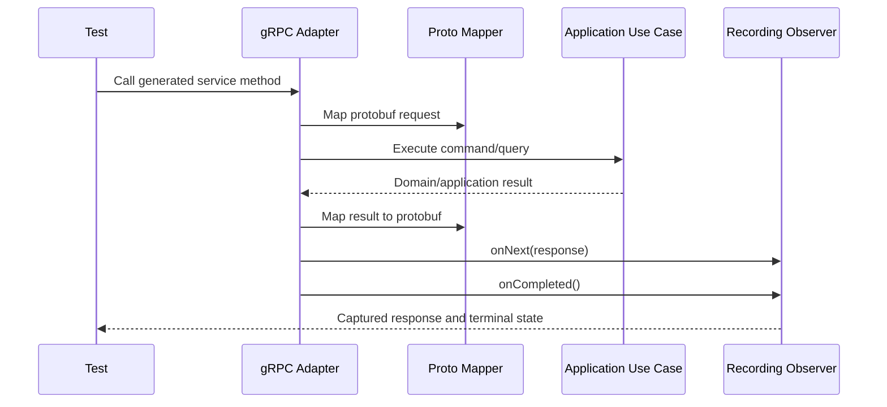

# Testing the Adapter Independently of Transport

In **SPRING_GRPC**, the gRPC service adapter is the boundary between the protobuf contract and application use cases. The adapter receives generated requests, converts them into queries/commands, invokes business logic, maps results or exceptions, and completes the RPC via `StreamObserver`.

Most of the adapter's behavior can be tested without starting a gRPC server, creating a channel, or opening a socket. Tests invoke methods directly on the generated service implementation, using fake/mock application ports and an observer that records responses/statuses. This approach is fast, deterministic, and focused on the adapter's responsibilities. Behaviors depending on HTTP/2, TLS, marshalling, or networking still need separate transport-level tests.

## 1. Identifying the Boundary to Test

A unary RPC passes through multiple layers:



In direct unit tests, the test calls the adapter as a plain Java object. There is no server runtime, transport executor, HTTP/2 connection, or client stub. Thus tests can focus on:

- Protobuf requests map to the expected application input.
- The right use case is called the expected number of times.
- Protobuf responses reflect the application result.
- Domain/application exceptions convert to the expected gRPC status.
- The adapter emits messages in order and terminates exactly once.
- Streaming adapters handle completion and errors per contract.

This tests the adapter boundary, not transport. Do not use results from these tests to conclude that TLS, interceptor registration, network deadline propagation, or wire-level protobuf marshalling work properly.

## 2. Distinguishing Testing Layers

| Testing layer | Components verified | Requires server/channel? |
| --- | --- | --- |
| Mapper unit test | Protobuf ↔ command/result | No |
| Adapter unit test | Generated service implementation, use case invocation, observer signals | No |
| Spring wiring test | Bean creation, dependency injection, conditional configuration | Spring context; usually no socket |
| In-process gRPC test | Service registration, stub, interceptor, gRPC call pipeline | Yes, in-process server/channel |
| Network integration test | HTTP/2, TLS, port, proxy, load balancing, keepalive | Yes, network transport |

You do not need to boot the full Spring Boot context for every mapper or adapter unit test. Instantiating the adapter class directly via its constructor keeps tests fast and makes adapter dependencies explicit.

## 3. Keeping Adapter Dependencies Explicit

Contract example with a unary RPC:

```proto
syntax = "proto3";

package catalog.v1;

option java_package = "com.acme.catalog.grpc.v1";
option java_multiple_files = true;

service CatalogService {
  rpc GetItem(GetItemRequest) returns (GetItemReply);
  rpc WatchItems(WatchItemsRequest) returns (stream ItemReply);
  rpc Upload(stream UploadChunk) returns (UploadResult);
}

message GetItemRequest {
  string item_id = 1;
}

message GetItemReply {
  string item_id = 1;
  string name = 2;
}

message WatchItemsRequest {
  string category = 1;
}

message UploadChunk {
  bytes data = 1;
}

message UploadResult {
  int64 bytes_received = 1;
}
```

The application layer uses its own types:

```java
public record GetItemQuery(String itemId) {}

public record ItemView(String itemId, String name) {}

public interface GetItemUseCase {
    ItemView execute(GetItemQuery query);
}

public record WatchItemsQuery(String category) {}

public interface WatchItemsUseCase {
    Iterable<ItemView> execute(WatchItemsQuery query);
}
```

The mapper converts at the boundary:

```java
@Component
public class CatalogProtoMapper {

    public GetItemQuery toQuery(GetItemRequest request) {
        return new GetItemQuery(request.getItemId());
    }

    public GetItemReply toProto(ItemView item) {
        return GetItemReply.newBuilder()
                .setItemId(item.itemId())
                .setName(item.name())
                .build();
    }
}
```

The adapter depends on the use case, mapper, and error mapper via constructor:

```java
@GrpcService
public class CatalogGrpcService
        extends CatalogServiceGrpc.CatalogServiceImplBase {

    private final GetItemUseCase getItem;
    private final CatalogProtoMapper mapper;
    private final GrpcErrorMapper errors;

    public CatalogGrpcService(
            GetItemUseCase getItem,
            CatalogProtoMapper mapper,
            GrpcErrorMapper errors) {
        this.getItem = getItem;
        this.mapper = mapper;
        this.errors = errors;
    }

    @Override
    public void getItem(
            GetItemRequest request,
            StreamObserver<GetItemReply> observer) {
        try {
            ItemView item = getItem.execute(mapper.toQuery(request));
            observer.onNext(mapper.toProto(item));
            observer.onCompleted();
        } catch (RuntimeException error) {
            observer.onError(errors.toStatus(error));
        }
    }
}
```

In unit tests, instantiate this class directly via its constructor. The `@GrpcService` annotation serves service registration in the Spring gRPC runtime; it is not required to invoke Java methods directly.

## 4. Creating a RecordingObserver to Capture Results

For unary RPCs, tests need to know how many responses the adapter sent, whether an error occurred, and whether completion was signaled. A small observer helps verify these conditions:

```java
import io.grpc.stub.StreamObserver;
import java.util.ArrayList;
import java.util.List;

final class RecordingObserver<T> implements StreamObserver<T> {

    private final List<T> values = new ArrayList<>();
    private Throwable error;
    private boolean completed;

    @Override
    public void onNext(T value) {
        if (error != null || completed) {
            throw new AssertionError("onNext after terminal signal");
        }
        values.add(value);
    }

    @Override
    public void onError(Throwable error) {
        if (this.error != null || completed) {
            throw new AssertionError("Multiple terminal signals");
        }
        this.error = error;
    }

    @Override
    public void onCompleted() {
        if (error != null || completed) {
            throw new AssertionError("Multiple terminal signals");
        }
        completed = true;
    }

    List<T> values() {
        return List.copyOf(values);
    }

    Throwable error() {
        return error;
    }

    boolean completed() {
        return completed;
    }
}
```

This observer is intentionally simple and meant only for synchronous calls in unit tests. If the adapter emits responses from another executor, use a latch/condition or a thread-safe observer; do not read the list while a worker is still writing.

Basic assertions:

- Success: exactly one value, error is null, and completed is true.
- Failure: error is non-null and completed is false.
- Server streaming: value count and order match; followed by exactly one terminal signal.
- No response is emitted after onError or onCompleted.

## 5. Unit Testing Unary Success

Use JUnit 5 and Mockito to replace the application use case with a mock. The test calls the adapter method directly:

```java
@ExtendWith(MockitoExtension.class)
class CatalogGrpcServiceTest {

    @Mock
    GetItemUseCase getItem;

    @Mock
    GrpcErrorMapper errors;

    private CatalogProtoMapper mapper;
    private CatalogGrpcService service;

    @BeforeEach
    void setUp() {
        mapper = new CatalogProtoMapper();
        service = new CatalogGrpcService(getItem, mapper, errors);
    }

    @Test
    void mapsRequestCallsUseCaseAndEmitsReply() {
        when(getItem.execute(new GetItemQuery("item-42")))
                .thenReturn(new ItemView("item-42", "Keyboard"));

        RecordingObserver<GetItemReply> observer =
                new RecordingObserver<>();

        service.getItem(
                GetItemRequest.newBuilder()
                        .setItemId("item-42")
                        .build(),
                observer);

        assertEquals(1, observer.values().size());
        assertEquals("item-42", observer.values().get(0).getItemId());
        assertEquals("Keyboard", observer.values().get(0).getName());
        assertNull(observer.error());
        assertTrue(observer.completed());

        verify(getItem).execute(new GetItemQuery("item-42"));
        verifyNoMoreInteractions(getItem);
    }
}
```

The test verifies the adapter flow from protobuf request to protobuf response. It does not need a generated client stub because the goal is to test the method implementation and mapping, not the call pipeline.

If the mapper is complex, test the mapper separately to distinguish conversion bugs from orchestration bugs. Avoid mocking the mapper in every test when using the real mapper is straightforward and lets tests verify the actual contract.

## 6. Testing Domain Errors and Status Mapping

Suppose the application use case throws `ItemNotFoundException` and the error mapper translates it to `NOT_FOUND`. The test can verify the status received by the observer:

```java
@Test
void mapsMissingItemToNotFound() {
    ItemNotFoundException domainError =
            new ItemNotFoundException("item-404");

    StatusRuntimeException grpcError =
            Status.NOT_FOUND
                    .withDescription("Item not found")
                    .asRuntimeException();

    when(getItem.execute(new GetItemQuery("item-404")))
            .thenThrow(domainError);
    when(errors.toStatus(domainError)).thenReturn(grpcError);

    RecordingObserver<GetItemReply> observer =
            new RecordingObserver<>();

    service.getItem(
            GetItemRequest.newBuilder()
                    .setItemId("item-404")
                    .build(),
            observer);

    assertTrue(observer.values().isEmpty());
    assertFalse(observer.completed());
    assertEquals(
            Status.Code.NOT_FOUND,
            Status.fromThrowable(observer.error()).getCode());

    verify(errors).toStatus(domainError);
}
```

Tests should cover the major error categories:

- Validation/request errors → `INVALID_ARGUMENT`.
- Missing domain resource → `NOT_FOUND`.
- State conflicts → `FAILED_PRECONDITION` or `ABORTED` per semantics.
- Authentication/authorization → `UNAUTHENTICATED` or `PERMISSION_DENIED`.
- Unexpected errors → `INTERNAL` with a safe description.

Never assert stack traces or internal messages in responses. Test status codes and structured details promised by the client contract; descriptions should only be asserted when they are part of a stable contract.

## 7. Testing Mappers Separately

Mappers are pure conversion components and typically do not need Mockito or a Spring context. Test protobuf semantics that are easy to overlook:

```java
@Test
void preservesOptionalFieldPresence() {
    SearchRequest request = SearchRequest.newBuilder()
            .setPageSize(0)
            .build();

    SearchQuery query = mapper.toQuery(request);

    assertTrue(query.pageSize().isPresent());
    assertEquals(0, query.pageSize().getAsInt());
}

@Test
void distinguishesAbsentOptionalField() {
    SearchRequest request = SearchRequest.newBuilder().build();

    SearchQuery query = mapper.toQuery(request);

    assertTrue(query.pageSize().isEmpty());
}
```

Cases to verify depending on the schema:

- Optional scalars: absent differs from an explicitly sent default value.
- Oneof: exact case and unset case.
- Enums: explicit mapping and unrecognized values.
- Timestamp/Duration: preserving seconds, nanos, and boundary rules.
- Repeated/map: ordering or immutability per contract.
- Field masks: valid paths and unsupported paths.

Mapper tests catch schema-to-domain bugs before they surface in the server runtime.

## 8. Testing Server Streaming Directly

A server-streaming adapter typically emits multiple responses and then completes:

```java
@Override
public void watchItems(
        WatchItemsRequest request,
        StreamObserver<ItemReply> observer) {
    try {
        for (ItemView item : watchItems.execute(
                new WatchItemsQuery(request.getCategory()))) {
            observer.onNext(mapper.toProto(item));
        }
        observer.onCompleted();
    } catch (RuntimeException error) {
        observer.onError(errors.toStatus(error));
    }
}
```

Test the method directly and verify ordering:

```java
@Test
void emitsAllItemsInOrderThenCompletes() {
    when(watchItems.execute(any()))
            .thenReturn(List.of(
                    new ItemView("a", "Alpha"),
                    new ItemView("b", "Beta")));

    RecordingObserver<ItemReply> observer =
            new RecordingObserver<>();

    service.watchItems(
            WatchItemsRequest.newBuilder()
                    .setCategory("office")
                    .build(),
            observer);

    assertEquals(
            List.of("a", "b"),
            observer.values().stream()
                    .map(ItemReply::getItemId)
                    .toList());
    assertNull(observer.error());
    assertTrue(observer.completed());
}
```

Also test failures mid-stream. If one item has already been emitted and then the iterator throws an exception, the adapter must terminate with onError and must not call onCompleted. Messages already sent cannot be retracted; the client must observe the final error status of the stream.

A fake observer checks the callback sequence invoked by the adapter. It does not verify HTTP/2 flow control, `isReady()`, or transport scheduling.

## 9. Testing Client Streaming and Bidirectional Streaming

A client-streaming adapter returns an observer to receive request messages. Tests can invoke that observer directly:

```java
StreamObserver<UploadChunk> input =
        service.upload(responseObserver);

input.onNext(firstChunk);
input.onNext(secondChunk);
input.onCompleted();
```

Verify that the adapter:
- Converts each chunk into an application command.
- Does not process chunks after a terminal signal.
- Calls finalize exactly once when input completes.
- Returns exactly one response and signals completion.
- Converts input/application errors into a terminal status.
- Stops or cleans up when the input observer receives onError.

For bidirectional streaming, test both input/output directions and terminal states. Do not assume callbacks always run on a single thread across every runtime configuration. If the adapter performs asynchronous processing, tests must synchronize waiting for results instead of reading the observer immediately after submitting a task.

## 10. Testing Async Adapters Deterministically

If the adapter offloads work to an executor, unit tests should not rely on sleep. There are two approaches:

1. Inject an executor abstraction and use a direct executor in tests so tasks execute immediately on the calling thread.
2. Use a controllable test executor, latch, or future to await task completion.

Simple abstraction example:

```java
interface RpcTaskExecutor {
    void execute(Runnable task);
}

final class DirectRpcTaskExecutor implements RpcTaskExecutor {
    @Override
    public void execute(Runnable task) {
        task.run();
    }
}
```

In production, the adapter receives an implementation backed by a bounded executor; in unit tests, use the direct implementation. If a test needs to verify rejection, use a fake executor that throws a controlled exception and assert the adapter returns an overload status.

If the adapter uses gRPC Context, capture Context before submitting and wrap the task. Unit tests should create a context with a specific key, invoke the adapter within that scope, and verify the worker sees the expected value. Test cancellation/races separately if this logic is part of the adapter's responsibilities.

## 11. Verifying Spring Wiring Without Opening Network Ports

Unit tests that instantiate classes directly do not check whether Spring discovers beans or injects the right dependencies. When component scanning or conditional configuration matters, add a small Spring context test.

Context tests should verify:
- Adapter beans are created.
- Mapper/use case collaborators are injected.
- No two beans implement the same generated service definition and cause registration conflicts.
- Expected profiles/configurations create the right adapters.

You can use a Spring test context or `ApplicationContextRunner` depending on configuration. There is no need to open real ports merely to verify constructor injection or component scanning. Whether a service is registered on the gRPC server and accepts real RPCs belongs to integration tests with the gRPC runtime.

## 12. What Unit Tests Cannot Verify

| Behavior | Appropriate test |
| --- | --- |
| Request/response and status mapping | Mapper/adapter unit test |
| Proper use case invocation | Adapter unit test |
| Spring bean discovery and dependency injection | Spring context test |
| Generated service registered on server | In-process/server integration test |
| Wire-level protobuf marshalling | In-process or network integration test |
| HTTP/2, ALPN, TLS/mTLS, and certificate validation | Network integration test |
| Real-transport deadlines/cancellation | gRPC integration test |
| Load balancing, proxy idle timeouts, keepalive | Environment/network test |
| Flow control and slow-reading clients | Streaming integration/load test |

Do not try to mock `ServerCall`, `Channel`, `ManagedChannel`, and every transport class in adapter unit tests when tests only need to verify mapping and observer contracts. Deep transport mocking easily creates implementation-coupled tests that are hard to maintain.

## 13. Common Testing Pitfalls

| Mistake | Consequence | Fix |
| --- | --- | --- |
| Booting a Spring Boot server for every unit test | Slow tests and port/configuration failures | Call the adapter directly via constructor |
| Asserting only responses while ignoring terminal state | Misses broken onCompleted/onError | Check values, error, and completed |
| Mocking mappers in every test | Misses real mapping bugs | Use real mappers when practical; test mappers separately |
| Using sleep to wait for async tasks | Flaky and slow tests | Direct executor, latch, or future |
| Using a non-thread-safe observer in async tests | Races when reading results | Synchronize observer/test |
| Testing only the happy path | Misses status mapping and stream errors | Test domain errors, unexpected errors, and terminal behavior |
| Assuming direct method tests verify TLS | Misses certificate/HTTP2 errors | Maintain separate network integration tests |
| Wrapping an RPC server thread in a test transaction | Cannot observe real commits accurately | Assert database state after transport call |
| One giant test for all RPCs | Hard to pinpoint failure cause | Split tests per method and contract behavior |

## 14. Minimum Test Suite for a Service Adapter

Before adding transport integration tests, each service adapter should have at least:

- Success unit tests for each critical unary RPC.
- Domain-error-to-status mapping tests.
- Tests ensuring unexpected errors do not leak internal details.
- Mapper tests for presence, oneof, enums, and special fields if used by the schema.
- Streaming tests for message ordering and terminal signals.
- Cancellation/rejection tests if the adapter manages executors or cancellation itself.
- Spring context tests if bean discovery/conditional registration carries risk.

There is no need to duplicate the same test for every trivial getter. Prioritize contract behavior, error branches, semantically meaningful mappings, and the coordination the adapter actually performs.

### Key takeaway

**Test the adapter independently of transport by calling the generated service implementation directly, replacing application dependencies with mocks/fakes, and capturing callbacks with a RecordingObserver.** This verifies mapping, use case invocation, statuses, and observer lifecycles quickly without a server/channel/network. Keep Spring wiring tests and transport integration tests separate for behaviors unit tests cannot observe.

## References

- [gRPC Java — Generated Code](https://grpc.io/docs/languages/java/generated-code/)
- [gRPC Java — StreamObserver](https://grpc.github.io/grpc-java/javadoc/io/grpc/stub/StreamObserver.html)
- [Spring gRPC — Server Services](https://docs.spring.io/spring-grpc/reference/server.html)
- [JUnit 5 — User Guide](https://junit.org/junit5/docs/current/user-guide/)
- [Mockito — Documentation](https://javadoc.io/doc/org.mockito/mockito-core/latest/org/mockito/Mockito.html)
