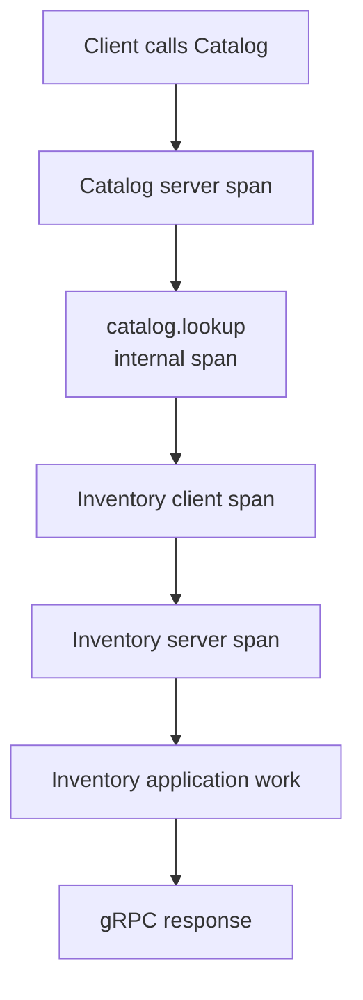
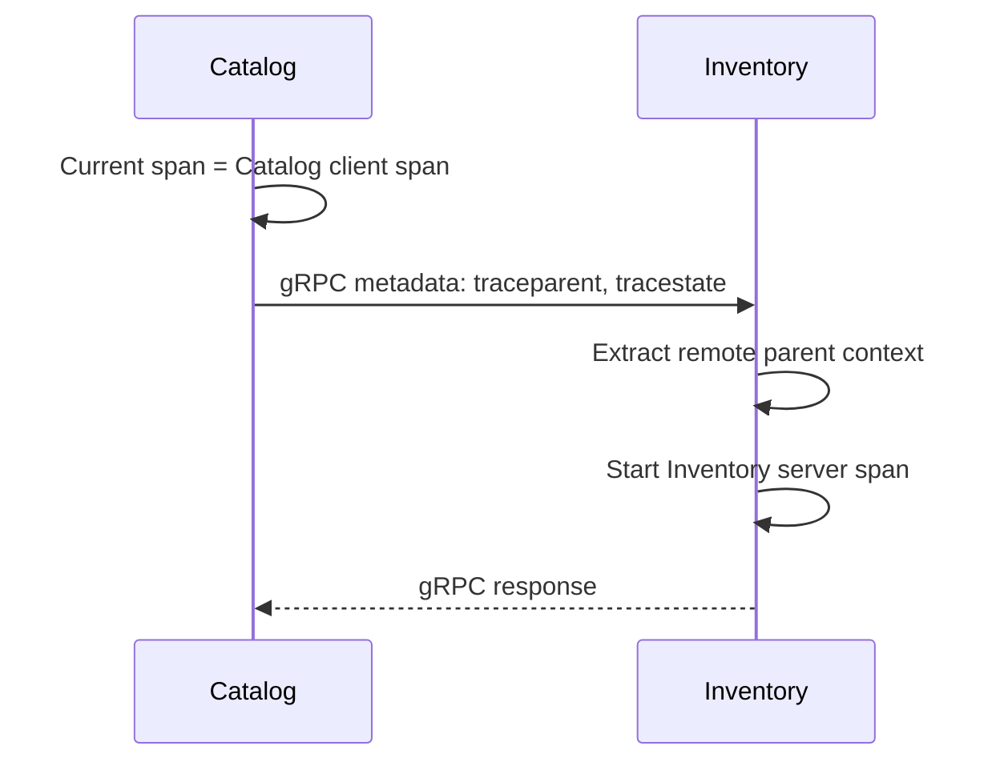
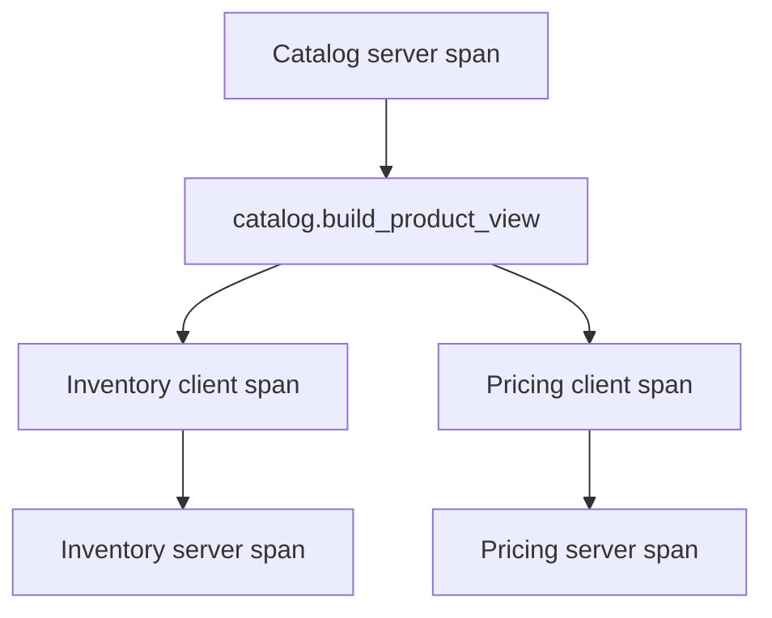

# Parent-Child Relationship Across Downstream Calls

## 1. Why Is a Parent-Child Relationship Needed?

In a Spring gRPC system, a request often traverses multiple services before producing the final response. For example, a Catalog API receives a request to read a product, calls Inventory to fetch stock availability, and returns aggregated data to the client. If each service creates its own separate trace without propagating context, the observability system sees disconnected traces and struggles to show which components the original request passed through.

OpenTelemetry models execution flows using **traces** and **spans**:

- A **trace** represents the entire journey of an operation across multiple processes.
- A **span** represents a unit of work with start/end timestamps, a name, kind, attributes, events, and status.
- A **parent-child relationship** represents causal linkage: a child span is created within the parent span's context and carries that span's parent span ID.
- **Trace context** carries trace ID, span ID, and sampling flags across process boundaries.

When Catalog calls Inventory via gRPC, Catalog's outbound client span is the parent of Inventory's inbound server span. As a result, the trace shows network wait time, processing on the calling service, and processing on the receiving service.

## 2. Span Tree Across a Downstream gRPC Call

A typical flow can have four spans:

1. `Catalog/GetProduct` — server span receiving the request from the external client.
2. `catalog.lookup` — internal span wrapping the use case orchestration step in Catalog.
3. `Inventory/GetAvailability` — client span created when Catalog calls Inventory.
4. `Inventory/GetAvailability` — server span at Inventory, receiving context from Catalog's client span.



Spans within the same trace share a trace ID but have distinct span IDs. Each child span's parent span ID points to its direct parent span. In the example, the Inventory server span's parent is the Inventory client span, not directly the Catalog server span. This structure accurately reflects call boundaries.

Do not create a new trace for each downstream call if it is a continuation of the current request. Likewise, do not share one span ID across multiple operations; each span is an independent unit.

## 3. W3C Trace Context Travels Through gRPC Metadata

OpenTelemetry uses propagators to transfer trace context across process boundaries. W3C Trace Context defines common headers:

- `traceparent`: contains version, trace ID, parent span ID, and trace flags.
- `tracestate`: carries additional vendor-specific information per the W3C specification.

With gRPC, these values are transmitted via HTTP/2 metadata. Metadata keys must be lowercase ASCII; `traceparent` and `tracestate` are valid keys. The OpenTelemetry propagator is responsible for serializing and parsing the standard format.

When client instrumentation makes a downstream call, it injects the current context into outbound metadata. Server instrumentation reads inbound metadata, extracts the context, and uses it as the parent for the new server span.



Do not manually build a `traceparent` string by concatenating trace ID and span ID. Use OpenTelemetry `TextMapPropagator` to avoid mistakes with formatting, sampling flags, or future version handling.

## 4. Prefer gRPC Auto-Instrumentation

When using the OpenTelemetry Java agent or appropriate instrumentation for gRPC Java, instrumentation can automatically:

- Create a server span when receiving an inbound gRPC call.
- Create a client span when a generated stub calls downstream over an instrumented channel.
- Extract/inject W3C Trace Context via gRPC metadata.
- Record method, status, error, and timing according to the instrumentation version's semantic conventions.
- Link spans to the request's current context.

In Spring gRPC, ensure that the channel and server actually fall within the instrumentation scope. If you use a custom channel factory, shaded Netty transport, or another transport, verify that your agent/instrumentation version supports that exact implementation.

Choose a clear strategy:

- **Auto-instrumentation:** let the agent/starter create gRPC client/server spans and handle propagation.
- **Manual instrumentation:** manually create spans and inject/extract context when the transport is not instrumented.

Do not install manual client/server interceptors that create the same span types alongside auto-instrumentation without explicit intent. If both create spans for a single gRPC call, traces will contain duplicate spans, confusing durations, and broken parent chains. Manual internal spans for distinct business steps remain useful even when auto-instrumentation creates transport spans.

## 5. Creating Internal Spans Around Application Operations

Auto-instrumentation typically creates the server span and outbound client span. You can add an internal span to measure a meaningful orchestration step in an application service—for instance, fetching stock availability before finalizing a product response.

Example using the OpenTelemetry API with a blocking stub:

```java
import io.grpc.StatusRuntimeException;
import io.grpc.Status;
import io.opentelemetry.api.trace.Span;
import io.opentelemetry.api.trace.SpanKind;
import io.opentelemetry.api.trace.StatusCode;
import io.opentelemetry.api.trace.Tracer;
import io.opentelemetry.context.Scope;

import java.util.concurrent.TimeUnit;

public final class ProductAvailabilityService {

    private final Tracer tracer;
    private final InventoryServiceGrpc.InventoryServiceBlockingStub inventoryStub;

    public ProductAvailabilityService(
            Tracer tracer,
            InventoryServiceGrpc.InventoryServiceBlockingStub inventoryStub) {
        this.tracer = tracer;
        this.inventoryStub = inventoryStub;
    }

    public AvailabilityResponse getAvailability(
            AvailabilityRequest request) {

        Span span = tracer.spanBuilder("catalog.lookup_inventory")
                .setSpanKind(SpanKind.INTERNAL)
                .setParent(io.opentelemetry.context.Context.current())
                .startSpan();

        try (Scope scope = span.makeCurrent()) {
            return inventoryStub
                    .withDeadlineAfter(400, TimeUnit.MILLISECONDS)
                    .getAvailability(request);

        } catch (StatusRuntimeException error) {
            span.recordException(error);
            if (Status.fromThrowable(error).getCode() != Status.Code.NOT_FOUND) {
                span.setStatus(StatusCode.ERROR);
            }
            throw error;

        } finally {
            span.end();
        }
    }
}
```

When calling the stub inside the internal span's scope, gRPC client auto-instrumentation sees the internal span as the current context and creates the client span as its child. When Inventory receives the call, server instrumentation extracts the client span context and creates the next server span.

This example assumes gRPC client instrumentation is active and `Tracer` is provided by the application's OpenTelemetry SDK/autoconfiguration. Without client auto-instrumentation, you must manually create the client span and handle propagation as shown in Section 7.

The example above treats downstream statuses other than `NOT_FOUND` as operation errors. This is only an illustrative policy: if `NOT_FOUND` is also an error under your use case's contract, mark the span `ERROR`; if it is an expected business outcome, keep the status aligned with your application semantics. Do not apply a mechanical status-mapping table to every RPC.

In production code, keep the `java.util.concurrent.TimeUnit` import; `AvailabilityRequest` and `AvailabilityResponse` are protobuf types for the example. Do not keep a scope open across an asynchronous operation.

## 6. Parent-Child Across Multiple Downstream Calls

An application operation can call multiple dependencies. If Catalog calls Inventory and Pricing in parallel, both client spans can share the internal span `catalog.build_product_view` as their parent:



These are two parallel child branches—not the Inventory span acting as parent of the Pricing span. Parent relationships express span-creation causality, not completion order or source code order.

If work is split into messages or background jobs executing independently after the current request finishes, consider creating a new trace/span and using a span link to represent causal linkage. Do not stretch a single request span across queue wait times or multi-minute background tasks when their lifecycles are independent.

## 7. When Manual Propagation Is Needed

If the transport is not auto-instrumented, you can use `TextMapPropagator` to inject/extract context via `io.grpc.Metadata`. Never parse headers manually with custom string logic.

Carrier setter for ASCII metadata:

```java
import io.grpc.Metadata;
import io.opentelemetry.context.propagation.TextMapGetter;
import io.opentelemetry.context.propagation.TextMapSetter;

static final TextMapSetter<Metadata> METADATA_SETTER =
        (carrier, key, value) -> {
            Metadata.Key<String> metadataKey =
                    Metadata.Key.of(
                            key,
                            Metadata.ASCII_STRING_MARSHALLER);
            carrier.put(metadataKey, value);
        };
```

The server side needs a corresponding getter to read ASCII metadata. Skip binary metadata keys because W3C trace headers are ASCII:

```java
static final TextMapGetter<Metadata> METADATA_GETTER =
        new TextMapGetter<>() {
            @Override
            public Iterable<String> keys(Metadata carrier) {
                return carrier.keys().stream()
                        .filter(key -> !key.endsWith("-bin"))
                        .toList();
            }

            @Override
            public String get(Metadata carrier, String key) {
                return carrier.get(Metadata.Key.of(
                        key, Metadata.ASCII_STRING_MARSHALLER));
            }
        };
```

Extraction uses the same propagator:

```java
io.opentelemetry.context.Context extracted = propagator.extract(
        io.opentelemetry.context.Context.current(),
        headers,
        METADATA_GETTER);
```

In the outbound client interceptor, inject the current OpenTelemetry context into metadata before the call is sent:

```java
propagator.inject(
        io.opentelemetry.context.Context.current(),
        headers,
        METADATA_SETTER);
```

In the inbound server interceptor, use `TextMapGetter<Metadata>` to read W3C keys and call `propagator.extract(...)`. The extracted context must be made current while dispatching the service and inside server call callbacks. When implementing a custom interceptor, you must wrap listener callbacks such as `onMessage`, `onHalfClose`, `onCancel`, `onComplete`, and `onReady` to restore the right OpenTelemetry context on callback threads.

This is the easiest part to get wrong when writing propagation manually: opening a `Scope` around `next.startCall(...)` and closing it immediately is not enough to preserve context for callbacks that execute later. Prefer OpenTelemetry gRPC instrumentation, which already handles this lifecycle. Only write custom interceptors when there is a specific reason and you have thoroughly tested every callback.

Propagation and span creation are two separate concerns. If instrumenting the client manually, `ClientInterceptor` must create a `CLIENT` span with the current context as its parent, inject the context containing that span into metadata, and keep the span open until the terminal callback `ClientCall.Listener.onClose(...)`. Inside the terminal callback, record the appropriate status/error and call `end()` exactly once. Do not create a client span and end it right after `start(...)`, because its duration would only measure initiation rather than the downstream call.

Do not pass trace context in business protobuf fields. Trace context is transport metadata that proxies and instrumentation can transform according to propagation standards.

## 8. OpenTelemetry Context and Async Threads

`io.opentelemetry.context.Context` stores the current trace context. When code executes on another executor, context may not automatically follow if the executor is not instrumented or wrapped.

You can capture the context and wrap the task:

```java
io.opentelemetry.context.Context parent =
        io.opentelemetry.context.Context.current();

executor.execute(parent.wrap(() -> {
    inventoryRefreshService.refresh(productId);
}));
```

`Context.wrap(...)` restores the captured context while the runnable executes and restores the thread's previous context when finished. For `CompletableFuture`, callbacks, or schedulers, use an instrumented executor or wrap each callback using the same principle.

Distinguish the two contexts:

- `io.opentelemetry.context.Context` carries OpenTelemetry spans/baggage and context propagation.
- `io.grpc.Context` carries the gRPC call context, including deadline, cancellation, and RPC-scoped data.

Both context types can be integrated by instrumentation, but they are not the same class and do not replace each other. Never store trace context in a custom `ThreadLocal` or a mutable field on a singleton.

## 9. Baggage Does Not Replace Trace Context

W3C Baggage can propagate certain business metadata across services, but it does not establish parent spans. Parent-child relationships are built from trace context, primarily trace ID and span ID.

Only place small, non-sensitive values in baggage, such as a tenant tier or rollout cohort if policy allows. Never transmit access tokens, emails, personal data, payment information, or large payloads in baggage. Baggage can be forwarded to many downstream services and appear in telemetry.

Do not use baggage to make authorization decisions. Access permissions must rely on verified credentials and policies.

## 10. Status, Exceptions, Deadlines, and Cancellation

Client spans and server spans should reflect the actual outcome of the gRPC call. Instrumentation typically records method, status code, and errors per semantic conventions:

- Successful RPCs end normally.
- Transport errors or unsuccessful gRPC statuses are recorded according to instrumentation rules.
- Exceptions can be recorded as events/exception attributes on the appropriate span.
- Deadlines and cancellations terminate the call; the server should cancel downstream work when possible.

Do not automatically mark every business outcome like `NOT_FOUND` as a system error. Status semantics should align with the API contract and the active semantic conventions. Avoid recording request/response payloads, secret metadata, or exception messages containing sensitive data in span attributes.

Deadline propagation and trace propagation are two distinct mechanisms. gRPC manages call deadlines/cancellations; OpenTelemetry manages trace context. A call can have a valid trace context with too short a deadline, or have a deadline without being traced. Instrumentation should produce spans with durations reflecting the actual call and never extending past call completion.

## 11. Sampling and Trace Data

Parent-based sampling generally ensures child spans follow the sampling decision propagated from upstream. If a request is not sampled, downstream services may still receive trace context without exporting sampled spans. This maintains trace consistency across multiple services.

Sampling policies must balance investigation capability with telemetry cost. You can use ratio sampling for normal traffic and tail sampling at the collector if infrastructure supports it, retaining traces with errors or high latency. Tail sampling requires holding related spans at the collector long enough and must be sized for traffic volume.

Do not generate a new trace ID for a downstream call belonging to the current request. If traces break, check propagators, instrumentation scope, custom channels, and metadata before changing sampling policies.

## 12. Integration and Testing in Spring gRPC

In Spring Boot, the OpenTelemetry SDK/agent must be initialized with the proper lifecycle and the gRPC server/client must fall within instrumentation scope. Applications can inject `Tracer` to create internal spans; transport spans and propagation should be managed by the agent/starter or corresponding instrumentation library.

Parent-child tests must verify ID relationships, not merely check that the exporter received spans:

| Check | Expected Result |
| --- | --- |
| Inbound request to Catalog | Server span exists with a new trace ID or the upstream trace ID. |
| Internal span in Catalog | Same trace ID, parent span ID is Catalog server span. |
| Outbound gRPC call | Client span exists, parent is the currently active internal span. |
| Request to Inventory | Server span in Inventory has the same trace ID, parent is Catalog's client span. |
| Parallel downstream calls | Client spans share the parent internal span, each with its own span ID. |
| Execution via executor | Callback still has the right trace context when wrapped/instrumented. |
| RPC error or timeout | Span ends, status/error recorded per policy; no spans left open. |

You can use `InMemorySpanExporter` from the test SDK to collect finished spans and verify `traceId`, `spanId`, `parentSpanId`, `SpanKind`, and status. For propagation over gRPC networking, add an integration test using Netty transport; in-process tests do not prove metadata is serialized over HTTP/2 as in production.

A useful test is calling Catalog via an instrumented gRPC client, having Catalog call Inventory, and verifying that the Inventory server span's parent span ID equals the Catalog client span ID. If trace IDs differ, inspect extract/inject and the current context at the moment the downstream call is created.

## 13. Common Mistakes

1. **Each service starts a new trace.** Traces become fragmented. Use a propagator to pass context via metadata.
2. **Creating only internal spans without instrumenting the gRPC client.** Outbound RPC duration and status are missing. Enable client instrumentation or create client spans manually.
3. **Enabling auto-instrumentation and adding interceptors that create duplicate client/server spans.** Traces contain duplicate spans. Pick one mechanism for transport spans.
4. **Injecting context before the parent span is current.** Client span has the wrong parent or no parent. Open a scope around the downstream call.
5. **Closing `Scope` too early in async flows.** Callbacks lose trace context. Wrap callbacks or use executor instrumentation.
6. **Wrapping only `startCall` without wrapping server listener callbacks.** Context vanishes when callbacks run on other threads. Use lifecycle-aware instrumentation.
7. **Confusing OpenTelemetry `Context` with gRPC `Context`.** Deadlines/cancellations and trace context are mishandled. Understand both context types clearly.
8. **Using baggage to pass tokens or make permission decisions.** Sensitive data leaks downstream. Keep baggage small, non-sensitive, and never use it for authorization.
9. **Failing to end spans on RPC error/cancel.** Traces show abnormally long spans. Use `finally` or terminal callbacks to call `end()` once.
10. **Checking only trace IDs.** Fails to verify the parent-child chain. Assert both parent span ID and span kind.

## 14. Practice Exercise

Set up tracing across two services, Catalog and Inventory:

1. Enable OpenTelemetry instrumentation for the gRPC server and client in both applications.
2. Send a unary request to Catalog via a generated stub.
3. Create an internal span `catalog.lookup_inventory` around the application service orchestration step.
4. Within the internal span's scope, call Inventory using a generated stub with a deadline.
5. Verify that `traceparent` is injected into gRPC metadata and Inventory creates a server span from that context.
6. Use an in-memory exporter or test collector to verify the same trace ID and exact parent span ID across all four spans.
7. Test `UNAVAILABLE`, `DEADLINE_EXCEEDED`, cancellation, and a downstream call running on an executor.
8. Verify there are no duplicate spans, unclosed spans, or sensitive metadata in attributes/baggage.

**Self-Check:** A parent-child relationship across downstream calls is formed when the outbound gRPC client span uses the current context as its parent and propagates W3C Trace Context through metadata. The downstream server extracts that context to create a child server span. In Spring gRPC, prefer auto-instrumentation for transport; add internal spans for meaningful application operations, propagate context across async callbacks, and verify both trace ID and parent span ID to prove trace continuity.
