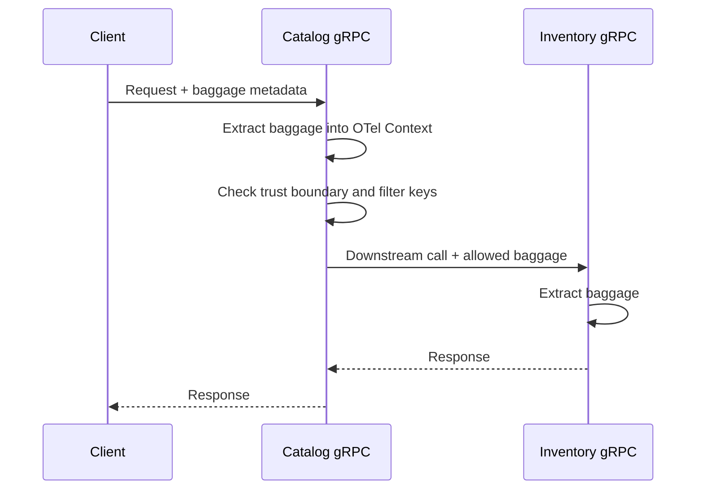

# Baggage and Data Propagation Risks

## 1. What Is Baggage?

OpenTelemetry Baggage is a set of key-value pairs that travel with the execution context and can be propagated from one service to another. Applications use baggage to carry a small amount of cross-cutting information throughout a request—such as a rollout cohort or service tier—when downstream components need that same context.

Baggage is typically transmitted via the W3C Baggage header. With gRPC, the propagator converts this header into ASCII metadata with the key `baggage`. When a client calls downstream, instrumentation injects the current baggage into metadata; the receiving server extracts it into OpenTelemetry `Context`.

Baggage is useful, but its propagation scope is wide. Every downstream service that receives baggage can forward it onward. Therefore, place only approved, non-sensitive, small, bounded-value data into baggage.

## 2. How Does Baggage Differ from Trace Context?

Trace Context and Baggage both reside in OpenTelemetry `Context`, but they solve two different problems:

| Component | Purpose | Example |
| --- | --- | --- |
| Trace Context | Identifies the trace, current span, and parent-child relationship | trace ID, span ID, sampling flags |
| Baggage | Carries additional key-value pairs across services | tenant tier, deployment ring, experiment group |

Trace Context stitches spans into a single trace. Baggage does not create traces, select parent spans, or replace span IDs. A request can have trace context without baggage; conversely, baggage can be carried in context even when a trace is not sampled.

Baggage is also not a place to store authentication or authorization data. A value such as `tenant.id` sent by a client can be spoofed; the server must never use it to decide which tenant the caller belongs to. Permissions must rely on verified credentials and application-layer policies.

## 3. Baggage Travels Through gRPC Metadata

W3C Baggage defines the `baggage` header to carry key-value members along with optional metadata. In gRPC, this header is transmitted over HTTP/2 metadata. ASCII metadata keys must be lowercase.

Typical downstream flow:



The OpenTelemetry propagator is responsible for encoding, decoding, and enforcing W3C rules. Do not manually concatenate header strings or parse by splitting on commas; values may require escaping and the format can evolve per the specification.

Baggage is only transmitted if both the propagator and instrumentation are configured to support it. Enabling `traceparent` does not automatically guarantee that baggage is injected/extracted as well.

## 4. Configuring W3C Baggage in OpenTelemetry Java

When using the OpenTelemetry Java agent or SDK autoconfiguration, configure propagators to include both Trace Context and Baggage. With the Java agent, a commonly used environment variable is:

```bash
OTEL_PROPAGATORS=tracecontext,baggage
```

Configuration names and values must match your application's agent/SDK version. If the application builds the SDK manually, configure the corresponding composite propagator rather than assuming the global SDK already includes a baggage propagator.

In a system with gRPC auto-instrumentation enabled, client instrumentation can inject baggage when making outbound calls and server instrumentation extracts baggage when receiving calls. Verify that your actual transport and channels are within the instrumentation scope, especially when using a custom channel factory or shaded Netty.

Do not install an extra manual interceptor solely to inject the same baggage if auto-instrumentation already does so. Two mechanisms injecting simultaneously can cause duplicate metadata or unintended overwrites.

## 5. Creating Baggage from Verified Data

Only create baggage from trusted sources, such as a principal verified by the authentication layer or deployment configuration. Never copy all client request metadata into baggage.

Example where the application already has a principal with a policy-verified tier:

```java
import io.opentelemetry.api.baggage.Baggage;
import io.opentelemetry.context.Context;
import io.opentelemetry.context.Scope;

import java.util.concurrent.TimeUnit;

public AvailabilityResponse getAvailability(
        AvailabilityRequest request,
        AuthenticatedPrincipal principal) {

    Baggage baggage = Baggage.builder()
            .put("tenant.tier", principal.tenantTier())
            .put("deployment.ring", "stable")
            .build();

    Context requestContext =
            baggage.storeInContext(Context.current());

    try (Scope scope = requestContext.makeCurrent()) {
        return inventoryStub
                .withDeadlineAfter(400, TimeUnit.MILLISECONDS)
                .getAvailability(request);
    }
}
```

In this example, the tier comes from a verified principal; it is not taken directly from the protobuf request or arbitrary metadata. The deployment ring value comes from service configuration. When outbound gRPC client instrumentation runs inside this scope, the propagator can inject baggage into downstream metadata.

A new `Baggage` builder contains only the keys added to it. When stored into the current context, this baggage replaces existing baggage in that context, preventing unapproved inbound keys from being forwarded. If the application needs to preserve additional keys, add each key through an explicit allowlist.

Never use baggage to carry access tokens, refresh tokens, API keys, passwords, session cookies, emails, phone numbers, addresses, payment data, or business payloads.

## 6. Reading Baggage in a Downstream Service

Once server instrumentation has extracted baggage, application code can read the current value:

```java
import io.opentelemetry.api.baggage.Baggage;

String tenantTier =
        Baggage.current().getEntryValue("tenant.tier");

if (tenantTier == null) {
    tenantTier = "unspecified";
}
```

Baggage values are context data passed from upstream. Validate format, length, and allowed value sets before using them. For example, tenant tier might only accept `standard`, `premium`, or `enterprise`.

Baggage may support technical decisions such as choosing a cache tier or grouping telemetry if policy permits. It must never be used as proof of identity, access rights, or tenant boundaries. If a downstream service needs tenant identity, obtain it from an authenticated principal or independently verified credentials.

## 7. Allowlisting and Sanitizing at Trust Boundaries

Inbound baggage can arrive from external clients, gateways, or untrusted services. Treat every key/value received from remote baggage as unverified input.

A safe ingress workflow:

1. Extract baggage using the W3C propagator.
2. Read only keys present in the allowlist.
3. Validate source, format, length, and allowed values.
4. Build a new `Baggage` containing only accepted keys.
5. Make the filtered baggage current before calling downstream.

Example filtering tenant tier against allowed values:

```java
Baggage inbound = Baggage.current();

String tier = inbound.getEntryValue("tenant.tier");
String approvedTier = switch (tier == null ? "" : tier) {
    case "standard", "premium", "enterprise" -> tier;
    default -> "unspecified";
};

Baggage sanitized = Baggage.builder()
        .put("tenant.tier", approvedTier)
        .put("deployment.ring", deploymentRing)
        .build();

Context downstreamContext =
        sanitized.storeInContext(Context.current());

try (Scope scope = downstreamContext.makeCurrent()) {
    return inventoryStub.getAvailability(request);
}
```

The example retains only two defined keys; other inbound baggage keys are not forwarded. In production, you can omit invalid keys entirely instead of replacing them with `unspecified`, depending on your contract. If a value affects any security decision, re-derive it from the authenticated principal rather than merely validating baggage syntax.

Sanitization must occur at every trust boundary. Never assume every service inside an internal network is safe to receive all upstream baggage.

## 8. Security and Privacy Risks

Baggage can propagate across many hops, including services unknown to the initial caller. Major risks include:

- **Sensitive data exposure:** downstream services, proxies, or telemetry systems can read the metadata.
- **Context spoofing:** callers can send keys like `tenant` or `role` to mislead downstream services.
- **Header amplification:** each hop forwarding extra keys causes metadata to grow larger.
- **Log leakage:** middleware or proxies may log raw metadata.
- **Untrusted values:** values containing control characters, overly long strings, or payloads that break parsers/logs.
- **Cross-boundary propagation:** internal data can leak to external services/vendors beyond the intended scope.

TLS protects data in transit between two TLS endpoints, but it does not prevent the receiving endpoint from reading baggage. TLS also does not stop a service from writing baggage into logs or exporting it to a telemetry backend.

Never place secrets into baggage assuming they are encrypted or readable only by the creator. Baggage is not a secret store and carries no origin-authenticity signature.

## 9. Size and Cardinality Limits

Baggage is per-request metadata. Excessively long lists or large values increase header size, bandwidth, parsing overhead, and the risk of exceeding metadata/header-list limits in gRPC, HTTP/2, or proxies.

Set an application-level budget:

- Limit the number of allowed keys.
- Limit key and value lengths.
- Limit total encoded baggage size.
- Reject or strip keys not in the allowlist.
- Do not repeat the same information across multiple keys or hops.
- Measure the rate of requests whose baggage is stripped or exceeds budget without logging raw values.

Do not rely on a single default limit across all deployments. gRPC transports, reverse proxies, and gateways can enforce different limits; configure your application's budget below the lowest limit along the path.

Cardinality also matters when baggage is converted into span attributes or used to group metrics. Values such as user ID, request ID, or order ID have very high cardinality. Never create metric labels from those values; metrics require bounded, stable dimensions. Only add baggage to span attributes when genuinely needed and after evaluating privacy, size, and cardinality.

Baggage does not automatically become a span attribute or metric label in every configuration. Exporting depends on instrumentation, processors, and application settings. Even so, treat baggage as data observable downstream and potentially recorded by instrumentation if enabled.

## 10. Baggage in Async Flows and Downstream Calls

OpenTelemetry `Context` holds both baggage and span context. When switching to an executor or asynchronous callback, context may not propagate automatically if the executor is not instrumented.

Capture context before switching threads:

```java
Context captured = Context.current();

executor.execute(captured.wrap(() -> {
    inventoryRefreshService.refresh(productId);
}));
```

When the callback makes a downstream gRPC call inside the wrapper, instrumentation sees the right baggage and span context. For `CompletableFuture`, schedulers, or callback frameworks, use an instrumented executor or wrap callbacks using the same principle.

Distinguish OpenTelemetry `Context` from `io.grpc.Context`. OpenTelemetry `Context` carries spans and baggage; gRPC `Context` carries deadlines, cancellations, and call-scoped data. Instrumentation may integrate both contexts, but they are two different APIs.

Never store baggage in a mutable field on a singleton or a custom `ThreadLocal`. Concurrent RPCs can leak context between requests if an application manages per-thread state improperly.

## 11. Baggage and Observability

Baggage can help group telemetry by a low-cardinality attribute, such as `tenant.tier` or `deployment.ring`. However, you should not automatically copy all baggage into span attributes or log fields.

If you need to record a value onto a span, explicitly choose the key and timing:

```java
Span.current().setAttribute(
        "app.tenant.tier",
        approvedTier);
```

Record only allowlisted, non-sensitive values. Use an application attribute namespace to distinguish them from standard semantic conventions. Do not record user IDs or raw tenant IDs just to make trace search easier; consider controlled correlation IDs and telemetry access policies instead.

Metrics should use dimensions with finite value sets. If per-tenant analysis is needed, aggregate in the backend or use a tier dimension instead of individual tenant identifiers.

## 12. Testing Baggage Propagation

Tests must demonstrate both that allowed keys propagate accurately and that unauthorized data is stripped.

| Scenario | Expected Outcome |
| --- | --- |
| Client sends allowlisted baggage | Downstream reads the exact value after extraction. |
| Client sends unknown key | Key is not forwarded across the trust boundary. |
| Client sends invalid tenant tier | Value is stripped or replaced with a fallback per policy. |
| Baggage value is too long | Request is constrained or key is dropped per budget. |
| No baggage present | RPC still runs with default behavior. |
| Two concurrent RPCs have different baggage | Context from one request never leaks into the other. |
| Callback runs on executor | Baggage is preserved when context is wrapped. |
| Baggage contains simulated sensitive data | Does not appear in logs, span attributes, or responses. |

For integration tests, use the Netty gRPC transport to verify W3C baggage actually travels over HTTP/2 metadata. The test server can read `Baggage.current().getEntryValue(...)` and record the observed value in a test fixture. In-process transport is useful for application context but is not sufficient to prove network propagation.

You can use a test propagator or exporter to inspect traces/baggage, but do not infer baggage was exported merely because a trace span exists. If testing span attributes, the application must actively attach the attribute or configure instrumentation to do so.

## 13. Common Mistakes

1. **Using baggage as authentication.** Clients can spoof values. Verify identity with credentials and policies.
2. **Forwarding all inbound baggage.** Untrusted keys spread to every downstream service. Use an allowlist and construct fresh baggage at trust boundaries.
3. **Putting PII or secrets into baggage.** Multiple services and telemetry backends can inspect it. Propagate only approved non-sensitive data.
4. **Manually parsing or concatenating baggage headers.** Escaping and formatting break easily. Use the W3C propagator.
5. **Assuming enabling `tracecontext` enables `baggage`.** Propagators may only include trace context. Explicitly configure `tracecontext` and `baggage`.
6. **Adding a manual interceptor alongside auto-instrumentation.** Can duplicate or overwrite metadata. Choose one propagation mechanism.
7. **Allowing baggage to grow unbounded across hops.** Large headers waste resources. Enforce key, value, and total budgets.
8. **Using user/request IDs as metric labels.** Creates high cardinality. Use only bounded dimensions.
9. **Assuming TLS keeps baggage secret from the receiving service.** TLS only protects transit. Never send data the endpoint should not read.
10. **Failing to propagate OTel `Context` across executors.** Downstream loses baggage or span parent. Use `Context.wrap` or executor instrumentation.

## 14. Practice Exercise

Set up safe baggage propagation for the flow where Catalog calls Inventory:

1. Enable W3C Trace Context and Baggage propagators in the OpenTelemetry Java agent/SDK.
2. Create `tenant.tier` baggage from an authenticated principal and `deployment.ring` from service configuration.
3. Store baggage into OpenTelemetry `Context` before calling Inventory via the generated gRPC stub.
4. At ingress, retain only allowlisted keys and validate values against allowed sets, lengths, and budget.
5. In Inventory, read baggage for technical grouping; never use it to determine tenant identity or authorization.
6. Offload a downstream call onto an executor and verify the context is wrapped.
7. Write a Netty integration test covering propagation, unknown key stripping, invalid values, oversized baggage, and two concurrent requests.
8. Verify that logs, spans, and metrics contain no tokens, PII, or high-cardinality identifiers.

**Self-Check:** Baggage is key-value data transmitted alongside OpenTelemetry `Context` across services; it supplements context rather than establishing trace parents or caller identity. With Spring gRPC, use the W3C propagator to pass it via metadata, build baggage from verified sources, filter with an allowlist at trust boundaries, enforce size/cardinality limits, and never put secrets or PII in baggage. Test both proper propagation and prevention of unauthorized data flowing downstream.
