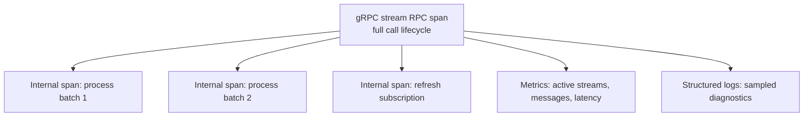

# Tracing Long-Lived Streams

## 1. Characteristics of Long-Lived Streaming RPCs

A gRPC streaming RPC can keep a connection open and exchange messages over a long period. For example, Catalog opens a stream watching inventory updates from Inventory; the client sends a subscription request once and receives many updates until the stream closes. For unary RPCs, span lifetime typically matches a short operation. For long-lived streams, a span can remain active for minutes or hours.

OpenTelemetry typically creates one client span or server span per **RPC**, rather than automatically creating a new span for every message. The span starts when the RPC is initiated or received and only ends when the call completes, errors, or is cancelled. Consequently, a long stream can produce a very long span.

Separate three observability questions:

- **RPC lifecycle:** when was the stream opened, how long did it last, and did it end normally or due to error/cancellation?
- **Message activity:** how many messages arrived/departed, at what rate, size, and processing latency?
- **Child work:** what steps were executed to process a batch or significant message?

Do not answer all three by creating a span for every single message. That approach can generate huge span volumes, inflate collector costs, and make traces unreadable. Use spans for the RPC lifecycle and meaningful operations; use metrics for counts/rates and controlled logs for diagnostic details.

## 2. One Span Represents the Entire Streaming RPC

For a server-streaming RPC:

```protobuf
rpc WatchStock(WatchStockRequest) returns (stream StockUpdate);
```

The client sends one request; the server can emit multiple responses. The RPC's server span covers the full call-processing duration, from receiving the request until the stream ends. The corresponding client span covers the time the client waits for the stream to end or cancels it.

For client-streaming:

```protobuf
rpc UploadEvents(stream EventChunk) returns (UploadSummary);
```

The client sends multiple messages and then half-closes the sending side. The server returns a single final response. The RPC span stays open until the call finishes; client half-close does not mean the response is finished.

For bidirectional streaming:

```protobuf
rpc Exchange(stream ClientMessage) returns (stream ServerMessage);
```

Both message directions progress independently while belonging to the same RPC. The span only ends when the call reaches a terminal state: completion, error, cancellation, or deadline. One side stopping its sends does not necessarily close the other side.

| RPC Type | Typical Terminal Event |
| --- | --- |
| Unary | Response completes or errors |
| Server-streaming | Server closes response stream or call errors/cancels |
| Client-streaming | Client half-closes, server sends final response and call completes |
| Bidirectional | Entire call reaches terminal state; single-direction half-close is not enough |

Do not end the span immediately after the handler method returns if the stream is still open. With streaming, the initiating method may return early while callbacks continue emitting messages.

## 3. Observability Model for Long-Lived Streams

A practical model consists of three layers:

1. **RPC span:** one client/server span covering the entire stream lifecycle, recording method, peer, status, duration, and appropriate terminal reason.
2. **Metrics:** measuring active streams, message count, byte count, processing latency, queue depth, reconnects, and cancellations.
3. **Child spans or linked spans:** capturing significant batches or processing steps, rather than creating a span for every message by default.



The RPC span shows how long the stream session lived and how it ended. Metrics show how the stream behaved over that duration. Child spans help pinpoint a slow processing batch without bloating the trace per message.

Use stable span names, such as `inventory.watch_stock`. Never embed product IDs, user IDs, or unique stream IDs in span names; dynamic identifiers make traces hard to group and raise storage costs.

## 4. Auto-Instrumentation and Lifecycle Responsibility

The OpenTelemetry Java agent or gRPC instrumentation can automatically create client/server spans for streaming RPCs and inject/extract Trace Context via gRPC metadata. When auto-instrumentation is enabled, let instrumentation own the transport span lifecycle.

Do not add another `ServerInterceptor` or `ClientInterceptor` that creates the same span type for the same RPC. If both auto-instrumentation and a manual interceptor create transport spans, traces can exhibit duplicate spans and confusing parent-child chains.

Manual instrumentation remains useful for business operations inside the stream, such as `inventory.process_batch`. That span is `INTERNAL` and a child of the current context; it does not replace the server/client RPC span.

Before concluding a stream has no span, check:

- Whether the gRPC server/channel falls within agent instrumentation scope;
- Whether the transport in use is supported by your instrumentation version;
- Whether the propagator has `tracecontext` enabled;
- Whether the span has ended — the SDK/exporter typically exports a span only after `end()` is called;
- Whether the sampler retained that trace.

For a stream that has not yet finished, not seeing a completed span in the backend does not necessarily mean instrumentation is broken.

## 5. Tracking Stream Lifecycle with a Manual Span

Create manual spans for transport only when no auto-instrumentation is present. When an automatic server span already exists, use `Span.current()` to attach appropriate information or create an internal span for application work.

The example below illustrates an internal span wrapping long-lived subscription handling. The span ends in terminal callbacks rather than immediately after registering the data source:

```java
import io.opentelemetry.api.trace.Span;
import io.opentelemetry.api.trace.SpanKind;
import io.opentelemetry.api.trace.StatusCode;
import io.opentelemetry.context.Context;
import io.grpc.stub.ServerCallStreamObserver;
import io.grpc.stub.StreamObserver;

import java.util.concurrent.atomic.AtomicBoolean;

Span streamWork = tracer.spanBuilder("inventory.watch_stock")
        .setSpanKind(SpanKind.INTERNAL)
        .startSpan();

Context streamContext =
        streamWork.storeInContext(Context.current());

AtomicBoolean ended = new AtomicBoolean();

@SuppressWarnings("unchecked")
ServerCallStreamObserver<StockUpdate> serverCallObserver =
        (ServerCallStreamObserver<StockUpdate>) responseObserver;

serverCallObserver.setOnCancelHandler(
        streamContext.wrap(() -> {
            if (ended.compareAndSet(false, true)) {
                streamWork.addEvent("stream.cancelled");
                try {
                    cancelSubscription();
                } finally {
                    streamWork.end();
                }
            }
        }));

subscription.onNext(update -> streamContext.wrap(() -> {
    if (!ended.get() && !serverCallObserver.isCancelled()) {
        responseObserver.onNext(toProto(update));
    }
}).run());

subscription.onError(error -> streamContext.wrap(() -> {
    if (ended.compareAndSet(false, true)) {
        streamWork.recordException(error);
        streamWork.setStatus(StatusCode.ERROR);
        try {
            responseObserver.onError(toGrpcError(error));
        } finally {
            streamWork.end();
        }
    }
}).run());

subscription.onComplete(() -> streamContext.wrap(() -> {
    if (ended.compareAndSet(false, true)) {
        try {
            responseObserver.onCompleted();
        } finally {
            streamWork.end();
        }
    }
}).run());
```

This is an illustrative skeleton; `serverCallObserver` is a `ServerCallStreamObserver` obtained from the response observer, and `subscription` is an abstraction of a data source with callbacks and a cancel operation. Real code must register callbacks using the exact publisher API in use, handle subscription registration errors, and guarantee terminal cleanup runs exactly once across all exit paths.

`streamContext.wrap(...)` restores OpenTelemetry context when callbacks execute on different threads. `AtomicBoolean` guards the terminal transition when cancel, error, and complete race. When the client cancels, you must also cancel the underlying subscription/source task to stop downstream work, not merely end the span.

If the framework already created a server span for the RPC, the internal span above is a child of that server span. Do not assign `SpanKind.SERVER` a second time for the same call.

## 6. Half-Close, Completion, Error, and Cancellation

Streaming has several signals that are easy to confuse:

- `onCompleted()` on the client's request observer closes the request sending direction.
- `onCompleted()` on the response observer signals that the response stream finished normally.
- `onError()` terminates that stream direction with an error.
- Cancellation can originate from the client, the server, or a deadline.
- `ServerCallStreamObserver.setOnCancelHandler(...)` lets the server clean up resources when the client cancels the call.

The span should not end upon client half-close alone if the server is still processing and preparing the final response. With bidirectional streaming, half-closing the request direction does not terminate the response direction either.

When the call finishes, record a diagnostically useful terminal reason, such as `completed`, `cancelled`, `deadline_exceeded`, or the status code. Avoid recording message payloads, tokens, or sensitive metadata inside events.

Cancellation is not always a server error. A client may close a stream because the user navigated away or a subscription is no longer needed. Record cancellation as a distinct outcome; only mark the span `ERROR` according to appropriate semantics and policies rather than turning every cancellation into a system incident.

## 7. Measuring Message Flow with Metrics

A single long span does not provide enough detail about message rates over time. Metrics are better suited for counts and distributions:

| Suggested Metric | Instrument | Purpose |
| --- | --- | --- |
| `grpc.stream.active` | `UpDownCounter` | Number of currently open streams |
| `grpc.stream.messages.received` | `Counter` | Total messages received |
| `grpc.stream.messages.sent` | `Counter` | Total messages sent |
| `grpc.stream.message.processing.duration` | `Histogram` | Latency to process a message or batch |
| `grpc.stream.duration` | `Histogram` | Duration of a finished stream |
| `grpc.stream.cancelled` | `Counter` | Number of cancelled streams |
| `grpc.stream.queue.depth` | Observable gauge or callback gauge | Processing queue depth |

Example metric declarations:

```java
LongUpDownCounter activeStreams = meter
        .upDownCounterBuilder("grpc.stream.active")
        .setDescription("Number of active streaming RPCs")
        .build();

LongCounter messagesReceived = meter
        .counterBuilder("grpc.stream.messages.received")
        .build();

LongHistogram messageProcessingTime = meter
        .histogramBuilder("grpc.stream.message.processing.duration")
        .ofLongs()
        .setUnit("ms")
        .build();
```

When a stream starts, increment active streams; when it ends on any terminal path, decrement exactly once. Increment message counters when a message is actually received or sent according to a consistent metric definition. Record processing duration around processing work, excluding network wait time if the goal is to measure application processing.

Metric attributes must have low cardinality: service, method, status class, or stream direction. Never use stream ID, message ID, user ID, product ID, or tenant ID as metric labels. Never create a metric label per connection.

## 8. Events and Child Spans: Choosing the Right Granularity

Span events are appropriate for infrequent milestones, for example:

- `subscription.started`;
- `first.message.received`;
- `stream.backpressure.enabled`;
- `stream.reconnected`;
- `stream.cancelled`.

Do not add an event for every message in a high-throughput stream. A span's event list grows over time and can bloat export payloads or hit SDK/backend limits.

Create child spans for meaningful batches or phases:

```java
import io.opentelemetry.context.Scope;

Span batchSpan = tracer.spanBuilder("inventory.process_batch")
        .setSpanKind(SpanKind.INTERNAL)
        .setParent(Context.current())
        .startSpan();

try (Scope scope = batchSpan.makeCurrent()) {
    processBatch(batch);
} catch (RuntimeException error) {
    batchSpan.recordException(error);
    batchSpan.setStatus(StatusCode.ERROR);
    throw error;
} finally {
    batchSpan.end();
}
```

The example above assumes the stream's context has been restored before processing the batch. The batch span is a child of the stream context. If an independent message is enqueued and processed after the stream has already ended, consider creating a separate span linked to the stream span context instead of keeping the parent span open or retaining request context longer than necessary.

## 9. Span Links for Work That Outlives the Stream

Parent-child fits when child work lies within the parent span's lifecycle and execution context. However, a stream may enqueue background work that executes after the RPC has closed. Keeping the stream span as the parent for multi-hour background work tightly couples two lifecycles that no longer share the same timeframe.

In that case, create an independent job/batch span and add a link to the stream span context:

```java
import io.opentelemetry.api.trace.SpanContext;

SpanContext source = streamWork.getSpanContext();

Span backgroundWork = tracer.spanBuilder("inventory.process_queued_batch")
        .setNoParent()
        .addLink(source)
        .setSpanKind(SpanKind.CONSUMER)
        .startSpan();

try (Scope scope = backgroundWork.makeCurrent()) {
    processQueuedBatch(batch);
} catch (RuntimeException error) {
    backgroundWork.recordException(error);
    backgroundWork.setStatus(StatusCode.ERROR);
    throw error;
} finally {
    backgroundWork.end();
}
```

A span link expresses causal linkage without forcing the job to be a child within the stream's lifecycle. Links must be added at span creation time. If you need to pass context to the job, pass only the `SpanContext` or necessary correlation metadata—not the entire request object or credentials.

Do not use links instead of parent-child everywhere. If a batch is processed directly as a synchronous part of a stream callback, a child span is usually easier to understand. Links are useful when work is decoupled, fan-in, or runs independently.

## 10. Async Context and Callback Threads

Streaming callbacks often run on transport executors or application executors. OpenTelemetry `Context` must not be assumed to cross thread boundaries automatically.

Capture context when creating the operation and wrap callbacks:

```java
Context streamContext = Context.current();

executor.execute(streamContext.wrap(() -> {
    Span.current().addEvent("stream.batch.processing");
    processNextBatch();
}));
```

If you created an internal span for the stream, use the context containing that span. Every callback must run in the right context so child spans get the proper parent and log correlation is preserved.

OpenTelemetry `Context` differs from `io.grpc.Context`. gRPC `Context` carries deadlines, cancellation, and call-scoped values; OpenTelemetry `Context` carries spans and baggage. Instrumentation may integrate both contexts, but applications must use the right API for each purpose.

Never store a stream's span or baggage in a mutable field on a singleton service. Concurrent streams will overwrite each other's context. Per-stream state belongs in a dedicated lifecycle object created for that call.

## 11. Sampling and Exporting Long-Lived Spans

The SDK typically exports a span after the span ends. For long-lived streams, the span may not appear in the backend until the RPC closes. This affects how you investigate currently active streams.

Head sampling decides whether to keep a span at the beginning based on initial information. If the sampler drops the trace initially, errors occurring hours later will lack a full trace. Sampling policies must balance trace retention rate and cost.

Tail sampling at a collector generally holds a trace's spans in memory to decide after seeing the outcome. A very long stream can force the collector to retain state for a long time, consuming memory and hitting trace-retention limits. While the trace has not finished, the collector lacks final outcome data to decide keep/drop based on latency or errors.

For long-lived streams:

- Use metrics to observe current state and message-flow trends.
- Use bounded span events for key milestones.
- Use child spans for batches or operations of meaningful duration.
- Consider head sampling suited to traffic and policy.
- If traces are needed per long phase, create bounded operation spans or separate job spans; do not fake ending the transport span while the RPC remains open.
- Check memory limits, trace timeouts, and incomplete-trace behavior of your tail sampler/collector.

Do not assume enabling tail sampling automatically solves all long traces. Collectors and exporters need limits configured appropriately for real stream durations.

## 12. Spring gRPC and Instrumentation Strategy

In Spring gRPC, prefer the OpenTelemetry Java agent or a compatible instrumentation starter to create transport spans and handle propagation for server/client. Create internal spans in application services for meaningful phases such as reading snapshots, processing batches, or writing results.

In real configuration:

1. Verify that both the Spring-managed gRPC server and named client channels are instrumented.
2. Share a single OpenTelemetry SDK/provider across the application; avoid creating a separate SDK per service bean.
3. Do not create manual server/client spans duplicating auto-instrumentation.
4. Wrap executors/callbacks to preserve OTel `Context`.
5. End spans and update active-stream metrics exactly once upon complete/error/cancel.
6. Set appropriate deadlines, idle timeouts, or subscription lifetime policies; unbounded streams still need reconnect and cleanup mechanisms.
7. Never put message payloads, credentials, or sensitive identifiers into span attributes/events.

For streams that may outlive a pod or deployment lifecycle, define server shutdown behavior: stop accepting new streams, signal clients to reconnect, drain active streams within a bounded window, and terminate calls per policy. Observability should record shutdown/drain reasons to distinguish normal deployments from network failures.

## 13. Testing Long-Lived Stream Traces

Tests must verify that the span stays open throughout the call and ends properly when the stream reaches a terminal state. `InMemorySpanExporter` typically receives spans only after `end()` is called; therefore, tests for an open stream must verify active state via fixtures or instrumentation hooks rather than expecting the exporter to already contain a finished span.

Recommended scenarios:

| Scenario | What to Verify |
| --- | --- |
| Server-streaming emits multiple messages | One RPC span covers the entire call; message count increments accurately |
| Client half-close | Request direction closes, but call span does not end while server still processes |
| Bidi streaming | Both directions operate independently; span ends only at terminal state |
| Normal completion | Span ends once, status follows success policy |
| Server error | Span records status/error and ends |
| Client cancel | Server cancels subscription, decrements active streams exactly once |
| Deadline exceeded | Call terminates, downstream work is stopped when possible |
| Callback via executor | Child span retains proper parent context |
| Background batch after stream | Job span links to the stream span context as designed |
| Long-running stream | Does not create unbounded events/spans; metrics continue reflecting state |

Use in-process transport for observer and lifecycle logic where appropriate. Use Netty integration tests to verify gRPC transport instrumentation, metadata propagation, and real cancellation. Avoid `Thread.sleep()` to wait for callbacks; use latches, futures, or test synchronization with timeouts.

## 14. Common Mistakes

1. **Creating a new span for every message.** Generates too many spans and increases telemetry costs. Use one RPC span, metrics, and batch-level child spans.
2. **Ending the span as soon as the handler method returns.** The stream may still be open. End at the complete/error/cancel terminal event.
3. **Confusing client half-close with full call completion.** The server may still be sending responses. Track each direction's lifecycle and call termination.
4. **Keeping `Scope` open on one thread for the entire stream.** Callbacks may run on other threads. Wrap each callback with captured `Context`.
5. **Creating manual transport spans alongside auto-instrumentation.** Traces contain duplicate spans. Choose one owner for transport spans.
6. **Recording every message as a span event.** Spans grow without bound. Record milestones and use metrics for message volume.
7. **Failing to clean up when the client cancels.** Subscriptions and workers keep running. Cancel sources and release resources idempotently.
8. **Relying solely on traces to monitor open streams.** Spans may not yet be exported. Use active-stream gauges and message metrics.
9. **Using tail sampling without accounting for stream duration.** Collectors hold trace state too long. Set timeouts/budgets and use bounded operation spans.
10. **Using stream ID or message ID as metric labels.** Cardinality explodes. Use bounded dimensions like service/method/status/direction.

## 15. Practice Exercise

Set up observability for `WatchStock` between Catalog and Inventory:

1. Enable OpenTelemetry gRPC client/server instrumentation in both Spring applications.
2. Invoke the server-streaming RPC `WatchStock` and verify a single RPC span covers the entire lifecycle.
3. Create an internal span for `inventory.watch_stock` if needed to measure subscription work separately, without creating a duplicate server span.
4. Count active streams, messages received/sent, stream duration, and message processing duration with metrics.
5. Send many updates and verify message volume does not grow the span event list indefinitely.
6. Test completion, error, client cancel, deadline, and server shutdown/drain; verify span ending and cleanup execute exactly once.
7. Offload a batch to an executor; verify the child span preserves parent context. If a job runs independently after the stream, verify the span link.
8. Use an exporter test to verify trace ID, parent span ID, status, and duration after the stream ends; use a Netty integration test for transport behavior.
9. Check the collector/tail sampler with a long stream and verify metrics still observe the open stream before trace export.

**Self-Check:** A long-lived streaming RPC is typically represented by one client/server span extending until the call's terminal event. Do not create spans for individual messages by default: use metrics for volume/latency, events for milestones, and child spans for meaningful batches. For work outliving the stream, consider span links. In Spring gRPC, combine auto-instrumentation, context propagation across callbacks, cancellation cleanup, and appropriate sampling so traces stay continuous while costs remain controlled.
