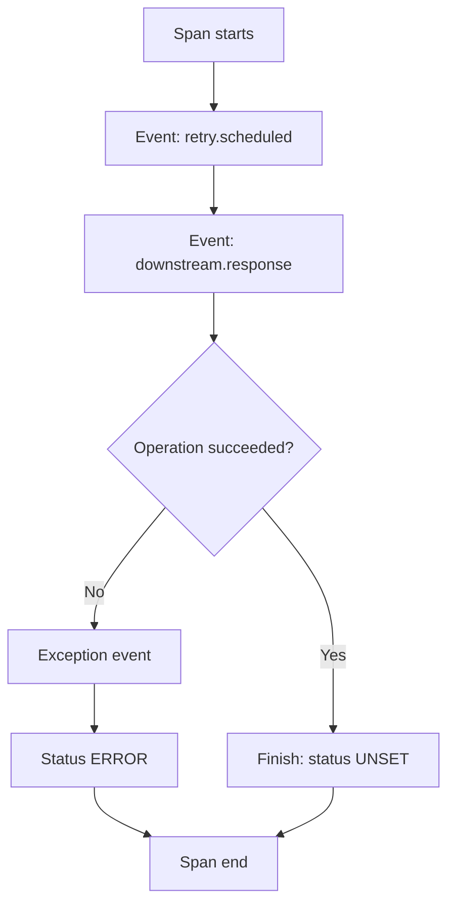

# Span Events for Status and Exceptions

## 1. Distinguishing Span Status and Span Events

In OpenTelemetry, span status and span events describe two different aspects of an operation:

- **Status** indicates the overall outcome of a span: unset, ok, or error.
- **Event** records a point-in-time occurrence during the span's lifecycle, with a timestamp and optional attributes.
- **Exception event** is an event following OpenTelemetry conventions used to record an exception relevant to the operation.

Status answers the question “how did the operation end?”. Events answer “what happened while the operation was running?”. A span can have many events, but only one final status.

For example, an RPC calling Inventory might record a `retry.scheduled` event, then `cache.fallback`, and finish successfully. If the final retry still fails, the span can end with status `ERROR` and record an exception event for the error that caused the operation to fail.



Do not use an event in place of status. An exception event does not automatically set the span status to `ERROR`; conversely, status `ERROR` does not contain the full exception type, message, or stack trace.

## 2. Three Span Status Values

OpenTelemetry defines three status codes:

| Status | Meaning | Usage |
| --- | --- | --- |
| `UNSET` | No explicit status set | Default value; typically left as-is for successful operations |
| `OK` | Operation explicitly confirmed successful | Set only when there is a reason to explicitly mark success |
| `ERROR` | Operation ended with an error | Set when the operation actually failed |

A newly started span has status `UNSET`. For successful operations, you typically do not need to call `setStatus(OK)`; keeping `UNSET` is the standard OpenTelemetry convention.

When an operation fails, set `ERROR`. Do not set `OK` after a span has been marked `ERROR` to “clear” an error. Status reflects the outcome of the operation represented by the span itself, not necessarily the entire outer request.

A request can have multiple child spans: a dependency call fails, then a retry succeeds. The failed attempt's span can be `ERROR` while the overall span finishes normally. Do not force every span in a trace to have the same status.

## 3. Exception Events in OpenTelemetry

An exception event has the standard name `exception`. Commonly used attributes include:

| Attribute | Content |
| --- | --- |
| `exception.type` | Exception class name or type |
| `exception.message` | Exception message if present |
| `exception.stacktrace` | Stringified stack trace if recorded |

The OpenTelemetry Java API provides `Span.recordException(Throwable)` to record an exception event:

```java
span.recordException(error);
```

This method records an event according to exception conventions; it does not automatically set the span status to `ERROR`. If the exception caused the operation to fail, the application must set the status separately:

```java
span.recordException(error);
span.setStatus(StatusCode.ERROR);
```

Do not manually call `addEvent("exception", ...)` when already using `recordException`. Recording the same exception twice adds noise to the trace and may mislead readers into thinking two independent errors occurred.

Record an exception event only when the exception is meaningful to the operation and needs observability. Exceptions fully handled via fallback or retry do not necessarily need to be recorded as a final error; use custom events such as `cache.fallback` or `retry.scheduled` to describe recovery.

## 4. When to Record an Exception vs. Only an Event?

Distinguish handled exceptions from exceptions that fail the operation:

- **Unhandled failure:** the exception causes the operation to terminate in error. Record an exception event and set span status `ERROR`.
- **Handled exception:** the application catches the exception, executes a fallback, and returns a valid result. Record a custom event if you need to track fallback behavior; you do not necessarily need an exception event or `ERROR` on the overall span.
- **Failed retry attempt followed by a successful retry:** the attempt span can record the exception and `ERROR`; the overall span can end successfully.
- **Expected business outcome:** for example, a product does not exist per contract. Record the appropriate outcome; do not automatically treat every non-`OK` business result as an infrastructure failure.
- **Cancellation:** the caller closes the stream or cancels the RPC. Record cancellation as needed; do not treat every cancellation as a server error by default.

An important rule is that status must match the operation the span describes. If a span describes a single downstream call and that call returns an error, the downstream span can be `ERROR` even if the application service ultimately recovers successfully.

Do not record the exception at every layer as the same exception propagates upward. Choose the span representing where the error originated or where the operation failed; parent spans can receive status `ERROR` if their overall operation also fails, without repeating the stack trace on every span.

## 5. Recording Exceptions in an Application Service

Consider an application operation calling a repository or downstream service. An internal span is created to measure the use case; if an unhandled error causes the use case to fail, record the exception and status:

```java
import io.opentelemetry.api.trace.Span;
import io.opentelemetry.api.trace.StatusCode;
import io.opentelemetry.api.trace.Tracer;
import io.opentelemetry.context.Scope;

public ProductView getProduct(GetProductQuery query) {
    Span span = tracer.spanBuilder("catalog.get_product")
            .startSpan();

    try (Scope scope = span.makeCurrent()) {
        return getProductUseCase.execute(query);

    } catch (RuntimeException error) {
        span.recordException(error);
        span.setStatus(StatusCode.ERROR);
        throw error;

    } finally {
        span.end();
    }
}
```

`startSpan()` inherits the current context as its parent by default. If a gRPC server span was already created by auto-instrumentation, `catalog.get_product` becomes a child of that server span. `Scope` makes the span current while the use case executes; `finally` guarantees the span ends on both success and error.

The example records the exception once on the application operation's span. If the adapter catches the exception to map it to a gRPC status, it should not re-record the same stack trace in another custom event. Transport instrumentation can record the RPC status separately according to semantic conventions.

## 6. Recording Custom Events for Business Milestones

Custom events record meaningful milestones, not replacements for exception events. For example, when a retry is scheduled:

```java
import io.opentelemetry.api.common.Attributes;
import io.opentelemetry.api.trace.Span;

Span.current().addEvent(
        "retry.scheduled",
        Attributes.builder()
                .put("retry.attempt", 2L)
                .put("retry.delay_ms", 100L)
                .put("retry.reason", "unavailable")
                .build());
```

Useful events in Spring gRPC can include:

- `retry.scheduled`: a retry attempt has been scheduled;
- `cache.fallback`: the application fell back to cache;
- `authorization.denied`: the request was rejected by policy;
- `stream.cancelled`: the streaming RPC was cancelled;
- `response.mapping.failed`: failed to map the application result into a protobuf response.

Event names should be stable, describe the action that occurred, and follow consistent conventions across the system. Attributes should be typed, bounded, and non-sensitive.

Do not create an event for every message in high-throughput streaming. Use metrics to count messages, bytes, and latency; events should only record milestones or state transitions worth investigating.

## 7. Recording Events with Attributes

Every span event has a timestamp. When calling the `addEvent(name, attributes)` overload, the SDK automatically records the current time:

```java
span.addEvent(
        "subscription.first_message",
        Attributes.builder()
                .put("message.count", 1L)
                .build());
```

This is appropriate for most events occurring inline during processing. Only use the explicit timestamp overload when the application has a reliable event timestamp and has converted it to the right clock/time unit per the API. Never use `System.nanoTime()` as an epoch timestamp; it is a monotonic clock for measuring elapsed intervals.

Event attributes can help explain an event, such as retry attempt or queue size. Avoid putting entire protobuf requests, responses, metadata maps, or large objects into events. Events are not payload storage.

## 8. Mapping gRPC Status to Span Status

gRPC has `io.grpc.Status` and codes such as `OK`, `INVALID_ARGUMENT`, `NOT_FOUND`, `UNAVAILABLE`, `DEADLINE_EXCEEDED`, `CANCELLED`, and `INTERNAL`. These are RPC-layer outcomes; OpenTelemetry span status is a broader signal.

| gRPC outcome | Observability interpretation |
| --- | --- |
| `OK` | RPC completed successfully; typically keeps span status `UNSET` |
| `INVALID_ARGUMENT` | Invalid request; may indicate a caller contract violation |
| `NOT_FOUND` | Resource does not exist; may be a valid business outcome |
| `ALREADY_EXISTS` | Data conflict per contract |
| `UNAUTHENTICATED` / `PERMISSION_DENIED` | Request rejected; distinguish policy denial from system error |
| `CANCELLED` | Call cancelled; typically distinguish caller cancellation from server failure |
| `DEADLINE_EXCEEDED` | Call exceeded time budget; usually an error for the call operation |
| `UNAVAILABLE` | Dependency or server unavailable; potentially retryable per policy |
| `INTERNAL` / `UNKNOWN` | Server-side error or unclassified failure |

If gRPC auto-instrumentation already creates the transport span and sets status per semantic conventions, do not override that status inconsistently with a custom policy. An application span can describe a business outcome differently from the transport span.

For example, `NOT_FOUND` may be a valid outcome for a “find product” use case; the application span can record `app.outcome=not_found` without treating it as an internal error. The transport span still reflects gRPC status per instrumentation conventions. Conversely, `UNAVAILABLE` from Inventory is typically a downstream call error and should be observed as a failure.

Do not copy raw gRPC status descriptions or trailers into span attributes if they may contain internal details or upstream-controlled data.

## 9. Handling Exceptions in the gRPC Adapter

Adapters often catch application exceptions and convert them into gRPC statuses. Decide which span records the exception:

```java
try {
    ProductView product = getProductUseCase.execute(query);
    responseObserver.onNext(toResponse(product));
    responseObserver.onCompleted();

} catch (ProductNotFoundException notFound) {
    // Known business outcome; do not record a stack trace as an infrastructure error.
    responseObserver.onError(
            Status.NOT_FOUND
                    .withDescription("Product was not found")
                    .asRuntimeException());

} catch (RuntimeException error) {
    Span span = Span.current();
    span.recordException(error);
    span.setStatus(StatusCode.ERROR);

    responseObserver.onError(
            Status.INTERNAL
                    .withDescription("Internal server error")
                    .asRuntimeException());
}
```

This illustrates a policy example: `ProductNotFoundException` is treated as a known business outcome; unexpected errors record an exception and `ERROR` status. If a separate application span already recorded the same exception before rethrowing, the adapter should not record a duplicate exception event on the same operation span. Transport instrumentation can record the gRPC status on the server span itself.

Never return exception messages or stack traces to clients. `Status.INTERNAL` carries a safe description; technical details belong in internal telemetry/logs with access controls.

## 10. Exceptions in Retries and Fallbacks

An exception on the first attempt does not necessarily mean the overall operation failed. For example, Catalog calls Inventory, receives `UNAVAILABLE`, waits for backoff, and succeeds on retry.

Possible representation:

- Each downstream attempt's span reflects its own outcome.
- Failed attempts can record an exception event and status `ERROR`.
- The overall span records `retry.scheduled`, attempt count, and final outcome.
- If the retry succeeds, the overall span does not need to end with `ERROR`.

If retries happen inside a single instrumentation-managed client span, use events to record attempts if instrumentation does not already provide that detail. If each attempt is a separate RPC, the corresponding client span should reflect each call's outcome.

When a fallback succeeds, record a `cache.fallback` or `inventory.fallback_used` event. Do not mark the overall span `ERROR` solely because a secondary data source failed when the business result still satisfies the contract.

Bound the number of events and never record an event for an unbounded retry loop. Retry policies must have bounded attempts, backoff, and an overall deadline.

## 11. Exceptions and Long-Lived Streaming RPCs

For streaming RPCs, an exception can occur after many messages have already been sent. The RPC span must live until the terminal event; the exception event must be recorded before the span ends.

Server-stream example:

```java
subscription.onError(error -> streamContext.wrap(() -> {
    if (ended.compareAndSet(false, true)) {
        streamSpan.recordException(error);
        streamSpan.setStatus(StatusCode.ERROR);

        try {
            responseObserver.onError(toGrpcError(error));
        } finally {
            streamSpan.end();
        }
    }
}).run());
```

Ensure the error callback ends the span only once, even when cancellation and error race. Use an atomic terminal guard or stream state machine. When the client cancels, cancellation is typically recorded via an event like `stream.cancelled`; an exception event is not strictly necessary if no actual exception occurred.

Do not record an exception event for every recoverable per-message error inside a stream. If a message is rejected while the stream continues normally, record a custom event or metric per policy. If an error terminates the entire stream, record the exception event on the span representing the failed operation.

## 12. Protecting Data in Exception Events

`recordException(Throwable)` can capture exception type, message, and stack trace. Those values are not always safe to export:

- Messages can contain emails, tokens, SQL, table names, customer IDs, or request data.
- Stack traces can expose internal packages, service names, file paths, and implementation details.
- Exception causes can include response bodies or details from external dependencies.
- Status descriptions can be upstream-supplied and contain untrusted data.

Never construct exception messages by concatenating entire requests or responses. Use short, non-sensitive technical messages. If an underlying exception contains sensitive data, consider recording a sanitized wrapper exception or only a safe event with a controlled `exception.type`.

Span processors can filter attributes before export, but you should not rely solely on processors to protect secrets. Restrict data at the recording site and test the actual data received by the exporter.

Never use exception messages as metric labels. Messages and stack traces have high cardinality, large size, and may contain private data.

## 13. Event Limits and Cardinality

Span events are suited for bounded-size timelines. A long-running stream or retry loop can generate thousands of events. SDKs/exporters/backends enforce limits on event and attribute counts; events exceeding limits may be dropped or truncated.

Principles:

1. Record events for meaningful milestones, not every message.
2. Use metrics for counts and distributions.
3. Use child spans for batches or operations of significant duration.
4. Keep event names and attribute keys stable.
5. Avoid unique IDs or raw exception messages in metric dimensions.
6. Check dropped event/attribute counters or limit settings if the backend does not show expected events.

Do not assume events are retained indefinitely just because a span stays open. Set an appropriate budget for long streams and never place large payloads in attributes.

## 14. Testing Span Status and Exception Events

Use an OpenTelemetry SDK test exporter to verify span data after completion. Tests should check both status and events, not merely span presence:

| Scenario | What to Verify |
| --- | --- |
| Successful operation | Status is typically `UNSET`; no exception event |
| Unhandled exception | `exception` event present, appropriate type, and status `ERROR` |
| Successful fallback | Custom fallback event present; overall span not marked `ERROR` |
| Retry attempt fails, retry succeeds | Attempt span reflects error; overall span ends successfully |
| Business `NOT_FOUND` | Outcome/status matches policy; no unnecessary stack trace recorded |
| gRPC `UNAVAILABLE` | Transport span has status per instrumentation; error is not lost |
| Cancellation | Appropriate event or status; cleanup and span end execute once |
| Exception containing sensitive data | No secret/PII in exported event attributes |
| Many events | Event limits and dropped counts are understood |

Example checking span data:

```java
SpanData data = exporter.getFinishedSpanItems().get(0);

assertEquals(StatusCode.ERROR, data.getStatus().getStatusCode());

assertTrue(data.getEvents().stream()
        .anyMatch(event -> event.getName().equals("exception")));
```

To test exception attributes, check `exception.type` and ensure `exception.message`/`exception.stacktrace` are handled per privacy policy. To test custom events, verify the event name and stable attributes such as `retry.attempt`.

For gRPC integration tests, invoke via the generated stub and verify both the status received by the client and the span data collected on the server. In-process tests work well for span logic; Netty transport tests verify real instrumentation and metadata. Use timeouts/latches instead of `Thread.sleep()`.

## 15. Common Mistakes

1. **Assuming `recordException` automatically sets status `ERROR`.** It records the exception event; you must set status separately when the operation fails.
2. **Using status `ERROR` for every caught and recovered exception.** The overall span may still succeed. Record custom events for fallbacks/retries.
3. **Recording exceptions at every layer.** The same error appears repeatedly in the trace. Pick a representative span and avoid duplicate recording.
4. **Calling `addEvent("exception")` ad hoc.** Semantic attributes may be missing. Use `recordException` for `Throwable`.
5. **Treating gRPC status and OTel span status as identical.** One is the RPC outcome, the other is the span outcome. Map according to semantics and instrumentation.
6. **Marking every `CANCELLED` call as a server error.** The caller may have cancelled intentionally. Distinguish cancellation from failure.
7. **Exposing stack traces or status descriptions to clients.** Leaks implementation details. Return only safe descriptions.
8. **Putting payloads or tokens into exception messages.** Telemetry can spread sensitive data. Sanitize data at the source.
9. **Recording an event for every message.** Bloats traces. Use metrics and milestone events.
10. **Ignoring event limits.** Events can be dropped. Check exporter behavior and SDK/backend limits.

## 16. Practice Exercise

Build observability for the unary RPC `GetProduct` and downstream call `GetAvailability`:

1. Enable OpenTelemetry gRPC auto-instrumentation to create transport spans.
2. Create an internal span for the `catalog.get_product` use case.
3. When Inventory returns `UNAVAILABLE`, record an exception event on the appropriate span and set status `ERROR` for the downstream attempt.
4. Perform bounded retries; record `retry.scheduled` with attempt and delay, without payloads.
5. If cache fallback succeeds, record `cache.fallback`; the overall span ends successfully according to the use case outcome.
6. For `ProductNotFoundException`, map to `NOT_FOUND` and decide whether it is a business outcome or failure per contract.
7. Verify that cancellation and streaming errors end the span only once.
8. Use a test exporter to verify status codes, exception events, custom events, and that sensitive data has been stripped.
9. Invoke via the generated stub in an integration test to verify gRPC status and telemetry both reflect the exact outcome.

**Self-Check:** Span status indicates the overall outcome of an operation; span events record milestones occurring during its lifecycle. `recordException` creates an `exception` event but does not automatically set status `ERROR`. Only record exceptions for errors meaningful to the operation, avoid duplicate recording, distinguish final failures from recovered retries/fallbacks, and protect messages/stack traces from data leakage. With Spring gRPC, align gRPC status, span status, custom events, and metrics with proper semantics so traces remain actionable during investigations.
