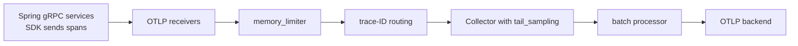

# Sampling in High-Traffic Systems

## 1. Why Is Sampling Needed?

OpenTelemetry can create spans for every operation in an application. In a high-traffic Spring gRPC system, a single request often traverses multiple services and creates many spans: inbound server spans, internal spans, outbound client spans, and child spans for batches or dependencies. Keeping every trace causes telemetry volume to grow rapidly with request rate, hop count, and operations per service.

Sampling decides which traces are recorded and exported. The goal is to reduce CPU, memory, network, and storage costs while retaining enough data to investigate errors, latency, and anomalous behavior.

Sampling affects telemetry only; it does not alter RPC outcomes or business access permissions. Never use sampling to hide errors, replace authorization, or serve as a data retention compliance mechanism.

A good strategy balances:

- **Cost:** the number of spans created, processed, exported, and stored.
- **Investigative value:** the ability to retain traces that are errored, slow, or belong to critical operations.
- **Consistency:** services within the same trace must share compatible sampling decisions so the parent-child chain does not break.

## 2. Head Sampling and Tail Sampling

There are two main points in time to decide whether to keep a trace:

| Mechanism | Decision Time | Available Information | Strengths | Limitations |
| --- | --- | --- | --- | --- |
| Head sampling | When the root span starts | Trace ID, parent sampled flag, information available at start | Early decision, reduces export cost right at the SDK | Final outcome is unknown; hard to prioritize traces based on later errors or slowness |
| Tail sampling | After the Collector receives the trace's spans | Status, duration, attributes, and received spans | Can retain errored/slow traces based on actual outcomes | Must receive and buffer many spans; consumes Collector memory and infrastructure |

Head sampling fits when you need to sharply reduce volume right at the service. Tail sampling fits when you need to select traces based on final outcomes such as `ERROR` or high latency.

Tail sampling cannot recover spans already dropped by an SDK head sampler before sending. If the Collector needs to decide whether to retain errored/slow traces, services must send the necessary spans to the Collector; configuring a head sampler that drops most traces starves tail sampling of data.

## 3. Trace-Based Sampling and Parent-Based Sampling

Sampling should be decided consistently at the trace level rather than randomly and independently on every span. If each service decides on its own, a trace can retain a server span while losing the client span or vice versa.

A parent-based sampler follows the parent's sampled flag:

- If the remote/local parent was sampled, child spans continue to be sampled.
- If the parent was dropped, child spans are typically also dropped.
- If a span has no parent, the root sampler decides per policy, such as trace ID ratio.

This preserves parent-child consistency across services when trace context is properly propagated.

With a trace ID ratio sampler, decisions are based on the trace ID so they remain deterministic across services using the same policy. A 5% ratio means roughly 5% of root traces are selected, not necessarily exactly 5% of requests in every small time window.

Do not use independent per-span samplers if you want complete traces. Likewise, do not generate a new trace ID downstream just to boost sampling rates.

## 4. Configuring Head Sampling for Spring gRPC

When using the OpenTelemetry Java agent, you can configure a parent-based trace ID ratio sampler via environment variables:

```bash
OTEL_TRACES_SAMPLER=parentbased_traceidratio
OTEL_TRACES_SAMPLER_ARG=0.05
OTEL_PROPAGATORS=tracecontext,baggage
```

This example selects approximately 5% of root traces; child spans follow the parent's sampled flag. Sampler names and settings must match the OpenTelemetry Java agent/SDK version in use.

If configuring the SDK directly, the equivalent idea is:

```java
Sampler sampler = Sampler.parentBased(
        Sampler.traceIdRatioBased(0.05));

SdkTracerProvider tracerProvider = SdkTracerProvider.builder()
        .setSampler(sampler)
        .build();
```

The snippet requires the corresponding SDK classes from the OpenTelemetry SDK. In Spring Boot, a single SDK/provider should be managed centrally by the Java agent or autoconfiguration; avoid creating multiple separate SDKs inside beans.

Sampling ratios should be configured per environment and actual load. For instance, local can use a high ratio for debugging, staging a medium ratio, and production a lower ratio. Do not arbitrarily hardcode different ratios across services in the same trace, as that can break consistency.

## 5. How Is the Sampled Flag Propagated Through gRPC?

W3C Trace Context carries trace ID, parent span ID, and trace flags in the `traceparent` metadata. The sampled bit in trace flags tells downstream services whether the trace was selected.

When Catalog calls Inventory:

1. Catalog has a current span and trace context.
2. gRPC client instrumentation injects the trace context into metadata.
3. Inventory server instrumentation extracts the context.
4. Inventory's parent-based sampler uses the remote parent's sampled flag to decide on child spans.

If the root trace is not sampled, the downstream parent-based sampler normally does not record child spans. This prevents recording disconnected trace fragments.

Enabling trace propagation does not mean every span is exported. Trace context can still be propagated to preserve causal metadata even when the sampled flag is false.

Do not manually alter the sampled flag in metadata to force downstream services to record spans. To change sampling decisions, use a consistent root policy or a properly designed tail-sampling mechanism.

## 6. Choosing a Head Sampling Ratio Based on Traffic

Estimating volume helps pick an initial ratio. An approximate calculation:

```text
Exported spans/second
  = incoming traces/second
  × average spans per trace
  × sampling ratio
```

For example, a system receiving 2,000 traces/second, averaging 8 spans/trace, at a 5% sampling ratio:

```text
2,000 × 8 × 0.05 = 800 spans/second
```

This is an average estimate. Traffic bursts, traces with many downstream calls, and internal spans can push actual volume higher.

Monitor:

- spans created and exported;
- spans dropped due to sampling or queue/export failures;
- exporter queue size, retries, and timeouts;
- Collector ingest/export rate;
- backend ingestion, storage, and query costs.

Do not choose a ratio based solely on a percentage. Base it on your spans/second budget, storage cost, investigation needs, and real trace distribution.

## 7. When Should You Use Tail Sampling?

Tail sampling lets you retain traces based on outcomes that have already happened. Examples:

- Keep traces containing a span with status `ERROR`.
- Keep traces with latency exceeding a threshold.
- Keep specific critical RPC methods.
- Keep traces carrying attributes that only appear after request processing.
- Keep a small percentage of normal traces as a baseline.

A policy can combine multiple conditions. For instance, keep all errored traces, traces slower than 1 second, and sample 1% of remaining traces. Specific policies must be evaluated against volume and Collector capacity.

Tail sampling is especially useful when errors are only known at the end of a request. A head sampler cannot predict in advance whether a request will return `UNAVAILABLE` or exceed its deadline.

Tail sampling only decides on the spans it receives. If a service is uninstrumented, drops spans via head sampling, or routes spans to a different Collector, traces can lose branches. Therefore, trace completeness and routing are mandatory design prerequisites.

## 8. Tail Sampling Pipeline in the OpenTelemetry Collector

Tail sampling typically runs in the OpenTelemetry Collector Contrib distribution because this processor must hold trace state and evaluate policies. A conceptual pipeline:



All spans belonging to the same trace must arrive at the same tail-sampling Collector. If Catalog's spans reach Collector A while Inventory's spans reach Collector B, each Collector sees only part of the trace and can make the wrong decision.

When running multiple Collector replicas, route by trace ID before tail sampling—typically via a load-balancing exporter/collector tier keyed on trace ID. Only then does the Collector receiving the complete trace execute `tail_sampling`.

The `memory_limiter` processor should precede memory-intensive processors. `batch` is typically placed after `tail_sampling` to group selected spans before export. Exact ordering and configuration depend on your Collector Contrib version.

## 9. Tail Sampling Configuration Example

The condensed example below illustrates Collector Contrib receiving OTLP, retaining errored or slow traces, and sampling a small percentage of normal traces:

```yaml
receivers:
  otlp:
    protocols:
      grpc:
      http:

processors:
  memory_limiter:
    check_interval: 1s
    limit_mib: 2048
    spike_limit_mib: 512

  tail_sampling:
    decision_wait: 10s
    num_traces: 50000
    expected_new_traces_per_sec: 1000
    policies:
      - name: keep-errors
        type: status_code
        status_code:
          status_codes: [ERROR]

      - name: keep-slow
        type: latency
        latency:
          threshold_ms: 1000

      - name: baseline
        type: probabilistic
        probabilistic:
          sampling_percentage: 1

  batch: {}

exporters:
  otlp:
    endpoint: telemetry-backend:4317
    tls:
      insecure: true

service:
  pipelines:
    traces:
      receivers: [otlp]
      processors: [memory_limiter, tail_sampling, batch]
      exporters: [otlp]
```

This is an illustrative configuration, not a copy-paste production file. Verify the schema for your deployed Collector Contrib version, exporter TLS/authentication, memory budget, and supported policy names. `insecure: true` is only appropriate for isolated test environments; production must configure proper TLS and authentication.

The baseline policy provides a sample of normal traces for comparison. When policies are evaluated as OR conditions, a trace matching any policy may be retained. Check the policy and composite-policy semantics of your Collector version before deploying.

## 10. Memory, Decision Wait, and Long-Lived Traces

The tail sampler must keep spans in memory until a decision can be made or `decision_wait` expires. Three settings have major impact:

- `decision_wait`: how long the Collector waits for more spans before deciding.
- `num_traces`: maximum number of traces the processor holds in state.
- `expected_new_traces_per_sec`: sizing hint for state capacity based on new-trace rate.

If `decision_wait` is too short, late-arriving spans may be excluded from the initial decision. If it is too long, memory usage and telemetry export latency increase.

A rough estimate for traces held in buffer:

```text
Buffered trace count
  ≈ new traces per second × decision wait in seconds
```

For example, 1,000 new traces/second with a 10-second `decision_wait` requires state for roughly 10,000 concurrent traces, before accounting for bursts, long traces, and overhead. This is only a starting estimate; measure real memory usage based on span counts and attribute sizes per trace.

Long-lived streaming RPCs can keep spans open longer than `decision_wait`. Tail sampling cannot evaluate the final outcome of an unfinished span. Use metrics to observe active streams and consider shorter-lived operation spans for batches or processing stages.

## 11. Routing and Scaling for Tail Sampling

In distributed deployments, routing by trace ID is required so a trace is evaluated as a single unit. A common pattern:

1. Application-tier Collectors receive OTLP from services.
2. A load-balancing exporter selects a tail-sampling Collector by trace ID.
3. The tail-sampling Collector buffers all spans for that trace.
4. The processor decides whether to keep or drop the trace.
5. The batch exporter sends selected spans to the backend.

When scaling Collectors, membership changes can briefly route the same trace to a different replica if consistent hashing/routing is not managed carefully. Account for trace affinity, rollout strategies, and late-span handling.

Monitor the tail-sampling tier separately: incoming spans, trace state count, memory, dropped spans, late spans, decision latency, exporter queue, and export failures. If the Collector becomes overloaded, the error-retention policy may no longer behave as intended.

Never send spans from services directly to multiple tail-sampling replicas using standard round-robin. Request-level round-robin does not guarantee spans of the same trace land on the same replica.

## 12. Combining Head and Tail Sampling

Head and tail sampling can be used at different tiers, provided you understand the limits:

- Head sampling in the SDK reduces volume before the Collector.
- Tail sampling in the Collector selects traces from the spans received.
- Traces dropped by the head sampler cannot be recovered by the tail sampler.
- If tail sampling must catch errors, spans that could contain errors must reach the tail tier.

A common setup for tail sampling configures the SDK to send all traces to the Collector and lets the Collector decide. Example for the Java agent:

```bash
OTEL_TRACES_SAMPLER=always_on
OTEL_EXPORTER_OTLP_ENDPOINT=http://otel-gateway:4317
```

Using `always_on` significantly increases traffic from applications to Collectors. Every service participating in the trace must be configured to send spans to the tail-sampling tier; if one downstream service head-samples and drops spans, the Collector still misses that branch. Choose this approach only when the Collector tier has sufficient capacity, appropriate backpressure/buffering, and has been load-tested.

If infrastructure cannot ingest all spans, use parent-based head sampling at a controlled ratio and accept that the tail sampler only classifies the subset of traces forwarded by the head sampler. Never claim all error traces are retained if error traces can already be dropped by head sampling.

## 13. Adaptive Sampling and Per-Service Policies

In systems with fluctuating traffic, a fixed sampling ratio may not be optimal. You can adjust sampling ratios by environment or load phase, while avoiding independent per-service changes.

Useful approaches:

- Use a lower ratio for high-volume normal traffic.
- Maintain a higher ratio for critical services or operations, provided the policy propagates consistently across the trace.
- Use tail policies to prioritize errors/slow traces when the Collector has capacity.
- Adjust ratios against measured telemetry budgets rather than guesswork.
- Record sampling configuration/version so you know why traces were kept or dropped.

Do not change sampling ratios continuously per request. Decisions should remain stable per trace and avoid hard-to-explain bias. If using tiered policies, clearly define the root sampler, remote parent behavior, and propagation.

Sampling does not guarantee every error has a trace. For investigation or audit requirements, combine logs/metrics and dedicated audit mechanisms with separate retention; never rely on trace sampling as the sole data source.

## 14. Metrics, Exemplars, and Trace Correlation

Metrics are usually collected independently of trace sampling. An application can still measure request rate, error rate, latency histograms, and active streams even when only a fraction of traces are exported.

Exemplars can link an observation in a metric histogram to a sampled trace/span context. This lets you jump from a latency bucket to a representative trace without turning trace ID into a metric label.

Never add trace ID, request ID, user ID, or tenant ID as metric dimensions. High-cardinality values inflate time-series costs and can destabilize metrics backends.

With Spring gRPC, maintain:

- Metrics for all requests/streams using low-cardinality aggregations.
- Traces governed by your sampling policy.
- Structured logs for errors needing detail, with sensitive data redacted.
- Correlation context to link logs/traces when a trace is sampled.

Do not assume metrics and traces share the same sampling rate. Trace sampling must never discard aggregate error-rate or latency metrics.

## 15. Security and Privacy When Sampling

Sampling is not a sensitive-data control mechanism. If a span contains tokens or PII, even a 1% sampled trace still leaks data.

Filter data before export:

- Do not record credentials, access tokens, passwords, or private keys.
- Do not put full protobuf payloads into span attributes/events.
- Use attribute allowlists and redaction where instrumentation creates data.
- Restrict telemetry backend access and set retention policies.
- Verify real exported data via exporter tests, including traces retained under an `ERROR` policy.

Tail sampling by attribute can also unintentionally prioritize traces based on sensitive data. Use only approved attributes with appropriate cardinality that do not reveal identity.

## 16. Testing Sampling in Spring gRPC

Tests should verify both sampling decisions and trace continuity:

| Scenario | What to Verify |
| --- | --- |
| Root trace with ratio sampler | Observed ratio approximates configuration over a sufficiently large trace set |
| Child span with sampled parent | Child is sampled per parent-based policy |
| Child span with unsampled parent | Child obeys remote sampled flag |
| Error trace with tail sampling | Trace is retained under the status `ERROR` policy |
| Slow trace | Trace is retained when exceeding the latency threshold |
| Normal trace | Only the baseline ratio is retained |
| Multiple Collector replicas | Spans of the same trace reach the same tail sampler |
| Late-arriving span | Late-span behavior matches policy and is observable |
| Collector overload | Memory limiter, queues, and dropped telemetry are monitored |
| PII in attributes | Data is stripped before export |

For head sampling, use an SDK test sampler or low/high ratio configurations to inspect sampled flags and recording state. Do not validate ratios using just a few traces; use a sufficiently large sample size with statistical tolerance.

For tail sampling, use a Collector Contrib integration test or a test environment with an OTLP receiver. Send multiple spans for the same trace with varying statuses/durations, wait past `decision_wait`, and check which traces are exported. Verify that parent-child spans are kept together.

In gRPC integration tests, invoke via generated stubs to test real propagation through metadata. In-process transport suits application logic, but does not prove routing, OTLP export, or production Collector behavior.

## 17. Common Mistakes

1. **Using head sampling while expecting every error trace to be kept.** The decision happens before outcomes are known. Use tail sampling or accept head-sampler limits.
2. **Enabling tail sampling behind an SDK sampler that drops most traces.** The Collector cannot restore dropped spans. Send the needed spans to the tail tier.
3. **Using round-robin toward multiple tail-sampling replicas.** Spans of the same trace get split up. Route by trace ID.
4. **Ignoring memory sizing for `decision_wait`.** Collector holds too much trace state. Estimate traces/sec × `decision_wait` and load-test bursts.
5. **Setting `decision_wait` too short.** Late spans are excluded from decisions. Choose wait based on network delay and real durations.
6. **Setting `decision_wait` too long for long streams.** State lingers and consumes memory. Use metrics for active streams and bounded operation spans.
7. **Treating sampling as a security mechanism.** Retained traces can still contain PII. Redact before export.
8. **Using trace ID as a metric label.** Cardinality explodes. Use exemplars or correlation outside metric dimensions.
9. **Changing ratios independently per service.** Traces are sampled inconsistently. Use parent-based policies and centralized configuration management.
10. **Checking only exported trace counts.** Cannot tell if traces have complete spans or parent chains. Assert trace ID, parent span ID, and policy outcomes.

## 18. Practice Exercise

Design sampling for Catalog calling Inventory and Pricing in production:

1. Measure current traces/second, average spans per trace, span sizes, and exporter throughput.
2. Choose `parentbased_traceidratio` head sampling as a baseline, or choose tail sampling if traces must be selected by outcome.
3. If using tail sampling, configure the SDK to send sufficient spans, deploy Collector Contrib, and route by trace ID.
4. Create policies to keep `ERROR` traces, high-latency traces, and a small baseline percentage of normal traces.
5. Tune memory limiter, decision wait, trace capacity, and batch/export limits via load testing.
6. Test long/streaming traces, late spans, and behavior when a Collector replica restarts.
7. Maintain request/error/latency metrics independently of trace sampling; use exemplars to link traces when sampled.
8. Redact PII/secrets before export and test traces retained under the error policy.
9. Write integration tests verifying all spans in a trace are kept or dropped according to a unified policy.

**Self-Check:** Head sampling decides early in the SDK and cuts volume prior to export; tail sampling decides after the Collector observes spans and can prioritize errored/slow traces. Tail sampling works only on spans delivered to it, requiring buffering and trace-ID routing to receive complete traces. In high-traffic Spring gRPC, pick parent-based head sampling when cost reduction is primary, or tail sampling when outcome-based selection is required; size memory/throughput carefully, keep metrics independent, and scrub sensitive data before export.
