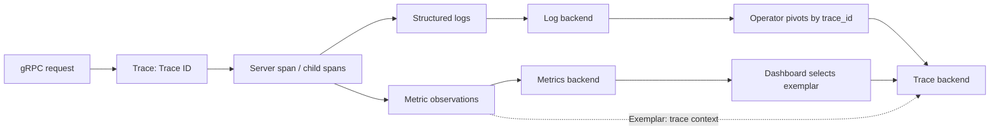

# Correlating Traces with Logs and Metrics

## Lesson Objectives

In **SPRING_GRPC**, a request can pass through a client, gateway, gRPC server, interceptors, services, database, and downstream RPCs. Traces show where a request traveled and how much time was spent in each span; logs record events along with processing details; metrics show system-wide trends in latency, throughput, and errors. If these three signals do not share the same context, operators struggle to pivot from a spike on a dashboard to the exact trace and logs explaining the root cause.

This lesson focuses on **correlating traces with logs and metrics**: including `trace_id`/`span_id` in structured logs, preserving OpenTelemetry `Context` across gRPC and async boundaries, linking metric samples to traces via exemplars, keeping trace IDs out of metric labels, and testing the full path from RPC to observability backends.

After this lesson, you will be able to:

1. Distinguish trace ID, span ID, log correlation, and metric exemplars.
2. Produce logs containing `trace_id`/`span_id` from the active span context.
3. Preserve OpenTelemetry `Context` across thread switches and downstream gRPC calls.
4. Combine gRPC `Context`, OTel `Context`, and MDC without leaking data between requests.
5. Record latency/error metrics using low-cardinality dimensions.
6. Use exemplars to navigate from a metric sample to its corresponding trace.
7. Prevent duplicate spans, forged trace context, and exposure of sensitive data.
8. Test trace-log-metric correlation across an end-to-end RPC.

> **Scope:** Examples use the OpenTelemetry API/SDK, gRPC Java, and Spring. Automatic gRPC span creation depends on the instrumentation/agent or integration enabled in your application. Semantic-convention attribute names and exemplar export support depend on your SDK, exporter, and backend versions.

## 1. The Three Signals and Their Relationships

| Signal | Question Answered | Identifiers/Characteristics |
| --- | --- | --- |
| Trace | Which services/spans did a request traverse and where was time spent? | Shared Trace ID; each span has a Span ID |
| Log | What specific event occurred, and with what processing details? | Timestamp, severity, `trace_id`, `span_id`, and event fields |
| Metric | How are latency, throughput, error rate, and saturation behaving? | Aggregated time series with bounded-cardinality dimensions |
| Exemplar | Which trace is associated with a specific metric sample? | Trace context attached to an observation/sample |

A trace typically contains multiple spans. Spans within the same trace share a trace ID, while each span has its own span ID. Logs written inside a span can include both IDs so operators can open the exact trace and locate the span that emitted the log.

Metrics typically aggregate across many requests. You should not create a separate time series per trace ID; instead, histograms/counters keep stable dimensions such as service, method, and status class. An exemplar can store the trace context of a selected observation to link a metric sample back to a trace.



Trace ID is the correlation key across spans/logs belonging to the same trace; span ID pinpoints a specific operation. Exemplars do not turn metrics into traces and do not replace logs. Each signal still needs its own sampling, retention, and access policy.

## 2. Trace Context in gRPC

When instrumentation is configured properly, the gRPC client and server can create client/server spans and propagate trace context via metadata using a propagator, usually W3C Trace Context. Applications should prefer supported OpenTelemetry Java agent instrumentation or gRPC instrumentation compatible with their version.

A common flow:

1. The client starts a client span.
2. Instrumentation injects trace context into outbound gRPC metadata.
3. Server instrumentation extracts the context and creates a server span as a child of the client span.
4. The service and downstream calls create child spans within the same trace.
5. Logs/metrics are recorded inside the active execution context.

Do not manually create an additional server span in an interceptor if instrumentation already creates a server span for the same RPC. Creating duplicate spans produces two spans representing one operation and skews latency. Only create manual spans for distinct, meaningful business operations inside the RPC span.

### 2.1. Trace ID and Span ID

In the OpenTelemetry Java API, obtain the current span context:

```java
SpanContext spanContext =
        Span.current().getSpanContext();

if (spanContext.isValid()) {
    String traceId = spanContext.getTraceId();
    String spanId = spanContext.getSpanId();
    boolean sampled = spanContext.isSampled();
}
```

Use IDs only from a valid `SpanContext`. Never generate a random trace ID yourself and log it as though it represents a trace collected by the backend. When no span is active, logs may omit trace fields; that is a valid state for work outside a tracing scope.

A valid span context does not guarantee the trace is stored in the backend. The sampling decision may be unsampled, the exporter may fail, or the trace backend may have different retention. When `sampled=false`, the trace ID can still help correlate components even if the backend has no stored trace to open.

## 3. Structured Logging with `trace_id` and `span_id`

Log correlation works best when logs are emitted as structured fields rather than concatenating IDs into a message string. With SLF4J/Logback, you can place `trace_id` and `span_id` into MDC so a JSON encoder outputs them as fields.

Example helper setting MDC for an execution scope:

```java
public final class TraceMdc {

    private TraceMdc() {}

    public static void runWithCurrentSpan(Runnable task) {
        SpanContext spanContext =
                Span.current().getSpanContext();

        Map<String, String> previous =
                MDC.getCopyOfContextMap();

        try {
            if (spanContext.isValid()) {
                MDC.put("trace_id", spanContext.getTraceId());
                MDC.put("span_id", spanContext.getSpanId());
                MDC.put(
                        "trace_sampled",
                        Boolean.toString(spanContext.isSampled()));
            } else {
                MDC.remove("trace_id");
                MDC.remove("span_id");
                MDC.remove("trace_sampled");
            }

            task.run();
        } finally {
            if (previous == null) {
                MDC.clear();
            } else {
                MDC.setContextMap(previous);
            }
        }
    }
}
```

This helper illustrates capturing/restoring MDC for a synchronous task running within the current OTel `Context`. In real code, if a task crosses threads, you must capture OTel `Context` on the submitting thread and activate it in the worker before reading `Span.current()`; wrapping only MDC without propagating OTel `Context` reads the worker's span (which may not exist or may be wrong).

If you use an OpenTelemetry log appender/bridge or logging instrumentation that already injects trace fields automatically, do not add MDC manually a second time. Choose one unified mechanism to avoid duplicate field names or conflicting values.

### 3.1. Logging in Interceptors and Services

Interceptors are suited for generic events such as RPC started/completed, method, status, and duration. Services log meaningful business events such as inventory lookup outcomes or validation failures. Both must use the same trace context.

Do not log entire Protobuf requests/responses by default. Payloads may contain tokens, personal data, or sensitive business information. Log method, status, duration, and approved identifiers; apply redaction before shipping logs to the backend.

### 3.2. Recommended Log Fields

| Field | Meaning |
| --- | --- |
| `timestamp` | Event timestamp |
| `severity` | Log severity level |
| `service.name` | Service emitting the log |
| `rpc.method` | Full method or method name per convention |
| `rpc.status_code` | RPC outcome |
| `trace_id` | Link to the trace |
| `span_id` | Span emitting the log |
| `trace_sampled` | Hint whether the trace was sampled |
| `request_id` | Application correlation ID if needed |
| `duration_ms` | Operation duration |

Prefer OpenTelemetry semantic conventions and a consistent organization-wide schema. Avoid inventing multiple variants like `traceId`, `trace_id`, and `traceID` across different services when the log backend needs cross-system queries.

## 4. Propagating OpenTelemetry Context Across Threads

OTel `Context` is OpenTelemetry's execution context; it is independent of `io.grpc.Context` and Java `ThreadLocal`. When using a self-managed executor, do not assume OTel `Context` automatically follows the task.

Example capturing and wrapping a task with OTel `Context`:

```java
io.opentelemetry.context.Context otelContext =
        io.opentelemetry.context.Context.current();

workerPool.execute(otelContext.wrap(() -> {
    SpanContext current =
            Span.current().getSpanContext();

    log.info("Processing async gRPC work");
    performWork();
}));
```

`Context.wrap` activates the captured context while the task runs and restores the previous context once the task finishes. If the task also needs gRPC `Context`, wrap both mechanisms in the proper order while preserving automatic cleanup:

```java
io.grpc.Context grpcContext =
        io.grpc.Context.current();

io.opentelemetry.context.Context otelContext =
        io.opentelemetry.context.Context.current();

Runnable task = grpcContext.wrap(
        otelContext.wrap(this::performWork));

workerPool.execute(task);
```

The two contexts serve different purposes: gRPC `Context` carries deadlines/cancellations and gRPC application values; OTel `Context` carries the active span, baggage, and OTel context values. Never cast an object from one context into the other or assume they are identical.

With Spring `ThreadPoolTaskExecutor`, you can configure a `TaskDecorator` to capture/restore MDC or integrate Micrometer Context Propagation. Clearly assign responsibility for who propagates OTel `Context` and who manages MDC; avoid two decorators overwriting state in an undefined order.

## 5. Attaching Log Correlation to the gRPC Lifecycle

Once server instrumentation has created the server span, interceptors or services can read `Span.current()` in callbacks if instrumentation/context bridging is active. For asynchronous callbacks, verify that context remains active on the callback execution thread.

An implementation guideline:

- Use gRPC instrumentation to create client/server spans and inject/extract trace context.
- Use a server interceptor to log RPC-level events or set request-scoped metadata.
- Use OTel `Context` propagation when offloading to workers.
- Use an MDC bridge or OTel logging integration to attach `trace_id`/`span_id` to logs.
- Restore MDC after each task to avoid cross-request data leaks.

Never pull `traceparent` directly from a request and put it straight into MDC without going through a propagator. Headers coming from a caller can be caller-controlled; trace context is for correlation, not identity or authorization credentials.

### 5.1. Manual Spans for Business Operations

If you need to measure a distinct operation inside a service, create a child span in the active trace:

```java
Tracer tracer = openTelemetry.getTracer("inventory-service");

Span span = tracer.spanBuilder("inventory.repository.load")
        .startSpan();

try (Scope scope = span.makeCurrent()) {
    return repository.load(sku);
} catch (RuntimeException ex) {
    span.recordException(ex);
    span.setStatus(StatusCode.ERROR);
    throw ex;
} finally {
    span.end();
}
```

Operation names should be stable and meaningful; never embed SKU/user/request IDs into span names. Identifiers may be attributes if permitted by cardinality/PII policies; generally avoid user IDs or sensitive data.

If instrumentation automatically creates a database span, do not add a duplicate manual span just to measure the same query. Manual spans should wrap business operations not already described by auto-instrumentation.

## 6. Linking Metrics to Traces with Exemplars

Metrics are aggregated measurements. For instance, an RPC duration histogram stores many observations by method/status/service. An exemplar selects an observation and attaches trace context so operators can jump from a metric sample to the corresponding trace.

Typical flow:

1. The RPC executes within an active sampled span.
2. Instrumentation records duration into a histogram.
3. The OTel SDK exemplar reservoir/filter selects a qualifying observation.
4. The exemplar carries trace ID/span context as supported by the SDK.
5. The metrics exporter sends the exemplar to the backend.
6. The dashboard displays the exemplar and allows opening the trace if metrics/trace backends are linked.

An exemplar is not a metric label. It keeps a link to a single sample without creating a separate time series per trace.

### 6.1. Recording Metrics with Stable Dimensions

Example recording RPC duration:

```java
LongHistogram rpcDuration =
        meter.histogramBuilder("app.grpc.server.duration")
                .ofLongs()
                .setUnit("ms")
                .setDescription("Duration of completed gRPC calls")
                .build();

rpcDuration.record(
        durationMillis,
        Attributes.of(
                AttributeKey.stringKey("rpc.method"), method,
                AttributeKey.stringKey("rpc.status"), status));
```

The metric and attribute names in this example use an application-defined schema. When adopting semantic conventions, choose names/attributes compatible with your instrumentation and backend versions. `method` and `status` usually have bounded value sets; never add trace ID, span ID, request ID, user ID, or raw target into attributes.

Exemplar selection is managed by SDK/exporter configuration, not by manually inserting trace ID into `Attributes`. Configure an appropriate exemplar filter/reservoir and verify that the exporter/backend actually retains exemplars.

### 6.2. Why Not Use Trace ID as a Metric Label?

If every RPC has its own trace ID, every observation can create a distinct time series. Cardinality explodes, driving up memory usage, ingest cost, and query latency in the metrics backend.

Use low-cardinality dimensions:

- standardized service name.
- RPC method from the service contract list.
- gRPC status code/status class.
- deployment environment.
- region or cluster from a controlled list.

Use trace ID/span ID in logs and exemplars, never as metric labels. Request ID also usually has high cardinality and is unsuitable as a label.

## 7. Sampling and Navigating from Metrics

An exemplar trace link is only useful if the corresponding trace can be found in the trace backend. Sampling decides which traces are exported; metrics normally still record observations even when a trace is dropped.

Scenarios:

| Scenario | Metric | Log | Trace |
| --- | --- | --- | --- |
| Sampled trace | Normal observation, may include exemplar | Has trace/span ID | Usually present if export succeeds |
| Unsampled trace | Observation still recorded; typically no trace-based exemplar | May have trace ID, `sampled=false` | No trace stored in backend |
| Exporter failure | Metric may still be sent | Log may still have IDs | Trace may be missing |
| Log sampling/drop | Metric still present | Event may not be stored | Trace may still exist |
| Backend lacks exemplar support | Metric still present | Log correlation still works | Open trace via trace ID from logs if available |

With head sampling, the sampling decision can be made early when the trace begins. Tail sampling can retain traces based on outcomes after collecting spans; ensure the trace backend and collector pipeline are configured to preserve traces referenced by exemplars.

Do not assume every metrics backend supports exemplars or every dashboard automatically links to traces. Verify end-to-end across your real exporter, collector, storage, and UI.

## 8. Correlation Across Downstream gRPC Calls

When a service calls a downstream gRPC service, trace context must be injected into outbound metadata and extracted at the next service. Use compatible gRPC instrumentation to perform propagation automatically.

Example creating a stub with a deadline; instrumentation attaches the client span/context when configured:

```java
InventoryGrpc.InventoryBlockingStub downstream =
        InventoryGrpc.newBlockingStub(channel)
                .withDeadlineAfter(800, TimeUnit.MILLISECONDS);

GetStockResponse response =
        downstream.getStock(request);
```

This snippet does not inject trace metadata on its own if instrumentation is not enabled. Verify that client/server spans share the same trace ID in the trace backend. If you must propagate across an uninstrumented protocol, use the OpenTelemetry propagator to inject/extract per specification instead of manually concatenating a `traceparent` string.

Baggage can carry metadata across multiple services, but you must bound keys/values, size, and lifetime. Never put tokens, emails, customer data, or sensitive information into baggage. Baggage is not an authorization mechanism.

## 9. Metrics, Logs, and Traces Must Share Service Identity

To query across signals, standardize resource attributes across pipelines:

- `service.name`: stable service name.
- `service.namespace`: team/domain if used by the organization.
- `service.version`: build/release version.
- `deployment.environment.name`: deployment environment per active convention.
- `service.instance.id`: instance identifier if needed and governed by a cardinality policy.

Resource attributes distinguish service/version/instance across traces, logs, and metrics. Do not put pod UID or instance ID as a label on every metric if it creates excessive cardinality; consider keeping it in resource metadata or logs/traces only.

Configure the resource once in the OTel SDK/agent and ensure logs/metrics/traces share the same resource identity. Avoid having each module assign a different `service.name`.

## 10. Security and Privacy During Correlation

Trace ID and span ID are normally not secrets, but logs/traces can contain internal metadata and user information. Apply these practices:

- Redact authorization headers, cookies, tokens, and private data.
- Do not log raw Protobuf requests/responses without an explicit policy.
- Never put PII/secrets into span attributes, baggage, or metric labels.
- Restrict trace/log backend access and enforce retention.
- Never trust caller-supplied trace context to make access-control decisions.
- Control sampling to avoid collecting excessive payloads/attributes.
- Use trace ID strictly for correlation; authentication must still rely on verified credentials.

Even if a request carries a valid `traceparent` forged by the caller, it proves nothing about caller identity. Propagators ensure formatting and context transfer, not identity verification.

## 11. Common Issues and Troubleshooting

| Symptom | Cause | Resolution |
| --- | --- | --- |
| Logs lack `trace_id` | No active span or logging bridge not configured | Check gRPC instrumentation and log correlation integration |
| Logs have `trace_id` but empty `span_id` | Copied only trace ID or read outside active scope | Read valid `SpanContext` inside the execution scope |
| Server span does not match client trace | Propagator/metadata not injected or extracted | Check gRPC instrumentation and W3C propagation |
| Async logs carry another request's ID | OTel `Context`/MDC not captured/restored | Use `Context.wrap` and MDC cleanup in `finally` |
| Trace has two server spans for one RPC | Manual instrumentation duplicates auto-instrumentation | Only create manual spans for distinct business operations |
| Metric dashboard cannot open trace | Exemplar dropped or backend unsupported | Check SDK exemplar filter, exporter, collector, and UI |
| Metric cardinality spikes | Trace ID/request ID/user ID added as labels | Remove high-cardinality attributes; use exemplars |
| Trace ID appears in logs but trace not found | Unsampled trace, exporter failure, or retention | Check `sampled` flag, exporter health, and retention |
| Log backend fails to parse correlation fields | MDC not emitted as structured JSON | Configure encoder/OTel log bridge and verify schema |
| Downstream span splits into another trace | Context not propagated across client call | Enable instrumentation or inject/extract with propagator |
| Baggage grows too large | Copying excessive metadata across services | Allowlist keys, enforce size limits, and set TTL |
| Logs contain tokens or payloads | Logging full metadata/requests | Apply redaction and field allowlists |

## 12. Testing Trace-Log-Metric Correlation

An integration test should traverse the client, server interceptor, service, worker executor, and downstream RPC if present.

Key checks:

1. Send an RPC with tracing instrumentation enabled.
2. Verify client/server spans share the same trace ID and have the proper parent-child relationship.
3. Log inside the interceptor and service; verify `trace_id`/`span_id` match the active span.
4. Offload a task to a worker; verify OTel `Context` is preserved and MDC is restored after the task.
5. Call a downstream gRPC service; verify the downstream server span belongs to the same trace.
6. Record a duration histogram; verify metric dimensions contain only low-cardinality values.
7. Verify exemplars carry trace context when SDK sampling/configuration supports them.
8. Verify trace ID never appears in metric labels.
9. Disable sampling or create an unsampled trace; verify logs/metrics remain valid and do not expect the trace backend to hold a trace record.
10. Trigger an RPC error; verify status, log events, and span status can be cross-referenced.
11. Verify tokens, authorization metadata, and sensitive payloads do not appear in logs/traces/metrics.
12. Check that resource attributes `service.name`/`version` are consistent across all three pipelines.

Use in-process gRPC tests for service/interceptor behavior, while using integration tests with real instrumentation and exporters to verify propagation/exemplars. You can use an in-memory exporter or test collector to assert span/log/metric data without relying on a production dashboard.

## 13. Practice Exercises

1. Enable OpenTelemetry gRPC instrumentation for the Spring gRPC client and server; verify only one client/server span is created per RPC attempt.
2. Configure structured JSON logging with `trace_id`, `span_id`, and `trace_sampled`.
3. Write an MDC capture/restore bridge and test it on a shared single-thread executor.
4. Use OTel `Context.wrap` for async tasks; combine with gRPC `Context` when tasks need deadlines/cancellations.
5. Create a manual child span for a business operation not measured by auto-instrumentation.
6. Create an RPC duration histogram with bounded-cardinality `method`/`status` dimensions.
7. Configure SDK exemplar sampling and verify exemplars are exported to the metrics backend.
8. Open the dashboard, select an exemplar, and navigate to the corresponding trace.
9. Send an unsampled request; verify metrics/logs remain observable even when the trace backend may lack a trace record.
10. Call a downstream gRPC service and verify trace context propagates through metadata.
11. Temporarily add trace ID as a metric attribute to observe cardinality growth, then remove it and use exemplars instead.
12. Write a redaction test ensuring tokens, PII, and raw payloads never appear in telemetry.

### Self-Check Questions

- How do Trace ID and Span ID differ?
- Why should logs include both `trace_id` and `span_id`?
- How does OTel `Context` differ from gRPC `Context` and MDC?
- Why must context be captured/restored when switching threads?
- How does an exemplar link a metric observation to a trace?
- Why must trace ID not be used as a metric label?
- Why can an unsampled trace appear in logs while being absent from the trace backend?
- When is a manual span needed and when is auto-instrumentation sufficient?
- How do you verify that client/server/downstream spans belong to the same trace?
- How does baggage differ from authorization metadata?
- Why must resource attributes stay consistent across logs, metrics, and traces?
- What must be tested to prove correlation works end-to-end?

## References

- [OpenTelemetry — Context Propagation](https://opentelemetry.io/docs/concepts/context-propagation/): propagating trace context across process and service boundaries.
- [OpenTelemetry — Signals](https://opentelemetry.io/docs/concepts/signals/): traces, metrics, and logs.
- [OpenTelemetry — Exemplars](https://opentelemetry.io/docs/specs/otel/metrics/data-model/#exemplars): linking metric samples to trace context.
- [OpenTelemetry Java — API](https://opentelemetry.io/docs/languages/java/api/): `Tracer`, `Span`, `Context`, and `Meter`.
- [OpenTelemetry Java — Instrumentation](https://opentelemetry.io/docs/zero-code/java/agent/): automatically instrumenting Java applications.
- [OpenTelemetry — Semantic Conventions](https://opentelemetry.io/docs/specs/semconv/): standardizing attributes for RPCs and service resources.
- [W3C Trace Context](https://www.w3.org/TR/trace-context/): `traceparent` and `tracestate` propagation.
- [gRPC — Metadata](https://grpc.io/docs/guides/metadata/): metadata transmitted over RPCs.
- [gRPC Java — Context](https://grpc.github.io/grpc-java/javadoc/io/grpc/Context.html): context and executor propagation in gRPC Java.

**Expected Outcome:** Learners can correlate Spring gRPC traces with structured logs and metric exemplars, preserve OpenTelemetry `Context` across async/downstream boundaries, pivot from metrics or logs to the corresponding trace, control cardinality and sampling, and protect sensitive data across all three signals.
