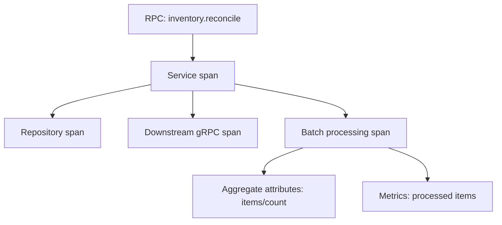

# Avoiding Unbounded Nested Spans

## Lesson Objectives

In **SPRING_GRPC**, OpenTelemetry provides visibility into an RPC across the client, server, interceptors, services, executors, and downstream calls. Each span adds a unit of timing and causal information. However, if you create spans in every helper method, every loop iteration, every streaming message, or every recursive interceptor invocation, a single request can generate an excessively deep or massive span tree. Traces become unreadable, burn CPU/memory, and drive up ingestion costs.

This lesson focuses on **avoiding unbounded nested spans**: choosing span boundaries by logical operation, recognizing recursion and re-entrant instrumentation, bounding spans in retries/fan-out/streaming, using events/metrics for repetitive details, propagating context in the proper scope, and testing span count/depth limits.

After this lesson, you will be able to:

1. Distinguish a logical operation from helper calls, recursion, and instrumentation boundaries.
2. Design span trees with appropriate depth and count.
3. Avoid creating child spans on every loop iteration or recursive node.
4. Bound spans for retries, fan-out, batches, and streaming RPCs.
5. Detect double instrumentation and loops caused by interceptors/telemetry pipelines.
6. Use span events, attributes, metrics, and span links for their intended purposes.
7. Understand span limits, sampling, and their impact on telemetry costs.
8. Write tests verifying span counts, parentage, cleanup, and isolation.

> **Scope:** Examples use the OpenTelemetry Java API/SDK and gRPC Java. Instrumentation package APIs depend on version. Thresholds in this lesson are illustrative policies that must be tuned to your system's latency, throughput, and telemetry budget.

## 1. Why Can Spans Bloat into an Oversized Tree?

A span represents an operation that is meaningful in terms of timing and causality. A span tree should highlight boundaries that answer operational questions: which RPC was slow, which downstream service failed, and which business step consumed time.

Span trees bloat when code creates spans along implementation structure rather than logical operations:

- Every helper method creates a span even when running only a few lines of code.
- A recursive function creates a child span on every invocation.
- A loop creates a span for every record or every message.
- A streaming RPC creates a span for every message even when the stream carries millions of messages.
- Retries create spans for every attempt, backoff sleep, timer, and helper inside each attempt.
- The Java agent and manual instrumentation both create spans for the same gRPC call.
- An interceptor accidentally calls another RPC passing through the same interceptor, creating a nested loop.
- The exporter/telemetry pipeline itself gets instrumented like business traffic and emits unnecessary traces.

For example, processing a tree of $N$ nodes by creating a span per recursive call produces roughly $N$ spans for a single operation. If each node also invokes $M$ instrumented helpers, the span count multiplies further.



The tree above illustrates operation-level tracing. Per-record details are aggregated via attributes/metrics instead of creating a span branch for every record.

## 2. Choosing Span Boundaries by Logical Operation

A span should represent an operation meaningful to operators, typically having at least one of these traits:

- Has significant duration or its own latency budget.
- Crosses a distinct dependency or resource boundary such as a database or HTTP/gRPC downstream call.
- Has retry/failure semantics that need observation.
- Can be analyzed independently in a trace.
- Can be given a stable name and useful attributes.

You do not need a span for every Java method. Pure computation helpers, getters, small mappers, or internal recursive functions generally do not need separate spans if they do not mark a useful observability boundary.

An auto-instrumented RPC typically already has a client/server span. Manual spans can add internal business operations, but must never recreate another span for the same RPC.

### 2.1. Wrapping an Entire Recursive Algorithm in One Span

For example, consider an RPC computing an inventory tree. Create one span for the high-level operation while the recursive function simply executes logic:

```java
public Result evaluateTree(Node root) {
    Span span = tracer.spanBuilder("inventory.tree.evaluate")
            .startSpan();

    try (Scope scope = span.makeCurrent()) {
        Result result = evaluateNode(root);

        span.setAttribute("inventory.nodes.visited", result.visited());
        span.setAttribute("inventory.result.count", result.count());

        return result;
    } catch (RuntimeException ex) {
        span.recordException(ex);
        span.setStatus(StatusCode.ERROR);
        throw ex;
    } finally {
        span.end();
    }
}

private Result evaluateNode(Node node) {
    // May be called recursively many times.
    // Do not create a new span per node.
    Result left = node.left() == null
            ? Result.empty()
            : evaluateNode(node.left());

    Result right = node.right() == null
            ? Result.empty()
            : evaluateNode(node.right());

    return combine(node, left, right);
}
```

This snippet illustrates placing one span at the business boundary. In a real implementation, `Result` can carry the processed node count or use an accumulator. What matters is that the number of `evaluateNode` calls does not increase the span count.

Never cap algorithm depth merely to limit tracing. If the domain has tree limits, enforce separate business validation. Telemetry must keep its overhead bounded without silently altering calculation semantics.

### 2.2. Do Not Create Spans for Every Helper Method

An easily overused pattern:

```java
Result execute(Request request) {
    return withSpan("execute", () ->
            validate(request));
}

Result validate(Request request) {
    return withSpan("validate", () ->
            normalize(request));
}

Result normalize(Request request) {
    return withSpan("normalize", () ->
            mapFields(request));
}
```

When helpers are just tiny steps, the resulting span tree adds many layers without aiding diagnostics. Instead, create one span for the main operation, and record outcomes or durations of important steps via events/metrics only when truly needed.

Split out a separate span when a step has independent latency, dependency, or failure semantics—not merely because code is factored into separate methods.

## 3. Recursion and Re-Entrant Instrumentation

Recursion in business code is a function calling itself. Re-entrant instrumentation happens when instrumented code re-triggers the exact same instrumentation path, for example:

- An interceptor records telemetry and then calls a gRPC endpoint sharing the same channel/interceptor chain.
- A client wrapper calls back into itself instead of delegating down to the underlying channel.
- A service invokes a downstream RPC with the same instrumentation, and downstream logic calls back into the original service.
- Both the Java agent and a manual interceptor instrument the same RPC.

Not all nested spans are wrong. An RPC calling downstream and creating a child span is the intended relationship. The problem is unbounded loops or creating spans at every internal step that adds no observability value.

### 3.1. Auditing the Call Graph and Instrumentation Ownership

For each kind of operation, designate one component responsible for creating the span:

| Operation | Recommended Span Owner |
| --- | --- |
| Inbound gRPC server call | gRPC server instrumentation |
| Outbound gRPC client call | gRPC client instrumentation |
| Database query | JDBC/database instrumentation, or manual span if uninstrumented |
| Business workflow | Manual span at the workflow boundary |
| Helper/mapper/recursive node | Typically no separate span |
| Telemetry exporter call | Not treated as a business operation; apply supported instrumentation suppression/config |

If the Java agent already creates gRPC client/server spans, do not add a manual interceptor that recreates the same span. If you need extra metadata or business events, use an interceptor that does not create a new span or attach data to the active span per policy.

### 3.2. Never Call Back into the Same Wrapper/Interceptor

A client interceptor must delegate to the next `Channel` in the chain. Calling a stub built from the channel already wrapped by that same interceptor instead of delegating can trigger a recursive loop.

Review rules:

- The wrapper calls `next.newCall(...)` exactly once per call.
- Never invoke the client wrapper's own public stub inside `interceptCall`.
- The telemetry/export path never mistakenly uses the business channel if doing so causes recursion.
- Test `interceptCall` invocation counts and span counts for a single logical RPC.
- If internal telemetry must be excluded from auto-instrumentation, use the suppression/configuration mechanism documented by your agent/instrumentation; never rely on unstable internal keys.

## 4. Bounding Spans for Retries

Retries can create one span per attempt, which is useful for analyzing which attempt was slow or failed. However, attempt counts must be bounded by a clear policy.

For example, a logical operation allows at most three attempts. You can create one workflow span and a child span per attempt:

```java
Span operation = tracer.spanBuilder("inventory.lookup")
        .startSpan();

try (Scope operationScope = operation.makeCurrent()) {
    for (int attempt = 1; attempt <= 3; attempt++) {
        Span attemptSpan = tracer
                .spanBuilder("inventory.lookup.attempt")
                .startSpan();

        try (Scope attemptScope = attemptSpan.makeCurrent()) {
            return callDownstream();
        } catch (RuntimeException ex) {
            attemptSpan.recordException(ex);
            attemptSpan.setStatus(StatusCode.ERROR);

            if (attempt == 3) {
                throw ex;
            }
        } finally {
            attemptSpan.setAttribute("retry.attempt", attempt);
            attemptSpan.end();
        }
    }

    throw new IllegalStateException("Unreachable");
} finally {
    operation.end();
}
```

This is an illustrative example; in real code, retry only policy-permitted errors and include backoff/deadline budgets. If gRPC retry instrumentation already creates attempt spans, do not manually create duplicate attempt spans.

Do not create a separate span for every backoff sleep or every retry-condition check. Record retry count with an attribute/metric; create attempt spans only when each attempt is a meaningful diagnostic unit and attempts are bounded.

If retry counts are unbounded, that is first and foremost a retry policy bug. Sampling cannot substitute for bounding call counts.

## 5. Fan-Out, Batches, and Span Links

A request may call many downstream services or process a batch of many items. Creating one child span per downstream call can fit when fan-out is small and bounded. For very large fan-out, consider grouping operations:

- One span for the batch operation.
- One span per partition or bounded downstream group.
- Metrics by service/status/duration for overall visibility.
- Bounded events for selected key milestones.
- Span links when an aggregating operation has multiple independent causal parents.

Span links fit when an operation has multiple causal sources that cannot be accurately represented by a single parent—such as a worker processing a batch aggregated from many message traces. Never fabricate an artificial span tree just to force multiple parents under one parent.

When using links, cap the link count and select meaningful contexts. Do not add a link for every record in a large batch; use aggregate metrics or trace sampling for a representative subset.

## 6. Streaming RPCs and High Message Volumes

A streaming RPC can remain open for a long time and carry thousands or millions of messages. Typically, one client span and one server span represent the stream lifecycle; never create a new span for every message by default.

Recommended approach:

- RPC span for the stream lifecycle.
- Span for a processing batch/window if batches have distinct timing and failure semantics.
- Counters/histograms for message count, processing latency, and error count.
- Bounded span events for key milestones such as first message, flow-control stall, or terminal error.
- Time-bounded sampling or diagnostic mode to investigate message-level issues.

Events can also grow without bound. Never call `addEvent` for every message without a cap. Record total message counts or a small representative sample instead of keeping an event per item.

### 6.1. Example Aggregating Counts Instead of Creating Per-Message Spans

```java
final class StreamTelemetry {
    private final LongAdder messages = new LongAdder();
    private final LongAdder failures = new LongAdder();

    void onMessage() {
        messages.increment();
    }

    void onFailure() {
        failures.increment();
    }

    void finish(Span rpcSpan) {
        rpcSpan.setAttribute(
                "app.grpc.messages.count",
                messages.sum());
        rpcSpan.setAttribute(
                "app.grpc.messages.failed",
                failures.sum());
    }
}
```

This is a per-stream accumulator; in multi-threaded systems, use thread-safe counters or serialize callbacks according to the observer contract. For long-term metrics, record counters/histograms via `Meter` rather than only setting attributes on spans. Avoid putting message payloads or message IDs into span attributes.

## 7. Span Events, Attributes, and Metrics: Picking the Right Tool

| Need | Tool to Use | Note |
| --- | --- | --- |
| Timed operation boundary | Span | Keep count intentional |
| Notable milestone inside an operation | Span event | Bound event count |
| Value describing an operation | Span attribute | Avoid sensitive data/high cardinality |
| Counting items/requests/retries | Counter or aggregate attribute | Never create a span per item |
| Latency distribution | Histogram | Low-cardinality dimensions |
| Linking a metric sample to a trace | Exemplar | Never use trace ID as a metric label |
| Multiple causal parents | Span links | Bound link count |

Span attributes are not a place to store entire requests. Never put large Protobuf payloads, tokens, emails, user IDs, or sensitive data on spans. Attributes unique per request can also hurt backend queryability; use trace ID/span ID for correlation instead of custom labels.

## 8. Span Limits and Sampling Do Not Replace Good Design

The OpenTelemetry SDK allows limiting the number of attributes, events, and links per span. These limits protect the data size of an individual span, but **do not limit the total number of spans created**.

Example configuring limits in the SDK:

```java
SpanLimits limits = SpanLimits.builder()
        .setMaxNumberOfAttributes(64)
        .setMaxNumberOfEvents(32)
        .setMaxNumberOfLinks(32)
        .build();

SdkTracerProvider tracerProvider = SdkTracerProvider.builder()
        .setSpanLimits(limits)
        .build();
```

These numbers are examples. Choose limits based on diagnostic needs and verify your SDK version's semantics; when limits are exceeded, excess attributes/events/links may be dropped.

Sampling reduces the number of spans recorded/exported per policy. However:

- Span creation code may still run and consume CPU.
- Parent-based sampling can propagate the sampled decision down to children.
- A sampled trace can still generate very large numbers of child spans.
- Tail sampling filters traces after the collector has received the data; it does not stop the application from creating and sending spans.
- Exporter/batch queues can saturate before the backend ever stores traces.

Therefore, the primary solution is bounding which operations are instrumented and how many spans are emitted. Span limits and sampling are secondary safeguards.

### 8.1. Checking `isRecording()` Before Computing Expensive Attributes

If computing an attribute is costly, check whether the span is recording:

```java
Span span = Span.current();

if (span.isRecording()) {
    String diagnostic = buildExpensiveDiagnostic();
    span.setAttribute("app.diagnostic.summary", diagnostic);
}
```

This avoids generating unnecessary attribute data when a span is not recording. It does not replace bounding span counts; the span object and instrumentation steps may still execute.

## 9. Keeping Context Scoped and Ending Spans

A span must end exactly once, even when the operation throws an exception or is cancelled. Scopes must close to restore the previous context.

```java
Span span = tracer.spanBuilder("inventory.reserve")
        .startSpan();

try (Scope scope = span.makeCurrent()) {
    return reserveInventory(request);
} catch (RuntimeException ex) {
    span.recordException(ex);
    span.setStatus(StatusCode.ERROR);
    throw ex;
} finally {
    span.end();
}
```

Never store a `Span` or `Scope` in a field of a singleton service to reuse across requests. Each operation has its own lifecycle. When switching threads, capture OpenTelemetry `Context` at the submission boundary and use context-aware wrappers; never call `makeCurrent` on an already-ended span.

In async/streaming code, clearly define who owns a span and who ends it. If RPC instrumentation owns the server span, the service must not end that span. Manual child spans must be ended by the code that created them.

## 10. Stable Span Naming and Bounded Attributes

Span names should describe the operation without request-specific data:

- Good: `inventory.lookup`, `inventory.reserve`, `inventory.batch.reconcile`.
- Bad: `inventory.lookup.SKU-100`, `inventory.lookup.user-123`, or names containing request IDs.

Attributes should follow a stable schema with bounded-cardinality values. For item counts, use numeric counts. For statuses, use enums/status classes. For dependencies, use standardized service names.

Never use dynamic span names to distinguish individual recursive nodes or messages. Trace UIs will fill with unfilterable spans and backends may incur heavy indexing costs.

## 11. Testing Span Count and Nesting Depth

Use the OpenTelemetry SDK with `InMemorySpanExporter` to assert span structure. Tests should enforce explicit bounds for a known workload.

For example, in a test for a recursive algorithm: given a tree of thousands of nodes, expect only one operation span (or a fixed count per chosen boundary), not thousands of spans.

Important assertions:

1. Total span count does not grow linearly with helper/node counts when helpers are not operation boundaries.
2. Parent-child depth stays within design thresholds.
3. Every span has a valid parent or is intentionally a root.
4. No duplicate `CLIENT`/`SERVER` spans exist for a single RPC attempt.
5. Retry span count does not exceed max attempts plus the operation span.
6. Streaming span count does not grow with message count.
7. Exceptions/cancellations still end spans and close `Scope`.
8. Concurrent requests never share spans or context.
9. Attributes/events/links do not exceed policy limits.
10. Unsampled traces are not treated as propagation failures by tests.

Trace depth can be computed by walking parent span IDs across `SpanData` within the same trace. Handle root spans with empty parent IDs and cases where a parent was not exported due to sampling.

## 12. Testing Recursion, Retries, and Streaming

A useful test suite covers three workloads:

| Workload | Input | Span Expectation |
| --- | --- | --- |
| Recursion | Tree growing from 10 to 10,000 nodes | Span count stays constant by operation boundary |
| Retry | Up to 3 attempts | One workflow span and at most 3 attempt spans if app-owned instrumentation |
| Streaming | 1,000,000 messages | RPC spans do not grow with messages; metrics record message count |

Do not assert only total span count. Verify trace ID, parent ID, `SpanKind`, and span names to confirm the remaining spans represent the intended operations.

Run tests under `alwaysOn` sampling to observe full structure. Then run a separate test with a dropping sampler to verify business behavior never depends on traces being exported.

## 13. Monitoring Instrumentation Overhead

Track telemetry pipeline indicators:

- Spans created/started/ended by service and instrumentation source if available.
- Spans exported/dropped.
- Export queue utilization and export failures.
- Trace size or spans per trace at the collector/backend.
- CPU and allocation rate with tracing enabled vs. disabled.
- RPC latency/throughput before and after instrumentation changes.

If spans per trace spike suddenly, inspect code for recursion, retries, fan-out, streaming, and double instrumentation. If spans created are high while exported are low, sampling may be dropping many traces while span-creation overhead remains.

Never use trace ID or span ID as metric labels. Metric dimensions require low cardinality such as service, method, status, and environment.

## 14. Common Issues and Troubleshooting

| Symptom | Cause | Resolution |
| --- | --- | --- |
| Trace has thousands of levels | Creating spans inside recursive functions or helpers | Move spans to logical operation boundaries |
| One RPC has two server spans | Java agent and manual interceptor both instrumenting | Choose one instrumentation owner |
| Streaming trace has too many spans | Creating a span per message | Use RPC span, batch spans, and metrics |
| Retries produce huge traces | Attempts/backoff/helpers all create spans | Bound attempts and instrument only meaningful attempts |
| Fan-out creates thousands of child spans | One span per small item/downstream call | Group by batch/partition, use metrics or bounded links |
| Span events also grow unbounded | Calling `addEvent` per message/node | Cap events and record aggregates |
| Sampling enabled yet app still burns CPU | Spans are still created before drop/export | Reduce instrumentation boundaries and emit fewer spans |
| Exporter queue full | Span volume exceeds export capacity | Reduce span volume, tune batch/export capacity and sampling |
| Interceptor calls itself recursively | Wrapper uses already-wrapped stub/channel instead of delegating | Delegate to next channel and test invocation counts |
| Wrong parent-child after async | Context not propagated or `Scope` held on wrong thread | Capture `Context` at submit and close `Scope` in task |
| Span never ends on exception | Missing `finally`/end | End span inside `finally` |
| Traces hard to search due to changing span names | Embedding IDs in span names | Use stable operation names and controlled attributes |

## 15. Practice Exercises

1. Create a single operation span for a service method processing a recursive tree; verify node count does not increase span count.
2. Add a metric counter for node count and a histogram for operation duration.
3. Implement a retry policy of at most three attempts; verify span count and parentage.
4. Enable auto gRPC instrumentation, then temporarily add a manual interceptor to spot duplicate spans; retain exactly one owner.
5. Create a streaming test with a large message count; verify span count does not grow with message count.
6. Bound span events and links; record aggregate attributes for item counts.
7. Test small fan-out and large fan-out; compare per-item child spans with batch spans/metrics.
8. Use `InMemorySpanExporter` to assert total span count and nesting depth.
9. Run tests with `alwaysOn` and a dropping sampler to distinguish span creation from span export.
10. Write exception/cancellation tests ensuring `Scope` closes and spans end.
11. Run concurrent requests on the same executor; verify parent contexts never mix.
12. Benchmark CPU/allocation/RPC latency before and after removing unnecessary spans.

### Self-Check Questions

- Why can one span per helper method make traces hard to read?
- When should recursion use a single operation span instead of one span per call?
- How does re-entrant instrumentation differ from nested business spans?
- Why can retry attempts have child spans while backoff timers do not necessarily need spans?
- When should span links be used for fan-in?
- Why should you avoid creating a span for every message in a streaming RPC?
- How do span limits differ from sampling and total span count limits?
- Why does tail sampling not prevent applications from creating spans?
- How do you detect duplicate spans created by the Java agent and manual instrumentation?
- Why must `Scope` close and spans end along every exception path?
- Which assertions prove that a span tree has bounded depth?
- Which metrics should replace per-item spans?

## References

- [OpenTelemetry — Traces](https://opentelemetry.io/docs/concepts/signals/traces/): spans, traces, and parent-child relationships.
- [OpenTelemetry — Java API](https://opentelemetry.io/docs/languages/java/api/): `Tracer`, `Span`, `Scope`, `Context`, and `SpanBuilder`.
- [OpenTelemetry — Java SDK](https://opentelemetry.io/docs/languages/java/sdk/): samplers, span processors, and span limits.
- [OpenTelemetry — Sampling](https://opentelemetry.io/docs/concepts/sampling/): head/tail sampling and trade-offs.
- [OpenTelemetry — Span Links](https://opentelemetry.io/docs/specs/otel/trace/api/#link): linking spans with multi-source causal relationships.
- [OpenTelemetry — Semantic Conventions](https://opentelemetry.io/docs/specs/semconv/): naming and attribute conventions.
- [OpenTelemetry Java — Testing](https://github.com/open-telemetry/opentelemetry-java/tree/main/sdk/testing): in-memory exporter and test utilities.
- [gRPC — Java](https://grpc.io/docs/languages/java/): clients/servers and interceptors in gRPC Java.

**Expected Outcome:** Learners can design bounded, meaningful span trees for Spring gRPC, avoid unnecessary per-helper/per-recursive-node/per-message spans, bound retry/fan-out/streaming instrumentation, detect double instrumentation and re-entry, use metrics/events/links appropriately, and test span counts, nesting depth, cleanup, and context isolation.
