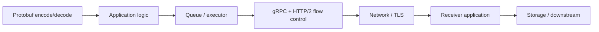

# Streaming Throughput

**Streaming throughput** is the volume of data or number of messages a gRPC stream successfully processes per unit of time. With **SPRING_GRPC**, throughput directly impacts data synchronization pipelines, file/chunk transfers, event feeds, batch processing, and bidirectional inter-service communication. Improving throughput requires examining the entire path from Protobuf serialization, application logic, HTTP/2 flow control, executors, and network down to the receiver's consumption capacity.

High throughput does not automatically mean a healthy system. A stream can achieve high messages per second while causing high latency, unbounded queue growth, excessive heap consumption, or starvation of other RPCs. Designs must balance throughput, latency, memory, fairness, and cancellation/recovery.

## 1. Definition and how to measure throughput

Two metrics are commonly used:

- **Message throughput:** number of application messages successfully processed per second, in messages/s.
- **Payload throughput (goodput):** number of application payload bytes successfully processed per second, in bytes/s or MiB/s.

Over a measurement interval of duration \(T\):

\[
\text{Message throughput} =
\frac{\text{Successfully completed messages}}{T}
\]

\[
\text{Payload goodput} =
\frac{\text{Total successfully completed payload bytes}}{T}
\]

For example, a stream transferring 120,000 messages in 60 seconds achieves 2,000 messages/s. If the average payload is 8 KiB, goodput is roughly 15.6 MiB/s. This measures application payload; traffic on the wire also includes HTTP/2 frames, gRPC message prefixes, TLS records, metadata, and protocol overhead.

### 1.1. Measuring the right completion event

You should not treat a call to `onNext()` as proof that a message has been successfully processed by the server or client. `onNext()` hands the message off to the gRPC runtime; the message may still be waiting to be written to the network, buffered, or not yet processed by the remote application.

If you need to measure durably processed data, the application protocol should include acknowledgments or checkpoints. For instance, the server sends `Ack(sequence)` after committing a record. You can then measure:

- Messages sent.
- Messages received.
- Messages processed.
- Messages committed/acknowledged.

These numbers diverge when queueing, retries, cancellations, or mid-stream errors occur. Dashboards must state clearly which boundary throughput is being measured at.

## 2. Streaming patterns and load characteristics

gRPC supports three streaming types alongside unary:

| RPC type | Message flow | Throughput characteristics |
| --- | --- | --- |
| Server streaming | One request, many responses | Server is the producer; producer rate must match client/network capacity |
| Client streaming | Many requests, one response | Server consumes continuously; requires inbound flow control and batching/aggregation |
| Bidirectional streaming | Many requests and many independent responses | Both directions can run concurrently; each direction needs separate flow control and queues |

Streaming reduces repeated RPC setup costs and pipelines multiple messages over one HTTP/2 stream. However, a long-lived stream holds resources longer, can create connection-level head-of-line pressure, and requires clear semantics for cancellation, timeouts, retries, partial results, and resumption.

Do not pick streaming solely for speed. If operations are independent, small, and need per-request load balancing/retries, unary can be simpler and fairer. Streaming fits when there is a related sequence of data or continuous communication is needed.

## 3. Factors determining throughput

Actual throughput is bounded by the slowest link:



Factors that typically matter most:

- **Message size:** tiny messages suffer high relative overhead; overly large messages increase allocation, latency, and memory pressure.
- **Serialization:** Protobuf encode/decode, byte array copies, and object creation can consume CPU/heap.
- **Compression:** lowers bytes sent over the network at the cost of CPU and potentially higher latency.
- **Flow control:** bounds the amount of data in flight that the receiver has not yet consumed.
- **Concurrency:** number of concurrent streams, number of channels, and how streams are distributed across HTTP/2 connections.
- **Application work:** databases, validation, mapping, encryption, and downstream calls.
- **Executor:** thread count, queues, context switching, and blocking.
- **Network:** bandwidth, RTT, packet loss, TLS, and geographic distance between services.

Optimizing one layer while another layer is the bottleneck usually does not improve overall throughput. For instance, adding threads will not help if the network is already saturated or the database can only handle a limited number of transactions per second.

## 4. HTTP/2 flow control and backpressure

gRPC runs over HTTP/2. HTTP/2 enforces flow control at two levels:

- **Stream-level window:** limits data in flight on a single stream.
- **Connection-level window:** limits total data in flight across a single connection.

The receiver updates windows as it consumes data. The sender can only continue transmitting within the remaining available window. gRPC Java manages transport flow control underneath; applications should respect readiness and inbound demand rather than assuming `onNext()` can be called indefinitely without buffering.

Backpressure is the mechanism ensuring a producer's rate does not exceed a consumer's processing capacity over sustained periods. If the producer outpaces the consumer and the application stores every message in an unbounded queue, heap grows until GC pressure or `OutOfMemoryError` degrades the system.

### 4.1. Operational rules

- Use bounded queues and define overflow behavior: pause the producer, throttle, reject, or persist durably.
- Emit messages only when the gRPC stream is ready.
- For inbound streaming, request additional messages based on processing capacity when using manual flow control.
- Never block gRPC callback/event-loop threads waiting on queues or databases.
- Cancel the producer and release resources when the stream is cancelled.
- Set limits on message size and total data volume per operation.

HTTP/2 flow control does not replace application-level backpressure. Transport can throttle bytes, yet the application can still allocate millions of objects before handing them to the transport.

## 5. Controlling outbound streams with readiness

In gRPC Java, `ServerCallStreamObserver` provides `isReady()` and `setOnReadyHandler()`. The server should emit messages while the stream is ready, then resume when the callback signals write capacity is available again.

Example server-streaming skeleton:

```java
@Override
public void streamEvents(
        StreamRequest request,
        StreamObserver<Event> responseObserver) {

    ServerCallStreamObserver<Event> observer =
        (ServerCallStreamObserver<Event>) responseObserver;

    EventProducer producer = eventService.openProducer(request);

    observer.setOnCancelHandler(producer::cancel);
    observer.setOnReadyHandler(producer::drainWhenReady);

    producer.start();
    producer.drainWhenReady();
}
```

`EventProducer` here is an illustrative application component. It must ensure:

- `drainWhenReady` pulls only a bounded number of messages from the queue.
- It checks `observer.isReady()` before every `onNext`.
- It does not run a long or blocking loop on the callback thread.
- State is synchronized between producer and callback so it neither emits duplicates nor emits after stream close.
- It calls `onCompleted` when the data source finishes normally, and `onError` on failure.
- It stops the data source when the client cancels.

Never call `onNext` concurrently from multiple threads on the same observer. If the producer runs on a separate executor, serialize emissions to preserve ordering and comply with the `StreamObserver` contract.

### 5.1. isReady is not an acknowledgment

`isReady()` only indicates that the local gRPC runtime can currently accept more outbound data without exceeding its internal readiness threshold. It does not prove the peer has received, decoded, or committed the message. When business confirmation is required, use protocol-level acknowledgments.

## 6. Controlling client/server inbound flow

With client-streaming or bidirectional streaming, the server can use manual inbound flow control to request more messages only after processing prior ones. In gRPC Java, `ServerCallStreamObserver` supports disabling automatic inbound flow control and calling `request(n)` to grant demand.

Example handler skeleton:

```java
public StreamObserver<UploadChunk> upload(
        StreamObserver<UploadResult> responseObserver) {

    ServerCallStreamObserver<UploadResult> serverObserver =
        (ServerCallStreamObserver<UploadResult>) responseObserver;

    serverObserver.disableAutoRequest();
    UploadSession session = uploadService.openSession();

    return new StreamObserver<>() {
        @Override
        public void onNext(UploadChunk chunk) {
            session.accept(chunk);
            serverObserver.request(1);
        }

        @Override
        public void onError(Throwable error) {
            session.abort(error);
        }

        @Override
        public void onCompleted() {
            UploadResult result = session.commit();
            responseObserver.onNext(result);
            responseObserver.onCompleted();
        }
    };
}
```

This is an illustrative skeleton; production code must verify the flow-control API of the exact gRPC Java version in use, handle exceptions from `accept`/`commit`, cancellation, transactions, and chunk limits. Call `request(1)` only after the current message has been processed or placed into a bounded queue. Requesting before the consumer has capacity defeats application-level backpressure.

For a client receiving a streaming response, `ClientResponseObserver.beforeStart` and `ClientCallStreamObserver` allow configuring manual inbound demand via the gRPC Java API. Read the exact contract for your version and call `request(n)` only when the consumer has capacity.

## 7. Batching and choosing message size

Batching can increase throughput by grouping many small records into one message or one transaction:

**Benefits:**

- Reduces framing and callback overhead per record.
- Amortizes fixed serialization/dispatch costs.
- Improves batch database write efficiency.
- Can utilize larger network payloads per send.

**Costs:**

- Large messages increase batch accumulation wait time.
- Increases memory needed to hold batches.
- One error can affect many records at once.
- Reduces fairness across streams if a batch hogs resources.
- Risks hitting client/server message size limits.

Batch size should be determined by benchmarking with real payloads and workloads. A common strategy is flushing when either threshold is reached: max record count or max wait time. That bounds latency while still grouping efficiently under heavy load.

Do not set batch size too large just to maximize bytes/s. For interactive systems, p95/p99 latency and time from record creation to consumer visibility may matter more than peak throughput.

## 8. Compression and serialization

Compression helps when payloads contain repetitive data or text. Already compressed data, images/video, or high-entropy payloads may barely shrink and can increase CPU and latency.

| Situation | What to consider |
| --- | --- |
| Text/highly repetitive payloads | Try gzip or an appropriate compressor |
| Already compressed payloads | Usually disable compression to avoid wasted CPU |
| CPU is already the bottleneck | Measure carefully before enabling compression |
| Network bandwidth is the bottleneck | Compression can meaningfully raise goodput |
| Small messages | Compression overhead can outweigh benefits |

In gRPC Java, compression can be configured per call or per message depending on API/stub. Example:

```java
asyncStub.withCompression("gzip").streamEvents(request, observer);
```

Compressor names and support depend on the runtime. Compression must be benchmarked on both sides; the server may spend more CPU decompressing than the network saves. Avoid compressing already compressed payloads or unsuitable data.

On the Protobuf side, keep message schemas lean, avoid unnecessary object nesting, and limit large payload copies. For byte payloads, consider bounded chunking instead of building one huge message. Never sacrifice schema compatibility just to save a few bytes if the gain has not been measured.

## 9. Channels, connections, and concurrent streams

A single `ManagedChannel` can multiplex many RPCs over HTTP/2 connections. Creating a new channel per message or per RPC typically increases DNS, TCP, TLS, thread, and socket overhead.

Guidelines:

- Reuse `ManagedChannel` according to an appropriate endpoint/lifecycle scope.
- Create stubs as needed from a shared channel; gRPC Java stubs are immutable and reusable.
- Measure actual concurrent streams and connection counts.
- When an HTTP/2 connection reaches its concurrent streams limit, new RPCs may wait or use another connection depending on channel/load balancing configuration.
- Use multiple channels only when benchmarks show connection-level parallelism or traffic/failure domain isolation is needed.
- Shut down channels properly according to application lifecycle.

A long-lived stream can hold a concurrent stream slot for a long time. If a service mixes many long streams with many unary RPCs, consider separating channels/pools or tuning load balancing so long streams do not inflate latency for short traffic.

## 10. Executors and avoiding blocking callbacks

Throughput can drop sharply if gRPC callbacks are blocked by database calls, file I/O, or lock contention. When a callback thread is held too long, other streams wait, causing queueing and higher tail latency.

Designs should:

- Keep callbacks short and avoid blocking I/O directly on transport/event-loop threads.
- Use bounded executors with explicit capacity for blocking work.
- Bound pending tasks; do not move the problem from gRPC queues into an unbounded application queue.
- Separate CPU-bound and I/O-bound workloads when needed.
- Propagate cancellation/deadlines to tasks and downstream dependencies.
- Never spawn a new thread per message.

Increasing thread count does not always increase throughput. When CPU, database connection pools, or the network are saturated, extra threads only add context switching and contention.

## 11. Running repeatable benchmarks

Streaming benchmarks must hold the workload steady and measure across layers:

1. Pick the RPC pattern and payload sizes representative of production.
2. Define throughput in terms of messages received, processed, or committed.
3. Run warm-up so JVM JIT, connections, and TLS stabilize.
4. Ramp up concurrent streams gradually and hold load long enough to observe steady state.
5. Record messages/s, MiB/s, p50/p95/p99 latency, CPU, heap, GC, and network.
6. Vary one factor at a time: batch size, payload size, compression, concurrency, executor.
7. Repeat runs and compare within the same environment.
8. Verify correctness, ordering, loss/duplication, and cancellation throughout the benchmark.

Do not measure only a few seconds right after process startup. Startup, class loading, JIT, and TLS handshakes can skew results away from steady state. Measure cold start separately if initialization latency matters for the workload.

### 11.1. Throughput and latency

Throughput and latency are related but not synonymous. A system can raise throughput via batching while making each message wait longer before flushing. As load rises, latency typically climbs rapidly as the system approaches saturation.

Track at least:

- Throughput at steady load.
- End-to-end latency and per-message processing latency.
- Queue depth and queue wait time.
- Error/cancel rates.
- CPU, memory, GC pauses, and network utilization.

Do not optimize average throughput alone if p99 latency breaches the SLO.

## 12. Load testing and detecting the saturation point

A useful load test steps up load incrementally:

```text
streams: 10 -> 25 -> 50 -> 100 -> 200
payload: 1 KiB, 8 KiB, 64 KiB
duration: warm-up + steady-state window
record: messages/s, MiB/s, p50/p95/p99, CPU, heap, GC, queue
```

This is an example matrix, not default thresholds for every system. Choose stream counts, payloads, and durations based on your production profile.

Saturation typically shows up through one or more signals:

- Throughput stops growing even as concurrency rises.
- p95/p99 latency spikes sharply.
- Queue depth grows continuously.
- CPU nears 100% or GC pauses increase.
- Network hits its bandwidth ceiling.
- Database/downstream latency and connection waits increase.
- `isReady()` on outbound streams is frequently false, or inbound demand cannot keep up.

When you see saturation, pinpoint the bottleneck before raising concurrency or buffer sizes. Enlarging buffers only delays failure if the consumer cannot keep pace.

## 13. Observability for streaming throughput

Emit metrics per service/method and stream type:

| Metric | Purpose |
| --- | --- |
| Messages sent/received/processed per second | Measures message rate at each boundary |
| Payload bytes per second | Measures application goodput |
| Active streams | Tracks concurrency and resource occupancy |
| Message size histogram | Shows payload distribution |
| Stream duration | Detects overly long or stalled streams |
| Queue depth / wait time | Detects producer-consumer imbalance |
| Readiness / flow-control wait | Identifies outbound backpressure |
| Retry/cancel/error count | Measures stability and recovery cost |
| CPU, heap, allocation, GC | Identifies runtime bottlenecks |

Do not attach high-cardinality labels like stream ID, user ID, or resource ID to metrics. Use trace IDs in logs/traces to investigate individual streams, while keeping metric labels bounded to service, method, outcome, and payload size buckets.

For long streams, a single trace can grow too large. Use spans per batch/checkpoint or event metrics to keep tracing overhead bounded. Logs should never dump entire payloads.

## 14. Common optimization mistakes

| Mistake | Consequence | Better approach |
| --- | --- | --- |
| Calling `onNext()` continuously without checking readiness | Buffer growth, memory pressure, and latency | Use `isReady()`/`onReady` and bounded queues |
| Unbounded application queues | Heap grows with consumer lag | Bound queues and define an overflow policy |
| Blocking callback threads with database I/O | Other streams suffer starvation | Use a bounded executor for blocking work |
| Creating a channel per RPC | Wastes sockets, TLS handshakes, and threads | Reuse `ManagedChannel` |
| Enabling compression by default for all payloads | Higher CPU for little byte savings | Benchmark against payload profile |
| Oversized batches | Poor latency, memory usage, and fairness | Flush by size or time threshold |
| Measuring only `onNext` call counts | Overestimates data actually processed | Measure receive/process/commit or acknowledgments |
| Raising concurrency without limit | Saturation, queueing, and retry storms | Find the bottleneck and limit admission |
| Increasing HTTP/2 windows without measuring | Higher in-flight memory with uncertain goodput gain | Tune after measuring RTT, bandwidth, and flow-control waits |

## 15. Checklist for improving streaming throughput

Before changing configuration or code, verify:

1. **Metric:** are you measuring messages/s, payload goodput, or wire throughput?
2. **Completion boundary:** is a message counted when sent, received, processed, or committed?
3. **Workload:** do stream type, payload size, and concurrent stream count represent production?
4. **Bottleneck:** is it CPU, serialization, queue, flow control, network, or downstream?
5. **Backpressure:** are outbound readiness and inbound demand respected?
6. **Queue:** are there explicit bounds and an overflow policy?
7. **Batch:** do batch size/flush interval balance throughput and latency?
8. **Compression:** do bandwidth savings outweigh CPU cost?
9. **Channel:** is `ManagedChannel` reused and lifecycle-managed?
10. **Executor:** are callbacks blocked, or are threads/queues unbounded?
11. **Correctness:** are ordering, duplicates, loss, cancellation, and resume tested?
12. **Benchmark:** does it include warm-up, steady state, multiple runs, and p95/p99?
13. **Observability:** are active streams, queues, flow-control waits, goodput, and CPU/GC monitored?

## 16. Key takeaway

Streaming throughput is the rate of messages or payload that an application truly processes per unit of time. Increasing throughput requires optimizing the whole pipeline: Protobuf, application logic, executors, HTTP/2 flow control, network, compression, and the consumer. `onNext()` does not mean a message has been processed or committed; when business confirmation matters, use acknowledgments/checkpoints.

In Spring gRPC, reuse channels, use bounded queues, respect `isReady()`/`onReady` and inbound demand, avoid blocking callback threads, choose batching/compression based on benchmarks, and monitor both throughput and p95/p99 latency. When load rises without throughput gains, queues swell, or latency spikes, the system is nearing saturation; find the bottleneck rather than just adding buffers or threads. Proper backpressure design and boundary-aware measurement enable streams to achieve high goodput while keeping memory, latency, and reliability under control.

### References

- [gRPC – Flow control](https://grpc.io/docs/guides/flow-control/)
- [gRPC – Performance](https://grpc.io/docs/guides/performance/)
- [gRPC Java – Generated code reference](https://grpc.io/docs/languages/java/generated-code/)
- [gRPC Java – API documentation](https://grpc.github.io/grpc-java/javadoc/)
- [Protocol Buffers – Encoding](https://protobuf.dev/programming-guides/encoding/)
