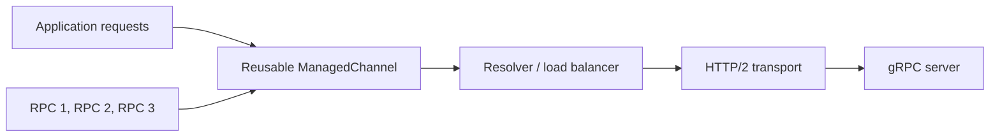

# Connection Reuse

**Connection reuse** means maintaining and reusing gRPC connection infrastructure across many RPCs instead of creating and closing connections after each request. In **SPRING_GRPC**, this cuts DNS resolution, TCP connect, TLS handshake, socket allocation, and transport initialization costs. It is especially important for services with many short unary RPCs or frequently opened streams.

In gRPC Java, the application objects typically reused are **`ManagedChannel`** and stubs created from that channel. Understand that `ManagedChannel` is a client-side abstraction, not necessarily a 1:1 equivalent to a single TCP connection. A channel can manage resolvers, load balancing, subchannels, and one or more transport connections depending on target, policy, and network state.

## 1. Why reuse channels?

If every RPC creates a new channel, the client may repeat several expensive steps:

1. Resolving the service name via DNS or a name resolver.
2. Creating a TCP socket and establishing a connection.
3. Performing the TLS handshake, verifying certificates, and negotiating protocol.
4. Initializing HTTP/2 connection and transport state.
5. Sending one RPC and immediately closing the channel/connection.

For short requests, setup costs can represent a substantial portion of total latency. Reusing a channel keeps transports ready for subsequent RPCs and allows HTTP/2 to multiplex multiple RPCs over the same connection when the transport supports it.



This diagram shows the channel as a shared logical entry point. The resolver and load balancer may create or manage multiple subchannels/transports; do not infer TCP connection counts solely from the number of `ManagedChannel` instances.

## 2. Distinguishing channel, connection, and stub

| Component | Role | Should it be reused? |
| --- | --- | --- |
| `ManagedChannel` | Client logical entry point; manages resolver, load balancing, and transport | Yes, typically lives for the application or client service lifecycle |
| HTTP/2 connection | Actual transport connection carrying multiple streams/RPCs | Managed and reused by the gRPC runtime |
| Subchannel | Represents a connection path to a backend in the load-balancing model | Managed by channel/load balancer |
| Generated stub | Typed API to invoke a service over a channel | Yes; gRPC Java stubs are immutable and thread-safe |
| RPC call | A single invocation of a specific method | Never reused; each RPC has its own deadline, metadata, and state |

A channel is not a request. A stub is not a socket either. Multiple stubs can share one channel, and one channel can serve multiple methods or multiple stubs targeting the same endpoint.

Generated stubs in gRPC Java are immutable. Methods like `withDeadlineAfter`, `withCallCredentials`, or `withCompression` return a new stub with the corresponding `CallOptions`; they do not create a new channel. You can hold a shared stub and derive per-call variants as needed.

## 3. How HTTP/2 multiplexing aids reuse

HTTP/2 lets multiple independent streams coexist on a single connection. Each gRPC RPC maps to an HTTP/2 stream. When a channel is reused:

- Multiple unary RPCs can execute concurrently without creating separate TCP connections per request.
- A long-lived stream can remain open while other RPCs continue sharing the connection.
- TLS handshakes and TCP setup are amortized across many RPCs.
- Connection-level flow control and concurrent stream limits are managed at the transport layer.

Multiplexing reduces connection churn, but it does not grant infinite concurrency. The server may advertise a concurrent streams limit; once reached, new RPCs may wait, be routed to another transport, or follow channel/load-balancer policies.

Therefore, channel reuse is normally the right starting point. Only increase the number of channels/connections when metrics show a single transport is becoming a bottleneck or traffic isolation is required.

## 4. Creating a shared ManagedChannel in Spring

A Spring configuration can declare a channel bean and inject it into services making downstream calls:

```java
@Configuration
class GrpcClientConfiguration {

    @Bean(destroyMethod = "shutdown")
    ManagedChannel inventoryChannel() {
        return ManagedChannelBuilder
            .forTarget("dns:///inventory.internal:8443")
            .useTransportSecurity()
            .build();
    }

    @Bean
    InventoryServiceGrpc.InventoryServiceBlockingStub inventoryStub(
            ManagedChannel inventoryChannel) {
        return InventoryServiceGrpc.newBlockingStub(inventoryChannel);
    }
}
```

This example uses a DNS target and TLS. `inventory.internal` is the service's logical hostname; the server certificate must validate against that hostname. If the application uses a Spring gRPC starter with its own channel factory or properties, configure it via the starter's mechanism, while keeping the same lifecycle and reuse principles.

The service simply injects the stub:

```java
@Service
class InventoryClient {

    private final InventoryServiceGrpc.InventoryServiceBlockingStub stub;

    InventoryClient(
            InventoryServiceGrpc.InventoryServiceBlockingStub stub) {
        this.stub = stub;
    }

    ItemReply getItem(String itemId) {
        ItemRequest request = ItemRequest.newBuilder()
            .setItemId(itemId)
            .build();

        return stub.withDeadlineAfter(800, TimeUnit.MILLISECONDS)
            .getItem(request);
    }
}
```

Each request still gets its own deadline. Sharing a channel does not mean RPCs share timeouts or metadata. `CallOptions` and metadata must be set per call to prevent context leakage across requests.

## 5. Never create a channel per RPC

Common anti-pattern:

```java
ItemReply getItem(ItemRequest request) {
    ManagedChannel channel = ManagedChannelBuilder
        .forAddress("inventory.internal", 8443)
        .useTransportSecurity()
        .build();
    try {
        return InventoryServiceGrpc.newBlockingStub(channel)
            .getItem(request);
    } finally {
        channel.shutdownNow();
    }
}
```

This pattern causes connection churn and repeats setup costs. As traffic grows, it drives up:

- TCP connections and sockets on both client and server.
- TLS handshakes and cryptographic CPU.
- DNS lookups and load balancer churn.
- Threads, timers, buffers, and object allocations.
- `TIME_WAIT` sockets and pressure on ephemeral ports.
- Tail latency as requests wait on new connections.

Create a channel once per target/configuration, reuse it across RPCs, and shut it down at the end of the application lifecycle.

## 6. Lifecycle and graceful shutdown

A `ManagedChannel` must be closed when the application stops. Calling `shutdown()` tells the channel to stop accepting new RPCs and lets in-flight calls finish. `shutdownNow()` forces the channel closed and cancels remaining calls.

A controlled shutdown sequence:

1. Stop accepting new application requests or begin draining.
2. Call `shutdown()` on the channel.
3. Wait a bounded duration for in-flight RPCs to complete.
4. If the timeout expires, call `shutdownNow()`.
5. Record cancelled calls and release resources.

Spring can invoke `shutdown` via `destroyMethod` as shown in the bean example above. If you need to await channel termination before process exit, add a lifecycle coordinator with a timeout instead of blocking indefinitely inside a destroy callback.

Never call `shutdown` after each RPC. Likewise, avoid holding channels in static globals without a clear lifecycle, as shutdown, test isolation, and multi-environment configuration become hard to control.

## 7. How should channels be partitioned?

Normally, maintain one shared channel per logical target and transport/security configuration. Reasons an application might need separate channels:

- Different target or service.
- Different trust configuration, TLS authority, or client certificate.
- Different load balancing policy or resolver.
- Proven need for executor/transport isolation.
- Traffic classes requiring resource or failure-domain isolation.

Never create a channel per user or per access token. Bearer tokens should normally be attached per RPC via `CallCredentials` or a client interceptor; the channel stays shared whenever target and transport identity are the same. If the credential is a TLS-layer client certificate, that is transport configuration and may require separate channels per identity/certificate.

A channel registry can be keyed by target and immutable transport properties. Never place raw secrets into keys or logs. Bound the number of created channels and close channels when their configurations expire.

## 8. Should you build a channel pool?

Pooling multiple `ManagedChannel` instances can occasionally increase HTTP/2 connections and prevent a single connection from becoming a bottleneck, but it has costs:

| Potential benefit | Costs/risks |
| --- | --- |
| More transport connections and parallelism | More sockets, TLS sessions, and memory |
| Separating long-lived and short-lived traffic | Greater configuration and shutdown complexity |
| Isolating a failure/traffic domain | Can skew load balancing or cause uneven distribution |
| Avoids waiting when concurrent stream limit is reached | Higher connection churn and server load |

Do not create a pool merely because one channel seems slow. First measure active streams, pending calls, connection utilization, latency, server concurrent-stream limits, CPU, and network. A gRPC Java channel/load balancer can already manage multiple subchannels or transports depending on configuration; an application-level pool may duplicate built-in distribution mechanisms.

If benchmarks prove multiple channels are needed, the pool must have a bounded size, clear lifecycle, fair channel selection, and shut down every channel. Avoid creating a fresh channel whenever the pool is busy; that is merely uncontrolled connection churn.

## 9. Reuse with load balancing and service discovery

When the target is DNS or a service name, the channel can keep a resolver and load balancer running to track backend updates. Example:

```java
ManagedChannel channel = ManagedChannelBuilder
    .forTarget("dns:///catalog.internal:8443")
    .defaultLoadBalancingPolicy("round_robin")
    .useTransportSecurity()
    .build();
```

Capabilities and policy names depend on the gRPC Java version and installed resolvers. A reused channel can still update backends when DNS/service discovery changes; there is no need to recreate channels whenever a backend changes IP.

Points to keep in mind:

- DNS TTL and refresh behavior depend on the resolver/runtime.
- The load balancer picks subchannels/backends according to its policy.
- One channel can maintain multiple transport connections if the policy and resolver create multiple subchannels.
- Certificate identity must match the hostname/authority the client verifies.
- When a backend is removed from service discovery, the channel can shift traffic to remaining healthy backends per policy.

Never hard-code backend IPs in clients if the architecture uses service discovery. Also do not assume `round_robin` is always effective if the resolver only returns one address or the policy is not registered.

## 10. Connection reuse and keepalive

Keepalive uses HTTP/2 PING frames to check or maintain connection liveness per policy. It differs from gRPC health checking:

- **Keepalive:** checks transport connection state and detects unresponsive peers/networks.
- **Health checking:** queries the service health API to determine whether the service is ready to accept requests.

Do not set overly aggressive keepalive intervals for all clients. Frequent PINGs can burden servers, load balancers, and networks; servers may reject clients violating keepalive policies. Coordinate client and server settings with infrastructure and traffic patterns.

Channel reuse does not mean keeping connections alive with constant pings. If traffic is sparse, connections may go idle or be closed by proxies; the gRPC channel can reconnect on the next RPC. Configure keepalive only for explicit operational needs such as detecting dead connections on long-lived streams or keeping paths open across proxies with idle timeouts.

## 11. GOAWAY, reconnects, and active streams

An HTTP/2 server can send `GOAWAY` when it wants to close a connection gracefully, such as before a restart. The gRPC runtime handles transport shutdown and can establish a new connection for subsequent RPCs.

However:

- Transport reconnection does not automatically recover all in-flight RPCs.
- Unprocessed unary RPCs may be retried according to semantics/runtime/policy.
- Open streaming RPCs may terminate with errors when the transport closes.
- The application needs cursors, sequences, acknowledgments, or a resume protocol if streams must survive reconnects.
- Never retry operations with side effects without idempotency protection.

For long streams, design reconnection at the application layer: the client persists confirmed checkpoints, opens a new stream, and requests resumption from the appropriate sequence/cursor. Connection reuse reduces setup overhead during normal operation; it does not replace stream recovery.

## 12. Deadlines, cancellation, and metadata remain per-call

Reusing a channel does not mean RPCs share business state. Each call still needs:

- A deadline appropriate to the operation.
- Its own metadata/correlation ID.
- Caller-specific authentication credentials.
- Cancellation when the caller no longer needs the result.
- Per-method retry policy and idempotency.

Never store mutable request metadata in a singleton client and mutate it before each call, as concurrent RPCs will overwrite each other's context. Use stub `CallOptions` or metadata interceptors that create per-call context.

For example, attach per-call correlation metadata with a client interceptor or appropriate `CallCredentials`. Never create a new channel just to change a request ID, trace context, or Bearer token.

## 13. Benchmarking reuse vs. creating new channels

To quantify the benefit, benchmark both approaches against the same server, payload, and load:

| Experiment | Call pattern |
| --- | --- |
| A | Create channel, invoke one RPC, shut down channel |
| B | Create channel once, invoke many RPCs sequentially |
| C | Create channel once, invoke many RPCs concurrently |
| D | Reuse channel via DNS/load balancing with changing backends |
| E | Multiple bounded channels, only when evaluating connection parallelism |

Measure:

- Latency p50/p95/p99 and first-call duration.
- TCP connect/TLS handshake counts and durations.
- RPC throughput and pending call counts.
- Active connections, active streams, and socket counts.
- Client/server CPU, allocation, heap, and GC.
- DNS resolution and reconnect durations.
- Error/cancel rates when backends restart or send `GOAWAY`.

Warm up the JVM and channel before measuring steady state. Separate cold-start latency from RPC latency once the channel is ready. Keep TLS, certificate validation, load balancing, and network conditions similar to production. Benchmarking reuse over plaintext when production uses TLS hides real setup and CPU costs.

## 14. Observability for channel reuse

Monitor per target/service and method:

| Metric | Meaning |
| --- | --- |
| Channel count | Detects unbounded channel creation |
| Active transport connections | Actual managed connections |
| Active/pending RPCs | Concurrency and waiting calls |
| Connection state | `IDLE`, `CONNECTING`, `READY`, `TRANSIENT_FAILURE`, `SHUTDOWN` |
| Connection/TLS setup duration | Transport initialization cost |
| Reconnect/`GOAWAY` count | Connection stability |
| RPC latency p50/p95/p99 | Impact of connection reuse |
| RPC throughput/error/cancel | Capacity and reliability |
| Shutdown duration/in-flight calls | Graceful shutdown quality |

Never use user ID, request ID, or access token as metric labels. Use bounded-cardinality target/service names, and trace IDs in logs/traces when investigating specific calls. Never log credentials or TLS private keys.

## 15. Common mistakes

| Mistake | Consequence | Better approach |
| --- | --- | --- |
| Creating a `ManagedChannel` per RPC | Increases TCP/TLS setup, sockets, and latency | Reuse channels per target/configuration |
| Calling `shutdown` after each call | Next call must create a new channel | Close channels with the application lifecycle |
| Sharing one channel across different targets/security identities | Wrong authority, trust, or credential context | Partition channels by immutable transport config |
| Creating a channel per user/token | Wastes resources and causes connection churn | Use per-call `CallCredentials`/metadata |
| Assuming one channel equals one TCP connection | Misunderstands load balancing/subchannels | Monitor actual transports |
| Creating an unbounded pool | Increases sockets, memory, and server load | Pool only when benchmarks prove it necessary; bound size |
| Setting overly frequent keepalive | PING storms or rejection by server/proxy | Configure per infrastructure policy |
| Assuming reconnect auto-resumes streaming RPCs | Data loss or duplicate processing | Use sequences, acks, and a resume protocol |
| Using static channels without lifecycle management | Difficult shutdown and test isolation | Manage channels via Spring beans/lifecycle |

## 16. Production checklist

Before shipping a gRPC client in Spring, confirm:

1. **Lifecycle:** channels are created once and closed when the application stops.
2. **Reuse:** no channel creation per request or per message.
3. **Targets:** channels are partitioned by logical target and transport/security config.
4. **Stubs:** generated stubs are reused; `CallOptions` are per RPC.
5. **Concurrency:** concurrent stream limits and pending calls are understood.
6. **Load balancing:** resolvers/policies are configured and properly observed.
7. **Credentials:** per-call Bearer tokens do not spawn per-user channels.
8. **TLS:** hostnames, trust stores, authorities, and client certificates match properly.
9. **Keepalive:** enabled only when needed and aligned with server/proxy policies.
10. **Reconnects:** behavior on connection reset, `GOAWAY`, or backend changes is clear.
11. **Streaming:** checkpoints/acks/resumption exist if streams require recovery.
12. **Shutdown:** draining, timeouts, and in-flight RPC handling are defined.
13. **Benchmarks:** cold start, warm channel, concurrency, and p95/p99 have been compared.
14. **Observability:** channel counts, connection states, reconnects, and RPC metrics are tracked.

## 17. Key takeaway

Connection reuse lets gRPC avoid repeating DNS, TCP, and TLS setup for every RPC. In gRPC Java, reuse `ManagedChannel` and generated stubs within Spring's lifecycle. A channel is a logical abstraction managing resolver/load balancing/transport, not a guarantee of a 1:1 mapping to a single TCP connection. HTTP/2 multiplexes many RPCs over a connection while still respecting concurrent stream and resource limits.

Never create a channel per request, never shut down after every call, and never build an unbounded pool. Partition channels only by genuinely distinct targets or transport/security identities; use per-call `CallCredentials` or metadata for Bearer tokens instead of per-user channels. Configure keepalive deliberately, recognize that `GOAWAY`/reconnects do not automatically resume streams, and use checkpoints when recovery is needed. Benchmark with TLS and production load, and monitor connection states, active/pending RPCs, setup latency, and p95/p99 to determine when one channel suffices or when isolation/pooling is warranted.

### References

- [gRPC – Performance](https://grpc.io/docs/guides/performance/)
- [gRPC – Keepalive](https://grpc.io/docs/guides/keepalive/)
- [gRPC – Custom Load Balancing](https://grpc.io/docs/guides/custom-load-balancing/)
- [gRPC Java – ManagedChannel API](https://grpc.github.io/grpc-java/javadoc/io/grpc/ManagedChannel.html)
- [gRPC Java – ManagedChannelBuilder API](https://grpc.github.io/grpc-java/javadoc/io/grpc/ManagedChannelBuilder.html)
