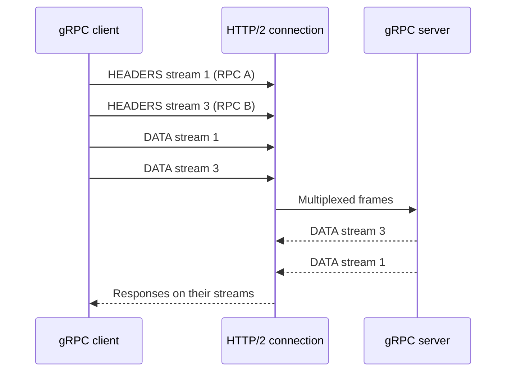

# HTTP/2 Multiplexing

**HTTP/2 multiplexing** lets multiple HTTP/2 streams operate simultaneously over a single TCP connection. gRPC maps each RPC onto an HTTP/2 stream, so multiple RPCs can transmit concurrently over the same connection without opening a separate TCP connection per request. This is the foundation that enables gRPC to reduce connection churn, share TLS costs, and support efficient concurrent communication.

In **SPRING_GRPC**, multiplexing is especially important when a service invokes many short RPCs, maintains multiple streams, or mixes unary and streaming calls. However, multiplexing does not yield infinite capacity: each connection has concurrent stream limits, shared flow-control windows, shared bandwidth, and shared CPU. TCP also still suffers from head-of-line blocking when packets are lost. Designs must balance stream count, stream lifetime, connection count, fairness, and server capacity.

## 1. RPCs map to HTTP/2 streams

One gRPC call corresponds to one HTTP/2 stream. Inside that stream, gRPC can send one or more messages:

- Unary RPC: one request message and one response message on a single stream.
- Server streaming: one request message and multiple response messages on the same stream.
- Client streaming: multiple request messages and one response message on the same stream.
- Bidirectional streaming: multiple messages in both directions on the same stream.

HTTP/2 splits data into frames. Frames belonging to different streams can be interleaved on the same connection, while stream IDs let both peers separate logical flows. For example, a client can send a DATA frame for RPC A, then a DATA frame for RPC B, then continue RPC A without finishing A before starting B.



Frame ordering on the connection does not alter message ordering within each individual stream. RPC A and RPC B have independent lifecycles at the gRPC layer even while sharing the transport.

## 2. Multiplexing cuts connection overhead

If every RPC opened a new TCP/TLS connection, the client would pay repeated setup costs:

1. DNS or service-name resolution.
2. TCP handshake.
3. TLS handshake and certificate verification.
4. Initializing the HTTP/2 connection and flow-control state.
5. Sending one RPC and closing the connection.

When reusing connections, multiple RPCs share the same transport:

- TCP/TLS setup happens once per connection.
- Multiple RPCs proceed concurrently.
- Socket counts, handshakes, and connection churn drop.
- Channels preserve resolver/load-balancing state and reuse transports.

Multiplexing and connection reuse complement each other. Multiplexing allows multiple streams to share one connection; connection reuse lets subsequent RPCs keep using already established infrastructure.

## 3. Distinguishing channel, connection, and stream

| Concept | Meaning |
| --- | --- |
| `ManagedChannel` | Client-side abstraction; manages resolver, load balancing, subchannels, and transport |
| Subchannel | Logical connection path to a backend in the load-balancing model |
| TCP connection | Actual byte-stream connection between two endpoints |
| HTTP/2 connection | HTTP/2 session running over TCP (usually secured by TLS) |
| HTTP/2 stream | Independent bidirectional stream inside a connection |
| gRPC RPC | A single method invocation, usually carried on one HTTP/2 stream |
| gRPC message | Request/response message inside an RPC stream |

One `ManagedChannel` does not necessarily correspond to exactly one TCP connection. Resolvers and load balancers can create multiple subchannels/transports depending on target, backends, and policy. Conversely, one HTTP/2 connection can multiplex many RPC streams.

Do not use channel count as a proxy for connection count or concurrent RPCs. When investigating performance, measure channels, transport connections, active HTTP/2 streams, and pending RPCs separately.

## 4. Concurrent stream limits

An HTTP/2 server advertises its concurrent stream limit via `SETTINGS_MAX_CONCURRENT_STREAMS`. This is a per-HTTP/2-connection limit, not a system-wide cap on total RPCs.

When a connection already has open streams equal to the limit:

- New RPCs may have to wait before being sent on that connection.
- The runtime/load balancer may pick another transport if topology and implementation allow.
- RPCs with short deadlines can expire while waiting.
- Long-lived streams can hold slots for extended periods, delaying short RPCs.

Do not assume the client automatically opens a new connection as soon as slots fill up. Behavior depends on the gRPC Java version, resolver, load-balancing policy, and transport. Observe active/pending calls and actual connection counts.

### 4.1. Why raising the concurrent-stream limit is not always better

Raising the limit can reduce stream wait times when the connection has spare CPU/network headroom. However, if the server is already saturated, more streams can increase:

- Concurrent callbacks and tasks.
- Memory for stream state, buffers, and pending messages.
- Contention on executors, locks, and downstream connection pools.
- Queueing and tail latency.
- Blast radius from a single client opening too many streams.

Limits should reflect handler, executor, memory, and dependency capacity. A higher limit does not make a database or downstream service run faster.

## 5. Stream-level and connection-level flow control

HTTP/2 enforces two layers of flow control for DATA frames:

- **Stream-level window:** limits data in flight on one stream that the receiver has not yet acknowledged consuming.
- **Connection-level window:** limits total DATA in flight across the entire connection.

Both limits apply simultaneously. A stream may still have stream window available while the connection window is exhausted; the sender must still wait for a connection window update. Conversely, the connection may have capacity while an individual stream is throttled by its stream window.

The receiver sends `WINDOW_UPDATE` as it consumes data. This prevents a faster sender from overflowing the receiver's buffers.

gRPC Java also exposes application-layer flow-control APIs, such as outbound observer readiness and manual inbound requests. HTTP/2 flow control does not replace application-level backpressure: code can still allocate millions of objects or build unbounded queues before handing messages to the transport.

## 6. TCP head-of-line blocking still exists

HTTP/2 multiplexing eliminates sequential request/response blocking at the HTTP/1.1 layer: one slow RPC does not force another RPC on its own stream to wait before sending frames. However, HTTP/2 normally runs over a single TCP connection, and TCP provides an ordered byte stream.

If a TCP segment is lost, subsequent bytes on that same TCP connection cannot be delivered to the HTTP/2 parser until the missing segment is retransmitted. Thus, multiple HTTP/2 streams sharing one connection can still be delayed by TCP packet loss. This is **TCP-level head-of-line blocking**.

Practical implications:

- Multiplexing does not fully isolate one stream from network impairments affecting other streams.
- High RTT and packet loss can elevate latency across many RPCs sharing a connection.
- Opening additional connections introduces separate congestion-control state and can sometimes reduce shared impact, at the cost of extra sockets/TLS/resources.
- Optimization should rely on network telemetry and benchmarks, not concurrent RPC counts alone.

Do not confuse TCP head-of-line blocking with RPC A's server handler blocking an executor and delaying RPC B. Those occur at different layers and require separate diagnosis.

## 7. Long-lived streams and fairness

A bidirectional stream may live for a long time and send thousands of messages while still occupying just one HTTP/2 stream. It does not open a new stream for each message.

Long-lived streams can affect other RPCs in several ways:

- Occupying a slot in the concurrent-stream limit.
- Consuming a large share of the connection-level flow-control window during continuous transmission.
- Generating continuous callback load on the application executor.
- Retaining buffers, state, and context for long durations.
- Competing for bandwidth with short RPCs.

To protect fairness:

- Cap long-lived streams per client/tenant.
- Enforce backpressure and bounded queues.
- Prevent one stream from continuously pushing oversized batches.
- Separate traffic classes or use dedicated channels/connections when SLOs require it and benchmarks prove it necessary.
- Monitor stream duration, message rate, and bytes per stream.

Do not create a dedicated connection per stream by default. Splitting connections can isolate traffic, but increases sockets, TLS sessions, keepalive traffic, and server load.

## 8. Reusing ManagedChannel in Spring

Spring applications typically register a channel bean and share it across client services targeting the same endpoint:

```java
@Configuration
class GrpcClientConfiguration {

    @Bean(destroyMethod = "shutdown")
    ManagedChannel catalogChannel() {
        return ManagedChannelBuilder
            .forTarget("dns:///catalog.internal:8443")
            .useTransportSecurity()
            .build();
    }

    @Bean
    CatalogServiceGrpc.CatalogServiceBlockingStub catalogStub(
            ManagedChannel catalogChannel) {
        return CatalogServiceGrpc.newBlockingStub(catalogChannel);
    }
}
```

Services inject the shared stub:

```java
@Service
class CatalogClient {

    private final CatalogServiceGrpc.CatalogServiceBlockingStub stub;

    CatalogClient(CatalogServiceGrpc.CatalogServiceBlockingStub stub) {
        this.stub = stub;
    }

    ProductReply find(String productId) {
        ProductRequest request = ProductRequest.newBuilder()
            .setProductId(productId)
            .build();

        return stub.withDeadlineAfter(700, TimeUnit.MILLISECONDS)
            .findProduct(request);
    }
}
```

Channel reuse lets RPCs from multiple service beans share the transport. Each call retains its own deadline, metadata, and `CallOptions`. Generated gRPC Java stubs are immutable; methods like `withDeadlineAfter` return stub variants without opening new connections.

If using a Spring gRPC starter, channel configuration may be managed via starter properties or a channel factory. Regardless of how beans are created, keep channels alive across the application lifecycle and close them cleanly on shutdown.

## 9. Load balancing and multiple connections

A channel using DNS/service discovery can resolve to multiple backends. The load-balancing policy determines how subchannels are picked per RPC. Each subchannel can manage its own transport, so one logical channel can use multiple HTTP/2 connections.

Factors to examine:

- Number of healthy backends and resolver results.
- Whether policies like `pick_first` or `round_robin` are supported and properly configured.
- Each backend's individual concurrent-stream limit and capacity.
- Whether connections distribute RPCs evenly or skew due to long-lived streams.
- Whether DNS refreshes and backend removals affect open RPCs.

Do not assume a single channel automatically spins up enough connections to bypass every concurrent-stream limit. Verify the behavior of your resolver, load balancer, and gRPC Java version. Only add a channel pool when benchmarks prove additional transport parallelism or traffic isolation is required.

## 10. Deadlines, cancellation, and queueing

An RPC can wait at multiple points:

1. Waiting for the application executor.
2. Waiting for the channel to pick a subchannel/transport.
3. Waiting for a concurrent-stream slot.
4. Waiting for a flow-control window.
5. Waiting on the server handler or downstream dependencies.

Deadlines cover the end-to-end call duration, including wait time before the handler begins. Consequently, an RPC with a tight deadline can fail with `DEADLINE_EXCEEDED` even before the handler performs much work.

When the caller cancels an RPC, the application should stop producers and downstream work when possible. Do not keep messages queued or continue computing after a call is cancelled. For streams requiring resumption, use sequences/checkpoints and open a new RPC after reconnecting; HTTP/2 does not automatically recover application streams.

## 11. Keepalive and health checking are not multiplexing

Keepalive uses HTTP/2 PINGs to probe or keep connections alive per policy. Health checking queries application-level service health. Neither increases concurrent-stream limits nor replaces flow control.

- PING is not a business gRPC RPC.
- Health checks can be sent as dedicated RPCs.
- Overly short keepalive intervals generate load and can be rejected by servers/proxies.
- A `READY` connection does not guarantee every service method is healthy.

Choose keepalive based on idle timeouts and dead-connection detection requirements. Choose health checking for service readiness. Do not enable frequent PINGs expecting to relieve stream queueing or raise throughput.

## 12. When are multiple connections needed?

Multiple connections can help when:

- One connection regularly hits its concurrent-stream limit.
- Long-lived streams significantly degrade latency of unary RPCs.
- Network paths experience packet loss and benchmarks show separate connections improve tail latency.
- Traffic must be separated by security identity, target, or failure domain.
- Load-balancing topology requires multiple transports.

However, multiple connections also increase:

- TCP sockets, file descriptors, and ephemeral port usage.
- TLS handshakes, certificate validation, and cryptographic CPU.
- HTTP/2 connection state, flow-control windows, and keepalive traffic.
- Memory, threads, and load on load balancers/servers.

Before adding connections, inspect executor saturation, server handler latency, flow-control waits, packet loss, and downstream bottlenecks. If the issue is a slow database, adding connections usually just pushes more requests into the database queue.

## 13. Benchmarking multiplexing

Benchmarks should compare concurrency levels and topologies under the same workload:

| Experiment | Configuration | What to observe |
| --- | --- | --- |
| A | One channel, low load | Baseline setup and latency |
| B | One channel, many concurrent unary RPCs | Multiplexing and pending calls |
| C | One channel, many long-lived streams | Concurrent-stream limit and fairness |
| D | Multiple bounded channels | Effect of additional connections/transports |
| E | Long-lived streams separated from unary traffic | Traffic isolation and tail latency |

Keep TLS, certificate validation, payloads, CPU quotas, and network conditions aligned with the deployment environment. Warm up before measuring steady state and step up load gradually.

Measure:

- RPC throughput and p50/p95/p99 latency.
- Active HTTP/2 streams and pending RPCs.
- Transport connection/subchannel counts.
- Stream-slot wait time and flow-control wait time if exposed by runtime/telemetry.
- Bytes/s, packet loss, RTT, and retransmissions.
- CPU, heap, allocation, GC, and executor queues.
- Errors, cancellations, reconnects, and `GOAWAY` events.

A benchmark measuring only requests/s without latency, queueing, and network metrics can mislead. If throughput climbs while p99 spikes or memory breaches limits, that setup is unlikely to be suitable.

## 14. Observability for HTTP/2 multiplexing

Track metrics across both transport and application layers:

| Metric | Purpose |
| --- | --- |
| Active RPC/HTTP2 streams | Measures active concurrency |
| Pending RPCs | Detects waiting on stream slots or transports |
| Active connections/subchannels | Reveals actual connection topology |
| RPC latency by method | Identifies methods affected by contention |
| Stream duration | Detects overly long streams |
| Messages/s and bytes/s | Measures load per stream or method |
| Flow-control/readiness wait | Detects sender/receiver imbalance |
| TCP RTT/retransmissions/loss | Detects network HOL and impairment |
| Executor queue/rejections | Separates transport wait from application saturation |
| CPU/heap/GC | Evaluates multiplexing overhead at high load |

Avoid high-cardinality labels like stream ID, request ID, or user ID in metrics. Use service, method, outcome, and traffic class; traces/logs may carry correlation IDs under safe observability policies.

## 15. Common misconceptions

| Misconception | Reality | Better approach |
| --- | --- | --- |
| One RPC requires one TCP connection | Many RPCs share streams on one HTTP/2 connection | Reuse `ManagedChannel` and transports |
| One `ManagedChannel` always equals one connection | A channel can manage multiple subchannels/transports | Measure actual connections |
| Multiplexing eliminates all head-of-line blocking | TCP packet loss can still stall byte delivery on the connection | Monitor RTT, loss, and retransmissions |
| Long streams open a new connection per message | One RPC stream carries many messages | Measure active streams and message rates separately |
| Concurrent streams are unlimited | Servers advertise `SETTINGS_MAX_CONCURRENT_STREAMS` | Track pending RPCs and server limits |
| Raising concurrent-stream limit always raises throughput | Can increase memory, executor, and downstream contention | Benchmark against capacity |
| Keepalive increases concurrency | PINGs only check connection health | Use flow control/load balancing for concurrency |
| Reconnects auto-resume streams | Transport reconnects do not restore business state | Design acks/sequences/checkpoints |

## 16. Production checklist

Before tuning multiplexing in Spring gRPC, confirm:

1. **Mapping:** understand each RPC is an HTTP/2 stream; messages travel inside streams.
2. **Reuse:** channels and transports are reused across the lifecycle.
3. **Concurrency:** concurrent-stream limits and saturation behavior are known.
4. **Flow control:** stream windows, connection windows, and application backpressure are understood.
5. **Fairness:** long streams do not cause short traffic to breach latency SLOs.
6. **TCP:** packet loss/retransmissions are monitored since multiplexing does not remove TCP HOL.
7. **Topology:** channel, subchannels, resolver, load balancer, and connection counts are understood.
8. **Deadlines:** slot/transport wait times fit inside end-to-end deadlines.
9. **Cancellation:** work stops and resources release when calls are cancelled.
10. **Keepalive:** configured by policy; PINGs are never used instead of flow control.
11. **Pooling:** channel/connection counts increase only when benchmarks prove it necessary.
12. **Recovery:** long streams carry sequences/acks/checkpoints if resumption is needed.
13. **Benchmarks:** measure concurrency, active streams, p95/p99, network, and executors.
14. **Observability:** distinguish transport waits, application queues, and downstream latency.

## 17. Key takeaway

HTTP/2 multiplexing enables many gRPC RPCs to run on independent HTTP/2 streams over a single TCP connection. Each RPC uses one stream; streaming RPCs send multiple messages on that stream. This reduces TCP/TLS setup and connection churn, though it remains bounded by concurrent-stream settings, stream/connection flow-control windows, bandwidth, CPU, and server capacity.

Multiplexing neither eliminates TCP head-of-line blocking under packet loss nor automatically ensures fairness between long streams and short RPCs. In Spring gRPC, reuse `ManagedChannel`, monitor active/pending streams, enforce deadlines, apply backpressure, and bound streams to capacity. Only add connections or channels when benchmarks point to concurrent-stream contention, network impairment, or traffic-isolation needs. Combine transport metrics with executor, downstream, and p95/p99 latency data to pinpoint the true bottleneck.

### References

- [gRPC – Performance](https://grpc.io/docs/guides/performance/)
- [gRPC – Flow control](https://grpc.io/docs/guides/flow-control/)
- [gRPC – Keepalive](https://grpc.io/docs/guides/keepalive/)
- [RFC 9113 – HTTP/2](https://www.rfc-editor.org/rfc/rfc9113)
- [gRPC Java – ManagedChannel API](https://grpc.github.io/grpc-java/javadoc/io/grpc/ManagedChannel.html)
