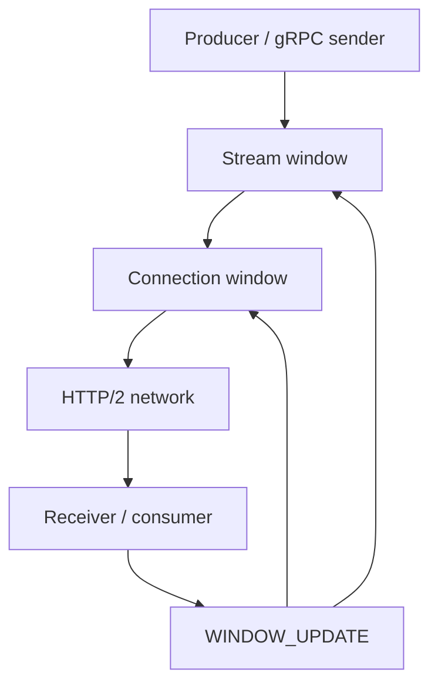

# Flow Control and Memory

In gRPC, **flow control** regulates in-flight data volume so a sender does not overwhelm a receiver or the network. **Memory management** ensures pending outbound, inbound, in-processing data, and associated buffers stay within the process's memory budget. The two concerns are tightly coupled: good flow control bounds in-flight data, yet does not automatically bound every queue and object the application creates.

For **SPRING_GRPC**, this topic is especially critical for client-streaming, server-streaming, and bidirectional streaming. One stream can carry thousands of messages, and many streams can share an HTTP/2 connection simultaneously. If a producer outpaces a consumer, data accumulates in transport buffers, application queues, or downstream systems. Without explicit bounds, heap/direct memory climbs, GC works harder, and eventually `OutOfMemoryError` or service unavailability can occur.

## 1. What problem does flow control solve?

Suppose a producer emits 20,000 messages per second while the consumer can process only 5,000 messages per second. If the sender keeps emitting unchecked, a gap of 15,000 messages per second builds up as a backlog. When messages carry large payloads, memory grows rapidly.

Flow control provides a mechanism for the receiver to pace the sender. Instead of transmitting solely at the producer's generation rate, the sender observes how much data the transport permits and pauses when the receiver has not consumed enough data.

Flow control helps:

- Limit data in transit that the receiver has not yet consumed.
- Prevent a fast sender from overflowing a receiver's buffers.
- Share bandwidth and buffers across multiple streams.
- Reduce queueing and runaway latency when consumers slow down.
- Provide signals for the application to throttle or pause producers.

Flow control does not make the consumer process faster. If downstream dependencies are slow, the system still needs concurrency, queue, and admission limits to keep memory within budget.

## 2. HTTP/2 enforces flow control at two levels

gRPC runs over HTTP/2. HTTP/2 applies flow control to DATA frames at two levels:

1. **Stream-level window:** limits DATA in flight on a single HTTP/2 stream that the receiver has not yet acknowledged consuming.
2. **Connection-level window:** limits total DATA in flight across the entire HTTP/2 connection.

The sender can transmit only when both the stream window and connection window have sufficient credit. The receiver sends `WINDOW_UPDATE` frames to replenish windows after consuming data.



The two windows serve distinct goals. The stream window protects an individual stream; the connection window protects total data on the connection. A stream can have stream credit left while still waiting on the connection window. Conversely, the connection may have credit while one specific stream has exhausted its stream window.

Flow control is byte-based, not message-count-based. A 1 MiB message consumes far more window than a 1 KiB message. Counting messages alone is therefore insufficient to predict in-flight data volume.

## 3. WINDOW_UPDATE and in-flight data limits

As the receiver consumes DATA, it can emit `WINDOW_UPDATE` to allow the sender to continue. If the application or transport fails to read data, windows are not updated promptly and the sender must wait.

Distinguish carefully:

- **Window size:** bytes the transport allows in flight.
- **Message size limit:** maximum size of a single gRPC message an endpoint accepts.
- **Application queue capacity:** records/bytes the application holds waiting to be processed or sent.
- **Concurrent stream limit:** HTTP/2 streams that can be open simultaneously on a connection.

These limits do not substitute for one another. A message smaller than the message-size limit can still swell application queues. A large HTTP/2 window does not mean the application has enough heap to hold many messages simultaneously.

Default window sizes and how gRPC Java manages and updates windows can vary by version and transport. Do not rely on a single default number to size production memory; observe the runtime, actual transport settings, and measure under load.

## 4. HTTP/2 flow control vs. application backpressure

HTTP/2 flow control regulates DATA frames at the transport layer. **Application backpressure** regulates producer speed according to the actual processing capacity of the consumer in business code.

For example:

- The transport may stop accepting more bytes because the stream window is exhausted.
- The application can still keep creating thousands of Protobuf objects and pushing them into a queue.
- Those objects have not hit the network yet, yet they still consume heap.

Therefore, transport flow control does not replace bounded queues and admission control. The application must decide when to read more records, when to form batches, when to emit, and when to pause the producer.

A system can obey HTTP/2 flow control and still exhaust heap due to an unbounded application queue. Conversely, even with bounded application queues, overly large windows/transport buffers can inflate in-flight memory.

## 5. Outbound flow control in gRPC Java

For server-streaming or bidirectional streaming, gRPC Java provides `ServerCallStreamObserver`. `isReady()` indicates whether the runtime can currently accept more outbound data without exceeding internal readiness thresholds. `setOnReadyHandler()` registers a callback invoked when the stream transitions back to ready.

Example server-streaming skeleton:

```java
public void streamEvents(
        StreamRequest request,
        StreamObserver<Event> responseObserver) {

    ServerCallStreamObserver<Event> observer =
        (ServerCallStreamObserver<Event>) responseObserver;

    EventProducer producer = eventService.openProducer(request);
    observer.setOnCancelHandler(producer::cancel);
    observer.setOnReadyHandler(producer::scheduleDrain);

    producer.start();
    producer.scheduleDrain();
}
```

The producer should use a bounded queue and drain only while the stream is ready:

```java
void drain() {
    while (!cancelled && observer.isReady()) {
        Event next = pendingEvents.poll();
        if (next == null) {
            return;
        }
        observer.onNext(next);
    }
}
```

This is an illustrative skeleton. In production, ensure only one drain loop runs at a time, the observer is never called concurrently from multiple threads, and callbacks do not run long loops on transport threads. A serial executor or an atomic work-in-progress guard can coordinate draining.

If the stream is not ready, the producer must stop pulling additional data or hold data in a bounded queue. Never keep reading an entire source into an in-memory list while waiting for stream readiness.

### 5.1. isReady is not an acknowledgment

`isReady()` only reflects the local gRPC runtime's readiness to accept more outbound data. It does not prove the peer has received, decoded, processed, or committed the message. If business confirmation is required, the protocol must provide its own acknowledgments/checkpoints.

Do not call `onNext()` endlessly assuming the runtime will block the producer until the peer finishes processing. Use readiness, bounded queues, and acknowledgments matching business requirements.

## 6. Inbound flow control and manual demand

For client-streaming or bidirectional streaming, the application may need to control how many inbound messages are requested. On the server, `ServerCallStreamObserver` supports disabling automatic inbound flow control via `disableAutoRequest()` and requesting messages via `request(n)`.

Example skeleton processing one message at a time:

```java
public StreamObserver<UploadChunk> upload(
        StreamObserver<UploadResult> responseObserver) {

    ServerCallStreamObserver<UploadResult> serverObserver =
        (ServerCallStreamObserver<UploadResult>) responseObserver;

    serverObserver.disableAutoRequest();
    UploadSession session = uploadService.openSession();
    serverObserver.request(1);

    return new StreamObserver<>() {
        @Override
        public void onNext(UploadChunk chunk) {
            session.accept(chunk);
            serverObserver.request(1);
        }

        @Override
        public void onError(Throwable error) {
            session.abort(error);
        }

        @Override
        public void onCompleted() {
            UploadResult result = session.commit();
            responseObserver.onNext(result);
            responseObserver.onCompleted();
        }
    };
}
```

This is a synchronous skeleton illustrating demand. In production, call `request(1)` only after the current message has been processed or placed into a bounded queue. If `session.accept` performs blocking I/O, do not hold the callback thread waiting on the database; offload with bounded capacity and request the next message only when the consumer has capacity.

When using asynchronous processing, serialize request/cancel/error state transitions and never request more messages after the stream closes. Handle exceptions from `accept`/`commit`, clean up the session, and propagate errors with appropriate statuses.

For a client receiving a streaming response, `ClientResponseObserver` and `ClientCallStreamObserver` support configuring inbound demand via the gRPC Java API. Request more messages only when the application consumer has capacity.

## 7. Where is memory used?

Memory for a gRPC streaming call extends beyond the Protobuf payload. It can include:

- **Transport buffers:** HTTP/2 and Netty read/write buffers; part may live off the Java heap.
- **In-flight messages:** messages received or staged for sending that have not finished processing.
- **Protobuf objects:** object graphs created when parsing messages.
- **Byte arrays/copies:** data copied between application, serializer, compressor, and transport.
- **Application queues:** records or batches waiting to be processed or sent.
- **Per-stream state:** observers, context, metadata, callbacks, and business state.
- **TLS/compression buffers:** buffers used for encryption, decryption, compression, and decompression.
- **Executor tasks:** closures, request contexts, and payloads retained inside task queues.

Netty can use off-heap direct memory. Low heap usage alone therefore does not prove the process has plenty of safe memory headroom. Monitor heap, direct memory, and RSS/container memory together.

## 8. Budgeting memory by concurrency

A simple estimation model:

\[
M_{total} \approx M_{base} +
N_{active}\times M_{stream} +
M_{global\ queues} +
M_{shared}
\]

Where:

- \(M_{base}\): baseline memory for JVM, Spring, gRPC, and services.
- \(N_{active}\): concurrent active streams/RPCs.
- \(M_{stream}\): average memory or conservative budget for one stream's state, buffers, and messages.
- \(M_{global\ queues}\): memory held by shared queues.
- \(M_{shared}\): caches, connection pools, and other shared structures.

This is a budgeting model, not an exact formula of the gRPC runtime. Some buffers are shared and others vary with windows, payloads, and transport; measure to calibrate.

For instance, if an application permits 400 concurrent streams and budgets an average of 256 KiB for per-stream data/state, that slice alone is roughly 100 MiB. That figure excludes global queues, Protobuf object overhead, TLS, direct memory, and JVM base memory. For production sizing, use p95/p99 distributions of message sizes and queue occupancy instead of averages alone.

### 8.1. Queues must bound both count and bytes

Capping at 100 messages is not enough if message sizes vary widely. A well-behaved queue should cap:

- Maximum element count.
- Maximum total serialized bytes.
- Maximum size of a single message.
- Concurrent batches/records actively being processed.

For example, a queue holding 100 messages of 1 MiB each holds roughly 100 MiB of payload before object overhead and copies. Across 50 concurrent streams, memory escalates rapidly.

When a queue fills up, the system needs an explicit policy: pause the producer, throttle, reject new requests, persist to durable storage, or return an overload status. Never drop messages silently if the contract guarantees delivery.

## 9. Message size limits and large payloads

A single oversized message can trigger a memory spike during receipt, decompression, Protobuf parsing, and processing. Configure appropriate inbound message size limits on client and server using your builder/transport API, such as `maxInboundMessageSize` in gRPC Java.

Client example:

```java
ManagedChannel channel = NettyChannelBuilder
    .forAddress("upload.internal", 8443)
    .useTransportSecurity()
    .maxInboundMessageSize(8 * 1024 * 1024)
    .build();
```

The 8 MiB limit is only an example. Set limits matching the contract, memory budget, and receiver configuration. Check the API for your exact transport/version and configure inbound limits on both client and server.

For large files or payloads, splitting into bounded chunks is usually better than sending one massive Protobuf message. Chunks should include upload/session ID, sequence, offset, or checksum to detect missing, duplicate, or out-of-order chunks. If resumption after reconnect is needed, persist acknowledged checkpoints.

Compression shrinks wire bytes, but post-decompression payloads can be much larger. Message limits must guard the size of data the application actually receives after decompression; also bound total bytes per stream to prevent decompression/resource exhaustion.

## 10. Raising HTTP/2 windows can increase memory

Larger windows can improve bandwidth utilization on high-RTT networks because the sender can keep more bytes in flight before needing a `WINDOW_UPDATE`. This is part of filling the bandwidth-delay product.

However, raising windows can also increase:

- In-flight data per stream.
- Total in-flight data across a connection.
- Buffer requirements on transport and receiver.
- Memory pressure when many streams run concurrently.

Do not enlarge stream/connection windows merely to mask a slow consumer. If the application fails to read messages or drain queues, larger windows delay backpressure and raise peak memory.

Tune windows only after measuring RTT, bandwidth, flow-control stalls, active streams, and memory. Change one parameter at a time, test under concurrent load, and watch both goodput and peak memory.

## 11. Cancellation and freeing memory

When a client cancels or a deadline expires, the application must halt producers and release stream-bound resources:

- Cancel subscriptions, cursors, file handles, or producers.
- Stop timers and scheduled flushes.
- Clear pending queues if data has not been persisted.
- Cancel unstarted tasks where feasible.
- Stop emitting messages after the observer closes.
- Close transaction/stream resources and return connections to pools.

The server can use `setOnCancelHandler()` on `ServerCallStreamObserver` to receive cancellation signals. The handler should be short and safe under repeated calls or races with completion.

Never store an entire stream's messages in an in-memory list just to support retries. Keep only checkpoints and bounded pending data; if large replays are required, use durable storage instead of the heap.

## 12. Backpressure with slow downstream dependencies

Suppose a gRPC server ingests uploads quickly while the database writes only 2,000 records/s. If the server accepts 10,000 records/s and pushes them all into a queue, the queue grows by 8,000 records every second.

Mitigations:

1. Bound the number of inbound messages requested.
2. Bound records/bytes waiting on the database.
3. Use batch inserts with count/bytes/time thresholds.
4. Use semaphores or concurrency limits aligned with the database pool.
5. Pause demand when the queue hits a high-water mark.
6. Resume demand when the queue drops below a low-water mark.
7. Reject early when quotas are exceeded or insufficient deadline remains.

High-water/low-water marks avoid rapidly toggling the producer on and off around a single threshold. For instance, pause at 80% capacity and resume below 50%; tune values from workload measurements.

If the upstream source cannot be paused and data must not be lost, use a durable queue or protocol acknowledgments so upstream can retry. Never use the heap as an unbounded message broker.

## 13. Example bounded queue and byte budget

An application queue should check both item count and total bytes. The following skeleton illustrates the principle:

```java
final class BoundedMessageQueue<T> {
    private static final class Entry<T> {
        final T value;
        final int bytes;

        Entry(T value, int bytes) {
            this.value = value;
            this.bytes = bytes;
        }
    }

    private final int maxItems;
    private final long maxBytes;
    private final Queue<Entry<T>> queue = new ArrayDeque<>();
    private long queuedBytes;

    BoundedMessageQueue(int maxItems, long maxBytes) {
        if (maxItems <= 0 || maxBytes <= 0) {
            throw new IllegalArgumentException("Limits must be positive");
        }
        this.maxItems = maxItems;
        this.maxBytes = maxBytes;
    }

    synchronized boolean offer(T item, int serializedBytes) {
        if (serializedBytes < 0 || serializedBytes > maxBytes) {
            return false;
        }
        if (queue.size() >= maxItems
                || queuedBytes > maxBytes - (long) serializedBytes) {
            return false;
        }
        queue.add(new Entry<>(item, serializedBytes));
        queuedBytes += serializedBytes;
        return true;
    }

    synchronized T poll() {
        Entry<T> entry = queue.poll();
        if (entry != null) {
            queuedBytes -= entry.bytes;
            return entry.value;
        }
        return null;
    }
}
```

This is an illustrative example, not a complete implementation. Production code must store each item's exact byte size at enqueue time so it is not recomputed by a function that might differ; handle overflow, concurrency, wake-ups, cancellation, and failed-offer policies. If shared across threads, pick an appropriate concurrent structure and avoid holding locks across network or database calls.

For Protobuf messages, `getSerializedSize()` estimates serialized bytes. Add application wrapper/metadata overhead if the budget tracks full objects or wire representation. Serialized size does not include full Java heap object overhead.

## 14. Monitoring memory and flow-control metrics

Observe both transport and application layers:

| Metric | Purpose |
| --- | --- |
| Active streams | Measures concurrent streams |
| In-flight messages/bytes | Estimates data awaiting completion |
| Stream/connection flow-control wait | Detects senders blocked by windows |
| Outbound readiness false duration | Measures time streams are not ready to send |
| Inbound demand outstanding | Tracks messages requested but not yet processed |
| Application queue items/bytes | Detects application-layer backlogs |
| Message size histogram | Spots abnormally large payloads |
| Heap used/committed | Monitors Java heap |
| Direct buffer memory/RSS | Detects off-heap memory usage |
| Allocation rate/GC pauses | Measures object churn and GC pressure |
| Cancellation/cleanup count | Verifies resource reclamation |
| Downstream pool wait | Identifies consumers slowed by dependencies |

Never attach high-cardinality labels like stream ID, request ID, or user ID to metrics. Use service, method, traffic class, and payload size buckets; traces/logs may carry correlation IDs under safe observability policies.

## 15. Testing flow control and memory

Integration tests should use real TCP gRPC transport when verifying HTTP/2 behavior. In-process transport is useful for handler logic, but does not fully represent network flow control, TLS, and transport buffers.

Scenarios to include:

| Scenario | What to verify |
| --- | --- |
| Producer faster than consumer | Queues stay bounded; producer throttles or rejects cleanly |
| Consumer pauses reading temporarily | Outbound readiness drops and producer stops accumulating unboundedly |
| Many concurrent streams | Total memory stays within budget |
| Message near max size | Processed or rejected per configuration |
| Message exceeding max size | Call fails cleanly without exhausting process memory |
| High compression ratio | Post-decompression limits still apply |
| Client cancel/deadline | Producers, queues, timers, and downstream resources clean up |
| Slow or failing downstream | Backpressure/admission works and system recovers |
| Stream reconnect/resume | Sequences/acks prevent data loss or duplicate processing |

In load tests, gradually ramp active streams, message rates, and payload sizes. Hold load long enough to catch monotonic memory growth, non-draining queues, or lengthening GC pauses. Track peak heap, direct memory, and container RSS—not just post-GC heap.

## 16. Common mistakes

| Mistake | Consequence | Better approach |
| --- | --- | --- |
| Assuming HTTP/2 flow control caps all heap usage | Application queues can still grow unboundedly | Bound queues by both count and bytes |
| Calling `onNext` repeatedly without checking readiness | Runtime/app buffers and memory pressure grow | Use `isReady`/`onReady` and bounded draining |
| Requesting too many inbound messages | Slow consumers keep receiving more data | Manual demand or bounded queues |
| Limiting only message count | Large payloads exceed memory expectations | Bound serialized bytes and max message size |
| Enlarging windows to fix a slow consumer | In-flight memory increases | Profile flow-control waits and downstream |
| Monitoring heap only | Misses Netty direct memory/RSS | Monitor heap, direct memory, and container memory |
| Keeping the entire stream for retries | Memory scales with stream length | Acks/checkpoints and durable replay |
| Failing to clean up on cancellation | Queues, timers, and producers retain objects | Cancel work and release resources |
| Relying on in-process tests for transport flow control | Misses real HTTP/2 behavior | Add TCP integration/load tests |

## 17. Production checklist

Before shipping a streaming service, confirm:

1. **Transport flow control:** understand stream windows, connection windows, and `WINDOW_UPDATE`.
2. **Application backpressure:** producers emit only according to readiness/demand and consumer capacity.
3. **Outbound:** check `isReady`, use `onReady` handlers, and serialize observer calls.
4. **Inbound:** use manual demand when needed; request more only when consumers have capacity.
5. **Queues:** bound both item count and total bytes.
6. **Message size:** configure appropriate inbound limits on client/server.
7. **Concurrency:** calculate memory budgets from active streams and payload distributions.
8. **Direct memory:** track Netty buffers and container RSS beyond the heap.
9. **Window tuning:** increase windows only after measuring RTT, bandwidth, flow-control stalls, and memory.
10. **Downstream:** bound concurrency to match DB/HTTP pools and actual capacity.
11. **Cancellation:** halt producers, timers, queues, and downstream tasks.
12. **Compression:** account for post-decompression sizes and cap total bytes.
13. **Testing:** include slow-consumer, oversized-message, concurrent-stream, and cancellation tests.
14. **Observability:** monitor active streams, in-flight bytes, queue bytes, readiness, heap/direct memory, and GC.

## 18. Key takeaway

HTTP/2 flow control regulates DATA frames by bytes at both stream and connection levels. gRPC Java adds readiness and manual inbound demand so applications can coordinate send/receive rates. However, transport flow control does not limit every object or queue the application creates; bounded queues, message-size limits, concurrency caps, and backpressure remain business-code responsibilities.

In Spring gRPC, budget memory across concurrent streams, in-flight messages, Protobuf objects, heap/direct buffers, queues, and downstream work. Bound queues by both item count and bytes, emit only when streams are ready, request more only when consumers have capacity, and clean up immediately on cancellation. Enlarging HTTP/2 windows can raise goodput over high-RTT links while increasing in-flight memory; adjust only after benchmarking. Monitor heap alongside direct memory/RSS, queue depth, flow-control waits, and GC to catch pressure before the process loses availability.

### References

- [gRPC – Flow control](https://grpc.io/docs/guides/flow-control/)
- [gRPC – Performance](https://grpc.io/docs/guides/performance/)
- [gRPC Java – API documentation](https://grpc.github.io/grpc-java/javadoc/)
- [RFC 9113 – HTTP/2](https://www.rfc-editor.org/rfc/rfc9113)
- [Netty – Reference counted objects](https://netty.io/wiki/reference-counted-objects.html)
