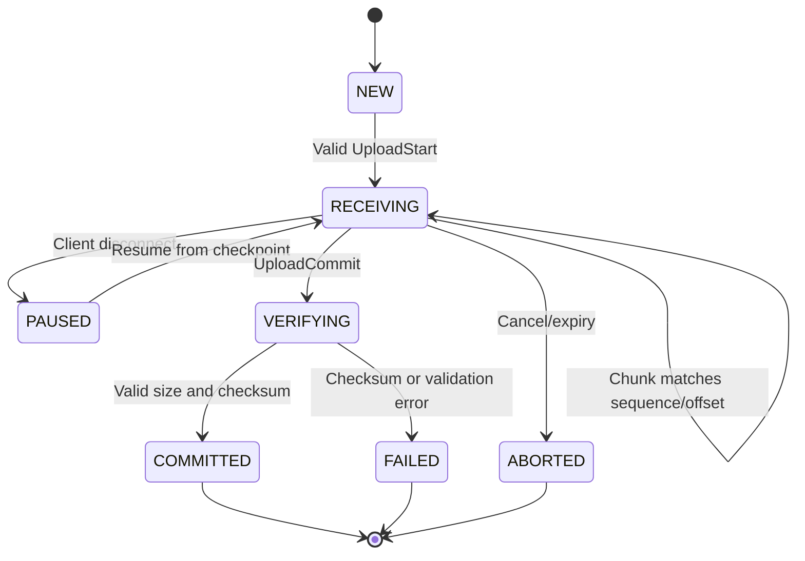

# Large Messages and Chunking

gRPC transfers data as Protobuf messages over HTTP/2. A single large message can be convenient for an API, yet it increases the memory required to serialize, buffer, receive, decompress, and parse; it must also stay within the peer's inbound message size limit. For large payloads such as files, raw images, backups, or datasets, **chunking** typically helps bound memory, apply backpressure, and support resumption when connections drop.

In **SPRING_GRPC**, choosing between one large message and multiple chunks should depend on payload size, latency, throughput, transport limits, downstream capacity, and recovery requirements. Streaming does not automatically split a large message: each `onNext` call still sends one distinct gRPC message, and that message must still satisfy the receiver's limit. To transfer large payloads safely, the application must define a chunk contract and manage upload/download lifecycles.

## 1. Why can large messages cause problems?

A large Protobuf message incurs costs across multiple layers:

- **Application heap:** byte arrays, Protobuf objects, and intermediate copies.
- **Serialization:** producing the encoded payload before sending.
- **Transport buffers:** gRPC/HTTP/2/Netty holding data waiting to be written or received.
- **TLS/compression:** buffers for encryption, decryption, compression, and decompression.
- **Deserialization:** receiver allocating the object graph from the payload.
- **Downstream:** databases, object storage, or filesystems may require their own buffers.

If a service receives 40 concurrent messages of 16 MiB each, raw payloads alone equal 640 MiB before accounting for object overhead, copies, and transport buffers. When many RPCs run concurrently, peak memory can far exceed the original file size.

Large messages also lengthen the time to process a single unit of work. An RPC may have to wait to serialize or parse the entire payload before the application can use any content. When sequential processing, partial acknowledgment, or resumption is required, a single message is also harder to manage than multiple chunks.

## 2. Message size limits in gRPC

gRPC enforces inbound message size limits at each endpoint. In gRPC Java, inbound message size can be configured via builder APIs, for example:

```java
ManagedChannel channel = NettyChannelBuilder
    .forAddress("files.internal", 8443)
    .useTransportSecurity()
    .maxInboundMessageSize(4 * 1024 * 1024)
    .build();
```

On the server, the corresponding builder can also configure the inbound limit:

```java
Server server = NettyServerBuilder
    .forPort(9090)
    .maxInboundMessageSize(4 * 1024 * 1024)
    .addService(objectTransferService)
    .build()
    .start();
```

The 4 MiB value is only a configuration example. Defaults and available APIs depend on the gRPC Java version and transport. Verify your version and configure limits on the **receiving side**: the server caps inbound requests; the client caps inbound responses. This limit applies per individual gRPC message, not to the total size of an entire stream.

Raising max inbound size is not a default optimization. It allows larger messages into the process while increasing the memory a single request can consume. Raise it only when the contract truly requires large messages and proper memory budgets, quotas, timeouts, and load tests are in place.

## 3. When should you use chunking?

Chunking splits one logical payload into smaller pieces. Each chunk is an independent gRPC message inside a streaming RPC.

Consider chunking when:

- Payloads can exceed the message size limit.
- You do not want to hold entire files on the heap.
- You want to write data incrementally to files or object storage.
- You need backpressure so slow consumers can throttle producers.
- You need progress confirmation, partial retries, or resumption after reconnect.
- You want to bound memory by the number of in-flight chunks.

A single message still fits when payloads are small, strictly bounded, processed atomically, and need no resumption. Chunking adds protocol state, sequences, checksums, commits, and error handling; do not add it unless it solves an actual requirement.

## 4. Choosing chunk size

Chunks that are too large or too small both carry costs:

| Chunk size | Pros | Cons |
| --- | --- | --- |
| Small | Low memory per chunk, small retry unit, granular progress reporting | More messages, callbacks, framing, and metadata; higher CPU overhead |
| Medium | Balances memory, throughput, and send frequency | Must be benchmarked against network and storage |
| Large | Fewer messages and potentially better batch write efficiency | Higher in-flight memory, per-chunk latency, and retry cost |

You might start benchmarking around 256 KiB, 512 KiB, or 1 MiB chunks, though these are only starting points, not standard defaults. Choose chunk size based on:

- Inbound message limits on both client and server.
- Protobuf wrapper fields and serialization overhead.
- Number of concurrent streams.
- HTTP/2 flow-control windows and bandwidth-delay product.
- Per-stream memory budget.
- Block sizes suited to object storage/filesystem.
- Acceptable duration to retry a single chunk.

Chunks must be smaller than the inbound message size limit, leaving headroom for Protobuf metadata fields. Never set chunk size equal to the max limit, because schema changes or extra fields can push serialized size over the threshold.

## 5. Designing a Protobuf upload contract

An upload protocol should explicitly model start, chunks, and completion. Example using client-streaming:

```protobuf
syntax = "proto3";

package transfer.v1;

service ObjectTransfer {
  rpc Upload(stream UploadFrame) returns (UploadResult);
  rpc GetUploadStatus(UploadStatusRequest) returns (UploadStatus);
  rpc Download(DownloadRequest) returns (stream DownloadChunk);
}

message UploadFrame {
  oneof frame {
    UploadStart start = 1;
    UploadChunk chunk = 2;
    UploadCommit commit = 3;
  }
}

message UploadStart {
  string upload_id = 1;
  string object_name = 2;
  uint64 total_size = 3;
  bytes expected_sha256 = 4;
  string idempotency_key = 5;
}

message UploadChunk {
  uint64 sequence = 1;
  uint64 offset = 2;
  bytes data = 3;
  bytes chunk_sha256 = 4;
}

message UploadCommit {
  uint64 total_chunks = 1;
  bytes final_sha256 = 2;
}

message UploadResult {
  string object_id = 1;
  uint64 committed_size = 2;
  bytes final_sha256 = 3;
}

message UploadStatusRequest {
  string upload_id = 1;
}

message UploadStatus {
  uint64 next_sequence = 1;
  uint64 committed_offset = 2;
  bool completed = 3;
}

message DownloadRequest {
  string object_id = 1;
  uint64 start_offset = 2;
}

message DownloadChunk {
  uint64 sequence = 1;
  uint64 offset = 2;
  bytes data = 3;
  bytes chunk_sha256 = 4;
  bool last = 5;
}
```

This is an illustrative contract. Production must clearly define `upload_id` ownership, session expiration, `total_size` limits, sequence/offset rules, checksum algorithms, and commit semantics. Never use `object_name` directly as a filesystem path; validate and authorize target objects.

`oneof` helps the server distinguish start, data, and commit frames. The server should reject chunks before start, out-of-order commits, or frames invalid for the session state.

## 6. Upload state machine

Uploads should be managed as a persistent state machine:



A basic processing flow:

1. Authenticate the caller and verify object write permissions.
2. Validate `total_size`, quotas, `upload_id`, and idempotency key.
3. Create the staging object/file and persist `RECEIVING` state.
4. Receive chunks by sequence/offset; verify size and checksum.
5. Write chunks to storage, updating checkpoints only after data is durably persisted.
6. Upon commit, verify total size, chunk count, and full-object checksum.
7. Promote the staging object to the final object via a storage-appropriate atomic operation.
8. Return `UploadResult` once commit finishes per documented semantics.

Never advance a checkpoint before chunk data is persisted. If the server crashes between writing data and updating metadata, recovery must reconcile the staging object against the checkpoint.

## 7. Sequence, offset, and checksum

Each chunk should carry:

- **Sequence:** monotonically increasing index, usually starting at 0.
- **Offset:** starting byte position of the chunk in the object.
- **Data:** chunk bytes.
- **Chunk checksum:** validates chunk contents.

The server validates sequence and offset against the current checkpoint. If expecting sequence 12 at offset 6 MiB, the next chunk must match that rule. Missing, duplicate, or overlapping chunks must follow explicit semantics.

Per-chunk checksums catch localized corruption and aid retries. Full-object checksums verify the final assembled data matches expectations. SHA-256 is typically suitable for integrity checks; never use checksums in place of authentication or authorization.

TLS protects data in transit, while end-to-end checksums detect application/storage-layer corruption and verify assembled objects. To guard against tampering by untrusted callers, the server must compute/verify checksums and access rights itself; client-supplied checksums do not prove data legitimacy by themselves.

## 8. One-way or bidirectional upload?

**Client-streaming** works well when the client sends many chunks and only needs one final summary result. The server consumes the stream, persists data incrementally, and returns `UploadResult` when the client finishes.

**Bidirectional streaming** fits when per-chunk acknowledgments or progress updates are required. The client sends chunks; the server returns acks containing persisted sequence/offset. This lets the client cap in-flight chunks and resume more accurately.

| Requirement | Suitable RPC |
| --- | --- |
| Send many chunks, need only final result | Client-streaming |
| Per-chunk acks or progress reporting | Bidirectional streaming |
| Download data from server in chunks | Server-streaming |
| Concurrent interactive send/receive protocol | Bidirectional streaming |

When using client-streaming with a single final response, the client cannot know the exact checkpoint persisted before a connection drop. You can add `GetUploadStatus` to query checkpoints after reconnecting. If immediate acks on the same call are required, choose bidirectional streaming.

## 9. Backpressure when sending chunks

Chunking bounds individual message sizes, but does not automatically cap how many chunks are created or queued. A client could read an entire file, allocate thousands of byte arrays, and hold them in a queue; memory would still scale with file size.

In gRPC Java clients, `ClientResponseObserver` provides access to `ClientCallStreamObserver` inside `beforeStart`. The client can use `isReady()` and `setOnReadyHandler()` to emit only when the stream is ready:

```java
ClientResponseObserver<UploadFrame, UploadResult> responseObserver =
    new ClientResponseObserver<>() {
        private ClientCallStreamObserver<UploadFrame> requestStream;

        @Override
        public void beforeStart(
                ClientCallStreamObserver<UploadFrame> stream) {
            this.requestStream = stream;
            stream.setOnReadyHandler(this::scheduleDrain);
        }

        @Override
        public void onNext(UploadResult result) {
            handleUploadResult(result);
        }

        @Override
        public void onError(Throwable error) {
            handleUploadFailure(error);
        }

        @Override
        public void onCompleted() {
            markUploadComplete();
        }

        private void scheduleDrain() {
            uploadSenderExecutor.execute(this::drainWhenReady);
        }

        private void drainWhenReady() {
            while (requestStream.isReady() && hasNextFrame()) {
                requestStream.onNext(nextFrame());
            }
            if (!hasNextFrame() && !completedInput) {
                completedInput = true;
                requestStream.onCompleted();
            }
        }
    };

asyncStub.upload(responseObserver);
```

This skeleton illustrates readiness. `nextFrame` should not read files or perform blocking I/O directly inside the readiness callback; use a bounded producer/queue and a dedicated executor. `scheduleDrain` must prevent concurrent drain loops, preserve frame ordering, and handle rejection/cancellation. `hasNextFrame` must also reflect whether the producer has finished so `onCompleted` is not called while data is still being read.

`isReady()` is not an acknowledgment that the server persisted the chunk. When persistence confirmation is required, the protocol must return acks or allow querying checkpoints.

## 10. Manual inbound demand on the server

The server can use manual inbound flow control to receive additional chunks only after the current chunk is processed or persisted. In gRPC Java, the server's response observer can be cast to `ServerCallStreamObserver` to disable auto-requests and call `request(n)`.

Example skeleton:

```java
public StreamObserver<UploadFrame> upload(
        StreamObserver<UploadResult> responseObserver) {

    ServerCallStreamObserver<UploadResult> call =
        (ServerCallStreamObserver<UploadResult>) responseObserver;
    call.disableAutoRequest();

    UploadSession session = uploadService.openSession();
    call.request(1);

    return new StreamObserver<>() {
        @Override
        public void onNext(UploadFrame frame) {
            session.acceptAndPersist(frame);
            call.request(1);
        }

        @Override
        public void onError(Throwable error) {
            session.pauseOrAbort(error);
        }

        @Override
        public void onCompleted() {
            UploadResult result = session.verifyAndCommit();
            responseObserver.onNext(result);
            responseObserver.onCompleted();
        }
    };
}
```

This is a synchronous skeleton. In production, `acceptAndPersist` may need to be offloaded to a bounded I/O executor. Call `request(1)` only after the chunk is persisted or placed into a bounded queue with remaining capacity. When switching to async processing, serialize state transitions, handle errors, cancellations, and completion, and never request more messages after the stream closes.

If using bidirectional streaming to send acks, the server must also pace outbound responses using readiness. Both directions must have bounded queues and clear semantics.

## 11. Resuming after reconnect

A large upload may lose its connection after the server has persisted part of it. Instead of restarting from byte 0, the client can:

1. Keep `upload_id` and idempotency key stable.
2. Call `GetUploadStatus` after reconnecting.
3. Obtain persisted `next_sequence` and `committed_offset`.
4. Open a new upload stream and continue from that offset.
5. Send commit once all data has been transferred.

The server confirms only durably persisted offsets. If the last chunk was written before the checkpoint updated, recovery must reconcile that data to avoid duplicate appends. You can store chunk metadata and checkpoints in one transaction or use a storage-appropriate manifest/staging protocol.

Never treat transport reconnection as automatic stream resumption. A closed gRPC stream does not resume where it left off; the application must open a new RPC and restore state via the protocol.

## 12. Retries and idempotency

If the client sends a chunk and receives no ack, commit status is ambiguous: the server may have persisted the chunk before the connection dropped. Retries must be safe:

- Keep `upload_id`, sequence, offset, and chunk checksum identical.
- Server recognizes duplicate already-persisted chunks and returns the matching checkpoint/ack.
- Chunks with the same sequence but a different checksum must be rejected.
- Chunks with overlapping or gapped offsets must follow defined rules.
- Repeated commits must return a consistent result if the object is already committed.

This represents at-least-once semantics with deduplication/idempotency, not built-in gRPC exactly-once delivery. Never retry operations with side effects unless the server maintains idempotency keys or deduplication state.

Retries must obey deadlines, retry budgets, and backoff. If the server returns validation or permission errors, the client must not retry endlessly.

## 13. Chunked download

Server-streaming works well when the server reads an object from storage block-by-block and emits `DownloadChunk` messages. The server does not need to load the entire file into a byte array before returning a response.

Workflow:

1. Verify read permissions for the object and validate the offset.
2. Open a storage read stream at the requested offset.
3. Read a bounded block.
4. Build a chunk with sequence, offset, and checksum.
5. Continue reading only when the gRPC stream is ready and the application queue has capacity.
6. Close file/storage streams on completion, error, or client cancellation.

The client can write chunks directly to a temporary file, verify sequence/offset/checksum, and perform an atomic rename after verifying the final checksum. If a download needs resumption, the client sends the durably written `start_offset` in a new request.

Never serve an entire file by building a `List<DownloadChunk>` in heap. Read sequentially, emit according to readiness, and release buffers once chunks are consumed.

## 14. Chunking and memory budget

Peak memory depends at least on:

\[
M_{peak} \approx M_{base}
 + N_{streams}\times
   (B_{inflight}+B_{queue}+B_{working})
 + M_{shared}
\]

Where:

- \(N_{streams}\): concurrent upload/download streams.
- \(B_{inflight}\): data awaiting transport completion.
- \(B_{queue}\): data sitting in application queues.
- \(B_{working}\): buffers actively being read/written or processed.
- \(M_{shared}\): JVM, Spring, connection pools, caches, and shared memory.

For example, 100 streams each holding up to 4 queued 512 KiB chunks represent ~200 MiB in queue payloads alone, excluding in-flight transport buffers, object overhead, byte copies, TLS, and direct memory. Therefore, capping chunk size without capping queued chunks is still insufficient.

Bound concurrent streams, total bytes, pending chunks, and storage capacity. Reuse buffers where appropriate, but never share mutable byte arrays across streams if they might be overwritten before transport finishes.

## 15. Storage strategy: staging and commit

Do not append unverified upload data directly into the final object. A safer strategy:

- Write to a staging object or temporary file tied to `upload_id`.
- Maintain a manifest of sequence, offset, length, checksum, and checkpoint.
- Advance `committed_offset` only after chunks are persisted.
- On commit, verify `total_size` and final checksum.
- Promote the staging object using a storage-appropriate atomic operation.
- Clean up expired staging objects or aborted uploads.

For object stores supporting multipart uploads, consider the storage's multipart API and store part numbers/ETags/checksums. gRPC chunk size does not have to match storage part size; manage the mapping between the two layers explicitly.

If storage lacks atomic rename/commit, design a manifest or visibility flag so consumers never read incomplete objects.

## 16. Deadlines, cancellation, and quotas

Large uploads/downloads can run longer than ordinary RPCs. Set deadlines based on expected size, minimum throughput, and business bounds. Never omit deadlines entirely; sessions can have their own TTL to preserve checkpoints across reconnects.

When the client cancels:

- Stop reading files or running producers.
- Stop writing new chunks.
- Cancel pending tasks where possible.
- Close file handles/storage streams.
- Retain persisted checkpoints if resumption is supported; otherwise abort and clean up.

Enforce quotas on:

- Total object size.
- Concurrent uploads per caller/tenant.
- Total bytes currently staged.
- Chunk count and upload rate.
- Session lifetime.
- Staging storage capacity and retention duration.

Check authentication/authorization before allocating staging storage. Never trust client-supplied `total_size` or `object_name` without validation.

## 17. Benchmarking chunk size and throughput

Benchmarks should compare multiple chunk sizes with identical files, network, TLS, and storage:

| Experiment | Chunk size | Goal |
| --- | ---: | --- |
| A | 64 KiB | Observe overhead with small chunks |
| B | 256 KiB | Low comparison point |
| C | 512 KiB | Medium comparison point |
| D | 1 MiB | Test larger chunks |
| E | 2 MiB | Evaluate memory/latency and limits |

This is an experimental matrix, not fixed recommendations. Measure in each run:

- Payload goodput (MiB/s) and chunks/s.
- End-to-end upload/download duration.
- Per-chunk latency and ack latency.
- Client/server CPU, allocation rate, and GC pauses.
- Heap, direct memory, and RSS.
- Active streams, in-flight bytes, and queue bytes.
- Retry counts, checksum failures, and resume duration.
- Storage write/read throughput and latency.

Warm up, step up stream counts, and sustain load long enough to observe steady memory behavior. A chunk size yielding top throughput on one stream can trigger excessive peak memory with 100 concurrent streams. Evaluate both aggregate throughput and resource limits at production concurrency.

## 18. Observability and diagnostics

Useful metrics:

| Metric | Meaning |
| --- | --- |
| Chunk size histogram | Actual chunk size distribution |
| Chunks/bytes sent and persisted | Distinguishes sent data from durably saved data |
| Upload/download throughput | Goodput by object or method |
| Active transfer sessions | Open transfer sessions |
| In-flight/queued bytes | Memory pressure |
| Flow-control wait/readiness | How long producers are throttled |
| Checkpoint/ack latency | Time from send to persist/ack |
| Resume/retry count | Disruption and recovery frequency |
| Checksum/sequence errors | Integrity/protocol errors |
| Staging bytes and expired sessions | Temporary storage usage and cleanup |
| Heap/direct memory/RSS | Actual process memory |
| Storage latency/errors | Bottlenecks in the storage layer |

Never use `upload_id`, `object_id`, or `user_id` as high-cardinality metric labels. Use controlled traces/logs to investigate individual transfers; never log payloads or credentials.

## 19. Common design mistakes

| Mistake | Consequence | Better approach |
| --- | --- | --- |
| Raising `maxInboundMessageSize` to send whole large files | High peak memory and OOM-prone requests | Split payloads into bounded chunks |
| Assuming streaming splits one large message automatically | A single `onNext` can still exceed message limits | Define chunk messages in Protobuf |
| Reading entire files into byte arrays | Heap scales with file size | Read/write block-by-block |
| Unbounded chunk queues | Memory grows at producer rate | Bound queues by count and bytes |
| Checking sequence only, skipping offset/checksum | Can assemble corrupted or misaligned data | Verify sequence, offset, and integrity |
| Acking before persisting | Clients assume data is safe, risking loss on server crash | Ack after durable checkpoints |
| Retrying chunks with new IDs | Duplicates or double appends | Idempotency via `upload_id`/sequence |
| Reconnecting and restarting from zero | Wastes bandwidth and storage I/O | Query checkpoint and resume |
| Failing to clean up on cancel/expiry | Staging files and buffers linger | Enforce TTLs, aborts, and cleanup jobs |
| Benchmarking only one stream | Misses peak memory under concurrency | Test multiple streams and total in-flight bytes |

## 20. Production checklist

Before shipping a large-payload transfer API, confirm:

1. **Message limits:** inbound sizes are properly configured on client and server.
2. **Chunk contract:** includes upload/session ID, sequence, offset, data, and checksum.
3. **Chunk size:** leaves headroom below the message limit.
4. **Streaming mode:** client-streaming or bidi chosen based on ack requirements.
5. **Backpressure:** client readiness and server inbound demand are enforced.
6. **Memory:** queues bound both item count and bytes; whole objects are never buffered.
7. **Integrity:** per-chunk and final-object checksums are verified.
8. **Durability:** checkpoints/acks confirm persistence strictly per semantics.
9. **Resumption:** reconnects use `upload_id` and `committed_offset`/`next_sequence`.
10. **Idempotency:** retried chunks/commits never produce duplicates.
11. **Storage:** uses staging and promotes/commits objects only after verification.
12. **Cancellation:** closes file/storage handles, stops producers, and handles staging.
13. **Quotas:** caps total size, concurrent sessions, staged bytes, and TTL.
14. **Benchmarks:** tests chunk sizes across concurrency with TLS and real storage.
15. **Observability:** monitors goodput, in-flight bytes, acks, resumes, checksums, and memory.

## 21. Key takeaway

Large messages inflate memory and serialization/parsing costs; raising inbound message limits simply shifts more risk onto the receiver. For large payloads, chunking provides a bounded unit of transfer enabling incremental processing, backpressure, checksums, retries, and resumption. Each chunk remains a distinct gRPC message and must fit under the peer's message-size limit.

In Spring gRPC, design contracts with `upload_id`, sequence, offset, checksums, and explicit commit semantics; write to staging storage and ack only after durable persistence. Use client-streaming when only a final result is needed, or bidi when per-chunk acks are required; apply readiness/manual demand and queues bounded by both count and bytes. Resumption must rely on durable checkpoints and idempotency, as transport reconnects never auto-resume old streams. Benchmark chunk sizes alongside concurrency, TLS, storage, throughput, p95/p99, and peak memory before finalizing production settings.

### References

- [gRPC – Flow control](https://grpc.io/docs/guides/flow-control/)
- [gRPC – Performance](https://grpc.io/docs/guides/performance/)
- [gRPC Java – API documentation](https://grpc.github.io/grpc-java/javadoc/)
- [Protocol Buffers – Language Guide (proto3)](https://protobuf.dev/programming-guides/proto3/)
- [Netty – Reference counted objects](https://netty.io/wiki/reference-counted-objects.html)
