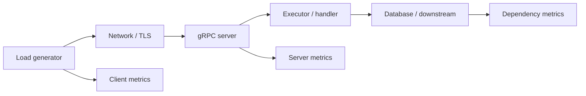
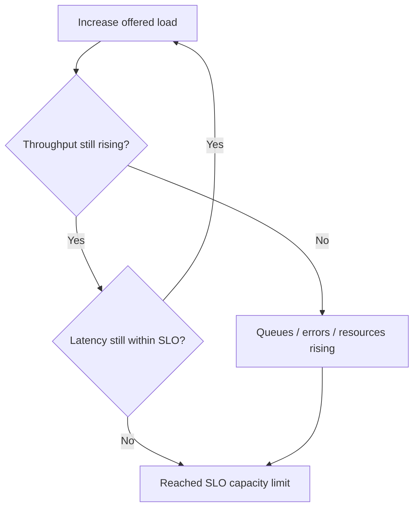

# Client-Server Benchmarking

A **client-server benchmark** is a controlled performance measurement of a gRPC service where a client sends RPCs to a server over a real transport. The goal is not just to find the highest requests-per-second figure, but to determine latency, sustainable throughput, resource utilization, and the point where the system begins to saturate.

In **SPRING_GRPC**, benchmarks must accurately reflect the RPC style, Protobuf payloads, TLS, compression, channel reuse, executors, downstream dependencies, and deployment topology. A measurement running client and server on the same machine, skipping TLS, or using tiny requests can be useful for quick sanity checks, yet does not represent production when the real environment differs.

## 1. What questions does a benchmark answer?

Before driving load, define the engineering decisions to make:

- How many RPCs/s can one server instance sustain while still meeting the latency SLO?
- At what concurrency or arrival rate does p95/p99 latency climb?
- Is the client, network, server executor, or downstream dependency the bottleneck?
- How do channel reuse, TLS, or compression affect results?
- How do unary and streaming throughput limits differ?
- How many replicas are needed to serve expected traffic plus headroom?
- Under overload, does the service reject requests cleanly or grow queues indefinitely?

A good benchmark starts with a testable hypothesis. For example: "Raising concurrency from 40 to 80 will increase throughput while keeping p99 below 150 ms; if p99 breaches the threshold, determine whether the executor or database saturated." This hypothesis guides the workload, metrics, and stopping criteria.

## 2. Distinguishing benchmarks, load tests, and stress tests

Testing types have related yet distinct goals:

| Test type | Goal | Expected outputs |
| --- | --- | --- |
| Microbenchmark | Measure a small operation like Protobuf serialization, mapping, or checksum | Time/op, allocation, and CPU |
| Client-server benchmark | Measure RPCs over the network between client and server | Latency, throughput, errors, and resources on both sides |
| Load test | Test the service at target load over a sustained window | SLO compliance, stability, queues, and resource usage |
| Stress test | Push load past expected capacity to find breaking points | Saturation point, failure modes, and recovery |
| Soak test | Hold steady load over a long duration | Memory leaks, GC, connection churn, and degradation over time |

JMH fits in-JVM microbenchmarks, such as comparing ways to construct Protobuf messages or transform payloads. JMH does not replace end-to-end benchmarks because it does not fully exercise TCP, HTTP/2, TLS, networking, and server scheduling.

## 3. Defining a representative workload

A workload must clearly specify RPC styles, request/response sizes, frequencies, and data distributions. Never use one small method to represent an entire service if production carries diverse traffic.

| RPC style | Workload to simulate | Characteristic metrics |
| --- | --- | --- |
| Unary | One request, one response; mix of small/medium/large payloads | RPC/s, latency, and error rate |
| Server-streaming | One request opens a stream and receives many responses | Active streams, messages/s, bytes/s, and stream duration |
| Client-streaming | Client sends many messages, server returns a final result | Chunks/s, payload goodput, and completion duration |
| Bidirectional streaming | Both sides send/receive concurrently | Messages/s per direction, backpressure, queues, and message latency |

For each method, document:

- Request and response serialized sizes.
- Payload distribution, not just one fixed size.
- Ratios of valid requests, business errors, and cache hits/misses.
- CPU processing time and dependency wait time.
- Concurrent RPCs or streams.
- Realistic deadlines and timeouts.
- Any compression, authentication, metadata, or interceptors on the path.

Synthetic workloads can isolate gRPC overhead. End-to-end workloads should traverse real databases, caches, or object storage like production to expose system-wide bottlenecks. Keep these two sets of results distinct in reports.

## 4. Preparing the benchmark topology

Ideally run the load generator and server on separate machines or containers so the client does not compete with the server for CPU, memory, and network. If both share one host, load generator CPU saturation can be mistaken for a server limit.



Before running, record:

- CPU quotas, memory limits, and replica counts for client/server.
- JDK, gRPC Java, Spring gRPC starter, and transport implementation versions.
- JVM options, GC collector, and heap size.
- TLS certificate chain, cipher/protocol, and authentication path.
- Compression algorithm and message-size limits.
- Channel count, load-balancing policy, and connection reuse settings.
- Database pools, caches, storage, and downstream limits.
- Network RTT, bandwidth, packet loss, and workload placement.

Keep topology and configuration consistent across comparisons. Changing TLS, payloads, and databases at the same time makes it hard to tell which change drove the difference.

## 5. Separating cold start and steady state

The first RPCs can pay extra initialization costs:

- JVM class loading and JIT compilation.
- Spring bean initialization or lazy initialization.
- DNS resolution and TCP/TLS handshakes.
- HTTP/2 connection establishment.
- Connection pool or cache warm-up.
- Creating initial serializers, reflection metadata, and buffers.

Exclude warm-up requests from steady-state results when measuring sustained capacity. Measure cold-start latency separately if the application uses scale-to-zero, rapid autoscaling, or frequent instance replacement.

A typical run follows these phases:

1. Start the server and wait for readiness.
2. Create channels, verify TLS, and warm up the target RPCs.
3. Ramp load from low to target level.
4. Hold steady load to collect steady-state metrics.
5. Step load upward across tiers to locate saturation.
6. Ramp down load and observe recovery.

Warm-up duration should not be chosen mechanically. Wait until throughput, CPU, and latency stabilize; the JVM may need longer for complex workloads.

## 6. Closed-loop vs. open-loop load

The two load models can produce very different results:

**Closed-loop:** each virtual user sends a new request after the previous one completes. In-flight requests are bounded by worker count. When the server slows down, the sending rate drops automatically.

**Open-loop:** the load generator schedules requests at a target arrival rate, e.g., 2,000 requests/s, regardless of whether prior requests have finished. This reveals queueing when offered load exceeds processing capacity.

| Model | Advantages | Limitations |
| --- | --- | --- |
| Closed-loop | Easy to control concurrency and steady load | Offered load drops when server slows; can mask queueing |
| Open-loop | Holds arrival rate, better models time-based incoming traffic | Requires monitoring load-generator scheduler and client-side backlog |

Closed-loop tests can suffer from **coordinated omission**: when the server stalls, the client waits for responses before sending the next request, so arrivals that would have occurred during the stall go unrecorded. Latency results can look more optimistic than real traffic experiences. Open-loop testing avoids part of this distortion, provided you measure both scheduled time and actual send time.

In practice, use both:

- Closed-loop to compare capacity at fixed concurrency levels.
- Open-loop to verify SLOs at target arrival rates and find where queues start growing.

## 7. Concurrency is not throughput

Concurrency is the number of RPCs or streams active simultaneously. Throughput is the amount of work completed per unit of time. Raising concurrency can raise throughput until resources saturate; past that point, queues and latency grow while throughput barely budges.

Little's Law gives the fundamental relationship:

\[
L = \lambda \times W
\]

Where:

- \(L\): average number of requests in the system.
- \(\lambda\): average throughput, in requests/s.
- \(W\): average time spent in the system, in seconds.

For example, if a system completes 500 RPCs/s with an average residence time of 0.1 seconds, average in-flight RPCs are roughly 50. This formula helps sanity-check measurement consistency; it does not replace measuring queues, active calls, and latency distributions.

For streaming, distinguish:

- Active streams: number of currently open streams.
- Messages/s: messages sent or processed per second.
- Bytes/s: data transfer rate.
- Completed streams/s: streams finished per second.

A bidirectional stream may live for minutes and exchange thousands of messages. Measuring only completed streams/s fails to capture stream throughput.

## 8. Measuring latency properly

Latency should be measured on the client side to reflect what callers actually wait for. For unary RPCs, measure from when the client starts the call until it receives a response or error. For streaming, specify clearly what is being measured:

- Time from opening a stream until it becomes ready.
- Latency from sending a message to receiving its acknowledgment.
- Inter-arrival gap between response messages.
- Total duration to complete the entire stream.

Never conflate different semantics under one latency number. For client-streaming uploads, whole-call completion latency differs from per-chunk processing latency.

Always report percentiles:

- p50: typical request experience.
- p90/p95: meaningful upper tail of the distribution.
- p99/p99.9: tail latency, where queueing and contention typically surface.
- Max: useful for spotting outliers, though sensitive to duration and sample count.

Average latency can mask tail latency. For instance, most requests take 20 ms while a small slice takes 2 seconds; the average can still look acceptable while users hit timeouts.

Measure durations with a monotonic clock within the same process, such as `System.nanoTime` in Java, rather than subtracting two wall-clock timestamps that may jump. When correlating events across client and server, synchronize clocks and account for cross-host clock skew.

## 9. Throughput, goodput, and error rate

Do not equate requests sent with requests successfully processed:

- **Offered load:** RPCs per second the client intends to send.
- **Attempted RPC/s:** RPCs actually started.
- **Completed RPC/s:** finished RPCs, including successes and failures if defined that way.
- **Successful RPC/s:** RPCs finishing with success.
- **Goodput:** valid business work or payload successfully processed per second.

For uploads, 1,000 RPCs/s does not tell you how many MiB/s the server persisted. For streaming, messages/s does not prove messages were processed/committed rather than merely buffered.

Classify errors by gRPC status:

| Status | What to investigate |
| --- | --- |
| `DEADLINE_EXCEEDED` | Queueing, slow handlers, downstream delays, or overly tight deadlines |
| `RESOURCE_EXHAUSTED` | Quotas, message limits, memory, or admission control |
| `UNAVAILABLE` | Connections, server restarts, load balancers, or dependencies |
| `CANCELLED` | Caller cancellation, upstream timeouts, or shutdown |
| `INTERNAL` | Unexpected server error; inspect corresponding traces/logs |
| `INVALID_ARGUMENT` | Invalid test data or validation errors |

Never lump all statuses into a single error rate. Errors from bad test payloads differ from saturation errors; separate them to interpret results accurately.

## 10. Building a benchmark matrix

Rather than running one isolated scenario, build a matrix over key dimensions:

| Dimension | Example values |
| --- | --- |
| RPC style | Unary, server-streaming, client-streaming, bidi |
| Request/response size | 128 B, 4 KiB, 64 KiB, 512 KiB |
| Concurrency | 1, 10, 50, 100, 250 |
| Arrival rate | From low load up to SLO target and beyond |
| Security | Production TLS; plaintext only for isolated comparison |
| Compression | Identity and gzip when payloads suit compression |
| Channel | Reused channel; bounded multiple channels if testing parallelism |
| Dependencies | Stub/mock to isolate gRPC; real dependencies for end-to-end |

Values are illustrative. Choose sizes and load tiers matching real traffic, message limits, CPU quotas, and SLOs. You do not need every Cartesian combination if the matrix is too large; pick experiments that test hypotheses and isolate bottlenecks.

A practical sequence:

1. Small unary baseline with a single reused channel and TLS.
2. Step up concurrency to map the throughput/latency curve.
3. Vary payload size to observe serialization/network effects.
4. Compare compression when payloads are compressible.
5. Run streaming and measure messages/s, bytes/s, and active streams.
6. Add real downstream dependencies to measure end-to-end capacity.
7. Run soak tests and restart/failure tests when evaluating reliability.

## 11. Using load generator tools

Dedicated gRPC tools such as `ghz` can drive load from an independent client. Illustrative unary example:

```bash
ghz --insecure \
  --proto ./proto/inventory.proto \
  --call inventory.v1.Inventory.GetItem \
  -d '{"item_id":"item-42"}' \
  -c 50 \
  -n 100000 \
  localhost:8443
```

Using `--insecure` fits only plaintext/lab benchmarks. For production-like benchmarks, configure TLS certificates and authority according to your tool version, and verify the client exercises the same authentication path as real applications.

The load generator must have enough capacity to deliver the offered load. Monitor CPU, GC, network, and scheduler delay on the client itself. If the client saturates before the server, results only measure the load generator's ceiling.

With a custom gRPC Java client, reuse `ManagedChannel` and stubs, use async APIs for controlled concurrency, set per-RPC deadlines, and record latencies into a histogram. Avoid creating a new channel per request, or the benchmark primarily measures DNS/TCP/TLS setup and connection churn.

## 12. Warm-up, JVM, and stability

The JVM involves JIT compilation, class loading, allocation, and GC. The first few seconds can differ markedly from steady state. Before recording metrics:

- Warm up long enough for hot code paths to JIT-compile.
- Initialize channels and TLS before measuring warm-channel latency.
- Separate cold-start timings from steady-state RPC timings.
- Keep JDK, heap, GC, and JVM flags consistent.
- Monitor GC pauses and allocation rates during every run.
- Avoid running benchmarks alongside builds, tests, or heavy background jobs.

When benchmarking in containers, record CPU throttling and memory pressure. The JVM may observe a different core count from the container's true CPU quota depending on JDK/container support. Record load generator and server configurations separately.

## 13. Measuring resources across client, server, and downstream

Looking solely at client latency cannot pinpoint bottlenecks. Observe multiple layers:

| Layer | Key metrics |
| --- | --- |
| Client | Offered load, active calls, pending calls, latency, CPU, GC |
| gRPC transport | Channel/connection count, active streams, reconnects, flow-control waits |
| Server executor | Active threads, queue depth, queue wait, rejected tasks |
| Service handler | Handler duration, CPU time, validation, and serialization |
| JVM | Heap, direct memory, allocation rate, GC pauses, thread count |
| Network | RTT, bandwidth, retransmissions, packet loss |
| Database/cache/storage | Active/pending connections, query latency, pool waits, and error rate |

Measuring both client and server distinguishes whether:

- The client failed to drive enough load.
- The network is saturated.
- The server executor is saturated.
- Handlers are CPU-bound or blocking.
- The database pool ran out of connections.
- Flow control is throttling the sender.

When one metric shifts, align it chronologically with latency and throughput. Checking only host-wide average CPU can miss a single saturated core or executor queue.

## 14. Identifying saturation and capacity

As arrival rate or concurrency increases, throughput normally rises up to a point and then flattens. If offered load keeps climbing while successful throughput plateaus, and queue wait, p99 latency, and error rate climb, the system has reached or passed saturation.



Useful capacity is not necessarily peak raw throughput. Define **maximum sustainable throughput** as the highest load sustained over the chosen window while still keeping:

- p95/p99 latency within SLO.
- Error rate below threshold.
- CPU, memory, and downstream headroom intact.
- Queues non-divergent (not growing continuously).
- No resource leaks or abnormal GC pauses.

If peak throughput is 5,000 RPCs/s yet p99 breaches the SLO at 4,000 RPCs/s, operational capacity should be anchored at 4,000 RPCs/s or lower, leaving headroom for bursts and failures.

## 15. Statistics and repeatability

A single run can be skewed by JIT, GC, noisy neighbors, network jitter, or cache state. To ensure trustworthy results:

1. Warm up before each configuration.
2. Repeat every scenario multiple times under equivalent conditions.
3. Record run duration, sample counts, and failed requests.
4. Compare histograms/percentiles from raw observations; never average p99 values across runs.
5. Keep payload distributions and seeds fixed when reproducibility is needed.
6. Log configuration changes between runs.
7. Report variance across runs rather than cherry-picking the best run.

For percentiles, sample counts must be large enough for p99 to be meaningful. A run of a few hundred requests lacks enough samples for stable p99 estimates. If runs diverge widely, find the root cause before drawing conclusions.

## 16. Example benchmark report

A report can follow this structure:

| Property | Value |
| --- | --- |
| Service/method | `inventory.v1.Inventory.GetItem` |
| RPC style | Unary |
| Environment | Client and server in two separate containers |
| Security | TLS enabled |
| Compression | Identity |
| Channel | One reused `ManagedChannel` |
| Payload | 1 KiB request, 4 KiB response |
| Load model | Open-loop, stepped arrival rate |
| Run duration | Separate warm-up, 5-minute steady-state measurement per tier |
| Concurrency | 10, 50, 100, 200 |

Hypothetical illustrative results:

| Arrival rate | Successful RPC/s | p95 | p99 | Error rate |
| ---: | ---: | ---: | ---: | ---: |
| 500/s | 499/s | 18 ms | 31 ms | 0.0% |
| 1,000/s | 998/s | 24 ms | 43 ms | 0.0% |
| 1,500/s | 1,493/s | 39 ms | 82 ms | 0.1% |
| 2,000/s | 1,720/s | 140 ms | 410 ms | 2.4% |

These figures are illustrative, not measurements from a real service. In this example, 2,000 requests/s is unsustainable: successful throughput lags behind offered load, latency jumps sharply, and error rate rises. SLO-compliant capacity should be chosen from a lower tier after cross-checking CPU, executors, network, and downstream metrics.

## 17. Common mistakes

| Mistake | Why results are skewed | Better approach |
| --- | --- | --- |
| Running client and server on the same host | Both compete for CPU/memory/network | Separate load generator and server |
| Skipping JVM/channel warm-up | JIT and handshakes pollute metrics | Separate cold start and steady state |
| Measuring average latency only | Hides tail latency | Report p50/p95/p99 and histograms |
| Using closed-loop only | Offered load drops when server slows | Pair with open-loop and track scheduler lag |
| Not monitoring the load generator | Client saturation looks like a server limit | Track client CPU/GC/network |
| Creating a channel per RPC | Measures connection churn instead of reuse | Reuse channels like production |
| Benchmarking plaintext when production uses TLS | Ignores handshake and TLS CPU costs | Measure production-like TLS configs |
| Tiny or fixed payloads | Misses real payload distribution | Use varied sizes and realistic data |
| Ignoring downstream dependencies | Blames database bottlenecks on gRPC | Collect dependency metrics |
| Cherry-picking the best run | Ignores variance and noisy neighbors | Repeat runs and report variance |
| Reporting only requests/s | Hides whether requests succeeded or data committed | Report successful RPC/s and goodput |

## 18. Client-server benchmark checklist

Before running:

1. **Goals:** define SLOs, hypotheses, and questions to answer.
2. **Workload:** pick representative RPC styles, payload distributions, metadata, and deadlines.
3. **Topology:** separate load generator/server and record resources on each side.
4. **Environment:** pin JDK, gRPC/Spring versions, TLS, compression, and dependencies.
5. **Warm-up:** separate cold start, connection setup, and steady state.
6. **Load model:** choose closed-loop, open-loop, or both; record offered load.
7. **Concurrency:** track active RPCs/streams and pending calls.
8. **Metrics:** collect p50/p95/p99, throughput, goodput, errors, and resource usage.
9. **Saturation:** identify the highest throughput still meeting SLOs.
10. **Repeatability:** repeat runs, preserve payloads/configs, and report variance.
11. **Streaming:** measure messages/s, bytes/s, stream duration, and backpressure.
12. **Dependencies:** monitor executors, database pools, caches, and storage.
13. **Recovery:** test behavior on server restarts, connection resets, or slow downstreams.
14. **Report:** save configuration, versions, run duration, sample counts, histograms, and conclusions.

## 19. Key takeaway

Client-server benchmarks must exercise gRPC workloads over real transports and mirror how the service runs in production. Define questions before running, and accurately model unary/streaming patterns, payloads, TLS, compression, channel reuse, and downstream dependencies. Separate the load generator from the server, warm up the JVM/channels, use closed-loop tests to explore concurrency and open-loop tests to evaluate arrival rates and queueing.

Evaluate results using successful throughput and goodput alongside p50/p95/p99, error rates, queues, CPU, memory, GC, network, and dependency metrics. Operational capacity is the highest load that still satisfies SLOs with headroom—not necessarily peak throughput from one short burst. Repeat measurements and archive configurations and histograms so results remain explainable, comparable, and reproducible.

### References

- [gRPC – Performance](https://grpc.io/docs/guides/performance/)
- [gRPC – Benchmarking](https://grpc.io/docs/guides/benchmarking/)
- [gRPC – Flow control](https://grpc.io/docs/guides/flow-control/)
- [ghz – gRPC benchmarking tool](https://ghz.sh/)
- [OpenJDK – JMH](https://github.com/openjdk/jmh)
