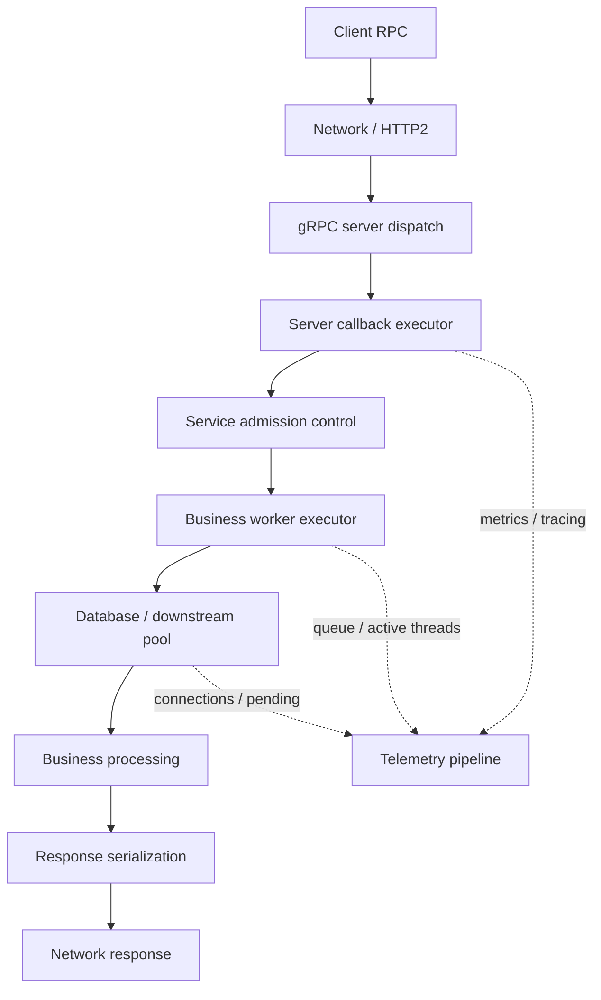

# Monitoring Resources Under Increasing Load

## Lesson Objectives

In **SPRING_GRPC**, increasing load simultaneously changes the number of in-flight RPCs, active threads, waiting queues, downstream connections, memory, CPU, and response latency. If teams monitor only CPU or request rate, they can miss real bottlenecks: saturated worker pools, exhausted database connection pools, streams holding resources too long, or retries amplifying load.

This lesson focuses on **monitoring resources under increasing load**: selecting RED and USE signals, measuring gRPC concurrency/latency/statuses, observing executors and downstream pools, tracking CPU/memory/GC/network, designing dashboards and alerts, using load tests to locate the capacity knee, and tuning admission control, queues, autoscaling, and graceful degradation.

After this lesson, you can:

1. Distinguish utilization, saturation, and errors.
2. Identify resources to observe in gRPC servers and clients.
3. Measure request rates, in-flight RPCs, latency percentiles, and status distributions.
4. Monitor worker pools, queues, connection pools, memory, GC, and network.
5. Design low-cardinality metrics and dashboards by service/method.
6. Find bottlenecks using ramp, spike, stress, and soak load tests.
7. Estimate concurrency/capacity and recognize where latency begins climbing rapidly.
8. Set alerts, admission control, backpressure, and scaling policies grounded in real signals.

> **Scope:** Examples use Spring Boot, Micrometer, gRPC Java, and OpenTelemetry. Custom metric names in this lesson are application-defined names; built-in metrics and semantic conventions depend on instrumentation/version. Do not assume a specific Spring gRPC starter property.

## 1. Three questions when load increases

Resource monitoring must answer three distinct questions:

- **Utilization:** what percentage of the resource is currently in use?
- **Saturation:** how much work is waiting or rejected because the resource is full?
- **Errors:** how many operations are failing and for what reasons?

70% CPU is not necessarily a bottleneck. A service might show low CPU while every worker is waiting on the database, queues grow, and RPC deadlines expire. Conversely, 95% CPU can be healthy load if latency remains within SLO and queues are not growing over time.

### 1.1. RED for services

RED focuses on requests:

| Signal | Meaning | gRPC example |
| --- | --- | --- |
| Rate | Request rate | RPCs completed/second by method |
| Errors | Error rate | Status codes, RESOURCE_EXHAUSTED, INTERNAL |
| Duration | Processing time | p50, p95, p99 RPC latency |

RED helps detect when users are affected. Measure both received requests and completed requests; measuring completed rate alone can hide requests stuck waiting in queues.

### 1.2. USE for resources

USE focuses on each resource:

| Signal | Meaning | Example |
| --- | --- | --- |
| Utilization | Usage level | Active threads / max threads |
| Saturation | Queued/waiting work | Executor queue depth, pending DB connections |
| Errors | Resource-related errors | Rejected tasks, connection timeouts, allocation failures |

Apply USE to CPU, memory, executors, database pools, HTTP client pools, file descriptors, and network. Combining RED with USE links slow-RPC symptoms to the underlying resource causing them.

## 2. Resource map of a gRPC request

A unary RPC can use multiple resources sequentially or concurrently:



Not every application has two executors or a database hop as shown in the diagram. What matters is identifying points where requests can wait, hold resources, or be rejected. For streaming RPCs, add open stream count, message rate, buffer bytes, and stream lifetime.

## 3. Core metrics for gRPC

A starter metric set should include:

| Metric | Type | Useful dimensions |
| --- | --- | --- |
| RPC started/completed | Counter | service, method |
| RPC duration | Histogram/Timer | service, method, status |
| RPC in-flight | UpDownCounter/Gauge | service, method or service |
| RPC status count | Counter | method, status code |
| Request/response size | Histogram | method, direction |
| Active streams | Gauge | service, method |
| Messages sent/received | Counter | method, direction |
| Admission rejected | Counter | method, reason class |
| Client retries | Counter | downstream, method, attempt class |
| Deadline exceeded | Counter | method, downstream |

Status code and method name are typically bounded-value dimensions. Never add trace IDs, span IDs, request IDs, user IDs, tenant IDs, or raw targets as metric labels. Per-request investigation data belongs in access-controlled logs/traces.

### 3.1. Request rate and in-flight

Completed requests per second show actual throughput. In-flight RPCs show how many calls are holding resources at the moment of measurement. When request rate is steady yet in-flight rises continuously, processing time or wait time is climbing.

For streaming RPCs, a stream can stay open long even when message rate is low. Track active streams and stream duration separately; counting only messages/second does not reveal how many connections/streams are occupying resources.

### 3.2. Latency distribution

Do not look only at averages. A few very slow requests can be hidden inside an average. Track p50, p90/p95, and p99, broken down by method/status and low-cardinality workload class.

Histogram boundaries must align with latency SLOs. If all requests take under 10 ms or many exceed 10 seconds while buckets are poorly aligned, percentiles become unhelpful. Use consistent units and conventions across dashboards, alerts, and SLOs.

## 4. Measuring RPC duration and status with a ServerInterceptor

A ServerInterceptor can wrap ServerCall to measure elapsed time until the RPC closes. Example with Micrometer:

```java
public final class RpcMetricsInterceptor implements ServerInterceptor {

    private final MeterRegistry registry;

    public RpcMetricsInterceptor(MeterRegistry registry) {
        this.registry = registry;
    }

    @Override
    public <ReqT, RespT> ServerCall.Listener<ReqT> interceptCall(
            ServerCall<ReqT, RespT> call,
            Metadata headers,
            ServerCallHandler<ReqT, RespT> next) {

        Timer.Sample sample = Timer.start(registry);
        String method = call.getMethodDescriptor().getFullMethodName();

        ServerCall<ReqT, RespT> wrapped =
                new ForwardingServerCall
                        .SimpleForwardingServerCall<>(call) {
            @Override
            public void close(Status status, Metadata trailers) {
                Timer timer = Timer.builder("app.grpc.server.rpc.duration")
                        .tag("method", method)
                        .tag("status", status.getCode().name())
                        .register(registry);

                sample.stop(timer);
                super.close(status, trailers);
            }
        };

        return next.startCall(wrapped, headers);
    }
}
```

This is a minimal instrumentation example. Ensure close is recorded only once per call lifecycle and never let metric errors break an RPC. Never add tags from arbitrary metadata. If using existing gRPC OpenTelemetry/Micrometer instrumentation, avoid creating a duplicate metric set with overlapping names and semantics.

The full method name has a bounded set of values per service contract; status code is a finite enum. For multi-tenant services, never tag tenant ID onto the Timer.

### 4.1. In-flight gauge

You can count open RPCs with a counter incremented when the call starts and decremented when the call ends. With async/streaming, decrement along a single terminal path, including cancel/error. An implementation should use an atomic guard to prevent double decrement if callbacks have multiple termination paths.

If built-in instrumentation already provides active calls, prefer reusing that metric. The goal is one consistent in-flight definition, not multiple nearly identical gauges.

## 5. Monitoring executors and queues

For Spring ThreadPoolTaskExecutor, useful signals include:

- Current pool size.
- Active thread count.
- Max pool size.
- Queue size and remaining capacity.
- Tasks completed/submitted/rejected.
- Queue wait duration and execution duration.

Example registering gauges after the executor has initialized:

```java
@Bean
MeterBinder grpcExecutorMetrics(
        @Qualifier("grpcBusinessExecutor")
        ThreadPoolTaskExecutor executor) {

    return registry -> {
        Gauge.builder(
                "app.grpc.executor.active",
                executor,
                ThreadPoolTaskExecutor::getActiveCount)
                .register(registry);

        Gauge.builder(
                "app.grpc.executor.pool.size",
                executor,
                ThreadPoolTaskExecutor::getPoolSize)
                .register(registry);

        Gauge.builder(
                "app.grpc.executor.queue.size",
                executor,
                pool -> pool.getThreadPoolExecutor()
                        .getQueue().size())
                .register(registry);
    };
}
```

This example assumes the executor is initialized before gauges are read. If the bean is not yet initialized, getThreadPoolExecutor() may not be ready; ensure proper lifecycle or use a version-compatible Micrometer executor binder. In production, add remaining queue capacity and rejection counters, not just queue size.

Active threads near max alongside a growing queue indicates saturation. A large queue with low active count can indicate blocked workers, a misconfigured executor, or undispatched tasks in the queue. Cross-check queue wait and thread dumps.

### 5.1. Queue wait vs. execution time

Queue wait measures time from submission until a worker begins; execution time measures time the worker spends running the task. These two metrics distinguish insufficient worker capacity from slow tasks/downstreams.

If execution time rises alongside DB latency, the bottleneck likely sits in the database. If queue wait rises while execution time stays steady, concurrency/worker count may be below demand. If both rise, the system may be overloaded across multiple layers.

## 6. Monitoring downstream connection pools

A gRPC service often depends on databases, HTTP services, caches, or message brokers. Track:

- Active/idle/max connections.
- Pending acquire requests.
- Connection acquire wait time.
- Connection creation failures.
- Timeouts and resets.
- Downstream request rate/latency/errors.
- Retry attempts and circuit breaker state.

If all workers are waiting on a connection pool, increasing worker count can make things worse because more threads contend for the same finite connections. Business executor sizing must align with downstream concurrency.

Measure both the latency from starting a downstream call until acquiring a connection and the operation execution time. Measuring only total RPC duration makes it hard to tell whether requests are waiting on the connection pool or running slow queries.

## 7. CPU, memory, GC, and operating system

Process/container metrics must be examined alongside RPC metrics:

| Resource | Signals |
| --- | --- |
| CPU | Process CPU, container CPU usage, and throttling |
| Heap | Used/committed/max, allocation rate |
| Garbage collection | Pause duration, frequency, reclaimed bytes |
| Native/off-heap memory | Direct buffers, Netty buffers, RSS |
| Threads | Live/daemon thread count, blocked/waiting threads |
| File descriptors | Open descriptors and limits |
| Network | Throughput, retransmits, resets, connection count |
| Container | Memory working set, OOM events, CPU quota throttling |

gRPC Java Netty uses network event loops and may allocate direct buffers. Stable heap does not mean total memory is safe; check process RSS, direct memory, and container working set.

CPU throttling inside containers can raise latency even when average CPU usage looks modest. Correlate throttled time with p95/p99 and queue wait.

Long GC pauses can cause many RPCs to time out simultaneously or queues to spike briefly. Track pause distributions and allocation rates rather than looking only at point-in-time heap used.

## 8. Applying Little's Law to estimate concurrency

In a stable system, Little's Law states:

```math
L = λ × W
```

Where:

- L is the average number of operations in the system.
- λ is the average throughput (operations/second).
- W is the average time in the system (seconds).

Example: a service handles 200 RPCs/second and average time in the system is 150 ms (0.15 seconds). Average in-flight RPCs are roughly:

```math
L = 200 × 0.15 = 30
```

The figure 30 is the average observed under steady-state conditions, not the max concurrency to configure. Add headroom for bursts, latency variance, retries, and downstream wait times. Use p95/p99, peak load, and SLOs to determine appropriate admission/worker limits.

Little's Law does not predict maximum capacity if the system has become unstable and queues grow unboundedly. When arrival rate exceeds service rate, W and L climb continuously; you must shed load, add capacity, or reject early.

## 9. Load testing to find the capacity knee

The capacity knee is the load region where adding a small increment of requests causes latency or error rate to spike rapidly. Find this point using load tests with realistic workloads.

A test plan:

1. **Warm-up:** initialize JVM, JIT, connection pools, and caches.
2. **Baseline:** measure latency/throughput at low load.
3. **Ramp:** step up request rate incrementally and hold each step long enough.
4. **Stress:** exceed capacity in a controlled way to observe rejections and failure modes.
5. **Spike:** surge load abruptly to verify burst handling.
6. **Soak:** sustain load over time to detect leaks, memory growth, and queue drift.
7. **Recovery:** drop load and verify queues, permits, connections, and latency return to normal.

Workloads must reflect method mix, payload sizes, unary/streaming ratios, client concurrency, deadlines, and downstream latency. A test calling only a single tiny RPC may not represent production.

### 9.1. Open-loop vs. closed-loop load

A closed-loop load generator waits for a response before sending the next request; when the server slows down, the generator slows itself down and can mask overload. An open-loop generator issues requests at a scheduled arrival rate; it reveals much more clearly what happens when arrival rate exceeds service capacity, though you must watch for backlogs in the load generator itself.

Choose the model based on the question being asked. Monitor dropped/queued requests in the load generator so you do not confuse generator saturation with server saturation.

### 9.2. What to record on every test run

- Build/version and configuration profile.
- CPU/memory limits and replica count.
- Executor sizes, queue capacities, and connection pool sizes.
- RPC rate, concurrency, method mix, and payload distribution.
- p50/p95/p99 latency, status distribution, and deadline errors.
- Queue wait, executor active/rejected counts, and downstream pool wait.
- CPU throttling, GC pauses, RSS, and network metrics.
- When autoscaling triggers and replica count over time.

Do not change many parameters at once if the goal is root-cause analysis. Change one configuration group with a clear hypothesis, rerun the same workload, and compare.

## 10. Dashboards and alerts

Dashboards should have clear tiers:

1. **Service RED:** rate, error ratio, latency percentiles by method.
2. **Concurrency:** in-flight RPCs, active streams, admission permits.
3. **Executor:** active/max threads, queue depth, queue wait, rejections.
4. **Downstream:** connection pool utilization, pending acquires, latency/errors.
5. **Process/container:** CPU, throttling, heap, RSS, GC, threads, file descriptors.
6. **Client behavior:** retries, retry delays, deadline exceeded, and cancellations.
7. **Capacity:** replica count, per-instance load, and autoscaling events.

Alerts should combine impact with saturation. For example, p99 breaching SLO alongside rising queue wait and RESOURCE_EXHAUSTED is far more meaningful than an isolated high-CPU alert.

Use time windows and thresholds aligned with SLOs. For critical services, multi-window/multi-burn-rate alerts can catch fast error-budget burn. Do not page on a brief spike if the system self-recovers within acceptable bounds.

## 11. Autoscaling and safe limits

Autoscaling adds instances when demand rises, yet it does not replace admission control. Scaling out has lag; during that wait, queues and in-flight counts can still overflow limits.

Scaling signals can include:

- CPU utilization/throttling.
- RPC rate or in-flight count per instance.
- Queue depth/queue wait.
- Active streams.
- p95/p99 latency if the metric is stable and supported by the scaling controller.

CPU-only scaling poorly fits I/O-bound workloads. Conversely, scaling on queues without capping replicas can overload databases/downstreams because each replica opens additional connections and workers.

Set min/max replicas, stabilization windows, scale-up/down policies, and per-instance resource limits. When a downstream is the bottleneck, scale the downstream or cap concurrency instead of blindly adding gRPC replicas.

## 12. Backpressure, overload, and graceful degradation

When load exceeds capacity:

- Bound concurrency and queues at every layer.
- Reject early with RESOURCE_EXHAUSTED when capacity is exhausted per proper semantics.
- Use deadlines and cancellation to free work that is no longer useful.
- Limit retries using backoff, jitter, and retry budgets.
- Use circuit breakers/bulkheads to isolate slow dependencies.
- Degrade quality or disable optional features if allowed by business policy.
- For streaming, combine flow control and bounded buffers.
- On shutdown, transition to NOT_SERVING and drain in-flight RPCs.

Never use large queues to postpone overload. Never let clients retry simultaneously right after errors; retry storms can prevent recovery. Reserve capacity for health/management and essential operations if required by the architecture.

## 13. Example metrics for executors and RPCs

Metric names in these examples are custom application metrics. When a project already has gRPC instrumentation, prefer standardizing on the active conventions and avoid duplicates.

Example Timer for RPCs:

```java
Timer.builder("app.grpc.server.rpc.duration")
        .description("Completed gRPC RPC duration")
        .tag("method", method)
        .tag("status", statusCode.name())
        .register(meterRegistry)
        .record(duration);
```

Example Counter for admission rejections:

```java
Counter.builder("app.grpc.server.admission.rejected")
        .tag("method", method)
        .tag("reason", "capacity")
        .register(meterRegistry)
        .increment();
```

Never put exception messages, tenant IDs, or request IDs into tags. When you need to know which specific request was rejected, write structured logs with redacted trace/request IDs; metrics should reflect aggregates only.

For executors, use a version-compatible Micrometer binder or gauges reading active count, pool size, and queue size. Register gauges once when the bean initializes; never create new meters per task.

## 14. Common pitfalls and troubleshooting

| Symptom | Possible cause | How to investigate |
| --- | --- | --- |
| Low CPU yet p99 rises | Downstream wait, queueing, or lock contention | Queue wait, DB pool pending, thread dumps |
| High CPU and throughput stalls | CPU saturation or excessive context switching | CPU profiles, active threads, allocations |
| In-flight rises continuously | Service time rising or arrival rate exceeds capacity | Compare rate with duration and downstream latency |
| Executor active=max, queue grows | Worker pool saturated | Queue wait, rejections, worker stacks |
| Shallow queue yet RPCs are slow | Workers running slow tasks or slow network/downstream | Execution duration, downstream spans |
| DB pending connections climb | Database pool/downstream is the bottleneck | Acquire wait, active/max connections |
| Heap stable yet container OOM | High native/direct memory or RSS | Direct buffers, Netty, RSS, and container metrics |
| Latency rises with CPU throttling | Container CPU quota too low | Throttled time, CPU limits |
| RESOURCE_EXHAUSTED rises | Admission control rejecting or quota exhausted | Reason class, permits, queues, and quotas |
| Retries spike after overload | Client retries amplifying load | Attempts, backoff, retry budgets |
| Streaming memory grows | Unbounded buffers or streams living too long | Active streams, buffer bytes, flow control |
| Autoscaling does not help | Downstream bottleneck or wrong scaling metric | Dependency capacity and per-instance load |

## 15. Testing and hands-on exercises

1. Add RPC duration histograms, request rates, status counts, and in-flight gauges.
2. Measure executor active threads, pool size, queue depth, queue wait, and rejections.
3. Collect DB/HTTP connection pool active/pending/acquire latency.
4. Enable process/container metrics for CPU throttling, heap, RSS, GC, threads, and file descriptors.
5. Build a load test with a unary/streaming mix, payload distribution, and downstream delays.
6. Run a ramp test to locate the capacity knee; record p50/p95/p99 and status distributions.
7. Run a spike test to observe admission control and bounded queues.
8. Run a soak test to detect queue drift, thread leaks, memory growth, and connection leaks.
9. Reduce load after the stress test and verify recovery.
10. Compare open-loop vs. closed-loop load to understand load generator effects.
11. Build RED/USE dashboards by service/method and resource layer.
12. Set alerts combining p99, error ratio, queue wait, and rejection rate.
13. Test autoscaling on CPU and queue/in-flight; inspect downstream impact.
14. Verify metric labels contain no request IDs, trace IDs, tenant IDs, or raw targets.

### Self-check questions

- How do utilization, saturation, and errors differ?
- How do RED and USE complement each other?
- Why is completed RPS alone insufficient to detect backlogs?
- How does queue wait differ from execution time?
- Why can low CPU still accompany high RPC latency?
- How does Little's Law estimate in-flight concurrency and what are its limits?
- Which type of load test finds the capacity knee?
- How can closed-loop load mask overload?
- When should you scale on queue/in-flight instead of CPU?
- Why can adding gRPC replicas overload a database further?
- Which metrics distinguish an executor bottleneck from a downstream bottleneck?
- How do you verify recovery after load subsides?

## References

- [Micrometer — JVM Metrics](https://docs.micrometer.io/micrometer/reference/reference/jvm.html): JVM memory, GC, and thread metrics.
- [Micrometer — Gauges](https://docs.micrometer.io/micrometer/reference/concepts/gauges.html): measuring current values such as queues and active threads.
- [Micrometer — Timers](https://docs.micrometer.io/micrometer/reference/concepts/timers.html): latency and duration distributions.
- [Spring Boot — Actuator Metrics](https://docs.spring.io/spring-boot/reference/actuator/metrics.html): registries, binders, and endpoint metrics.
- [OpenTelemetry — Metrics](https://opentelemetry.io/docs/concepts/signals/metrics/): counters, histograms, and observable instruments.
- [gRPC — Performance](https://grpc.io/docs/guides/performance/): factors affecting gRPC performance.
- [gRPC — Flow Control](https://grpc.io/docs/guides/flow-control/): throttling streaming.
- [gRPC — Health Checking](https://grpc.io/docs/guides/health-checking/): readiness and client health checking.
- [Google SRE — Monitoring Distributed Systems](https://sre.google/sre-book/monitoring-distributed-systems/): golden signals and monitoring strategy.
- [Google SRE — Handling Overload](https://sre.google/sre-book/handling-overload/): admission control, load shedding, and overload management.

**Expected outcome:** Learners monitor Spring gRPC resources under increasing load using RED/USE, pinpoint bottlenecks from RPCs to executors and downstreams, find capacity knees via load tests, design low-cardinality dashboards/alerts, and tune admission control, backpressure, and autoscaling to keep latency and reliability within SLO.
