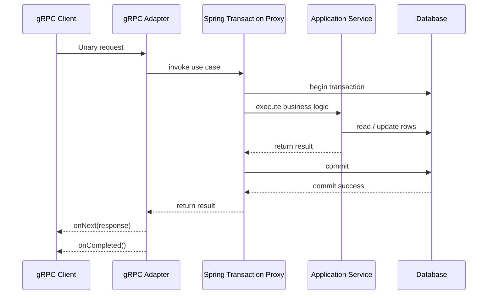

# Transactions in Unary RPC

## 1. What does a transaction protect in a unary RPC?

In **SPRING_GRPC**, a unary RPC receives one request and returns one response. Many RPCs execute a business unit of work consisting of multiple database operations: reading records, checking state, updating multiple rows, and writing history. If an operation fails partway through, the system needs to roll back all changes so that no partial state is left behind.

Spring manages transactions through a transaction manager and typically integrates with the @Transactional annotation. For synchronous unary RPCs, the transaction boundary should wrap the **use case/application service** that performs the data operations. The gRPC adapter is responsible for converting the request, calling the application service, mapping the result, and emitting the response.

A distinctive aspect of gRPC Java is that the server method typically returns void and receives a StreamObserver. Therefore, calling onNext() or onCompleted() inside a method wrapped in a Spring transaction may happen **before the transaction commits**. If the commit fails after the response has been sent, the client may receive a success response even though the data was not persisted.

This lesson focuses on:

- Transaction boundaries between the gRPC adapter and the Spring application service.
- Commit/rollback ordering relative to emitting the response.
- Mapping exceptions to gRPC statuses after the transaction finishes.
- Isolation, locking, and concurrency when multiple unary requests update data simultaneously.
- Retries, idempotency, deadlines, cancellation, and external side effects.
- How to test real transactions in Spring gRPC.

## 2. Execution flow and commit timing

A typical unary RPC follows this sequence:

1. The gRPC runtime receives the request and invokes the server implementation.
2. The adapter validates the request and builds an internal command.
3. The adapter invokes the application service through a Spring bean proxy.
4. The transaction interceptor opens a transaction before running the @Transactional method.
5. The application service reads/writes to the database and returns the result.
6. The Spring transaction interceptor commits before the proxy call returns the result to the adapter.
7. The adapter converts the result into a Protobuf response and calls onNext() and onCompleted().



Only when the commit succeeds does the adapter receive the result from the transactional call and emit the response. If the commit throws an exception, the proxy does not return normally; the adapter catches the exception and sends a gRPC error.

This is why a transaction should finish before onNext() in a unary RPC with side effects.

## 3. Do not place transactions directly around StreamObserver callbacks

An error-prone implementation is annotating the gRPC adapter method with @Transactional and emitting the response right inside that method:

```java
@GrpcService
@Transactional
public class PaymentGrpcService
        extends PaymentServiceGrpc.PaymentServiceImplBase {

    @Override
    public void capture(
            CaptureRequest request,
            StreamObserver<CaptureReply> observer) {

        paymentRepository.capture(request.getPaymentId());

        observer.onNext(CaptureReply.newBuilder()
                .setCaptured(true)
                .build());
        observer.onCompleted();
    }
}
```

With standard Spring proxy transactions, the transaction interceptor commits after the target method returns. However, onNext() and onCompleted() have already been called before the method finishes. If the commit fails due to a constraint, connection issue, or database error, the client may already have received a success response.

This approach also couples the gRPC adapter directly to the repository, making transaction boundaries and business logic difficult to reuse.

Instead, the adapter should call a synchronous application service annotated with @Transactional; the application service returns the result after Spring completes the commit. The adapter only emits the response after that call.

## 4. Placing the transaction in the application service

Consider a money transfer use case that needs to update two accounts and create a transaction record:

```java
@Service
@RequiredArgsConstructor
public class TransferApplicationService {
    private final AccountRepository accounts;
    private final TransferRepository transfers;

    @Transactional
    public TransferResult transfer(TransferCommand command) {
        Account source = accounts.findById(command.sourceId())
            .orElseThrow(AccountNotFoundException::new);

        Account target = accounts.findById(command.targetId())
            .orElseThrow(AccountNotFoundException::new);

        source.debit(command.amount());
        target.credit(command.amount());

        Transfer transfer = transfers.save(
            Transfer.create(source, target, command.amount())
        );

        return new TransferResult(
            transfer.getId(),
            source.getBalance(),
            target.getBalance()
        );
    }
}
```

The database changes are in the same transaction. If debit, credit, or saving the transfer fails with an exception that triggers a transaction rollback, all changes are reverted.

The adapter calls the application service and only then emits the response:

```java
@GrpcService
@RequiredArgsConstructor
public class TransferGrpcService
        extends TransferServiceGrpc.TransferServiceImplBase {

    private final TransferApplicationService applicationService;

    @Override
    public void transfer(
            TransferRequest request,
            StreamObserver<TransferReply> observer) {
        try {
            TransferResult result = applicationService.transfer(
                new TransferCommand(
                    request.getSourceId(),
                    request.getTargetId(),
                    request.getAmount()
                )
            );

            TransferReply reply = TransferReply.newBuilder()
                .setTransferId(result.transferId())
                .setSourceBalance(result.sourceBalance())
                .setTargetBalance(result.targetBalance())
                .build();

            observer.onNext(reply);
            observer.onCompleted();
        } catch (AccountNotFoundException ex) {
            observer.onError(
                Status.NOT_FOUND
                    .withDescription("Account not found")
                    .asRuntimeException()
            );
        } catch (InsufficientFundsException ex) {
            observer.onError(
                Status.FAILED_PRECONDITION
                    .withDescription("Insufficient funds")
                    .asRuntimeException()
            );
        } catch (RuntimeException ex) {
            // Log internal exception; do not send SQL or sensitive data to the client.
            observer.onError(
                Status.INTERNAL
                    .withDescription("Unable to complete transfer")
                    .asRuntimeException()
            );
        }
    }
}
```

The service registration annotation name may vary depending on the Spring gRPC starter in use; the core idea is that the adapter is managed by Spring and invokes the application service through a bean proxy.

When applicationService.transfer() returns normally, the transaction interceptor has already committed. If the commit fails, the exception propagates back to the adapter and no success response is emitted.

## 5. Conditions for @Transactional to actually take effect

@Transactional does not automatically open a transaction on every method call. In standard Spring proxy configuration, the call must go through the proxy created by Spring.

Checklist to verify:

- The application service is a Spring bean, such as @Service.
- The adapter injects that bean via constructor and calls it from another bean.
- The transactional method is invoked through the proxy; self-invocation within the same object usually does not trigger the transaction interceptor.
- An appropriate transaction manager for the database in use is configured.
- The repositories participate in the same transaction manager and datasource.
- Exceptions are not caught and turned into a normal return value when a transaction rollback is intended.

An example of self-invocation that easily causes confusion:

```java
@Service
public class OrderService {
    public void submit() {
        saveOrder(); // internal call, may bypass the Spring proxy
    }

    @Transactional
    public void saveOrder() {
        // database work
    }
}
```

If submit() calls saveOrder() directly on the same instance, a standard proxy does not intercept that internal call. Place transactional use cases in a separate bean and invoke them via dependency injection.

By default, Spring rolls back on unchecked exceptions (RuntimeException) and Error. Checked exceptions do not roll back automatically under the default configuration; if business logic uses checked exceptions, declare an appropriate rollbackFor or switch to unchecked domain exceptions. Do not swallow exceptions inside a transactional method if you still want a rollback; if you must catch one, explicitly mark the transaction rollback-only using the transaction API.

## 6. Choosing transaction scope, propagation, and read-only

A transaction should wrap an atomic use case, not the entire lifecycle of a gRPC connection.

- For read-only unary queries, you can use @Transactional(readOnly = true) if the transaction manager/database supports appropriate optimizations.
- For commands updating multiple tables, REQUIRED propagation typically lets repositories participate in the current transaction.
- Only use REQUIRES_NEW when an independent transaction is genuinely needed; it can commit even if the outer transaction rolls back.
- Avoid keeping a transaction open while waiting for a remote service call, user input, or an asynchronous callback.
- Do not rely on a database transaction assuming it can roll back an RPC already sent to another system.

For synchronous unary RPCs, a transaction typically starts when the application service is called and ends when the method returns a result or throws an exception. There is no need to keep the transaction open while gRPC sends the response over the network.

## 7. Isolation and concurrency when multiple RPCs update the same data

Transactions ensure that operations within a single transaction commit or roll back together, but they do not automatically solve all race conditions between concurrent requests.

For example, two unary RPCs both read a balance of 100, and each subtracts 80. If both read the same snapshot and overwrite the balance, the system can produce a lost update or a negative balance depending on the isolation level and update statement.

Commonly used measures:

- **Optimistic locking:** add a version column (JPA @Version); one transaction updates first, and the other encounters an optimistic lock conflict and must retry according to policy.
- **Pessimistic locking:** lock the rows to be updated when reading, such as SELECT FOR UPDATE, if the DB and repository support it.
- **Atomic conditional update:** execute a conditional update such as UPDATE account SET balance = balance - ? WHERE id = ? AND balance >= ?, then check the number of affected rows.
- **Database constraints:** unique constraints, check constraints, and foreign keys protect invariants at the data layer.

Choose the isolation level according to business invariants and the actual database. Higher isolation can reduce anomalies but increases lock contention, deadlocks, and retries. For serialization/deadlock errors, bounded transaction retries may be needed; do not blindly retry validation or business rule errors.

## 8. Transactions and gRPC status: roll back first, map afterwards

The adapter should map exceptions to gRPC statuses after the application service call finishes. When the proxy throws an exception, the transaction manager has already performed the rollback according to policy before the exception reaches the catch block in the adapter.

| Situation | Commonly used gRPC status |
| --- | --- |
| Request has invalid format/value | INVALID_ARGUMENT |
| Record not found | NOT_FOUND |
| Business state does not allow the operation | FAILED_PRECONDITION |
| Concurrency or version conflict requiring client retry | ABORTED |
| Unexpected/database error | INTERNAL |

Do not return SQL details, table names, connection strings, or stack traces to the client. Internal logs should include a correlation/request ID for tracing.

If the application service catches a database error and returns a normal "failure" result, the transaction interceptor may commit changes executed earlier. For errors that require a rollback, throw an appropriate exception or mark the transaction rollback-only. Do not emit onError() and then let the transaction commit as if the use case completed normally.

## 9. Commit succeeds but the client misses the response: idempotency

A database transaction and sending a response over the network are not a single atomic operation. The following sequence can occur:

1. The server updates the database.
2. The database commits successfully.
3. The server sends the response, but the connection drops or the client's deadline expires before receiving it.
4. The client sees DEADLINE_EXCEEDED or UNAVAILABLE and retries.
5. The server receives the request again.

If the RPC creates an order, transfers money, or records a payment, retrying can execute the side effect twice. A committed transaction cannot be rolled back simply because the response was lost.

For unary commands with side effects, design an idempotency key:

- The client generates a stable key for a business intent and sends it in the request.
- The database stores the key alongside the result/operation ID, with a unique constraint within the appropriate scope.
- Checking the key, executing the side effect, and saving the result happen in the same transaction.
- If the key already exists, return the stored result instead of executing the operation again.
- If the same key arrives with a different payload, reject it according to clear rules.

A unique constraint in the database is the final safeguard when two requests with the same key arrive concurrently. Checking the key with only a SELECT before inserting is not sufficient to prevent race conditions.

## 10. External side effects and transactional outbox

A database transaction cannot automatically roll back an email already sent, a message already published to a broker, or an RPC already sent to another service.

If you need to update the database and emit an event, you can use a **transactional outbox**:

1. Within the same transaction, update business tables and write an outbox record.
2. Commit the database.
3. A separate worker reads the outbox and publishes the event.
4. Mark the event as sent or use a retry/idempotent consumer mechanism.
5. Monitor the outbox backlog and handle failed messages.

This approach ensures the business change and the intent to emit an event are saved in the same transaction. Publishing may happen more than once, so consumers still need idempotency.

Do not keep a database transaction open while calling a remote RPC or waiting for a broker response. That prolongs locks, increases deadlocks, and makes transaction duration dependent on the network. If a workflow involves multiple services, consider saga/compensation instead of assuming automatic distributed transactions.

## 11. Deadlines, cancellation, and transaction timeouts

A gRPC deadline limits how long the client waits for an RPC. When the deadline expires or the client cancels the request, the server receives a cancellation signal via the gRPC context, but this **does not automatically guarantee that the JDBC statement or transaction has rolled back immediately**.

Multiple limits should be coordinated:

- Set reasonable deadlines on the client and propagate time budgets to dependencies.
- Configure appropriate transaction timeouts and database statement/query timeouts.
- Avoid unbounded queries or infinite lock waits.
- For long-running tasks, check cancellation at safe points and stop work before commit if business logic permits.
- If the transaction has already committed, cancellation cannot reverse the commit; idempotency allows the client to retry safely.
- Do not hold a transaction while waiting for an asynchronous callback or another RPC.

If database work is handed off to another executor/thread, Spring's thread-bound transaction does not automatically propagate to the new thread. Open the transaction on the worker thread through a Spring bean proxy and only emit the response after the worker finishes the transaction. Do not assume @Transactional on an async-launching method covers work running after the method returns.

## 12. Testing transactions in Spring gRPC

Test against a real database or Testcontainers when verifying locking, constraints, and isolation; H2 may behave differently from a production database.

| Test | What to verify |
| --- | --- |
| Successful unary command | Data is committed and the response reflects the committed result |
| Mid-execution exception | All changes in the transaction are rolled back |
| Commit failure | The adapter does not emit a success response before commit |
| Checked exception | Rolls back properly according to rollbackFor configuration |
| Two concurrent requests | Invariants are protected by locks/version/constraints |
| Retry with same idempotency key | Only one side effect is created |
| Client deadline/cancel | Query/transaction stops according to timeout and defined policy |
| Outbox | Business update and outbox record commit or roll back together |

To verify commit ordering, you can create a constraint/deferred failure appropriate for the test database, invoke the RPC, and verify that the client receives an error rather than a success response. Query the database using an independent transaction/connection after the RPC to verify the committed state.

Do not test only the application service method. Integration tests through a real gRPC server are needed to confirm that the adapter catches exceptions, maps statuses, calls the observer with exactly one terminal signal, and never emits onNext() before the application service finishes committing.

## 13. Transaction boundary review checklist

- Unary RPCs are clearly classified as queries or commands with side effects.
- Transactions are placed on synchronous application services managed by a Spring proxy.
- The adapter only emits the response after the transactional call returns successfully.
- onNext()/onCompleted() are never called before commit time.
- Exceptions that require rollback are not swallowed or turned into normal returns.
- Checked exceptions have an appropriate rollback policy.
- The transaction manager and repositories use the same datasource.
- Concurrency is protected with appropriate isolation, locking, optimistic versioning, or constraints.
- Commands with side effects have an idempotency strategy.
- External events use an outbox or workflow compensation when needed.
- Deadlines, query timeouts, and transaction timeouts are coordinated.
- Async work opens transactions on the proper worker thread.
- Integration tests verify commit/rollback, status mapping, and observer lifecycle.

In **SPRING_GRPC**, a unary RPC's transaction should conclude in the application service before the adapter emits the response. This separation ensures the client only receives success after the database commit succeeds, exceptions are mapped after rollback, and business logic does not depend on gRPC callbacks. Combine concurrency control, idempotency, timeouts, and outbox patterns to protect data when requests run concurrently, are retried, or lose connectivity.
