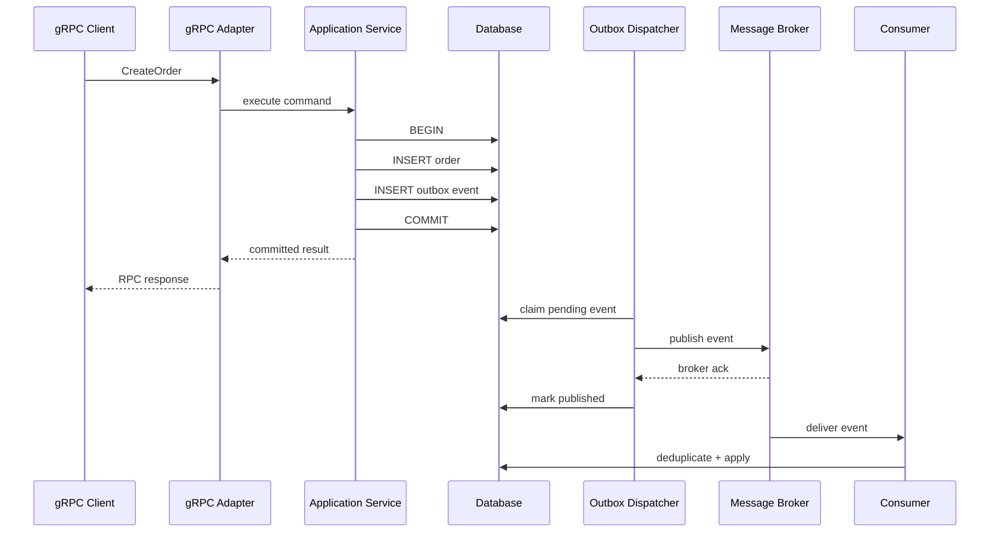

# Outbox for Events After RPCs

## 1. The problem: database commit and event publishing are two distinct operations

In **SPRING_GRPC**, a unary RPC may update business data and then need to emit an event to other systems. For example, CreateOrder creates an order and needs to emit OrderCreated for inventory, notification, or analytics processing.

If the server writes to the database and publishes the event directly, the two systems do not participate in a single atomic transaction:

- Publishing before commit: consumers may receive the event while the database rolls back; the event describes a change that never existed.
- Committing before publishing: the process may crash after commit but before publishing; the data changed, yet the event is lost.
- Publishing succeeds, but the server crashes before recording it as sent: the next run may publish a duplicate.

This is the **dual-write problem**. A JDBC/JPA transaction cannot atomically commit together with a broker such as Kafka or RabbitMQ. Calling a broker inside a transactional method does not make the broker a participant in the database transaction.

The **transactional outbox** solves this by persisting the intent to emit an event in the same database transaction that performs the business change. A separate dispatcher reads the outbox and publishes after commit. Thus, the business change and the pending event either both persist or both roll back in the database.

## 2. Execution flow from gRPC request to event

A command RPC with an outbox typically follows this sequence:

1. The gRPC server receives, authenticates, and validates the request.
2. The adapter calls the application service through a Spring bean proxy.
3. The application service opens a transaction.
4. The service updates business tables.
5. The service creates an outbox record containing the event ID and payload/envelope.
6. The database commits business data and the outbox record together.
7. The transaction finishes; the adapter sends a success response to the client.
8. An independent dispatcher reads unpublished outbox rows and sends events to the broker.
9. The dispatcher records delivery; consumers receive events and process them idempotently.



The RPC response confirms the command committed under the API's semantics. It does not necessarily confirm that consumers have already processed the event. Those are two separate milestones and must be communicated clearly to callers.

## 3. Why not just use an after-commit callback?

Spring provides mechanisms to run callbacks after a transaction commits, such as TransactionalEventListener with phase AFTER_COMMIT. It is useful for waking a dispatcher or performing auxiliary work after commit, but it does not replace a durable outbox.

If the process crashes after commit but before the callback runs, the callback is lost. If the callback calls the broker and the broker accepts the event, but the process crashes before recording it, the event may be sent again. A callback also does not create a durable record to retry after a restart.

You can use an after-commit signal to reduce latency: once an outbox row is committed, emit a signal waking a polling worker. However, the worker must still read the outbox from the database; polling or CDC is the recovery mechanism if the wakeup signal is missed.

## 4. Designing the outbox table

An outbox table typically includes these fields:

| Column | Purpose |
| --- | --- |
| event_id | Unique, stable ID for the event |
| aggregate_type | Aggregate type, e.g., Order |
| aggregate_id | ID of the aggregate emitting the event |
| aggregate_version | Version or sequence to preserve order |
| event_type | Event name, e.g., OrderCreated |
| schema_version | Payload/envelope schema version |
| payload | Serialized event contents |
| created_at | Timestamp when the event was created |
| published_at | Timestamp when the broker acknowledged receipt |
| attempts | Number of publish attempts |
| next_attempt_at | Timestamp for the next retry |
| lease_owner / lease_until | Claiming worker and lease expiry when using polling |

Abbreviated DDL example:

```sql
CREATE TABLE outbox_event (
    event_id          UUID PRIMARY KEY,
    aggregate_type    VARCHAR(100) NOT NULL,
    aggregate_id      VARCHAR(200) NOT NULL,
    aggregate_version BIGINT,
    event_type        VARCHAR(200) NOT NULL,
    schema_version    INTEGER NOT NULL,
    payload           BYTEA NOT NULL,
    created_at        TIMESTAMP NOT NULL,
    published_at      TIMESTAMP NULL,
    attempts          INTEGER NOT NULL DEFAULT 0,
    next_attempt_at   TIMESTAMP NULL,
    lease_owner       VARCHAR(100) NULL,
    lease_until       TIMESTAMP NULL
);

CREATE INDEX ix_outbox_pending
ON outbox_event (next_attempt_at, created_at)
WHERE published_at IS NULL;
```

The DDL above is a PostgreSQL example; UUID types, binary payloads, partial indexes, and timestamp functions should be adapted to the actual database. Do not store secrets or unnecessary personal data inside event payloads.

## 5. Writing business data and outbox in the same transaction

The application service creates the event in the same transaction as the business change:

```java
@Service
@RequiredArgsConstructor
public class CreateOrderService {
    private final OrderRepository orders;
    private final OutboxRepository outbox;
    private final EventSerializer serializer;

    @Transactional
    public CreateOrderResult create(CreateOrderCommand command) {
        Order order = orders.save(Order.create(command));

        OrderCreated event = new OrderCreated(
            order.getId(),
            order.getCustomerId(),
            order.getVersion()
        );

        outbox.save(OutboxRecord.pending(
            UUID.randomUUID(),
            "Order",
            order.getId(),
            order.getVersion(),
            "OrderCreated",
            1,
            serializer.serialize(event)
        ));

        return CreateOrderResult.from(order);
    }
}
```

If saving the order succeeds but inserting into the outbox fails, the transaction rolls back both. If the transaction commits, both the business row and the outbox row exist so the dispatcher can recover across restarts.

Never publish to the broker inside the transactional method. If the broker is slow, the transaction holds connections/locks for a long time; if the broker fails, the business transaction might roll back even though the domain update was valid. Outbox decouples business commit timing from event delivery timing.

If the command has an idempotency key, save the idempotency record, business update, and outbox event in the same transaction. When the client retries after a lost response, the server replays the committed result without creating a new order or event.

## 6. When does gRPC return the response?

Normally, the adapter sends the response after the application service returns through the Spring transaction proxy, meaning the commit has completed. The response can include the order ID and status ACCEPTED/CREATED; it confirms that the database change and the intent to publish the event have been durably saved.

Do not hold the transaction open waiting for the broker to publish and consumers to finish processing. That couples the RPC to broker/consumer latency, ties up database connections, and tightly couples the systems.

If an API truly requires waiting for broker confirmation before responding, clearly define the semantics and bound the deadline; still retain an outbox for recovery because publish outcomes can be uncertain when the broker connection drops. Usually it is better to return an operation/event ID so callers can query asynchronous processing status.

States can be represented separately:

- COMMITTED: command and outbox have committed.
- PENDING: event is awaiting the dispatcher.
- PUBLISHED: broker acknowledged receipt of the event.
- PROCESSED: business consumer completed processing, if the system tracks receipts.

Never equate PUBLISHED with PROCESSED.

## 7. Polling dispatcher

A polling dispatcher periodically looks for unpublished events. With multiple workers/replicas, a claim mechanism is needed so two workers do not process the same batch uncontrolledly.

A common strategy:

1. Open a short transaction.
2. Select a pending batch using row locks, e.g., FOR UPDATE SKIP LOCKED on PostgreSQL.
3. Assign lease owner/lease expiry or transition state to claimed.
4. Commit the claim transaction.
5. Publish to the broker outside the database transaction.
6. Upon broker ack, open a short transaction and mark published.
7. On failure, increment attempts and set next_attempt_at using backoff.

Example claim query on PostgreSQL:

```sql
SELECT event_id
FROM outbox_event
WHERE published_at IS NULL
  AND (next_attempt_at IS NULL OR next_attempt_at <= now())
  AND (lease_until IS NULL OR lease_until < now())
ORDER BY created_at
FOR UPDATE SKIP LOCKED
LIMIT 100;
```

In the same transaction, update leases on the selected events and commit. Do not hold row locks while calling the broker; network calls can be slow or hang. Leases allow another worker to take over if a process dies.

Batch size must be bounded to avoid holding too many events in memory and starving older events. Lease duration should exceed expected publish time while still enabling timely recovery when a worker hangs.

## 8. Publish first, mark second: why duplicates still happen

Suppose the dispatcher sends an event and the broker acknowledges receipt. Immediately afterward, the process crashes before updating published_at. On restart, the outbox row is still pending and the event will be published again.

Reversing the order is also wrong: marking published before publishing means a crash in between permanently loses the event.

Because the database and broker do not share a transaction, outbox polling provides **at-least-once delivery**, not end-to-end exactly-once. Duplicates are a normal part of the model and consumers must handle them safely.

Each event needs a stable event_id. Every republish of the same outbox row must reuse that exact event_id; never generate a new ID per attempt.

## 9. Consumer deduplication via inbox

Consumers should record processed event IDs in the same transaction as the consumer's side effect:

```sql
CREATE TABLE processed_event (
    consumer_name VARCHAR(150) NOT NULL,
    event_id UUID NOT NULL,
    processed_at TIMESTAMP NOT NULL,
    PRIMARY KEY (consumer_name, event_id)
);
```

Consumer flow:

1. Receive event.
2. Open transaction.
3. Insert (consumer_name, event_id) into inbox/processed_event.
4. On unique conflict, the event was already processed; do not execute the side effect again.
5. If newly inserted, apply the consumer's business changes.
6. Commit the inbox record and business update together.
7. Ack the broker only after commit.

Service example:

```java
@Transactional
public void handle(OrderCreated event) {
    boolean firstDelivery =
        inboxRepository.insertIfAbsent(
            "inventory-projection",
            event.eventId()
        );

    if (!firstDelivery) {
        return;
    }

    inventoryProjection.apply(event);
}
```

insertIfAbsent must be backed by a unique constraint. If the consumer transaction rolls back, the inbox record also rolls back so broker redelivery can reprocess it. If commit succeeds but the broker ack is lost, redelivery is deduplicated.

If the consumer's side effect calls an external system outside the database, the inbox transaction cannot make the external call atomic. The consumer needs its own outbox, a downstream idempotency key, or a corresponding saga.

## 10. Per-aggregate ordering

Multiple events for the same aggregate may need to be processed in order, e.g., OrderCreated before OrderPaid and then OrderShipped.

Do not rely on global created_at to guarantee ordering when multiple dispatchers run. Define an ordering key:

- Use aggregate_id as the broker partition key if the broker supports per-partition ordering.
- Generate monotonically increasing aggregate_version or event sequences inside the transaction.
- Consumers check sequence/version and detect missing or out-of-order events.
- If strict per-aggregate ordering is required, allow publishing the next event only after the previous one, or use a partition/worker strategy that preserves order.

Different aggregates can be processed in parallel while events of the same aggregate remain serialized. Avoid enforcing a global total order unless business rules actually require it.

## 11. Retries, backoff, and poison events

When the broker is unavailable, the dispatcher keeps the outbox row and retries. Use exponential backoff with jitter, rate limits, and bounded concurrency to prevent retry storms.

After repeated failures:

- Safely record last_error and attempts.
- Mark as requiring intervention or route to a dead-letter workflow.
- Trigger alerts based on pending event age and failure count.
- Allow operators to replay after fixing the root cause.
- Keep the event ID stable on replay so consumers deduplicate.

Do not delete an event simply because it exceeded retry counts if it is an important business event. Dead-letter is a holding state for handling, not proof an event can be discarded.

When broker ack is uncertain due to a network timeout, the dispatcher must assume the event may have been received and retry with the same event ID. The consumer inbox protects side effects against duplicates.

## 12. CDC instead of polling

Another option is Change Data Capture (CDC): a connector reads the database transaction log and forwards committed outbox rows to the broker.

Advantages:

- Eliminates multiple workers continuously polling the table.
- Can reduce polling queries and event detection latency.
- Log-based capture reads committed changes, aligning well with an outbox table.

In return, CDC requires operating the connector, transaction-log read privileges, log retention management, schema registry/serialization, and handling connector restarts/rebalances. Configure it to capture only the outbox table and align cleanup policies with connector progress.

Polling and CDC are two transport mechanisms for the outbox; both still require event IDs, consumer idempotency, ordering strategies, and monitoring. CDC does not automatically create exactly-once side effects at the target system.

## 13. Event schemas, versioning, and security

Events are contracts between services, so version them independently of RPC responses if consumer lifecycles differ.

- Use explicit event types and schema versions.
- Favor additive changes, maintaining compatibility with older readers.
- Never reuse removed Protobuf field numbers.
- Consumers must handle unknown fields and unsupported event versions according to policy.
- Retain schemas/decoders long enough to replay older events.
- Do not include sensitive data or entire entities in events if consumers only need a subset.
- Secure brokers with authentication, authorization, and TLS.
- Log event IDs and aggregate IDs per policy; avoid logging raw payloads containing personal data.

Event payloads should carry enough data for consumers to perform their tasks without turning the outbox into an uncontrolled replica of the entire database.

## 14. Outbox retention and cleanup

The outbox table can grow continuously. Establish a policy:

- Only clean up events that are published and past the retention window.
- Retain pending/failed/dead-letter events until resolved or explicitly decided operationally.
- Delete in small batches to avoid long locks and oversized cleanup transactions.
- Maintain indexes supporting pending/next_attempt_at queries and time-based partitioning if volume is very large.
- Monitor table size, oldest pending event age, and growth rate.
- Ensure the CDC connector has read past the target position before deleting rows when using CDC.

If long-term auditing is required, archive metadata/events under a separate policy before cleanup. Never use published_at as the sole condition if the system needs to know whether consumers have processed the event; broker ack and consumer processing are distinct milestones.

## 15. Observability and operations

Monitor at minimum:

- Counts of pending, published, failed, and dead-letter outbox rows.
- Age of the oldest pending event.
- Publish latency and broker ack latency.
- Attempts/retry rate by event type.
- Expired leases and worker reclaim counts.
- Consumer duplicate counts, processing latency, and failure rates.
- Event ordering gaps/version conflicts.
- Outbox table size and cleanup lag.

Alert when pending age exceeds SLOs, backlogs grow continuously, workers miss heartbeats, or dead-letter rows appear. Keep metric labels bounded to event type, consumer, and outcome; never use event ID or aggregate ID as unbounded-cardinality labels.

Correlation/trace context can be placed in the event envelope to link the RPC trace with the dispatcher and consumers, while controlling retention and sensitive data. Trace IDs do not replace event IDs.

## 16. Testing outbox end-to-end

Test against real test databases and brokers or corresponding containers:

| Scenario | What to verify |
| --- | --- |
| Business update succeeds | Business row and outbox row commit together |
| Outbox insert fails | Business update rolls back |
| Transaction rolls back | No pending event is created |
| Process crashes after commit | Restarted dispatcher still finds and processes event |
| Broker publish fails | Event stays pending and is retried |
| Broker acks then worker crashes before marking | Event can republish with the same event ID |
| Consumer receives duplicate | Consumer side effect executes only once |
| Consumer rolls back before commit | Redelivery can process again |
| Two dispatchers run concurrently | Claim/lease prevents uncontrolled duplicate processing |
| Multiple events for same aggregate | Ordering/version preserved per contract |
| Poison event | Dead-letter/alert/replay workflow functions |
| gRPC response lost after commit | Client retry does not create a second business row or outbox event |

An important test is creating an order via gRPC, verifying the response arrives only after commit, and simulating the dispatcher not running immediately. When the dispatcher starts back up, the event must still be published from the outbox.

## 17. Review checklist

- Business updates and outbox records are written in the same database transaction.
- Never publish to the broker before commit or hold transactions open waiting on the broker.
- The gRPC response clearly states whether the command committed or the event was processed.
- Event IDs remain stable across all publish/replay attempts.
- Polling/CDC dispatchers recover cleanly after crashes.
- Polling claims use short transactions, leases/locking, and bounded batches.
- Publish before marking; duplicates are expected and handled with consumer deduplication.
- Consumer inbox and business updates commit in the same transaction.
- External side effects in consumers have their own outbox/idempotency.
- Per-aggregate/version ordering is defined when business rules require it.
- Retries/backoff, poison events, and dead-lettering have clear policies.
- Event schemas are versioned and payloads are minimized.
- Retention/cleanup never deletes unprocessed events or events unread by CDC.
- Metrics track backlog, age, retries, duplicates, and consumer lag.
- Integration/fault-injection tests cover all critical failure windows.

In **SPRING_GRPC**, a transactional outbox turns event emission into a durable intent committed alongside the business change. The RPC can return as soon as the database commits; the dispatcher publishes the event afterward and consumers process idempotently since deliveries can repeat. Combine event IDs, an inbox, ordering, retries, and retention so events are never lost on process crashes and never produce duplicate side effects on broker redeliveries.
