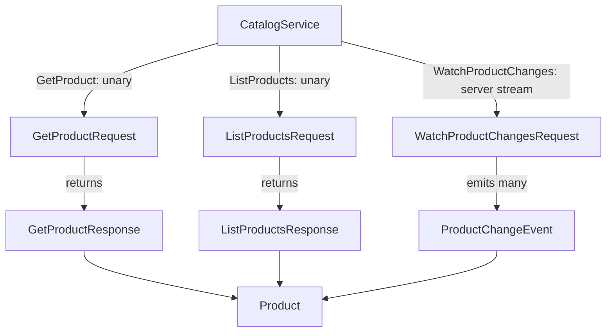

# Naming Messages, Fields, and Services in Spring gRPC

In **Spring gRPC**, the `.proto` contract describes the data types and RPCs shared between client and server. Names in the contract appear in many places: Java source code generated by Protocol Buffers, gRPC method names on the wire, ProtoJSON payloads, API documentation, and sometimes logs, metrics, or traces. A schema with clear names helps development teams implement unary and streaming RPCs, handle errors, test, and operate services more smoothly.

This lesson belongs to the **Schema design** section of the **SPRING_GRPC** module. It focuses on choosing consistent, domain-meaningful names for `message`, `field`, and `service`, and understanding what changes when you need to rename elements in an API that is already in use.

After this lesson, you will be able to:

- Apply `UpperCamelCase` conventions for messages, services, and RPCs; and `snake_case` for fields.
- Distinguish resource names, request/response names, and operation names; name unary and streaming RPCs clearly.
- Recognize the differences between proto names, generated Java names, and default JSON keys.
- Assess compatibility impact when renaming a field, message, service, or RPC.
- Self-review a `.proto` contract before using it to generate Spring gRPC code.

## 1. Foundational Naming Conventions

Suppose we are developing a product catalog service. A common, readable convention for Protocol Buffers is:

| Element | Naming style | Good examples | Hard-to-maintain examples |
| --- | --- | --- | --- |
| `message` | `UpperCamelCase`, typically a noun or noun phrase | `Product`, `GetProductRequest`, `ProductChangeEvent` | `product`, `Get_Data`, `Data1` |
| `field` | `lower_snake_case`, describing an attribute | `product_id`, `display_name`, `updated_at` | `ProductId`, `name2`, `str1` |
| `service` | `UpperCamelCase`, capability or business domain name; usually ends with `Service` | `CatalogService`, `InventoryService` | `Service1`, `UtilsService` |
| `rpc` | `UpperCamelCase`, starting with a verb expressing the action | `GetProduct`, `ListProducts`, `WatchProductChanges` | `ProductGet`, `Handle`, `DoAction` |
| `enum` | `UpperCamelCase` type name, `UPPER_SNAKE_CASE` values | `ProductAvailability`, `PRODUCT_AVAILABILITY_IN_STOCK` | `availability`, `OK` |
| Proto `package` | Lowercase segments, with domain and version | `shop.catalog.v1` | `Common`, `everything` |

Names should be self-explanatory: `product_id` tells you it is a product identifier; `display_name` tells you it is a display string; `GetProductRequest` clearly identifies which RPC the message belongs to. Avoid ad-hoc internal abbreviations. For common abbreviations such as ID, SKU, or URL, prefer one consistent convention across the entire schema (for example `product_id`, `sku`).

**Syntax rules:** protobuf identifiers may contain letters, digits, and underscores, but must not start with a digit; syntax keywords must not be used in invalid identifier positions. The casing conventions in the table above are design recommendations—not every alternative casing is rejected by `protoc`.

### Bind Names to Semantics, Not Implementation Details

Prefer `CatalogService` over `CatalogDatabaseService` if the API serves business clients: today the data may reside in a database, tomorrow it may come from a cache or another system. Likewise, the message name `Product` expresses a resource, whereas `ProductRow` exposes internal storage. However, use exact names for genuinely specialized cases, such as `ImportProductsRequest` for a data import task.

## 2. Designing a Consistent .proto Contract

The following example includes both unary RPCs (fetching and listing products) and server streaming (watching product changes). Place it in `src/main/proto/catalog/v1/catalog.proto`:

```proto
syntax = "proto3";

package shop.catalog.v1;

option java_package = "com.myshop.grpc.catalog.v1";
option java_multiple_files = true;
option java_outer_classname = "CatalogProto";

import "google/protobuf/timestamp.proto";

service CatalogService {
  rpc GetProduct(GetProductRequest) returns (GetProductResponse);
  rpc ListProducts(ListProductsRequest) returns (ListProductsResponse);
  rpc WatchProductChanges(WatchProductChangesRequest)
      returns (stream ProductChangeEvent);
}

enum ProductAvailability {
  PRODUCT_AVAILABILITY_UNSPECIFIED = 0;
  PRODUCT_AVAILABILITY_IN_STOCK = 1;
  PRODUCT_AVAILABILITY_OUT_OF_STOCK = 2;
}

message Product {
  string product_id = 1;
  string display_name = 2;
  ProductAvailability availability = 3;
  google.protobuf.Timestamp updated_at = 4;
}

message GetProductRequest {
  string product_id = 1;
}

message GetProductResponse {
  Product product = 1;
}

message ListProductsRequest {
  int32 page_size = 1;
  string page_token = 2;
}

message ListProductsResponse {
  repeated Product products = 1;
  string next_page_token = 2;
}

message WatchProductChangesRequest {
  string product_id = 1;
}

message ProductChangeEvent {
  Product product = 1;
  google.protobuf.Timestamp changed_at = 2;
}
```

The numbers `= 1`, `= 2`, ... are **field numbers (tags)** used for protobuf encoding. They are distinct from field names and are essential for binary data compatibility. Each field in a message must have a unique number; once published, do not arbitrarily change a number or reuse the number of a removed field.

Diagram of relationships in the contract:



### Why Were These Names Chosen?

- `Product` is a **business data type** that can be reused across multiple responses; it is not tied to a single operation.
- `GetProductRequest` and `GetProductResponse` state the exact message pair for `GetProduct`. Naming by `<RpcName>Request` / `<RpcName>Response` makes searching and code generation easier as the number of RPCs grows.
- `GetProduct` expresses the action of fetching one product. The specific lookup criterion sits in `GetProductRequest.product_id`, with no need to cram every detail into the RPC name like `GetProductByProductIdFromDatabase`.
- `ListProducts` uses a plural noun for the result collection. `products` is a `repeated` field, while `page_size` and `page_token` clearly represent the two pagination parameters.
- `WatchProductChanges` indicates that the client subscribes to watch updates; `ProductChangeEvent` describes each event emitted by the server on the stream. The method name distinguishes "watching multiple events" from "fetching a single result".
- `updated_at` and `changed_at` are points in time; `google.protobuf.Timestamp` expresses their semantics far better than an ambiguous integer named `time`.
- `ProductAvailability` describes a finite set of states; enum value names are prefixed with the enum type name to avoid collisions in languages with different scoping rules.

Because gRPC defines methods in terms of input/output message types, even when an operation takes no parameters or returns no payload, you should still design explicit request/response types. For genuinely empty cases, you can use `google.protobuf.Empty` instead of inventing types like `EmptyRequest1` or `NothingResponse`.

## 3. Naming Messages: Separating Resources, Calls, and Events

### Messages Describing Entities

Names like `Product`, `Category`, and `InventoryLevel` state **what the data is**. Prefer singular nouns for a single entity, even when it may appear inside a list:

```proto
message Product {
  string product_id = 1;
  string display_name = 2;
}

message ListProductsResponse {
  repeated Product products = 1;
}
```

There is no need to name the type `Products` just because an RPC returns multiple products; repetition is expressed by `repeated` and a plural field name.

### Messages Describing Requests/Responses

Tie message names to the RPC to avoid `Request`/`Response` collisions across services:

```proto
rpc GetProduct(GetProductRequest) returns (GetProductResponse);
rpc ListProducts(ListProductsRequest) returns (ListProductsResponse);
```

For larger APIs, a request may hold filters, pagination, display locale, or query options. The name `ListProductsRequest` remains appropriate after adding compatible fields. There is no need to create `ProductQuery2` just because the first version only had one criterion.

### Messages Describing Stream Events

The name `ProductChangeEvent` emphasizes that each item on the stream is an **event**, which may include a timestamp and product state. If the stream only sends snapshots, `ProductSnapshot` is more accurate. Naming reflects the data contract and keeps clients from having to guess what each message means.

Not every streaming RPC needs a `Stream` suffix in its message names. The transport mode is declared by the `stream` keyword on `rpc`; messages should be named after their actual content.

## 4. Naming Fields: Clear Data, Cardinality, and Units

A good field name lets readers answer "what does this value represent?" with minimal extra explanation.

| Scenario | Recommended | Avoid | Reason |
| --- | --- | --- | --- |
| Identifier | `product_id`, `order_id` | `id1`, `key` | Identifies the referenced entity. |
| Display value | `display_name` | `name_str` | States the role rather than the data type. |
| List | `products`, `product_ids` | `product_list_data` | A plural name combined with `repeated` clearly shows multiplicity. |
| Count | `item_count` | `number` | States what is being counted. |
| Size | `payload_size_bytes` | `size` | Specifies the unit of measurement. |
| Delay/duration | `retry_delay` with `Duration` type | `retry_time` | Distinguishes a time span from a point in time. |
| Timestamp | `created_at`, `updated_at` with `Timestamp` type | `date_value` | Expresses when an event occurred. |
| Pagination | `page_size`, `next_page_token` | `limit1`, `next` | Aligns request and response semantics. |

For Boolean fields, choose a consistent phrasing, such as `is_active`, `has_discount`, `allow_backorder`. Avoid double negatives like `is_not_disabled`. Do not add suffixes like `_str` or `_int` merely to repeat the field type already declared in the schema.

### Absent Values vs. Default Values

In proto3, regular scalar fields such as `bool` and `int32` have default values when unset. If the business logic needs to know whether a value **was actually sent by the client**, model presence with `optional` or an appropriate structure rather than adding an ambiguous field like `value_is_set`:

```proto
message UpdateProductRequest {
  string product_id = 1;
  optional string display_name = 2;
}
```

Here `optional` distinguishes an omitted `display_name` field from one explicitly sent as an empty string. For multi-field update operations, consider `google.protobuf.FieldMask` to describe which fields are allowed to be updated. Naming conventions and presence representation are two related design decisions, but they do not substitute for each other.

### Field Names and JSON Names Can Differ

Proto uses `snake_case`:

```proto
message GetProductRequest {
  string product_id = 1;
}
```

In **ProtoJSON** (the standard JSON mapping for Protocol Buffers), the default emitted key is `productId`:

```json
{
  "productId": "P-100"
}
```

This is a mapping defined by ProtoJSON rules, not because a separate `productId` field exists in the proto. When you rename a field, its default JSON key may also change even though the field number stays the same. The `json_name` option can pin a JSON name when compatibility truly requires it, but it does not automatically resolve every change in generated code or reflection.

## 5. Naming Services and RPCs: The Contract Over the Network

A `service` should group operations that share closely related business semantics and contract lifecycles:

```proto
service CatalogService {
  rpc GetProduct(GetProductRequest) returns (GetProductResponse);
  rpc ListProducts(ListProductsRequest) returns (ListProductsResponse);
}

service InventoryService {
  rpc GetStock(GetStockRequest) returns (GetStockResponse);
}
```

`CatalogService` serves catalog concerns; `InventoryService` serves inventory concerns. Avoid creating a `CommonService` containing every unrelated action, or splitting every single RPC into its own standalone service without a clear need. A team can draw boundaries based on ownership, access control, change frequency, and operational model; naming conventions simply express those decisions.

### Verbs for Unary RPCs

- `GetProduct`: fetch a single identified resource.
- `ListProducts`: list multiple resources, optionally filtered/paginated.
- `CreateProduct`: create a resource.
- `UpdateProduct`: update a resource.
- `DeleteProduct`: delete a resource.

These are helpful conventions rather than a mandatory verb set. For domain-specific operations, `ReserveStock` or `ConfirmOrder` is clearer than overly generic names like `Process` or `Execute`.

### Verbs for Streaming RPCs

The streaming mode is determined by where the `stream` keyword appears, not by the method name:

```proto
service InventoryService {
  // One request, many responses: server streaming.
  rpc WatchStock(WatchStockRequest) returns (stream StockChangeEvent);

  // Many requests, one response: client streaming.
  rpc UploadStockChanges(stream StockChange) returns (UploadStockChangesResponse);

  // Many requests and many responses: bidirectional streaming.
  rpc SyncStock(stream SyncStockRequest) returns (stream SyncStockResponse);
}
```

The types `WatchStockRequest`, `StockChangeEvent`, `StockChange`, `UploadStockChangesResponse`, `SyncStockRequest`, and `SyncStockResponse` must be declared in an actual schema; the snippet above only illustrates how RPC names express interaction direction. `Watch...` fits when the server pushes changes over time, `Upload...` fits when the client sends a stream of data, and `Sync...` fits when both sides exchange messages continuously. Exact names must reflect business semantics, since a name like `StreamData` does not tell clients what to expect.

### Full RPC Names

Given:

```proto
package shop.catalog.v1;

service CatalogService {
  rpc GetProduct(GetProductRequest) returns (GetProductResponse);
}
```

gRPC identifies the service as `shop.catalog.v1.CatalogService` and the method by the path:

```text
/shop.catalog.v1.CatalogService/GetProduct
```

It is the **proto package**, `service`, and `rpc` names that form the full RPC name. `option java_package` only controls the generated Java package; changing the Java package alone does not change the RPC path. When configuring interceptors, metrics, tracing, or testing calls with tools like `grpcurl`, these full service/method names typically appear in observability output.

## 6. How `.proto` Names Map to Generated Java Names

From the contract in Section 2, when configuring `protoc` with the gRPC Java plugin, the generated code typically includes classes such as:

```text
com.myshop.grpc.catalog.v1
  ├── CatalogServiceGrpc
  ├── Product
  ├── ProductAvailability
  ├── GetProductRequest
  ├── GetProductResponse
  ├── ListProductsRequest
  └── ListProductsResponse
```

Because `java_multiple_files = true`, messages and enums are generated as standalone top-level classes. The `CatalogServiceGrpc` class is generated by the gRPC Java plugin to hold stubs and the service implementation base class.

Common rules:

| Proto | Generated Java or corresponding API |
| --- | --- |
| `message GetProductRequest` | Class `GetProductRequest` |
| `string product_id = 1;` | `request.getProductId()`, builder `setProductId(...)` |
| `string display_name = 2;` | `product.getDisplayName()`, builder `setDisplayName(...)` |
| `service CatalogService` | `CatalogServiceGrpc` |
| `rpc GetProduct(...)` | Java method `getProduct(...)` in the server base class/stub |

A unary handler example illustrates the generated names. Assume the server has Spring gRPC integration configured and code generated from the proto above:

```java
package com.myshop.server.catalog;

import com.myshop.grpc.catalog.v1.CatalogServiceGrpc;
import com.myshop.grpc.catalog.v1.GetProductRequest;
import com.myshop.grpc.catalog.v1.GetProductResponse;
import com.myshop.grpc.catalog.v1.Product;
import io.grpc.Status;
import io.grpc.stub.StreamObserver;
import org.springframework.grpc.server.service.GrpcService;

@GrpcService
public class CatalogEndpoint
        extends CatalogServiceGrpc.CatalogServiceImplBase {

    @Override
    public void getProduct(
            GetProductRequest request,
            StreamObserver<GetProductResponse> observer) {

        if (request.getProductId().isBlank()) {
            observer.onError(Status.INVALID_ARGUMENT
                    .withDescription("product_id is required")
                    .asRuntimeException());
            return;
        }

        Product product = Product.newBuilder()
                .setProductId(request.getProductId())
                .setDisplayName("Sample product")
                .build();

        observer.onNext(GetProductResponse.newBuilder()
                .setProduct(product)
                .build());
        observer.onCompleted();
    }
}
```

The proto method is named `GetProduct`, while the overridden Java method is `getProduct`. The proto field is `product_id`, while the Java accessor is `getProductId()`. These are two distinct naming conventions bridged by the code generator. The hand-written class `CatalogEndpoint` in `com.myshop.server.catalog` does not need to reside in the same package as the stubs.

In this example, `Status.INVALID_ARGUMENT` represents an input validation error according to gRPC conventions. Do not add an `error_message` field to every response just to replace status codes: the names and structure of the data contract should fit the status/error model understood by gRPC clients.

## 7. Does Renaming Break Compatibility?

**It can, depending on which layer you rename and how clients consume the data.** Once a schema is published, you must distinguish between binary encoding, ProtoJSON, generated code APIs, and gRPC wire names.

| Change | On binary protobuf data | On applications and APIs |
| --- | --- | --- |
| Rename `product_id` to `item_id`, **keeping number 1 and type `string`** | A plain message can still be read by tag 1 and its type. | Java APIs and default JSON keys may change; clients relying on the old name must be updated. |
| Rename `GetProductRequest` | Message fields do not change their encoding just because the message name changes. | Type references in protos, generated code, reflection, and `Any` (if used) may be affected. |
| Rename `CatalogService` | Not a message encoding change. | **Changes the full service name and RPC path**; clients calling the old name may receive `UNIMPLEMENTED`. |
| Rename `GetProduct` to `FetchProduct` | Does not change the protobuf payload itself. | **Changes the RPC path** from `.../GetProduct` to `.../FetchProduct`; old clients/stubs must migrate. |
| Change `java_package` while keeping proto package/service/RPC | Does not change RPC names or message wire format. | Java imports, packages, and binary APIs change; Java code must be regenerated and updated. |
| Change field number or reuse a removed tag | May cause data to be misinterpreted or become incompatible. | Avoid changing; record removed tags under `reserved`. |

For example, after publishing the API, you want to use `display_title` instead of `display_name`. Changing:

```proto
// Old version:
string display_name = 2;

// New version, same tag and type:
string display_title = 2;
```

There is no guarantee that all clients will continue working even though the binary payload remains compatible at field 2. Java code will use new accessors (`getDisplayTitle()` instead of `getDisplayName()`); ProtoJSON by default will use a different key; descriptor-based tools will also observe the name change. Plan migrations based on actual usage rather than judging safety solely by whether two messages decode the same binary bytes.

When **permanently removing** a field, mark both the old number and old name as `reserved`:

```proto
message Product {
  reserved 5;
  reserved "legacy_category";

  string product_id = 1;
  string display_name = 2;
}
```

This prevents schema editors from accidentally reusing tag 5 or the name `legacy_category` in the same message. Do not use `reserved` to "rename" a field that still exists under the same name or number; it serves to protect retired identifiers.

For renaming a published service/RPC, the safe approach is usually to keep the old path during a transition period or publish a new API version alongside the old one. Renaming `java_package` is a different matter: the Java side must update generated code/artifacts, but clients do not need to change endpoints solely because a Java package changed.

## 8. Names That Cause Pain as Systems Scale

| Poor name | Problem | Suggested improvement |
| --- | --- | --- |
| `Data`, `Info`, `Result` | Unclear which domain the data belongs to. | `Product`, `StockLevel`, `GetProductResponse` |
| Shared `Request`, `Response` for all RPCs | Different RPCs evolve independently; easy type conflicts. | `CreateProductRequest`, `CreateProductResponse` |
| `GetAllProducts` when response is paginated | Name misleads clients into expecting everything in one call. | `ListProducts` with `page_size` and `next_page_token` |
| `product_list` when field is already `repeated Product` | Redundant and inconsistent with plural conventions. | `products` |
| `timeout` of type `int32` without a unit | Unclear whether milliseconds, seconds, or minutes. | `timeout_ms` or an appropriate `google.protobuf.Duration` type |
| `GetAndUpdateProduct` | An RPC that both reads and writes is surprising and hard to retry. | Split or name after the actual business behavior |
| `Stream`, `Process`, `Handle` | Does not indicate the specific data or action. | `WatchProductChanges`, `ConfirmOrder` |
| `status` without an enum/context | Unclear whether it is business state or gRPC status. | `availability`, `order_state`, or a domain-specific name |

In the Spring gRPC ecosystem, consistent names also make per-method logs and metrics easier to read. When a service named `CatalogService` contains only catalog operations, attaching access control, interceptors, or deadline policies by service/method is also easier to audit. However, clear naming does not replace TLS, authorization, resource limits, or integration testing.

## 9. Pre-Release Schema Review Checklist

1. **Messages:** Is every type in `UpperCamelCase` and representative of a clear entity, request, response, or event? Are there overly generic names like `Data`/`Payload`?
2. **Fields:** Do all fields use `snake_case`, clear semantics, accurate singular/plural forms, and explicit units? Are tags unique within each message?
3. **RPCs:** Do names start with a verb expressing actual behavior, consistently using `Get/List/Create/Update/Delete/Watch/...`? Does `stream` in the declaration match the expectation set by the method name?
4. **Services:** Do the RPCs belong to the same business domain and relatively stable ownership? Does the service name avoid leaking implementation details like `Db` or `Jdbc`?
5. **Generated code:** Is `java_package` clear, and are the expected Java classes and accessors ergonomic in Spring? Are there any message/enum name collisions within the package?
6. **Compatibility:** If modifying a published API, have binary encoding, JSON keys, generated code, and RPC paths been checked? Are removed fields marked `reserved` to prevent reuse?
7. **Verification:** Compile the proto with `protoc` and the gRPC Java plugin, verify a call using real stubs, and check the full RPC name in tests or gRPC reflection if the server enables it.

For example, with a test server running plaintext on `localhost:9090`, you can verify the RPC path using the proto name:

```bash
grpcurl -plaintext -import-path src/main/proto \
  -proto catalog/v1/catalog.proto \
  -d '{"productId":"P-100"}' \
  localhost:9090 shop.catalog.v1.CatalogService/GetProduct
```

In this command, `productId` is the JSON key under the default mapping of `product_id`; `shop.catalog.v1.CatalogService/GetProduct` is the service/method name from the proto. The command works only when the server, port, and connection mode match the running environment.

## 10. Self-Check

**Question 1.** You encounter the following proto snippet:

```proto
message data {
  string ProductName = 1;
  repeated string product_list = 2;
}
service UtilService {
  rpc DoIt(data) returns (data);
}
```

What would you rename if the actual business capability is looking up a product by ID?

**Suggested answer:** Split into `GetProductRequest` (with `product_id`) and `GetProductResponse` (with `Product product`), define `Product` with `display_name`, and use `CatalogService` and `GetProduct`. You should not keep a single `data` type for both input and output when both sides have different meanings. If already published, a migration plan is needed because renaming a service/RPC affects the gRPC path.

**Question 2.** Field `product_id = 1` is renamed to `item_id = 1` while remaining a `string`. Both server and client use binary protobuf. Can you conclude there are zero breaking changes?

**Suggested answer:** No. Binary field 1 can usually still be decoded when the type stays the same, but generated code, descriptor references, and default ProtoJSON keys can change. Consumers must be checked.

**Question 3.** Why should a server streaming method be named `WatchProductChanges` and its returned message `ProductChangeEvent`, rather than naming both `Stream`?

**Suggested answer:** The first name clearly states the action of subscribing to updates, while the second states the meaning of each item in the stream. The transport mode is still determined by `returns (stream ProductChangeEvent)`. Separating the action name and the data name makes the contract easier to understand, observe, and extend.

**Question 4.** Given `rpc GetProduct(GetProductRequest) returns (GetProductResponse);` in `package shop.catalog.v1;` and `service CatalogService`, which name appears in the gRPC path, and which method name typically appears in the Java implementation?

**Suggested answer:** The gRPC path is `/shop.catalog.v1.CatalogService/GetProduct`; the overridden Java method is typically `getProduct(...)`. The Java package name does not determine the gRPC path.

To design durable schemas, treat message names as **domain vocabulary**, field names as **the data contract**, and service/RPC names as **the network operational interface**. Keeping them clear from the start helps Spring gRPC clients and servers—both unary and streaming—integrate cleanly and avoid surprising changes as the system grows.
