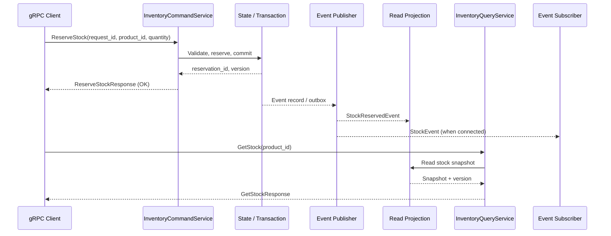

# Separating Command, Query, and Event Messages in Spring gRPC

When building **Spring gRPC** services, a single Protocol Buffers (`.proto`) file may define state-changing operations, read queries, and event payloads emitted after changes. If all three share a single generic message like `Data` or `Request`, clients struggle to tell which fields to send, servers can easily return or mutate unrelated attributes by accident, and the schema becomes hard to evolve when multiple consumers depend on it.

In the **Schema design** chapter of the **SPRING_GRPC** module, a clean design practice is to separate:

- **Command**: a request asking the system to perform an action that may change state.
- **Query**: a request to read information without mutating business state.
- **Event**: a record of a fact that **has already occurred** and can be broadcast to interested parties.

This is a way of organizing **message contracts**. It relates to CQRS (Command Query Responsibility Segregation), yet does not require deploying two databases, adopting event sourcing, or splitting into three microservices. A single Spring application can apply this separation even when using one database and one server process.

After this lesson, you will be able to design messages for each role, define appropriate unary/streaming RPCs, handle retries and consistency, and assess the impact of evolving Protocol Buffers contracts.

## 1. Three Message Types Answer Three Different Questions

Suppose an e-commerce system has an inventory service:

| Type | Question answered | Example message | Expected outcome |
| --- | --- | --- | --- |
| **Command** | "What should be done?" | `ReserveStockRequest` | Reserve 2 units if stock suffices; return result details or an error |
| **Query** | "What is currently known?" | `GetStockRequest` | Read available quantity, reserved quantity, and data version |
| **Event** | "What happened?" | `StockReservedEvent` | Announce that a stock reservation was accepted and recorded |

Command names typically begin with an **imperative verb** (`ReserveStock`, `ReleaseReservation`). Query names typically begin with **Get/List/Search** (`GetStock`, `ListReservations`). Event names are typically in the **past tense** (`StockReservedEvent`, `ReservationReleasedEvent`).

Do not rename `StockReservedEvent` to `ReserveStockEvent`: the latter is easily misread as a "request to reserve stock", whereas an event is a fact that already happened. Nor is an event an RPC response merely because it shares a few fields with a response; it has its own lifecycle, subscribers, and compatibility requirements.

### Differences in Semantics and Responsibilities

| Criterion | Command | Query | Event |
| --- | --- | --- | --- |
| Initiator | Client wanting to change state | Client needing to read data | Component confirming an occurrence |
| Temporal framing | Present/future intent | State observed at read time | Fact that occurred in the past |
| Can be rejected? | Yes, by validation, permissions, business rules, or conflicts | Queries can fail, though empty results are usually valid | A recorded event is not "rejected" like a new request; a consumer may fail while processing it |
| Core data | Target, mutation parameters, idempotency key, preconditions | Lookup criteria, filters, pagination | Event ID, aggregate ID, timestamp, version, fact payload |
| Common gRPC pattern | Unary RPC; sometimes client streaming | Unary RPC; sometimes server streaming of results | Server streaming for live notifications |
| Retry considerations | Risk of duplicate execution when the client does not know the outcome | Usually safe to retry if purely a read | Events may be redelivered; deduplication rules are needed if the source supports replay |

**The RPC pattern does not determine business semantics.** Server streaming can serve a multi-item query; unary RPCs can accept commands. What matters is the message content and the API's processing guarantees.

## 2. An End-to-End Example: The Inventory Contract

Let us build three groups of operations: reserving stock, reading stock levels, and watching stock changes. File `src/main/proto/inventory/v1/inventory.proto`:

```proto
syntax = "proto3";

package shop.inventory.v1;

option java_package = "com.myshop.grpc.inventory.v1";
option java_multiple_files = true;
option java_outer_classname = "InventoryProto";

import "google/protobuf/timestamp.proto";

// Command: mutates business state.
service InventoryCommandService {
  rpc ReserveStock(ReserveStockRequest) returns (ReserveStockResponse);
  rpc ReleaseReservation(ReleaseReservationRequest)
      returns (ReleaseReservationResponse);
}

// Query: reads business data.
service InventoryQueryService {
  rpc GetStock(GetStockRequest) returns (GetStockResponse);
}

// Pushes ongoing events to connected clients.
service InventoryEventService {
  rpc WatchStockEvents(WatchStockEventsRequest) returns (stream StockEvent);
}

message ReserveStockRequest {
  string product_id = 1;
  int64 quantity = 2;
  // Client keeps this ID unchanged when retrying the same intent.
  string request_id = 3;
  // If provided, must match the current inventory version.
  optional int64 expected_version = 4;
}

message ReserveStockResponse {
  string reservation_id = 1;
  int64 resulting_version = 2;
  google.protobuf.Timestamp reserved_at = 3;
}

message ReleaseReservationRequest {
  string reservation_id = 1;
  string request_id = 2;
}

message ReleaseReservationResponse {
  string reservation_id = 1;
  int64 resulting_version = 2;
  google.protobuf.Timestamp released_at = 3;
}

message GetStockRequest {
  string product_id = 1;
}

message StockSnapshot {
  string product_id = 1;
  int64 available_quantity = 2;
  int64 reserved_quantity = 3;
  int64 version = 4;
  google.protobuf.Timestamp observed_at = 5;
}

message GetStockResponse {
  StockSnapshot stock = 1;
}

message WatchStockEventsRequest {
  // Empty: receive only events the client is authorized to watch.
  string product_id = 1;
}

// Envelope: shared metadata for every inventory change.
message StockEvent {
  string event_id = 1;
  string product_id = 2;
  int64 aggregate_version = 3;
  google.protobuf.Timestamp occurred_at = 4;

  oneof detail {
    StockReservedEvent stock_reserved = 5;
    ReservationReleasedEvent reservation_released = 6;
  }
}

message StockReservedEvent {
  string reservation_id = 1;
  int64 quantity = 2;
  string request_id = 3;
}

message ReservationReleasedEvent {
  string reservation_id = 1;
  int64 quantity = 2;
  string request_id = 3;
}
```

The snippet above is a **complete proto with respect to message/service declarations**, sharing a single `package shop.inventory.v1` so the contract has a stable namespace. Services are separated by role for readability and access management; that is a design choice. For a small API, a single `InventoryService` with the corresponding RPCs can still make sense, provided requests, responses, and events keep distinct semantics.

All three message categories refer to `product_id`, but with different purposes:

- `ReserveStockRequest.product_id`: the target on which you **want** to reserve stock; `quantity` is the requested amount.
- `GetStockRequest.product_id`: the target whose current inventory you **want to read**.
- `StockEvent.product_id`: the target on which a fact **occurred**, used for routing or grouping events.

There is no reason to send an entire `StockSnapshot` inside `ReserveStockRequest` or reuse `GetStockResponse` as an event: doing so forces clients to supply server-known data and mixes all three responsibilities.

## 3. Designing Commands: Action Requests, Validation, and Outcomes

### 3.1. Requests Carry Only Information Needed to Perform the Action

```proto
message ReserveStockRequest {
  string product_id = 1;
  int64 quantity = 2;
  string request_id = 3;
  optional int64 expected_version = 4;
}
```

In this example contract, the server needs to validate:

1. `product_id` is non-empty and the client is authorized to reserve that product.
2. `quantity` is a positive integer; the `int64` type alone does not forbid negative or zero values.
3. `request_id` is non-empty and freshly generated for **each distinct business intent**. The client reuses the exact same ID when retrying the same intent.
4. If `expected_version` is present, its value must match the product's current version under the published concurrency control mechanism.
5. Available quantity must be sufficient and satisfy inventory rules.

Because proto3 supplies default values for numbers and strings, the server must still validate these conditions. `optional int64 expected_version` distinguishes **no version supplied** from **explicitly requesting version 0**. Do not rely on `getExpectedVersion() == 0` to infer the field is absent; in Java, check `hasExpectedVersion()`.

### 3.2. Responses Are Confirmed Outcomes, Not Events

```proto
message ReserveStockResponse {
  string reservation_id = 1;
  int64 resulting_version = 2;
  google.protobuf.Timestamp reserved_at = 3;
}
```

When the RPC completes successfully, this example guarantees the request was accepted **and the reservation has committed**; the response returns the reservation ID, new version, and recorded timestamp. If the server only enqueues work for later processing, the contract must explicitly represent an `accepted/pending` state or return an operation ID: **accepted for processing** is not equivalent to **completed**.

Do not put `success = true` in every response and return gRPC `OK` for failed operations too. gRPC has dedicated status codes (`INVALID_ARGUMENT`, `FAILED_PRECONDITION`, `ABORTED`, etc.) that help clients, interceptors, and metrics understand call outcomes.

### 3.3. Why Do Commands Need an Idempotency Key?

Suppose the server reserved 2 units, but the connection dropped before the client received the response. A client seeing `DEADLINE_EXCEEDED` or `UNAVAILABLE` **cannot infer** that the operation definitely did not happen. Sending a new request with a different ID could reserve stock a second time.

`request_id` solves this problem **when** the server implements deduplication properly:

- Store the outcome keyed by the ID, appropriate caller/scope, and request payload; two calls with the same ID and same payload must yield the same outcome within the published retention window.
- If the same ID arrives with a different payload, reject it according to documented error rules.
- Ensure ID checking and state mutation happen atomically or under consistent coordination, preventing two concurrent requests from executing together.
- Define the key retention duration and scope; merely declaring `request_id` in protobuf does **not** automatically create idempotency.

An action like `ReserveStock` typically requires retry protection. By contrast, `GetStock` is a read operation and does not need a request ID without a special reason.

### 3.4. Command Error Statuses

| Scenario | Appropriate gRPC status | Meaning |
| --- | --- | --- |
| `quantity <= 0` or missing `product_id` | `INVALID_ARGUMENT` | Request violates input rules |
| Missing product or reservation | `NOT_FOUND` | Target entity does not exist |
| Insufficient available quantity | `FAILED_PRECONDITION` | Current state does not allow execution |
| Stale `expected_version` during concurrent update | `ABORTED` (if the contract specifies conflict errors require re-reading and retrying) | Concurrency conflict; client should fetch fresh state before deciding next steps |
| Not permitted to reserve stock | `PERMISSION_DENIED` | Identity lacks permission |
| Downstream dependency temporarily unavailable | `UNAVAILABLE` | Infrastructure error; retries must account for duplicate execution risk |

Choose status codes and retry policies **consistently** across the API. For `ABORTED`, clients should not blindly loop forever with the same stale `expected_version`; they should query the latest state and decide again. If a client does not know whether a command committed, it must reuse the same `request_id` within the server's idempotency window.

## 4. Designing Queries: Describing What to Read

```proto
message GetStockRequest {
  string product_id = 1;
}

message GetStockResponse {
  StockSnapshot stock = 1;
}

message StockSnapshot {
  string product_id = 1;
  int64 available_quantity = 2;
  int64 reserved_quantity = 3;
  int64 version = 4;
  google.protobuf.Timestamp observed_at = 5;
}
```

`GetStock` is a pure business query: calling it does **not** create a reservation, decrement stock, or emit a `StockReservedEvent`. Technical logging, metrics, and caching may change without turning it into a command in business terms.

The response returns a `StockSnapshot` rather than `ReserveStockResponse` because the client is asking for current stock levels, not the result of a reservation attempt. The fields also express clear semantics:

- `available_quantity`: quantity still available to sell or reserve under system rules.
- `reserved_quantity`: quantity already reserved for other transactions.
- `version`: inventory data version, usable with the concurrency control mechanism.
- `observed_at`: the timestamp of the data observed by the query, not necessarily the moment the server sends the response.

**Consistency considerations:** if commands write to a write model and queries read an asynchronously updated projection, `ReserveStock` returning `OK` followed immediately by `GetStock` may still show the old `version`. That is **eventual consistency**. The design must clarify whether the query provides strongly consistent reads and how clients should handle stale state.

One way for clients to tell whether the projection has caught up is comparing `GetStockResponse.stock.version` with `ReserveStockResponse.resulting_version`, **provided** the system guarantees both values share the same version counter and the projection updates monotonically per product. Without that guarantee, do not assume the two versions can be compared directly.

For list queries, requests typically include `page_size`, `page_token`, and filters; responses should include `repeated` records along with `next_page_token`. When there are no matches, return an empty list with status `OK` rather than `NOT_FOUND`. Returning paginated data does not turn a query into an event stream.

## 5. Designing Events: Recording Facts That Occurred

Events may be produced after a command executes successfully:

```proto
message StockEvent {
  string event_id = 1;
  string product_id = 2;
  int64 aggregate_version = 3;
  google.protobuf.Timestamp occurred_at = 4;

  oneof detail {
    StockReservedEvent stock_reserved = 5;
    ReservationReleasedEvent reservation_released = 6;
  }
}

message StockReservedEvent {
  string reservation_id = 1;
  int64 quantity = 2;
  string request_id = 3;
}
```

**The `StockEvent` envelope** holds shared metadata for the event ID, product, and aggregate version. The `StockReservedEvent` payload describes the specific fact: reservation ID, reserved quantity, and the request ID that can correlate back to the originating command.

`oneof detail` represents at most one event variant inside the envelope; the server must guarantee **exactly one** variant is populated in valid messages. In Java, clients can inspect `getDetailCase()` to determine which payload is present.

### Separating Intent From Recorded Fact

Compare the three messages:

```text
Command:
  ReserveStockRequest(product_id="P-100", quantity=2, request_id="req-789")

Response after commit:
  ReserveStockResponse(reservation_id="res-456", resulting_version=18)

Event that occurred:
  StockEvent(
    event_id="evt-901",
    product_id="P-100",
    aggregate_version=18,
    stock_reserved={reservation_id:"res-456", quantity:2, request_id:"req-789"}
  )
```

A command **may produce no events** if rejected for insufficient stock, invalid input, or missing permissions. A command can also produce **multiple events** if the business workflow involves several independent state changes. Do not assume a 1:1 ratio of requests to events, and never let the client fabricate a `StockReservedEvent` merely because it sent `ReserveStockRequest`.

### Fields to Consider for an Event

| Field | Purpose | Decisions required |
| --- | --- | --- |
| `event_id` | Deduplication, tracking a fact across replays | ID generation scheme and uniqueness scope |
| `product_id` | Grouping, partitioning, routing by aggregate | Can a single event affect multiple entities? |
| `aggregate_version` | Tracking change progression for each product | Is it contiguous, monotonically increasing, and unique per aggregate? |
| `occurred_at` | Time when the fact was confirmed | Clocks, time zones, non-absolute ordering across hosts |
| `request_id` in payload | Linking the event to the originating command | Is it safe to expose to all consumers? |
| `stock_reserved` payload | Sufficient detail for consumers to understand the fact | Which fields are required without leaking sensitive data |

Events should reflect **the data consumers need** rather than dumping an entire database entity. For long-lived stored messages, avoid coupling to internal table/column names, unnecessary personal data fields, and types that only make sense in a single code version.

## 6. Processing Flow From Command to Query and Event

A common architecture can be visualized as follows:



The diagram illustrates **separating behavior and messages**, not a mandatory technology stack. Some systems read directly from the same state updated by commands; others use asynchronous read projections. `InventoryEventService` may consume from an internal event bus or an external broker. Choose the implementation based on throughput, latency, reliability, and operational needs.

**The boundary between commit and event publishing:** if a command commits successfully but the application crashes before publishing the event, consumers may miss the change. A transactional outbox is one solution: the same transaction writes the state and an event/outbox record, and an independent process reads the outbox to publish. This reduces the risk of lost events, though redelivery can still cause **duplicate delivery**, so consumers must process events idempotently. Never claim "exactly-once" delivery merely because gRPC streams or an outbox are used.

### Separating Messages Does Not Force Splitting Infrastructure

You can start with a single Spring Boot application:

```text
Inventory application
├── gRPC command handler -> inventory domain service -> storage
├── gRPC query handler   -> inventory query service  -> storage / read model
└── event dispatcher    -> event source             -> gRPC stream
```

Later, when reads need independent scaling or teams take separate ownership, the system can deploy command, query, and event components as separate applications. Even then, **service granularity should follow real needs**; clean message design already pays off from the very first version.

## 7. Server Streaming for Events: Contracts Must State Limits Clearly

```proto
service InventoryEventService {
  rpc WatchStockEvents(WatchStockEventsRequest) returns (stream StockEvent);
}

message WatchStockEventsRequest {
  string product_id = 1;
}
```

In **this example**, we define `WatchStockEvents` as a **live subscription**: clients receive only events published after the server successfully registers the connection; the RPC does not guarantee historical retrieval or resuming from a disconnect point. An empty `product_id` means observing all products **within the client's authorized scope**. The server must check permissions even when the filter is empty.

On a stream, these cases have distinct meanings:

- **No events over a period of time:** the stream can still be healthy; this is not `NOT_FOUND`.
- **Client cancellation or deadline expiration:** the server must release the subscription and avoid unnecessary ongoing work.
- **Connection interruption:** clients may miss events in a live-only model. Reconnecting automatically does not mean missed events are replayed.
- **Slow consumer:** can cause growing queues and memory pressure. The application must apply flow control/backpressure or appropriate buffer limits, timeouts, and disconnect policies.

If **replay** or resuming from the last received event is required, design a dedicated contract with a cursor/resume token, event retention window, guaranteed ordering, and expired-cursor error handling. For example, add `resume_after_event_id` **only when** the backend genuinely persists sufficient history and supports seeking to a starting point. Do not add such a field just to create the illusion of reliability when the system only streams live events.

### Ordering and Duplicates

`aggregate_version` helps verify the ordering of changes for **the same product** if the server guarantees monotonically increasing versions. It does not establish a total order across all products; neither do timestamps substitute for a global ordering guarantee. If a consumer receives an already-seen `event_id`, it can deduplicate per idempotency rules. In a live-only stream, having an ID does not imply the ability to recover all missed events.

## 8. Illustrative Spring gRPC Java Client Code

When `protoc` and the gRPC Java plugin compile the proto above, the services generate `InventoryCommandServiceGrpc`, `InventoryQueryServiceGrpc`, and `InventoryEventServiceGrpc` in `com.myshop.grpc.inventory.v1`. The following snippet illustrates **a Java client** invoking a unary command, a unary query, and an event subscription. In a Spring application, `Channel` is provided and managed through appropriate client configuration.

```java
package com.myshop.client.inventory;

import com.myshop.grpc.inventory.v1.GetStockRequest;
import com.myshop.grpc.inventory.v1.GetStockResponse;
import com.myshop.grpc.inventory.v1.InventoryCommandServiceGrpc;
import com.myshop.grpc.inventory.v1.InventoryEventServiceGrpc;
import com.myshop.grpc.inventory.v1.InventoryQueryServiceGrpc;
import com.myshop.grpc.inventory.v1.ReserveStockRequest;
import com.myshop.grpc.inventory.v1.ReserveStockResponse;
import com.myshop.grpc.inventory.v1.StockEvent;
import com.myshop.grpc.inventory.v1.WatchStockEventsRequest;
import io.grpc.Channel;
import io.grpc.stub.StreamObserver;
import java.util.UUID;
import java.util.concurrent.TimeUnit;

public final class InventoryClientExample {

    public static void reserveThenRead(Channel channel) {
        var command = InventoryCommandServiceGrpc.newBlockingStub(channel)
                .withDeadlineAfter(3, TimeUnit.SECONDS);
        var query = InventoryQueryServiceGrpc.newBlockingStub(channel)
                .withDeadlineAfter(3, TimeUnit.SECONDS);

        String requestId = UUID.randomUUID().toString();
        ReserveStockRequest request = ReserveStockRequest.newBuilder()
                .setProductId("P-100")
                .setQuantity(2)
                .setRequestId(requestId)
                .build();

        ReserveStockResponse commandResult = command.reserveStock(request);
        System.out.println("Reservation: " + commandResult.getReservationId());

        GetStockResponse queryResult = query.getStock(GetStockRequest.newBuilder()
                .setProductId("P-100")
                .build());
        System.out.println("Read version: "
                + queryResult.getStock().getVersion());
        System.out.println("Command version: "
                + commandResult.getResultingVersion());
    }

    public static void watchEvents(Channel channel) {
        var events = InventoryEventServiceGrpc.newStub(channel)
                .withDeadlineAfter(30, TimeUnit.SECONDS);

        events.watchStockEvents(
                WatchStockEventsRequest.newBuilder()
                        .setProductId("P-100")
                        .build(),
                new StreamObserver<StockEvent>() {
                    @Override
                    public void onNext(StockEvent event) {
                        if (event.hasStockReserved()) {
                            System.out.println("Reserved: "
                                    + event.getStockReserved().getReservationId());
                        } else if (event.hasReservationReleased()) {
                            System.out.println("Released: "
                                    + event.getReservationReleased().getReservationId());
                        }
                    }

                    @Override
                    public void onError(Throwable error) {
                        System.err.println("Event stream failed: " + error);
                    }

                    @Override
                    public void onCompleted() {
                        System.out.println("Event stream completed");
                    }
                });
    }
}
```

Notes on code behavior:

1. The command stub accepts a `ReserveStockRequest` and the query stub accepts a `GetStockRequest`; never reuse the same message for both.
2. `requestId` must be **retained** when retrying the same operation if the client does not know whether the command committed; generating a new UUID on every retry defeats idempotency.
3. `ReserveStockResponse.resulting_version` and `GetStockResponse.stock.version` may differ if the query reads an asynchronously updated projection.
4. `watchEvents` invokes an async stub and registers callbacks; calling this method does not block the current thread for 30 seconds. A real application must keep the channel alive, handle subscription cancellation, and manage stub lifecycle.
5. The 3-second and 30-second deadlines are illustrative values only. Choose deadlines based on operational requirements; deadline expiration does not guarantee the command did not execute.

When writing a Spring gRPC server, each service can extend `InventoryCommandServiceGrpc.InventoryCommandServiceImplBase`, `InventoryQueryServiceGrpc.InventoryQueryServiceImplBase`, or `InventoryEventServiceGrpc.InventoryEventServiceImplBase` and register via the mechanism supported by the project's Spring gRPC version (such as `@GrpcService`). Command handlers should invoke domain services and validate errors; event handlers must manage subscribers, cancellation, and flow control. Never put stock-mutating logic inside a query handler.

## 9. Where Do Metadata, Deadlines, gRPC Status, and Security Belong?

Separating commands, queries, and events does **not** mean every message must embed all technical metadata of the call.

| Information | Typically belongs in | Examples |
| --- | --- | --- |
| Business data for reserving stock | Command message | `product_id`, `quantity`, `request_id` |
| Read criteria | Query message | `product_id`, filters, pagination |
| Facts about what happened | Event message | `event_id`, `occurred_at`, `stock_reserved` |
| Auth tokens or trace context | gRPC metadata/interceptors | Authorization header, trace headers |
| Call time budget | gRPC deadline/cancellation | Deadline for `ReserveStock` |
| Call termination error | gRPC status and error details if needed | `INVALID_ARGUMENT`, `ABORTED`, `UNAVAILABLE` |
| Transport security | TLS/mTLS and infrastructure config | Client–server encryption |

For state-changing commands, a timeout or network error creates an **unknown outcome**, not automatically a business failure. Command idempotency and verification queries resolve this situation. Interceptors can log, inspect metadata, or enforce deadline policies, but they do not turn an event into a regular request/response.

For trustworthiness, never store auth tokens inside events broadcast to multiple consumers. If a correlation ID is needed for tracing, carefully draw the boundary between technical trace metadata and business identifiers safe to publish.

## 10. Versioning and Compatibility Rules for the Three Message Types

Protocol Buffers permits certain compatible changes on the binary wire, yet changing names, types, and behavior can break clients, JSON mappings, or event consumers.

| Change | Risk | Safe practice |
| --- | --- | --- |
| Add a new field with a new number to a command request | Old clients do not send the new field; the server might interpret defaults unexpectedly | Assign stable default semantics; never silently require old clients to send the new field |
| Add a new field to a query response | Old clients typically ignore unknown fields in binary protobuf | Use a new field number, document its meaning, and check JSON clients |
| Add a new branch to `StockEvent.oneof` | Old consumers may not recognize the new event variant | Require consumers to tolerate unsupported variants; consider a new event type/version for breaking behavior |
| Rename a field while keeping its tag | Binary wire may still decode, but Java APIs, ProtoJSON, and reflection are affected | Avoid renaming after release without a migration plan |
| Change a field number or reuse a removed tag | High risk of misreading or losing data | Keep field numbers stable; mark both tag and name of removed fields as `reserved` |
| Change proto `package`, `service`, or `rpc` name | gRPC path changes; old client stubs may receive `UNIMPLEMENTED` | Deploy versions in parallel when breaking changes are needed |
| Change the meaning of a published event | Historical consumers may misinterpret old records | Create a new event or version the schema with a consumer upgrade plan |

For example, if `StockReservedEvent` previously had an old field `int64 reserved_count = 4;` and it was removed, do not reuse tag 4:

```proto
message StockReservedEvent {
  reserved 4;
  reserved "reserved_count";

  string reservation_id = 1;
  int64 quantity = 2;
  string request_id = 3;
}
```

**Events often outlive individual RPC calls.** If a system stores events for replay or analytics, check both older consumer versions and historical records. Even live-only streams without persisted history must still account for clients running older stubs.

## 11. Common Design Mistakes and How to Fix Them

| Poor design | Consequence | Recommended design |
| --- | --- | --- |
| Using `InventoryData` for commands, query responses, and events | Messages carry irrelevant fields; ambiguous semantics | Separate `ReserveStockRequest`, `StockSnapshot`, and `StockReservedEvent` |
| Naming a command `StockReserved` | Uses past tense for a request that may not succeed | `ReserveStock` is the RPC; `StockReservedEvent` is the post-commit event |
| Having query `GetStock` decrement stock to reserve items | Clients think they are reading while mutating state; retries are dangerous | Read in `GetStock`, mutate in `ReserveStock` |
| Command response has only `bool ok` | No reservation ID, no version, hard to handle timeouts | Return `reservation_id`, `resulting_version`, and explicit error status |
| Publishing an event before the transaction commits | Consumers may observe events for operations that rolled back | Publish events only for committed changes; consider an outbox |
| Naming an event `ReserveStockRequest` and broadcasting it to consumers | Consumers may mistake intent for fact | Emit events only after domain confirmation |
| Automatically retrying a command with a new `request_id` | May reserve stock multiple times | Reuse the same ID for the same intent; server deduplicates per contract |
| Treating a live-only stream as a durable event log | Events are lost when clients disconnect | State limits clearly; add persistence/replay/cursor if required |
| Assuming a query returning an old version means the command failed | Read projection updates may lag behind | Publish the consistency model and how to wait or verify |

## 12. Design and Integration Testing Checklist

Before publishing a schema, review in order:

1. **Verify behavior:** Which RPCs mutate state, which only read, and which events describe facts that occurred? Is any command mislabeled as a query or event?
2. **Verify fields:** Do commands carry all needed validation, idempotency, and concurrency fields? Do queries require only read criteria? Do events have identifiers, timestamps, and payloads free of internal implementation details?
3. **Lock down consistency:** Does a command response mean committed or merely accepted for processing? Are post-command queries guaranteed to see fresh data immediately or with lag?
4. **Lock down stream policy:** Live-only or replayable? Are buffer limits, ordering, event retention, and deduplication specified?
5. **Lock down errors and security:** Are gRPC status codes appropriate, deadline/cancellation behavior correct, authorization data placed in metadata, and events free of leaked secrets?
6. **Check compatibility:** Are field tags stable, new event variants tolerated by consumers, and proto/Java packages and RPC paths properly versioned?
7. **Write end-to-end tests:** Use real Java stubs to observe commands, queries, and events across success, failure, retry, and disconnect scenarios.

Recommended test cases:

| Case | Expectation |
| --- | --- |
| `ReserveStock(quantity=0)` | `INVALID_ARGUMENT`, no state written, no `StockReservedEvent` emitted |
| Reserving more than available stock | `FAILED_PRECONDITION`, inventory unchanged |
| Retry with same `request_id`/payload | No second reservation within idempotency policy window |
| Retry with same ID but different payload | Rejected according to published rules |
| Stale `expected_version` | Returns appropriate conflict status, no state written |
| `GetStock` after command | Returns valid snapshot; satisfies the promised consistency policy |
| Successful reservation command | Response contains reservation ID; event record created/published per policy |
| Consumer receives duplicate `StockEvent` | Able to detect duplicate by event ID and handle appropriately |
| Client cancels `WatchStockEvents` | Server stops pushing and releases subscription |
| Service crashes after commit before publish | Durable publishing mechanism (if guaranteed) recovers the event |

### Self-Check Exercises

**Question 1.** Given three messages `ConfirmOrderRequest`, `GetOrderResponse`, and `OrderConfirmedEvent`: which expresses intent, which expresses read data, and which is a fact that occurred?

**Answer:** `ConfirmOrderRequest` is a command; `GetOrderResponse` is a query result; `OrderConfirmedEvent` is an event emitted after order confirmation succeeds. Never emit a confirmation event if the command is rejected.

**Question 2.** The `ReserveStock` command committed, but the client hit a deadline before receiving the response. Is it safe for the client to resend with a new `request_id`?

**Answer:** Not necessarily. The server might execute the reservation a second time. If the contract supports idempotency, the client must keep the same `request_id` and payload for the same intent; the server must perform deduplication properly.

**Question 3.** After `ReserveStockResponse.resulting_version = 18`, a query returns `StockSnapshot.version = 17`. Can you conclude the command failed?

**Answer:** No. The query may be reading an asynchronous projection. Check the published consistency guarantees and version semantics rather than using a stale query to conclude a command never committed.

**Question 4.** Why should `StockReservedEvent` not be the input of `InventoryCommandService.ReserveStock`?

**Answer:** The input is a request asking to reserve stock; the event asserts that the reservation already happened. Letting clients send a "successfully reserved" message bypasses server validation, authorization, and transactions.

**Question 5.** A client watching a live-only stream is disconnected for one minute. Is reconnecting enough to guarantee receiving all missed events?

**Answer:** No. Live-only streams offer no replay guarantee. To guarantee recovery, the system needs a durable event source and a resume/cursor contract or another state reconciliation mechanism.

When naming and designing contracts, keep the boundaries sharp: **commands express requested actions, queries express data to observe, and events express what has occurred**. This allows Spring gRPC applications to evolve unary RPCs, streaming, metadata, deadlines, error statuses, and monitoring without blurring the responsibilities of each message.
