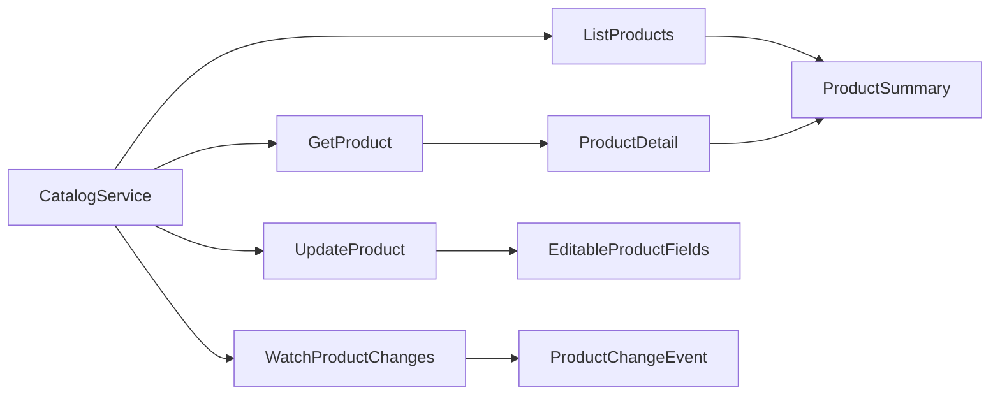

# Avoiding Oversized Messages for Every RPC in Spring gRPC

In the **Spring gRPC** ecosystem, Protocol Buffers (`.proto`) files define the contract shared by clients and servers to generate Java code and exchange data over gRPC. Early in design, it is tempting to create a single `Product` message holding every piece of product information and reuse that same message across every RPC: fetching details, listing, updating, deleting, or broadcasting change notifications. That seems convenient because it reduces the number of declared types, yet as features grow, the contract becomes harder to understand and accumulates unnecessary coupling.

This lesson belongs to the **Schema design** chapter of the **SPRING_GRPC** module and focuses on designing purpose-built messages suited for unary and streaming RPCs. After this lesson, you will be able to:

- Spot the signs of a **God Message** (a catch-all message carrying too many responsibilities).
- Distinguish **a schema with many fields** from **a large runtime payload**, and understand their impact on network transfer, memory, and processing.
- Separate requests/responses and model data per use case: summary, detail, update, and event.
- Choose pagination or streaming when transferring many records, and avoid adopting streaming merely because a message has many fields.
- Preserve compatibility when slimming down contracts, changing fields, or upgrading an API.

## 1. "Oversized Message" Actually Has Two Meanings

In practice, two distinct problems are often lumped together as a "large message".

| Aspect | Symptom | Primary issue | Preferred solution |
| --- | --- | --- | --- |
| **Too many responsibilities in the schema** | One message has dozens of unrelated fields and serves as input/output for every RPC | Ambiguous field semantics, hard to validate, hard to evolve without impacting clients | Split messages by domain role and each RPC's purpose |
| **Large payload at runtime** | A response contains tens of thousands of records, binary images/videos, or huge `repeated` fields | Network, memory, serialization/parsing time, size limits, and deadlines | Pagination, batching, streaming, external references to large blobs, or narrowing response scope |

**Do not equate the number of declared fields with the number of bytes sent on the wire.** In binary protobuf, unset fields typically do not appear in the encoded payload; a message defining 50 fields with only two populated can produce a small payload. Conversely, a message with just `repeated bytes chunks = 1;` can still create an enormous payload if each element holds large data.

Even so, a catch-all schema still carries design costs: every consumer is exposed to many irrelevant fields, generated code exposes sprawling APIs, changing one feature forces retesting unrelated features, and the rules for "which field is valid in which case?" grow increasingly tangled.

## 2. Anti-Pattern: One `ProductEverything` Used Everywhere

Suppose a team defines:

```proto
syntax = "proto3";

package shop.catalog.v1;

message ProductEverything {
  string product_id = 1;
  string display_name = 2;
  string description = 3;
  string category_id = 4;
  int64 price_minor_units = 5;
  string currency_code = 6;
  bool active = 7;
  repeated string image_urls = 8;
  repeated string audit_messages = 9;
  string admin_note = 10;
  string update_action = 11;
  string next_page_token = 12;
  string event_id = 13;
}

service CatalogService {
  rpc GetProduct(ProductEverything) returns (ProductEverything);
  rpc ListProducts(ProductEverything) returns (ProductEverything);
  rpc UpdateProduct(ProductEverything) returns (ProductEverything);
  rpc WatchProductChanges(ProductEverything)
      returns (stream ProductEverything);
}
```

This is a **syntactically valid** proto, yet the contract leaves many questions unanswered:

- Which fields does `GetProduct` require in the request? Only `product_id`, or `update_action` too? If a client sends `admin_note`, does the server ignore it or return an error?
- How does `ListProducts` return multiple products? A single `ProductEverything` cannot express a paginated list; stuffing data into strings or misusing unrelated repeated fields makes the API awkward.
- Does `UpdateProduct` update every field or only the ones sent? In proto3, a `bool` without presence normally reads as `false` when omitted.
- Does `WatchProductChanges` emit a snapshot, an action to execute, or an event that occurred? `event_id` makes sense only for events, not for every response.
- Should `admin_note` be sent to public clients? Sharing one type makes it easy for the server to leak internal fields into responses by mistake.

From the perspective of Java code generated by `protoc`, stubs accept the same `ProductEverything` across every operation. The compiler cannot catch domain bugs like "the client passed admin-only fields into a public read RPC". Every RPC ends up needing sprawling validation branches to interpret a generic message.

The fix is not simply shrinking `ProductEverything` below some arbitrary field count. You need to **redefine responsibility boundaries**: each request expresses the call's intent, each response expresses the promised outcome, and each event expresses what occurred.

## 3. Categorize Before Splitting Messages

For a product catalog system, list the data each operation actually needs:

| Operation | Minimum input | Meaningful output | Appropriate message types |
| --- | --- | --- | --- |
| View details of one product | `product_id` | Name, description, price, images, and status | `GetProductRequest` / `GetProductResponse` containing `ProductDetail` |
| List products | Filters, `page_size`, `page_token` | Multiple summary rows + next page token | `ListProductsRequest` / `ListProductsResponse` containing `ProductSummary` |
| Edit product info | ID, fields to edit, update scope | Product after update | `UpdateProductRequest` / `UpdateProductResponse` |
| Watch product changes | Subscription ID/filter | A stream of `ProductChangeEvent` | `WatchProductChangesRequest` / `ProductChangeEvent` |

The key idea is **semantic reuse**, not "reusing everything everywhere". A `ProductSummary` type can be shared across multiple list responses if they represent the same concept. By contrast, an update request should not reuse `ProductDetail` merely because they share a few fields: fields such as `updated_at`, image URLs, or price may be server-managed or disallowed from editing.

You can visualize it as:



Embedding `ProductSummary` inside `ProductDetail` in the diagram is an **intentional reuse choice**: product details include the basic display summary. Not every model must nest like this; you can inline fields directly if nesting makes things awkward for clients.

## 4. Complete `.proto` Design by RPC

The following example lives in `src/main/proto/catalog/v1/catalog.proto`. It provides a cohesive contract for generating Java code for Spring gRPC.

```proto
syntax = "proto3";

package shop.catalog.v1;

option java_package = "com.myshop.grpc.catalog.v1";
option java_multiple_files = true;
option java_outer_classname = "CatalogProto";

import "google/protobuf/field_mask.proto";
import "google/protobuf/timestamp.proto";

service CatalogService {
  rpc GetProduct(GetProductRequest) returns (GetProductResponse);
  rpc ListProducts(ListProductsRequest) returns (ListProductsResponse);
  rpc UpdateProduct(UpdateProductRequest) returns (UpdateProductResponse);
  rpc WatchProductChanges(WatchProductChangesRequest)
      returns (stream ProductChangeEvent);
}

// Only the attributes needed for a list row.
message ProductSummary {
  string product_id = 1;
  string display_name = 2;
  int64 price_minor_units = 3;
  string currency_code = 4;
}

// Full details used when a user opens a product.
message ProductDetail {
  ProductSummary summary = 1;
  string description = 2;
  repeated string image_urls = 3;
  bool active = 4;
  google.protobuf.Timestamp updated_at = 5;
}

message GetProductRequest {
  string product_id = 1;
}

message GetProductResponse {
  ProductDetail product = 1;
}

message ListProductsRequest {
  // Empty string: no category filter.
  string category_id = 1;
  // 0: server applies the default page size.
  int32 page_size = 2;
  // Empty: first page.
  string page_token = 3;
}

message ListProductsResponse {
  repeated ProductSummary products = 1;
  // Empty: no further pages.
  string next_page_token = 2;
}

// Only attributes clients are allowed to edit.
message EditableProductFields {
  string display_name = 1;
  string description = 2;
  bool active = 3;
}

message UpdateProductRequest {
  string product_id = 1;
  EditableProductFields changes = 2;
  // Update only listed fields, even when set to default values.
  google.protobuf.FieldMask update_mask = 3;
  // Used for deduplication if the server implements idempotency.
  string request_id = 4;
}

message UpdateProductResponse {
  ProductDetail product = 1;
}

enum ProductChangeKind {
  PRODUCT_CHANGE_KIND_UNSPECIFIED = 0;
  PRODUCT_CHANGE_KIND_CREATED = 1;
  PRODUCT_CHANGE_KIND_UPDATED = 2;
  PRODUCT_CHANGE_KIND_DELETED = 3;
}

message WatchProductChangesRequest {
  // Empty: watch products within the client's authorized scope.
  string product_id = 1;
}

// Small event payload; clients can call GetProduct when details are needed.
message ProductChangeEvent {
  string event_id = 1;
  string product_id = 2;
  ProductChangeKind change_kind = 3;
  google.protobuf.Timestamp occurred_at = 4;
}
```

The file above illustrates four distinct behaviors. Although the number of **message types** increases, each type has clearer responsibilities and validation rules. `GetProduct` returns `ProductDetail`, while `ListProducts` returns `ProductSummary` so long descriptions and image URLs are not repeated for every item in a list.

### Why Are There Still Shared Types?

`ProductSummary` is a stable summary model used inside both `ProductDetail` and `ListProductsResponse`. Sharing it makes sense because both places define the same ID, display name, price, and currency code. This is **different** from reusing `ProductDetail` as an update request, because updates have a restricted set of editable fields and separate validation rules.

Do not split every single field into its own message or create empty wrappers just to achieve a "small schema". Prefer grouping fields that share semantics, ownership, and rate of change.

## 5. Purpose-Built Requests and Responses Reduce Confusion

### 5.1. `GetProduct`: Accept Only an ID, Return Detailed Data

```proto
message GetProductRequest {
  string product_id = 1;
}

message GetProductResponse {
  ProductDetail product = 1;
}
```

With this API:

- The request contains only a non-empty `product_id`, without attaching an entire product object.
- If the ID is invalid, the server returns `INVALID_ARGUMENT`; if not found, `NOT_FOUND`.
- A successful response has `product` present and consistent with the requested ID.
- Internal attributes such as admin notes are excluded from the public `ProductDetail`, so they cannot slip out accidentally due to sharing a type with database records.

**Should you return `ProductDetail` directly instead of `GetProductResponse`?** You can. A dedicated wrapper is useful when an API wants explicit per-RPC result boundaries or anticipates adding business result metadata. Avoid multi-level nesting if it adds no meaning.

### 5.2. `ListProducts`: Return Just Enough to Render a List

`ListProducts` is often called repeatedly as users scroll pages or apply filters. The response does not need to repeat long descriptions, large image URLs, or undisplayed metadata.

```proto
message ListProductsResponse {
  repeated ProductSummary products = 1;
  string next_page_token = 2;
}
```

Example convention: `page_size = 0` uses a default of 20 items/page, `1..100` is allowed, and negative values or values over 100 are rejected with `INVALID_ARGUMENT`. `page_token` is a server-issued opaque token; clients pass it back verbatim for the next page. An empty `next_page_token` indicates the end. When no matching products exist, return `OK` with an empty list.

**Note:** using `ProductSummary` does not automatically guarantee every response is small. A response containing one million `ProductSummary` items will still be oversized. Enforce page limits and test realistic payload sizes.

### 5.3. `UpdateProduct`: Allow Editing Only Permitted Fields

An update request should not be `ProductDetail`, because some fields are server-managed or forbidden in this RPC. For example:

```proto
message EditableProductFields {
  string display_name = 1;
  string description = 2;
  bool active = 3;
}

message UpdateProductRequest {
  string product_id = 1;
  EditableProductFields changes = 2;
  google.protobuf.FieldMask update_mask = 3;
  string request_id = 4;
}
```

Business rules in this illustrative design:

1. `product_id` is non-empty; `changes` and `update_mask` must be present.
2. `update_mask.paths` is non-empty. Accept only `display_name`, `description`, and `active`; these are **relative paths inside `EditableProductFields`**, so do not write `changes.display_name`.
3. The server updates only fields listed in the mask; if `active` is in the mask with value `false`, it means **set to false**, not "leave unchanged".
4. Ignore or reject fields outside the mask per the published contract; in this example, the server rejects disallowed paths, and values of fields not listed in the mask are not applied.
5. `request_id` makes retries safe only if the server implements idempotency (storing/checking keys and outcomes appropriately); merely declaring it in the proto does nothing automatically.

Example request in ProtoJSON:

```json
{
  "productId": "P-100",
  "changes": {
    "active": false
  },
  "updateMask": "active",
  "requestId": "cmd-20261119-001"
}
```

The JSON `updateMask` is a field mask string formatted per ProtoJSON rules. To update both `display_name` and `active` at once, the value takes the form `"displayName,active"`. The difference between proto name `display_name` and JSON name `displayName` is standard mapping, not two separate fields.

### 5.4. `WatchProductChanges`: Emit Events, Not Full Records

`ProductChangeEvent` holds an event ID, product ID, change kind, and timestamp. It omits long `description` text and `image_urls` lists. Consumers needing full details can call `GetProduct` to read the latest state if the resource still exists.

This works well when subscribers only need to know "which product changed". If a consumer needs **the exact values at the moment of the event**, calling `GetProduct` afterward may observe *newer* state or encounter `NOT_FOUND` if the product was deleted. In that case, design a dedicated event payload carrying the required event data or use a system with explicit snapshot/replay storage. Never assume "sending the ID is enough" for every domain requirement.

## 6. A Small Schema Does Not Guarantee a Small Payload

The protobuf protocol uses binary encoding based on field numbers and wire types. On-the-wire message size depends on actual assigned values, numeric encoding, counts of `repeated` elements, string/byte lengths in each field, and nesting depth.

Compare two situations:

```proto
// Many fields, but typically only a few are populated.
message ProductOptions {
  string product_id = 1;
  string label = 2;
  string description = 3;
  string category_id = 4;
  string supplier_id = 5;
  bool active = 6;
  string notes = 7;
}

// Only one field, yet the payload can be huge.
message ExportDataResponse {
  bytes content = 1;
}
```

If `ExportDataResponse.content` holds a file of hundreds of megabytes, both server and client still pay the corresponding memory, network, and deserialization costs. Having few fields does not prevent overload. Conversely, `ProductOptions` declares many fields, yet unset fields may be omitted from the binary payload.

Factors to consider when sending large payloads:

- **Serialization/parsing:** more bytes and elements increase CPU usage and memory allocation.
- **Message size limits:** gRPC enforces configurable receive limits; payloads exceeding the limit on either side can be rejected.
- **Deadlines:** calls must complete within the client's time budget; large payloads increase timeout risk.
- **Memory pressure:** a unary RPC returning a massive list can force the server to buffer large results and the client to hold one giant response.
- **Compression:** can reduce wire bytes in some cases, but consumes CPU and does not replace pagination or batching design.

Therefore, splitting messages reduces **contract coupling**, while controlling payload sizes improves **performance and reliability**. Both optimizations complement each other.

## 7. When Runtime Data Is Actually Large: Pagination, Batching, or Streaming?

Not every data-heavy request needs the same mechanism. Choose based on how clients consume the results.

| Scenario | Typically appropriate option | Must be documented in contract |
| --- | --- | --- |
| Product list page in a UI | Paginated unary `ListProducts` | `page_size`, `page_token`, sort order, end-of-list semantics |
| Exporting many records continuously | Server streaming of many small messages | Per-message size, ordering, mid-stream failure semantics, cancellation, backpressure |
| Client submitting thousands of changes | Client streaming or bounded batches | How each record is acknowledged, partial error handling, retries, idempotency |
| Continuous two-way synchronization | Bidirectional streaming | Correlation ID, ordering, flow control, deadlines, half-closing each direction |
| Transferring large files | Stream of chunks or external storage with controlled references | Chunk size, checksums, offset/resume, access control |
| Client only wants to know what changed | Small server-streaming events | Event ID, live/replay semantics, ordering, missed-event handling |

### Pagination Is More Than Adding `page_size`

A solid paginated API must bound record counts and define ordering stability. If data mutates between page fetches, clients may see duplicates or skipped items. Depending on domain needs, you may need a cursor bound to filters/sort order or a consistent snapshot. `page_token` should be an opaque token rather than requiring clients to construct offsets.

### Streaming Does Not Automatically Reduce Total Data Volume

`returns (stream ProductSummary)` avoids packing an entire list into a single response and lets clients process items incrementally. However, if the server emits one million products, total bytes remain large. Streaming also requires managing observers, flow control, cancellation, and mid-stream failures; a client that received part of a stream **must not treat** the result as complete if the stream terminates with an error.

Use streaming only when incremental processing, real-time delivery, or very large record counts justify stream lifecycle complexity. For short paged lists, paginated unary RPCs are usually easier to implement and test.

## 8. Spring gRPC Example: Handlers Build Only the Needed Response

After compiling `catalog.proto` with `protoc` and the gRPC Java plugin, classes such as `GetProductRequest`, `ProductSummary`, `ProductDetail`, `GetProductResponse`, and `CatalogServiceGrpc` are generated in `com.myshop.grpc.catalog.v1`. A Spring gRPC server can implement unary `GetProduct`:

```java
package com.myshop.server.catalog;

import com.myshop.grpc.catalog.v1.CatalogServiceGrpc;
import com.myshop.grpc.catalog.v1.GetProductRequest;
import com.myshop.grpc.catalog.v1.GetProductResponse;
import com.myshop.grpc.catalog.v1.ProductDetail;
import com.myshop.grpc.catalog.v1.ProductSummary;
import io.grpc.Status;
import io.grpc.stub.StreamObserver;
import org.springframework.grpc.server.service.GrpcService;

@GrpcService
public class CatalogGrpcEndpoint
        extends CatalogServiceGrpc.CatalogServiceImplBase {

    @Override
    public void getProduct(
            GetProductRequest request,
            StreamObserver<GetProductResponse> observer) {

        String id = request.getProductId();
        if (id.isBlank()) {
            observer.onError(Status.INVALID_ARGUMENT
                    .withDescription("product_id is required")
                    .asRuntimeException());
            return;
        }

        // Sample data; a real app reads from domain/repository.
        if (!id.equals("P-100")) {
            observer.onError(Status.NOT_FOUND
                    .withDescription("product not found")
                    .asRuntimeException());
            return;
        }

        ProductSummary summary = ProductSummary.newBuilder()
                .setProductId("P-100")
                .setDisplayName("Mechanical keyboard")
                .setPriceMinorUnits(125000L)
                .setCurrencyCode("VND")
                .build();

        ProductDetail detail = ProductDetail.newBuilder()
                .setSummary(summary)
                .setDescription("Mechanical keyboard for work and study")
                .setActive(true)
                .addImageUrls("https://example.com/products/p-100.jpg")
                .build();

        GetProductResponse response = GetProductResponse.newBuilder()
                .setProduct(detail)
                .build();

        observer.onNext(response);
        observer.onCompleted();
    }
}
```

`ProductSummary` holds only the fields needed for listings; `ProductDetail` embeds the summary and adds description, images, and status. `GetProductResponse` appears only when the RPC succeeds. The example intentionally implements a single method to focus on message design; other `CatalogService` RPCs must be implemented separately before production use. Server registration via `@GrpcService` must match the project's Spring gRPC version.

A client using generated Java stubs can invoke two RPCs with two distinct result shapes:

```java
import com.myshop.grpc.catalog.v1.CatalogServiceGrpc;
import com.myshop.grpc.catalog.v1.GetProductRequest;
import com.myshop.grpc.catalog.v1.ListProductsRequest;
import com.myshop.grpc.catalog.v1.ProductSummary;
import io.grpc.Channel;
import java.util.concurrent.TimeUnit;

public class CatalogClientExample {
    public static void displayCatalog(Channel channel) {
        var stub = CatalogServiceGrpc.newBlockingStub(channel)
                .withDeadlineAfter(3, TimeUnit.SECONDS);

        // List request: client receives only ProductSummary items.
        var page = stub.listProducts(ListProductsRequest.newBuilder()
                .setCategoryId("CAT-10")
                .setPageSize(20)
                .build());

        for (ProductSummary item : page.getProductsList()) {
            System.out.println(item.getProductId()
                    + " | " + item.getDisplayName());
        }

        // Detail request only when the user needs to inspect one product.
        var detail = stub.getProduct(GetProductRequest.newBuilder()
                .setProductId("P-100")
                .build()).getProduct();
        System.out.println(detail.getDescription());
    }
}
```

The sample client assumes the server actually implements `ListProducts`. `Channel` is passed into the method so the code focuses on request/response types; a Spring application should use proper connection/stub management, TLS in production, and deadlines matching latency budgets.

**Clear benefit:** the listing client depends only on `ProductSummary`; the detail view uses `ProductDetail`; the editor uses `EditableProductFields` and `FieldMask`. Contracts can evolve cleanly per consumer group's needs.

## 9. What If an RPC Genuinely Needs Many Details?

Not every large message is a design flaw. An operation that genuinely requires a cohesive composite entity with tightly coupled fields can be modeled as a well-structured larger message.

For example, a `CreateOrderRequest` containing order line items, a shipping address, and a chosen payment method can represent **one valid business intent**. Splitting each line item into a separate RPC solely to shrink field counts can introduce consistency bugs and extra round-trips.

Evaluate using these questions:

1. **Same lifecycle?** Are the fields read/written and mutated in the same operation?
2. **Same access control?** Are public fields mixed with internal/sensitive fields?
3. **Same consumers?** Do different RPCs truly need the same set of fields, or only a couple of identifiers?
4. **Same rate of change?** Would a change for feature A force clients of feature B to update?
5. **What is the runtime size?** Can `repeated` fields grow unboundedly? Is there binary data that should be separated from the response?
6. **Atomicity?** Must a multi-part request commit together? If so, splitting across multiple RPCs can make consistency hard to maintain.

Splitting shared types should not cause endless duplication. If multiple responses share a stable concept, reuse a sub-message or extract the shared portion into a clearly governed schema. What to avoid is creating a single "super model" for operations that do not share semantics.

## 10. Modifying a Published Schema: Preserving Compatibility

Once clients are running in production, do not delete `ProductEverything` immediately just because you spotted a poor design. Examine how changes affect **wire format**, **generated Java code**, **ProtoJSON**, and **gRPC paths**.

| Change | Potential impact | How to handle |
| --- | --- | --- |
| Add a field with a new number to an existing message | Old binary clients usually ignore unknown fields; may affect semantics | Use safe defaults; test binary and JSON consumers |
| Create `ListProductsV2` or a new versioned RPC returning `ProductSummary` | Old and new APIs can coexist side by side | Migrate clients gradually; publish a clear deprecation timeline |
| Change an existing RPC's input/output type to a new message | Generated Java stubs change; even if wire bytes happen to align, descriptors and consumers break | Prefer a new RPC or a new package version once the contract is published |
| Rename a field while keeping its field number | Binary payloads may still decode, yet Java accessors and default ProtoJSON keys change | Avoid renaming; plan a migration if necessary |
| Remove a field and reuse its field number | Risk of decoding old data as the new field's meaning | Mark removed numbers and names as `reserved` |
| Rename a service or RPC | Changes the `/package.Service/Method` path on the wire | Keep the old endpoint running alongside the new one during client migration |
| Change `java_package` | Generated Java imports and classes move | Regenerate code and update dependent Java modules; protobuf RPC names do not change |

For example, if an old internal field was removed from a message, protect its name and tag:

```proto
message ProductSummary {
  reserved 8;
  reserved "legacy_internal_note";

  string product_id = 1;
  string display_name = 2;
  int64 price_minor_units = 3;
  string currency_code = 4;
}
```

This snippet illustrates protecting field number 8 **if it was actually used in the past**. Do not add `reserved` arbitrarily for numbers that never existed just to "clean up" the schema.

### Strategy for Migrating Away From a God Message

1. Inventory every RPC using the shared message and record which fields are inputs, which are outputs, and which are actually used.
2. Define behavior-focused messages such as `ProductSummary`, `ProductDetail`, and `UpdateProductRequest`, while keeping the legacy message during transition.
3. Add new endpoints or a `v2` API whenever changing input/output signatures would break deployed clients.
4. Write compatibility tests and test with both old and new generated clients; track which RPC paths are still called via appropriate metrics/interceptors.
5. Migrate clients in waves, monitor error rates, latency, and payload sizes, and only then consider retiring the legacy endpoint.

Never rename `ProductEverything` to a new name assuming it is merely an internal refactor: message names can be referenced by generated APIs, reflection, dynamic messages, and `google.protobuf.Any`.

## 11. Metadata, Deadlines, Statuses, TLS, and Performance Monitoring

Clean message design does not replace handling gRPC operational concerns:

| Concern | Appropriate place | Relation to avoiding catch-all messages |
| --- | --- | --- |
| Authentication, trace context | gRPC metadata and interceptors | Do not repeat tokens/tracing headers as fields in every request unless required by business logic |
| Authorization | Server/interceptor/domain service | Never expose internal fields merely because they sit in a shared message |
| Deadlines/cancellation | Client sets deadline; server handles cancellation | Avoid computing or assembling large payloads when the client is no longer waiting |
| gRPC status | `INVALID_ARGUMENT`, `NOT_FOUND`, `RESOURCE_EXHAUSTED`, etc. | Never wrap RPC errors inside an `error` field of a God Message and always return `OK` |
| TLS/mTLS | Channel and server configuration | Secures transport independently of how many fields a message has |
| Monitoring | Per-method metrics, traces, logs, and payload sizes | Observe which RPCs are actually oversized/slow before optimizing |

Valuable measurements include:

- **Serialized request/response size** (actual bytes) per RPC and by percentile, rather than counting schema fields.
- **Latency** per method, especially `ListProducts` across page sizes and calls approaching deadlines.
- **Counts of `repeated` elements** returned per request to spot unbounded response growth.
- **CPU, memory allocation, and `RESOURCE_EXHAUSTED` errors** under large payloads or streams.
- **Stream cancellation rates and processing times** to detect slow subscribers or backlogs.

Keep telemetry storage costs and sensitive data protection in mind: do not log entire request bodies containing private data just to measure payload size. Interceptors can record byte size and method names without logging every field.

### Illustrative Operational Scenario

A page listing 50 products is unusually slow. Do not rush to convert all of `ListProducts` into streaming. First check whether the response repeats long descriptions, hundreds of image URLs, and unnecessary metadata for every item in the list. If so, returning `ProductSummary` with bounded pagination solves most of the problem with a much simpler contract. Only when clients must process massive continuous result sets should you consider streaming or a dedicated export mechanism.

## 12. Checklist and Test Scenarios

Before shipping a schema into a project, verify:

1. **Does each RPC have purposeful input and output?** Does any message force clients to fill in "unrelated" fields?
2. **Is the detail level right?** Does a listing really need all details from the single-product view?
3. **Are update boundaries clear?** Do update requests contain only editable fields, with explicit rules for defaults and field masks?
4. **Is sensitive/internal data isolated?** Could internal fields leak because a shared type is used in public responses?
5. **Is data growth bounded?** Are `page_size`, batch sizes, or chunk sizes capped appropriately?
6. **Are stream semantics defined?** Are events facts that occurred or snapshots? Are ordering/replay/cancellation guarantees documented?
7. **Is there a compatibility plan?** Can older clients still call the service? Are published field numbers and names protected?
8. **Is it measured?** Do real payload sizes, latencies, and gRPC error metrics confirm the improvement after changes?

Representative integration test cases:

| Test case | Input | Expected outcome |
| --- | --- | --- |
| Valid Get | `GetProductRequest(product_id="P-100")` | `OK`; `ProductDetail` present with matching `summary.product_id` |
| Get with missing ID | `product_id=""` | `INVALID_ARGUMENT`; no success response sent |
| Empty list | Filter matching no products | `OK`; empty list, empty next page token |
| List with oversized page | `page_size=10000` | `INVALID_ARGUMENT` per the example API's 1..100 policy |
| List with next page | More records than `page_size` | Each page within limit, token returned until final page |
| Update `active` only | `update_mask="active"`, `active=false` | Updates only `active`, leaves other fields unchanged |
| Update forbidden field | `update_mask="price_minor_units"` | `INVALID_ARGUMENT` because the path is not editable |
| Change event | Recorded mutation occurs | `ProductChangeEvent` carries only the necessary ID/kind/timestamp |
| Stream canceled | Client cancels `WatchProductChanges` | Server stops emitting and releases subscriber and buffers |
| Exceeds message limit | Attempt to send payload above configured limit | Receives appropriate error instead of exhausting application memory |

### Self-Check Exercises

**Question 1.** A `ListProducts` RPC returns `repeated ProductDetail` with long descriptions and all image URLs for thousands of products, even though the UI only displays names and prices. How would you change the contract?

*Hint:* Return `repeated ProductSummary` with ID, name, price, and currency code; add pagination, `page_size` bounds, and `next_page_token`. Call `GetProduct` only when full details are needed.

**Question 2.** A message declares 40 fields, yet an actual request populates only two. Can you conclude it always takes more bytes on the wire than a message with a single `bytes content` field?

*Hint:* No. Binary protobuf typically omits unset fields, whereas a single `bytes` field can hold a huge payload. Measure actual serialized byte sizes.

**Question 3.** A server reuses `ProductDetail` for `UpdateProduct`. A client omits `active`, yet the server reads the default `false` and accidentally deactivates the product. How would you fix this?

*Hint:* Use a dedicated update request and specify presence/`FieldMask`. When the mask omits `active`, do not update it; when the mask includes `active` with value `false`, explicitly set it to false.

**Question 4.** A slim event sends only `product_id`; upon receiving it, a consumer calls `GetProduct` and sees data that has already been updated again. Is such an event sufficient for an audit log use case?

*Hint:* Not necessarily. Event ID and product ID are enough only for change notification; auditing or replay needs the exact details at the time of the event, appropriate version/correlation fields, and event persistence.

**Question 5.** Can changing the output type of a published `ListProducts` RPC to an entirely new message be treated as an internal refactor because the server still sends binary protobuf?

*Hint:* No. Descriptors, generated stubs, parsing logic, and even response semantics can change. You must evaluate compatibility and consider a new endpoint or API version to migrate clients.

A sustainable protobuf design does not aim to minimize the count of message types. The goal is that **each RPC receives only the data it needs and returns exactly what it promises**, while runtime size, pagination, streaming, statuses, deadlines, and security remain well controlled. This makes Spring gRPC contracts clearer and lets systems scale without creating needless coupling between client and server.
