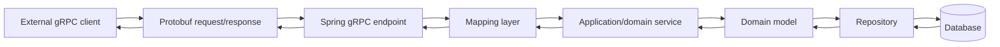

# Separating Public Contracts From Internal Models

In Spring gRPC, Protocol Buffers messages are **the contract visible to external clients**. Entities, aggregates, and persistence models serve how the application structures domain logic and stores data. If you use a JPA entity directly to derive protobuf definitions or return entire entities over RPC, database changes can accidentally become API changes; worse, internal fields such as cost price, operational notes, or moderation status can leak to clients.

Safe design maintains a clear boundary: **the public contract describes what clients may send and receive; the internal model describes how the server executes domain logic**. Both sides may hold some overlapping data, yet they do not need the same structure, field names, or lifecycle.

## 1. Two Models Serve Different Purposes

Suppose we have a product management system. An internal domain aggregate may need product ID, display name, sale price, cost price, supplier, profit margin, audit metadata, and moderation status. Clients of the Catalog service are only allowed to read ID, name, short description, and sale price. The remaining fields serve internal operations or business logic and do not belong in the public contract.

| Aspect | Public contract (protobuf) | Internal model (domain/persistence) |
| --- | --- | --- |
| Users | gRPC clients, partner apps, and published consumers | Domain services, repositories, and server-side logic |
| Goal | Stable communication across process boundaries | Expressing business rules and state |
| Lifecycle | Governed by API versioning and compatibility | Evolves with domain/database refactoring needs |
| Fields | Only data permitted for exchange | May include internal data, relationships, and metadata |
| Validation | Validates incoming requests at the API boundary | Enforces domain invariants across all call paths |
| Data types | Protobuf messages, enums, timestamps, field masks | Value objects, aggregates, entities, monetary and domain types |

"Public contract" does not necessarily mean an Internet-facing API. It is the contract at **the boundary between a service and another consumer**, even when both belong to the same internal system.

## 2. Anti-Pattern: Returning Entities Directly Over gRPC

A persistence entity might look like this:

```java
@Entity
public class ProductEntity {
    @Id
    private String id;
    private String displayName;
    private long salePriceMinorUnits;
    private long costPriceMinorUnits;
    private String supplierId;
    private String moderationNote;
    private String internalStatus;
    @Version
    private long rowVersion;
}
```

If the API returns all these attributes, clients can come to depend on details never meant for public exposure. A change such as replacing supplierId with a SupplierEntity relationship, normalizing internalStatus, or moving cost price into another table can force the API schema to change alongside it.

The risks go beyond data exposure:

1. **Information leakage:** internal fields can carry sensitive data or staff-only notes.
2. **Persistence coupling:** clients are affected by table changes, lazy-loading relationships, column names, or storage layouts.
3. **Unsafe growth:** adding a database column can accidentally expose it in responses if a mapper auto-copies all properties.
4. **Wrong-layer validation:** protobuf requests might bind directly into entities, bypassing business rules or overwriting server-controlled fields.
5. **Hard-to-manage compatibility:** the API can change even when client needs have not changed.

Do not use entities as public contracts. Translate through an application model or a mapper with an explicit allowlist of exposed fields.

## 3. Define Contracts Around Client Needs

For instance, catalog/v1/catalog.proto publishes only the data needed to view a product:

```proto
syntax = "proto3";

package shop.catalog.v1;

option java_package = "com.myshop.grpc.catalog.v1";
option java_multiple_files = true;

service CatalogService {
  rpc GetProduct(GetProductRequest) returns (GetProductResponse);
}

message GetProductRequest {
  string product_id = 1;
}

message Product {
  string product_id = 1;
  string display_name = 2;
  string short_description = 3;
  int64 sale_price_minor_units = 4;
  string currency_code = 5;
}

message GetProductResponse {
  Product product = 1;
}
```

There is no cost_price_minor_units, supplier_id, moderation_note, internal_status, or row_version. This is a decision about data ownership and public scope, not merely about trimming field count.

Nor does the contract need to mirror database tables. For example:

- The database stores sale prices in a product_price table, yet the API can still expose sale_price_minor_units directly on Product.
- The domain models state with multiple value objects, yet the API needs only one clearly defined public enum.
- Internally, supplier IDs factor into pricing, yet Catalog clients are not permitted to see those IDs.

Design fields in the consumer's language and needs, not after column names.

## 4. Place Mappers at the Adapter Boundary

The processing flow should have a clear dependency direction:



The endpoint receives protobuf messages, validates boundary preconditions, translates requests into application commands or queries, and calls the service. Domain or application results are converted by the mapper into protobuf responses. The domain layer should not import generated protobuf classes and should know nothing about gRPC StreamObserver, metadata, or status codes.

An application model can be a projection tailored to the use case:

```java
package com.myshop.catalog.application;

import com.myshop.catalog.domain.Money;

public record ProductView(
        String id,
        String displayName,
        String shortDescription,
        Money salePrice) {
}
```

ProductView is neither a database entity nor a protobuf message. It describes the data the GetProduct use case needs to return. The domain can hold many additional attributes that this projection never exposes.

### Explicit Mappers

```java
package com.myshop.catalog.grpc;

import com.myshop.catalog.application.ProductView;
import com.myshop.grpc.catalog.v1.Product;

final class ProductGrpcMapper {
    private ProductGrpcMapper() {
    }

    static Product toPublicMessage(ProductView source) {
        return Product.newBuilder()
                .setProductId(source.id())
                .setDisplayName(source.displayName())
                .setShortDescription(source.shortDescription())
                .setSalePriceMinorUnits(source.salePrice().minorUnits())
                .setCurrencyCode(source.salePrice().currencyCode())
                .build();
    }
}
```

The mapper enumerates each exposed field explicitly. When internal entities add costPriceMinorUnits or moderationNote, responses do not automatically sprout new fields. When a public field needs to change, the team can review it explicitly as an API contract change.

For nested messages or collections, build dedicated mappers per type or use case. Avoid reflection-based mappers that auto-copy all properties from entities to protobuf when your goal is controlling public exposure.

## 5. Spring gRPC Endpoints Keep Protobuf Out of the Domain

An illustrative unary endpoint:

```java
package com.myshop.catalog.grpc;

import com.myshop.catalog.application.CatalogQueryService;
import com.myshop.catalog.application.ProductView;
import com.myshop.grpc.catalog.v1.CatalogServiceGrpc;
import com.myshop.grpc.catalog.v1.GetProductRequest;
import com.myshop.grpc.catalog.v1.GetProductResponse;
import io.grpc.Status;
import io.grpc.stub.StreamObserver;
import org.springframework.grpc.server.service.GrpcService;

@GrpcService
public class CatalogGrpcEndpoint
        extends CatalogServiceGrpc.CatalogServiceImplBase {

    private final CatalogQueryService catalogQueryService;

    public CatalogGrpcEndpoint(CatalogQueryService catalogQueryService) {
        this.catalogQueryService = catalogQueryService;
    }

    @Override
    public void getProduct(
            GetProductRequest request,
            StreamObserver<GetProductResponse> observer) {
        if (request.getProductId().isBlank()) {
            observer.onError(Status.INVALID_ARGUMENT
                    .withDescription("product_id is required")
                    .asRuntimeException());
            return;
        }

        var result = catalogQueryService.findById(request.getProductId());
        if (result.isEmpty()) {
            observer.onError(Status.NOT_FOUND
                    .withDescription("product not found")
                    .asRuntimeException());
            return;
        }

        ProductView view = result.get();
        GetProductResponse response = GetProductResponse.newBuilder()
                .setProduct(ProductGrpcMapper.toPublicMessage(view))
                .build();
        observer.onNext(response);
        observer.onCompleted();
    }
}
```

This example assumes CatalogQueryService.findById returns Optional<ProductView>. Annotations and endpoint registration must match the project's Spring gRPC version. The key design point is that the endpoint depends on the application service and mapper; it never returns ProductEntity directly and never passes protobuf requests down to repositories.

On the request side, for write operations, translate protobuf requests into dedicated application commands. The domain service accepts commands or value objects and enforces its own invariants. Never bind a protobuf request directly onto an entity and save it, because clients could submit fields they are not authorized to modify.

## 6. Protecting Data and Update Permissions

The public contract is a security boundary. Before adding any field to a response, ask:

- Which consumers are authorized to see this value?
- Does the field contain cost prices, supplier details, internal notes, personal data, or anti-fraud signals?
- Could the field be inferred from other fields or reveal proprietary business rules?
- Does the field belong in every RPC or only in a separate, privileged admin API?

For write requests, distinguish **client-editable fields** from **server-managed fields**. For example, clients may send display_name and description, but must not send created_at, approved_by, cost_price, or internal_status. Define dedicated update requests and enforce permissions on the server; never use one full Product message for both reads and writes.

Never treat hiding a field in the UI as access control. If a field does not belong in a consumer's contract, keep it out of the public response altogether. If an admin API needs that field, define a separate contract and apply appropriate authorization.

## 7. Validation, Status Codes, and Metadata at the Right Layer

Separating the contract from internal models does not mean skipping validation:

| Check category | Example | Where handled |
| --- | --- | --- |
| API syntax/input | Non-blank product_id, length limits | gRPC endpoint or adapter validator |
| Access control | Which products the caller may view | Interceptor and/or application authorization |
| Business rules | Suspended products cannot be sold | Domain/application service |
| Persistence constraints | Unique IDs, foreign keys, optimistic locking | Domain/repository/database depending on invariant |
| Call errors | Invalid arguments, not found, unauthorized | Mapped to gRPC status at the boundary |

For instance, INVALID_ARGUMENT fits a blank product_id; NOT_FOUND fits a valid ID with no matching product; PERMISSION_DENIED fits an unauthorized caller. Never leak persistence exceptions or table names in public responses. Error messages should be helpful enough for clients without exposing stack traces or internal data.

Authentication credentials and trace context belong in gRPC metadata and interceptors, not as fields on Product. Deadlines belong to call configuration; TLS protects the wire. Never add auth_token, trace_id, or encrypted to every business message when they are not part of the use case's domain data.

## 8. When the Domain Changes, the Public Contract Can Stay Intact

Suppose the database currently has a sale_price_minor_units column. After a refactor, the team introduces a value object:

```java
package com.myshop.catalog.domain;

public record Money(long minorUnits, String currencyCode) {
}
```

```java
package com.myshop.catalog.domain;

public class Product {
    private ProductId id;
    private ProductName name;
    private Money salePrice;
    private Money costPrice;
    private SupplierId supplierId;
    private ProductModeration moderation;
}
```

The domain model's structure changed, yet clients still expect the same product_id, display_name, sale_price_minor_units, and currency_code. You only update the mapper:

```java
static com.myshop.grpc.catalog.v1.Product toPublicMessage(ProductView source) {
    return com.myshop.grpc.catalog.v1.Product.newBuilder()
            .setProductId(source.id())
            .setDisplayName(source.displayName())
            .setSalePriceMinorUnits(source.salePrice().minorUnits())
            .setCurrencyCode(source.salePrice().currencyCode())
            .build();
}
```

The public contract needs no change just because internal details shifted. Conversely, if consumers genuinely need a new tax_included field, that is an explicit API decision: define semantics, assign a new field number, plan fallbacks, and verify compatibility before publishing.

That is the biggest benefit of a mapping boundary: **domain refactoring and API schema evolution can proceed independently**, as long as the mapper continues fulfilling the published contract.

## 9. Testing the Contract Boundary

Do not only test that the repository returns the right entity. Verify that actual gRPC responses contain no internal fields and that mapping stays accurate across domain refactors.

| Test | What to verify |
| --- | --- |
| Mapper test | Public fields map accurately; price amounts and currencies are not swapped |
| Contract descriptor test | Public messages contain only approved fields |
| Endpoint integration test | Valid requests return expected responses; blank ID yields INVALID_ARGUMENT; missing item yields NOT_FOUND |
| Authorization test | Unauthorized callers receive no data even when knowing a product ID |
| Regression test | Adding an internal field to an entity does not alter protobuf responses |
| Compatibility test | Changing persistence models does not force client changes when the public contract stays fixed |

A simple descriptor check can catch sensitive fields accidentally added to a message:

```java
import static org.junit.jupiter.api.Assertions.assertNull;

import com.myshop.grpc.catalog.v1.Product;
import org.junit.jupiter.api.Test;

class CatalogContractTest {
    @Test
    void publicProductDoesNotExposeInternalFields() {
        assertNull(Product.getDescriptor().findFieldByName("cost_price_minor_units"));
        assertNull(Product.getDescriptor().findFieldByName("supplier_id"));
        assertNull(Product.getDescriptor().findFieldByName("moderation_note"));
    }
}
```

This illustrates testing a denylist of unexposed fields. In a real project, you can maintain an allowlist of public fields and inspect descriptors across multiple messages; mapper tests and authorization tests remain essential because descriptors alone do not prove runtime filtering works.

## 10. Review Checklist

- [ ] Protobuf messages are designed for consumers and use cases, not generated straight from entities/databases.
- [ ] The domain/application layer has no dependency on generated protobuf classes or StreamObserver.
- [ ] Mappers explicitly map only approved public fields.
- [ ] Write requests contain only client-editable fields; the server controls audit metadata, cost prices, and internal states.
- [ ] Authorization is enforced before returning data; hiding fields in the UI is never treated as security.
- [ ] Internal errors map to appropriate gRPC statuses without exposing persistence details.
- [ ] Refactoring entities or value objects does not unintentionally alter the public contract.
- [ ] Tests cover mappers, descriptors, endpoints, and authorization.

**Self-Check**

**Question 1.** An entity has cost_price_minor_units, while Catalog clients only need sale price. Should both fields be included in protobuf Product to simplify the mapper?

*Answer:* No. The public contract should contain only data consumers are permitted to receive. Explicit mapping prevents leaking cost prices.

**Question 2.** The domain switches from a numeric price field to a Money value object. Must the protobuf schema change?

*Answer:* No, if the data and semantics visible to clients stay unchanged. Update the mapper to translate Money into the existing public fields.

**Question 3.** Can the same protobuf Product message serve as both an update request and a detail read response?

*Answer:* It should not when the two use cases have different permissions and rules. Update requests should include only editable fields plus a mechanism specifying which fields to update.

**Question 4.** Is a descriptor test alone enough to prove responses never leak internal data?

*Answer:* No. It verifies schema structure; you still need mapper, endpoint, and authorization tests to verify runtime behavior.

Separating public contracts from internal models lets Spring gRPC keep APIs stable while domains and persistence evolve. Let protobuf define what the service promises consumers, let the domain guard business invariants, and let adapter-boundary mappers govern every piece of data crossing that boundary.
