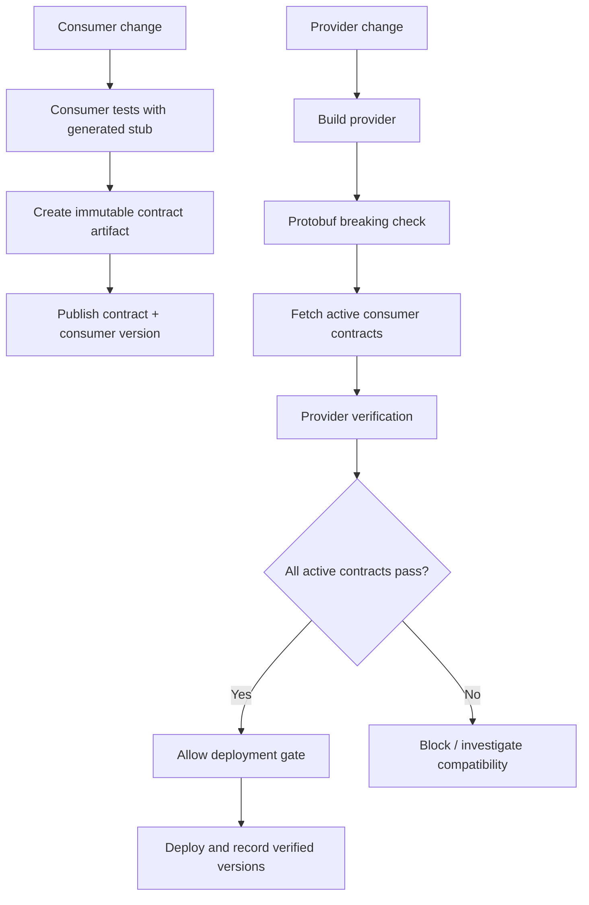

# Consumer-Driven Contracts for gRPC

## Lesson Objectives

In **SPRING_GRPC**, a consumer typically uses only a subset of a provider's API: specific RPC methods, request/response fields, metadata, statuses, and deadline or streaming rules. When a provider changes its implementation or Protobuf schema, checking compilation or wire compatibility alone is not enough to know whether running consumers still work properly.

**Consumer-driven contracts (CDC)** let consumers describe the interactions and behaviors they actually rely on; the provider verifies those contracts against its own implementation. For gRPC, a contract must cover both the Protobuf message contract and RPC semantics: methods, statuses, metadata, authentication, deadlines, and stream lifecycles.

After this lesson, you will be able to:

1. Explain the roles of consumer, provider, and contract in CDC.
2. Build interaction contracts for unary, server-streaming, client-streaming, and bidirectional-streaming RPCs.
3. Describe requests/responses using generated Protobuf types or descriptor-aware fixtures.
4. Set expectations for gRPC statuses, metadata, trailers, deadlines, and authorization.
5. Test consumer behavior and verify contracts against the real provider.
6. Distinguish CDC from Protobuf wire compatibility and schema breaking checks.
7. Manage contract versions, consumer matrices, and provider verification in CI/CD.
8. Design matching rules strict enough to protect consumers while avoiding coupling to implementation details.

> **Tooling note:** gRPC uses HTTP/2 framing and Protobuf binary payloads. Do not assume an HTTP Pact test or HTTP interaction plugin can directly test gRPC. Use a tool with genuine gRPC support or an organization-defined executable contract format, then verify using generated gRPC stubs. The YAML in this lesson is an illustrative DSL, not a standard Pact or Protobuf schema.

## 1. What Is a Consumer-Driven Contract?

CDC shifts the question from "what schema does the provider have?" to "what does the consumer need the provider to guarantee so its use case works?".

- **Consumer:** a service or application calling an RPC, knowing which requests it sends and which responses/statuses it needs to handle.
- **Provider:** the service implementing the RPC and responsible for fulfilling contracts currently used by consumers.
- **Contract:** an executable or verifiable set of interactions describing the method, inputs, expected outcomes, and relevant conditions.
- **Provider verification:** running consumer interactions against the provider implementation to confirm the provider satisfies them.

For example, Inventory Service has the `GetStock` method. Consumer Order Service only needs to send a SKU and receive quantity and availability. The consumer does not need to constrain which database the provider uses, how it calls caches, or how many internal spans it creates.

A good contract describes observable behavior at the RPC boundary. It does not record the entire implementation or every capability the provider might support.

### 1.1. CDC Complements the Protobuf Schema

Protobuf defines services, methods, and message structures. It supports code generation and certain wire-format compatibility rules. CDC supplements what schemas do not fully describe:

- Which methods a consumer needs and which fields it uses.
- What fields mean and which values are accepted.
- Which statuses are returned under specific business conditions.
- Which metadata/trailers are part of API behavior.
- Which permissions/credentials the consumer needs.
- Deadline, cancellation, and retry semantics.
- Streaming sequence, completion, and error behavior.

A schema can be non-breaking at the wire level yet still breaking in behavior. For instance, the provider keeps message types unchanged but changes the "SKU does not exist" error from `NOT_FOUND` to `INVALID_ARGUMENT`; consumers branching on `NOT_FOUND` can break.

Conversely, a provider can add an optional field that older consumers do not use; that schema change is usually compatible, and a consumer's CDC should not fail merely because a new field exists.

## 2. Choosing the Right Contract Scope

Each consumer should record only the interactions it truly depends on. Avoid creating massive contracts covering every provider method if the consumer only uses a single RPC.

An interaction typically needs to describe:

| Component | Content |
| --- | --- |
| Identity | Consumer, provider, contract version |
| RPC | Fully qualified service and method |
| Request | Protobuf message or typed fixture |
| Expected outcome | Response, gRPC status, or stream sequence |
| Metadata | Headers/trailers the consumer sends or needs to receive |
| Security | Authentication/authorization context required for the call |
| Timing | Minimum/maximum deadline the consumer sets; assert only meaningful behavior |
| Scenario | Business conditions and fixture state |
| Matching | Which fields require exact matches and which only need to satisfy matchers |

For example, Order Service may need contracts for three cases: sufficient stock, SKU does not exist, and caller lacks permission. There is no need to describe every internal edge case of Inventory Service if the consumer does not depend on them.

### 2.1. Contracts Are Consumer-Specific

Two consumers can call the same RPC with different expectations. Order Service might need `NOT_FOUND` to display an order error; Analytics Service might only need to distinguish a valid response from a transient error.

Do not force a single shared contract containing every consumer's expectations. Splitting contracts per consumer helps the provider see who depends on which behavior and reduces false failures when one use case changes.

## 3. Describing Interactions for gRPC

For gRPC, the contract must identify methods by full name, typically in the form `package.Service/Method`. Do not use Java implementation class names as identifiers because those are not part of the API contract.

An illustrative DSL for a unary RPC:

```yaml
contract:
  name: order-service-inventory-consumer
  version: 3
  consumer: order-service
  provider: inventory-service
  interactions:
    - description: SKU has stock
      rpc:
        fullMethod: commerce.v1.InventoryService/GetStock
        type: unary
      request:
        sku: SKU-100
      expect:
        status: OK
        response:
          sku: SKU-100
          available: true
          quantity: 12
```

This is an illustrative format defined by the project team. When implementing, you need a parser/runner that converts fixtures into generated request types and calls generated stubs. Do not treat this YAML as a format natively understood by the gRPC runtime.

### 3.1. Use Protobuf Types, Do Not Arbitrarily Compare Raw Bytes

Provider verification should construct requests using generated Protobuf classes. Responses should also be verified by field/semantic values, not by comparing raw serialized bytes unless byte-level encoding is actually a requirement.

Protobuf can serialize the same message without guaranteeing stable byte order across all cases; unknown fields, map ordering, and implementation details can make byte comparison overly strict. Assert message fields and semantics instead.

Presence notes:

- For proto3 scalars without explicit presence, the default value can be indistinguishable from "field not sent".
- For `optional`, message fields, and `oneof`, presence/selection carries distinct meaning.
- Do not write matchers checking only 0/false values if consumers need to know whether the field was explicitly set.
- For `Timestamp`, `Duration`, enums, and `Any`, verify appropriate semantics and type URLs.

## 4. Contracts for Requests, Responses, and Statuses

A consumer-driven contract does not only describe successful responses. It must specify the errors consumers rely on to decide behavior.

Example contract outcomes:

```yaml
expectations:
  - scenario: stock exists
    status: OK
    response:
      available: true
  - scenario: unknown sku
    status: NOT_FOUND
  - scenario: invalid sku
    status: INVALID_ARGUMENT
  - scenario: service temporarily unavailable
    status: UNAVAILABLE
```

Statuses must reflect consistent semantics:

| Condition | Typically Appropriate Status | Consumer Behavior |
| --- | --- | --- |
| Malformed request | `INVALID_ARGUMENT` | Fix request; do not retry the exact same input |
| Resource does not exist | `NOT_FOUND` | Handle as a business outcome |
| Unauthenticated | `UNAUTHENTICATED` | Supply valid credentials |
| Unauthorized | `PERMISSION_DENIED` | Do not retry with the same identity |
| Capacity temporarily exhausted | `RESOURCE_EXHAUSTED` | Retry only if policy allows |
| Dependency temporarily unavailable | `UNAVAILABLE` | Retry with backoff if the operation is safe |
| Deadline expired | `DEADLINE_EXCEEDED` | Adjust budget or handle timeout |
| Unexpected error | `INTERNAL` | Do not depend on internal detail messages |

Consumer contracts should assert status codes, not stack traces or internal description text that easily changes. Descriptions should only be checked when they are public messages committed to in the API.

### 4.1. Metadata and Trailers

Metadata can be part of the contract if the consumer depends on it, for example:

- Request correlation IDs sent by the consumer.
- Auth metadata required for the provider to accept the call.
- Response metadata/trailers containing version or retry guidance per API agreement.
- Binary metadata with a `-bin` key suffix if the contract actually uses binary values.

Do not assert internal metadata unused by the consumer. ASCII keys must follow gRPC metadata lowercase rules. Do not embed real tokens in contract artifacts; use placeholders or test credentials.

## 5. Contracts for Deadlines, Cancellation, and Retries

Deadlines are typically set by the consumer via stub/call options. Contracts should verify that the consumer sends RPCs with a reasonable budget and the provider handles cancellation properly, rather than asserting flaky absolute timings.

Items to describe if meaningful to the consumer:

- Consumer sets a finite deadline aligned with its latency budget.
- Provider stops resource-intensive work once cancellation is detected, within what the API/runtime supports.
- `DEADLINE_EXCEEDED`/`CANCELLED` statuses are handled properly.
- Retries only occur on policy-permitted errors.
- Retries bound attempt count, backoff, and total time.
- Non-idempotent operations are never blindly retried.

Do not write expectations like "RPC always completes under 20 ms" in CDC if that duration is not a provider-committed guarantee. Latency SLOs belong in separate performance/observability tests; contracts should only constrain necessary timing semantics.

## 6. Contracts for Streaming RPCs

Streaming contracts must describe both sequence and lifecycle, not just a single request/response.

### 6.1. Server Streaming

The consumer sends one request and receives multiple responses. The contract should define:

- The request initiating the stream.
- Minimum/expected responses per scenario.
- Response order if ordering is guaranteed.
- Stream completion conditions.
- Status when the stream errors.
- Consumer cancellation behavior.

Illustrative DSL example:

```yaml
- description: Watch stock changes
  rpc:
    fullMethod: commerce.v1.InventoryService/WatchStock
    type: server_streaming
  request:
    sku: SKU-100
  expect:
    messages:
      - available: true
        quantity: 12
      - available: false
        quantity: 0
    terminalStatus: OK
```

Do not assert ordering if the contract does not promise ordering. If the stream is an event feed, clearly define ordering keys or replay/resume semantics.

### 6.2. Client Streaming and Bidirectional Streaming

For client streaming, the contract describes the sequence of messages the consumer sends, the final response, and behavior if the client half-closes or cancels.

For bidirectional streaming, describe a controlled exchange scenario: which client messages are sent, which responses are expected, how interleaving may occur, when the stream completes, and what the final status is.

Do not pin every message's timing to milliseconds. Use bounded test timeouts and synchronize via latches/observers. Tests must close streams and release channels/servers even when assertions fail.

### 6.3. Flow Control and Limits

CDC can record observable guarantees such as the consumer being able to cancel the stream, the provider sending no responses after terminal close, or the server honoring flow-control behavior per the gRPC API. Buffer capacity and internal thread counts are typically implementation details unless published as quota/limit contracts.

## 7. Consumer Tests: Verifying How the Consumer Uses the Provider

Consumer tests need to verify that consumer code uses generated stubs in accordance with the contract it publishes.

For example, a test can create an in-process fake provider to record requests and return fixture responses:

```java
final class InventoryContractStub
        extends InventoryGrpc.InventoryImplBase {

    private final List<GetStockRequest> received =
            new CopyOnWriteArrayList<>();

    @Override
    public void getStock(
            GetStockRequest request,
            StreamObserver<GetStockResponse> observer) {

        received.add(request);

        observer.onNext(
                GetStockResponse.newBuilder()
                        .setSku(request.getSku())
                        .setAvailable(true)
                        .setQuantity(12)
                        .build());
        observer.onCompleted();
    }

    List<GetStockRequest> receivedRequests() {
        return List.copyOf(received);
    }
}
```

Consumer tests run the application gateway/client through the generated stub and fake provider. They then assert the consumer sends the right method/request fields, applies required deadlines/metadata, and handles responses/statuses per the contract.

A fake provider helps test consumer expectations, but does not prove the real provider satisfies the contract. That is the job of provider verification.

### 7.1. Do Not Let Mocks Replace Full Provider Verification

If you only test consumers against mocks written by the consumer itself, the mock can repeat the same faulty assumptions as the consumer. Contracts must be published independently so the provider runs them against its real implementation. Provider verification is the critical step that exposes mismatches between the two sides.

## 8. Provider Verification with Generated gRPC Stubs

Provider verification launches the provider implementation in a test environment and replays each interaction. Use generated client stubs to call the server just like an actual consumer.

Unary test example using an in-process server:

```java
@Test
void providerSatisfiesStockContract() throws Exception {
    String serverName = InProcessServerBuilder.generateName();

    Server server = InProcessServerBuilder
            .forName(serverName)
            .directExecutor()
            .addService(inventoryGrpcService)
            .build()
            .start();

    ManagedChannel channel = InProcessChannelBuilder
            .forName(serverName)
            .directExecutor()
            .build();

    try {
        InventoryGrpc.InventoryBlockingStub stub =
                InventoryGrpc.newBlockingStub(channel);

        GetStockResponse response = stub.getStock(
                GetStockRequest.newBuilder()
                        .setSku("SKU-100")
                        .build());

        assertEquals("SKU-100", response.getSku());
        assertTrue(response.getAvailable());
        assertEquals(12, response.getQuantity());
    } finally {
        channel.shutdownNow();
        server.shutdownNow();
    }
}
```

This is a skeleton; in real tests, the service must be initialized with an appropriate fixture repository/state. If Spring gRPC server registration, interceptors, or TLS configuration are also part of what needs verification, start the real Spring application context or server factory instead of only calling `addService` directly.

Provider verification must use the provider's real implementation. Database/HTTP dependencies can be replaced by deterministic fixtures if the contract does not aim to test those dependencies; never replace the gRPC service implementation itself with a mock.

### 8.1. Verify All Contracts Still in Use

Provider CI should fetch all contract versions published by consumers as active or deployed. Do not verify only the latest contract because older consumers may still be running.

Verification results should be associated with:

- Provider build/version.
- Consumer name/version.
- Contract version or immutable artifact digest.
- Environment/test profile.
- Verification timestamp.
- Which interactions passed/failed and why.

Do not rely on mutable "latest" artifacts without recording a digest; results must be reproducible when investigating releases.

## 9. Contract Artifacts and Versioning

A contract artifact needs an owner, version, and lifecycle:

| Metadata | Purpose |
| --- | --- |
| Consumer name | Who defines the expectations |
| Provider name | Service that must verify |
| Consumer version | Consumer code version |
| Contract version | Interaction schema version |
| Proto package/service revision | Links to API definition |
| Commit/build ID | Traces source generating the contract |
| Published timestamp | Tracks freshness |
| Active/deployed marker | Shows which contracts the provider must still support |

Consumers publish the contract after consumer tests produce the verified artifact. Provider CI fetches the artifact by version/digest, runs verification, and publishes the results.

Once a consumer is no longer deployed, the contract can be retired after verifying no instances/versions still depend on it. Do not delete a contract merely because a newer pipeline published another version.

## 10. CDC and Protobuf Compatibility Checks

The two check types complement each other:

| Check | What It Protects | What It Does Not Prove |
| --- | --- | --- |
| Protobuf breaking-change check | Wire/schema compatibility per tool rules | Business semantics, status mapping, auth, metadata |
| Consumer-driven contract | Interactions a specific consumer depends on | Uncontracted consumers, all input combinations |
| Provider unit/integration tests | Provider logic and internal behavior | Whether real consumers actually use the API properly |
| End-to-end test | Selected cross-system paths | Full contract matrix and all release combinations |

Use Buf breaking checks or descriptor comparisons to catch dangerous schema changes, and use CDC to verify behavior. For example, changing a field number or deleting an active field is caught by schema checkers; changing a status code for a business scenario may only be caught by CDC.

CDC does not replace API governance. Providers still need to review Protobuf evolution, deprecation, and compatibility windows.

## 11. Matching Rules: Flexible Enough Without Being Ambiguous

Overly strict contracts create false failures; overly loose ones fail to protect consumers.

Exact-match for:

- Full RPC method name.
- Enum/status codes that consumers branch on.
- Identifiers or fields determining the use case.
- Metadata keys/values with published semantics.
- Message count/ordering if committed to by the contract.

Matchers can be used for:

- Timestamps within a valid range.
- Server-generated IDs matching a format.
- Additional fields unused by the consumer.
- Nondeterministic values unrelated to business decisions.

Do not ignore the entire response just to make a contract pass. Only ignore fields if the consumer genuinely does not depend on them. For Protobuf defaults/presence, make explicit whether tests verify value or presence.

### 11.1. Avoid Implementation-Coupled Contracts

Do not assert:

- Database table names or cache keys.
- Order of internal repository method calls.
- Thread names or worker thread counts.
- Stack trace contents.
- Internal log messages.
- Response order if the API does not commit to ordering.

Those belong in provider unit/performance/operational tests, not consumer contracts.

## 12. Security in Contract Verification

Contract artifacts are data stored and passed between pipelines. Never put real credentials or real customer data into fixtures.

- Use synthetic identifiers and test data.
- Use short-lived test credentials or fake auth contexts.
- Never store bearer tokens, private keys, or cookies in artifacts.
- Test auth metadata with test identities, not production secrets.
- Never write sensitive payloads into verification reports.
- Restrict read access to contract artifacts if they contain internal topology or schemas.
- Verify the provider still enforces authorization; contracts must never become a bypass around security interceptors.

Provider verification may use a test-only credential provider, yet it should still traverse the authentication/authorization path the contract needs to protect. If a contract only tests business behavior and bypasses auth, a separate security contract/test suite is required.

## 13. CI/CD Workflow

A common workflow:



Detailed steps:

1. Consumer compiles generated stubs and runs consumer tests.
2. Consumer builds the contract artifact from required interactions.
3. Artifact is versioned and published immutably.
4. Provider CI runs Protobuf breaking checks.
5. Provider CI fetches all active/deployed contracts.
6. Provider boots a test server/application context and replays interactions.
7. Results are stored alongside the provider build and contract digest.
8. Deployment gate verifies all required contracts pass.
9. After deploy, update consumer/provider version status and retire contracts when safe.

If contract verification needs external dependencies, use an isolated test environment and deterministic data. Never let tests call production downstreams or use production credentials.

## 14. Common Issues and How to Handle Them

| Symptom | Cause | How to Handle |
| --- | --- | --- |
| Protobuf breaking check passes yet consumer breaks | Business/status semantics changed | Add interaction contracts for behaviors consumers use |
| Consumer mock test passes yet real provider fails | Mock repeated consumer assumptions | Provider verifies contracts on the real implementation |
| Contract fails due to a new field | Exact matcher on entire message | Assert only fields the consumer depends on; keep schema checks separate |
| Contract passes despite wrong response | Matcher too loose or ignores all fields | Tighten expectations for decision fields/statuses |
| Provider only verifies latest contract | Older consumer version contracts not fetched | Verify the entire active/deployed contract matrix |
| gRPC does not run with HTTP Pact plugin | Tool lacks HTTP/2 gRPC framing/Protobuf support | Use a gRPC-aware verifier or executable contract runner |
| Stream test is flaky | Uses sleep and fixed timing | Use observers/latches, bounded timeouts, and deterministic sequences |
| Metadata expectation mismatch | Wrong lowercase key, ASCII/binary marshaller, or interceptor | Check metadata definition and actual call |
| Deadline test is unstable | Asserts absolute completion time | Assert deadline propagation/cancellation semantics |
| Contract artifact is not reproducible | Uses mutable `latest` or unversioned fixtures | Record immutable digest, consumer build, and fixture version |
| Provider test bypasses auth | Invokes service directly, bypassing interceptors | Verify through a server pipeline with required security paths |
| Contract contains secrets | Fixtures used real credentials | Use synthetic/test credentials and redaction |

## 15. Hands-On Exercises

1. Pick a real consumer of `InventoryService` and list the exact RPC methods it uses.
2. Write an interaction contract for `GetStock` covering success, `NOT_FOUND`, and `INVALID_ARGUMENT`.
3. Add expectations for correlation metadata and test authentication identity if the consumer depends on them.
4. Create a consumer test using a generated stub and an in-process fake provider; assert request fields, deadline, and status handling.
5. Publish the contract artifact with consumer name/version and immutable digest.
6. In the provider test, start the real implementation with a deterministic repository fixture.
7. Replay interactions using a generated blocking stub; assert responses and gRPC statuses.
8. Write a contract for a server-streaming method covering message sequence, terminal status, and cancellation.
9. Write a client-streaming or bidirectional-streaming test if the API has corresponding methods.
10. Add a Buf breaking check alongside provider verification; create a schema-compatible yet behavior-breaking example to demonstrate how the two checks differ.
11. Run provider verification against at least two still-active consumer contract versions.
12. Add a deployment gate and report provider build, consumer version, contract digest, and interaction failures.

### Self-Check Questions

- How does a consumer-driven contract differ from a provider-owned API schema?
- Why is Protobuf wire compatibility insufficient to protect consumers?
- What must a gRPC interaction contract use to identify a method?
- When should status codes, metadata, and trailers be asserted?
- Why should raw Protobuf serialized bytes not be compared?
- Which lifecycle aspects must streaming contracts describe?
- How do the responsibilities of consumer tests and provider verification differ?
- Why must providers verify contracts of still-deployed consumer versions?
- When is exact matching appropriate vs. when are matchers needed?
- How does CDC differ from Buf breaking checks and end-to-end tests?
- Why can an HTTP Pact plugin not test gRPC out of the box?
- What metadata must be recorded so provider verification is reproducible?

## References

- [Protocol Buffers — Language Guide](https://protobuf.dev/programming-guides/proto3/): field presence, messages, and schema semantics.
- [Protocol Buffers — Editions / Compatibility](https://protobuf.dev/programming-guides/editions/): Protobuf evolution and compatibility.
- [Buf — Breaking Change Detection](https://buf.build/docs/breaking/): detecting incompatible schema changes.
- [gRPC — Concepts](https://grpc.io/docs/what-is-grpc/core-concepts/): unary, streaming, and RPC lifecycle.
- [gRPC — Metadata](https://grpc.io/docs/guides/metadata/): headers and trailers.
- [gRPC — Deadlines](https://grpc.io/docs/guides/deadlines/): deadline propagation and timeout behavior.
- [gRPC — Status Codes](https://grpc.io/docs/guides/status-codes/): status code semantics.
- [Pact — Consumer-driven Contracts](https://docs.pact.io/): consumer/provider contract principles and provider verification; check transport/plugin support before applying to gRPC.
- [gRPC Java](https://grpc.io/docs/languages/java/): generated stubs, server, and client APIs.

**Expected Outcome:** Learners can design and operate consumer-driven contracts for Spring gRPC, accurately describe the RPC interactions and behaviors consumers require, verify provider implementations using generated stubs, combine CDC with Protobuf compatibility checks, and integrate contract verification into CI/CD while supporting multiple coexisting consumer versions.
