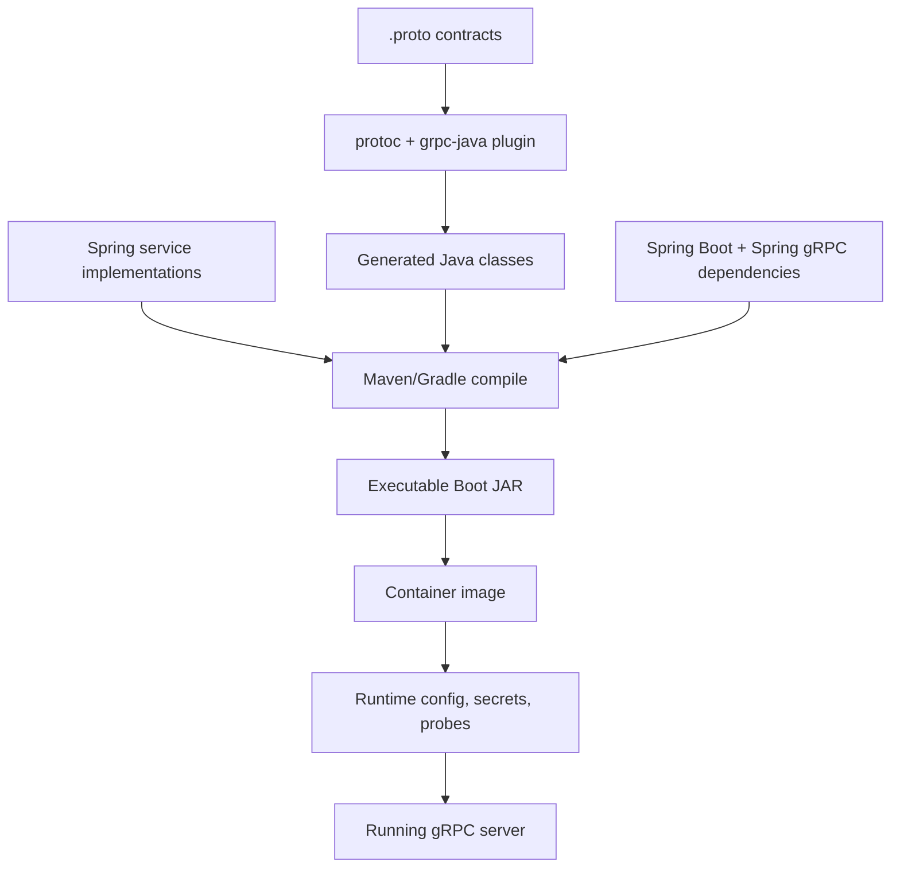

# Packaging a gRPC Server with Spring Boot

## 1. Goals of the Deployment Package

In the SPRING_GRPC module, a Spring Boot application containing gRPC services is deployed as a unit that can be built, run, and released independently. The deployment package must carry the application code, protobuf generated classes, gRPC runtime, and compatible server startup configuration.

When using the Spring gRPC starter, Spring Boot manages the server lifecycle and detects service beans marked with the corresponding annotation. The application does not need to manually create another Netty server in the main method. The common packaging approach is to build an executable Boot JAR, then run the JAR directly or place it inside a container image.

A proper deployment artifact must ensure:

- Contains the application classes and service implementations.
- Contains the protobuf message classes and required generated gRPC stubs.
- Contains compatible runtime libraries: Spring Boot, Spring gRPC, gRPC Java, and Protocol Buffers.
- Keeps port, bind address, TLS, and environment configuration external to the artifact.
- Starts via the Spring Boot entry point and closes the server according to the proper lifecycle.
- Has health/readiness, logging, metrics, and tracing suitable for the operating environment.



## 2. Dependencies and Generated Code Must Be Included in the Build

A gRPC service typically needs three groups of components:

1. Spring Boot and the Spring gRPC starter to create the application context, register services, and manage the server.
2. gRPC Java runtime and Protocol Buffers runtime to handle channels, stubs, messages, and transport.
3. Code generated from proto files, including message classes, service descriptors, and client/server base classes.

Example Maven dependency with centrally managed version:

```xml
<dependency>
    <groupId>org.springframework.grpc</groupId>
    <artifactId>spring-grpc-spring-boot-starter</artifactId>
    <version>SPRING_GRPC_VERSION</version>
</dependency>
```

The artifact name and version must match the Spring gRPC release compatible with the Spring Boot version in use. If the project uses a platform BOM or dependency management, declare the version in the centrally managed location instead of letting each module pick its own version.

The Protocol Buffers plugin must run during the build lifecycle to generate Java sources before compilation. With Maven, configure `protobuf-maven-plugin` together with `protoc` and `protoc-gen-grpc-java`; with Gradle, use the protobuf plugin and declare the corresponding generator. Both generators must be compatible with the runtime libraries.

Generated sources must be compiled into the application artifact. Do not simply copy proto files into the image and expect the server to generate stubs at startup. Code generation belongs to build time, keeping the artifact reproducible and avoiding the need for a compiler in production.

Synchronize the following versions:

- `protoc` compiler;
- `protoc-gen-grpc-java`;
- `protobuf-java`;
- `grpc-api`, `grpc-stub`, and transport implementation;
- Spring gRPC starter;
- Spring Boot and Java runtime.

Do not upgrade an individual gRPC or protobuf library on its own if Spring gRPC dependency management locks a different version set. Inspect the dependency tree whenever `NoSuchMethodError`, `ClassNotFoundException`, or serialization errors occur.

## 3. Registering a gRPC Service in a Spring Application

The service implementation must be managed by Spring so the starter can discover and register it with the server:

```java
import org.springframework.boot.SpringApplication;
import org.springframework.boot.autoconfigure.SpringBootApplication;

@SpringBootApplication
public class CatalogApplication {

    public static void main(String[] args) {
        SpringApplication.run(CatalogApplication.class, args);
    }
}
```

Example service bean:

```java
import io.grpc.stub.StreamObserver;
import org.springframework.grpc.server.service.GrpcService;

@GrpcService
public class CatalogGrpcService
        extends CatalogServiceGrpc.CatalogServiceImplBase {

    private final GetProductUseCase getProductUseCase;

    public CatalogGrpcService(GetProductUseCase getProductUseCase) {
        this.getProductUseCase = getProductUseCase;
    }

    @Override
    public void getProduct(
            GetProductRequest request,
            StreamObserver<GetProductResponse> responseObserver) {
        ProductView product = getProductUseCase.execute(
                new GetProductQuery(request.getProductId()));

        responseObserver.onNext(toResponse(product));
        responseObserver.onCompleted();
    }
}
```

The `GrpcService` annotation registers the service according to the Spring gRPC starter. The import package and auto-configuration mechanism may vary by version; use the API of the exact release in the build. The service must reside within the application's component scan or be explicitly imported. An annotated class outside the scan boundary will not automatically appear in the server.

The Spring Boot main method only initializes the application context. The starter manages the server according to the context lifecycle. Avoid creating an additional `ServerBuilder.forPort` in `main` unless there is a dedicated custom server architecture, as doing so can open two servers, occupy ports, or bypass Spring-managed interceptors and configuration.

## 4. Creating an Executable Spring Boot JAR

Maven needs to run Spring Boot repackage to turn a regular JAR into an executable Boot JAR. When using the Spring Boot parent or corresponding dependency/plugin management, the plugin may already be configured; otherwise, declare the `repackage` goal:

```xml
<build>
    <plugins>
        <plugin>
            <groupId>org.springframework.boot</groupId>
            <artifactId>spring-boot-maven-plugin</artifactId>
            <executions>
                <execution>
                    <goals>
                        <goal>repackage</goal>
                    </goals>
                </execution>
            </executions>
        </plugin>
    </plugins>
</build>
```

The build produces an artifact runnable via the `java -jar` command. A Boot JAR typically contains:

| Component | Typical Location |
| --- | --- |
| Application classes and generated classes | BOOT-INF/classes/ |
| Runtime dependencies | BOOT-INF/lib/ |
| Boot launcher | org/springframework/boot/loader/ |

There is no need to package the JDK, Maven, protoc, or proto sources into the executable JAR for the server to run. Proto files can be stored in the repository or published separately as an API contract artifact if clients need them to generate code or invoke via reflection-less tools.

Do not use a shading/uber-jar plugin to merge all dependencies into a single JAR unless configured compatibly with the Spring Boot loader. An executable Boot JAR already has its own dependency-loading mechanism. The two packaging approaches should not overlap arbitrarily.

## 5. Configuring Separate HTTP and gRPC Ports

Many Spring Boot applications expose both HTTP actuator/management endpoints and gRPC APIs. The two listeners can use different ports:

```yaml
server:
  port: 8080

spring:
  grpc:
    server:
      address: 0.0.0.0
      port: 9090

management:
  server:
    port: 8081
```

The example above uses HTTP application port 8080, gRPC port 9090, and management port 8081. The `spring.grpc.server.*` keys must be verified against the project's Spring gRPC starter version. If the application has no HTTP endpoints, there is no need to add a web server just to run gRPC.

Inside a container, the server must bind to an interface capable of receiving traffic from the container network, usually `0.0.0.0`. Binding to `127.0.0.1` only allows connections local to the container and makes a Kubernetes Service or reverse proxy unable to reach it.

`EXPOSE` in a Dockerfile is only metadata describing the expected port. It does not bind the server, publish the port on the host, or replace listener configuration. The actual port must stay consistent across the application config, container port, Kubernetes Service, and client.

## 6. Packaging into a Container Image

A container image should contain a suitable JRE and the executable Boot JAR. Use a multi-stage build so that Maven/JDK exist only in the build stage:

```dockerfile
FROM maven:3.9-eclipse-temurin-21 AS build
WORKDIR /workspace
COPY pom.xml .
COPY src ./src
RUN mvn -B -DskipTests package

FROM eclipse-temurin:21-jre
WORKDIR /app
COPY --from=build /workspace/target/catalog-service.jar /app/app.jar
USER 10001
EXPOSE 9090
ENTRYPOINT ["java", "-jar", "/app/app.jar"]
```

This is a simplified example; real projects may need to copy the Maven wrapper, parent POM, sibling modules, proto files, or additional build configuration. The JAR name in `COPY` must match the actual `finalName`. The CI pipeline should run tests and verify the artifact before building a release image; the skip-tests flag in the example only shortens the illustrative build stage and is not a release policy.

Several principles for production images:

- Use a JRE compatible with the compiled Java version.
- Run as a non-root user.
- Pin the base image by version or digest in the release process.
- Do not copy source code, build caches, or secrets into the runtime layer.
- Keep the entrypoint simple so the Java process receives `SIGTERM` signals.
- Tag the image with the application version and commit/build metadata.

If the organization uses Cloud Native Buildpacks with the Spring Boot plugin, an image can be built directly from the executable JAR. Whether choosing a Dockerfile or buildpacks, runtime configuration and secrets must still be supplied from the deployment environment.

## 7. Externalizing Configuration

Do not build separate JARs for development, staging, and production just because ports or endpoints differ. Keep the artifact immutable and supply configuration through environment variables, mounted configuration, or a secret manager.

For example, the gRPC server port configuration can be overridden via environment variables following Spring Boot's relaxed binding:

```bash
SPRING_GRPC_SERVER_PORT=9090
SERVER_PORT=8080
```

Variable names must correspond to the actual properties of the Spring gRPC version in use. Do not assume a property exists if the starter changed namespaces between releases.

Commonly externalized values:

- gRPC listen address and port;
- HTTP/management port if present;
- outbound targets and service discovery settings;
- TLS certificate, private key, and trust bundle locations;
- deadline, keepalive, max inbound message size, and connection policy;
- OTLP endpoint, sampling ratio, and resource attributes;
- feature flags and business configuration.

Do not embed credentials, private keys, database passwords, or API tokens into the JAR, Dockerfile, or image layers. Secrets must be mounted or provided through a secret manager with least-privilege read access. Do not print secret values to startup logs.

## 8. TLS and Certificates in Deployment Environments

If the gRPC endpoint is accessed across an untrusted network, configure TLS. With mTLS, the server verifies the client certificate and the client verifies the server certificate against the trust chain.

Certificate/private key files should be mounted at runtime or fetched from a secret manager. The artifact should only contain code that reads configuration and initializes credentials. When certificates rotate, there must be a process to reload or roll out new instances depending on the capabilities of the server/starter.

Items to verify:

- The server certificate has a SAN matching the hostname used by clients.
- The private key is protected with restricted file permissions.
- The client trust store contains the required CA.
- The mTLS policy clearly distinguishes internal endpoints from public endpoints.
- Expiry/rotation is monitored before certificates expire.
- Health checks and diagnostic tools use the proper TLS mode.

The exact TLS property names depend on the Spring gRPC version and transport implementation. Do not guess property names from another version; check the configuration of the starter in use. If TLS is terminated at an ingress/proxy, clearly identify which hops are encrypted and whether the proxy forwards HTTP/2 gRPC properly.

## 9. Health Checks and Readiness

A running Java process does not guarantee that the gRPC server is ready to accept requests. Readiness must reflect at least that the server has bound its listener and essential dependencies are in a serviceable state.

The gRPC Health Checking Protocol with the `grpc.health.v1.Health` service can be used if the application/starter registers and updates that health service. Kubernetes gRPC probes can call the health service directly. Configure the health status to transition to `NOT_SERVING` during shutdown or when the instance should no longer receive traffic.

The Actuator HTTP health endpoint and the gRPC health protocol are two different interfaces. `/actuator/health` returning `UP` does not automatically prove the gRPC listener can accept calls. If using an HTTP probe, verify the gRPC listener separately; a TCP probe only proves the port is open, not that service methods are working.

Distinguish between:

- **Liveness:** the process is alive and not severely deadlocked.
- **Readiness:** the instance can accept new requests.
- **Startup probe:** allows a longer startup time before liveness/readiness probes apply.

Do not include non-essential dependency checks in liveness; a slow database should not cause the orchestrator to continuously restart every instance if the process itself is healthy. Readiness may reflect mandatory dependencies for the specific service.

## 10. Graceful Shutdown and Draining gRPC Connections

When a container receives `SIGTERM`, the application must stop accepting new traffic, give in-flight calls time to finish according to policy, and then close the server. This is critical for streaming RPCs because a stream may live longer than a typical rollout window.

Spring Boot supports lifecycle shutdown for the application context; the Spring gRPC starter manages the server according to its own lifecycle. Verify the behavior of the starter version in use: whether the server stops accepting new calls, waits for in-flight calls, and forces shutdown after a timeout.

Example Spring lifecycle shutdown timeout configuration:

```yaml
spring:
  lifecycle:
    timeout-per-shutdown-phase: 30s
```

This value must align with the orchestrator's termination grace period and the gRPC server's graceful stop capability. Do not assume HTTP graceful shutdown properties automatically drain all gRPC streams if the starter/transport does not integrate that mechanism.

A safe deployment process typically includes:

1. Marking the instance not ready so the load balancer stops sending new requests.
2. Sending the shutdown signal and requesting the server to gracefully stop.
3. Waiting for unary/in-flight RPCs within a bounded timeout.
4. Notifying or closing streaming RPCs per contract so clients reconnect.
5. After the timeout, force-closing any remaining calls.
6. Logging/recording shutdown reason metrics to distinguish normal rollouts from incidents.

Streaming clients need a retry/reconnect policy with backoff and a fresh deadline. Do not assume an interrupted stream can resume from the exact last byte/message unless the protocol defines a resume token or sequence number.

## 11. Resource and Transport Settings

A gRPC server can hold many concurrent connections and streams. The container needs CPU/memory limits suited to concurrency, message sizes, and workload.

Parameters to evaluate via load testing:

- Maximum inbound message size to prevent oversized payloads.
- Permitted number of connections and concurrent calls.
- Executor/event-loop and thread pool sizing.
- Keepalive policy compatible with proxies/load balancers.
- Flow control for streaming and queue limits.
- Deadlines and timeouts for downstream calls.
- JVM heap relative to the container memory limit.

Do not increase thread pools or keepalive settings arbitrarily. Netty uses event loops; blocking database or HTTP calls on the event loop can stall many connections. For blocking use cases, run on an appropriate executor and enforce concurrency limits.

Modern JVMs generally recognize container memory/CPU limits, but check `MaxRAMPercentage`, heap, direct memory, and Netty buffers. Total process memory also includes metaspace, thread stacks, direct buffers, and native allocations, not just Java heap.

## 12. Logging, Metrics, and Tracing After Packaging

Production artifacts need sufficient observability to know whether the server started, whether the listener bound the right port, and how RPCs are being handled.

At a minimum, include:

- Startup logs recording service version, environment, and bound port; do not log secrets.
- Structured logs with trace ID/span ID when context is available.
- Metrics for request count, latency, status codes, active streams, and connection errors.
- OpenTelemetry traces with gRPC server/client instrumentation.
- Exporter endpoint and sampling policy configured outside the artifact.

Do not use the management/actuator port as a substitute for gRPC metrics. An HTTP metrics endpoint can run on a separate port; protect this endpoint with appropriate network policies or authentication.

Verify telemetry in the container after deployment: DNS/egress to the collector, TLS trust, queueing/retries, and resource attributes such as service name/version/environment. Low sampling must not distort aggregate metrics for request/error rates.

## 13. Reproducible Builds and Artifact Management

The same source revision and dependency lock should produce a deterministic artifact. This makes rollbacks and production investigations easier.

Recommended practices:

- Lock plugin and dependency versions; use a controlled BOM.
- Generate protobuf code in the build pipeline rather than generating manually on a developer machine and committing out-of-sync generated files.
- Record the checksum or image digest of released artifacts.
- Include service version/build commit in the manifest and telemetry resource attributes.
- Separate the build stage from the runtime image.
- Scan dependencies and images per the organization's security pipeline.
- Keep proto contracts/versions in source control or an artifact repository so client and server remain compatible.

In multi-module builds, ensure generated classes from the contract module are published or present in the reactor build before building the server. Do not accidentally copy an old JAR into the container due to caches or uncleaned target directories.

## 14. Verifying Artifacts and Containers Before Release

A practical verification procedure:

1. Build from a clean workspace using the exact JDK and dependency management.
2. Confirm generated message/stub classes are compiled.
3. Inspect the JAR to verify it contains `BOOT-INF/classes` and required dependencies in `BOOT-INF/lib`.
4. Run `java -jar` with test configuration and confirm the Spring context and gRPC listener start.
5. Invoke an RPC using the generated stub or `grpcurl`.
6. If using reflection, confirm the reflection service is intentionally enabled; otherwise, call using a proto descriptor.
7. Verify the TLS handshake and mTLS if configured.
8. Verify readiness, shutdown, in-flight unary calls, and streaming cancellation.
9. Run the container with a non-root user and production-like resource limits.
10. Verify logs, metrics, and traces are exported to the proper endpoints.

Example commands to inspect the JAR and server:

```bash
mvn clean package
jar tf target/catalog-service.jar
java -jar target/catalog-service.jar
```

Example calling a unary RPC using a proto file when reflection is disabled:

```bash
grpcurl -plaintext \
  -import-path src/main/proto \
  -proto catalog/v1/catalog.proto \
  -d '{"productId":"p-100"}' \
  localhost:9090 catalog.v1.CatalogService/GetProduct
```

The `plaintext` flag is only for non-TLS test endpoints. With TLS, omit this flag and provide the appropriate CA/client certificates. The package, service, method, and JSON fields in the command must match the actual proto contract. Do not enable reflection publicly just so tools can list services in production.

## 15. Common Pitfalls

1. **Packaging only application classes without the gRPC runtime.** Server fails to start or misses classes. Use Spring Boot repackage and inspect `BOOT-INF/lib`.
2. **Generated stubs not compiled into the artifact.** Service base classes or message classes do not exist at runtime. Run the protobuf plugin in the build lifecycle.
3. **Mismatched `protoc`, `grpc-java`, and runtime versions.** Generated code is incompatible. Manage versions via BOM/plugin management and inspect the dependency tree.
4. **Service bean outside component scan.** JAR runs but no RPC services are registered. Use the right package or import configuration explicitly.
5. **Creating a manual Netty server alongside the starter.** Two listeners conflict or configuration is ignored. Let one server management mechanism own the lifecycle.
6. **Binding to localhost inside a container.** Service cannot receive traffic from outside the container. Bind to an appropriate interface such as `0.0.0.0`.
7. **Confusing `EXPOSE` with port publishing.** Container has port metadata but network routing is not configured. Configure port mapping/Service separately.
8. **Baking certificates/private keys into the image.** Secrets persist in layers and registries. Mount secrets at runtime.
9. **Checking only Actuator health.** HTTP health is UP while the gRPC listener may not be ready. Check gRPC health/readiness separately.
10. **Shutdown drops active streams.** Clients lose subscriptions. Design drain, timeout, and reconnect/resume semantics.
11. **Setting heap too close to the container memory limit.** No room remains for native/direct memory. Account for heap, metaspace, threads, and Netty buffers.
12. **Not testing the final artifact.** Local build succeeds but the image lacks config or generated code. Test the actual built image before release.

## 16. Hands-on Exercise

Package a Catalog gRPC server into a Spring Boot container:

1. Declare the Spring gRPC starter and dependency management compatible with Spring Boot.
2. Configure the protobuf plugin to generate message classes and gRPC service base classes during the build.
3. Create a `GrpcService` implementation discovered by Spring component scan.
4. Configure separate HTTP/management ports and gRPC port; bind the gRPC listener to the container interface.
5. Enable Spring Boot repackage and build an executable JAR.
6. Create a multi-stage image running the JAR as a non-root user.
7. Externalize ports, outbound targets, TLS certificates, and OTLP endpoint; do not include secrets in the artifact.
8. Configure health/readiness and graceful shutdown aligned with the Spring gRPC starter lifecycle.
9. Run the container, invoke one unary RPC and one streaming RPC; verify TLS, cancellation, logs, metrics, and traces per environment.
10. Save the image digest and build metadata so the exact artifact can be rolled back.

**Self-check:** Packaging a gRPC server with Spring Boot means building an executable artifact containing application code, generated protobuf/gRPC classes, and compatible runtime dependencies; the Spring gRPC starter registers service beans and manages the server lifecycle. The artifact should remain immutable across environments, while ports, TLS, secrets, health, and telemetry are configured at runtime. Before releasing, verify the actual JAR/container with real RPCs, readiness, graceful shutdown, and observability.
