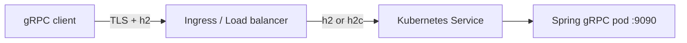

# Exposing HTTP/2 and the gRPC Port

## 1. Objectives

A Spring gRPC server can only be called by external clients when the network path to the server's listener is properly opened. However, opening a TCP port only solves reachability. gRPC requires HTTP/2, so the container runtime, Kubernetes Service, ingress, reverse proxy, load balancer, and firewall must allow the proper protocol.

**Exposing HTTP/2 and the gRPC port** means configuring the listener and network infrastructure so clients can establish a gRPC connection to the Spring service. This involves choosing a port, binding the right network interface, publishing the port from the container, routing through a service/proxy, configuring TLS or h2c, and verifying that HTTP/2 is preserved along the entire path.

After this lesson, you can:

- Distinguish between process, container, Kubernetes Service, and load balancer ports.
- Explain why gRPC requires HTTP/2 instead of just TCP or HTTP/1.1.
- Distinguish between HTTP/2 over TLS (h2) and plaintext HTTP/2 (h2c).
- Configure a listener accessible from outside the container.
- Publish ports via Docker and Kubernetes Services.
- Configure an ingress/reverse proxy to forward gRPC over HTTP/2.
- Test connectivity using `grpcurl` and diagnose protocol/port errors.

## 2. gRPC Requires HTTP/2, Not Just a TCP Port

gRPC uses HTTP/2 as its transport. An RPC is typically represented as an HTTP/2 request with:

- Method `POST`.
- A path containing the full service and method name, for example `/catalog.v1.ProductCatalog/GetProduct`.
- `Content-Type` starting with `application/grpc`.
- gRPC-specific message framing inside HTTP/2 DATA frames.
- The final status transmitted via gRPC trailers.

HTTP/2 allows multiplexing multiple streams over a single TCP connection. Therefore, a single gRPC port can serve multiple services, multiple methods, and many concurrent RPCs. There is no need to open a separate port per method or generated stub.

A TCP port is only the transport entry point. If a proxy accepts TCP and converts the request to HTTP/1.1, the gRPC call is no longer transported with the right protocol. A passing TCP health check also does not prove the upstream can handle HTTP/2/gRPC.

| Component | Role |
|---|---|
| TCP | Network connection to the listener |
| TLS | Encryption and peer authentication when using secure transport |
| ALPN | Application protocol negotiation, typically selecting `h2` for HTTP/2 over TLS |
| HTTP/2 | Stream multiplexing and header/data/trailer transmission |
| gRPC framing | Representation of RPC messages and status |

During deployment, you must verify both the port and the protocol at every hop.

## 3. h2 and h2c

gRPC can run HTTP/2 in two transport modes:

| Mode | Description | Typical Use |
|---|---|---|
| h2 | HTTP/2 over TLS; ALPN negotiates `h2` | Public clients, traffic over untrusted networks |
| h2c | Plaintext HTTP/2, without TLS | Protected internal networks or local/test environments |

With `h2`, the client and server/proxy perform a TLS handshake. ALPN must negotiate `h2`. If the endpoint only supports HTTP/1.1, the client may report a protocol negotiation error or fail to establish a gRPC channel.

With `h2c`, the client typically uses HTTP/2 prior knowledge. This is not simply sending HTTP/1.1 and asking the server to upgrade. The proxy configuration must know the upstream is plaintext gRPC/HTTP2 and forward the right protocol.

Do not enable plaintext just to make probes pass. If traffic traverses the Internet or an untrusted network, use TLS or mTLS according to the security architecture. `h2c` is only appropriate when the trust boundary, network policy, and threat model permit it.

## 4. Choosing a Port and Binding the Listener

gRPC does not require a fixed port number. Port `9090`, `50051`, or another port can be used as long as client, server, and infrastructure agree.

What matters is the bind address. Inside a container, binding to loopback only allows processes in the same network namespace to connect:

```java
// Example of a self-managed gRPC server, not a universal property for every Spring starter.
Server server = ServerBuilder.forPort(9090)
        .addService(catalogService)
        .build()
        .start();
```

The builder above illustrates the port; the server runtime usually binds the wildcard interface by default. For servers or starters with a dedicated bind address configuration, ensure the listener binds to an interface that can receive traffic from the container network, typically `0.0.0.0`, rather than `127.0.0.1`.

In Spring gRPC, the property names for configuring port and address depend on the starter/version. Use the exact configuration of the starter in your project; do not copy a key from another starter and assume it takes effect. Check startup logs or socket listeners to confirm the actual port.

A port configured in the application is not automatically published to the host or cluster. The listener must still be mapped through the container and network service.

## 5. Distinguishing Port Layers

In a containerized deployment, the same gRPC endpoint can appear under multiple port numbers:

| Layer | Example | Meaning |
|---|---:|---|
| Application listener | 9090 | Port that the Spring gRPC server binds inside the process |
| Container port | 9090 | Port declared in the container/deployment spec |
| Host published port | 19090 | Port on the Docker host mapped to the container |
| Kubernetes Service port | 9090 or 443 | Port called by clients inside the cluster |
| Kubernetes targetPort | 9090 | Container port receiving traffic from the Service |
| Ingress/load balancer listener | 443 | Public or edge port receiving TLS/gRPC |

These ports can differ. For example, a client outside the cluster connects to `api.example.com:443`, the ingress forwards to Kubernetes Service port `9090`, and the Service routes to container listener `9090`.

When debugging, note the port at each hop. A `connection refused` error at the host port does not necessarily mean the application listener is wrong; Docker might not have published the port. Conversely, an open host port with a container listener bound only to `127.0.0.1` can also cause forwarding to fail.

## 6. Exposing Ports with Docker

A Dockerfile can declare the port the application uses:

```dockerfile
EXPOSE 9090
```

`EXPOSE` is metadata describing the container's intended port. It does not publish the port to the host or open any firewall.

When running the container, you must publish the port if clients connect from the host:

```bash
docker run --rm -p 9090:9090 my-spring-grpc-service:latest
```

In the example, the port on the left is the host port; the port on the right is the container port. If the host port differs:

```bash
docker run --rm -p 19090:9090 my-spring-grpc-service:latest
```

Clients on the host will call `localhost:19090`, while the application inside the container still listens on `9090`.

If the application binds `127.0.0.1` inside the container, publishing the port still will not allow the container network to reach that listener. Check the bind address and startup logs.

In production, avoid publishing every gRPC port directly to the Internet if traffic must pass through an ingress/load balancer with TLS, authentication, and policies. Only publish according to the chosen network architecture.

## 7. Exposing Ports in Kubernetes

A Kubernetes Deployment declares the container port:

```yaml
apiVersion: apps/v1
kind: Deployment
metadata:
  name: catalog-grpc
spec:
  replicas: 2
  selector:
    matchLabels:
      app: catalog-grpc
  template:
    metadata:
      labels:
        app: catalog-grpc
    spec:
      containers:
        - name: catalog
          image: example/catalog-grpc:1.0.0
          ports:
            - name: grpc
              containerPort: 9090
              protocol: TCP
```

Declaring `containerPort` documents the port and allows components to reference the port name. It does not create a Service or guarantee the listener is open.

A Service provides a stable address inside the cluster:

```yaml
apiVersion: v1
kind: Service
metadata:
  name: catalog-grpc
spec:
  selector:
    app: catalog-grpc
  ports:
    - name: grpc
      port: 9090
      targetPort: grpc
      protocol: TCP
  type: ClusterIP
```

Clients inside the cluster can call the Service DNS name on port `9090`. The Service routes traffic to matching pod endpoints. `targetPort` can reference the container port name `grpc` or port number `9090`.

The gRPC port is TCP. Do not declare UDP for a standard gRPC listener. NetworkPolicy and firewalls must allow TCP from clients/ingress to the required Service/pod port.

If a public endpoint is needed, an Ingress or `LoadBalancer` Service is typically used depending on the infrastructure's gRPC capabilities. Do not assume an arbitrary HTTP ingress automatically supports HTTP/2 upstream.

## 8. Preserving HTTP/2 Through Ingress and Reverse Proxies

A gRPC request can pass through multiple hops:



A proxy may terminate TLS at the edge and open a plaintext HTTP/2 connection to the backend inside a trusted internal network. That model still requires the proxy to use gRPC/HTTP2 upstream. If end-to-end encryption or mTLS to the pod is required, configure TLS for the upstream and the corresponding trust identity.

Check the following:

- The public listener supports gRPC over HTTP/2.
- The TLS listener negotiates ALPN `h2` when using TLS.
- The gRPC route preserves the path and HTTP/2 semantics.
- The upstream protocol is configured as gRPC/HTTP2, not HTTP/1.1.
- The proxy forwards gRPC trailers and status properly.
- The backend `port`/`targetPort` matches the actual listener.
- Idle timeouts and request timeouts suit long-running RPCs and streaming.
- The load balancer does not close valid connections/streams prematurely.

Some ingress controllers use dedicated annotations or backend protocol settings to enable gRPC. Configuration names depend on the product and version. Verify the documentation of the ingress being deployed and inspect the upstream protocol in runtime config; do not apply annotations from one controller to another.

## 9. TLS Termination and Upstream Protocol

Two common patterns:

| Pattern | Client → proxy | Proxy → Spring gRPC | Notes |
|---|---|---|---|
| Terminate TLS at the edge | TLS + h2 | h2c inside private network | Simpler; protect internal hop with network isolation/policies |
| End-to-end TLS or re-encrypt | TLS + h2 | TLS + h2 | Proxy validates backend certificate |

The first pattern is only suitable when proxy-to-pod traffic is trusted under the threat model. If the cluster network is not considered trusted, use mTLS or upstream TLS.

When using upstream TLS:

- The backend certificate must have a SAN matching the DNS/identity verified by the proxy.
- The proxy must trust the CA that issued the certificate.
- A client certificate must be configured if the backend requires mTLS.
- SNI/authority and hostname verification must be consistent.
- Do not disable certificate verification to bypass deployment errors.

Do not confuse client TLS with TLS between the proxy and backend. A client can complete a TLS handshake with the ingress while the ingress fails to reach the backend or uses the wrong upstream protocol.

## 10. Timeouts, Streaming, and Connection Management

gRPC supports long-lived RPCs and streaming. A reverse proxy's default HTTP timeout may cut off a stream even when the application is still working.

Distinguish between:

- **RPC deadline:** time limit set by the client for an RPC.
- **Proxy request/stream timeout:** duration the proxy allows a request/stream to remain open.
- **Idle timeout:** duration a stream/connection has no activity before being closed.
- **Connection max age:** maximum lifetime of an HTTP/2 connection.
- **Keepalive:** frames/probes that maintain or detect unresponsive connections.

Proxy timeouts should not be shorter than valid workloads. For streaming, configuration must consider stream duration, valid idle periods, and client reconnect behavior. Do not set infinite timeouts on all routes because hung connections can hold resources indefinitely.

HTTP/2 multiplexes multiple RPCs on a single connection. Closing a connection can affect many active streams; load balancers must drain connections cleanly during rollouts or scale-downs.

Client/server/proxy keepalive settings must be coordinated. Pinging too frequently may be rejected by the server/proxy or increase load. Keepalive does not replace application health checks and does not prove business dependencies are healthy.

## 11. Firewalls and NetworkPolicy

Opening a port in the application, Docker, or Kubernetes Service does not guarantee all clients can reach it. The network path may still be restricted by:

- Host firewalls or cloud security groups.
- Kubernetes NetworkPolicy.
- Service mesh authorization/network policies.
- Load balancer listeners and backend target groups.
- NAT, routing tables, or DNS.
- Proxy egress policies.

Allow only the required traffic sources to the TCP gRPC port. If clients are only permitted via ingress, do not expose pod ports directly to unnecessary network segments.

When multiple namespaces call the same service, NetworkPolicy must permit the right namespace/pod selectors and ports. Verify both the client-to-server direction and health/monitoring flows if they traverse separate policies.

## 12. Testing with grpcurl

`grpcurl` sends gRPC requests over HTTP/2 and helps verify the endpoint at the protocol level. If the server enables reflection, you can list services:

```bash
grpcurl -plaintext localhost:9090 list
```

If the server does not enable reflection, provide the proto file:

```bash
grpcurl -plaintext -proto catalog.proto -d '{"productId":"p-42"}' localhost:9090 catalog.v1.ProductCatalog/GetProduct
```

With TLS and a custom CA:

```bash
grpcurl -cacert ca.pem -proto catalog.proto -d '{"productId":"p-42"}' catalog.example.internal:443 catalog.v1.ProductCatalog/GetProduct
```

If the server requires mTLS, `grpcurl` can accept a client certificate and private key according to the options of the version in use. Do not leave production private keys in shell history or CI logs.

Results help classify issues:

- `Connection refused`: no listener at the address/port or incorrect forwarding.
- `Deadline exceeded`: server/proxy did not respond within the deadline; investigate hop by hop.
- `TLS/ALPN error`: wrong certificate, hostname, trust, or HTTP/2 negotiation.
- `UNIMPLEMENTED`: transport reached the server, but the method/service is not registered or routed incorrectly.
- `UNAUTHENTICATED`/`PERMISSION_DENIED`: protocol reached the handler/security layer, but identity/permissions were not satisfied.

The `list` command requires server reflection. If reflection is disabled, use a proto descriptor/file and invoke a specific method.

## 13. Additional Network Checks

You can use network tools to inspect individual layers, but do not misinterpret the results:

```bash
# Check TCP reachability
nc -vz catalog.example.internal 443

# Check TLS and ALPN h2
openssl s_client -connect catalog.example.internal:443 -servername catalog.example.internal -alpn h2
```

`nc` only checks TCP. `openssl s_client` can verify the TLS handshake and ALPN; it does not invoke gRPC methods. Only `grpcurl` verifies gRPC request/response at the application level.

Standard `curl` or an HTTP/1.1 health endpoint is not proof that gRPC works. Even HTTP/2-capable `curl` does not construct gRPC message framing, Protobuf payloads, and gRPC trailers without specialized tooling.

Run checks from the right network location. A command run on a laptop may succeed while pod-to-pod traffic is blocked by NetworkPolicy; a command run inside a pod may succeed while the public ingress upstream uses the wrong protocol.

## 14. Common Pitfalls

| Symptom | Cause | Resolution |
|---|---|---|
| TCP port is open but `grpcurl` fails | Listener/proxy does not serve HTTP/2 or gRPC | Check ALPN, upstream protocol, and service route |
| Container runs but host cannot reach it | Only `EXPOSE` declared, port not published | Use appropriate port mapping or Service |
| Docker port mapping exists but connection refused | App binds loopback or listener uses a different port | Bind container interface and verify actual port |
| TLS succeeds but RPC fails with protocol error | Proxy upstream uses HTTP/1.1 | Configure gRPC/HTTP2 upstream |
| Ingress returns 502/503 | Wrong backend port, protocol, or health target | Check `targetPort`, upstream protocol, and endpoint |
| TLS reports hostname mismatch | Certificate SAN does not match endpoint | Issue certificate with right DNS name and keep verification |
| Client fails to negotiate `h2` | ALPN or TLS listener does not support HTTP/2 | Enable HTTP/2 and verify ALPN |
| Unary works but streams drop | Proxy idle/request timeout too short | Adjust timeouts and connection draining |
| Some methods return `UNIMPLEMENTED` | Wrong route/path or service registration | Check full method path and service descriptor |
| Only same-namespace pods can call | NetworkPolicy/security group restricts sources | Open proper TCP source/destination policy |
| TCP probe is green even when app is not ready | Probe only checks listener | Use gRPC health/readiness probe |

## 15. Hands-on Exercise

**Scenario:** A Spring gRPC Catalog server listens on port 9090 inside a container. Internal clients call it via a Kubernetes Service; external clients connect through an ingress with TLS. A server-streaming RPC may last several minutes.

Perform the following:

1. Configure the Spring gRPC listener on port 9090 and verify the bind address can receive traffic from the container network.
2. Declare `containerPort` 9090/TCP and a Kubernetes Service port 9090 pointing to `targetPort: grpc`.
3. Configure the ingress/load balancer listener on port 443 with TLS and HTTP/2.
4. Configure the upstream to the Service using gRPC/HTTP2; choose internal `h2c` or upstream TLS based on the trust boundary.
5. Allow the proper TCP path through firewalls and NetworkPolicy.
6. Tune timeouts/idle timeouts for unary and server-streaming workloads.
7. Use `grpcurl` to call a unary method from an internal pod and through the public ingress.
8. Verify the TLS certificate, hostname, and ALPN `h2` from outside the cluster.
9. Verify long streams are not terminated early by the proxy; test drain behavior during rollout.
10. Run a test TCP probe and demonstrate why it does not replace gRPC health/method testing.

**Completion criteria:** clients reach the right port; every hop preserves HTTP/2; TLS/h2c matches the trust boundary; upstream never downgrades to HTTP/1.1; timeouts suit streaming; firewall/policies open only necessary sources; `grpcurl` succeeds over both internal and ingress paths.

## 16. Key Takeaways

Exposing gRPC is more than opening a TCP port. gRPC requires end-to-end HTTP/2; with TLS, listeners and proxies must negotiate `h2` via ALPN, while `h2c` is only used when the network boundary permits it. Distinguish application ports, container ports, host mappings, Kubernetes Service `port`/`targetPort`, and ingress listeners. Docker `EXPOSE` does not publish ports; `containerPort` does not create a Service. Reverse proxies must use gRPC/HTTP2 upstreams and preserve trailers, paths, and stream semantics. Configure TLS, firewalls, NetworkPolicy, and timeouts hop by hop. Use `grpcurl` to verify real RPCs; `nc` only checks TCP and `openssl` only checks TLS/ALPN. An open port is a necessary condition for connectivity, not sole proof that a gRPC service works.
