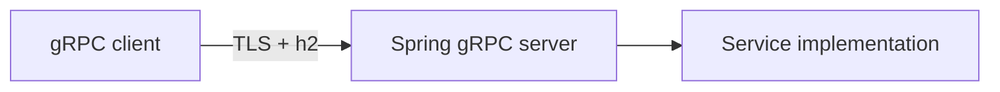
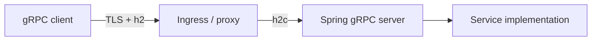
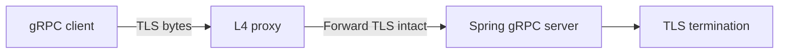
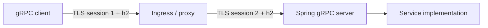

# TLS Termination at the Application or Proxy

## 1. Objectives

gRPC typically runs over HTTP/2 and in production environments should be protected with TLS. When deploying behind an ingress or reverse proxy, you must decide whether TLS is terminated at the Spring gRPC application, at the proxy, or at both hops. This decision affects where private keys live, where clients are authenticated, how internal traffic is encrypted, routing capabilities, and certificate operational ownership.

**TLS termination at the application or proxy** is the choice of which component performs the TLS handshake and decrypts gRPC traffic. There are four common topologies:

- Application termination: direct client TLS to the Spring gRPC server.
- Proxy termination: proxy decrypts TLS from the client and forwards plaintext HTTP/2 to the application.
- TLS passthrough: proxy forwards the TLS stream intact; the application terminates TLS.
- Re-encryption: proxy terminates client TLS, then establishes a new TLS connection to the application.

No single topology is always right for every system. Choose based on trust boundaries, mTLS requirements, network policies, certificate lifecycles, proxy capabilities, and the degree to which internal traffic must be protected.

After this lesson, you can:

- Distinguish between application termination, proxy termination, passthrough, and re-encryption.
- Understand HTTP/2 ALPN, SNI, hostname verification, and upstream protocols.
- Identify where private keys reside and where client identity is verified.
- Design mTLS at the edge or between proxy and application.
- Configure Spring gRPC according to the starter/runtime TLS mechanism.
- Test each hop with `grpcurl` and TLS tools.
- Plan certificate rotation without unexpected RPC disruption.

## 2. What Does TLS Termination Mean?

TLS termination is the point where a component accepts a TLS connection, performs the handshake, verifies certificates per policy, and decrypts application data. After that point, the component can read HTTP/2 headers, gRPC method paths, metadata, and message payloads.

If TLS terminates at the proxy:

1. The client opens a TLS connection to the proxy.
2. The proxy holds the public endpoint's certificate/private key.
3. The proxy decrypts the HTTP/2/gRPC request.
4. The proxy opens an upstream connection to the Spring gRPC server.
5. The upstream can be `h2c` or a new TLS connection.

If TLS terminates at the Spring application, the application holds the certificate/private key and directly authenticates the peer. Any proxy in front of the application must forward TLS intact or operate in TCP passthrough mode.

TLS is not a property that automatically spans every hop. When a proxy decrypts traffic, the client-to-proxy TLS connection ends there. If the proxy opens a new TLS connection to the application, that is a separate TLS session with its own handshake, certificates, and trust decisions.

## 3. Four Common Deployment Topologies

| Topology | Client → proxy | Proxy → application | Where server private key resides |
|---|---|---|---|
| Direct application termination | TLS + HTTP/2 or via TCP passthrough | TLS + HTTP/2 | Spring gRPC application |
| Proxy termination | TLS + HTTP/2 | `h2c` inside trusted internal network | Proxy |
| TLS passthrough | TLS forwarded intact | Same TLS connection to application | Spring gRPC application |
| Re-encryption | TLS + HTTP/2 | New TLS + HTTP/2 | Proxy and application |

### Application Termination



Clients connect directly to the application or through an L4 load balancer that only forwards TCP. The Spring gRPC server performs the TLS handshake and can require a client certificate for mTLS.

The advantage is that the client's TLS identity is authenticated directly by the application. Traffic is not decrypted at an intermediate L7 reverse proxy. In return, certificates/private keys must be distributed and rotated across application instances; an L7 proxy cannot read the method path to route or apply RPC-level gRPC policies.

### Proxy Termination with h2c Upstream



The proxy holds the public certificate, terminates TLS from the client, and forwards plaintext HTTP/2 to the application. This is a common pattern when the proxy and application reside in a protected private network.

Advantages:

- Public certificates are centralized at the ingress/proxy.
- The proxy can apply routing, rate limiting, access policies, and observability per gRPC route.
- The application does not have to hold public private keys on every replica.

The main risk is that proxy-to-application traffic is unencrypted. A private network is not automatically a trusted network. Evaluate cluster boundaries, node access, multi-tenant isolation, packet capture risk, and internal policies before choosing `h2c`.

### TLS Passthrough



The proxy does not decrypt TLS. The Spring gRPC application performs the handshake and holds the server certificate. The proxy usually routes based on address/port or SNI at the TLS ClientHello level and cannot read the gRPC method path inside the encrypted payload.

Passthrough is suitable when you need to preserve client TLS identity to the application or want the application to fully own TLS. The drawback is that the proxy cannot enforce L7 policies that require reading gRPC metadata/paths; some ingress controllers do not support passthrough as needed or only provide limited routing.

### Re-encryption



The proxy terminates TLS from the client, then establishes a new TLS connection to the application. Traffic is encrypted on both hops. The proxy can verify the backend certificate; the application can require mTLS and verify the proxy's identity.

Re-encryption protects internal traffic when proxy-to-pod traverses an untrusted network. However, the application sees the proxy as the TLS peer and does not automatically see the original client certificate. If end-user identity must be preserved, pass identity through a separate trusted mechanism.

## 4. HTTP/2 and ALPN on Each Hop

gRPC requires HTTP/2. With TLS, the client and server/proxy typically use ALPN to negotiate the `h2` protocol during the handshake.

In the proxy termination model:

- Client-to-proxy must support TLS and ALPN `h2`.
- The proxy must accept gRPC/HTTP2 and not downgrade requests to HTTP/1.1.
- Proxy-to-application must be configured as `h2c` or TLS+HTTP/2.

In the re-encryption model, both TLS hops must negotiate HTTP/2 properly. Client-to-proxy success does not prove proxy-to-application is working.

Plaintext HTTP/2 (`h2c`) has no ALPN because there is no TLS handshake. The client/proxy must use proper HTTP/2 prior knowledge mode. Do not confuse HTTP/1.1 Upgrade with gRPC `h2c` upstream configuration.

## 5. SNI, Authority, and Certificate Hostname

A TLS certificate must validate the exact name the client uses to connect. Distinguish three concepts:

- **SNI:** hostname sent by the client in TLS ClientHello so the server can select the appropriate certificate.
- **Certificate SAN:** list of DNS names/IPs certified by the certificate.
- **HTTP/2 authority:** authority of the request, usually corresponding to the hostname and port called by the client.

For example, a client calls `catalog.example.internal:443`. The server certificate needs a SAN matching `catalog.example.internal`; proxy/backend TLS config must use the right SNI/authority when selecting and verifying the certificate.

In re-encryption, the proxy might connect to `catalog-grpc.default.svc.cluster.local:9090` while the backend certificate is issued for `catalog.internal`. Configure server name/authority and SAN verification consistently with the intended identity. Do not disable hostname verification to bypass a mismatch.

SNI helps select a certificate; it does not replace authentication or authorization. A valid certificate only confirms the peer possesses an identity issued by a trusted CA; it does not automatically authorize the peer to call every RPC.

## 6. mTLS at the Edge and Upstream mTLS

mTLS means both sides of a TLS connection verify each other's certificates. However, when proxy termination is present, clarify which connection performs mTLS:

| mTLS Position | Client certificate verified by | Which TLS peer does the application see? |
|---|---|---|
| Client ↔ proxy | Proxy | Proxy, if upstream uses TLS; or no TLS peer if `h2c` |
| Proxy ↔ application | Application | Proxy |
| Client ↔ application via passthrough | Application | Client |
| Client ↔ proxy and proxy ↔ application | Proxy on first hop; application on second hop | Proxy on upstream hop |

If the application must authenticate the end user via certificate while TLS terminates at the proxy, the client certificate does not automatically travel over the upstream connection. The proxy can forward identity information via headers/metadata, but this is only safe when:

1. The proxy strips client-supplied identity headers from inbound requests.
2. The proxy generates headers/metadata itself after authenticating the certificate.
3. The upstream accepts traffic only from authenticated proxies, ideally via mTLS or trusted network identity.
4. The application trusts headers only from authenticated proxies.
5. Identity values are constrained, validated, and appropriately audited.

Do not trust a header like `x-forwarded-client-cert` simply because it appears in a request. A client can spoof it if the proxy fails to strip inbound headers and the application fails to authenticate the upstream source.

If the application must directly verify the original client certificate at the TLS layer, choose passthrough or application termination. If accepting identity assertions from the proxy, design that as a formal trust contract and protect it strictly.

## 7. Configuring TLS in a Spring gRPC Application

When the application is the TLS termination point, the server needs a certificate chain and private key. With the gRPC Java Netty server, the underlying API can be configured as follows:

```java
NettyServerBuilder.forPort(9090)
        .useTransportSecurity(
                certificateChainFile,
                privateKeyFile)
        .addService(catalogService)
        .build()
        .start();
```

This is a gRPC Java example at the server builder level. The Spring gRPC starter may provide properties, SSL bundles, credential beans, or dedicated server customizers. Use the exact API of the installed starter/version; do not assume TLS property names across different starters are identical.

Deployment principles:

- Mount the certificate chain and private key from a secret manager or Kubernetes Secret.
- Restrict private key read permissions to the necessary process.
- Do not commit private keys to source control or container images.
- Use a certificate with a SAN matching the DNS name clients call.
- Define the trust root and client-auth policy if mTLS is enabled.
- Ensure the TLS listener still serves HTTP/2 via ALPN.
- Have a safe reload/restart plan when certificates change.

Do not place private keys or passwords in committed application YAML. YAML should only reference secret/config mounts or a secret provider per the deployment mechanism.

## 8. Configuring Clients to Trust the Server

A gRPC Java client uses TLS channel credentials or a transport security builder:

```java
ManagedChannel channel = ManagedChannelBuilder
        .forAddress("catalog.example.internal", 443)
        .useTransportSecurity()
        .build();
```

With a custom CA or mTLS, configure the trust manager and client key manager using the credential API appropriate for your gRPC Java version. Conceptual example with TLS channel credentials:

```java
ChannelCredentials credentials = TlsChannelCredentials.newBuilder()
        .trustManager(caCertificateFile)
        .keyManager(clientCertificateFile, clientPrivateKeyFile)
        .build();

ManagedChannel channel = Grpc.newChannelBuilder(
        "catalog.example.internal:443",
        credentials)
        .build();
```

Only provide `keyManager` when the server requires a client certificate. The trust manager must verify the server's CA. Do not use an insecure trust manager in production and do not disable hostname verification.

If a proxy terminates TLS, the client verifies the proxy's certificate. If the proxy re-encrypts to the application, the proxy must verify the backend certificate. These two trust configurations are independent and must be managed separately.

## 9. Proxy Termination and h2c Upstream

When using proxy termination with an `h2c` upstream, the proxy configuration must simultaneously:

1. Listen for TLS on the public port.
2. Hold a valid certificate chain and private key.
3. Negotiate ALPN `h2` with clients.
4. Accept and route gRPC method paths.
5. Open a plaintext HTTP/2 upstream to the Spring gRPC port.
6. Preserve gRPC trailers, status, and streaming semantics.

This model is only appropriate when the proxy-to-application network is accepted as a trust boundary. Restrict the upstream with a private network, NetworkPolicy, and proper access controls.

If a service mesh or sidecar automatically encrypts internal traffic, clearly understand which layer terminates TLS and which creates new TLS. Avoid configuring the app for `h2c` when the mesh expects TLS, or configuring the app for TLS when the proxy sends plaintext.

## 10. Re-encryption and Upstream Verification

With re-encryption, the proxy needs configuration for:

- An upstream scheme/protocol supporting gRPC over HTTP/2 TLS.
- A CA bundle to verify the backend certificate.
- Server name/SNI matching the certificate SAN.
- A client certificate/key if the backend requires mTLS.
- Policies to rotate trust bundles and client identities.
- Timeouts and connection draining suitable for streaming.

The application can trust only an internal CA and accept only the proxy/service mesh certificate. Thus, the application authenticates the upstream caller as the proxy identity; end-user authorization requires identity information forwarded by the proxy under a trust contract.

Do not merely enable TLS while skipping verification. Encryption without peer verification does not provide necessary identity authentication and can create a false sense of security.

## 11. Certificate Lifecycle and Rotation

Certificates expire and must be rotated before expiration. Rotation must account for server certificates, client certificates, CA trust bundles, and proxy upstream identities.

A safe procedure:

1. Issue the new certificate and verify SAN, chain, key usage, and expiry.
2. Distribute the new CA/trust bundle first if the CA changes.
3. Configure the proxy/application to pick up the new certificate.
4. Reload or roll out instances via a supported mechanism.
5. Verify the TLS handshake, ALPN `h2`, and a real RPC.
6. Monitor handshake/`UNAVAILABLE` errors and connection draining.
7. Remove the old CA/certificate only after all clients/upstreams have migrated.

Do not assume every gRPC server automatically reloads certificate files when mounted files change. Many runtimes read certificates only at server startup; a restart/rollout or a supported custom certificate provider is needed. Check the behavior of the actual server builder/starter.

When rolling out application TLS, instances with old and new certificates can run side by side during the transition if the trust chain allows. For long-lived HTTP/2 connections, existing connections may keep using the established TLS session; drain according to policy so clients open new connections with the new certificate.

## 12. Choosing a Topology Based on Requirements

| Requirement | Commonly Suitable Topology | Considerations |
|---|---|---|
| Application must directly verify client certificates | Application termination or passthrough | App manages private keys and trust store |
| Centralize public certificates and L7 routing | Proxy termination | `h2c` upstream only when the private network is trusted |
| Encrypt both client-to-edge and edge-to-app | Re-encryption | Two TLS sessions and two trust policies |
| Proxy must not read gRPC payloads | TLS passthrough | Limits L7 routing and observability at the proxy |
| Multiple app replicas, public certificate managed by ingress | Proxy termination or re-encryption | Must protect upstream and verify identity |
| Service mesh already manages internal mTLS | Proxy/mesh termination per mesh architecture | Avoid overlapping TLS layers with unclear ownership |

The decision should explicitly document:

- The TLS termination point.
- The protocol at each hop: `h2`, `h2c`, or TLS+HTTP/2.
- Who owns certificates/private keys.
- Who verifies client certificates.
- What identity the application receives.
- Which CA/trust bundle is trusted.
- Who is responsible for rotation and reload.

## 13. Testing and Diagnostics

### Checking TLS and ALPN

```bash
openssl s_client \
  -connect catalog.example.internal:443 \
  -servername catalog.example.internal \
  -alpn h2
```

The output should verify the certificate chain, hostname/SNI, and negotiated protocol `h2`. This command does not prove gRPC methods are registered.

### Calling an RPC over TLS

```bash
grpcurl -cacert ca.pem \
  -proto catalog.proto \
  -d '{"productId":"p-42"}' \
  catalog.example.internal:443 \
  catalog.v1.ProductCatalog/GetProduct
```

With mTLS, provide the client certificate/key using the appropriate options for your `grpcurl` version. Do not put production private keys in command history or CI logs.

### Testing the Upstream Separately

Run `grpcurl` from a network namespace or pod that shares the same path to the upstream as the proxy. If edge TLS succeeds but upstream calls fail, check:

- Whether the proxy uses the right `h2c` or TLS+HTTP/2 mode.
- Whether the backend port and DNS are correct.
- Whether SAN/SNI/authority match.
- Whether the proxy trusts the right backend CA.
- Whether the backend requires a client certificate.
- Whether NetworkPolicy allows the proxy to reach the application.

### Minimum Test Matrix

| Test | Proxy termination | App termination/passthrough | Re-encryption |
|---|---|---|---|
| Client TLS + ALPN `h2` | Required | Required if client connects via TLS directly | Required |
| Upstream protocol | Verify `h2c` or TLS | TLS forwarded | TLS+HTTP/2 |
| Server certificate | Proxy certificate | Application certificate | Proxy and application certificates |
| mTLS client identity | Verified at proxy | Verified at application | Verified at proxy; upstream verifies proxy |
| gRPC unary/streaming | Call through proxy | Call via app endpoint | Call across both TLS hops |
| Rotation | Proxy cert/trust | App cert/trust | Both hops |

## 14. Common Pitfalls

| Symptom | Cause | Resolution |
|---|---|---|
| TLS handshake succeeds but RPC fails | Upstream proxy uses wrong protocol | Configure gRPC/HTTP/2 upstream |
| ALPN does not select `h2` | Listener supports only HTTP/1.1 or wrong TLS config | Enable HTTP/2 and verify ALPN |
| Certificate hostname mismatch | SAN does not match DNS/SNI/authority | Issue certificate with right identity and keep hostname verification |
| Proxy calls to backend return `UNAVAILABLE` | Wrong backend port, route, network, or upstream TLS | Inspect each hop from the proxy network |
| Application does not see original client certificate | TLS terminates at proxy | Use passthrough/app termination or protected identity assertions |
| Client-supplied header trusted as certificate identity | Proxy fails to strip inbound header or app fails to verify proxy | Strip and regenerate metadata after authentication; protect upstream |
| `h2c` rejected | Proxy/backend expects TLS or uses HTTP/1.1 | Align upstream mode and HTTP/2 prior knowledge |
| Re-encryption trust error | Proxy does not trust backend CA or wrong SAN | Configure CA, SNI, and hostname verification |
| New certificate does not take effect | Runtime does not auto-reload files | Use a supported reload mechanism or rollout |
| Streams drop during rotation | Old connections closed abruptly | Drain HTTP/2 connections and set a grace period |
| TLS works at edge but internal traffic leaks plaintext | `h2c` chosen outside trust boundary | Re-encrypt or use mTLS/service mesh |

## 15. Hands-on Exercise

**Scenario:** Catalog gRPC is deployed on Kubernetes. External clients connect through a TLS ingress. The security team requires traffic from the ingress to the application to also be encrypted and the application to accept only authenticated proxy workloads. The application needs to know the end-user identity verified at the edge.

Perform the following:

1. Choose the re-encryption topology and clearly diagram the two TLS sessions.
2. Configure the ingress public certificate and ALPN `h2`.
3. Configure upstream TLS+HTTP/2 to the Spring gRPC server.
4. Issue a backend certificate with an appropriate SAN and configure the ingress to trust the CA.
5. Enable upstream mTLS if the application must authenticate the proxy workload.
6. Design a mechanism to forward end-user identity from the proxy after the proxy authenticates the client; strip client-supplied headers.
7. Configure the Spring gRPC server to trust only the selected upstream CA/identity.
8. Verify the application does not treat identity metadata as trustworthy if a request does not come from an authenticated proxy.
9. Test TLS/ALPN at the edge, TLS trust on the upstream, and unary and streaming RPCs.
10. Simulate certificate rotation and verify connection draining does not drop calls outside policy.

**Completion criteria:** both hops use HTTP/2; certificates are verified at each hop; the application authenticates the proxy identity; end-user identity is accepted only from trusted assertions; certificates/private keys have clear owners and a rotation plan; gRPC status/streaming work through the proxy.

## 16. Key Takeaways

TLS termination determines where gRPC traffic is decrypted and where TLS peers are authenticated. Application termination or passthrough keeps TLS all the way to the Spring server; proxy termination centralizes certificates and L7 routing, though `h2c` upstream is unencrypted; re-encryption creates a second TLS session to protect internal traffic. Every hop must preserve HTTP/2, with ALPN `h2` on TLS connections. SNI, SAN, and authority must match. mTLS at the edge does not automatically forward client certificates to the application; if passing identity assertions via metadata, trust them only after proxy authentication, stripping inbound headers, and protecting the upstream. Manage certificates, trust bundles, rotation, and connection draining across the lifecycle. Test TLS/ALPN, upstream trust, and gRPC RPCs separately; a passing TLS handshake at the edge does not prove the entire path is healthy.
