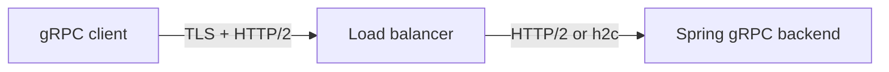
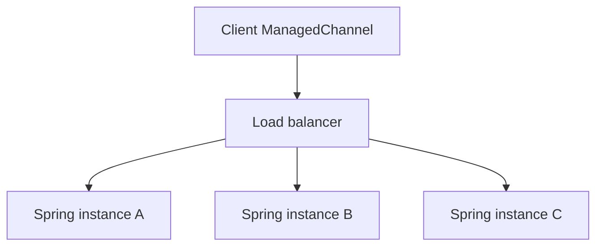
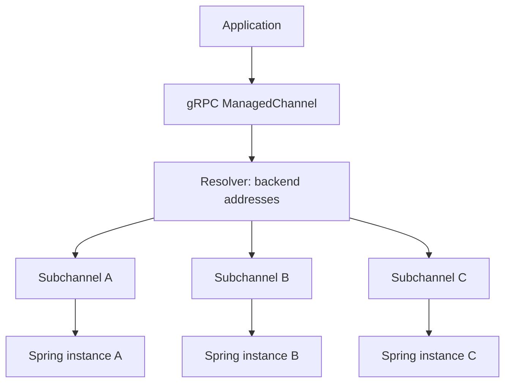

# Load Balancers Supporting HTTP/2

## 1. Objectives

gRPC uses HTTP/2 to transport RPCs. When deploying multiple Spring gRPC instances, the load balancer must distribute traffic to backends while preserving HTTP/2, gRPC framing, trailers, and streaming semantics. Enabling HTTP/2 only on the client-facing listener is not enough: if the load balancer terminates HTTP/2 and connects to the backend over HTTP/1.1, RPCs can fail.

A **load balancer supporting HTTP/2** is one capable of accepting or forwarding HTTP/2 according to the topology, while properly handling gRPC connections and streams. You must determine whether it operates at Layer 4 (TCP) or Layer 7 (HTTP/2-aware), whether HTTP/2 is used on the frontend or also upstream, and whether the balancing unit is the connection or each RPC stream.

After this lesson, you can:

- Distinguish TCP/L4 load balancing from HTTP/2-aware L7 load balancing.
- Verify HTTP/2 on both the client-facing listener and the backend upstream.
- Understand how HTTP/2 multiplexing affects load distribution.
- Choose server-side or client-side gRPC load balancing.
- Configure service discovery suitable for DNS, Kubernetes, and resolvers.
- Design health checks, timeouts, streaming, and connection draining.
- Test the load balancer with real RPCs and observe load distribution.

## 2. Why Must the Load Balancer Understand HTTP/2?

A gRPC call is transmitted within an HTTP/2 stream. The request uses method `POST`, a path containing the service/method, gRPC content type, and gRPC-specific message framing. The response may consist of multiple DATA frames and ends with the gRPC status in trailers.

HTTP/2 multiplexes multiple streams over a single TCP connection. For example, a client creates one `ManagedChannel` to the load balancer; that channel can send hundreds of concurrent RPCs over the same connection. If the load balancer only balances TCP connections, all streams on that connection typically go to the same backend.

Therefore, distinguish between:

- **Connection balancing:** selecting a backend when the TCP connection is established.
- **RPC/stream balancing:** selecting a backend for each HTTP/2 stream or RPC.

A TCP load balancer can still forward valid gRPC because it forwards TCP bytes without needing to understand HTTP/2. However, it cannot inspect the method path, gRPC metadata, or distribute individual RPCs within the same connection. An HTTP/2-aware L7 proxy can balance per stream, depending on the product and configuration.

## 3. L4 TCP vs. L7 HTTP/2-Aware

| Characteristic | L4 TCP load balancer | L7 HTTP/2-aware load balancer |
|---|---|---|
| Typical balancing unit | TCP connection | HTTP/2 stream/RPC or connection depending on mode |
| Understands gRPC method path | No | Possible |
| Reads HTTP/2 headers/trailers | No | Yes |
| TLS termination | Usually passthrough; some products support TLS offload | Usually can terminate TLS |
| Streaming | Forwards TCP stream | Must support gRPC streaming and flow control |
| Per-RPC retry | Does not understand RPC semantics | May support, but must be configured safely |
| Level of intervention | Minimal protocol modification | Can rewrite/route/apply timeouts per request |

L4 is suitable when you want to pass TLS through to the application, preserve end-to-end TLS identity, or use client-side load balancing. It is simple and touches payloads minimally, though load distribution can skew when some clients hold long-lived HTTP/2 connections.

L7 is suitable when you need routing by service/method, health-aware backend selection, observability, or per-RPC balancing. In return, the proxy becomes an HTTP/2-processing hop and requires careful configuration of timeouts, buffering, flow control, TLS, and connection draining.

Do not conclude a load balancer supports gRPC solely because its documentation says "HTTP/2 enabled". Verify the gRPC frontend, upstream protocol, and streaming behavior.

## 4. HTTP/2 Must Be Configured on Both Hops

When the load balancer terminates TLS, there are two independent connections:



The frontend can use TLS and ALPN `h2`. The upstream can use:

- Plaintext HTTP/2 (`h2c`) inside a trusted network boundary.
- TLS + HTTP/2 when encryption or mTLS to the backend is required.

If the frontend uses HTTP/2 while the upstream is configured for HTTP/1.1, the proxy may return protocol errors, 502/503, or unexpected gRPC statuses. gRPC trailers may also be lost if the proxy treats the upstream as a regular HTTP request.

With TLS passthrough at L4, the load balancer does not terminate HTTP/2. It only forwards TCP; TLS and HTTP/2 are negotiated directly between the client and the Spring server. This still serves gRPC, but without L7 per-RPC routing.

In any topology, verify:

1. The client connects to the right listener.
2. The TLS listener negotiates ALPN `h2` if using TLS.
3. The proxy treats the frontend as gRPC/HTTP2.
4. The upstream protocol is `h2c` or TLS+HTTP/2 matching the backend.
5. gRPC trailers, status, and streaming are preserved.

## 5. HTTP/2 Multiplexing Can Cause Load Skew

Suppose there are three backends A, B, and C. There are 100 clients, each opening one HTTP/2 connection to an L4 load balancer and sending 100 RPCs over that connection. If L4 chooses a backend once at connection open, each client is pinned to one backend. RPCs on the same connection are not redistributed.

If there are only a few clients but each sends many RPCs, one backend may receive most of the load even though the number of connections across backends looks balanced.

An L7 HTTP/2-aware proxy can pick a backend per RPC stream, distributing short unary RPCs much more evenly. However, a long-lived stream still occupies a backend for the lifetime of the RPC; an in-flight stream cannot be migrated mid-stream to another backend.

For streaming:

- Server-streaming may hold a backend for several minutes or longer.
- Client-streaming and bidirectional streaming keep call state on the backend.
- Retrying or switching backends mid-stream is usually unsafe once messages have been sent/received.
- Rollouts must drain active streams or allow them to finish within a deadline.

Do not evaluate load distribution solely by TCP connection count. Monitor RPC count, request rate, active streams, latency, and CPU/memory load per backend.

## 6. Server-Side and Client-Side Load Balancing

### Server-Side Load Balancing

The client only knows a single load balancer endpoint. The load balancer picks the backend:



The advantages are a simple client and centralized backend discovery. The load balancer can apply health checks, routing, rate limiting, and shared policies. You must control connection reuse, stream distribution, timeouts, and the proxy's gRPC capabilities.

### Client-Side Load Balancing

The client receives multiple backend addresses from a name resolver/service discovery. The gRPC channel creates subchannels and selects a backend according to a load balancing policy:



Client-side balancing distributes calls directly to backends, removing an L7 proxy hop. In return, the client needs a reliable resolver and service discovery, health policies, handling of address updates, and per-subchannel observability.

gRPC Java includes policies such as `pick_first` and `round_robin` depending on resolver/runtime/version. `pick_first` typically picks one available address; `round_robin` distributes calls across addresses/subchannels in the `READY` state. The policy must be configured and supported by the resolver; do not assume simply having multiple pods makes the client aware of all pods.

## 7. DNS and Kubernetes Service Discovery

In Kubernetes, DNS for a `ClusterIP` Service typically returns a single virtual IP. A client-side resolver sees one Service address, not the list of pods. Kube-proxy or the dataplane picks a pod when the connection is established; because HTTP/2 keeps connections long-lived, many RPCs on the channel may keep going to the same pod.

A headless Service can return pod IPs. When the DNS resolver and gRPC client are configured appropriately, client-side load balancing can see multiple backend addresses.

| Kubernetes discovery | What the resolver typically sees | Impact |
|---|---|---|
| ClusterIP Service | One virtual IP | Balancing usually happens at the connection/network layer |
| Headless Service | List of pod IPs via DNS | Can support client-side balancing |
| xDS/service mesh control plane | Endpoints and policies provided by control plane | Can support health-aware, locality-aware, and centralized policies |

Headless DNS has caching and TTL; the address list does not necessarily update instantaneously when pods change. Verify resolver refresh behavior, DNS TTL, readiness, and how gRPC Java handles address removal.

If using a service mesh, clarify where the mesh sidecar performs balancing. Avoid enabling multiple load-balancing layers simultaneously with conflicting policies without understanding the connection path.

## 8. Configuring Client-Side `round_robin` in gRPC Java

Example service config expressing the policy:

```json
{
  "loadBalancingConfig": [
    {
      "round_robin": {}
    }
  ]
}
```

With a resolver returning multiple backend addresses, you can provide the service config to the channel:

```java
Map<String, Object> serviceConfig = Map.of(
        "loadBalancingConfig",
        List.of(Map.of("round_robin", Map.of())));

ManagedChannel channel = ManagedChannelBuilder
        .forTarget("dns:///catalog-grpc.default.svc.cluster.local:9090")
        .defaultServiceConfig(serviceConfig)
        .build();
```

This is a gRPC Java API example; capabilities and policy names must match the runtime version. The DNS target must actually resolve to multiple backend addresses for `round_robin` to distribute across pods. If the target only returns a `ClusterIP`, the client does not see individual pods.

Service config can be returned by the resolver and takes precedence according to gRPC's mechanism. When configuring `defaultServiceConfig`, verify the behavior when the resolver provides a different config and the fallback policy when a policy is unavailable.

Do not write a custom resolver or update the address list from the pod API without comprehensive handling for auth, watches, expiry, removal, and backoff. Prefer DNS, xDS, or supported service discovery integrations.

## 9. Health-Aware Backend Selection

A load balancer must know which backends are eligible to receive traffic. A successful TCP connect does not prove the service is ready. With gRPC, you can use the gRPC Health Checking protocol or an equivalent health probe supported by the infrastructure.

Principles:

- Add a backend to the pool only after readiness succeeds.
- Remove `NOT_SERVING` backends from new traffic.
- Distinguish liveness from readiness; dependency outages should not automatically trigger a restart storm.
- Health checks must have reasonable timeouts and intervals.
- Use the exact service name matching the Protobuf package/service.
- When the health endpoint is unsupported, explicitly document the substitute probe and its limitations.

An L4 load balancer might only check TCP. It will not understand gRPC `SERVING` without a dedicated health integration. An L7 proxy can invoke the health RPC or use an endpoint probe, depending on its capabilities.

If the load balancer uses a separate HTTP health check, do not treat that result as equivalent to a gRPC Health Check. Ensure the health signal reflects the same readiness policy as the application.

## 10. Timeouts, Keepalive, and Streaming

Timeouts must be coordinated across the client, load balancer, and server:

| Setting | Scope | Purpose |
|---|---|---|
| RPC deadline | One RPC | Limits total call duration |
| Backend request timeout | One request/stream at the proxy | Limits how long the proxy holds an RPC |
| Idle timeout | Connection or stream | Closes inactive resources |
| Connection max age | HTTP/2 connection | Rotates connections periodically |
| Keepalive | HTTP/2 connection | Detects unresponsive connections |
| Drain grace period | Backend/connection | Allows current RPCs to finish when retiring a backend |

A proxy timeout shorter than a valid deadline will cut off the RPC before the client deadline expires. For streaming, idle periods between messages can be valid; an overly low idle timeout will drop the stream even while the application is healthy.

Keepalive pings must align with server and load balancer policies. Pinging too frequently may be rejected or create load. Keepalive does not replace business health checks.

Do not set all timeouts to infinity. Non-terminating streams can hold connections, memory, and backend capacity indefinitely. Design deadlines, cancellation, and maximum stream duration per use case.

## 11. Connection Draining and Rollouts

During scale-down or rollout, the load balancer must stop sending new RPCs to the terminating backend while allowing in-flight calls to finish within limits.

Typical sequence:

1. The backend transitions readiness to `NOT_SERVING`.
2. The load balancer stops selecting the backend for new RPCs.
3. The backend or proxy begins draining connections/streams per the supported mechanism.
4. The HTTP/2 server may send `GOAWAY` to tell clients not to create new streams on the old connection.
5. In-flight RPCs complete or are cancelled when the grace period expires.
6. The process stops after the server/channel has drained or the shutdown deadline expires.

`GOAWAY` is an HTTP/2 connection-level signal; clients can open a new connection and retry eligible calls. It does not guarantee all in-flight RPCs are automatically migrated to another backend. Streams that have already sent messages usually cannot be safely retried like an idempotent unary call.

The Kubernetes termination grace period, `preStop` hook, readiness propagation, and server shutdown timeout must be coordinated. If a pod is killed immediately after readiness changes, the load balancer may not have updated its endpoints yet and new calls will still arrive at the pod.

## 12. Retries and Load Balancing

A load balancer or gRPC client may retry certain RPCs according to policy, but retries must consider:

- Whether the RPC is idempotent.
- Whether the server has already processed the request.
- Whether enough remaining deadline exists.
- Whether the status code is in the retryable set.
- Whether backoff and jitter are applied.
- Whether retries will further overload the backend.
- Whether the RPC involves streaming or partial side effects.

Do not automatically retry every `UNAVAILABLE`. For read-only unary calls, retries may be appropriate if policy and deadline allow. For create/update or streaming, define idempotency keys, deduplication, or clear semantics before retrying.

An L7 load balancer cannot always know whether an operation has side effects. The application contract and client retry policy must define that.

## 13. Security and Observability

The load balancer sits on the network path and must be protected:

- TLS certificates and private keys stored in a secret store, with clear owners and a rotation plan.
- Upstream TLS/mTLS if internal traffic requires encryption and workload authentication.
- SNI, SAN, and hostname verification must be correct.
- Do not trust forwarded identity metadata unless the proxy authenticates clients and strips forged headers.
- Allow only necessary traffic sources to backend ports.
- NetworkPolicy/security groups must permit the exact path: client to load balancer, then load balancer to backend; with client-side balancing, clients need access to the backend addresses published by the resolver.
- Restrict administrative/configuration access to the load balancer.

Monitor both connection metrics and RPC metrics:

- Number of TCP/HTTP2 connections per backend.
- Number of active HTTP/2 streams and active RPCs.
- RPC count by service/method/status.
- Request rate, error rate, and latency percentiles per backend.
- Number of healthy/ready backends.
- TLS handshake failures and upstream protocol errors.
- Stream duration, cancellations, and connection drain outcomes.
- Retry count and retry exhaustion.

If connection counts are balanced while RPC counts or CPU are skewed, HTTP/2 multiplexing may be pinning many RPCs onto a few connections. If the frontend succeeds while the upstream fails, check metrics/proxy logs at each hop.

## 14. Testing the Load Balancer

### Verifying HTTP/2 and TLS

```bash
openssl s_client \
  -connect catalog.example.internal:443 \
  -servername catalog.example.internal \
  -alpn h2
```

Verify the negotiated protocol is `h2` and the certificate is valid. This command only tests TLS/ALPN and does not prove backend gRPC methods work.

### Calling a Real RPC

```bash
grpcurl -cacert ca.pem \
  -proto catalog.proto \
  -d '{"productId":"p-42"}' \
  catalog.example.internal:443 \
  catalog.v1.ProductCatalog/GetProduct
```

Call through the load balancer, not only directly to a pod. For streaming, run tests with durations and idle gaps similar to real workloads.

### Checking Backend Distribution

A fake/test backend can return an instance ID in the response or log request IDs on each instance. Send multiple RPCs from:

- A single channel to observe connection affinity.
- Multiple channels/clients to test connection distribution.
- Client-side `round_robin` with a resolver returning multiple addresses.
- Long streams to verify backends hold streams.

Measure RPCs per backend, not only connection counts. Run long enough to eliminate warm-up and DNS cache effects.

## 15. Common Pitfalls

| Symptom | Cause | Resolution |
|---|---|---|
| Client TLS succeeds but gRPC fails | Upstream does not use HTTP/2 | Configure backend protocol `h2c` or TLS+HTTP/2 |
| One backend receives nearly all RPCs | L4 balances connections, client multiplexes many streams | Use L7 stream balancing or client-side LB |
| `round_robin` does not distribute across pods | Resolver sees only `ClusterIP` | Use headless DNS, xDS, or a resolver returning multiple endpoints |
| Unary works but streaming drops | Idle/request timeout too short | Adjust timeouts and test long streams |
| Shutting-down backend still receives requests | Slow readiness propagation/drain | Update status early, configure endpoint removal and grace period |
| Upstream TLS errors | Wrong CA, SAN, SNI, or client identity | Verify trust and hostname verification at each hop |
| Retries create duplicate records | Non-idempotent operation | Use idempotency keys/deduplication and retry policies |
| Health is green but RPCs fail | Probe only checks TCP or uses wrong service name | Use appropriate gRPC health/method probes |
| Connection counts balanced but CPU skewed | Uneven RPC counts/stream durations | Monitor RPCs and active streams per backend |
| Rollout drops streams | Backend killed before drain finishes | Use `GOAWAY`, readiness, grace period, and cancellation policy |

## 16. Hands-on Exercise

**Scenario:** Catalog has three Spring gRPC replicas in Kubernetes. A client creates one `ManagedChannel` and sends many unary RPCs along with a long-running server-streaming RPC. An L4 load balancer is distributing connections, yet one replica receives most of the requests.

Perform the following:

1. Determine whether the load balancer operates at L4 or L7 and whether the balancing unit is the connection or the RPC.
2. Verify frontend TLS/ALPN `h2` and backend upstream HTTP/2.
3. Measure connection count, RPC count, active streams, and CPU on each replica.
4. Compare L4 connection balancing with HTTP/2-aware stream balancing.
5. If using client-side LB, configure a resolver returning multiple pod endpoints and choose an appropriate policy.
6. Verify Kubernetes `ClusterIP` and headless Services produce different address lists.
7. Configure gRPC health/readiness to exclude unready backends.
8. Tune RPC deadlines, proxy timeouts, and idle timeouts for streaming.
9. Roll out one replica and verify readiness removal, `GOAWAY`/draining, and the grace period.
10. Verify retries apply only to safe RPCs with remaining deadline.

**Completion criteria:** every hop uses proper HTTP/2; clear distinction between connection balancing and RPC balancing; backend selection reflects readiness; streaming does not time out outside policy; rollout draining is controlled; metrics prove RPC distribution rather than only TCP connection distribution.

## 17. Key Takeaways

A load balancer for gRPC must preserve HTTP/2 and gRPC semantics on both the frontend and upstream. L4 TCP can forward gRPC, but only balances connections; due to HTTP/2 multiplexing, a long-lived connection can concentrate many RPCs on a single backend. HTTP/2-aware L7 can balance per stream, but must support trailers, flow control, and streaming. Client-side balancing requires a resolver that actually returns multiple endpoints; Kubernetes `ClusterIP` typically exposes only one virtual IP to clients, whereas a headless Service or xDS can provide pod addresses. Readiness, timeouts, retries, and connection draining must be coordinated. Evaluate using RPC count, active streams, latency, and backend load; TCP connection count alone does not prove balanced load distribution.
