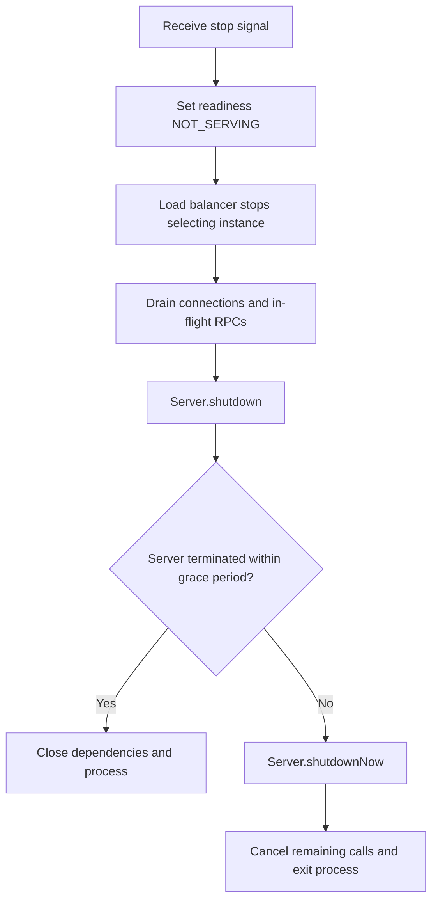

# Graceful Shutdown

## 1. Objectives

When deploying Spring gRPC, an instance may be stopped due to a rollout, scale-down, node drain, or application restart. If the process terminates immediately, in-flight RPCs can be severed, streams lose connectivity, and clients receive errors even when requests were partially processed.

**Graceful shutdown** is the process of stopping acceptance of new RPCs, signaling that the instance is no longer ready, giving in-flight calls time to complete, and then closing the gRPC server and process. If the allowed time expires, the system transitions to a forced shutdown so it does not exceed the platform's termination deadline.

The process must coordinate the application lifecycle, gRPC server, health status, load balancer/orchestrator, HTTP/2 connections, and client retry/resume policies. Calling shutdown at the end of the process without draining traffic beforehand can drop new requests during the window before routing updates.

After this lesson, you can:

- Distinguish graceful shutdown from forced shutdown.
- Use `Server.shutdown()`, `awaitTermination()`, and `shutdownNow()` in the right order.
- Transition gRPC health/readiness to `NOT_SERVING` before stopping the listener.
- Understand the role of HTTP/2 `GOAWAY` and connection draining.
- Handle in-flight unary, server-streaming, client-streaming, and bidirectional RPCs.
- Coordinate the Spring lifecycle with Kubernetes `SIGTERM` and the termination grace period.
- Design client retry/resume behavior and test the shutdown process.

## 2. What Happens If You Stop the Server Immediately?

A gRPC server may be serving multiple concurrent RPCs over a single HTTP/2 connection. When the process is killed or the server is force-shut down:

- Unary RPCs may fail even though the server already executed part of the business logic.
- Server-streaming may be cut off before sending the final message.
- Client-streaming may lose unacknowledged data.
- Bidirectional streams may lose both active directions.
- Clients may receive `UNAVAILABLE`, `CANCELLED`, or transport errors depending on timing and cause.
- If a client retries an operation with side effects, business logic may execute twice.

Therefore, shutdown must be treated as a service state transition. Before closing the listener, the system must stop routing new requests to the instance and give existing calls time to finish.

## 3. Phases of Graceful Shutdown

A general sequence:



Key phases:

1. **Begin draining:** receive `SIGTERM`, rollout command, or application context close signal.
2. **Stop accepting new traffic:** health service publishes `NOT_SERVING` and readiness endpoints transition state.
3. **Wait for routing updates:** load balancer, Kubernetes `EndpointSlice`, or service discovery removes the instance from the pool.
4. **Close server gracefully:** server stops accepting new calls and allows accepted calls to finish.
5. **Wait for termination:** wait within a bounded duration.
6. **Force shutdown if needed:** cancel remaining calls when the grace period expires.
7. **Release resources:** close executors, database clients, and dependencies in ownership order.

The exact ordering between readiness removal and `Server.shutdown` depends on the architecture. With a server-side load balancer, publish `NOT_SERVING` and give the routing system time to update before closing the listener. Once `server.shutdown()` is called, the server stops accepting new RPCs; requests arriving during the race window may fail.

## 4. Graceful Shutdown in gRPC Java

gRPC Java provides three key APIs:

| API | Behavior |
|---|---|
| `Server.shutdown()` | Initiates graceful shutdown, stops accepting new RPCs, and gives in-flight calls a chance to complete |
| `Server.awaitTermination(timeout, unit)` | Waits for the server to terminate within a bounded duration |
| `Server.shutdownNow()` | Requests cancellation of active calls and stops the server more aggressively |

Example helper:

```java
static void shutdownGracefully(
        Server server,
        Duration gracePeriod) {

    server.shutdown();
    try {
        boolean terminated = server.awaitTermination(
                gracePeriod.toMillis(),
                TimeUnit.MILLISECONDS);

        if (!terminated) {
            server.shutdownNow();
            server.awaitTermination(5, TimeUnit.SECONDS);
        }
    } catch (InterruptedException ex) {
        server.shutdownNow();
        Thread.currentThread().interrupt();
    }
}
```

This snippet illustrates an application-managed server. In the Spring gRPC starter, the server may be created and owned by the framework. In that case, use the lifecycle/shutdown hooks provided by the starter; do not create a second `Server` or call shutdown directly from a gateway.

`shutdown()` does not guarantee all RPCs will finish in a fixed period. A stream can be long-lived or a handler may be stuck. Hence, a bounded grace period and a forced shutdown fallback are required.

`awaitTermination()` only waits for the server to finish; it does not grant extra time from Kubernetes. Total wait time must fit within the remaining termination grace period of the pod/process.

## 5. Health Status and Readiness Must Change First

If the application exposes a gRPC Health Checking service, transition its status to `NOT_SERVING` when draining starts:

```java
public void beginDrain(HealthStatusManager health) {
    health.setStatus(
            "catalog.v1.CatalogService",
            ServingStatus.NOT_SERVING);
    health.setStatus("", ServingStatus.NOT_SERVING);
}
```

If readiness is also exposed via Spring Boot Actuator or a separate endpoint, update the corresponding state too. All readiness signals should share a single coordinator to avoid gRPC Health reporting `NOT_SERVING` while HTTP readiness still reports `UP`.

When readiness fails, Kubernetes marks the pod unready and removes it from Service endpoints as the control plane updates. External load balancers also need to receive backend health updates. This is not necessarily instantaneous; allow an appropriate propagation window.

Do not set liveness to `NOT_SERVING` merely because the application is draining. Readiness must stop new traffic; liveness can remain healthy while the process finishes current calls. When the process actually exits, the orchestrator stops the container per its lifecycle.

## 6. HTTP/2 GOAWAY and Connection Draining

An HTTP/2 connection can carry many RPC streams. During graceful shutdown, the gRPC transport can use `GOAWAY` to inform the peer that the connection will not accept new streams beyond the accepted limit. The client can open a new connection to another backend if the resolver/load balancer is still active.

`GOAWAY` is a connection-level signal:

- It helps prevent clients from opening new streams on a draining connection.
- It does not migrate an active stream to another backend.
- It does not guarantee clients can retry every affected RPC.
- Exact behavior depends on the gRPC transport, proxy, and load balancer.

With an L7 proxy, configure connection draining and backend removal. With L4 passthrough, the proxy does not understand RPCs, though it can drain TCP connections per policy. In both cases, long-lived streams can keep the backend busy until completion, cancellation, or grace period expiration.

Do not rely solely on `GOAWAY`. Readiness, endpoint removal, server shutdown, and client behavior must be coordinated.

## 7. Handling Each Type of In-Flight RPC

| RPC Type | Risk during shutdown | Design supporting drain |
|---|---|---|
| Unary | In-progress request cut off before response | Reasonable deadline, idempotent processing, and sufficient grace period |
| Server-streaming | Stream cut off before final message | Limit stream lifetime, cursor/resume token if needed |
| Client-streaming | Server has not received all messages or committed | Progress acknowledgment, clear commit semantics |
| Bidirectional streaming | Both directions sending/receiving concurrently | Stream close protocol, checkpoints, and reconnect/resume |

Unary RPCs are typically easier to drain because they have bounded processing times. Still, a unary request making downstream calls without a deadline can hold the server longer than expected.

For streaming, define how normal termination works. For example, the server can send a final event indicating the stream is closing, and the client stores the last sequence number and opens a new stream to another backend to resume from that cursor. This is an application protocol; gRPC does not automatically migrate streams to another server.

Do not cut off active data-transfer streams merely for a fast rollout if clients lack detection and resume mechanisms. For non-resumable streams, choose a sufficiently long grace period or explicitly accept that clients must restart the operation.

## 8. Deadlines, Cancellation, and Background Work

Client deadlines limit how long an RPC may continue. The server should propagate deadlines to downstream calls and avoid starting work that would far exceed the remaining time.

When a client cancels a call or the deadline expires:

- The server can receive cancellation signals via the gRPC `Context`.
- Handlers should stop unnecessary work.
- Do not continue writing side effects after the caller abandoned the request unless business rules require it.
- Resources such as cursors, locks, executor tasks, and stream buffers must be released.

Example checking cancellation:

```java
public void watchCatalog(
        WatchRequest request,
        StreamObserver<CatalogEvent> observer) {

    Context.current().addListener(
            context -> stopSubscription(request),
            Runnable::run);

    // Subscription must check cancellation and close resources.
}
```

This is a sketch: real implementations must retain the subscription handle and ensure cleanup runs only once when the call ends, is cancelled, or the server shuts down. Do not use cancellation callbacks to start a new operation.

Deadlines and cancellation do not automatically cancel background work detached from the RPC. If a handler already pushed a message to a queue or spawned a background task, the application needs a separate management mechanism so the task does not continue causing unintended side effects.

## 9. Spring Lifecycle and Ownership of the gRPC Server

In Spring, the gRPC server is typically managed by the starter or server factory. Only one component should own the server's lifecycle:

- The component that creates/binds the server is responsible for stopping it.
- The health/readiness coordinator is responsible for publishing status.
- Gateways/client adapters only use stubs/channels and never close the server themselves.
- Application services never shut down the listener when a request completes.

`ContextClosedEvent` can be used to report `NOT_SERVING` before Spring stops bean lifecycles:

```java
@Component
public class GrpcDrainListener {

    private final HealthStatusManager health;

    public GrpcDrainListener(HealthStatusManager health) {
        this.health = health;
    }

    @EventListener(ContextClosedEvent.class)
    public void onContextClosed() {
        health.setStatus(
                "catalog.v1.CatalogService",
                ServingStatus.NOT_SERVING);
        health.setStatus("", ServingStatus.NOT_SERVING);
    }
}
```

This example only marks health state. It does not drain the `Server` itself and does not replace the Spring gRPC starter's lifecycle. The server owner must still invoke shutdown via the API provided by the starter.

If integrating via `SmartLifecycle`, choose the phase and stop callback so the readiness coordinator runs before the server owner, and the server drains before dependencies needed by RPCs are closed. `SmartLifecycle.stop(Runnable)` must invoke the callback when stopping finishes; do not signal completion before the server has terminated or been force-stopped.

Do not assume Spring Boot's embedded HTTP server property `server.shutdown=graceful` automatically manages the gRPC server. Check the starter/version in use and verify behavior with integration tests.

## 10. Kubernetes SIGTERM and Termination Grace Period

When a pod is deleted or rolled out, Kubernetes begins the termination process. Kubelet runs the `preStop` hook if present, then sends `SIGTERM` to the process. The container must exit within `terminationGracePeriodSeconds`; if time expires, the runtime can send `SIGKILL`.

Example configuration:

```yaml
apiVersion: apps/v1
kind: Deployment
metadata:
  name: catalog-grpc
spec:
  template:
    spec:
      terminationGracePeriodSeconds: 60
      containers:
        - name: catalog
          image: example/catalog-grpc:1.0.0
          ports:
            - name: grpc
              containerPort: 9090
          lifecycle:
            preStop:
              httpGet:
                path: /internal/grpc/drain
                port: management
                scheme: HTTP
```

The `/internal/grpc/drain` path in the example is an administrative endpoint implemented by the application; it must mark readiness `NOT_SERVING` and may wait for a bounded propagation window. It is not a default endpoint of Spring Boot or the gRPC starter.

When pod termination starts, Kubernetes concurrently updates endpoint state to stop sending new traffic. The `preStop` hook runs before `SIGTERM`, and hook duration counts toward the termination grace period. Because propagation has latency, the drain endpoint can proactively mark not ready early and wait for load balancers to update before the hook finishes.

The termination grace period must cover:

1. `preStop` hook and readiness propagation.
2. Spring context shutdown.
3. gRPC server graceful drain.
4. Dependency and executor cleanup.

60 seconds in the example is illustrative. Choose based on p99 RPC duration, stream lifetimes, rollout policies, and platform shutdown limits. Do not set the grace period shorter than the time needed to finish valid requests.

## 11. Calculating the Shutdown Budget

Suppose:

| Phase | Example Budget |
|---|---:|
| Readiness propagation/load balancer drain | 8 seconds |
| Wait for unary and short streams to finish | 25 seconds |
| Force cancellation and cleanup | 7 seconds |
| Scheduler/runtime buffer | 5 seconds |
| Total | 45 seconds |

`terminationGracePeriodSeconds` should exceed the expected total budget, such as 60 seconds in this scenario. Do not add numbers arbitrarily; measure actual RPC durations, stream lifetimes, and propagation in the deployment environment.

Maximum client deadlines must also be considered. If clients allow RPCs to run for 2 minutes while the pod only has 30 seconds to drain, some calls will be cancelled during rollouts. You can set a maximum RPC duration, limit stream lifetimes, or accept client reconnect/resume.

You cannot wait indefinitely for every stream. A bidirectional stream might stay open for hours; without a close/resume protocol, rollouts will always have to force-stop streams or stall indefinitely.

## 12. Clients Must Handle Server Shutdown

While a backend drains, clients may receive `UNAVAILABLE` or transport errors on new or in-flight calls depending on timing. Clients must:

- Set a deadline on every RPC.
- Retry unary calls only when status and operation semantics permit.
- Use idempotency keys for operations with side effects.
- Avoid infinite retries or synchronized fleet-wide retries.
- Use exponential backoff and jitter.
- For streaming, detect `onError`/`onCompleted` and open a new stream per the resume protocol.
- Store cursors/sequence numbers if resuming from a confirmed position is required.

Example retrying a read-only unary call:

```java
Product getProductWithRetry(
        CatalogServiceBlockingStub stub,
        GetProductRequest request) {

    int attempt = 0;
    while (true) {
        try {
            return stub.withDeadlineAfter(
                    800, TimeUnit.MILLISECONDS)
                    .getProduct(request);
        } catch (StatusRuntimeException ex) {
            boolean retryable =
                    ex.getStatus().getCode() == Status.Code.UNAVAILABLE;

            if (!retryable || attempt >= 2) {
                throw ex;
            }

            backoffWithJitter(attempt++);
        }
    }
}
```

This illustrates a simple policy; production needs a total deadline tracked across attempts rather than granting a fresh 800 ms per attempt if the caller has a shorter deadline. Use gRPC/service config retry mechanisms or a controlled application policy. Do not apply this example to create/update or streaming without idempotency/resume semantics.

## 13. Do Not Arbitrarily Close Client Channels Alongside the Server

A `ManagedChannel` on the client and a `Server` on the server are two resources with different lifecycles:

- Server shutdown stops accepting new RPCs at the instance.
- Client channel shutdown stops creating new calls from the client process and drains/cancels the client's own calls.
- A gateway that only borrows a channel must not close a shared channel.

In a Spring application that both serves and calls gRPC, coordinate the two lifecycles. First stop accepting inbound requests and stop issuing new downstream calls; then drain inbound RPCs and in-flight downstream calls; finally close client channels and the server according to defined ownership.

If client channels are closed before the application service finishes inbound RPCs, downstream calls needed to complete those requests will fail. If the server is closed before reporting readiness, load balancers may continue sending new requests to the instance.

## 14. Observing the Shutdown Process

Record and measure:

- Timestamp when `SIGTERM` or `ContextClosedEvent` is received.
- Timestamp when readiness transitions to `NOT_SERVING`.
- Time taken for endpoints/load balancers to remove the instance.
- Number of active RPCs when draining begins.
- Number of RPCs completed within the grace period.
- Number of RPCs cancelled or force-terminated.
- Duration from `Server.shutdown()` to terminated.
- Number of streams remaining when the grace period expires.
- Status codes observed by clients during rollout.

Logs should include instance ID, service/method, and request/trace ID if available; do not log sensitive payloads. Shutdown metrics help distinguish normal rollouts from an overly short grace period or streams lacking a termination mechanism.

A healthy deployment does not necessarily have zero retries. What matters is that retries are bounded, cause no duplicate side effects, and keep the RPC failure rate within SLO.

## 15. Testing Graceful Shutdown

### Unit Testing the Coordinator

Verify when draining begins:

- Readiness and gRPC health transition to `NOT_SERVING`.
- Liveness is not changed simply because draining started.
- The coordinator does not emit duplicate drain-start signals causing side effects.
- Callbacks or lifecycle owners complete only after the server finishes stopping.

### In-Process Server Test

Create a server with `InProcessServerBuilder` and a fake service that can hold an RPC active with a latch:

1. Send a unary or streaming RPC and confirm the handler has started.
2. Call `server.shutdown()`.
3. Verify new calls are rejected.
4. Release the latch so the in-flight call finishes.
5. Wait on `awaitTermination()` and verify the server terminated.
6. Write a separate test for `shutdownNow()` verifying in-flight calls receive cancellation/error.

Use latches and bounded timeouts; do not use short sleeps to test races. Close channels/servers in JUnit lifecycle hooks even when assertions fail.

### Kubernetes Integration Test

Perform a rollout or delete a pod while generating traffic:

- Verify readiness transitions to `NOT_SERVING` before the server closes.
- Verify the pod is removed from Service endpoints.
- Observe new RPCs routing to remaining healthy replicas.
- Measure completed unary RPCs and cancelled streams.
- Verify the process exits before the termination grace period.
- Simulate a stream exceeding the grace period and verify controlled forced shutdown.

Also test `preStop` hook failure, an application unresponsive to `SIGTERM`, and slow dependency cleanup.

## 16. Common Pitfalls

| Symptom | Cause | Resolution |
|---|---|---|
| Rollout drops new RPCs | Server closes before readiness propagation finishes | Mark `NOT_SERVING` and wait for routing updates |
| Server never terminates | Streaming call never ends | Limit stream lifetime and set a bounded grace period |
| In-flight RPCs cut immediately | Calling `shutdownNow()` immediately on `SIGTERM` | Call `shutdown()`, wait, then force on expiry |
| Pod receives `SIGKILL` before drain finishes | `terminationGracePeriodSeconds` too short | Measure and increase shutdown budget appropriately |
| Kubernetes probes stay green while app stops | Health status not updated | Switch readiness to `NOT_SERVING` early |
| Spring closes dependencies before gRPC server | Wrong lifecycle phase/bean ownership | Drain server before closing dependencies needed by RPCs |
| Retries create duplicate data | Retrying non-idempotent operations | Use idempotency keys, deduplication, and retry policies |
| Streams cannot resume | Lacking cursor/checkpoint protocol | Design resume semantics at the application layer |
| Gateway closes shared server | Consumer assumes ownership | Only the server lifecycle owner may shut down |
| HTTP graceful shutdown configured yet gRPC gets killed | Confusing embedded web server config with gRPC server | Verify starter manages gRPC lifecycle separately |

## 17. Hands-on Exercise

**Scenario:** Catalog Spring gRPC has three Kubernetes replicas. Each replica serves unary `GetProduct` and bidirectional `WatchCatalog`. A Deployment rollout sends `SIGTERM` to one replica; some streams last several minutes.

Perform the following:

1. Identify the component owning the gRPC `Server` and the Spring gRPC starter's lifecycle hooks.
2. Upon receiving the shutdown signal, set Catalog and overall health to `NOT_SERVING`.
3. Wait for readiness propagation so load balancers stop sending new RPCs.
4. Invoke `Server.shutdown()` via the lifecycle owner and wait within the grace period.
5. Give in-flight unary RPCs a chance to finish.
6. Define a maximum lifetime or resume cursor for `WatchCatalog`.
7. When the grace period expires, call `shutdownNow()` and release remaining resources.
8. Coordinate `terminationGracePeriodSeconds`, `preStop`, and Spring lifecycle timeouts.
9. Configure client deadlines, idempotent unary retries, and stream reconnect/resume.
10. Run a rollout test under load; measure completed RPCs, cancelled calls, `UNAVAILABLE` responses, and shutdown duration.

**Completion criteria:** readiness stops before server shutdown; new calls shift to other replicas; in-flight RPCs drain within limits; streams have a termination/resume policy; forced shutdown runs only when grace expires; the process exits before `SIGKILL`; client retries cause no duplicate side effects.

## 18. Key Takeaways

Graceful shutdown coordinates the application, gRPC server, health/readiness, load balancer, and orchestrator. First transition readiness to `NOT_SERVING` to stop new traffic; then allow routing to update and call `Server.shutdown()` to drain in-flight RPCs. Use `awaitTermination()` with a bounded grace period; call `shutdownNow()` only on timeout or interruption. HTTP/2 `GOAWAY` helps stop opening new streams on old connections but does not migrate active streams to another backend. Unary and streaming RPCs need appropriate deadlines, cancellation, idempotency, or resume semantics. In Spring, only the starter/server lifecycle owner should close the server; do not confuse `server.shutdown` with client `ManagedChannel.shutdown` or embedded HTTP server graceful shutdown settings. Kubernetes `preStop`, `SIGTERM`, and `terminationGracePeriodSeconds` must provide enough budget for readiness propagation, RPC draining, and cleanup. Test rollouts under load to verify actual behavior.
