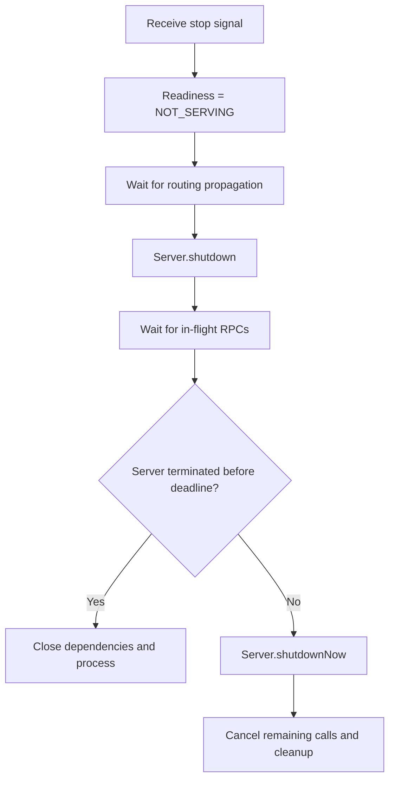

# Waiting for In-Flight RPCs to Complete

## 1. Objectives

A Spring gRPC server may be processing multiple concurrent RPCs when it receives a stop request due to a rollout, scale-down, or restart. If the process exits immediately, in-flight requests may lose their responses, streams are severed, and clients do not know how far the server progressed with side effects.

**Waiting for in-flight RPCs to complete** is the core of graceful shutdown: stop accepting new calls, give accepted calls time to finish within a bounded window, and only then close resources. If time runs out while calls remain, the server must transition to a forced shutdown according to policy.

The key is distinguishing three things:

- Stopping new requests from routing to the instance.
- Stopping the server from accepting new RPCs.
- Waiting for started RPCs to reach a terminal state: completed, errored, or cancelled.

Merely waiting for a fixed sleep does not guarantee these three steps have happened. You need readiness, the gRPC server lifecycle, deadlines, and a mechanism to observe in-flight RPCs.

After this lesson, you can:

- Use `Server.shutdown()` and `awaitTermination()` to wait for existing RPCs.
- Choose a bounded grace period and force shutdown on expiration.
- Track the number of in-flight RPCs with a server interceptor.
- Handle terminal callbacks exactly once for unary and streaming calls.
- Distinguish RPC completion, client cancellation, and server shutdown.
- Coordinate the Spring lifecycle, Kubernetes, and load balancers.
- Test waiting for RPCs using latches and an in-process server.

## 2. When Is an RPC Considered Complete?

An RPC does not end simply when the handler returns from the Java method. For asynchronous and streaming RPCs, the implementation method may return immediately after registering callbacks while the call continues sending/receiving messages.

A call is only terminal when one of the following occurs:

- The server completes the response and closes the call.
- The server ends the call with a gRPC error status.
- The client cancels the call or the deadline expires.
- The transport closes and the call terminates.

For unary RPCs, the terminal state usually arrives shortly after the server sends the response or error. For server-streaming, the call remains active until the server sends the last message and calls `onCompleted()`, or sends `onError()`. For client-streaming and bidirectional streaming, the call may remain open while both sides exchange messages.

Do not use the moment the handler method returns as the in-flight counter boundary. For async handlers, that moment can happen long before the RPC actually finishes.

## 3. `Server.shutdown()` and `awaitTermination()`

gRPC Java provides lifecycle APIs to drain the server:

| API | Behavior |
|---|---|
| `Server.shutdown()` | Initiates graceful shutdown, stops accepting new RPCs, and gives accepted calls a chance to complete |
| `Server.awaitTermination(timeout, unit)` | Waits for the server to finish within a bounded time |
| `Server.shutdownNow()` | Requests cancellation of active calls and stops the server faster |
| `Server.isShutdown()` | Indicates whether shutdown has been initiated |
| `Server.isTerminated()` | Indicates whether the server has finished its lifecycle |

Basic usage pattern:

```java
server.shutdown();

boolean terminated = server.awaitTermination(
        30, TimeUnit.SECONDS);

if (!terminated) {
    server.shutdownNow();
    server.awaitTermination(5, TimeUnit.SECONDS);
}
```

`shutdown()` does not wait for all RPCs to finish inside that call. It initiates the process of rejecting new calls. `awaitTermination()` is the operation that waits for the server to reach the terminated state.

Do not call `shutdownNow()` immediately upon receiving a stop signal if the goal is to preserve in-flight calls. Force shutdown only when the grace period expires, the process is interrupted, or an emergency requires immediate termination.

At the HTTP/2 layer, connection draining can use `GOAWAY` frames to tell peers the connection will not accept additional streams. The gRPC transport manages these protocol details; applications typically drive the lifecycle via `Server.shutdown()` rather than emitting `GOAWAY` frames directly. `GOAWAY` does not migrate active streams to another backend and does not replace waiting for RPCs to finish.

## 4. Proper Sequence to Prevent More Incoming Calls

If you only wait for an in-flight counter to reach zero while the server still accepts new requests, the count may never reach zero. Therefore, the sequence must block new traffic before waiting:

1. Set readiness and gRPC health status to `NOT_SERVING`.
2. Wait for the load balancer/orchestrator to remove the instance from the pool within a bounded propagation window.
3. Call `Server.shutdown()` so the server stops accepting new RPCs.
4. Wait for accepted RPCs to complete using `awaitTermination()`.
5. If the grace period expires, call `shutdownNow()` to cancel remaining calls.
6. Close dependencies needed by in-flight RPCs.



The propagation interval should not be an arbitrary fixed sleep. Choose it based on endpoint/load balancer update times observed in the deployment environment. If the platform offers a callback or signal confirming the backend was removed from the pool, prefer that signal.

## 5. Use One Overall Deadline for the Entire Drain Process

Do not grant the full grace period separately to each step. If readiness propagation waits 10 seconds, then server drain waits 30 seconds, and cleanup waits another 10 seconds, the total time can exceed Kubernetes' termination grace period.

Create one overall deadline based on a monotonic clock:

```java
static long remainingNanos(long deadlineNanos) {
    return Math.max(0L, deadlineNanos - System.nanoTime());
}

static boolean awaitServer(
        Server server,
        Duration totalBudget) throws InterruptedException {

    long deadline = System.nanoTime() + totalBudget.toNanos();
    server.shutdown();

    long remaining = remainingNanos(deadline);
    boolean terminated = remaining > 0
            && server.awaitTermination(
                    remaining, TimeUnit.NANOSECONDS);

    if (!terminated) {
        server.shutdownNow();
    }
    return terminated;
}
```

This example starts the budget when the helper is called. In real applications, the overall deadline should be created as soon as shutdown starts so it covers readiness propagation, server drain, and cleanup. Every step consumes the remaining time instead of resetting the timeout.

Use `System.nanoTime()` to measure elapsed intervals because it is unaffected by system clock synchronization. Do not compute deadlines using `LocalDateTime` or wall clock time.

## 6. Tracking the Number of In-Flight RPCs

`Server.awaitTermination()` is the gRPC server's primary waiting mechanism. However, an in-flight metric helps operators see how many calls remain, which calls run long, and whether the grace period is sufficient.

A server interceptor can increment a counter when an RPC starts and decrement it when the call reaches a terminal callback. Do not decrement when the handler method returns, as async/streaming calls may still be active.

Example tracker with safe acquire/release:

```java
public final class InFlightRpcTracker {

    private final AtomicInteger active = new AtomicInteger();

    public Lease begin() {
        active.incrementAndGet();
        return new Lease();
    }

    public int activeCount() {
        return active.get();
    }

    public final class Lease implements AutoCloseable {
        private final AtomicBoolean closed = new AtomicBoolean();

        @Override
        public void close() {
            if (closed.compareAndSet(false, true)) {
                active.decrementAndGet();
            }
        }
    }
}
```

`Lease` guarantees a call decrements the counter only once even if multiple terminal paths fire. In production, you can add a gauge metric, call start timestamp, method name, and alerts for calls exceeding thresholds.

## 7. Attaching the Tracker with a `ServerInterceptor`

The interceptor wraps the listener to receive terminal callbacks:

```java
public final class InFlightRpcInterceptor
        implements ServerInterceptor {

    private final InFlightRpcTracker tracker;

    public InFlightRpcInterceptor(InFlightRpcTracker tracker) {
        this.tracker = tracker;
    }

    @Override
    public <ReqT, RespT> ServerCall.Listener<ReqT> interceptCall(
            ServerCall<ReqT, RespT> call,
            Metadata headers,
            ServerCallHandler<ReqT, RespT> next) {

        String method = call.getMethodDescriptor()
                .getFullMethodName();

        // Health Watch can be a long-lived stream; exclude it from
        // business in-flight metrics.
        if (method.startsWith("grpc.health.v1.Health/")) {
            return next.startCall(call, headers);
        }

        InFlightRpcTracker.Lease lease = tracker.begin();
        try {
            ServerCall.Listener<ReqT> delegate =
                    next.startCall(call, headers);

            return new ForwardingServerCallListener
                    .SimpleForwardingServerCallListener<>(delegate) {
                @Override
                public void onComplete() {
                    try {
                        super.onComplete();
                    } finally {
                        lease.close();
                    }
                }

                @Override
                public void onCancel() {
                    try {
                        super.onCancel();
                    } finally {
                        lease.close();
                    }
                }
            };
        } catch (RuntimeException | Error ex) {
            lease.close();
            throw ex;
        }
    }
}
```

This is a pattern for tracking calls on the server side. Import forwarding listener and interceptor types from the gRPC Java API matching your project version. Register the interceptor on the server or services according to the Spring gRPC starter's mechanism.

Important notes:

- `onComplete()` covers calls completing normally.
- `onCancel()` covers calls cancelled by the client/transport.
- An idempotent `Lease` prevents double-decrementing.
- If `next.startCall()` throws an exception, the lease is released.
- Health Watch is a long-lived stream and should be excluded from business metrics or tracked separately.
- If the interceptor is registered only on certain services, the metric reflects only those services.

Do not use the tracker as a substitute for `Server.awaitTermination()`. The counter is for observability/application coordination; the server lifecycle remains the source of truth for server termination.

## 8. Waiting for the Counter to Reach Zero After Stopping New Calls

In some applications, you need to know the exact moment all business handlers have reached terminal callbacks so you can close dependencies in order. You can extend the tracker with a `Condition`:

```java
public final class DrainTracker {

    private final ReentrantLock lock = new ReentrantLock();
    private final Condition empty = lock.newCondition();
    private int active;

    public Lease begin() {
        lock.lock();
        try {
            active++;
            return new Lease();
        } finally {
            lock.unlock();
        }
    }

    public boolean awaitZero(Duration timeout)
            throws InterruptedException {
        long remaining = timeout.toNanos();
        lock.lockInterruptibly();
        try {
            while (active > 0 && remaining > 0) {
                remaining = empty.awaitNanos(remaining);
            }
            return active == 0;
        } finally {
            lock.unlock();
        }
    }

    private void finish() {
        lock.lock();
        try {
            active--;
            if (active == 0) {
                empty.signalAll();
            }
        } finally {
            lock.unlock();
        }
    }

    public final class Lease implements AutoCloseable {
        private final AtomicBoolean closed = new AtomicBoolean();

        @Override
        public void close() {
            if (closed.compareAndSet(false, true)) {
                finish();
            }
        }
    }
}
```

Only call `awaitZero()` after the server has stopped accepting new calls; otherwise the counter can rise again. Share the same overall deadline with `server.awaitTermination()`; never wait indefinitely for zero.

If the counter reaches zero while the server has not yet terminated, still wait for the server lifecycle to finish or force shutdown when the budget expires. Conversely, if the counter does not reach zero, method name and call age metrics help pinpoint hung streams or handlers.

## 9. Unary and Streaming RPCs Need Different Policies

| RPC Type | Typical Duration | Drain Approach |
|---|---|---|
| Unary read | Short, bounded | Wait for response or deadline |
| Unary write | Bounded but has side effects | Wait for commit/response; client retries need idempotency |
| Server-streaming | Can be long | Send terminal signal or cap lifetime |
| Client-streaming | Depends on upload speed | Let client complete half-close within grace period |
| Bidirectional streaming | Can be very long | Have close protocol, checkpoints, or resume |

A server cannot migrate an active stream to another backend merely because the instance is shutting down. If continuity is needed, the application protocol must support reconnect and resume.

For server-streaming, you can send a final event announcing the server is draining, along with a cursor/sequence number so the client resumes on a new connection. For client-streaming, identify which messages were committed and which must be resent. For bidirectional streaming, both sides must agree on terminal signals and checkpoints.

Do not force-close active data-transfer streams as soon as a rollout starts if the contract requires complete delivery. Conversely, do not let unbounded streams block deployments; set a maximum lifetime or explicit cancellation policy.

## 10. Deadlines and Cancellation Limit Wait Time

The client's deadline bounds total duration for an RPC. The server should propagate deadlines to downstream calls and avoid holding requests indefinitely.

When a deadline expires or the client cancels a call:

- The server can receive cancellation signals via the gRPC `Context`.
- Handlers should stop unnecessary work.
- Subscriptions, cursors, locks, and buffers must be released.
- Background tasks detached from the RPC need their own lifecycle.

Example checking cancellation:

```java
Context.current().addListener(
        context -> subscription.cancel(),
        Runnable::run);
```

This snippet assumes the handler holds the corresponding subscription. In real implementations, register cleanup exactly once and ensure the callback does not mistakenly release resources whose ownership was transferred.

Deadlines do not automatically roll back committed side effects. If the server already wrote to the database and the connection dropped before the client received the response, the client cannot infer the operation did not occur. Use idempotency keys or operation status queries to handle uncertain outcomes.

## 11. Coordinating the Spring Lifecycle

In Spring, the server may be owned by the starter/server factory. The component owning the server must perform shutdown; gateways and application services must not close a shared listener themselves.

A coordinator can perform:

1. Receive the application shutdown signal.
2. Set gRPC Health and readiness to `NOT_SERVING`.
3. Wait for endpoint propagation per budget.
4. Call the server owner's lifecycle stop.
5. Wait for the server to terminate.
6. Force shutdown if the budget expires.
7. Close dependencies used by in-flight RPCs.

If using `SmartLifecycle`, choose the phase so the server drains before closing dependencies needed by handlers. The `stop(Runnable)` callback must only be invoked once the component's stop process finishes.

`ContextClosedEvent` can be used to start updating health status, but an event handler does not automatically replace the server shutdown API. Check the lifecycle hooks of the Spring gRPC starter in use; do not assume embedded HTTP server graceful shutdown settings also control the gRPC server.

If the application both serves and calls gRPC, stop issuing new downstream RPCs before closing client `ManagedChannel`s. In-flight inbound RPCs may still need the downstream client to finish. Closing client channels too early can cause the very requests being drained to fail.

## 12. Kubernetes Termination Budget

Kubernetes sends `SIGTERM` when a pod is terminated and waits `terminationGracePeriodSeconds` before possibly sending `SIGKILL`. The `preStop` hook runs within the same grace period.

Example:

```yaml
spec:
  terminationGracePeriodSeconds: 60
  containers:
    - name: catalog
      lifecycle:
        preStop:
          httpGet:
            path: /internal/grpc/drain
            port: management
```

The `/internal/grpc/drain` endpoint is implemented by the application; it can set readiness to `NOT_SERVING` and wait for propagation. This is not a default endpoint of Spring gRPC.

The total budget must cover:

- `preStop` and readiness propagation.
- Time for the server to stop accepting new RPCs.
- Time waiting for in-flight RPCs.
- Forced cancellation if expired.
- Closing dependencies and the process.

For example, if termination grace is 60 seconds, you cannot spend all 60 seconds solely waiting for RPCs before starting cleanup. Reserve part of the budget for propagation and part for cleanup/force-stop.

Measure p95/p99 RPC durations and stream lifetimes in a production-like environment to pick the grace period. If valid streams last hours, you must have a max stream lifetime or resume protocol; increasing the grace period indefinitely is not a solution.

## 13. Observing In-Flight RPCs

Metrics and logs help identify which calls the server is waiting on:

- Gauge of active RPCs by service/method.
- Histogram of RPC duration.
- Count of calls completed within the drain window.
- Count of calls cancelled or force-terminated.
- Age of the oldest call when shutdown begins.
- Remaining stream count at each timestamp.
- Duration from readiness `NOT_SERVING` to server terminated.
- Count of grace period expirations.

When logging, include instance ID, method name, and trace/request ID if available. Do not log sensitive payloads or tokens.

If the counter does not drop, identify the method and age of the call before increasing timeouts. Causes may include clients holding streams long, handlers forgetting `onCompleted`/`onError`, downstreams lacking deadlines, or cleanup callbacks not running.

Do not let Health Watch or long-lived diagnostic streams inflate business in-flight metrics. Track them in separate metrics.

## 14. Testing Waiting for In-Flight RPCs

### In-Process Test with Unary RPCs

Use `InProcessServerBuilder` and `InProcessChannelBuilder` to set up a server/client in the same JVM, then use a fake service holding the handler with a latch to control completion timing:

1. Send an RPC and wait until the server confirms the handler has started.
2. Call `server.shutdown()`.
3. Send a new RPC and verify the server rejects new calls.
4. Verify the old call is still running.
5. Release the latch so the handler completes its response.
6. Wait on `awaitTermination()` and verify the server terminated.

Use bounded-timeout latches; do not use `Thread.sleep` to simulate ordering.

### Testing Force Shutdown

Create a call that does not finish within the grace period, call `shutdown()`, wait a short controlled timeout, then call `shutdownNow()`. Verify the client receives cancellation/error and the tracker is eventually released.

### Testing Streaming

Keep a server-streaming or bidirectional stream open, initiate shutdown, and verify:

- The existing stream can continue within the grace period per policy.
- No new calls are accepted after `server.shutdown()`.
- The client receives a terminal signal or error when the server force-stops.
- Resume cursors work if supported by the application contract.

### Kubernetes Integration Test

Generate continuous traffic during a rollout:

- Readiness changes before the server stops.
- The endpoint is removed from the Service.
- New RPCs route to remaining healthy replicas.
- In-flight calls have a chance to complete.
- The pod exits before the termination grace deadline.
- If calls exceed the limit, forced shutdown is recorded and clients handle it properly.

Also test `preStop` hook failure, an application unresponsive to `SIGTERM`, and slow dependency cleanup.

## 15. Common Pitfalls

| Symptom | Cause | Resolution |
|---|---|---|
| Counter never reaches zero | Decrementing when handler returns or missing terminal callbacks | Track `onComplete`/`onCancel` and use an idempotent lease |
| Waiting for zero while new calls keep arriving | Server still accepting requests while waiting | Switch readiness, wait for propagation, then call `server.shutdown()` |
| Server stops immediately, active calls fail | Calling `shutdownNow()` too early | Graceful shutdown and `awaitTermination()` |
| Shutdown exceeds termination grace | Waiting indefinitely or resetting timeout per step | Use one overall deadline |
| Streaming blocks server termination | Streams lack a maximum lifetime | Design close/resume or force-stop policy |
| Client retries create duplicate side effects | Commit outcome unclear after transport failure | Idempotency keys and operation status |
| Dependencies close before RPCs finish | Wrong Spring lifecycle phase | Drain server before closing dependencies |
| Health Watch keeps metrics busy | Counting admin streams as business RPCs | Track separately or exclude from business in-flight gauge |
| Flaky tests | Using sleep or overly short timeouts | Use latches, barriers, and bounded timeouts |

## 16. Hands-on Exercise

**Scenario:** Catalog has three Spring gRPC replicas. One replica is handling many unary `GetProduct` calls and bidirectional `WatchCatalog` streams when it receives `SIGTERM`. Some streams can last several minutes.

Perform the following:

1. Register a health/readiness coordinator and an interceptor tracking in-flight RPCs.
2. When draining begins, transition Catalog readiness to `NOT_SERVING`.
3. Wait for the load balancer/Kubernetes to remove the pod from the endpoint pool.
4. Call `Server.shutdown()` to stop accepting new RPCs.
5. Track active call counts by service/method.
6. Wait for unary RPCs and short streams to finish within one overall deadline.
7. Define a maximum lifetime or resume cursor for `WatchCatalog`.
8. If the grace period expires, call `shutdownNow()` and record metrics for cancelled calls.
9. Close databases/client channels only after handlers no longer need them.
10. Run a rollout test under load and verify no new RPCs reach the draining replica.

**Completion criteria:** the server stops accepting new calls before waiting; in-flight counts reflect terminal lifecycle rather than handler return; the grace period is bounded; unary and streaming have separate policies; dependencies close only after drain; clients handle cancellation/retry/resume safely.

## 17. Key Takeaways

To wait for in-flight RPCs to complete, first stop new traffic: update readiness, wait for routing propagation, then call `Server.shutdown()`. Next, use `awaitTermination()` with a single overall deadline; call `shutdownNow()` only when the budget expires or an emergency stop is needed. Async/streaming handlers can continue after the Java method returns, so if tracking in-flight calls, decrement counters in terminal callbacks `onComplete`/`onCancel` and guarantee single release. Track Health Watch separately so it does not skew business metrics. Unary calls usually drain quickly; streaming requires maximum lifetimes, terminal signals, or a resume protocol. In Spring, the server owner must coordinate the lifecycle and keep dependencies open until RPCs finish. The Kubernetes termination grace period must budget for readiness propagation, draining, and cleanup. Test with latches/in-process servers and rollout tests to verify old calls finish, new calls are blocked, and forced shutdown occurs only on expiration.
