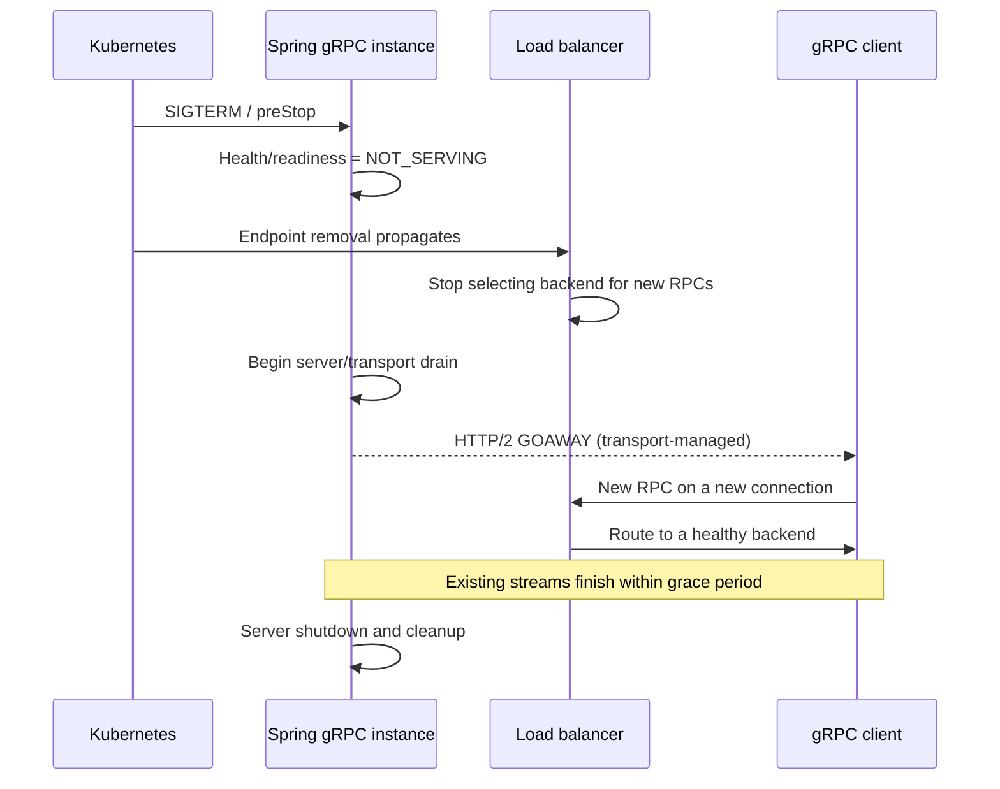

# Draining Connections Before Stopping

## 1. Objectives

A gRPC client typically holds a long-lived HTTP/2 connection and sends many RPCs over that same connection. During a rollout or scale-down of a Spring gRPC instance, switching readiness to `NOT_SERVING` alone may not close existing connections. An old connection can still hold active streams or continue to be used by clients until the transport detects the backend has left the pool.

**Draining connections before stopping** is the process of stopping new RPCs from entering a retiring connection/backend, allowing existing streams to finish per policy, directing clients to open new connections to healthy backends, and only then closing the server or proxy. Connection draining coordinates HTTP/2 `GOAWAY`, readiness, load balancers, gRPC channels, and the shutdown lifecycle.

After this lesson, you can:

- Distinguish removing a backend from the pool from closing connections and waiting for RPCs to complete.
- Explain HTTP/2 `GOAWAY` and the limits of connection draining.
- Coordinate readiness, endpoint removal, and proxy draining.
- Use gRPC server shutdown to stop accepting new calls.
- Understand how clients open new connections after an old connection is retired.
- Handle long-lived streaming RPCs and reconnect/resume.
- Test draining during rollouts without relying on arbitrary sleeps.

## 2. Why Drain Connections?

HTTP/2 multiplexes many RPC streams over a single TCP connection. A `ManagedChannel` can maintain a connection to a backend for a long time. If a load balancer selects a backend when the TCP connection is opened, all RPCs on that connection may keep going to that same backend.

When a pod is marked not ready, Kubernetes can remove the pod from new endpoints, yet established connections at a proxy or client may persist. This creates two traffic groups:

- New RPCs routed over new connections/backends.
- Existing RPCs or streams still bound to the old connection.

If the process is stopped before old connections drain, streams can suffer transport errors or be cancelled. If you wait indefinitely for connections to close on their own, rollouts may never finish because a bidirectional stream can stay open for hours.

Connection draining creates a clear boundary between new traffic and in-flight traffic:

1. Stop selecting the backend for new RPCs.
2. Notify peers not to open new streams on the old connection.
3. Let existing streams finish within the grace period.
4. Clients open new connections to active backends.
5. Stop the old connection/server after drain or expiration.

## 3. Distinguishing Backend Removal, `GOAWAY`, and Server Shutdown

These three operations are related but do not replace one another:

| Operation | Scope | Result |
|---|---|---|
| Readiness `NOT_SERVING` / endpoint removal | Service discovery and routing | Backend is no longer selected for new traffic once updates propagate |
| HTTP/2 `GOAWAY` | A single HTTP/2 connection | Signals peer to stop opening new streams on that connection |
| gRPC `Server.shutdown()` | Server lifecycle | Server stops accepting new RPCs and begins graceful shutdown |

Readiness does not automatically send `GOAWAY` on existing connections. `GOAWAY` does not remove a pod from a Kubernetes Service. `Server.shutdown()` does not replace coordinating with the load balancer or service discovery to shed new traffic before stopping.

A deployment process must use each mechanism in its proper role and order. Calling `Server.shutdown()` immediately upon `SIGTERM` can fail new calls arriving during the routing propagation window. Setting only `NOT_SERVING` while keeping old connections open forever can allow clients to keep hitting a retired backend depending on the load balancer type.

## 4. How Does HTTP/2 `GOAWAY` Work?

`GOAWAY` is an HTTP/2 control frame sent on a connection to notify that the endpoint will accept no further new streams past a given stream ID. It informs the peer that the connection is closing cleanly.

Key points:

- `GOAWAY` applies to a connection, not to service discovery as a whole.
- It does not move an active stream to another connection or backend.
- Already-accepted streams may continue depending on stream ID and processing state.
- Clients must open a new connection if they still have new RPCs to send.
- Proxies or servers may perform one or more `GOAWAY` steps during graceful close; details depend on the implementation.

In gRPC, the transport manages HTTP/2 frames. Applications usually drive the lifecycle via gRPC server/channel APIs rather than constructing `GOAWAY` frames directly.

Do not treat `GOAWAY` as a guarantee that every RPC succeeded. An RPC may have been sent without yet being processed by the server; clients must evaluate status, retry policy, and idempotency before resending.

## 5. Connection Draining Through L4 and L7 Load Balancers

### L4 TCP Load Balancer

L4 forwards TCP bytes and typically chooses a backend when the TCP connection is established. It cannot read gRPC method paths or HTTP/2 stream state when passing TLS through.

When a backend retires:

- L4 can stop opening new TCP connections to the backend.
- Existing TCP connections can remain open.
- Some products support connection draining with a timeout.
- L4 cannot selectively pick individual RPC streams inside a multiplexed TLS connection.

Thus, old connections may continue pinning many RPCs to the old backend until the client or server closes the connection.

### L7 HTTP/2-Aware Proxy

An L7 proxy understands HTTP/2 and gRPC. It can:

- Mark a backend as ineligible for new requests.
- Pick another backend for new HTTP/2 streams.
- Keep active streams on the old backend.
- Drain connections or send `GOAWAY` depending on product capabilities.
- Track active streams and timeouts.

L7 offers finer-grained control, but must handle gRPC trailers, flow control, and streaming properly. Drain timeouts must match real workloads.

| Need | L4 | L7 HTTP/2-aware |
|---|---|---|
| Stop new TCP connections to backend | Yes | Yes |
| Understand gRPC method/stream | No | Possible |
| Route new streams to another backend on same frontend connection | No | Possible, depending on proxy |
| Drain active streams | By TCP connection lifetime | Possible per stream and backend policy |
| Observe gRPC status/trailers | No when passing TLS through | Possible |

## 6. Drain Sequence for a Spring gRPC Deployment

A typical sequence:



Practical steps:

1. Receive stop or rollout signal.
2. Transition gRPC Health and readiness to `NOT_SERVING`.
3. Wait for endpoint removal/load balancer propagation within a bounded budget.
4. Request the proxy or gRPC transport to drain connections using supported APIs.
5. Call `Server.shutdown()` so the server stops accepting new RPCs.
6. Monitor in-flight RPCs and active streams.
7. Wait until the server terminates or the grace period expires.
8. If calls remain, force shutdown per policy, then close dependencies.

The exact order between calling drain APIs and `Server.shutdown()` depends on the server/proxy architecture. Some proxies require endpoint removal before draining starts; some gRPC servers begin sending `GOAWAY` when shutdown is called. Verify the behavior of your implementation rather than assuming all components coordinate automatically.

## 7. Coordinating in the Spring Lifecycle

The Spring gRPC server is usually managed by the starter or server factory. The component owning the server lifecycle must be responsible for stopping the server. The readiness coordinator and load balancer controller may be separate components, but a shutdown coordinator should invoke them in sequence.

Sketch example:

```java
public final class GrpcDrainCoordinator {

    private final GrpcReadiness readiness;
    private final BackendDrainSignal backendDrain;
    private final GrpcServerLifecycle serverLifecycle;

    public void beginDrain(Duration propagationBudget,
                           Duration serverBudget) {
        readiness.markNotServing();
        backendDrain.stopSelectingThisInstance();
        backendDrain.awaitPropagation(propagationBudget);
        serverLifecycle.shutdownAndAwait(serverBudget);
    }
}
```

The interfaces in this example are application abstractions, not built-in Spring gRPC classes. A real implementation must connect to `HealthStatusManager`, readiness endpoints, load balancer APIs if any, and the starter's lifecycle APIs.

Do not place drain logic inside RPC-handling gateways. A gateway only consumes stubs or application services; it does not own the server listener.

If using `SmartLifecycle`, choose the phase so the readiness coordinator begins draining before the server owner, and dependencies needed by in-flight handlers close last. The `stop(Runnable)` callback must signal completion only once the server has stopped or been force-stopped.

## 8. Clients Receiving `GOAWAY` and Opening New Connections

When an HTTP/2 connection is drained, the gRPC client must continue sending new RPCs over an active connection. With `ManagedChannel`, the transport and load balancing policy manage subchannel/connection lifecycles. `GOAWAY` can cause the transport to stop using the old connection and establish a new connection via the resolver/policy.

The client application must still handle:

- New RPCs temporarily waiting for a new connection to become `READY`.
- In-flight calls either completing or failing depending on state and `GOAWAY` timing.
- Retries not being automatically safe for all methods.
- DNS/resolvers still providing healthy backends.
- The caller's overall deadline being preserved across reconnect/retry.

Do not create a new `ManagedChannel` per RPC solely to avoid connection draining. Channels should be reused; the gRPC transport manages underlying connections.

If client-side load balancing uses a resolver returning multiple backends, the new connection can be opened to another instance. If the client sees only one L4 VIP, the new connection may still have its backend chosen by the load balancer per its policy.

## 9. Long-Lived Streams and Resume

Connection draining cannot move an active stream to another connection. For long-lived streams, choose one of three strategies:

1. **Natural completion:** the stream finishes within the grace period.
2. **Bounded lifetime:** the server periodically closes streams in a controlled way so clients reconnect.
3. **Resume protocol:** clients store a cursor/sequence number and open a new stream from the confirmed position.

Example response event with sequence:

```proto
message CatalogEvent {
  string event_id = 1;
  int64 sequence = 2;
  string product_id = 3;
  string change_type = 4;
}

message WatchCatalogRequest {
  int64 after_sequence = 1;
}
```

When the server signals that the stream is draining, the client retains the last processed sequence and opens a new stream with `after_sequence`. The server must clearly define whether sequences are stable, replayable, and gap-free.

For client-streaming uploads, acknowledgments/checkpoints are needed to know which messages the server committed. For bidirectional streams, both sides must agree on how to close, checkpoint, and recover state.

Do not retry a stream by resending all messages if the server might have committed part of them. Use idempotency keys or protocol deduplication to prevent duplicate side effects.

## 10. Timeouts and Drain Budgets

The drain budget must cover propagation, connection draining, in-flight completion, and cleanup:

| Phase | Contents |
|---|---|
| Readiness propagation | Orchestrator/load balancer stops selecting backend |
| Connection drain | Stop creating new streams on old connections |
| In-flight wait | Wait for active unary and streaming calls |
| Force phase | Cancel calls exceeding time limit |
| Cleanup | Close server, executors, and dependencies |

All phases must fit inside Kubernetes `terminationGracePeriodSeconds` or the runtime's shutdown timeout. Use one overall deadline; do not reset timeouts for each step.

Example:

```text
Termination grace period: 60 seconds
Readiness propagation:      8 seconds
Connection drain:           5 seconds
In-flight wait:             35 seconds
Force/cleanup reserve:     12 seconds
```

This is an illustrative budget. Measure endpoint propagation times, p99 RPC durations, and stream lifetimes. If valid streams outlive the grace period, use a bounded lifetime or resume protocol rather than waiting indefinitely.

Proxy idle timeouts, max connection age, and gRPC deadlines mean different things. Idle timeout closes an inactive connection; max connection age rotates connections periodically; deadlines bound a single RPC. Do not use one setting as a substitute for all of them.

## 11. Kubernetes `preStop` and Endpoint Propagation

Kubernetes initiates termination, runs the `preStop` hook if present, and sends `SIGTERM` per its lifecycle. `EndpointSlice` and load balancers need time to update the backend pool.

Example drain endpoint:

```yaml
lifecycle:
  preStop:
    httpGet:
      path: /internal/grpc/drain
      port: management
      scheme: HTTP
terminationGracePeriodSeconds: 60
```

The `/internal/grpc/drain` endpoint is implemented by the application. It should mark readiness `NOT_SERVING` and trigger the drain coordinator; this is not a built-in Spring gRPC endpoint.

The `preStop` hook executes within the termination grace period. If the hook waits 10 seconds, the remaining time for server draining and cleanup shrinks accordingly. Do not configure the hook to wait longer than the total budget.

Do not assume a pod is removed from all load balancers instantaneously when readiness changes. Propagation can pass through `EndpointSlice`, kube-proxy, ingress controllers, cloud load balancers, and a service mesh. Measure real propagation times in the cluster.

## 12. Monitoring Draining Connections and Streams

Observe connection-level and RPC-level metrics separately:

- Number of open HTTP/2 connections to the instance.
- Number of connections in draining state.
- Number of active RPCs/streams by service and method.
- Age of the oldest stream.
- Timestamp when `GOAWAY` or transport shutdown occurs if metrics/logs expose it.
- Number of new RPCs rejected after drain starts.
- Number of RPCs completed, cancelled, or force-terminated.
- Time from `NOT_SERVING` until connection count reaches zero.
- Client reconnect/retry counts and resulting status codes.

Connection count reaching zero does not always mean all application tasks have cleaned up; handlers might spawn background work detached from the RPC. Conversely, in-flight RPC count might hit zero while proxy connections stay open via keepalive. Monitor both layers.

Include instance ID, connection generation, method name, and trace ID in logs when possible. Do not log sensitive payloads or credentials.

## 13. Testing Connection Draining

### Testing with an In-Process Server

In-process transport is useful for checking server lifecycle and in-flight RPCs, though it does not create real TCP/HTTP2 connections. Use `InProcessServerBuilder` and `InProcessChannelBuilder` to:

1. Create a fake service holding a stream open with a latch.
2. Send an RPC and confirm the handler starts.
3. Call `Server.shutdown()`.
4. Verify new calls are rejected by the server.
5. Allow the existing stream to finish within the grace period.
6. Wait on `awaitTermination()` and verify the server terminated.
7. Write another test for `shutdownNow()` when a stream does not finish.

In-process tests do not prove real `GOAWAY` frames or proxy draining; a separate transport integration test is required.

### Real HTTP/2 Testing

Run a Netty server on a test port, create a real `ManagedChannel`, and open multiple RPCs/streams. Initiate shutdown and observe:

- Connection/stream behavior.
- Client statuses and reconnects.
- New RPCs routed over a new connection if a resolver/backend remains available.
- Old streams completing or being cancelled per the grace policy.
- Server terminating before the deadline.

### Testing Through a Load Balancer/Kubernetes

Roll out a replica under load:

- Readiness transitions to `NOT_SERVING`.
- Endpoint is removed from the pool.
- Backend receives no new streams after draining.
- Old connections retire per policy.
- Clients continue sending RPCs to healthy backends.
- Long-lived streams resume from cursor if supported by contract.
- Pod exits before the termination grace deadline.

Do not use a single TCP connect test to conclude that draining works.

## 14. Common Pitfalls

| Symptom | Cause | Resolution |
|---|---|---|
| Pod not ready yet RPCs still hit old pod | Existing HTTP/2 connections persist | Drain connections and use proper `GOAWAY`/endpoint removal |
| Calling shutdown fails new calls in propagation window | Server stops before load balancer updates | Mark readiness and wait for propagation first |
| L4 load balancer keeps hitting old backend | Balances TCP connections only | Configure connection drain timeout or use L7/client-side LB |
| Streams cut off during rollout | Stream outlives grace period without resume | Bounded lifetime and resume cursor |
| Client fails to open a new connection | Resolver does not update or channel cannot reconnect | Check resolver, DNS, subchannels, and channel state |
| `GOAWAY` interpreted as all RPCs finished | Confusing connection-level signal with call completion | Track RPC/stream completion separately |
| Drain never finishes | Keepalive/connections stay open or infinite streams | Separate connections from RPCs; set max lifetime/force policy |
| Pod receives `SIGKILL` mid-drain | Propagation + drain exceeds grace period | Measure and allocate the shutdown budget |
| Retries cause duplicate side effects | Non-idempotent RPCs | Idempotency keys, deduplication, and operation status |
| In-process tests pass but production fails | In-process creates no real HTTP/2 socket/`GOAWAY` | Add Netty/proxy/Kubernetes integration tests |

## 15. Hands-on Exercise

**Scenario:** Catalog has three Spring gRPC replicas. A client holds one `ManagedChannel` and sends many unary RPCs plus a long-running bidirectional stream. During a rollout, the old pod flips readiness to `NOT_SERVING`, yet an L4 load balancer keeps established connections open.

Perform the following:

1. Determine whether the load balancer balances TCP connections or HTTP/2 streams.
2. Measure connection counts and active RPCs/streams on the retiring pod.
3. Transition health/readiness to `NOT_SERVING` before stopping the server.
4. Wait for endpoint propagation and configure connection draining on the load balancer.
5. Call `Server.shutdown()` via the lifecycle owner so the server stops accepting new calls.
6. Verify the transport emits `GOAWAY` or the proxy performs an equivalent drain mechanism.
7. Allow unary RPCs and short streams to finish within the grace period.
8. Design a sequence cursor and reconnect flow for the bidirectional stream.
9. If the budget expires, force-stop remaining calls and record metrics.
10. Run a rollout test through both TCP/L4 and an HTTP/2-aware proxy to compare results.

**Completion criteria:** the old backend receives no new RPCs after draining; clients open new connections to healthy backends; old streams finish or resume per contract; the server stops within the grace period; metrics distinguish connection count from in-flight RPCs.

## 16. Key Takeaways

Connection draining prevents new RPCs from entering a retiring connection/backend and gives existing streams time to finish. Readiness/endpoint removal takes a backend out of routing; `GOAWAY` tells peers to stop opening new streams on an HTTP/2 connection; `Server.shutdown()` drives the gRPC server lifecycle. None of these replaces the others. L4 usually drains per TCP connection, whereas HTTP/2-aware L7 can control streams more granularly. Clients need working resolvers and channels to open new connections; `GOAWAY` does not automatically migrate active streams. Long streams require maximum lifetimes, terminal signals, or resume cursors. Coordinate readiness propagation, proxy draining, server shutdown, and the Kubernetes termination budget under one overall deadline. Test both in-process lifecycles and real HTTP/2/proxy rollouts; monitor connections and RPCs/streams as two separate layers.
