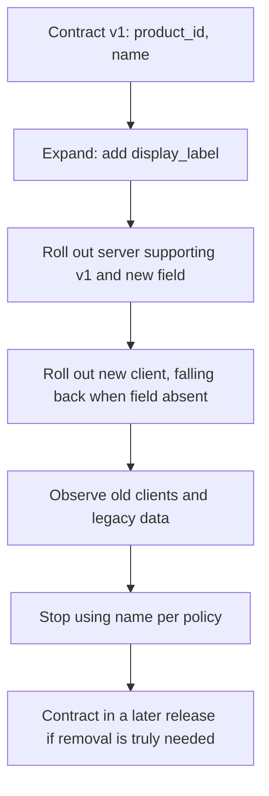

# Proto-Compatible Rolling Deployment

## 1. Objectives

A rolling deployment replaces instances of a service one by one while remaining instances continue serving traffic. With Spring gRPC, the fleet may run both old and new server versions simultaneously for a period, while clients also roll out independently. Both sides exchange messages according to a Protobuf contract, so a schema change must work safely across every version combination that can occur during deployment.

**Proto-compatible rolling deployment** is the practice of releasing Protobuf and generated stub changes without requiring all clients and servers to upgrade simultaneously. The goal is to preserve wire compatibility, preserve RPC semantics, and allow old and new versions to coexist during rollout, rollback, or reconnection.

A change can be wire-compatible while still breaking source APIs or business semantics. For instance, adding a new field usually will not break an old parser, yet old clients may not understand the new semantics; adding an enum value can cause old generated code to receive `UNRECOGNIZED`. Therefore, rollouts must check wire compatibility, source compatibility, and semantic compatibility.

After this lesson, you can:

- Distinguish wire, source, and semantic compatibility.
- Apply the expand–migrate–contract strategy.
- Choose server and client rollout ordering based on change type.
- Evolve fields, enums, `oneof`s, services, and RPC methods safely.
- Handle mixed-version fleets, long-lived streams, and rollbacks.
- Configure rolling updates with readiness and graceful shutdown.
- Test a client/server version matrix before release.

## 2. Three Layers of Compatibility to Preserve

| Layer | Question | Example Failure |
|---|---|---|
| Wire compatibility | Can old and new messages parse each other's bytes? | Changing field number or wire type causes misread data |
| Source/API compatibility | Does client/server code still compile with the generated API? | Renaming a field renames Java accessors |
| Semantic compatibility | Do both versions interpret the same value with the same meaning? | New enum value treated by old code as another valid state |

Protobuf uses field numbers and wire types to encode fields. Field names are not included in the binary wire representation, though they are used to generate accessors, JSON mappings, and tooling. Consequently, renaming a field can preserve wire compatibility while still breaking source compatibility or JSON clients.

A gRPC method is identified by its full method path of the form:

```text
/package.Service/Method
```

Changing the Protobuf package, service name, or method name changes the path. Clients calling the old path may receive `UNIMPLEMENTED` if the new server no longer registers the old method. This is an API change requiring a planned rollout, not merely a Java class rename.

## 3. The Expand–Migrate–Contract Principle

Safe schema changes typically go through three phases:

1. **Expand:** add new capabilities in a way that old servers/clients can ignore or safely default.
2. **Migrate:** deploy new servers and clients, shifting traffic and data to the new semantics; monitor the fleet until old versions are no longer used.
3. **Contract:** remove old fields/methods only after confirming no clients, servers, or streams still depend on them.

Example adding `display_label` to `Product`:

```proto
message Product {
  string product_id = 1;
  string name = 2;
  optional string display_label = 3;
}
```

A rollout might look like:



Do not combine expand and contract into a single rolling release. During a rollout, some instances still run the old schema; if the new release immediately deletes a field required by old clients, requests will fail depending on whether the load balancer picks an old or new instance.

## 4. Adding Protobuf Fields

Adding a new field with an unused field number is a common evolution pattern:

```proto
message GetProductResponse {
  string product_id = 1;
  string name = 2;
  optional string display_label = 3;
}
```

Typically:

- New servers can accept old requests without the new field.
- New clients can accept responses from old servers; the new field will be absent/default.
- Old clients usually ignore unknown fields when parsing messages.
- Old servers usually ignore unknown request fields.

However, being parseable does not imply semantic safety. New clients must have a fallback when the new field is absent. New servers must not assume every client sends the new field right after rollout starts.

For proto3 scalars, if you need to distinguish absent from a default value, use `optional` or an appropriate message wrapper. Do not infer that a getter returning an empty string or `0` proves the client sent the field.

### Field Number Rules

- Do not change the field number of a released field.
- Do not reuse the field number of a deleted field.
- Mark deleted field numbers with `reserved`.
- Reserve field names as well to avoid reuse in JSON/text format.
- Do not change types just because two types look similar in Java.

Example deleting an old field:

```proto
message Product {
  reserved 2;
  reserved "legacy_name";

  string product_id = 1;
  optional string display_label = 3;
}
```

Reusing a field number can cause old bytes to be interpreted as a different field, producing subtle data corruption.

## 5. Changing Field Types and Semantics

Not every type change is safe even if generated Java code still compiles. Protobuf wire format classifies fields by wire type; some types share the same wire type yet differ in interpretation.

Examples:

- `int32` and `sint32` are both varints but encode negative numbers differently.
- `string` and `bytes` share the length-delimited wire type but differ in semantics and validation.
- `fixed32` and `float` use the `fixed32` wire type yet have different data meanings.
- Changing an integer's unit from milliseconds to seconds does not alter wire format but breaks semantic compatibility.

Do not change the type/meaning of a released field in place. Add a new field with a new tag, migrate data/clients, and then deprecate the old field. If converting units, name the new field to express its unit and validate ranges explicitly.

## 6. Field Presence and Update Semantics

In proto3, scalars without explicit presence typically return the default when not sent. This is especially dangerous for update requests:

```proto
message UpdateProductRequest {
  string product_id = 1;
  optional string display_label = 2;
  optional int32 reorder_level = 3;
}
```

`hasDisplayLabel()` tells whether the field is present; `getDisplayLabel()` returns its value. If a new client sends an empty string meaning "clear label", an old server does not recognize the field and ignores it. If a new server treats an absent field as "clear", an old client sending a request without that field will accidentally erase data.

Keep semantics explicit:

- Absent: do not modify the field.
- Present with empty/zero: set the value to empty/zero if allowed by the contract.
- Explicit clear: use a field mask or dedicated operation if an unambiguous distinction is needed.

When adding a field to an update API, the new server must preserve old behavior for requests lacking that field. Do not alter the default semantics of existing fields during a rolling deployment.

## 7. Adding Enum Values

Adding an enum value typically preserves wire compatibility because enums are encoded numerically. However, old clients may receive a numeric value unknown to the old generated enum.

Example:

```proto
enum ProductStatus {
  PRODUCT_STATUS_UNSPECIFIED = 0;
  PRODUCT_STATUS_ACTIVE = 1;
  PRODUCT_STATUS_DISCONTINUED = 2;
  PRODUCT_STATUS_ARCHIVED = 3;
}
```

Proto3-generated Java code can return `UNRECOGNIZED` when receiving an enum number unknown to that code version. Client code must include a handling branch:

```java
ProductState toDomain(ProductStatus status) {
    return switch (status) {
        case PRODUCT_STATUS_ACTIVE -> ProductState.ACTIVE;
        case PRODUCT_STATUS_DISCONTINUED ->
                ProductState.DISCONTINUED;
        case PRODUCT_STATUS_UNSPECIFIED, UNRECOGNIZED ->
                ProductState.UNKNOWN;
    };
}
```

If an unknown status affects permissions, billing, or data correctness, fail safely instead of mapping it to a meaningful default state. If you need to preserve the numeric value for round-tripping or logging, use the appropriate numeric value accessor.

Rollout order depends on whether the server emits the new enum immediately. Deploy clients able to handle unknown values first, then enable servers to emit the new value. If old clients cannot safely handle unknown values, do not send the new enum to those clients.

Do not change released enum numbers and do not reuse numbers of removed enum values. Reserve removed numeric values and names.

## 8. Changing `oneof`

`oneof` expresses mutually exclusive choices:

```proto
message ProductFilter {
  oneof criterion {
    string category = 1;
    string seller_id = 2;
  }
}
```

Adding a new alternative may be seen by an old parser as an unknown field; old code may observe `CRITERION_NOT_SET`. Thus, `NOT_SET` does not always mean the client intentionally omitted the filter: a new client may have sent an alternative that the old server does not understand.

If `NOT_SET` broadens a query or alters access permissions, handle it fail-safely. Before clients send the new alternative, roll out servers supporting it across all backends that can receive requests. If mixed-version compatibility is needed, clients must use a fallback or capability negotiation.

Do not move existing fields into or out of a `oneof` arbitrarily in the same release. Changing presence and mutual-exclusion semantics can make generated APIs and behavior diverge across versions.

## 9. Adding RPC Methods or Services

Adding a new method to a service usually does not break parsing of existing messages on old clients/servers, though a new client calling that method on an old server will receive `UNIMPLEMENTED`.

Safe ordering:

1. Release the server with the new method before requiring clients to call it.
2. Wait for rollout completion and verify all backends expose the new method.
3. Release clients that start calling the new method.
4. Monitor `UNIMPLEMENTED`, `UNAVAILABLE`, and fallbacks.

When removing an old method:

1. Release clients that stop calling the old method.
2. Verify metrics/logs show zero calls to the old method.
3. Wait for old clients and related streams to finish.
4. Only then remove the method on the server in a subsequent release.

Do not rename the package/service/method if the old path must be preserved. You can create a new service version such as `catalog.v2.ProductCatalog` and maintain v1 during migration.

## 10. Generated Stubs and Dependency Rollout

Generated Java stubs come from the Protobuf contract and pinned plugin/runtime versions. When the schema changes:

- Generate code from the exact proto source and pinned compiler/plugin versions.
- Review the generated source diff alongside the proto diff.
- Build clients and servers with compatible runtimes.
- Do not edit generated sources by hand.
- Do not upgrade runtimes/generators simultaneously with breaking schema changes unnecessarily.
- Inspect modules sharing the proto artifact and dependency graph.

A newly built client does not mean every server supports the new contract. A newly built server does not mean clients understand the new response. Generated stubs only enable compilation; they do not automatically guarantee runtime compatibility across versions.

If using a separate contract artifact, release contract versions under strict control and document compatible server/client ranges. Do not publish a new proto artifact and assume every consumer has updated.

## 11. Rollout Order by Change Type

| Change | Usually Safe Order | Condition |
|---|---|---|
| Add optional response field | Server first, client second | New client falls back when old server omits field |
| Add optional request field | Server supports first, client sends second | Old servers must not receive traffic requiring new semantics |
| Add enum value the server will emit | Client handles unknown first, server emits second | Old clients must handle unknown or not receive the new value |
| Add RPC method | Server first, client calls second | All target backends must support the method |
| Remove RPC method | Client stops calling first, server removes second | No remaining clients/streams use the method |
| Remove field | Stop reading/writing and migrate first, remove later | No remaining consumers need the old field |
| Change package/service path | Run v1 and v2 side by side | Clear client migration and routing |

These are general guidelines. Specific ordering must consider server request parsing, response generation, client behavior, and how the load balancer distributes requests during a mixed fleet.

## 12. Rolling Updates on Kubernetes

A Deployment can use rolling updates to maintain serving replicas while swapping images:

```yaml
apiVersion: apps/v1
kind: Deployment
metadata:
  name: catalog-grpc
spec:
  replicas: 3
  strategy:
    type: RollingUpdate
    rollingUpdate:
      maxSurge: 1
      maxUnavailable: 0
  selector:
    matchLabels:
      app: catalog-grpc
  template:
    metadata:
      labels:
        app: catalog-grpc
    spec:
      terminationGracePeriodSeconds: 60
      containers:
        - name: catalog
          image: example/catalog-grpc:2.0.0
          ports:
            - name: grpc
              containerPort: 9090
          readinessProbe:
            grpc:
              port: 9090
              service: readiness
```

`maxSurge: 1` allows creating one extra pod during rollout; `maxUnavailable: 0` requires the Deployment to keep the desired number of available replicas according to rollout conditions. Readiness must reflect real serving ability, not merely listener bind success.

Kubernetes rolling updates do not verify Protobuf compatibility automatically. They only replace pods according to readiness and strategy. Compatibility must be verified beforehand via schema reviews and mixed-version tests.

Old pods need graceful shutdown and connection draining. Long-lived streams may continue on an old pod even after new pods are ready. During this window, both server versions coexist and must understand messages under compatible contracts.

## 13. Long-Lived Streaming in a Mixed Fleet

Streaming RPCs can outlive a rollout. A stream established with a v1 server may keep running on v1 even after v2 receives new traffic.

Do not assume messages inside a single stream will migrate to the new server version. Connections and streams remain bound to the transport/backend selected when the call began.

When evolving streaming messages:

- Retain old fields while old clients/servers remain active.
- Add new fields as optional with safe defaults/fallbacks.
- Clients must ignore or handle unknown fields.
- Servers must not require all stream peers to send new fields immediately.
- If changing protocol state machines, version messages or RPCs explicitly.
- Design cursors/sequences so clients reconnect and resume after draining.

If a v2 server requires new semantics for every message, do not emit new messages onto a v1 stream before the corresponding client can understand them. You can preserve old behavior by stream version/capability or open a separate v2 RPC.

## 14. Capability Negotiation and Fallbacks

When a client needs to know whether a server supports a new feature, you can use:

- A capability/version RPC endpoint.
- Capability fields in responses.
- Controlled metadata or service config.
- Separate service/RPC versions.

Do not infer capability solely from a server version string if a load balancer might route consecutive RPCs to backends of different versions. In a mixed fleet, capability must reflect the actual endpoint the client is hitting or be rolled out uniformly before clients depend on it.

Fallbacks must have safe semantics. If a server does not yet support a new method, the client can use the old method when outcomes are equivalent. Never fall back by silently bypassing authorization, validation, or consistency guarantees.

## 15. Rollback and Database/Schema Compatibility

Rolling back an application image does not roll back already-sent Protobuf bytes or written data. A new server may already have written a new state to the database or emitted a new enum value to a message queue.

Before rolling out, verify:

- Can the old server read data written by the new server?
- Can old clients understand new responses/events?
- Are new fields/enum values persisted or replayed?
- Can a rollback restore old semantics without data loss?
- Do database migrations follow expand–migrate–contract?

Prefer additive database migrations: add columns/indexes first, deploy code compatible with both schemas, migrate data, and only drop old columns in a later release.

If v2 writes a new enum/status into a persistent store, v1 reading it back may fail to understand it. Keep unknown mappings safe or delay writing new values until the rollback window has passed.

## 16. Compatibility Testing

Do not merely compile new clients and servers against the same proto source. Test version combinations:

| Client | Server | Expectation |
|---|---|---|
| v1 | v1 | Baseline behavior |
| v1 | v2 | New server still accepts old requests and returns old-compatible responses |
| v2 | v1 | New client falls back when new fields/methods are absent |
| v2 | v2 | New features work completely |

For enum/oneof/method additions, add specific tests for unknown values, `UNIMPLEMENTED`, and fallbacks. For streaming, hold streams open across a rollout and verify old/new message behavior.

Test types:

1. **Schema compatibility checks:** detect field number/type/reservation issues and breaking changes.
2. **Wire tests:** serialize with generated v2, parse with generated v1, and vice versa where supported.
3. **Mixed-version integration tests:** v1 client calling v2 server and v2 client calling v1 server.
4. **Rolling deployment tests:** run multiple server versions simultaneously behind a load balancer.
5. **Streaming/drain tests:** hold streams across rollout and test reconnect/resume.
6. **Rollback tests:** revert the server to v1 after v2 has processed traffic and data.

Example checking that an old parser ignores a new field:

```java
ProductV2 newer = ProductV2.newBuilder()
        .setProductId("p-42")
        .setName("Keyboard")
        .setDisplayLabel("Office keyboard")
        .build();

byte[] wire = newer.toByteArray();
ProductV1 older = ProductV1.parseFrom(wire);

assertEquals("p-42", older.getProductId());
assertEquals("Keyboard", older.getName());
```

This test only proves the old parser reads the fields it knows. It does not prove the v1 client understands the semantics of display label or that the v1 server processes the new feature.

## 17. Observing Rollouts

During rollout, monitor metrics by server version and method:

- RPC count by service/method/status and server version.
- Rates of `UNIMPLEMENTED`, `INVALID_ARGUMENT`, and `INTERNAL`.
- Client version or contract capability if safely collected.
- Rate of new fields absent/default in requests/responses.
- Number of clients/streams still using old methods.
- Active streams by server version and stream age.
- Readiness, restarts, and rollout progress.
- Retry, reconnect, and fallback counts.

Do not log full payloads to inspect field presence; use aggregate metrics or sampled diagnostics without sensitive data.

Only contract/remove old fields when observations confirm old clients have left the fleet and old streams have closed. A successful server rollout does not mean every external client has upgraded; mobile clients, partners, or batch jobs may outlive server release cycles.

## 18. Common Pitfalls

| Symptom | Cause | Resolution |
|---|---|---|
| New client receives `UNIMPLEMENTED` | Calls new RPC while old servers remain behind LB | Roll out servers first or use fallback |
| Old client fails on new enum | Does not handle `UNRECOGNIZED` | Add unknown-value policy before server emits enum |
| New field always absent | Old client/server version or field presence not sent | Check rollout matrix and fallbacks |
| Data misinterpreted after schema change | Reused field number or changed type/meaning | Use new tags and expand–contract migration |
| Java compile error after field rename | Generated accessors renamed | Maintain source compatibility or migrate consumers cleanly |
| JSON clients break even though binary gRPC works | Changed field name/JSON mapping | Verify both binary and JSON compatibility |
| Rolling update causes intermittent errors | Fleet runs incompatible versions concurrently | Deploy only additive changes and test mixed versions |
| Streams break when old pod stops | Long-lived stream lacks drain/resume | Graceful drain and resume protocol |
| Rollback fails | v2 wrote data/statuses v1 cannot read | Keep backward-readable data and compatible migrations |
| Deleted field tag gets reused | Forgot to reserve field number/name | Reserve tags/names permanently |

## 19. Hands-on Exercise

**Scenario:** Catalog v1 has `Product(product_id, name)` and RPC `GetProduct`. v2 wants to add `display_label`, enum `ARCHIVED`, and RPC `ArchiveProduct`. The system has three server replicas and multiple concurrent v1/v2 clients; some clients hold long-lived bidirectional streams.

Perform the following:

1. Design proto v2 additively, using new field numbers and keeping old fields intact.
2. Define semantics for when `display_label` is absent versus present with an empty string.
3. Add `UNRECOGNIZED` enum handling in old clients or defer emitting `ARCHIVED`.
4. Deploy servers supporting new fields/methods before clients depend on them.
5. Use rolling updates with readiness and graceful connection draining.
6. Test client v1/server v2 and client v2/server v1.
7. Ensure `ArchiveProduct` is not called by clients while unsupported backends remain.
8. Keep v1 streams running or resume safely while v1 pods drain.
9. Monitor `UNIMPLEMENTED`, unknown enums, field absence, and stream age by version.
10. Simulate rolling back server v2 to v1 after v2 has served traffic.
11. Deprecate/remove old fields or methods only in a later release after proving no consumers remain.

**Completion criteria:** wire contracts never reuse tags; old and new clients/servers interoperate per the matrix; new methods are called only when servers support them; unknown enums are handled safely; streaming has drain/resume; rollback does not cause old servers to misread data.

## 20. Key Takeaways

Rolling deployments create a mixed-version fleet phase, so Protobuf changes must preserve wire format, generated source API, and semantics. Use expand–migrate–contract: add fields/methods first, deploy supporting servers, and only then let clients depend on them; stop using old fields/methods before removing them in a later release. Do not change field numbers/types/meanings in place and do not reuse deleted tags; reserve numbers and names. Clients must handle absent fields, `UNRECOGNIZED` enums, and unknown `oneof`s. New methods can return `UNIMPLEMENTED` when routed to old servers. Long-lived streams do not automatically move to new server versions, so they require drain and resume protocols. Kubernetes rolling strategies only control pod replacement and do not prove schema compatibility. Test cross-version clients/servers, rollouts under load, streams, and rollbacks before releasing.
