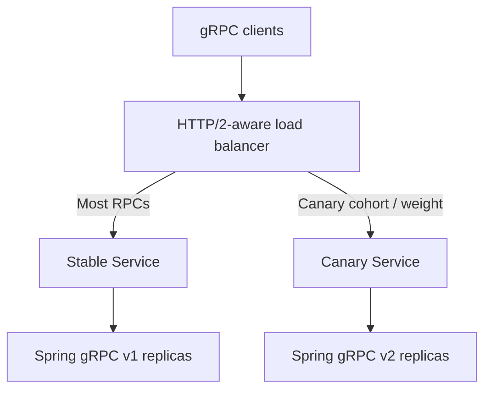

# Canary Server and Client

## 1. Objectives

A canary deployment sends a new version to a small fraction of traffic or a subset of clients before expanding across the entire system. With Spring gRPC, both server versions and client versions must be controlled because the two sides exchange Protobuf messages over RPCs and often hold long-lived HTTP/2 connections.

**Canary server and client** is a controlled release strategy: deploy a group of new servers, route a portion of RPCs to that group, observe quality, and gradually increase traffic; at the same time, a new client can be released to a small cohort to verify end-to-end compatibility and behavior.

Canarying does not replace compatibility testing. During rollout, old clients can call new servers and new clients can call old servers. Contracts must support those combinations, or traffic must be explicitly isolated by version.

After this lesson, you can:

- Distinguish server canaries from client canaries.
- Choose routing by RPC, by connection, or by client cohort.
- Understand how HTTP/2 multiplexing and long-lived streams affect canary percentages.
- Design stable/canary deployments for Spring gRPC.
- Preserve Protobuf contract compatibility during mixed-version phases.
- Measure SLOs, error rates, latency, and perform canary analysis.
- Halt, roll back, or expand a canary based on quantitative criteria.

## 2. Server Canary and Client Canary

A **server canary** replaces part of the backend with a new version while stable servers continue serving the rest. A load balancer, service mesh, or client-side resolver decides which RPCs go to stable and which go to canary.

A **client canary** releases a new application/client version to a small group of users, pods, or tenants. The new client may use new generated stubs, send new fields, or call new methods. Because clients may connect to multiple server versions, the server fleet must support the new client's behavior before the client depends on new features.

| Aspect | Server canary | Client canary |
|---|---|---|
| Changed component | Spring gRPC server | Application using gRPC stubs |
| Grouping unit | RPC, connection, endpoint, or cohort | User, tenant, pod, region, or client instance |
| Primary signals | Server version, backend load, RPC status/latency | Client version, crashes/errors, RPC outcomes, and user impact |
| Key risks | Mixed server fleet, skewed routing, schema mismatch | New client calling methods/fields not yet supported by old servers |
| Rollback | Remove canary backends from the pool | Stop rollout or revert clients to the previous version |

The two dimensions can be deployed separately or coordinated. For example, first put a backward-compatible new server at 5% traffic; once stable, release the new client to a 1% cohort. Do not ramp both percentages simultaneously unless necessary, as that makes it harder to pinpoint which change caused a failure.

## 3. Why Is a gRPC Canary Different from Short HTTP Requests?

gRPC typically reuses `ManagedChannel`s and HTTP/2 connections. One connection can carry many concurrent RPCs. Distinguish between:

- **Connection-level routing:** the load balancer picks a backend when the TCP connection is opened.
- **RPC-level routing:** an HTTP/2-aware proxy picks a backend per RPC stream.
- **Client-side routing:** the resolver/load balancing policy in the gRPC client picks a backend.
- **Cohort routing:** a client or user group is pinned to a release track.

If an L4 load balancer sends 5% of TCP connections to canary, one connection might carry thousands of RPCs while another carries almost no traffic. Thus, 5% of connections does not guarantee 5% of RPCs.

HTTP/2 connections and streaming RPCs can be long-lived. A stream already started on stable usually stays on stable; it does not migrate to canary mid-stream. When measuring a canary, observe RPC counts, active streams, stream duration, and traffic bytes per backend.

If the goal is canarying by request percentage, you need an L7 proxy that understands HTTP/2/gRPC and supports weighted routing at the stream/RPC level, or an appropriate client-side routing design. L4 remains useful for TCP/TLS passthrough, though connection distribution should only be used when skew from connection affinity is acceptable.

## 4. Stable and Canary Server Architecture

A deployment can split stable and canary into two Deployments/Services:



Stable and canary should have distinct labels, metrics, and log versions. Both need compatible contracts during the mixed-fleet window. Readiness probes should admit instances into the pool only after the server has registered services and is ready to process RPCs.

Canaries can be implemented using:

- Two Kubernetes Deployments and two separate Services.
- A service mesh or ingress supporting weighted gRPC routes.
- An L7 load balancer capable of routing HTTP/2 streams by metadata or weight.
- A client-side resolver returning stable/canary endpoints per policy.

Exact configuration names depend on the infrastructure. Do not assume every HTTP ingress supports gRPC weighted routing; verify the upstream protocol, HTTP/2, and how the product applies weights.

## 5. Choosing a Canary Routing Approach

| Routing Approach | Selection Unit | Pros | Cons |
|---|---|---|---|
| Weighted L7 gRPC routing | RPC/stream | Achieves request ratios close to target | Proxy must understand gRPC/HTTP2 |
| L4 TCP balancing | TCP connection | Simple, preserves TLS passthrough | RPC ratios can skew due to multiplexing |
| Metadata/header routing | RPC based on metadata | Targets specific cohorts, easy to test | Must protect metadata and requires proxy support |
| Client-side resolver | Subchannel/backend address | Client controls endpoint selection | Requires client discovery and policy |
| Separate endpoint | Client/channel or cohort | Clear isolation | Must manage targets and channel lifecycles |

Weighted routing fits traffic-percentage experiments. Header/metadata routing fits fixed or internal cohorts, such as QA testers. Separate endpoints fit when isolating canary clients from stable servers, or when the load balancer lacks L7 gRPC routing.

Do not mix multiple mechanisms without knowing which one determines the final backend. If client-side `round_robin` picks a pod first and a proxy also applies weighted routing, actual percentages may differ from expectations.

## 6. Routing by gRPC Metadata

gRPC metadata can be used by a proxy to route by release track. For example, a client sends custom metadata:

```java
Metadata metadata = new Metadata();
Metadata.Key<String> releaseTrack =
        Metadata.Key.of(
                "x-release-track",
                Metadata.ASCII_STRING_MARSHALLER);
metadata.put(releaseTrack, "canary");

CatalogServiceGrpc.CatalogServiceBlockingStub canaryStub =
        MetadataUtils.attachHeaders(baseStub, metadata);
```

This gRPC Java example illustrates custom metadata. Use it only when the proxy/LB is configured to read that metadata key and route to the right backend pool. Metadata keys must be lowercase ASCII; do not use HTTP/2 pseudo-headers or metadata reserved for the gRPC transport.

Client-sent metadata is not trustworthy proof of identity or permissions. Clients can set their own release track or spoof another cohort. If routing affects access rights or sensitive data:

1. Authenticate the client first at the gateway/proxy.
2. Strip client-supplied cohort metadata if self-selection is disallowed.
3. Have the proxy generate internal metadata after resolving the cohort from trusted identity/configuration.
4. Trust internal metadata only on protected upstreams.

Do not use canary metadata as a substitute for authorization. A canary route only selects a backend version; every backend must still enforce authentication, authorization, and validation.

## 7. Client-Side Canarying

A client canary can be released by cohort:

- A small percentage of mobile/desktop users.
- An internal group of tenants.
- A subset of pods of a service calling downstream gRPC.
- A single region or staging environment.
- Verified employees or testers.

New clients should be built from generated stubs corresponding to a controlled proto version. Before enabling a new feature, verify that stable servers can handle the new request or that the client has a fallback.

For backend service-to-service calls, you can run two client Deployments or two release tracks. If using separate endpoints:

```java
ManagedChannel stableChannel = ManagedChannelBuilder
        .forTarget("dns:///catalog-stable.internal:9090")
        .usePlaintext()
        .build();

ManagedChannel canaryChannel = ManagedChannelBuilder
        .forTarget("dns:///catalog-canary.internal:9090")
        .usePlaintext()
        .build();
```

This example illustrates separate targets inside a trusted network; production must configure TLS/mTLS according to the trust boundary. Channels are long-lived resources, so reuse them and close them with the lifecycle. Do not create a new channel per RPC or forget to shut down unused channels.

Never let a canary client accidentally send all production traffic to the canary server just because a shared target config changed. Keep cohort selection explicit, observable, and independently rollbackable.

## 8. Protobuf Compatibility During Canarying

During a canary, client and server versions can differ. Every change should be evaluated across four combinations:

| Client | Server | What to Verify |
|---|---|---|
| v1 | stable v1 | Baseline |
| v1 | canary v2 | New server accepts old requests and returns compatible responses |
| v2 | stable v1 | New client falls back when old server lacks the feature |
| v2 | canary v2 | New feature works completely |

Principles:

- Add fields using new tags; do not change or reuse field numbers.
- New fields must have safe semantics when absent.
- Clients must handle unknown/`UNRECOGNIZED` enums.
- New methods must only be called by clients when every backend that can receive the request supports them, or the client has a fallback/isolated route.
- Do not delete old fields/methods in the same release that migrates clients.
- Preserve old semantics for old clients during the transition window.

If client v2 must call a new method, do not route that request to stable v1. Use a dedicated canary endpoint or capability-aware routing. Do not rely on a small canary percentage to hide a guaranteed incompatibility.

## 9. Step-by-Step Server Canary Procedure

A server rollout can be broken into stages:

1. **Preflight:** schema compatibility checks, unit/integration tests, security scans, and load tests.
2. **Deploy canary:** run one or a few new replicas without receiving production traffic yet.
3. **Smoke test:** call the health RPC and a representative set of business RPCs.
4. **1% traffic:** route a small fraction of RPCs to canary if L7 supports request-level weighting.
5. **Ramp-up:** gradually increase to 5%, 10%, 25%, 50% across observation windows.
6. **Full rollout:** shift all traffic once gates pass.
7. **Cleanup:** retain a rollback window before removing the old stable version.

Each step needs enough observation time to cover real workloads. For long-lived streams, the observation window must account for stream lifetime; a canary running for only a few minutes may not receive rare stream types.

The percentages are examples, not mandatory numbers. If traffic is low, 1% may be too small to evaluate; require a minimum request count and volume threshold before deciding.

## 10. Client Canary Procedure

Client rollouts generally require separate gates:

1. Confirm stable servers already support the requests/responses used by the new client.
2. Release the new client to an internal cohort or 1% of users/pods.
3. Attach client version and release cohort to telemetry per security policy.
4. Monitor crashes, RPC statuses, deadlines, latency, and fallbacks.
5. Expand the cohort incrementally as gates pass.
6. Halt rollout if the new client causes errors or abnormal load spikes.
7. Enable new features only after backend compatibility is verified.

For mobile/desktop clients, rollbacks may not be instantaneous because users do not update immediately. Servers must continue supporting old clients for the committed support window. For service-to-service clients, rollouts can move faster, though compatibility must still hold while old and new pods run side by side.

## 11. Measuring SLOs and Comparing Canary Against Stable

Do not decide based solely on a single fleet-wide aggregate metric. Split telemetry by release track and server version:

- Request/RPC rate by service and method.
- Error rate by gRPC status code.
- p50, p95, p99 latency.
- `Deadline exceeded` and client cancellations.
- Retry, fallback, and reconnect rates.
- CPU, memory, and thread/worker saturation.
- Active streams and stream duration.
- Dependency errors/latency from canary.
- Health/readiness transitions and restart counts.

Compare canary against stable over the same time window and workload type. If canary receives only read traffic while stable receives write traffic, comparing raw error rates can mislead you. Segment by method, tenant/region, and request class when needed.

Example gate table:

| Metric | Illustrative Expansion Condition |
|---|---|
| gRPC error rate | Does not exceed threshold compared to stable |
| p99 latency | Within SLO and does not diverge significantly |
| Deadline exceeded | No abnormal increase |
| CPU/memory | Sufficient headroom for ramp-up |
| Dependency failures | No new regressions |
| Streaming | No rise in unexpected cancellations |
| Health/readiness | Canary stable, no restart loops |

Set concrete thresholds based on the system's SLO and baseline. Do not apply a single generic threshold to every method or workload.

## 12. Canary Analysis and Decisions

A canary has three primary outcomes:

- **Promote:** expand traffic/cohort when all gates pass and volume is sufficient.
- **Hold:** keep the current ratio when data is insufficient or a metric is ambiguous.
- **Rollback:** stop the canary and shift traffic back to stable when a regression exceeds thresholds.

Key principles:

- Define stop conditions before starting.
- Use the same time window for canary and control groups.
- Exclude shared environmental errors affecting both groups.
- Ensure sufficient sample size; low traffic requires longer windows.
- Track both leading indicators like latency/dependency saturation and outcomes like error rates.
- Record versions, configs, and weight-change timestamps to correlate metrics with the rollout.

Do not keep ramping just because the overall fleet looks healthy if the canary itself is failing. Conversely, do not roll back over an unrelated brief spike; check volume, traces, and dependencies before deciding if no stop condition has been breached.

## 13. Rolling Back Server and Client

Server rollback:

1. Set canary weight to zero or remove canary endpoints from the pool.
2. Stop accepting new RPCs on canary.
3. Drain active streams per the grace period.
4. Keep stable servers serving traffic.
5. Investigate logs/traces and preserve artifacts/configs for reproduction.

Client rollback:

1. Stop releasing to new cohorts.
2. Where possible, revert the cohort to the previous client version.
3. Turn off feature flags or fall back to old methods/semantics.
4. Keep servers compatible with both old and already-released clients.
5. Monitor remaining old clients before contracting the API.

Rolling back an image does not undo side effects or data already written by the canary. If the new server wrote new fields/statuses to a database or event stream, old stable servers must be able to read that data, or the rollout must have a migration/compensation plan.

## 14. Security and Cohort Integrity

Canary routing may use tenants, user cohorts, or metadata. Do not put sensitive identifying details directly into high-cardinality labels/metrics.

- Cohort assignment must remain stable during an experiment when comparing the same group.
- Only trusted gateways may assign internal routing metadata.
- Do not trust arbitrary client-sent release headers.
- Do not use canary routes to bypass authorization or auditing.
- Protect canary endpoints; do not expose them directly to public clients unless authorized.
- Keep TLS/mTLS and network policies identical to the stable environment.
- Separate bounded-cardinality metric labels, such as `release_track` and `server_version`.

Canaries should not hold sensitive production data beyond what is necessary. If real traffic is required, apply the same data access policies, auditing, and retention as stable.

## 15. Testing Canaries

### Compatibility Tests

Test client v1/server v2, client v2/server v1, and client v2/server v2. Include unknown enums, absent fields, new methods, and fallbacks.

### Routing Tests

Send RPCs for each cohort and verify which server version receives the request. Verify metadata is stripped/overwritten properly and cohorts cannot be spoofed.

### HTTP/2 Connection Tests

Hold a long-lived `ManagedChannel`, send many RPCs, and change canary weights. Verify whether weights apply at the connection level or RPC level according to load balancer capabilities. Open multiple channels and streams to measure actual skew.

### Load/Streaming Tests

Send representative unary and streaming traffic. Monitor active streams, stream age, cancellations, latency, and resource usage. Verify long-lived streams are not assumed to migrate mid-stream.

### Rollback Tests

Set canary weight to zero, drain canary, verify stable handles new traffic, and verify client fallbacks work. Verify data written by canary remains readable after rollback.

## 16. Common Pitfalls

| Symptom | Cause | Resolution |
|---|---|---|
| Canary at 5% receives nearly 40% of RPCs | L4 splits connections, not individual RPCs | Use L7 per-RPC routing or measure by request |
| Canary receives no new traffic after raising weight | Clients hold old HTTP/2 connections or proxy did not reload routes | Check connection reuse, route propagation, and open new connections as needed |
| New client receives `UNIMPLEMENTED` | Request hits stable server lacking new method | Roll out servers first or isolate routes |
| Old client fails on new enum | Does not handle unknown enums | Add unknown-value handling before emitting new values |
| Canary metrics look good while users hit errors | Cohort or workload is unrepresentative | Segment by method/tenant/region and expand sample |
| Server rolled back but data unreadable | Canary wrote new schema/enum | Backward-readable migration or compensation |
| Metadata routing spoofed | Trusting client-sent headers | Strip inbound values and set from trusted gateway |
| Canary streams linger after rollback | Streams remain bound to canary backend | Drain, cap lifetime, or resume |
| Canary ratio fluctuates unexpectedly | Multiple LB/client-side policies pick backends | Establish a single routing authority and observe each hop |

## 17. Hands-on Exercise

**Scenario:** Catalog has three stable Spring gRPC replicas and one v2 canary replica. Client v1 is running; client v2 adds the `display_label` field and wants to call a new RPC `GetDisplayLabel`. The infrastructure has an HTTP/2-aware load balancer and some clients hold long-lived channels.

Perform the following:

1. Verify schema v2 is compatible with client/server v1 across required combinations.
2. Deploy canary server v2 without routing production traffic yet.
3. Run smoke tests via `grpcurl` and generated clients.
4. Configure an RPC-level weighted gRPC route, starting with a small percentage.
5. Track RPC counts by backend/version to verify actual weights.
6. Release client v2 only after every backend that can receive `GetDisplayLabel` supports the method or the client has a safe route/fallback.
7. Release client v2 to a small cohort and monitor version, status, latency, deadlines, and fallbacks.
8. Test long-lived streams while changing weights and rolling out.
9. Define stop conditions and perform a server/client canary rollback.
10. Verify stable can still read data written by canary.

**Completion criteria:** canary cohorts are identified reliably; actual RPC percentages are measured rather than inferred from connection counts; cross-version clients/servers are compatible; new features are called only when backends support them; SLO gates have clear thresholds; rollback causes no data loss or out-of-policy stream drops.

## 18. Key Takeaways

A server canary sends a fraction of RPCs to a new backend; a client canary releases a new client version to a cohort. With gRPC, pay attention to HTTP/2 connections carrying many RPCs and long streams, so L4 connection weights do not equal request weights. If RPC-level percentages are needed, use observable L7 gRPC-aware routing or client-side routing. Maintain Protobuf wire and semantic compatibility in mixed fleets; deploy supporting servers before clients depend on new fields/methods. Measure error rates, latency, deadlines, active streams, dependencies, and resources by release track; set promote/hold/rollback gates before rolling out. Cohort metadata must come from a trusted source and never replace authorization. Rollbacks must remove canary, drain streams, and ensure data written by canary remains readable by stable. Test cross-version clients/servers, routing, HTTP/2 connection reuse, and rollbacks before expanding.
