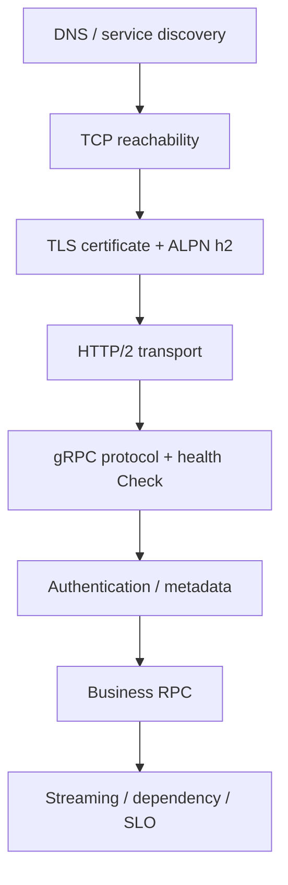

# Verifying Endpoints After Deployment

## 1. Objectives

After deploying Spring gRPC, a successful Deployment status or an open TCP port does not prove clients can invoke RPCs properly. An endpoint might resolve DNS yet route incorrectly; TCP connect might succeed yet TLS/ALPN fail to negotiate HTTP/2; HTTP/2 might work yet gRPC health be unready; health might be green yet business methods fail due to schema, metadata, authentication, or dependencies.

**Verifying endpoints after deployment** is the process of validating a gRPC endpoint along the exact network path real clients will use, traversing DNS, TCP, TLS, HTTP/2, gRPC protocol, and application behavior. The goal is to catch failures early after rollout, confirm the right version/backend is receiving traffic, and produce clear evidence to promote or roll back a release.

In the Spring gRPC ecosystem, you must verify the server listener, generated service registration, Protobuf contract, health status, interceptors/security policies, dependencies, and streaming behavior. Checks must use the exact hostname, port, TLS trust, metadata, and RPC methods used by production workloads.

After this lesson, you can:

- Distinguish verifying deployment status, TCP ports, gRPC health, and business RPCs.
- Verify DNS, routing, TLS certificates, and ALPN `h2`.
- Call gRPC health `Check` and real methods using `grpcurl`.
- Verify authentication, metadata, deadlines, and status codes.
- Verify the endpoint through load balancers and per backend replica.
- Test streaming, readiness, and behavior during rollouts.
- Design smoke tests, acceptance gates, and rollback procedures.

## 2. Layer-by-Layer Verification

A gRPC endpoint should be verified in order from the outer layer inward:



Each step answers a different question:

| Layer | Question to Verify | Tool/Signal |
|---|---|---|
| DNS | Does the hostname resolve to the expected address? | `nslookup`, `dig`, resolver logs |
| TCP | Can a connection reach the right port? | `nc`, `Test-NetConnection` |
| TLS | Are the certificate, hostname, and trust chain valid? | `openssl s_client` |
| ALPN | Does the TLS connection negotiate HTTP/2 `h2`? | `openssl s_client -alpn h2` |
| HTTP/2/gRPC | Does the server understand gRPC framing and trailers? | `grpcurl` |
| Health | Does the service report `SERVING`? | `grpc.health.v1.Health/Check` |
| Security | Are token/client identity and authorization enforced? | `grpcurl` metadata, test identities |
| Business | Does the method return a contract-compliant response? | `grpcurl` or generated client |
| Streaming | Do streams stay open and terminate per policy? | integration/load tests |

Do not skip an earlier layer when investigating a later failure. For example, `UNIMPLEMENTED` typically indicates the request reached a gRPC server, but the service/method is unregistered or routed incorrectly; `connection refused` occurs before the gRPC layer.

## 3. Preparing Endpoint Details

Before running smoke tests, record the release values:

- Public/service hostname and port.
- Protocol at each hop: `TLS+h2`, `h2c`, or upstream TLS.
- CA bundle and client certificate if using mTLS.
- Protobuf package, service, and method to invoke.
- Sample request containing no sensitive data.
- Required metadata such as authorization, tenant, or correlation ID.
- Expected deadlines for unary and streaming calls.
- Expected gRPC status and response assertions.
- Expected server version/revision to observe.
- Internal endpoint and load-balanced endpoint.

Example endpoint details:

```text
Public:  catalog.example.internal:443
In-cluster: catalog-grpc.default.svc.cluster.local:9090
Service: catalog.v1.CatalogService
Method:  GetProduct
Health:  grpc.health.v1.Health/Check
```

The hostnames and methods above are examples only. In real smoke tests, use the exact names published in the contract and environment config. Do not guess method names from Java class names.

Store sample requests and expected responses in the release test suite, but never commit access tokens, private keys, or sensitive production payloads to repositories or logs.

## 4. Verifying DNS and Service Discovery

Check that the hostname resolves within the proper network environment:

```bash
nslookup catalog.example.internal
```

On Linux, you can use:

```bash
dig +short catalog.example.internal
```

Successful DNS only confirms the resolver returned an address. It does not prove that address points to the new load balancer, the right cluster, or the right backend pool.

With Kubernetes, check service DNS from a pod sharing the client's namespace/network policy:

```bash
kubectl get svc catalog-grpc -n default
kubectl get endpointslice -n default -l kubernetes.io/service-name=catalog-grpc
```

`EndpointSlice` must contain ready backends matching the selector. If the Service has no endpoints, inspect label selectors, readiness probes, and pod status. If endpoints still contain terminating pods, inspect readiness propagation and the termination lifecycle.

For client-side load balancing, verify the resolver actually sees the required backend addresses. `ClusterIP` typically gives clients only a virtual IP; a headless Service or xDS can provide the endpoint list. Do not infer client-side balancing works solely from the Deployment's replica count.

## 5. Verifying the TCP Port

Check TCP reachability from the location where real clients run:

```bash
nc -vz catalog.example.internal 443
```

On Windows PowerShell:

```powershell
Test-NetConnection catalog.example.internal -Port 443
```

A successful TCP connect proves a listener or network device accepts connections at that address/port. It does not prove the listener supports TLS, HTTP/2, or gRPC.

If TCP fails, check in order:

- Which IP the hostname resolves to.
- Whether the public port and backend port mapping match.
- Firewalls, security groups, and Kubernetes NetworkPolicy.
- Whether the load balancer listener/target group is healthy.
- Whether the container listener binds the right interface and port.
- Whether pods are ready and the service selector matches the pods.

Do not use a TCP check from a laptop to conclude pod-to-pod networking works. Run probes from the exact network vantage point: outside the cluster, inside the client namespace, and from proxy to backend if needed.

## 6. Verifying TLS Certificates and ALPN `h2`

For TLS endpoints, check the certificate chain, hostname, and negotiated ALPN:

```bash
openssl s_client -connect catalog.example.internal:443 -servername catalog.example.internal -alpn h2
```

Verify:

- The certificate is not expired.
- The SAN matches the hostname clients use.
- The certificate chain leads to a trusted CA.
- SNI is sent properly so the server/proxy picks the right certificate.
- The ALPN negotiated protocol is `h2`.

If ALPN does not select `h2`, the listener may serve only HTTP/1.1 or the TLS/proxy configuration may not have HTTP/2 enabled. gRPC clients can fail even when the TLS handshake completes.

If a proxy terminates TLS and opens a new upstream, check both hops separately. TLS success on client-to-ingress does not prove proxy-to-Spring backend uses the right `h2c` or TLS+HTTP/2.

With mTLS, verify the server demands a client certificate per policy and trusts the client certificate chain. Do not use options that skip certificate verification to make smoke tests pass; that masks identity and hostname errors.

## 7. Testing gRPC with `grpcurl`

`grpcurl` sends real gRPC requests over HTTP/2 and fits endpoint smoke testing. If the server enables reflection, you can list services:

```bash
grpcurl catalog.example.internal:443 list
```

If reflection is disabled, that does not mean the server is broken. Reflection is an optional service. Supply the proto source or descriptor set:

```bash
grpcurl -proto catalog.proto catalog.example.internal:443 catalog.v1.CatalogService
```

Call a unary method with a custom CA:

```bash
grpcurl -cacert ca.pem -proto catalog.proto -d '{"productId":"p-42"}' catalog.example.internal:443 catalog.v1.CatalogService/GetProduct
```

With an internal plaintext endpoint:

```bash
grpcurl -plaintext -proto catalog.proto -d '{"productId":"p-42"}' catalog-grpc.default.svc.cluster.local:9090 catalog.v1.CatalogService/GetProduct
```

`-plaintext` is only appropriate for `h2c` endpoints inside a trusted network boundary. Do not use it to bypass TLS errors on a public endpoint.

When reflection is disabled, use `-proto` or `-protoset` to describe the service. If proto dependencies must be imported, pass the appropriate import paths. Smoke tests should not rely on reflection unless reflection is an intentionally enabled operational contract.

## 8. Verifying Authentication and Metadata

An endpoint may answer health `Check` while business methods still require authentication or authorization. Smoke tests should use an identity equivalent to real workloads.

Example passing a bearer token:

```bash
grpcurl -cacert ca.pem -H "authorization: Bearer $ACCESS_TOKEN" -proto catalog.proto -d '{"productId":"p-42"}' catalog.example.internal:443 catalog.v1.CatalogService/GetProduct
```

This is a shell example; storing and passing tokens depends on your CI secret store. Avoid printing tokens to the console, enabling shell tracing, or leaving them in command history. In pipelines, inject secrets at runtime and mask output.

Verify these cases:

- Valid identity with permission: receives expected response.
- Missing/expired token: receives `UNAUTHENTICATED`.
- Valid identity lacking permission: receives `PERMISSION_DENIED`.
- Valid tenant metadata: accesses only the matching tenant.
- Missing/malformed metadata: receives the defined validation/status error.

Health probes may not require the same auth as business RPCs. Never treat health success as proof that authorization works. Likewise, do not strip authentication from the entire listener just so orchestrators can probe; choose a dedicated health access policy or an appropriate probe mechanism.

## 9. Verifying Deadlines and Status Codes

Smoke tests need bounded deadlines so pipelines do not hang:

```bash
grpcurl -max-time 5 -cacert ca.pem -proto catalog.proto -d '{"productId":"p-42"}' catalog.example.internal:443 catalog.v1.CatalogService/GetProduct
```

An appropriate timeout depends on the method. Do not apply one short timeout to every streaming workload.

Common statuses:

| Status | Meaning When Verifying Endpoints |
|---|---|
| `OK` | RPC completed successfully |
| `UNAVAILABLE` | Server/transport/backend temporarily unreachable |
| `DEADLINE_EXCEEDED` | RPC exceeded deadline; check latency and timeouts at each hop |
| `UNAUTHENTICATED` | Missing or invalid credentials |
| `PERMISSION_DENIED` | Identity lacks authorization |
| `INVALID_ARGUMENT` | Request failed validation |
| `NOT_FOUND` | Resource does not exist or service name in health request is unmanaged |
| `UNIMPLEMENTED` | Service/method not registered or proxy routed incorrectly |
| `INTERNAL` | Internal processing error; requires correlation ID and server logs |

A smoke test should not check only the exit code. Verify the status code and key response fields to avoid endpoints responding with incorrect business results.

## 10. Verifying gRPC Health

gRPC defines `grpc.health.v1.Health/Check`. The request has a service name field; an empty string usually represents overall status, while a specific name represents the service under check.

Example:

```bash
grpcurl -plaintext -d '{"service":"catalog.v1.CatalogService"}' localhost:9090 grpc.health.v1.Health/Check
```

The response must show status `SERVING` when the service is ready. Other statuses such as `NOT_SERVING` indicate the server is not yet accepting business traffic; `UNKNOWN` should not be treated as healthy.

If the health call returns `UNIMPLEMENTED`, the health service may not be registered. If the service name is unmanaged, the server may return `NOT_FOUND`. Match the exact Protobuf package and service name; do not substitute the Java package name.

With Spring gRPC, `HealthStatusManager` from `grpc-services` can manage status, but `getHealthService()` must be registered on the server and statuses updated with the lifecycle. Creating the bean alone does not guarantee the health RPC is bound.

Health Check is only one signal. After health succeeds, still invoke at least one representative business RPC to verify generated services, interceptors, dependencies, and response mapping.

## 11. Verifying Through the Load Balancer and Per Replica

A public endpoint smoke test validates the client path, yet may hit only one backend. During a rolling deployment, some replicas may run the new version while others still run the old version.

Include two layers of verification:

1. **Service-level test:** call the hostname/service VIP used by production clients; verify routing and user-visible behavior.
2. **Backend-level test:** verify each replica or endpoint via a secure internal mechanism; verify all backends are ready and running the expected version.

In Kubernetes, `port-forward` can inspect a specific pod in a controlled environment:

```bash
kubectl port-forward pod/catalog-grpc-7d9f8c 19090:9090 -n default
```

Then call `localhost:19090` with `grpcurl` using the listener's exact TLS/plaintext mode. If `port-forward` targets a TLS listener, you still need an appropriate CA/hostname strategy; do not automatically switch to `h2c`.

Do not expose pod ports publicly just for testing. Use protected administrative network paths with restricted access. When multiple replicas exist, repeat checks per pod/endpoint or use telemetry carrying `server_version`/`instance_id` to prove distribution.

If the load balancer uses sticky routing, sending multiple RPCs from one `ManagedChannel` may repeatedly hit one backend. Open multiple channels or use an L7 request-level routing test to verify the pool. Do not infer every replica is healthy from a single successful VIP call.

## 12. Verifying the Right Version and Release

An endpoint may be healthy yet still point to an old image or a backend outside the intended rollout. Verify release identity through one of these mechanisms:

- A diagnostic response field or version RPC.
- Internal metadata/trailers reliably attached by the proxy/server.
- Metric labels `server_version` and `instance_id`.
- Deployment image digest and pod template revision.
- Traces/logs carrying a release ID.

Do not trust client-supplied version metadata to identify the server version. Values must originate from the server or trusted infrastructure.

When canarying, verify the RPC ratio by server version rather than only TCP connection ratios. HTTP/2 multiplexing can send many RPCs over one connection to the same backend. With an L4 load balancer, connection weight does not equal request weight.

## 13. Verifying Streaming and Connection Reuse

A unary smoke test does not verify streaming. For server-streaming, client-streaming, or bidirectional streaming, run dedicated tests:

- Stream opens and sends/receives the first message.
- Message ordering and sequence/cursor are correct.
- Backpressure/flow control prevents unbounded memory growth.
- Deadlines and idle timeouts are appropriate.
- Cancellation frees subscriptions/resources.
- Stream terminates with the expected status.
- Reconnect/resume works if supported by the contract.

A server-streaming test can verify several messages and then perform a controlled cancel. Do not hold infinite streams open in a short smoke test; use integration tests with clear duration and stop conditions.

Verify connection reuse with a long-lived `ManagedChannel` and multiple RPCs. After deployment, observe whether clients reconnect properly when servers/connections drain. Do not create a new channel per RPC in production just to avoid stale connections.

## 14. Verifying Dependencies and Readiness

gRPC health `SERVING` should reflect serving capability under the defined policy. For methods depending on a database, cache, or downstream gRPC:

- Confirm dependency connections/pools are ready.
- Perform lightweight, bounded-timeout checks.
- Do not run heavy queries on every health request.
- Distinguish mandatory dependencies from optional dependencies.
- Avoid putting all dependencies into liveness and causing restart storms.
- Cross-check readiness state against real RPCs.

A green Health Check while `GetProduct` returns `UNAVAILABLE` may indicate the health policy omits a required database or downstream. That is a readiness contract issue, not merely a `grpcurl` issue.

Do not turn smoke tests into load tests. Smoke tests should use lightweight requests, bounded counts, and safe data. Load/performance tests require separate environments, traffic profiles, and thresholds.

## 15. Post-Deploy Smoke Tests in CI/CD

A post-deploy pipeline might include:

1. Wait for Deployment rollout completion and Ready pods.
2. Verify DNS from the appropriate runner/network zone.
3. Check the TCP port.
4. Check the TLS certificate and ALPN `h2`.
5. Invoke gRPC Health Check.
6. Invoke one or more representative business RPCs with test credentials.
7. Assert response fields and status.
8. Verify server version/revision.
9. Run a streaming smoke test if the service has a streaming contract.
10. Collect logs/metrics/traces and decide whether to promote or roll back.

Condensed shell script example:

```bash
#!/usr/bin/env bash
set -euo pipefail

TARGET="catalog.example.internal:443"
PROTO="catalog.proto"

grpcurl -cacert ca.pem \
  -d '{"service":"catalog.v1.CatalogService"}' \
  "$TARGET" grpc.health.v1.Health/Check

grpcurl -cacert ca.pem \
  -max-time 5 \
  -proto "$PROTO" \
  -d '{"productId":"smoke-test-product"}' \
  "$TARGET" \
  catalog.v1.CatalogService/GetProduct
```

This script illustrates structure only. Production pipelines must pass credentials via a secret store, parse responses to assert `SERVING` and business fields, retry health checks with bounds during the startup window, and keep tokens out of logs.

Do not infinitely retry a failing smoke test. Use bounded attempts, backoff, and an overall deadline to distinguish slow startup propagation from a persistently broken endpoint.

## 16. Post-Deploy Pass/Fail Criteria

Define gates before deploying:

| Gate | Pass Condition | Action on Failure |
|---|---|---|
| DNS | Hostname resolves to right zone/address | Stop; inspect DNS/service discovery |
| TCP | Right listener/port is reachable | Stop; inspect routing/firewalls/listeners |
| TLS/ALPN | Certificate trusted, hostname matches, ALPN `h2` | Stop; fix certificates/proxy protocol |
| Health | Service status is `SERVING` | Wait within startup budget or roll back |
| Auth | Valid credentials accepted; invalid rejected | Stop; inspect security/interceptors |
| Business RPC | Response/status match contract | Stop; inspect service, dependencies, and mapping |
| Streaming | Messages/cancel/complete follow semantics | Do not promote; investigate stream lifecycle |
| Version | Backends run expected revision | Check rollout and routing |
| SLO | Errors/latency/resources within thresholds | Hold or roll back per policy |

There are three decisions:

- **Pass/promote:** all mandatory gates pass and observed volume is sufficient.
- **Hold:** startup has not stabilized or data is insufficient; keep traffic at current level.
- **Fail/rollback:** critical gate violated or regression exceeds SLO.

Do not mark a deploy successful solely because the Kubernetes rollout completed. The orchestrator confirms pod readiness via probes; smoke tests confirm the endpoint and RPC contract from the client's perspective.

## 17. Symptom-Based Diagnostics

| Symptom | Likely Failing Layer | What to Check Next |
|---|---|---|
| DNS lookup fails | DNS/service discovery | Records, namespace, resolver, search domain |
| `Connection refused` | TCP/listener | Port mapping, bind address, pod listener |
| Connection timeout | Network path | Firewall, security groups, NetworkPolicy, LB |
| TLS handshake/certificate error | TLS | CA, SAN, expiry, SNI, mTLS |
| ALPN is not `h2` | HTTP/2 negotiation | TLS listener and proxy frontend |
| HTTP/2 connects but `UNIMPLEMENTED` | gRPC service registration/routing | Full method path, service binding, proxy route |
| Health returns `NOT_SERVING` | Application readiness | `HealthStatusManager` and dependency policy |
| Health returns `NOT_FOUND` | Health service name | Protobuf full service name in request |
| `UNAUTHENTICATED` | Authentication | Token, certificate, metadata interceptor |
| `PERMISSION_DENIED` | Authorization | Roles, tenant, method policy |
| `DEADLINE_EXCEEDED` | Latency/timeout | Client deadline, proxy timeout, downstream |
| `UNAVAILABLE` after rollout | Backend/connection lifecycle | Readiness, endpoint pool, `GOAWAY`, drain |
| Unary passes, stream fails | Streaming/idle timeout | Proxy timeout, flow control, cancellation |

Collect correlation IDs, method names, server versions, and traces before drawing conclusions. Avoid logging tokens, private keys, or sensitive payloads.

## 18. Security When Verifying Endpoints

Post-deploy tests often run in CI/CD or high-privilege operational environments. Protect them:

- Use dedicated smoke-test credentials with least privilege and short lifetimes.
- Fetch secrets from a secret manager; never commit them into scripts.
- Mask authorization metadata and certificate private keys from logs.
- Use real CA/hostname verification; never skip TLS verification.
- Call administrative/health endpoints only from permitted networks.
- Use deletable test resources or dedicated test data.
- Rate-limit requests so smoke tests do not load production.
- Audit tests that have write permissions or mutate data.

If a test method creates side effects, use fixtures/idempotency keys and controlled cleanup. Prefer read-only RPCs or protected test-specific methods.

## 19. Hands-on Exercise

**Scenario:** Catalog Spring gRPC was just rolled out to Kubernetes. The public endpoint uses TLS at the ingress, and upstream to pods uses `h2c` inside a private network. The server has Health Check, unary `GetProduct`, and server-streaming `WatchCatalog`. Some traffic may still hit old-version pods during rollout.

Perform the following:

1. Document the expected hostname, port, CA, service/method, and server revision.
2. Check DNS from an out-of-cluster runner and from an internal client pod.
3. Check TCP port 443 and backend port 9090 from the right network vantage points.
4. Use `openssl` to verify the certificate, SAN, and ALPN `h2` at the ingress.
5. Verify the ingress upstream uses plaintext HTTP/2 matching the trust boundary.
6. Call `Health/Check` for `catalog.v1.CatalogService` and assert `SERVING`.
7. Call `GetProduct` with test credentials, a deadline, and response assertions.
8. Test an invalid token and verify `UNAUTHENTICATED` or the defined status.
9. Call `WatchCatalog`, receive messages, cancel, and verify resources are freed.
10. Check each backend revision or telemetry to verify stable/canary routing.
11. Review error rates, p99 latency, active streams, and dependency metrics.
12. Promote only when all gates pass; on failure, remove canary or roll back per runbook.

**Completion criteria:** endpoints are verified from the right network paths; DNS/TCP/TLS/ALPN/HTTP2/gRPC all pass; health and business RPCs have assertions; auth is tested both positively and negatively; streaming lifecycle is correct; version and backend routing are verified; promote/rollback decisions rely on measurable gates.

## 20. Key Takeaways

Post-deploy endpoint verification must progress from DNS and TCP to TLS/ALPN, HTTP/2, gRPC health, and then business RPCs. An open TCP port does not prove HTTP/2 or service readiness; `SERVING` health does not prove authentication, method mapping, dependencies, and response semantics are all right. Use `grpcurl` with the exact proto/descriptor, CA, metadata, and deadline; reflection is optional. Test from the proper network vantage points, through the load balancer, and per backend when necessary. With HTTP/2 multiplexing, a single VIP call may touch only one replica; use version telemetry or backend-level tests to verify the fleet. Test streaming and cancellation separately. Define pass/hold/rollback gates before rollout, protect credentials, and never turn smoke tests into load tests. Promote only when endpoint, contract, and SLO gates all pass.
