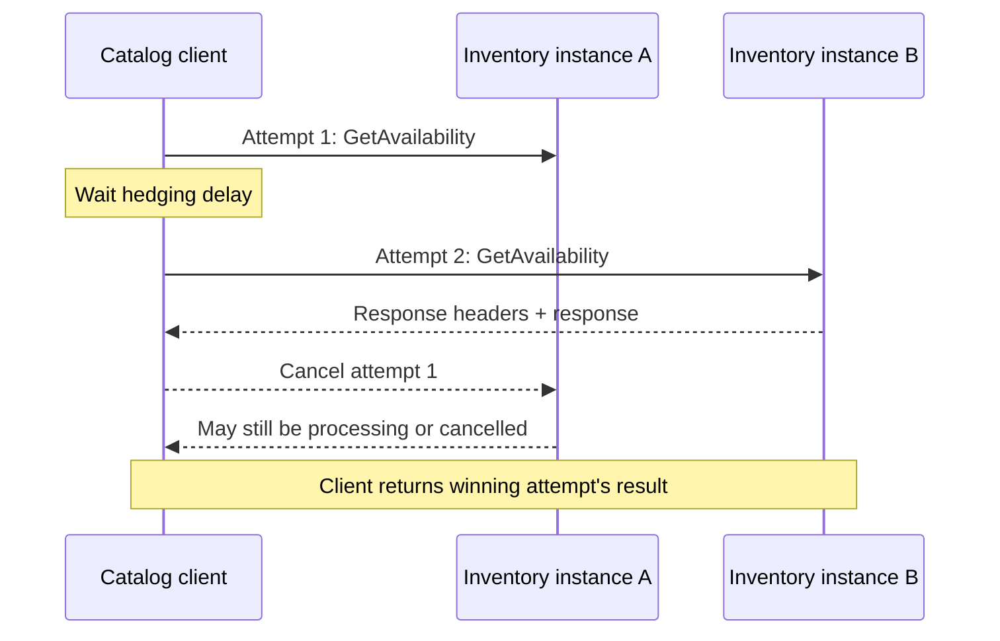
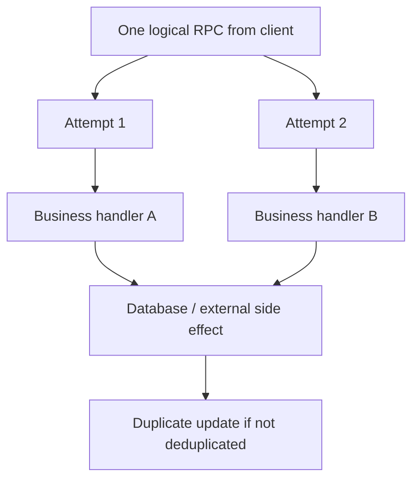

# Hedging and the risk of duplicate work

## 1. What problem does hedging solve?

In gRPC, an RPC can be slow because one server instance pauses, queues build up, a network path behaves abnormally, or a dependency responds slowly. A client normally waits on the current attempt until it receives a response or the deadline expires. For latency-sensitive requests, waiting on a single slow tail instance can spike p99 latency even while other instances remain healthy.

**Hedging** is a technique where the client sends an additional attempt for the same logical RPC after a short delay while the previous attempt is still in flight. Once any attempt responds first, the client takes that result and cancels the remaining attempts according to gRPC semantics.

Hedging can reduce tail latency when a subset of instances are unusually slow. In return, one logical RPC can generate multiple concurrent server attempts. If a method has side effects, multiple attempts can execute the work simultaneously and cause duplicate work.

Hedging is only safe when the method contract tolerates multiple executions or the server has sufficiently durable deduplication. Client cancellation does not automatically roll back transactions or undo external side effects that have already started.

## 2. Lifecycle of a hedged RPC

Suppose Catalog calls Inventory to read availability. The client starts the first attempt. If response headers have not arrived after the hedging delay, the client can launch a second attempt. Attempts may hit different server instances depending on the load-balancing policy.



Hedging does not create two independent logical RPCs on the caller side. It creates multiple attempts for the same call. However, the server receives each attempt as a separate RPC and may begin executing each request.

Under gRPC hedging semantics:

- The first attempt is sent immediately.
- After each hedging delay, another attempt may be sent if no attempt has sent response headers yet and attempts remain within the limit.
- An attempt terminating with a status in the non-fatal set can trigger the next attempt early.
- A fatal status terminates the logical call and cancels remaining attempts.
- Once one attempt sends response headers, hedging stops; other attempts are cancelled and the result from the attempt that sent headers is used for the call.

Important point: response headers do not necessarily mean the business operation succeeded. If a server sends headers early and fails afterward, the client has already passed the point where this mechanism continues hedging.

## 3. How does hedging differ from retry?

Both retry and hedging can issue multiple attempts, but their timing differs:

| Characteristic | Sequential retry | Hedging |
| --- | --- | --- |
| When next attempt starts | After the prior attempt fails per retry policy | After hedging delay while prior attempt is still pending, or upon receiving a non-fatal status |
| Concurrent attempts | Typically one | Can be multiple |
| Primary goal | Recover from transient failures | Cut tail latency and route around slow instances |
| Extra load | Occurs after failure | Can occur even when the first attempt would eventually succeed |
| Duplicate work risk | Present | Higher because attempts can run concurrently |
| Suited for | Operations with retry semantics | Idempotent operations or those with deduplication |

Sequential retry waits for an attempt to return an error before trying again. Hedging intentionally overlaps attempts so the caller does not wait out a slow attempt until the deadline.

Do not configure overlapping retry policies and hedging policies on the same method unless your service config/runtime explicitly supports it. Also check whether proxies or a service mesh perform their own retries; multiple retry layers can multiply attempt counts.

## 4. Hedging policy in gRPC service config

gRPC service config lets you declare hedging per service/method. Example policy for a unary read RPC:

```json
{
  "methodConfig": [
    {
      "name": [
        {
          "service": "inventory.v1.InventoryService",
          "method": "GetAvailability"
        }
      ],
      "hedgingPolicy": {
        "maxAttempts": 3,
        "hedgingDelay": "0.050s",
        "nonFatalStatusCodes": [
          "UNAVAILABLE"
        ]
      }
    }
  ]
}
```

Meaning:

- `maxAttempts` is the maximum total attempts, including the initial attempt.
- `hedgingDelay` is the wait interval between launching attempts when no response headers have arrived.
- `nonFatalStatusCodes` defines transient statuses that allow hedging to continue.

The example permits up to three attempts: the initial attempt, a second attempt after roughly 50 ms if no response headers have arrived, and a third attempt if still eligible. Actual values should be based on the method's latency distribution, capacity, and deadline.

Service config can come from a name resolver or the channel's default configuration, depending on the client runtime. With Spring gRPC, apply the policy on the Spring-managed channel via the service config/channel customization hook supported by your starter version. Never create a separate channel outside Spring's lifecycle just to enable hedging.

Hedging executes only when the gRPC client runtime supports it and retry/hedging is enabled on the channel configuration. Verify the behavior of your exact gRPC Java version and resolver; do not assume valid JSON guarantees the policy is active.

## 5. Choosing non-fatal statuses carefully

Not every status should trigger another attempt. A policy usually picks only statuses representing transient, recoverable conditions, such as `UNAVAILABLE` when a backend is temporarily unable to serve.

Statuses like `INVALID_ARGUMENT`, `UNAUTHENTICATED`, `PERMISSION_DENIED`, and `NOT_FOUND` are typically outcomes that calling another instance will not fix. Hedging them only adds load without improving results.

`RESOURCE_EXHAUSTED` requires extra caution: if the server is overloaded or rate-limiting, spawning more attempts can worsen the outage. Do not add this status to the non-fatal set without an appropriate retry-after/load-shedding policy.

A status code is only a technical signal. `UNAVAILABLE` can still occur after a server has performed a side effect if the response fails to reach the client. Choosing non-fatal statuses therefore never replaces idempotency.

## 6. Enable hedging only for methods with suitable semantics

Hedging fits read operations without side effects best, for example:

- Reading current availability.
- Fetching product details.
- Reading configuration or metadata.
- Queries that can execute independently on multiple replicas under the chosen consistency model.

Be cautious with write operations:

- Deducting inventory.
- Creating orders.
- Processing payments.
- Sending notifications.
- Issuing coupons.
- Writing audit logs or starting workflows.

If two attempts both deduct inventory, stock may be deducted twice. If both call a payment provider, two charges may occur. If both send an email, cancelling the losing attempt cannot unsend the email.

Never conclude an operation ran only once based on the method name or the fact that the client received one response. The server may have executed work across multiple attempts before the client picked a winner.

## 7. Where does duplicate work occur?

Duplicate work can occur at multiple layers:

1. **Application handler:** two server instances enter the service method simultaneously.
2. **Database:** two transactions execute inserts/updates or business actions concurrently.
3. **Downstream RPC:** each attempt calls Payment, Pricing, or Notification.
4. **Message broker:** two attempts publish the same event.
5. **External provider:** the side effect is accepted before cancellation arrives.
6. **Background worker:** the attempt is cancelled, yet an already-enqueued job keeps running.

gRPC cancellation is a best-effort stop signal; it is not a distributed rollback. Server handlers should check cancellation and halt unexecuted work where possible. Once a transaction commits or an external provider accepts a request, cancellation does not reverse that result.



## 8. Idempotency key: identifying the logical operation

For write RPCs requiring hedging or retry, the client should send a stable **idempotency key** for the logical operation. Every attempt of the same call must use the exact same key; never generate a new key per attempt.

Example protobuf contract:

```protobuf
message ReserveStockRequest {
  string idempotency_key = 1;
  string sku = 2;
  int32 quantity = 3;
}

service InventoryService {
  rpc ReserveStock(ReserveStockRequest)
      returns (ReserveStockResponse);
}
```

The server uses the key to recognize the same logical request. When receiving a request:

- Key does not exist: claim the key and execute the operation.
- Key completed with the same request: return the stored result.
- Key is currently in progress: wait within limits or return a retryable status per contract.
- Key already exists with a different payload: reject because the caller misused the key.

Keys should be scoped by tenant/client identity and method, e.g., the tuple `(tenant, RPC method, idempotency key)`. Do not use an unscoped global key if multiple clients can collide on values.

## 9. Deduplication must be durable and atomic

An in-memory map inside a single pod is insufficient for hedging because two attempts can land on different replicas. Deduplication requires a shared store or partitioning that routes every attempt for the same key to the same owner.

An idempotency table can store:

| Field | Role |
| --- | --- |
| tenant_id | Caller scope |
| rpc_method | Distinguishes operations |
| idempotency_key | Logical request key |
| request_hash | Detects key reuse with a different payload |
| state | IN_PROGRESS or COMPLETED |
| response_payload | Replayable result |
| created_at / expires_at | Retention window for dedup records |

Place a unique constraint on `(tenant_id, rpc_method, idempotency_key)`. Claiming the key and mutating business state need proper transactions/locking so two attempts cannot both see the key as missing and execute concurrently.

Illustrative pseudocode:

```java
ReservationResult reserve(ReserveStockRequest request, Caller caller) {
    IdempotencyScope scope = new IdempotencyScope(
            caller.tenantId(),
            "inventory.v1.InventoryService/ReserveStock",
            request.getIdempotencyKey());

    String requestHash = canonicalHash(request);

    return idempotencyStore.executeOnce(
            scope,
            requestHash,
            () -> reservationRepository.reserve(
                    request.getSku(),
                    request.getQuantity()));
}
```

`executeOnce` here is a repository/service abstraction backed by a unique constraint and transaction; it is not a built-in Spring method. The implementation must handle races between two inserts for the same key, re-read state on conflict, and ensure only one transaction executes the business mutation.

If the same key arrives with a different request hash, return a contract error such as `INVALID_ARGUMENT` or `FAILED_PRECONDITION`. Never return the old request's result for a new payload.

## 10. Transaction boundaries and external side effects

If the operation only updates the database in the same transaction as the idempotency record, operation state and result can commit together. When the second attempt arrives, it reads the `COMPLETED` record and returns the stored response.

External side effects do not live inside the same database transaction. For instance, reserving stock and then calling Payment or publishing an event: a database rollback cannot erase a transaction already accepted by a payment provider.

Use these patterns:

- **Transactional outbox:** commit business state and the outbox record in the same transaction; a worker publishes the event after commit.
- **Downstream idempotency:** pass the same logical operation key to downstream providers/services if they support it.
- **Saga/compensation:** if a multi-step workflow cannot be atomic, define compensating actions and workflow states.
- **Durable operation state:** persist `IN_PROGRESS`/`COMPLETED`/`FAILED` for crash recovery.

Never emit events or call external providers before securing the idempotency claim. If a side effect ran and the process crashed before saving the result, the next attempt needs a way to look up status or pass the same key downstream so it is not executed twice.

## 11. Cancellation does not guarantee the losing attempt stopped

Once one attempt wins and sends response headers, the gRPC client cancels the remaining attempts. The server can receive cancellation via gRPC Context or streaming callbacks. However, cancellation may arrive after the handler has already performed part of its work.

For server logic that can take time:

- Check cancellation before expensive steps or unstarted side effects.
- Propagate cancellation to downstream RPCs/futures when APIs support it.
- Cancel background tasks/queued work if not yet committed.
- Never assume thread interrupts are always delivered or that every library reacts to interrupts.
- Rely on idempotency/deduplication for side effects that cannot be safely cancelled.

For unary RPCs, server handlers can check `Context.current().isCancelled()` at work boundaries. For server streaming, use `ServerCallStreamObserver.setOnCancelHandler` to clean up subscriptions/resources. Cleanup must be idempotent because cancellation, error, and completion can race.

## 12. Deadline is the shared budget for the logical call

Hedging does not create extra time beyond the deadline. The logical RPC's deadline bounds how long the client waits for a result. Hedging delays, queueing, and all attempts consume that budget.

For example, a client sets a 300 ms deadline and a 50 ms hedging delay. The second attempt starts after roughly 50 ms if eligible, but it only has the remaining deadline left. You cannot treat each attempt as having its own 300 ms and add them up to 900 ms.

Configure deadlines around the method's latency objective:

- Enough time for a normal attempt.
- Headroom for hedging to bypass tail latency.
- Not so long that multiple attempts and resources stay pinned indefinitely.
- Downstream deadlines must not exceed the caller's remaining deadline.

If the deadline is too short, multiple attempts may be cancelled before any instance finishes. If the deadline is too long, hedging can hold resources and generate redundant load for extended periods.

## 13. Hedging can amplify overload

Hedging is often viewed as a latency optimization, yet in a saturated system it can increase load right when backends are weakest.

If the logical request rate is R and policy allows up to N attempts, the theoretical upper bound approaches `R × N` server attempts/second when every request uses all attempts. For instance, 1,000 logical calls/second with `maxAttempts` equal to 3 can generate up to 3,000 attempts/second in the worst case.

If client, proxy, and service mesh all retry/hedge, execution counts multiply per layer. Three attempts at the client and three at the proxy can produce up to nine backend attempts for a single logical request under poor configuration.

Controls:

- Keep `maxAttempts` low.
- Enable only for methods and traffic classes with clear latency objectives.
- Base hedging delay on measured latency percentiles rather than arbitrary guesses.
- Stop hedging when backends are overloaded or actively load-shedding.
- Bound concurrent calls and queues.
- Use circuit breakers/adaptive concurrency at the right layers.
- Avoid duplicate hedging configs across client, proxy, and mesh.

Hedging should be disabled or throttled when the system lacks capacity. A policy that improves p99 under normal load but causes retry storms during overload is incomplete.

## 14. Choosing hedging delay and max attempts

A hedging delay that is too short duplicates many normal requests. A delay that is too long launches the second attempt right as the first finishes, yielding little benefit while still adding load.

A practical starting point is inspecting the method's latency distribution and setting the delay near the tail region you want to avoid. For example, if most requests finish under 40 ms while a small subset exceeds 200 ms, try a delay around 40–60 ms, then load test and tune.

Do not pick p99 mechanically as the delay. Also inspect:

- Per-attempt latency vs. logical call latency.
- Fraction of second/third attempts actually launched.
- Fraction of requests where a secondary attempt wins.
- Cancellation rate and work completed before cancellation.
- Backend utilization, queue depth, and error rates.
- Deadline-exceeded and overload status counts.

Start with two attempts if that delivers enough benefit. Only increase to three with measured evidence and adequate capacity. More attempts do not increase success probability linearly because replicas may share dependencies or failure domains.

## 15. Load balancing and attempt independence

Hedging helps only if the extra attempt has a chance of running on more independent resources than the first. However, a gRPC load balancer may pick the same endpoint or endpoints sharing a common fault, depending on the resolver and policy.

Evaluate:

- Does endpoint discovery exclude unhealthy instances?
- Does the load-balancing policy spread attempts across multiple backends?
- Do replicas share a bottlenecked database, cache, or downstream dependency?
- Is there a locality/zone policy to reduce correlated failures?
- Does an intermediary proxy retry back to the same backend?

Never assume two attempts automatically run on two separate machines. Hedging is not zonal failover if the load-balancing topology does not support it.

## 16. Integrating with Spring gRPC

In a Spring application, keep a single clear channel owner managed by Spring gRPC. The hedging policy attaches to the channel's service config or is supplied by a name resolver via the corresponding gRPC Java mechanism.

When configuring:

1. Target specific methods, prioritizing unary reads with safe semantics.
2. Put the hedging policy in service config under the exact fully qualified service/method name.
3. Ensure the gRPC client runtime has retry/hedging enabled for your version.
4. Verify the resolver does not override the default service config.
5. Never spin up extra channels outside the Spring context just to test a policy.
6. Verify interceptors, `CallCredentials`, deadlines, and tracing work properly on each attempt.
7. Separate logical-call metrics from per-attempt metrics if instrumentation provides both levels.

Spring gRPC property names for configuring default service config or channel customizers can vary across releases. Check the API/configuration metadata for your exact dependency version; do not copy property names from another version unverified.

Hedging is client behavior. The server needs no "hedging" flag to accept requests, but it must tolerate duplicate attempts and late-arriving cancellations.

## 17. Observing hedging in production

Measuring only logical RPC duration hides whether hedging is causing duplicate work. Track separately:

| Metric | Meaning |
| --- | --- |
| Logical RPC count | Number of requests actually issued by callers |
| Attempt count | Total server/client attempts |
| Attempts per logical call | Load amplification factor |
| Hedged attempt started | Number of secondary attempts launched |
| Winning attempt index | Which attempt supplied the response |
| Cancelled attempts | Number of attempts cancelled after a winner emerged |
| Work completed after cancellation | Work that still finished after attempt cancellation |
| Duplicate idempotency hits | Requests served from dedup records |
| Dedup conflict | Same key with differing payload |
| p50/p95/p99 latency | Comparing logical call vs. attempt latency |
| Backend saturation | CPU, queues, connections, and downstream utilization |

Traces should distinguish the logical operation from individual attempts if instrumentation supports it. Do not emit duplicate spans on top of gRPC auto-instrumentation. Use low-cardinality events/attributes like attempt index, outcome, and hedged flag; never use idempotency keys, user IDs, or request payloads as metric labels.

A key ratio is how often secondary attempts win compared to how many secondary attempts start. If very few secondary attempts win while lots of work gets cancelled late, hedging is burning resources for minimal gain.

## 18. Testing duplicate work and cancellation races

Tests must simulate two attempts running concurrently, not merely verify that service config parses.

| Scenario | What to verify |
| --- | --- |
| Attempt 1 slow, attempt 2 fast | Client receives winning attempt's response; other attempt is cancelled |
| Attempt 1 returns non-fatal status | Next attempt launches per policy |
| Attempt returns fatal status | Logical call terminates and other attempts cancel |
| Attempt sends response headers early | Hedging stops per semantics; error after headers launches no new attempt |
| Two attempts with same idempotency key | Only one business mutation commits |
| Same key, different payload | Server rejects conflicting request |
| Losing attempt cancelled before side effect | Unneeded work stops |
| Losing attempt cancelled after commit | Other attempt reads stored result without repeating side effect |
| Deadline expires mid-hedge | All attempts terminate on deadline |
| Backend overloaded | Load shedding and attempt caps prevent excessive amplification |
| Proxy also retries | Total attempts measured and do not multiply past budget |
| Streaming method | Hedging disabled unless runtime/contract supports safe replay |

Use latches/barriers in tests to force two handlers to collide at the race point. Assert row mutation counts, downstream call counts, and returned results—not just that the client received one response.

Test the idempotency store with a real database or Testcontainers if correctness depends on unique constraints/transaction isolation. Simple mock repositories cannot prove atomicity under concurrent requests.

## 19. Common mistakes

1. **Assuming one response means the server ran only once.** Multiple attempts may have processed concurrently. Count attempts and deduplicate side effects.
2. **Enabling hedging for every method.** Mutations can execute multiple times. Enable only for idempotent methods or those with durable idempotency.
3. **Generating a new idempotency key per attempt.** The server fails to recognize duplicates. Keys must remain stable per logical operation.
4. **Deduplicating with an in-memory map inside one pod.** Attempts hitting different replicas still run twice. Use a durable store/shared atomic claim.
5. **Believing cancellation rolls back databases or external APIs.** Side effects may have already committed. Design transactions, outboxes, and downstream idempotency.
6. **Picking `UNAVAILABLE` without considering overload.** Hedging can overload backends further. Combine load shedding and capacity limits.
7. **Setting hedging delay too low.** Normal requests get doubled. Base delays on latency distributions and attempt-win metrics.
8. **Configuring hedging at multiple layers.** Attempts multiply across client/proxy/mesh. Assign one policy owner and measure totals.
9. **Ignoring response headers.** Early server headers stop hedging before business completion. Understand exactly when transport commits an attempt.
10. **Ignoring stream semantics.** Client/bidi streams may not be replayable. Use only on RPCs supported by the runtime and permitted by contract.

## 20. Practice exercise

Design hedging for Catalog reading Inventory and protect an inventory-writing RPC:

1. Pick the unary `GetAvailability` method as a hedging candidate; keep `ReserveStock` unhedged until an idempotency contract exists.
2. Configure service config for `GetAvailability` with `maxAttempts` 2, a `hedgingDelay` grounded in measured latency, and appropriate non-fatal statuses.
3. Build a test backend with one slow instance and one fast instance; verify the secondary attempt wins when needed.
4. Add metrics for logical calls, attempts, hedged attempts, cancellations, and p99 latency.
5. For `ReserveStock`, add a stable idempotency key to the protobuf request.
6. Create a unique constraint on tenant, method, and key; store request hash, state, and response transactionally.
7. Issue two concurrent attempts with the same key; verify only one mutation commits and both receive the same result.
8. Simulate a crash after an external side effect; use an outbox or downstream idempotency to avoid repeated execution.
9. Simulate cancellations, non-fatal/fatal statuses, early response headers, and deadline expiry.
10. Load test near backend saturation; compare latency improvements against attempt amplification and duplicate-work rates.

**Self-check:** Hedging launches a secondary attempt before the first fully fails in order to reduce tail latency; in exchange, the server may execute the same logical request multiple times. gRPC cancellation does not roll back side effects. In Spring gRPC, restrict hedging to suitable methods, choose `maxAttempts`/delay/non-fatal statuses from metrics, carry the same idempotency key across every attempt, and enforce durable atomic deduplication on the server. Measure both latency and attempt amplification, cancellations, and duplicate work before deciding to keep the policy in production.
