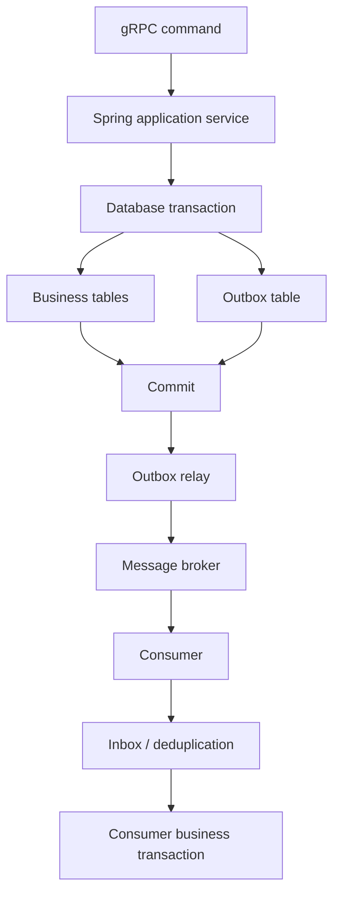
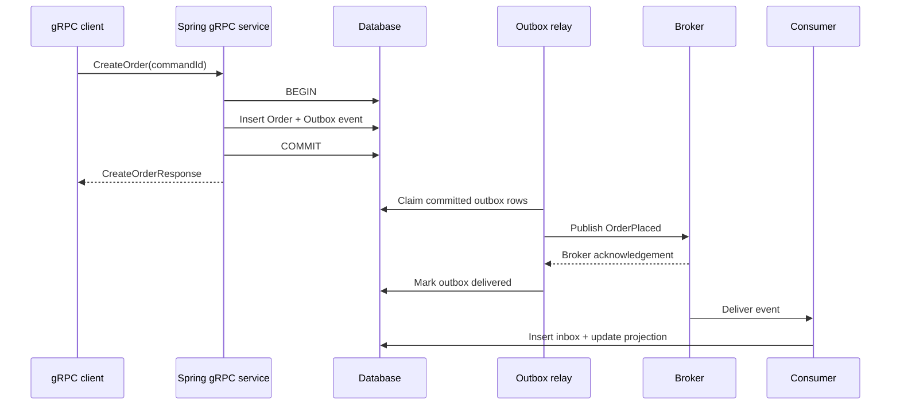

# Outbox when an RPC triggers an event

## 1. The dual-write problem when handling gRPC commands

A gRPC method often both mutates business data and emits an event for other services to react to. For example, Catalog receives a create-order RPC, saves the Order to the database, and emits an `OrderPlaced` event so Inventory reserves stock and Notification sends confirmation.

If the application writes to the database and publishes a message in two independent operations, the system hits the **dual-write** problem:

- Database commits successfully, but publishing fails: business state changed, yet the event never reaches consumers.
- Publishing succeeds, but the database rolls back: consumers observe an event for a change that never existed.
- Publishing succeeds, but the process crashes before recording the outcome: the application may republish on startup or retry.

Without a distributed transaction spanning the database and message broker, calling these two operations sequentially cannot guarantee atomicity. Publishing before or after commit leaves a failure window.

The **transactional outbox** solves the dual-write half by persisting the event to be published inside an outbox table within the same database transaction as the business mutation. A separate relay reads the outbox and publishes messages after the transaction commits.

## 2. The transactional outbox model

An outbox is a table storing events waiting to be published. The RPC handler writes only business state and an outbox record; it never calls the broker inside the business transaction.



The crucial requirement is that the business row and the outbox row share the exact same transaction on the same database transaction manager:

- If the transaction commits, both business state and the event record exist.
- If the transaction rolls back, neither exists.
- The relay reads only committed outbox rows, so it never emits events for rolled-back changes.

An outbox does not make the database and broker commit simultaneously. It guarantees the event to be emitted is durably stored alongside the business change; the relay then delivers the event to the broker with at-least-once delivery semantics.

## 3. End-to-end flow from RPC to consumer

Example: Catalog receives a `CreateOrder` RPC:

1. The client sends `CreateOrderRequest` with a command idempotency key.
2. The gRPC service converts the request into an application command.
3. The application service opens a transaction, checks the idempotency key, creates the Order, and writes `OrderPlaced` to the outbox.
4. The database commits business state together with the outbox record.
5. The application service returns the result; the gRPC adapter sends the response to the client.
6. The outbox relay reads the committed record and publishes it to the broker.
7. The consumer receives the event, inserts an inbox/deduplication record, and updates local state in its own transaction.

The gRPC response does not need to wait for broker publishing to succeed. Command completion means the business transaction and outbox record have committed. Event delivery happens asynchronously.



If the database commits successfully but the response is lost due to a network issue/deadline, the client may retry the RPC. Therefore the command needs a stable idempotency key; the outbox event ID and the command idempotency key solve two distinct types of duplication.

## 4. Designing the outbox table

A baseline schema can store:

| Field | Meaning |
| --- | --- |
| event_id | Unique event ID, generated once and preserved across publish retries |
| aggregate_type | Aggregate type emitting the event, e.g., Order |
| aggregate_id | Aggregate ID, used as message key and to preserve per-entity ordering |
| aggregate_version | Aggregate version when the event was created |
| event_type | Contract name, e.g., order.placed.v1 |
| payload | Serialized event payload |
| occurred_at | Business timestamp when the event occurred |
| created_at | Timestamp when the outbox row was written |
| attempts | Number of relay publish attempts |
| next_attempt_at | Earliest timestamp eligible for retry |
| lease_owner / lease_until | Worker claiming the record and lease expiration |
| published_at | Timestamp when the broker acknowledged publishing |

Illustrative DDL:

```sql
CREATE TABLE outbox_event (
    event_id          UUID PRIMARY KEY,
    aggregate_type    VARCHAR(120) NOT NULL,
    aggregate_id      VARCHAR(160) NOT NULL,
    aggregate_version BIGINT,
    event_type        VARCHAR(200) NOT NULL,
    schema_version    INTEGER NOT NULL,
    payload           BYTEA NOT NULL,
    occurred_at       TIMESTAMP NOT NULL,
    created_at        TIMESTAMP NOT NULL,
    attempts          INTEGER NOT NULL DEFAULT 0,
    next_attempt_at   TIMESTAMP NOT NULL,
    lease_owner       VARCHAR(120),
    lease_until       TIMESTAMP,
    published_at      TIMESTAMP
);

CREATE INDEX idx_outbox_pending
    ON outbox_event (next_attempt_at, created_at)
    WHERE published_at IS NULL;
```

This is a conceptual schema; UUID types, binary payloads, partial indexes, and DDL syntax depend on the database. For PostgreSQL, `BYTEA` and partial indexes fit well; other databases can use `BLOB` or equivalent types.

Do not delete records immediately after publishing if you need auditing, replay, or investigation. Move them to an archive/partition and clean up per your retention policy. If payloads contain sensitive data, minimize fields, encrypt, or enforce suitable retention.

## 5. Writing business state and outbox in the same Spring transaction

The application service coordinates the use case and transaction boundary. The following example illustrates creating an order and a protobuf event:

```java
@Service
public class CreateOrderUseCase {

    private final OrderRepository orders;
    private final OutboxRepository outbox;
    private final Clock clock;

    public CreateOrderUseCase(
            OrderRepository orders,
            OutboxRepository outbox,
            Clock clock) {
        this.orders = orders;
        this.outbox = outbox;
        this.clock = clock;
    }

    @Transactional
    public OrderView execute(CreateOrderCommand command) {
        Order order = Order.create(
                command.customerId(),
                command.lines());

        orders.save(order);

        OrderPlaced event = OrderPlaced.newBuilder()
                .setEventId(UUID.randomUUID().toString())
                .setOrderId(order.getId().toString())
                .setAggregateVersion(order.getVersion())
                .build();

        outbox.save(OutboxRecord.pending(
                UUID.fromString(event.getEventId()),
                "Order",
                order.getId().toString(),
                order.getVersion(),
                "order.placed.v1",
                1,
                event.toByteArray(),
                clock.instant()));

        return OrderView.from(order);
    }
}
```

This example assumes `OrderRepository` and `OutboxRepository` share the same datasource/transaction manager. The `execute` method must be invoked through the Spring proxy so `@Transactional` takes effect; self-invocation inside the same bean can bypass the proxy and fail to open the expected transaction.

Never call the broker inside `execute`. If the broker is slow or unreachable, the database transaction stays open and locks can linger. The outbox row is durable proof that the event must be emitted.

If an event should only be emitted when a business condition holds, write the outbox row in the same branch as the business mutation. Do not infer events later from the gRPC method returning `OK`, because the response might get lost and the caller might retry.

## 6. Returning the gRPC response after the transaction commits

The gRPC adapter should invoke the application service and send the response after the transactional method finishes. With a Spring proxy, the transaction typically commits when the method returns through the proxy; only then should the adapter send the response:

```java
@GrpcService
public class OrderGrpcService
        extends OrderServiceGrpc.OrderServiceImplBase {

    private final CreateOrderUseCase createOrder;

    public OrderGrpcService(CreateOrderUseCase createOrder) {
        this.createOrder = createOrder;
    }

    @Override
    public void createOrder(
            CreateOrderRequest request,
            StreamObserver<CreateOrderResponse> observer) {
        try {
            OrderView order = createOrder.execute(toCommand(request));

            observer.onNext(toResponse(order));
            observer.onCompleted();
        } catch (OrderValidationException invalid) {
            observer.onError(
                    Status.INVALID_ARGUMENT
                            .withDescription("Invalid order")
                            .asRuntimeException());
        } catch (RuntimeException failure) {
            observer.onError(
                    Status.INTERNAL
                            .withDescription("Could not create order")
                            .asRuntimeException());
        }
    }
}
```

Never send a success response before the transaction commits. If commit fails, the RPC must return the corresponding error; never return `OK` hoping the outbox or relay will fix the business transaction.

Conversely, do not wait for the relay to finish publishing before returning the response if the contract only requires recording the command. If the API must confirm the broker accepted the event, that is a different contract and must explicitly model pending/completed states.

## 7. Command idempotency vs. event deduplication

There are two levels of deduplication:

- **Command idempotency:** prevents a client retrying the same RPC from executing the business operation twice.
- **Event deduplication:** prevents the relay republishing or the broker redelivering the same event from applying it twice on the consumer.

The command idempotency key is generated by the client for one logical command and kept constant across retries. The server stores the key alongside caller/tenant, RPC method, request hash, and completed result.

The event ID is generated when the transaction creates the outbox record. The relay preserves that exact event ID across every publish attempt; the consumer uses the event ID to deduplicate. Never generate a new event ID on each relay retry.

Example command key scope:

```text
(tenant_id, rpc_method, idempotency_key)
```

If the same key arrives with a different request hash, reject the request because the caller is reusing the key for a different payload. If the command already completed, return the stored result instead of creating a new Order and a new outbox event.

Never use the event ID in place of the command idempotency key: if a client retries after losing the response, the server could generate another event ID for the same command without command-level deduplication.

## 8. Relay polling: reading and claiming pending events

A polling relay periodically queries unpublished outbox rows. With multiple workers, rows must be claimed atomically so two workers do not process the same row simultaneously.

In PostgreSQL, `SELECT FOR UPDATE SKIP LOCKED` lets multiple workers grab distinct rows:

```sql
BEGIN;

SELECT event_id
FROM outbox_event
WHERE published_at IS NULL
  AND next_attempt_at <= CURRENT_TIMESTAMP
  AND (lease_until IS NULL OR lease_until < CURRENT_TIMESTAMP)
ORDER BY created_at
FOR UPDATE SKIP LOCKED
LIMIT 100;

-- Update selected rows with lease_owner and lease_until.
-- Increment attempts, then commit the claim.

COMMIT;
```

After claiming, the relay publishes outside the database transaction. Never hold row locks and open database transactions while waiting on broker network I/O. Once the broker acknowledges, the relay updates `published_at` and clears the lease. If publishing fails, the relay sets `next_attempt_at` using backoff and releases or lets the lease expire.

`SKIP LOCKED` syntax and batch claiming depend on the database. You can use atomic `UPDATE ... RETURNING`, a lease table, or an appropriate queue mechanism. What matters is concurrency-safe claiming and leases that expire if a worker crashes.

## 9. Publish succeeded but not yet marked published

There is a failure window that polling alone cannot eliminate:

1. The relay publishes the event successfully.
2. The broker acknowledges it.
3. The relay process crashes before updating `published_at`.
4. The lease expires, and another worker reclaims and publishes the event again.

Therefore, a transactional outbox typically provides **at-least-once delivery**, not a guarantee that an event is published strictly once. This is expected by design; consumers must be idempotent.

Never mark a row published before broker acknowledgement, because if marking succeeds and publishing fails the event can be lost permanently. Marking after acknowledgement can produce duplicates on crash, which consumers handle via the event ID.

If the broker supports producer idempotence or transactions, enabling them reduces duplicates within a broker session/producer scope; they do not replace end-to-end business deduplication.

## 10. Consumer inbox and idempotent processing

Consumers should record processed event IDs in the same transaction as local state mutations. This pattern is commonly called an **inbox** or consumer deduplication table.

Example schema:

```sql
CREATE TABLE inbox_event (
    consumer_name VARCHAR(120) NOT NULL,
    event_id      UUID NOT NULL,
    processed_at  TIMESTAMP NOT NULL,
    PRIMARY KEY (consumer_name, event_id)
);
```

Consumer transaction:

```java
@Transactional
public void handle(OrderPlaced event) {
    boolean firstDelivery = inbox.insertIfAbsent(
            "inventory-projection",
            UUID.fromString(event.getEventId()));

    if (!firstDelivery) {
        return;
    }

    inventoryProjection.applyOrderPlaced(event);
}
```

`insertIfAbsent` must rely on a unique constraint/atomic insert. The inbox row and business mutation must commit in the same transaction. If the consumer crashes before commit, both roll back and the broker can redeliver. If commit succeeds but the broker acknowledgement is lost, redelivery hits the inbox record and skips re-applying the business change.

If the consumer needs to emit a downstream event, the consumer itself can write a new event to its own outbox in the same transaction. Avoid writing to the inbox and then invoking an un-idempotent external side effect, because a crash could duplicate or lose that side effect.

## 11. Ordering by aggregate

One aggregate can emit multiple events: `OrderCreated`, `OrderPaid`, `OrderShipped`. If the relay publishes concurrently without coordination, version 3 might reach the broker before version 2.

To preserve ordering:

- Record a monotonically increasing `aggregate_version` in the same transaction as the outbox row.
- Use `aggregate_id` as the broker message key so events for the same aggregate land on the same partition if the broker supports partition ordering.
- Have the relay avoid claiming a later event for an aggregate while an earlier event is still pending, when strict ordering is required.
- Have consumers check versions and detect gaps or out-of-order arrivals.
- If events are independent, allow parallel processing while documenting the consistency contract clearly.

A message key alone does not guarantee ordering if the relay sends events in arbitrary order. Combine query/claim ordering, partitioning strategy, and consumer sequencing. Do not enforce global ordering when only per-aggregate ordering is needed; global serialization degrades throughput.

## 12. Retry, backoff, and dead-letter handling

The relay must retry transient errors such as broker unavailable, timeouts, or connection resets. Use exponential backoff with jitter and cap retry rates to avoid overwhelming the broker upon recovery.

Error classification:

| Error | Handling |
| --- | --- |
| Broker timeout/unavailable | Retry with backoff; do not mark published |
| Authentication/authorization failure | Alert on configuration; bounded retries and notify operations |
| Invalid payload/schema | Transition to manual intervention or dead-letter per policy |
| Database unavailable | Stop claiming new rows; retain records for retry |
| Worker dies while holding lease | Lease expires so another worker reclaims |

Never delete an event after N retries without a preservation and recovery process. Transition it to `FAILED`/`DEAD_LETTER`, record a sanitized reason, retain the payload per policy, and raise an alert. Once fixed, operators can replay the event with the exact same event ID.

A poison event should not block the entire queue indefinitely. When per-aggregate ordering is required, you can block only that aggregate and continue processing other aggregates; this policy must align with business rules.

## 13. CDC as an alternative to polling

Instead of polling the outbox table, you can use Change Data Capture (CDC) reading the database transaction log, such as Debezium. The connector watches committed row inserts and turns them into messages.

| Delivery approach | Advantages | Costs/prerequisites |
| --- | --- | --- |
| Polling relay | Easy to implement, controls batching and retries inside the app | Continuous queries, requires leases/claims, cleanup |
| CDC connector | Reads change log, cuts polling queries, decouples publisher from app | Requires operating connector, schema history, offsets, and log retention |

CDC emits only committed changes when configured properly. Map outbox event type, payload, event ID, and aggregate key cleanly.

Never run both a polling relay and CDC against the same outbox table in production without explicit ownership separation; both could emit the same event. Pick one primary delivery path or define a migration/dual-run plan with deduplication.

## 14. Event contracts, schema evolution, and payloads

The outbox payload is a contract between producer and consumer. You can store protobuf serialized bytes or JSON/Avro depending on the system, but you must include event type and schema version so consumers know how to decode it.

With protobuf:

- Add new fields with new field numbers.
- Never reuse deleted field numbers; reserve numbers/names when needed.
- Keep changes backward-compatible per your consumer/producer rollout strategy.
- Do not serialize entire database entities if the event only needs a small subset of data.
- Attach `event_id`, `aggregate_id`, `aggregate_version`, and `occurred_at` in a stable envelope or metadata.

Do not place access tokens, secrets, private keys, or unnecessary personal data in event payloads. Outboxes are often retained longer than requests and can be replayed; treat payloads as durable data with their own retention and access controls.

If consumers need current state rather than a point-in-time snapshot, the contract must explicitly state that consumers query the source service. Never implicitly assume an event payload reflects the latest state after subsequent updates.

## 15. Spring gRPC and relay lifecycle

The Spring gRPC adapter should stay focused on transport: receiving protobuf requests, authenticating/authorizing, invoking application use cases, and mapping results to gRPC responses/statuses. The transactional outbox belongs at the application/domain persistence boundary, not inside interceptors or transport callbacks.

The relay can be a separate Spring-managed component, such as a scheduled worker or message publisher service. Give it a clear lifecycle:

- Start polling only after the datasource and broker configuration are ready.
- Stop claiming new batches during application shutdown.
- Finish or allow leases to expire for in-flight batches.
- Never hold database transactions open during publish calls.
- Bound batch size, concurrency, and in-flight messages.
- Use dedicated connection pools/executors sized to load.
- Allow scaling across multiple relay replicas via atomic claims or partitioning.

You can use transaction synchronization/`AFTER_COMMIT` events to wake the relay early after commit. Treat that only as a latency optimization; polling/CDC must remain the durable recovery mechanism. If the process crashes right after commit before firing the wake-up signal, the outbox row is still picked up on the next relay scan.

Never use `@Async` broker publishing as a substitute for an outbox. In-memory async tasks are lost if the process crashes after database commit.

## 16. Observability and operations

An outbox creates a durable queue inside the database, so monitor both latency and backlog:

| Metric | Meaning |
| --- | --- |
| outbox_pending_count | Number of unpublished events |
| outbox_oldest_pending_age | Age of the oldest pending event |
| outbox_publish_attempts_total | Total relay publish attempts |
| outbox_publish_failures_total | Total failed publish attempts |
| outbox_publish_latency | Duration from claim to acknowledgement |
| outbox_delivery_lag | Duration from occurred_at to published_at |
| outbox_lease_expired_total | Worker died or failed to renew lease |
| consumer_duplicate_events_total | Count of already-processed event IDs |
| consumer_processing_failures_total | Consumer-side event processing errors |

Alert on `oldest_pending_age` and `delivery_lag`, not just `pending_count`. A queue with few events where one event is minutes old still signals an outage. Monitor database table growth, index bloat, vacuuming/partitioning, and retention cleanup.

Logs should include `event_id`, `aggregate_id`, `event_type`, attempt count, and correlation/trace context; never log sensitive payloads. Never use `event_id` or `aggregate_id` as high-cardinality metric labels.

You can link traces from the gRPC command through the outbox event to the consumer via trace context stored with the record or message headers. When storing trace context, store only required propagation fields and avoid sensitive baggage.

## 17. Security and outbox access control

The outbox holds business data that can be relayed, replayed, or inspected by operators. Apply least privilege:

- Application writers only insert required outbox records.
- The relay only reads/claims/updates publish status; it needs no permission to alter business tables.
- Consumers only read assigned topics/queues and write to their local inbox.
- Operator replays require audit trails and approval permissions.
- Broker secrets/TLS credentials come from a secret manager.
- Payloads and archives follow encryption, retention, and data-deletion policies.

Never treat the outbox as a public debug table. Do not expose the outbox via gRPC query APIs to general callers. If event delivery status is needed, provide an authorized view/API returning only necessary metadata.

## 18. Testing transactions and delivery failures

Tests must prove both atomicity and crash recovery:

| Scenario | What to verify |
| --- | --- |
| RPC succeeds | Business row and outbox row commit together |
| Business validation fails | Neither business mutation nor outbox event exists |
| Database rolls back | Both business row and outbox row roll back |
| Broker unavailable | RPC can still commit per contract; outbox stays pending |
| Relay publishes successfully | Broker receives event and record is marked published |
| Relay crashes after broker ack before mark published | Event can be republished with the same event_id |
| Consumer receives duplicate | Inbox unique constraint prevents applying business change twice |
| Consumer rolls back | Inbox and local mutation roll back together |
| Two relays claim concurrently | One row is never processed concurrently by two workers under the same lease |
| Events for same aggregate | Ordering/version preserved per contract |
| New payload schema | Older consumer handles or rejects in a controlled way |
| Relay shutdown | No rows lost; leases expire or in-flight batch completes |

Use Testcontainers for real databases and brokers when correctness depends on transaction isolation, unique constraints, broker acknowledgements, or redelivery. Unit tests with mock publishers cannot prove the crash window between publishing and updating `published_at`.

Test gRPC via generated stubs to verify responses are sent only after commit. Simulate a client deadline/cancel immediately after server commit; retrying with the same command idempotency key must return the previous result and not create a second outbox event.

## 19. Common mistakes

1. **Writing to DB then publishing directly to broker in the same method.** Not atomic; crashes lose events or leave orphaned events. Write to the outbox inside the transaction.
2. **Publishing before DB commit.** Consumers may see events for rolled-back transactions. Relay only committed rows.
3. **Using `AFTER_COMMIT` callbacks as the sole event store.** Crashes before the callback lose events. Persist the outbox row before commit.
4. **Marking published before broker acknowledgement.** Broker failures silently drop events. Mark after acknowledgement and accept duplicates.
5. **Assuming the outbox delivers strictly once.** Crash windows can cause duplicate publishes. Use event IDs and a consumer inbox.
6. **Using the event ID instead of a command idempotency key.** Client retries can generate new events. Deduplicate commands at the RPC boundary.
7. **Using an in-memory map for the inbox.** Restarts or other replicas forget processed events. Use a durable unique constraint.
8. **Holding DB transactions open while publishing.** Slow brokers hold locks and connections. Claim via lease, commit, then publish outside the transaction.
9. **Parallel relays scrambling aggregate order.** Consumers receive later versions before earlier ones. Use aggregate versions, partition keys, and claim ordering.
10. **No retention/cleanup.** Outbox tables bloat and indexes degrade. Archive/partition/clean up per policy.
11. **Retrying poison events forever.** One bad payload stalls backlogs. Add dead-letter/manual repair and alerts.
12. **Using `@Async` instead of an outbox.** In-memory tasks disappear if the process crashes. The outbox row must be the durable source of truth.

## 20. Practice exercise

Implement a `CreateOrder` gRPC command that emits `OrderPlaced`:

1. Define protobuf `CreateOrderRequest` with a command idempotency key and a response containing the order ID.
2. Create an application use case with a transaction wrapping Order, command idempotency record, and outbox row.
3. Define an event envelope containing `event_id`, `event_type`, `schema_version`, `aggregate_id`, `aggregate_version`, and payload.
4. Write a polling relay claiming batches via leases/atomic locking; publish to the broker outside the DB transaction.
5. Mark published only after broker acknowledgement; preserve `event_id` across retries.
6. Write an Inventory consumer using an inbox table with a unique key to deduplicate and update its projection in the same transaction.
7. Use `aggregate_id` as the message key and `aggregate_version` to enforce ordering.
8. Simulate a process crash after broker ack but before marking published; verify the consumer never applies the event twice.
9. Simulate a client deadline right after DB commit; retrying with the same command idempotency key must return the same order without creating a new event.
10. Measure pending count, oldest pending age, publish failures, delivery lag, and consumer duplicate count; configure alerts and retention policies.

**Self-check:** When an RPC mutates the database and needs to emit an event, persist business state and the outbox row in the same transaction. The relay publishes after commit and marks delivered after broker acknowledgement; due to crash windows, delivery is typically at-least-once. Consumers use an inbox/event ID to deduplicate, while client commands use a separate idempotency key to handle RPC retries after lost responses. In Spring gRPC, the adapter returns responses after commit, the application service owns the transaction, the relay has its own lifecycle, and broker publishing stays outside the business transaction.
