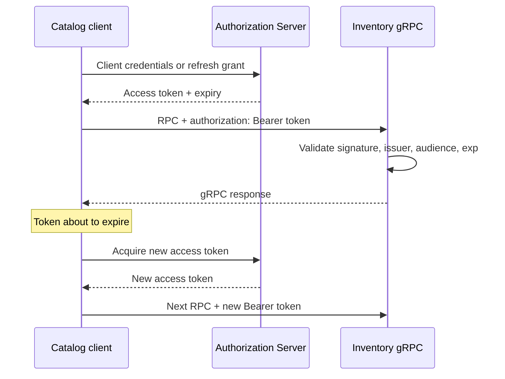

# Access Token Rotation

## 1. Objectives and Scope

In a Spring gRPC system, a client typically calls another service using an access token sent in gRPC metadata. Access tokens have an expiration time; when a token is about to expire, the client needs to obtain a new token and use it for subsequent RPCs. This process is commonly referred to as access-token renewal or token rotation.

Proper rotation helps limit the impact if a token is compromised, supports access revocation, and maintains service-to-service connectivity without restarting the application. It must coordinate with gRPC deadlines, retries, and streaming lifecycles.

Distinguish between three activities:

| Activity | Component Renewed | Purpose |
| --- | --- | --- |
| Access-token renewal | Access token | Obtain a new short-lived credential to call an API |
| Refresh-token rotation | Refresh token | Each refresh issues a new refresh token and invalidates the old one according to the authorization server policy |
| Signing-key rotation | JWT signing key | Replace the signing key; the resource server updates its public key/JWKS to verify tokens |

These three activities are related but do not replace one another. A JWT access token can remain valid even after a new signing key is published; the resource server must accept the old key during a transition window to verify previously issued tokens. Obtaining a new access token does not mean the refresh token or signing key has been rotated.

## 2. Token Lifecycle in a gRPC Call

A common service-to-service flow:



The token is attached to the metadata of each RPC. When the token changes, new calls use the new token; there is no need to recreate the channel if the endpoint and TLS configuration remain unchanged.

Do not embed tokens in protobuf requests/responses, resource names, or query strings. Do not write tokens to logs, trace attributes, exception messages, or metric labels.

## 3. Access Tokens, Refresh Tokens, and Client Credentials

**Access token** is the credential that the client presents to the resource server. It is usually short-lived and carries a limited scope/audience.

**Refresh token** is sent by the client to the authorization server to request a new access token. It must never be sent to Inventory or any gRPC resource server. With refresh-token rotation, the authorization server issues a new refresh token after each use and invalidates the old token. If an old token is reused, the authorization server can detect replay and revoke the entire token family.

**Client credentials** are generally suitable for service-to-service machine identity. The client authenticates with the authorization server using client authentication and requests a new access token when needed. This grant typically does not issue a refresh token; the client simply requests a new access token via client credentials when the token expires or is about to expire.

Choose the flow based on the client type and authorization server. Do not build your own token issuance endpoint or self-sign JWTs in the gRPC client if the system already has an OAuth2/OIDC authorization server.

## 4. Designing Short-Lived Access Tokens

Access tokens should have a lifetime short enough to limit exposure if compromised, an audience matching the resource server, minimal scopes, a clear issuer, and only necessary claims. Avoid embedding personal data or large payloads in the token.

Do not choose a lifetime so short that the client constantly requests tokens and overloads the authorization server. Nor choose a lifetime so long just to avoid handling renewal. Evaluate request rate, token endpoint capacity, cache behavior, and revocation requirements.

The client should refresh ahead of expiry by a safety window to prevent requests from arriving at the server right as the token expires due to clock skew or network latency. Use time synchronization such as NTP, and do not overextend the acceptance window to compensate for drifted clocks.

## 5. Obtaining New Access Tokens with Spring Security OAuth2 Client

For client credentials, Spring Security OAuth2 Client can manage authorization and store the authorized client. A suitable service-side manager for background applications is `AuthorizedClientServiceOAuth2AuthorizedClientManager`:

```java
@Bean
OAuth2AuthorizedClientManager authorizedClientManager(
        ClientRegistrationRepository registrations,
        OAuth2AuthorizedClientService authorizedClients) {

    ClientCredentialsOAuth2AuthorizedClientProvider provider =
            new ClientCredentialsOAuth2AuthorizedClientProvider();
    provider.setClockSkew(Duration.ofSeconds(60));

    var manager =
            new AuthorizedClientServiceOAuth2AuthorizedClientManager(
                    registrations, authorizedClients);

    manager.setAuthorizedClientProvider(provider);
    return manager;
}
```

The client registration contains the token URI, client ID, client authentication method, and scopes. Retrieve the client secret from a secret manager or a protected environment; do not commit it to source control.

When a token is needed:

```java
OAuth2AuthorizeRequest request =
        OAuth2AuthorizeRequest.withClientRegistrationId("inventory")
                .principal("catalog-service")
                .build();

OAuth2AuthorizedClient authorized =
        authorizedClientManager.authorize(request);

if (authorized == null) {
    throw new IllegalStateException("Could not obtain inventory access token");
}

OAuth2AccessToken accessToken = authorized.getAccessToken();
```

The manager/provider checks the authorized client state and can request a new token when the old token enters the provider's clock-skew window. For example, setting clock skew to 60 seconds matches the safety window illustrated in the cache; adjust based on latency, clock drift, and the Spring Security version in use. With multiple concurrent threads, avoid letting every request call the token endpoint simultaneously when the token expires.

## 6. Token Caching and Pre-Expiry Refresh

Do not call the authorization server for every gRPC request. Tokens are typically cached by client registration and principal. A token provider should:

1. Hold the current access token in memory or an appropriate authorized-client store.
2. Check `expiresAt` before supplying a token to a new call.
3. Refresh ahead of expiry by a safety margin, for example 30–60 seconds depending on clock skew and latency.
4. Use single-flight or locking so multiple threads trigger only one refresh.
5. Atomically update the new token after authorization succeeds.
6. Only use the existing token while it is still valid; never send an expired token.
7. Apply backoff and retry limits for the token endpoint.

Minimal provider example:

```java
public final class CachedAccessTokenProvider {

    private final AtomicReference<OAuth2AccessToken> current =
            new AtomicReference<>();

    public void update(OAuth2AccessToken token) {
        current.set(token);
    }

    public OAuth2AccessToken currentValidToken(Duration safetyWindow) {
        OAuth2AccessToken token = current.get();

        if (token == null || token.getExpiresAt() == null
                || !token.getExpiresAt().isAfter(
                        Instant.now().plus(safetyWindow))) {
            throw new IllegalStateException("Access token requires renewal");
        }

        return token;
    }
}
```

This is a minimal cache component; a scheduler or token manager must update the token before the provider is used. Production systems need to handle concurrent refreshes, authorization server outages, token revocation, and process restarts. Do not persist tokens into configuration files or container images.

If multiple replicas share the same client identity, weigh a per-replica cache against a shared authorized-client store. A shared store requires encryption, access control, and concurrency semantics; never share tokens via a public cache.

## 7. Background Token Refresh and Stampede Prevention

A resilient operational pattern is background refresh before expiry:

- Upon receiving a new token, schedule a refresh at `expiresAt` minus the safety window.
- Only one task should refresh a given registration/principal at a time.
- If refresh succeeds, swap the token in the cache atomically and schedule the next run.
- If refresh fails, emit metrics/logs without the token and retry with exponential backoff and jitter.
- If the current token expires before refresh succeeds, fail closed; do not send the stale token.

Do not run token refreshes on the Netty event loop or a thread handling gRPC callbacks. Calling the token endpoint is a network operation that can be slow; execute it on a dedicated scheduler/executor.

The principal key must be stable. With client credentials, a principal like `catalog-service` lets the manager look up the saved authorized client accurately. If every request uses a random principal name, the cache will fragment and the token endpoint may be hammered continuously.

## 8. Attaching Tokens per gRPC Call with CallCredentials

gRPC Java provides `CallCredentials` to add per-RPC metadata. This is preferable to capturing a static token when creating the channel, because the token can change while the channel remains open.

Example credentials reading the token from a non-blocking cache:

```java
public final class BearerTokenCallCredentials extends CallCredentials {

    private static final Metadata.Key<String> AUTHORIZATION =
            Metadata.Key.of(
                    "authorization",
                    Metadata.ASCII_STRING_MARSHALLER);

    private final CachedAccessTokenProvider tokenProvider;

    public BearerTokenCallCredentials(
            CachedAccessTokenProvider tokenProvider) {
        this.tokenProvider = tokenProvider;
    }

    @Override
    public void applyRequestMetadata(
            RequestInfo requestInfo,
            Executor appExecutor,
            MetadataApplier applier) {

        try {
            OAuth2AccessToken token =
                    tokenProvider.currentValidToken(Duration.ofSeconds(30));

            Metadata headers = new Metadata();
            headers.put(AUTHORIZATION, "Bearer " + token.getTokenValue());
            applier.apply(headers);

        } catch (RuntimeException unavailable) {
            applier.fail(Status.UNAUTHENTICATED.withDescription(
                    "A valid access token is unavailable"));
        }
    }
}
```

`CallCredentials` must return metadata quickly. Do not call the token endpoint synchronously inside `applyRequestMetadata` because the callback must not block the transport executor. If asynchronous authorization is needed, use a separate executor and call `applier.apply` or `applier.fail` exactly once.

Attach credentials to the generated stub:

```java
InventoryServiceGrpc.InventoryServiceBlockingStub authenticatedStub =
        inventoryStub.withCallCredentials(bearerTokenCallCredentials);

AvailabilityResponse response =
        authenticatedStub.getAvailability(request);
```

Each new RPC retrieves the current token from the provider. When the token is refreshed, subsequent calls automatically use the new token without rebuilding the `ManagedChannel`.

## 9. Validating Tokens on the gRPC Server

The server must verify the access token on every new RPC before dispatching to the service. For JWTs, the resource server needs to verify the signature, issuer, `exp`/`nbf` timestamps, audience, and required policy claims.

Spring Security Resource Server provides `JwtDecoder`. gRPC does not automatically run the servlet security filter chain; integrate the decoder into a gRPC `ServerInterceptor` or the corresponding authentication mechanism of the starter.

Concise interceptor example:

```java
public final class JwtServerInterceptor implements ServerInterceptor {

    private static final Metadata.Key<String> AUTHORIZATION =
            Metadata.Key.of(
                    "authorization",
                    Metadata.ASCII_STRING_MARSHALLER);

    static final Context.Key<Jwt> CALLER_JWT =
            Context.key("authenticated-jwt");

    private final JwtDecoder jwtDecoder;

    public JwtServerInterceptor(JwtDecoder jwtDecoder) {
        this.jwtDecoder = jwtDecoder;
    }

    @Override
    public <ReqT, RespT> ServerCall.Listener<ReqT> interceptCall(
            ServerCall<ReqT, RespT> call,
            Metadata headers,
            ServerCallHandler<ReqT, RespT> next) {

        String value = headers.get(AUTHORIZATION);
        if (value == null || !value.regionMatches(
                true, 0, "Bearer ", 0, 7)) {
            call.close(Status.UNAUTHENTICATED
                    .withDescription("Missing bearer token"),
                    new Metadata());
            return new ServerCall.Listener<>() {};
        }

        String rawToken = value.substring(7).trim();
        try {
            Jwt jwt = jwtDecoder.decode(rawToken);
            Context context = Context.current()
                    .withValue(CALLER_JWT, jwt);

            return Contexts.interceptCall(
                    context, call, headers, next);

        } catch (JwtException invalidToken) {
            call.close(Status.UNAUTHENTICATED
                    .withDescription("Invalid access token"),
                    new Metadata());
            return new ServerCall.Listener<>() {};
        }
    }
}
```

Register the interceptor globally using the Spring gRPC mechanism corresponding to the starter version in use. `Contexts.interceptCall` restores the gRPC `Context` for listener callbacks. The example stores the `Jwt` in context for the service or authorization layer to read; if using Spring method security based on `SecurityContextHolder`, bridge `Authentication` into the security context for each callback/thread. Map `scope`/`scp` to authorities using a controlled converter/policy; do not treat arbitrary claims issued by an issuer as permissions unless a contract is defined. Do not assume servlet filters run automatically for gRPC.

## 10. Validating Issuer, Audience, and Opaque Tokens

Simply decoding a JWT is not enough. The resource server must trust the exact issuer and audience. You can use typed configuration properties to provide the issuer/audience to the decoder:

```java
@ConfigurationProperties(prefix = "security.jwt")
public record SecurityJwtProperties(String issuer, String audience) {}

@Bean
JwtDecoder jwtDecoder(SecurityJwtProperties properties) {
    String issuer = properties.issuer();
    String audience = properties.audience();

    NimbusJwtDecoder decoder =
            NimbusJwtDecoder.withIssuerLocation(issuer).build();

    OAuth2TokenValidator<Jwt> issuerAndTime =
            JwtValidators.createDefaultWithIssuer(issuer);

    OAuth2TokenValidator<Jwt> audienceValidator = jwt -> {
        if (jwt.getAudience().contains(audience)) {
            return OAuth2TokenValidatorResult.success();
        }

        return OAuth2TokenValidatorResult.failure(
                new OAuth2Error("invalid_token"));
    };

    decoder.setJwtValidator(new DelegatingOAuth2TokenValidator<>(
            issuerAndTime, audienceValidator));

    return decoder;
}
```

Register the configuration record with `@EnableConfigurationProperties(SecurityJwtProperties.class)` or `@ConfigurationPropertiesScan` in the application. The issuer validator checks the issuer and timestamp claims using the default validators. The audience validator ensures the token was issued for this resource server, not another API. Restrict signing algorithms and trust the JWKS endpoint/CA according to the identity provider configuration.

For opaque access tokens, use token introspection instead of attempting to parse them as JWTs. The introspection response must confirm the token is active and matches the policy's audience/scope; cache results with a bounded TTL that does not exceed expiry/revocation requirements. Self-contained JWTs generally cannot be revoked immediately across all resource servers if servers only verify the signature and `exp`; if rapid revocation is required, use short-lived tokens combined with a controlled denylist or introspection per security requirements.

## 11. Access Token Expiry and gRPC Status

The server should distinguish authentication failures from authorization failures:

| Situation | Typical gRPC Status |
| --- | --- |
| Missing token | `UNAUTHENTICATED` |
| Expired token, invalid signature, or wrong issuer | `UNAUTHENTICATED` |
| Valid token but missing scope/role | `PERMISSION_DENIED` |
| Authorization server temporarily unable to issue a token to client | Client does not send RPC or returns appropriate internal error; do not disguise as `PERMISSION_DENIED` |
| Resource does not exist after successful authentication | `NOT_FOUND` |

Do not return internal details such as which signature or claim failed to the caller. Use generic descriptions, controlled internal logging, and error-type metrics without token values.

If the server returns `UNAUTHENTICATED` due to an expired or stale token and the client can acquire a new token, the client may refresh and retry at most once when the operation is safe to retry. Do not blindly refresh/retry for wrong issuer, audience, or signature errors; those configuration/credential issues must be fixed. Do not retry indefinitely. Do not automatically refresh/retry `PERMISSION_DENIED`; a new token will not grant additional permissions. For mutating RPCs, require an idempotency key or clear retry contract to avoid executing the operation twice.

## 12. Long-Lived Streaming RPCs and Token Expiration

gRPC metadata is sent when a call begins. A token does not automatically change mid-stream on an open streaming RPC. If a token expires after the server has authenticated the stream, the server typically does not re-check the token on every message unless the application implements a custom policy.

For long-lived streams, establish a clear policy:

- Cap maximum stream lifetime in alignment with access-token lifetime.
- Allow existing streams to complete after token expiry while disallowing new streams with the old token, if the threat model permits.
- Close the stream when the token/session expires or permissions are revoked.
- Have the client obtain a new token and reconnect using a protocol-defined resume token/sequence number.
- For sensitive operations, re-check authorization per message/batch according to policy.

Do not send refresh tokens inside stream messages to extend a call. If a protocol requires mid-stream re-authentication, design a dedicated message/control flow with secure credentials, verify on every step, and protect against replay; reconnecting with a new access token is usually simpler.

## 13. Refresh-Token Rotation and Replay Detection

For user-facing clients using the authorization code flow, refresh tokens may be rotated at the authorization server. On each successful refresh, the client receives a new access token and a new refresh token; the old refresh token is invalidated.

The client must store the new token pair atomically. If the process crashes after the server invalidates the old refresh token but before the new token is persisted, the session may require re-login. Do not retry an old refresh token indefinitely after an `invalid_grant` error, as the server may treat that as replay.

Refresh tokens must be kept in secure storage or a token vault, encrypted at rest with restricted access. Do not store refresh tokens in gRPC metadata, logs, traces, or unprotected application databases.

For service-to-service client credentials, there is usually no refresh token. The client obtains a new access token via client authentication; rotation of the client secret/certificate is a separate credential lifecycle process.

## 14. Signing-Key Rotation and JWKS Cache

JWTs typically carry a `kid` header so the resource server selects the matching public key from JWKS. When the authorization server rotates signing keys:

1. Publish the new public key in JWKS before signing with the new key.
2. Start issuing new tokens with the new `kid`.
3. Keep the old public key in JWKS long enough to verify still-valid old tokens.
4. Have the resource server refresh its JWKS cache per policy and handle unknown `kid` values.
5. Remove the old key after the overlap period and once old tokens expire per policy.

Signing-key rotation is not access-token renewal. If a resource server caches JWKS for too long, tokens signed with the new key may be rejected; if it keeps a compromised key for too long, old tokens can continue passing verification. Maintain an emergency procedure to revoke a compromised key and shorten token TTLs when needed.

## 15. Retries, Clock Skew, and Token Endpoint Availability

Clocks between the client, authorization server, and resource server can drift. Use NTP/time synchronization, apply a small clock skew per policy, and refresh ahead of expiry.

When the token endpoint fails:

- Use the currently cached token if it is still valid and within the safety window.
- Refresh using exponential backoff and jitter.
- Limit attempt counts and wait time to fit the operation's deadline.
- Do not hammer the token endpoint on every RPC during an outage.
- Emit metrics for refresh success/failure, latency, and cache age.
- When no valid token remains, fail closed; do not send an expired token or skip authentication.

Do not use gRPC retry policies to retry the token endpoint indefinitely. Token acquisition and the RPC call are two distinct operations with separate deadlines, error handling, and telemetry.

## 16. Protecting Tokens in Operations

An access token is a bearer credential: anyone possessing the token can use it within its permissions and validity window. Protect it at every hop:

- Transmit only over TLS; consider mTLS for workload authentication at the transport layer.
- Use minimal scopes/audience and appropriately short lifetimes.
- Retrieve client secrets/private keys from a secret manager; do not bake them into images.
- Never log authorization metadata, token values, refresh tokens, or sensitive introspection responses.
- Redact headers in proxies, tracing agents, exceptions, and support bundles.
- Do not put tokens into span attributes, baggage, metric labels, or protobuf payloads.
- Restrict read access to the token cache and encrypt if persisted.
- Audit token issuance/renewal/revocation using an identifier rather than the raw token.

TLS protects data in transit; endpoints, proxies, or processes with access to metadata can still see the bearer token. Therefore, TLS is not a reason to log tokens.

## 17. Testing Access-Token Rotation

Tests should verify that the new token is actually attached to new calls and that old tokens are no longer used after expiry:

| Scenario | What to Verify |
| --- | --- |
| Valid token | `CallCredentials` sends the exact current Bearer token |
| Token near expiry | Provider refreshes before the safety window |
| Expired token | Old token is not sent; new token is authorized |
| Concurrent RPCs near expiry | Only one refresh executes or refreshes are coordinated |
| Authorization server timeout | Backoff, metrics, and failure behavior are correct; no tokens logged |
| Wrong issuer/audience/signature | Server returns `UNAUTHENTICATED` |
| Valid token missing scope | Server returns `PERMISSION_DENIED` |
| Token refresh succeeds | Next RPC uses the new token without rebuilding the channel |
| Refresh-token replay | Client does not retry old token indefinitely; requires re-auth per policy |
| Stream exceeds expiry | Continuation/closing/reconnection matches policy |
| Signing key changes | JWKS cache picks up new key and overlaps old key |
| Log/trace capture | No access token or refresh token appears |

Use a mock authorization server or test identity provider to control expiry, refresh, rotation, and JWKS. Invoke gRPC through generated stubs/Netty transport to inspect actual metadata. Unit-test `CallCredentials` separately to verify headers; unit-test the interceptor separately to verify validation and status codes.

## 18. Common Mistakes

1. **Caching tokens indefinitely.** RPCs keep sending expired tokens. Check `expiresAt` and refresh before expiry.
2. **Fetching a token on every RPC.** Overloads the authorization server. Cache by registration/principal and coordinate refreshes.
3. **Capturing the token at channel creation.** Channels outlive tokens. Use `CallCredentials` to read the current token per call.
4. **Calling the token endpoint on the Netty event loop.** Blocks transport threads. Perform background refreshes on a dedicated executor.
5. **Sending a refresh token to the resource server.** Exposes a high-privilege credential. Send only the access token in Bearer metadata.
6. **Skipping audience validation.** Tokens valid for other APIs get accepted. Validate issuer, audience, signature, and timestamps.
7. **Treating `PERMISSION_DENIED` like an expired token.** Refreshing will not fix missing permissions. Only refresh on appropriate authentication failures.
8. **Not defining stream expiry.** Streams outlive sessions without a policy. Enforce max lifetime or reconnect with a new token.
9. **Confusing signing-key rotation with access-token rotation.** JWKS cache and token cache have different lifecycles. Manage the two processes separately.
10. **Logging tokens for debugging.** Exposes bearer credentials in logs/traces. Redact them from metadata capture and observability pipelines.
11. **Uncoordinated concurrent refreshes.** Token endpoint gets hit by burst requests. Use single-flight, locks, and jitter.
12. **Retrying an old refresh token after `invalid_grant`.** Can trigger replay detection. Handle according to authorization server policy and require re-auth when needed.

## 19. Hands-On Exercise

Set up Catalog calling Inventory using OAuth2 client credentials:

1. Register client `catalog-service` and resource audience `inventory-api` at the authorization server.
2. Configure Spring Security OAuth2 Client with client credentials and store the authorized client under a stable principal.
3. Build a token provider with caching, a safety window, and single-flight refresh.
4. Create `CallCredentials` that reads the current token and attaches Bearer metadata to each RPC.
5. Configure the Inventory gRPC server interceptor using `JwtDecoder` or introspection to validate token, issuer, audience, expiry, and scopes.
6. Distinguish `UNAUTHENTICATED` from `PERMISSION_DENIED`; retry authentication failures at most once only when the RPC is idempotent.
7. Define a policy for streams spanning across expiry: max lifetime, cancellation, or reconnect/resume.
8. Simulate authorization server outage, token expiry, signing-key rollover, and refresh-token replay if the flow uses refresh tokens.
9. Verify logs, traces, and metrics contain no tokens; measure refresh latency, failures, and cache hits.
10. Use integration tests over the gRPC transport to verify the old token is rejected, the new token is used for the next call, and the channel does not need to be rebuilt.

**Self-check:** Access-token rotation is the process where a client acquires a new token before the current one expires and attaches the new token to each gRPC call. Refresh-token rotation is a separate authorization server mechanism; signing-key rotation is the process of updating JWT/JWKS verification keys. In Spring gRPC, use an OAuth2 client manager and a cache with expiry/safety window, `CallCredentials` to supply per-call Bearer metadata, an interceptor to verify tokens on the server, and a clear reconnection policy for streaming RPCs. Protect tokens from logs/traces, bound retries, and test both expiry and rotation.
