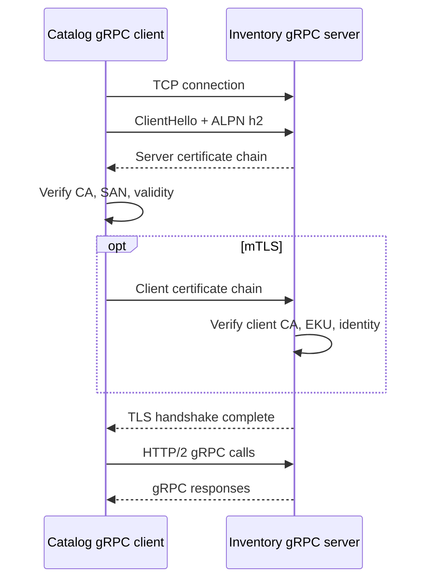

# Server and Client Certificate Rotation

## 1. Why Rotate Certificates?

In Spring gRPC, TLS certificates authenticate the server's identity; with mutual TLS (mTLS), the client also presents a certificate so the server authenticates the calling workload. X.509 certificates have an expiration time, are signed by a CA, and are bound to a public key, subject/SAN, and extensions specifying their intended use.

Certificate rotation is the process of replacing certificates and private keys before they expire, or immediately when credentials are at risk of compromise. The goal is to maintain secure connectivity while swapping credentials, ensure both sides still trust the right CA, and avoid downtime during rollout.

Distinguish between these activities:

| Activity | What Changes | Impact |
| --- | --- | --- |
| Server certificate rotation | Server leaf certificate and usually its private key | Client verifies the new server identity when establishing a TLS connection |
| Client certificate rotation | Client workload leaf certificate and private key | Server verifies the new client identity during the mTLS handshake |
| CA rotation | CA certificate/public key in the trust bundle | Changes the set of issuers accepted by peers |
| Access-token renewal | OAuth2 access token in gRPC metadata | Replaces application-layer credential; does not change TLS identity |

Replacing a leaf certificate signed by the same CA is typically simpler than rotating a CA. When changing CAs, both client and server must have a trust overlap period so both old and new certificates are accepted during the transition.

## 2. Components of a TLS Identity

A TLS identity typically includes:

- **Private key:** secret used to prove ownership of the identity; never sent to peers.
- **Leaf certificate:** the server or client certificate, containing the public key and identity.
- **Intermediate CA certificates:** certificate chain linking the leaf to the trust anchor.
- **Root CA certificate:** trust anchor configured on the peer to verify the chain.
- **SAN:** Subject Alternative Name, identifying the DNS name or IP address the certificate represents.
- **Validity:** start and end timestamps of validity.
- **Key Usage and Extended Key Usage:** restricts intended usage, such as `serverAuth` or `clientAuth`.

The client verifies the server certificate against the trust chain, validity period, and hostname/SAN. With mTLS, the server also verifies the client certificate against trusted CAs and identity policy.

Checking only that a certificate has a valid signature is insufficient. You must verify that the SAN matches the hostname the client connects to, the EKU matches the role, the certificate is within its validity window, and the chain terminates at a trusted CA.

## 3. TLS Handshake in gRPC

gRPC runs over HTTP/2. The TLS handshake establishes encryption, verifies certificates, and negotiates ALPN to select the HTTP/2 protocol. With mTLS, both sides present certificates during the handshake.



Certificates are verified during the TLS handshake when the connection is established. New RPCs running over the same HTTP/2 connection continue using the negotiated TLS session/identity; replacing certificate files on disk does not automatically swap the certificate of an already-open connection.

This is especially important for long-lived channels and streaming RPCs. Certificate rotation must account for connection pools, reconnection, stream draining, and when new TLS connections are created.

## 4. Preparing Certificates for Servers and Clients

A server certificate should have a DNS SAN matching the service name clients connect to, such as `inventory.internal.example`. Do not rely on Common Name instead of SAN. If clients connect using a Kubernetes service DNS name, the SAN must match the exact DNS name clients use.

A client certificate in mTLS should represent a workload identity; avoid sharing a single certificate across all applications if individual auditing or authorization is needed. Identity may reside in a URI SAN, DNS SAN, or subject according to organizational policy.

The certificate profile should define:

- Key algorithm and size compliant with current TLS policy.
- EKU `serverAuth` for server certificates and `clientAuth` for client certificates.
- Consistent SAN and identity format.
- Short validity aligned with automated renewal workflows.
- CA chain and trust bundles needed by peers.
- Revocation procedure if a private key is compromised.

Do not issue production certificates with ad-hoc scripts or unmanaged self-signed CAs. Use an organization-approved PKI/secret manager/certificate authority with auditing and automated rotation.

## 5. Configuring TLS for the gRPC Server with Netty

With the `grpc-netty-shaded` transport, you can build a Netty `SslContext` from a certificate chain and private key:

```java
import io.grpc.netty.shaded.io.netty.handler.ssl.ClientAuth;
import io.grpc.netty.shaded.io.netty.handler.ssl.SslContext;
import io.grpc.netty.shaded.io.netty.handler.ssl.SslContextBuilder;
import io.grpc.netty.shaded.io.grpc.netty.GrpcSslContexts;

import java.io.File;

SslContext serverTls = GrpcSslContexts.configure(
        SslContextBuilder.forServer(
                new File("/run/tls/server-chain.pem"),
                new File("/run/tls/server-key.pem")))
        .trustManager(new File("/run/tls/client-ca-bundle.pem"))
        .clientAuth(ClientAuth.REQUIRE)
        .build();
```

This example enables mTLS: the server presents its certificate and requires clients to present a certificate signed by a CA in the trust bundle. If only one-way TLS is needed, omit the client trust manager and `ClientAuth.REQUIRE`; the client still verifies the server certificate.

`SslContextBuilder` belongs to the Netty transport. If the project uses unshaded `grpc-netty`, the package imports differ. Pick the matching dependency and never mix shaded and non-shaded Netty classes.

In Spring gRPC, let the starter manage the server lifecycle. Pass the `SslContext` or certificate material into the extension/customization point supported by your exact starter version. Do not instantiate a second `NettyServerBuilder` running alongside the Spring-managed server just to configure TLS. Property names and TLS hooks can vary across releases; verify against your locked dependency version before implementing.

## 6. Configuring TLS for the gRPC Client

The client needs a trust bundle to verify the server. With mTLS, the client also presents a client certificate and private key:

```java
import io.grpc.ManagedChannel;
import io.grpc.netty.shaded.io.grpc.netty.NettyChannelBuilder;
import io.grpc.netty.shaded.io.grpc.netty.GrpcSslContexts;
import io.grpc.netty.shaded.io.netty.handler.ssl.SslContext;
import io.grpc.netty.shaded.io.netty.handler.ssl.SslContextBuilder;

import java.io.File;

SslContext clientTls = GrpcSslContexts.configure(SslContextBuilder.forClient())
        .trustManager(new File("/run/tls/server-ca-bundle.pem"))
        .keyManager(
                new File("/run/tls/client-chain.pem"),
                new File("/run/tls/client-key.pem"))
        .build();

ManagedChannel channel = NettyChannelBuilder
        .forAddress("inventory.internal.example", 9090)
        .sslContext(clientTls)
        .build();
```

If not using mTLS, omit `keyManager`; the client still requires a trust manager to verify the server. Never use `usePlaintext()` or a trust-all manager in production.

Hostname verification must remain enabled and the certificate SAN must match the target. Do not disable hostname verification to work around certificate mismatch errors; fix the SAN or target name instead.

If using a Spring gRPC client channel factory, configure TLS through the channel customization/configuration mechanism of your exact starter release. Keep a single Spring-managed channel lifecycle so channel shutdown and refresh can be coordinated consistently.

## 7. Leaf Certificate Rotation with an Unchanged CA

When the current CA remains trusted, leaf certificate rotation can follow an overlap workflow:

1. Generate a new private key and request a new leaf certificate for the same workload identity.
2. Validate the chain, SAN, EKU, validity, and key usage of the new certificate.
3. Deliver the new certificate/key to the secret store or mounted volume atomically.
4. Create a new TLS context or roll out new instances so listeners serve the new certificate.
5. Open new connections from clients and verify handshakes succeed.
6. Drain old connections per policy; retain old instances during the transition window if needed.
7. Revoke or retire the old certificate after confirming no dependent connections/deployments remain.

Do not overwrite certificate and private key files in two separate operations if a process might read between them. You can write a versioned secret directory and atomically swap a symlink/mount reference to avoid pairing a new certificate with an old private key.

Verify the new certificate against the actual client hostname and trust bundle. A parseable PEM file alone does not prove the chain and identity are valid.

## 8. CA Rotation and Trust Overlap

CA rotation is more complex because peers must trust the new CA before certificates issued by the new CA are presented.

A safe rollout typically follows these phases:

| Phase | Trust Bundle | Presented Certificate |
| --- | --- | --- |
| 1. Preparation | Trusts old CA | Leaf certificate issued by old CA |
| 2. Trust expansion | Trusts both old CA and new CA | Still uses old leaf certificate |
| 3. Leaf migration | Trusts both CAs | Gradually replaces leaf certificates with new CA |
| 4. Verification | Trusts both CAs | All critical workloads use the new CA |
| 5. Trust contraction | Only new CA once safe | No connections/deployments require old CA |

Do not remove the old CA from the trust bundle before all peers have switched certificates and all required connections have drained. If a client does not yet trust the new CA when the server presents the new certificate, handshakes will fail. With mTLS, both client and server trust bundles must be updated in the proper order.

Trust overlap should have a defined duration and completion criteria. Do not retain the old CA indefinitely, as doing so widens the trust boundary and may preserve unwanted authentication paths.

## 9. Replacing Certificates on a Running Server

A Netty `SslContext` is typically built from certificates/keys at configuration time. Modifying file contents on disk does not guarantee that an existing context will automatically reload the files or update certificates for future handshakes.

Three common strategies exist:

- **Rolling restart:** spin up new instances with the new certificate, wait for readiness, shift traffic, drain old instances, and terminate them. This is predictable and usually fits Spring Boot well.
- **Dynamic certificate provider:** use a transport/provider that supports updating TLS material without restarts. Verify the API and semantics of your exact gRPC Netty version, especially regarding new connections and session resumption.
- **Controlled server replacement:** shut down the old server and start a new server under application-managed lifecycle control. Avoid port contention between the two servers and ensure proper request draining.

Do not assume the Spring gRPC starter automatically reloads certificates when a Kubernetes Secret updates. Verify the behavior of your exact version with integration tests. Without a supported and verified dynamic reload mechanism, use rolling restarts.

## 10. Replacing Client Certificates and Channel Lifecycle

Client certificates are typically supplied to the channel's TLS context. When the certificate changes, an existing channel may continue issuing RPCs over connections already handshaked with the old certificate.

Client rotation workflow:

1. Receive the new certificate/key and verify chain, SAN, EKU, and expiry.
2. Create a new TLS context/channel with the trust bundle and new client identity.
3. Send a health/probe RPC over the new channel.
4. Switch the stub/client factory to the new channel.
5. Stop dispatching new calls to the old channel.
6. Wait for in-flight unary calls and handle streaming calls per the reconnect/resume contract.
7. Shut down the old channel after the drain timeout.

Do not immediately close the old channel on certificate swap if it is serving streams that the protocol requires maintaining. Conversely, do not keep the old channel open indefinitely because it continues using the old identity on existing connections.

A factory can manage channel generations: each rotation creates a new generation, atomically swaps the client reference, and drains the old generation. Every channel must be shut down properly to release event loops, connections, and native buffers.

## 11. Streaming RPCs and Certificate Expiration

TLS certificates are verified during the handshake; certificates are not resent on each message. Therefore, an already-open stream does not automatically swap client/server certificates when certificate files rotate or expire.

Define a clear policy for long-lived streams:

- Cap stream lifetimes so old TLS identities are not held too long.
- During rotation, stop accepting new streams on old instances and drain existing streams within a bounded timeout.
- Have clients reconnect using the new certificate/channel.
- Use sequence numbers, resume tokens, or cursors if streams must resume from the last received position.
- For sensitive workloads, re-check authorization/session state at the application layer periodically or per message.

Do not confuse certificate rotation with access-token renewal. Tokens can be refreshed for new RPCs via metadata; certificate identity is bound to the TLS connection and requires a new channel/connection to handshake with new credentials.

## 12. Certificate Rotation in Kubernetes and Containers

Certificates are commonly injected into pods via Secret volumes, CSI drivers, or agents. Understand how your chosen mechanism updates files:

- Kubernetes Secret volumes update projected content with eventual consistency.
- `subPath` mounts may not receive updates as expected; verify exact behavior.
- Java processes do not automatically reload certificates merely because files change.
- If the application watches files, the watcher must track the right file/symlink and handle atomic updates.
- Secrets must never be copied into image layers or committed to source repositories.

A safe rollout can use versioned Secrets or checksum annotations to trigger new pods when certificates change. Readiness should turn ready only after the server binds successfully and builds its TLS context from the intended certificate version.

Never print private keys or secret contents in startup logs. You may log fingerprint, serial number, issuer, and `notAfter` for auditing, provided policy permits and no key material is exposed.

## 13. Revocation and Certificate Compromise

If a private key is compromised, waiting for the certificate to expire is insufficient. An incident procedure is required:

1. Identify affected workloads, serial numbers, issuers, and certificate scope.
2. Stop issuing duplicates and revoke the certificate at the CA/PKI.
3. Issue new identities/keys and deploy them to legitimate workloads.
4. Update trust/revocation policy or denylists according to TLS stack capabilities.
5. Drain or terminate connections established with the compromised credential.
6. Inspect audit logs, connection logs, and anomalous activity.
7. Verify all instances have transitioned to the new identity.

CRL/OCSP and revocation checking depend on the TLS provider, trust manager, and transport configuration. Do not assume gRPC Java automatically performs revocation checks merely because a CA revoked a certificate. If immediate revocation is required, design explicit enforcement: short-lived certificates, connection termination, denylist/authorization layers, or a provider supporting revocation checks.

With mTLS, certificate validation proves workload identity at the transport layer. Per-RPC authorization still requires application policy based on the verified identity, method, and permissions. A valid certificate does not mean the client is authorized to invoke every service method.

## 14. Monitoring Certificate Expiry and Rotation Health

Rotation should be monitored well before certificates approach expiration. Collect operational telemetry without private keys:

- Certificate `notAfter` and days remaining.
- Current serial number, issuer, and fingerprint.
- TLS handshake successes/failures categorized by reason.
- Percentage of new connections using the new certificate generation.
- Count of client/server instances still running the old certificate.
- Rotation success/failure and rollout duration.
- mTLS authentication failures and trust-chain errors.

Configure multi-threshold alerts, such as 30 days, 14 days, 7 days, and 24 hours before expiry, tailored to actual issuance and rollout lead times. Also alert when certificates are not yet expired but a rotation job fails or workloads have not picked up the new version.

Do not use serial numbers or fingerprints as unbounded-cardinality metric labels. Record them in structured audit logs or controlled resource metadata instead; metrics should use bounded labels like service, environment, and status.

## 15. Configuration and Operations in Spring gRPC

Spring Boot should manage service beans, the gRPC server lifecycle, and client channel lifecycles. Certificate paths, trust bundles, rotation policies, and endpoints must be externalized; never build a separate JAR per certificate.

When deploying:

1. Pin compatible Spring Boot, Spring gRPC starter, and gRPC Netty versions.
2. Identify the exact TLS properties or customization hooks supported by the starter in use.
3. Configure server certificates, client trust bundles, and mTLS requirements via that version's supported mechanism.
4. Configure outbound channels with server trust bundles and client identities when mTLS is required.
5. Mount secrets with minimal read permissions and version/rotation metadata.
6. Use a lifecycle manager or rolling deployment to swap contexts/channels.
7. Integrate readiness, graceful shutdown, and stream draining.
8. Monitor certificate expiry, handshake failures, and rollout status.

Do not spin up an extra Netty server outside the Spring context just to test new certificates in production. Every server/channel must have one clear lifecycle owner. Exact property names change across starter releases; consult the configuration metadata and documentation of your pinned dependency, then verify with tests.

## 16. Testing Certificate Rotation

Tests should use a dedicated test CA, never production private keys. Coverage should include:

| Scenario | Expected Outcome |
| --- | --- |
| Valid server certificate | Client handshake succeeds and verifies SAN |
| Server certificate with wrong SAN | Client rejects handshake |
| Expired certificate | New handshake fails |
| Valid client certificate in mTLS | Server authenticates workload |
| Client omits certificate when mTLS required | Server rejects handshake |
| Client certificate from untrusted CA | Server rejects handshake |
| New leaf certificate, same CA | New connections succeed after rollout/reload |
| CA trust overlap | Peers accept both old and new certificates during transition |
| Old CA removed prematurely | Test detects handshakes with old peers failing |
| Old and new channels coexist | New calls route through new channel; old channel drains per policy |
| Streaming RPC during rotation | Stream completes or reconnects/resumes per contract |
| Revoked/compromised certificate | Enforcement matches actual policy and is verified |

Use Netty gRPC integration tests to verify HTTP/2/ALPN handshakes, SANs, trust chains, and mTLS. Unit-testing that `SslContext` parses a certificate is not enough to prove production clients and servers trust each other.

Practice rotation in the exact rollout order in staging: update trust bundles, rotate leaf certificates, open new connections, drain old connections, and finally remove the old CA. Test pod restarts, Secret updates, and channel replacement.

## 17. Common Mistakes

1. **Only replacing certificate files on disk.** Existing `SslContext` or connections keep the old credentials. Use a verified reload mechanism or rolling restart/channel replacement.
2. **Replacing server certificates before clients trust the new CA.** TLS handshakes fail. Enable trust overlap before rotating leaf certificates.
3. **Removing the old CA too early.** Clients or servers still holding old certificates are rejected. Only contract trust after migration completes.
4. **Certificates missing the right hostname SAN.** Client hostname verification fails. Reissue certificates with the proper SAN.
5. **Wrong EKU.** A `clientAuth` certificate is used for a server or vice versa. Verify certificate profiles and EKUs.
6. **Sharing one client certificate across all workloads.** Makes auditing and individual revocation difficult. Issue distinct identities per workload or trust domain.
7. **Assuming Secret volume updates automatically reload Java TLS.** Files change on disk, but the process keeps the old context. Track versions and trigger explicit rollouts/reloads.
8. **Closing channels immediately upon rotation.** In-flight RPCs/streams break ungracefully. Drain and reconnect per contract.
9. **Assuming CA revocation kills active connections.** Already-handshaked TLS connections can persist. Terminate/drain affected connections per incident policy.
10. **Using trust-all or disabling hostname verification to fix errors.** Breaks server authentication. Fix the CA chain, SAN, and trust bundle instead.
11. **Baking private keys into images or logging them.** Credentials can remain exposed long-term. Use a secret manager/mounted volume and never output key material.
12. **Having no pre-expiry alerts.** Expired certificates break all new handshakes. Monitor `notAfter` and rotation completion.

## 18. Hands-On Exercise

Set up mTLS and certificate rotation for Catalog calling Inventory:

1. Create a test CA, a server certificate for `inventory.internal.example`, and a separate client certificate for Catalog.
2. Configure the Inventory gRPC server to present the server chain and require client certificates issued by the trusted client CA.
3. Configure Catalog to trust the server CA and present the client certificate through the gRPC channel's TLS context.
4. Verify SAN, EKU, issuer, validity, and handshakes using a Netty integration test.
5. Issue a new leaf certificate under the same CA; roll out server/client using an overlap strategy.
6. Build a new channel with the new client certificate, switch new calls to the new channel, and drain the old channel.
7. Practice CA rotation: add the new CA to both sides' trust bundles first, rotate leaf certificates next, and finally remove the old CA.
8. Simulate an expired certificate, wrong SAN, missing client certificate, and untrusted CA.
9. Simulate a long-lived stream during rotation; verify drain/reconnect/resume behavior.
10. Create pre-expiry alerts and a dashboard showing certificate generations, handshake failures, and rotation status without exposing private keys.

**Self-check:** Server/client certificate rotation replaces the TLS identity verified during the handshake; access-token renewal replaces credentials at the gRPC metadata layer. When replacing only leaf certificates under the same CA, deploy the new certificate, create new TLS contexts/connections, and drain old connections. When rotating a CA, establish trust overlap on both sides before rotating leaf certificates, and remove the old CA only after migration completes. In Spring gRPC, let the starter manage server/channel lifecycles, externalize secrets, test SAN/EKU/mTLS, and monitor expiry, handshakes, and rotation completion.
