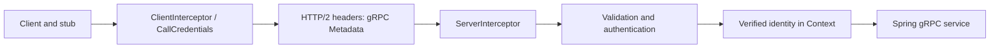

# Client Metadata Injection

Metadata allows a client to send accompanying information with a gRPC call without adding those fields to Protocol Buffers messages. This mechanism is useful for authentication, tracing, routing, and log correlation. However, all metadata sent by a client is caller-controlled input. The server must validate it and establish trust before using it for security or business decisions.

In a Spring gRPC service, the appropriate place to process RPC-level metadata is typically a `ServerInterceptor`. The interceptor reads metadata when the call begins, validates required information, and propagates the verified identity via `io.grpc.Context` to the service. Services then use that identity to enforce access control.

## 1. Where Does Metadata Live in an RPC?

gRPC metadata is a collection of key-value pairs attached to an RPC. It is transmitted over HTTP/2 headers and trailers, separate from Protobuf messages:

- **Request headers** sent by the client when the RPC starts, before the first message.
- **Response headers** optionally sent by the server before the first response message.
- **Trailers** sent by the server when the RPC ends, typically carrying the RPC status and optional additional metadata.

Metadata is not part of the `.proto` schema. The server receives request metadata in the `headers` parameter of `ServerInterceptor.interceptCall`.

A streaming RPC also has only one RPC start and one initial metadata set. Subsequent messages flow inside the stream; they do not create a new set of request metadata. If data varies per message, place that data in the Protobuf message and validate it at the service layer.

## 2. Why Client Metadata Must Be Treated as Untrusted

Clients can fabricate metadata, alter values, send multiple values for the same key, or omit a key the server expects. A legitimate client can also be misconfigured; a malicious client can intentionally spoof values to bypass access controls.

For example, a client can send:

    x-user-id: admin
    x-role: ADMIN
    x-tenant-id: tenant-vip
    x-request-id: mobile-2026-00042

Those strings only prove the client sent those values. They do not prove the caller actually is `admin`, holds the `ADMIN` role, or belongs to `tenant-vip`.

Distinguish three concepts:

| Concept | Question Answered | Source of Truth |
|---|---|---|
| Metadata | What extra info is the RPC carrying? | Data received from client or infrastructure |
| Authentication | Who is calling the RPC? | Token/certificate verified by the server |
| Authorization | What is the caller allowed to do? | Permission policy based on verified identity |

Never use arbitrary metadata as a substitute for authentication or authorization.

### Handling Common Metadata Keys

| Key | Safe Handling |
|---|---|
| `authorization` | Treat as unverified credential; validate signature, issuer, audience, expiry, and token conditions |
| `x-user-id`, `x-role`, `x-permission` | Never treat as identity or permissions; derive these attributes from the server-created principal after authentication |
| `x-tenant-id` | Treat only as the tenant the client requests to access; verify that tenant falls within the principal's allowed scope |
| `x-request-id` | Can be used for log correlation after validating length, characters, and value count; generate a new ID if invalid |
| `traceparent`, `baggage` | Let the tracing library parse them; never use as authorization basis and never put sensitive data into baggage |
| `x-forwarded-for` | Trust only when requests come from a configured trusted proxy that strips or overwrites client-supplied values |

If a gateway authenticates users and injects `x-user-id`, a downstream server can trust that value only when the path from the gateway is secured, the gateway strips client-supplied headers of the same name, and the server accepts traffic exclusively from trusted gateways. If clients can reach the server directly, that header remains caller-controlled input.

## 3. Spoofing Patterns and Pitfalls to Prevent

### Identity or Role Spoofing

A client sends `x-user-id: admin` or `x-role: ADMIN` to trick the service into treating the caller as an administrator. If the service reads those keys directly, the client can escalate privileges.

**Mitigation:** verify credentials first, construct the principal on the server side, and enforce permissions based on that principal. Never accept self-asserted client roles.

### Selecting an Out-of-Scope Tenant

A client may swap `x-tenant-id` from its own tenant to another tenant. If the service uses the header in data queries without checking permissions, this becomes a cross-tenant access vulnerability.

**Mitigation:** verify the token or certificate to extract allowed tenants. If the client sends a target tenant, check it against the verified scope before querying data. If the application model permits only one tenant per principal, derive the tenant directly from the principal and ignore the client-supplied value.

### Duplicate or Malformed Metadata

Metadata is a list of key-value pairs; never assume a key appears only once. For security-sensitive keys like `authorization`, receiving multiple values must be handled explicitly; arbitrarily picking one value can create discrepancies across processing layers.

**Mitigation:** use `Metadata.getAll(key)` to inspect the value count. For credentials, reject if missing, blank, or multi-valued. For optional metadata such as request IDs, discard invalid values and generate a new ID per system policy.

### Oversized or Unnecessary Metadata

Metadata travels in headers and is not flow-controlled payload like streaming messages. Large headers increase processing overhead and memory usage and may exceed gRPC server or proxy limits. Exact limits depend on implementation and infrastructure; gRPC guidance suggests a default request-header limit around 8 KiB, though that should not be treated as a uniform limit across all systems.

**Mitigation:** enforce metadata size limits at both server and proxy, bound individual value lengths at the application layer, allow only necessary keys, and avoid stuffing large business payloads into metadata.

### Uncontrolled Metadata Forwarding

A service that receives a request and copies all metadata to a downstream service can inadvertently forward tokens, spoofed tenant headers, internal headers, or sensitive data.

**Mitigation:** construct outbound metadata using an allowlist. Forward only fields with an explicit purpose, such as tracing context accepted by the parser and a normalized request ID. For downstream credentials, use credentials scoped to the target service's audience or a token-exchange mechanism; never blindly forward end-user bearer tokens.

## 4. Sending Metadata from a Java Client

To send custom metadata, create a `Metadata.Key` with the appropriate marshaller. The following example sends an ASCII request ID:

    import io.grpc.Channel;
    import io.grpc.ClientInterceptors;
    import io.grpc.Metadata;
    import io.grpc.stub.MetadataUtils;

    public final class GrpcClientFactory {

        private static final Metadata.Key<String> REQUEST_ID =
                Metadata.Key.of(
                        "x-request-id",
                        Metadata.ASCII_STRING_MARSHALLER);

        private GrpcClientFactory() {
        }

        public static OrdersGrpc.OrdersBlockingStub createStub(Channel channel) {
            Metadata headers = new Metadata();
            headers.put(REQUEST_ID, "web-req-42");

            Channel channelWithHeaders = ClientInterceptors.intercept(
                    channel,
                    MetadataUtils.newAttachHeadersInterceptor(headers));

            return OrdersGrpc.newBlockingStub(channelWithHeaders);
        }
    }

The interceptor in this example attaches the same metadata to RPCs passing through the wrapped channel. This suits static values or non-sensitive metadata. For per-RPC request IDs, generate metadata per call in a suitable client interceptor. For bearer tokens that vary per user or over time, prefer `CallCredentials` or Spring gRPC's authentication interceptor to fetch credentials right when sending the request; never pin one user's token into static metadata on a shared channel.

Never put passwords, access tokens, or personal data into request IDs, trace baggage, or logged keys.

### Key Naming and Data Type Rules

- Metadata keys are case-insensitive; use lowercase consistently.
- Keys use ASCII characters and must not start with the `grpc-` prefix, which is reserved by gRPC.
- ASCII-valued keys use `Metadata.ASCII_STRING_MARSHALLER`.
- Binary-valued keys must end with `-bin` and use `Metadata.BINARY_BYTE_MARSHALLER`.
- Never arbitrarily convert binary bytes into strings or use the ASCII marshaller for binary data.

Example binary key declaration:

    private static final Metadata.Key<byte[]> CUSTOM_PAYLOAD =
            Metadata.Key.of(
                    "x-custom-payload-bin",
                    Metadata.BINARY_BYTE_MARSHALLER);

Use binary metadata only when small binary data truly needs to travel alongside the RPC. Business data belongs in Protobuf messages for clear schemas, compatibility, and type safety.

## 5. Reading and Normalizing Metadata with ServerInterceptor

`ServerInterceptor` is the central place to handle cross-cutting RPC-level concerns such as request IDs, authentication, logging, and policies. Interceptors execute before service logic processes messages.

The following example reads `x-request-id`. The value is retained only if exactly one value is present and matches the allowed format. If missing or invalid, the server generates a new UUID. This policy fits request IDs used for log correlation; never silently substitute values for credentials or tenants.

    import io.grpc.Context;
    import io.grpc.Contexts;
    import io.grpc.Metadata;
    import io.grpc.ServerCall;
    import io.grpc.ServerCallHandler;
    import io.grpc.ServerInterceptor;
    import java.util.Iterator;
    import java.util.UUID;

    public final class RequestIdServerInterceptor implements ServerInterceptor {

        private static final Metadata.Key<String> REQUEST_ID =
                Metadata.Key.of(
                        "x-request-id",
                        Metadata.ASCII_STRING_MARSHALLER);

        public static final Context.Key<String> REQUEST_ID_CONTEXT =
                Context.key("requestId");

        @Override
        public <ReqT, RespT> ServerCall.Listener<ReqT> interceptCall(
                ServerCall<ReqT, RespT> call,
                Metadata headers,
                ServerCallHandler<ReqT, RespT> next) {

            String requestId = onlyValue(headers, REQUEST_ID);
            if (!isValidRequestId(requestId)) {
                requestId = UUID.randomUUID().toString();
            }

            Context context = Context.current()
                    .withValue(REQUEST_ID_CONTEXT, requestId);

            return Contexts.interceptCall(context, call, headers, next);
        }

        private static <T> T onlyValue(
                Metadata metadata,
                Metadata.Key<T> key) {
            Iterable<T> values = metadata.getAll(key);
            if (values == null) {
                return null;
            }

            Iterator<T> iterator = values.iterator();
            if (!iterator.hasNext()) {
                return null;
            }

            T value = iterator.next();
            return iterator.hasNext() ? null : value;
        }

        private static boolean isValidRequestId(String value) {
            return value != null
                    && value.matches("[A-Za-z0-9._-]{1,64}");
        }
    }

`Contexts.interceptCall` attaches the context for RPC processing and listener callbacks. Services can read the request ID via `RequestIdServerInterceptor.REQUEST_ID_CONTEXT.get()`:

    String requestId =
            RequestIdServerInterceptor.REQUEST_ID_CONTEXT.get();

Never store the request ID in a field on a singleton service or interceptor. That value belongs to a single RPC; using `Context` prevents concurrent requests from overwriting each other's data. When creating custom executors or offloading work asynchronously, ensure required context is propagated via an appropriate propagation mechanism.

## 6. Validating Credentials and Creating a Server-Side Principal

When a client sends a bearer token in `authorization`, the server must verify the token before treating any claim as identity. Verification typically includes:

1. Accepting only a single `authorization` value in the system-supported format.
2. Verifying the signature using trusted keys and an allowlisted algorithm.
3. Checking `issuer`, `audience`, `exp`, `nbf`, and mandatory claims.
4. Mapping verified subject and permissions into an internal principal.
5. Attaching the principal to `io.grpc.Context` for the scope of the RPC.
6. Returning `UNAUTHENTICATED` when credentials are missing or invalid; proceeding to the service only after authentication succeeds.

Never merely decode a JWT and trust its claims. Decoding only reads token contents; it does not prove the token was issued by a trusted issuer or remains untampered.

The following example illustrates the interceptor structure. `TokenVerifier` is an application adapter to a token verification library or service; it must implement all verification steps above. The example does not implement JWT cryptography itself.

    import io.grpc.Context;
    import io.grpc.Contexts;
    import io.grpc.Metadata;
    import io.grpc.ServerCall;
    import io.grpc.ServerCallHandler;
    import io.grpc.ServerInterceptor;
    import io.grpc.Status;
    import java.util.Iterator;
    import java.util.Set;

    public final class AuthenticationServerInterceptor
            implements ServerInterceptor {

        private static final Metadata.Key<String> AUTHORIZATION =
                Metadata.Key.of(
                        "authorization",
                        Metadata.ASCII_STRING_MARSHALLER);

        public static final Context.Key<AuthenticatedPrincipal> PRINCIPAL =
                Context.key("authenticatedPrincipal");

        private final TokenVerifier tokenVerifier;

        public AuthenticationServerInterceptor(TokenVerifier tokenVerifier) {
            this.tokenVerifier = tokenVerifier;
        }

        @Override
        public <ReqT, RespT> ServerCall.Listener<ReqT> interceptCall(
                ServerCall<ReqT, RespT> call,
                Metadata headers,
                ServerCallHandler<ReqT, RespT> next) {

            String authorization = onlyValue(headers, AUTHORIZATION);
            if (authorization == null
                    || !authorization.regionMatches(
                            true, 0, "Bearer ", 0, 7)) {
                return reject(call);
            }

            String token = authorization.substring(7);
            if (token.isBlank() || token.indexOf(' ') >= 0) {
                return reject(call);
            }

            try {
                AuthenticatedPrincipal principal =
                        tokenVerifier.verify(token);

                Context context = Context.current()
                        .withValue(PRINCIPAL, principal);

                return Contexts.interceptCall(
                        context, call, headers, next);
            }
            catch (InvalidTokenException exception) {
                return reject(call);
            }
        }

        private static <T> T onlyValue(
                Metadata metadata,
                Metadata.Key<T> key) {
            Iterable<T> values = metadata.getAll(key);
            if (values == null) {
                return null;
            }

            Iterator<T> iterator = values.iterator();
            if (!iterator.hasNext()) {
                return null;
            }

            T value = iterator.next();
            return iterator.hasNext() ? null : value;
        }

        private static <ReqT, RespT> ServerCall.Listener<ReqT> reject(
                ServerCall<ReqT, RespT> call) {
            call.close(
                    Status.UNAUTHENTICATED.withDescription(
                            "Missing or invalid credentials"),
                    new Metadata());
            return new ServerCall.Listener<ReqT>() { };
        }
    }

    public record AuthenticatedPrincipal(
            String subject,
            Set<String> authorities,
            Set<String> tenantIds) {
    }

    public interface TokenVerifier {
        AuthenticatedPrincipal verify(String token)
                throws InvalidTokenException;
    }

`InvalidTokenException` here is an exception defined by the application's token verification adapter. In production implementations, never log tokens or credential contents. Error responses should also avoid revealing details such as invalid signature, expired token, or nonexistent subject.

After authentication, the service reads the principal from context:

    AuthenticatedPrincipal principal =
            AuthenticationServerInterceptor.PRINCIPAL.get();

    if (principal == null
            || !principal.authorities().contains("orders:read")) {
        responseObserver.onError(
                Status.PERMISSION_DENIED.asRuntimeException());
        return;
    }

This permission check illustrates a plain gRPC service. In Spring Security applications, use integrated authorization mechanisms so policies stay centralized and easy to test. The principal must come from verified credentials; never take authorities from `x-role` or any custom metadata header.

## 7. Registering Interceptors in Spring gRPC

In current Spring gRPC, you can register a `ServerInterceptor` as a Spring bean and annotate it with `@GlobalServerInterceptor` to apply it to all services. `@Order` controls the ordering of global interceptors.

    import io.grpc.ServerInterceptor;
    import org.springframework.context.annotation.Bean;
    import org.springframework.context.annotation.Configuration;
    import org.springframework.core.annotation.Order;
    import org.springframework.grpc.server.GlobalServerInterceptor;

    @Configuration(proxyBeanMethods = false)
    public class GrpcMetadataConfiguration {

        @Bean
        @GlobalServerInterceptor
        @Order(100)
        ServerInterceptor requestIdServerInterceptor() {
            return new RequestIdServerInterceptor();
        }
    }

If only one service needs an interceptor, register the interceptor bean and declare it in `@GrpcService`'s `interceptors` or `interceptorNames` attribute. Global interceptors are applied in sorted order; per-service interceptors apply after global interceptors by default. When combining multiple interceptors, declare ordering explicitly and test actual runtime behavior.

Note the library distinction: Spring gRPC uses `org.springframework.grpc.server.GlobalServerInterceptor`. Some projects use `grpc-spring-boot-starter` from `grpc-ecosystem`/`net.devh`, which has its own annotations and extension points such as `@GrpcGlobalServerInterceptor`. Do not mix imports or configuration examples between the two starters; check your project's actual dependencies.

### Integrating with Spring Security

Spring gRPC supports Spring Security integration via `AuthenticationManager`, `AuthenticationProcessInterceptor`, and `GrpcSecurity`. With an OAuth2 Resource Server, configure bearer token verification via Spring Security's Resource Server mechanism. Then use `@PreAuthorize` on methods/services to check verified authorities.

A policy should explicitly account for RPC groups:

- Public methods explicitly permitted, such as health checks if system design requires.
- Authenticated methods requiring a verified principal.
- Administrative methods requiring specific authorities.
- All remaining methods denied by default.

Do not open reflection, health, or internal methods to all clients merely because they are support endpoints. Select policies based on deployment environment and operational requirements.

## 8. Tenants, Proxies, and Metadata Forwarding

### Checking Tenants

Suppose the verified principal holds an allowed tenant list:

    Set<String> allowedTenants = principal.tenantIds();
    String requestedTenant = readRequestedTenant(headers);

    if (requestedTenant == null
            || !allowedTenants.contains(requestedTenant)) {
        return rejectWithPermissionDenied(call);
    }

`readRequestedTenant` must apply the same value-count and format rules as other metadata. Only after a successful match does the service use the target tenant in data queries. If a tenant is a fixed attribute of the principal, ignore client tenant metadata and read it directly from the principal.

Never treat the fact that a client knows a tenant ID as proof the client is permitted to access that tenant. Tenant IDs are typically not secrets; access rights must be checked independently.

### Proxy Trust Boundaries

If a gateway authenticates requests and forwards identity headers, protect the gateway-to-server boundary:

1. The gateway strips client-supplied identity headers before writing internal headers.
2. The gateway writes identity headers only after verifying credentials.
3. The backend server accepts connections only from gateways or workloads with verified infrastructure identity.
4. The server does not expose the same endpoint to untrusted client networks.
5. If using mTLS between gateway and service, map certificate identity to a service principal per explicit policy.

TLS protects data in transit and authenticates the server per certificate configuration. mTLS can authenticate the client at the transport layer as well. However, TLS does not turn arbitrary custom metadata into trusted identity; clients can still choose values for any keys the application permits them to send.

### Forwarding to Downstream Services

When service A calls service B, construct outbound metadata from verified data:

- Generate an internal request ID if cross-service correlation is needed.
- Propagate trace context through the configured tracing library.
- Pass tenant only after confirming the tenant lies within the principal's scope.
- Use credentials meant for service B or a token with the matching audience.
- Never copy all inbound metadata verbatim.

If user context must be preserved when calling service B, use a delegation or token-exchange mechanism designed for that flow. Forwarding an end-user bearer token verbatim to every service can over-broaden credential scope unnecessarily.

## 9. Metadata in Unary and Streaming RPCs

Metadata is tied to the RPC lifecycle, not individual messages:

| RPC Type | When Metadata Arrives | What to Check |
|---|---|---|
| Unary | When the RPC starts | Authenticate and authorize before processing the request |
| Server streaming | When the RPC starts | Authenticate before emitting the first message; authorize streamed data |
| Client streaming | When the RPC starts | Authenticate before receiving/persisting data; validate each message if business rules require |
| Bidirectional streaming | When the RPC starts | Authenticate once for the RPC; validate payloads and state transitions per message |

Never use initial metadata to carry values that vary per message. For example, in a stream processing multiple commands, each command may carry its own resource ID; the service must check permissions for each resource. Authentication at stream start does not mean every subsequent operation is authorized.

For long-lived streams, account for credential expiration, cancellation, deadlines, and permission revocation. If permissions can change while a stream stays open, the application needs a revalidation policy or an appropriate stream lifetime limit.

## 10. Logging, Tracing, and Protecting Sensitive Data

Metadata often carries authentication info or routing data. Never dump full metadata into logs automatically.

Log normalized fields with operational value:

- gRPC method name and status code.
- Server-accepted or server-generated request ID.
- Internal subject or minimized identifier per privacy policy.
- Verified tenant if required for access investigations.
- Processing duration and authorization outcome.

Never log:

- Bearer tokens, refresh tokens, passwords, or cookies.
- Full `authorization` header values.
- Sensitive data inside `baggage`.
- Unfiltered arbitrary client-sent metadata.

For `traceparent` and `baggage`, let the tracing library parse and propagate them per specification. Never use trace IDs to authenticate callers. Baggage can traverse many services and observability backends; place only non-sensitive, small, explicitly permitted attributes inside it.

## 11. Testing Metadata Injection

Testing should cover valid, missing, malformed, and spoofed metadata. With Spring gRPC, you can use an in-process server in integration tests to exercise services and interceptors without opening network ports.

| Scenario | Expected Outcome |
|---|---|
| Valid request ID, single value | Service and logs use the accepted request ID |
| Missing or malformed request ID | Server generates a new ID per policy |
| Duplicate request ID values | Does not arbitrarily pick one; rejects or generates a new ID per policy |
| Missing authorization on authenticated RPC | `UNAUTHENTICATED` |
| Invalid signature, expired, wrong issuer or audience token | `UNAUTHENTICATED` |
| Multiple authorization values | Reject authentication |
| Client sends `x-user-id: admin` or `x-role: ADMIN` | Principal and permissions remain unchanged |
| Client selects tenant outside principal scope | `PERMISSION_DENIED` |
| Metadata exceeds configured size limit | Request rejected at server or proxy per configuration |
| Stream message attempts cross-tenant resource access | Individual message checked and rejected when unauthorized |
| Metadata contains tokens or sensitive data | Logs omit sensitive values |

You can use `grpcurl` to test metadata locally or in staging:

    grpcurl \
      -H 'authorization: Bearer <access-token>' \
      -H 'x-request-id: demo-42' \
      -H 'x-role: ADMIN' \
      -d '{"orderId":"A-100"}' \
      localhost:9090 \
      orders.v1.OrderService/GetOrder

In this test, `x-role: ADMIN` must not alter permissions. If the token lacks the required authority, the RPC must still be rejected. When targeting production endpoints, connections must be protected by TLS; never use plaintext mode with real credentials.

Beyond isolated interceptor unit tests, write integration tests verifying:

- Global interceptors actually apply to expected services.
- Interceptor ordering does not bypass authentication or overwrite context.
- Public methods and protected methods follow their respective policies.
- Both unary and streaming RPCs receive proper context.
- No service reads identity directly from client-supplied metadata.

## 12. Deployment Checklist

- [ ] Use TLS for production connections; consider mTLS for service-to-service communication.
- [ ] Verify tokens or certificates on the server before constructing a principal.
- [ ] Never trust `x-user-id`, `x-role`, or `x-permission` sent by clients.
- [ ] Verify target tenants fall within the verified principal's scope.
- [ ] Handle duplicate metadata explicitly via `getAll`.
- [ ] Validate format, length, and value count for custom metadata.
- [ ] Enforce metadata size limits at the server and relevant proxies.
- [ ] Forward metadata strictly via an allowlist.
- [ ] Never write credentials or sensitive metadata to logs.
- [ ] Test spoofed, missing, duplicate, oversized, and multi-message stream cases.
- [ ] Verify interceptor configuration against your exact Spring gRPC starter.

## 13. Choosing Where to Place Data

| Data Type | Appropriate Location |
|---|---|
| Business data such as order ID, amount, filter | Protobuf message |
| Credentials for the entire RPC | `authorization` metadata or `CallCredentials`, then verified on the server |
| Request ID, trace context | Metadata |
| Verified identity and permissions | Principal in security context or `io.grpc.Context` |
| Attributes that vary per streaming message | Protobuf message |
| Final status and supplementary server info | gRPC status and response trailers where appropriate |

The rule of thumb is to keep metadata small, enforce clear application-layer parsing rules, and treat all client-supplied input as untrusted until validated. Metadata carries RPC context; server-side authentication and authorization decide who is permitted to act.

## References

- [gRPC Metadata](https://grpc.io/docs/guides/metadata/) — key-value structure, headers, trailers, binary keys, and metadata limits.
- [gRPC Interceptors](https://grpc.io/docs/guides/interceptors/) — using interceptors for metadata, logging, metrics, and authentication.
- [gRPC Authentication](https://grpc.io/docs/guides/auth/) — transport-layer authentication and RPC-bound credentials.
- [Spring gRPC Server Reference](https://docs.spring.io/spring-grpc/reference/server.html) — registering global/per-service interceptors, interceptor ordering, and Spring Security integration.
- [Spring Boot gRPC](https://docs.spring.io/spring-boot/reference/io/grpc.html) — configuring the gRPC server, TLS/mTLS, and application security.
