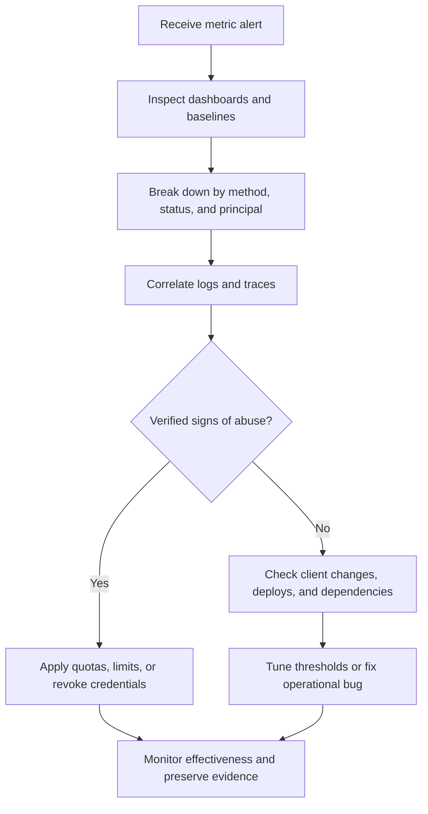

# Monitoring Anomalous Requests

In a **Spring gRPC** service, every RPC traverses the network carrying metadata, an authenticated identity, and one or more messages. A request can be syntactically valid yet anomalous in frequency, size, processing time, or method usage pattern. Relying solely on post-incident error log checks means operations teams often detect issues too late or lack sufficient evidence to pinpoint the source.

Monitoring anomalous requests means collecting and correlating RPC signals to spot behavior deviating from normal usage, investigate root causes, and apply appropriate mitigations. This combines metadata, status codes, deadlines, metrics, logs, and traces. It complements authentication, authorization, TLS, and resource limits; logging alone does not replace those protections.

## 1. Defining What Counts as Anomalous

A failed RPC is not necessarily an attack. Clients can send bad inputs, lose connectivity, exceed deadlines, or actively cancel calls. Conversely, an RPC returning `OK` can still be notable if a single identity invokes a sensitive method at an unusually high rate or opens too many concurrent streams.

Therefore, requests must be evaluated in context: invoked method, authenticated identity, connection source, timing, frequency, message size, duration, and RPC outcome. A single signal should typically raise an investigative signal; multiple correlated signals provide a stronger basis for escalating alerts.

| Indicator | Signals to Observe | Interpretation |
| --- | --- | --- |
| Sudden RPC spike | Call counts by method, identity, and time window | Could be legitimate traffic, excessive retries, or probing behavior |
| Repeated authn/authz failures | `UNAUTHENTICATED`, `PERMISSION_DENIED`, identity, and method | Could be expired tokens, client misconfiguration, or unauthorized access attempts |
| Oversized or dense requests | Message size, messages per stream, inbound limits | Could be a client bug or an attempt to exhaust memory and bandwidth |
| Many slow or timed-out RPCs | Latency, `DEADLINE_EXCEEDED`, active RPC count | Could be slow backends, overly tight deadlines, or intentional load generation |
| Many concurrent open streams | Open stream count, stream duration, message rate | Can exhaust threads, connections, or processing resources |
| Rare or out-of-order method calls | Frequency by full method name and call sequence | Could be a new client, broken integration, or API surface enumeration |
| Unusual metadata | Count, size, and types of allowed metadata | Could be misconfiguration or deliberate oversized/unusual headers |

Signals must be weighed against business patterns. For example, a data-sync method may spike at the start of the day; a read-status method may be called far more often than a permission-change method. Never apply one uniform threshold across all methods.

## 2. Collecting Telemetry at the Right Layers

An effective observability setup combines three telemetry pillars:

- **Metrics** show trends and scale: RPC counts, error rates, latency, active streams, and messages per stream.
- **Structured logs** record events needed for investigation: timestamps, methods, statuses, correlation IDs, authenticated identity when policy permits, and security control outcomes.
- **Traces** link an RPC to downstream calls to locate where latency, retries, or cascading errors originate.

### Recommended Metrics

The names below are illustrative; exact metric names depend on the instrumentation library and Micrometer/Prometheus setup in use.

| Metric | Data Type | Purpose |
| --- | --- | --- |
| `grpc_server_started_total` | Counter | Total RPCs started, by method |
| `grpc_server_handled_total` | Counter | Total RPCs completed, by method and status code |
| `grpc_server_handling_seconds` | Histogram | Processing latency distribution for p50, p95, p99 |
| `grpc_server_active_calls` | Gauge | Active RPCs at measurement time |
| `grpc_server_request_messages_total` | Counter | Client-sent inbound message count, useful for streaming |
| `grpc_server_stream_duration_seconds` | Histogram | Stream durations |

Keep metric labels bounded in cardinality, such as `method`, `grpc_code`, and `rpc_type`. Never put `request_id`, tokens, emails, IP addresses, or arbitrary user IDs into metric labels: every unique value creates a new time series, inflating memory and storage costs. When identity-level analysis is needed, write a security-policy-approved identifier to access-controlled logs.

### Structured Event Logs

An RPC completion record can take this form:

```json
{
  "event": "grpc.server.call.completed",
  "timestamp": "2026-11-19T08:30:15.120Z",
  "trace_id": "4bf92f3577b34da6a3ce929d0e0e4736",
  "rpc_method": "inventory.v1.InventoryService/GetItem",
  "rpc_type": "unary",
  "grpc_status": "PERMISSION_DENIED",
  "duration_ms": 12.8,
  "request_message_count": 1,
  "principal_ref": "service-account-42",
  "source": "10.20.4.18"
}
```

This is a structural example, not a mandate to log every field. Record identity and source address only when there is a clear operational purpose, proper log access control, and a defined retention window. Obtain the source address from the actual trusted connection; never blindly trust `x-forwarded-for` or client-sent metadata unless traffic traversed a trusted proxy.

Never write `authorization` values, access tokens, private keys, cookies, message payloads, or sensitive personal data into ordinary logs. If business evidence must be retained, define dedicated allowed fields, mask or pseudonymize sensitive data, and restrict reader access. Client-supplied request IDs are also untrusted input: validate length/characters, never treat them as identity, and never let them overwrite trusted trace context.

### Traces and Correlation

Every RPC should carry trace/span context linking gRPC server events with databases, HTTP clients, and downstream services. During investigations, use `trace_id` or a trusted system-generated correlation ID to locate related logs. Never put tokens or sensitive data in span attributes or baggage. When requests are retried, distinguish individual attempts from the original business operation to avoid miscounting requests.

## 3. Capturing RPC Lifecycle with ServerInterceptor

In gRPC Java, `ServerInterceptor` is the natural place to observe cross-cutting call properties without duplicating logic in each service implementation. An interceptor can read the full method name, measure duration, count inbound messages, and record status when the server closes the call. For streaming RPCs, counting messages helps distinguish one long multi-message call from many short unary calls.

The following example shows an implementation skeleton. `RpcTelemetry` is an application-provided adapter forwarding data to Micrometer, OpenTelemetry, or an existing observability backend.

```java
import io.grpc.ForwardingServerCall;
import io.grpc.ForwardingServerCallListener;
import io.grpc.Metadata;
import io.grpc.ServerCall;
import io.grpc.ServerCallHandler;
import io.grpc.ServerInterceptor;
import io.grpc.Status;

import java.util.concurrent.atomic.AtomicBoolean;
import java.util.concurrent.atomic.AtomicLong;
import java.util.function.Consumer;
import java.util.logging.Level;
import java.util.logging.Logger;

public final class RpcMonitoringInterceptor implements ServerInterceptor {
    private static final Logger LOGGER =
            Logger.getLogger(RpcMonitoringInterceptor.class.getName());

    private final RpcTelemetry telemetry;

    public RpcMonitoringInterceptor(RpcTelemetry telemetry) {
        this.telemetry = telemetry;
    }

    @Override
    public <ReqT, RespT> ServerCall.Listener<ReqT> interceptCall(
            ServerCall<ReqT, RespT> call,
            Metadata headers,
            ServerCallHandler<ReqT, RespT> next) {

        String method = call.getMethodDescriptor().getFullMethodName();
        long startedAt = System.nanoTime();
        AtomicLong requestMessages = new AtomicLong();
        AtomicBoolean recorded = new AtomicBoolean();

        recordSafely(() -> telemetry.started(method));

        Consumer<Status> finish = status -> {
            if (recorded.compareAndSet(false, true)) {
                long elapsedNanos = System.nanoTime() - startedAt;
                long messageCount = requestMessages.get();
                recordSafely(() -> telemetry.completed(
                        method, status.getCode(), elapsedNanos, messageCount));
            }
        };

        ServerCall<ReqT, RespT> observedCall =
                new ForwardingServerCall.SimpleForwardingServerCall<>(call) {
                    @Override
                    public void close(Status status, Metadata trailers) {
                        finish.accept(status);
                        super.close(status, trailers);
                    }
                };

        try {
            ServerCall.Listener<ReqT> listener = next.startCall(observedCall, headers);
            return new ForwardingServerCallListener
                    .SimpleForwardingServerCallListener<>(listener) {
                @Override
                public void onMessage(ReqT message) {
                    requestMessages.incrementAndGet();
                    super.onMessage(message);
                }

                @Override
                public void onCancel() {
                    finish.accept(Status.CANCELLED);
                    super.onCancel();
                }
            };
        } catch (RuntimeException ex) {
            finish.accept(Status.UNKNOWN);
            throw ex;
        }
    }

    private void recordSafely(Runnable event) {
        try {
            event.run();
        } catch (RuntimeException ex) {
            // Telemetry system failures must not break the in-flight RPC.
            LOGGER.log(Level.WARNING, "Unable to record gRPC telemetry", ex);
        }
    }
}
```

Minimal adapter interface:

```java
import io.grpc.Status;

public interface RpcTelemetry {
    void started(String method);

    void completed(
            String method,
            Status.Code status,
            long elapsedNanos,
            long requestMessageCount);
}
```

Key details when applying this:

1. `getFullMethodName()` provides a stable method name shaped `package.Service/Method`, suitable as a metric label when the service set is bounded.
2. `System.nanoTime()` measures elapsed duration; never use it as a calendar timestamp. Event timestamps can come from the logging system's clock.
3. `onMessage()` counts client-sent messages. It does not measure wire bytes and does not replace message size limits. Measuring bytes requires serialization/transport-layer instrumentation or dedicated application logic.
4. `close()` captures the server-returned status; `onCancel()` captures client cancellation. The `AtomicBoolean` flag prevents double-recording if both terminal paths fire.
5. The telemetry adapter must run fast, never block RPC threads, and never call remote logging services synchronously. Telemetry failures are isolated so monitoring issues never turn into business failures.

Register the interceptor using the mechanism supported by your project's Spring gRPC starter. Interceptor order matters: if recording the principal, authentication must place the principal into `io.grpc.Context` before the monitoring interceptor reads it. Never pull identity from arbitrary client-sent headers. Exact configuration depends on your chosen starter and gRPC version; check the corresponding registration mechanism before deploying.

## 4. Detecting Anomalies Against a Baseline

A baseline describes normal activity by method, identity, connection source, and time window. You can start with static thresholds to protect resources, then refine using real traffic data. For cyclical traffic, comparing against the same hour of day or day of week is more useful than comparing against an all-time average.

Practical detection rules:

- **Rapid rate increases:** alert when RPCs per identity or source exceed allowed thresholds in a short window. Combine absolute caps with baseline deviation to catch both quota breaches and sudden spikes.
- **Repeated auth failures:** track `UNAUTHENTICATED` and `PERMISSION_DENIED` rates by method. Distinguish mass token expiration caused by an issuance outage from many identities probing a single method.
- **Resource abuse:** monitor message sizes, messages per stream, stream durations, and concurrent RPCs. Alert when an identity holds unusually long streams or sends messages faster than expected.
- **API probing:** detect a source calling many rare methods, calling uncommon method sequences, or repeatedly hitting `NOT_FOUND`/`UNIMPLEMENTED`.
- **Slow loads:** watch p95/p99 latency, active RPC counts, and `DEADLINE_EXCEEDED` rates. Correlate downstream traces to tell slow backends apart from overly short client deadlines.
- **Abnormal retries:** watch repeated calls sharing the same correlation ID or business operation. Retry storms can amplify a backend hiccup into a system-wide overload.

Example Prometheus query tracking denied RPC rates by method (adjust metric/label names to match your exporter):

```promql
sum by (method) (
  rate(grpc_server_handled_total{
    grpc_code=~"UNAUTHENTICATED|PERMISSION_DENIED"
  }[5m])
)
```

And a p95 latency query when metrics are exported as a Prometheus histogram:

```promql
histogram_quantile(
  0.95,
  sum by (le, method) (
    rate(grpc_server_handling_seconds_bucket[5m])
  )
)
```

Never alert solely on total error counts. `CANCELLED`, `DEADLINE_EXCEEDED`, or `INVALID_ARGUMENT` can occur during normal operation. Evaluate rates, growth deltas, identities, methods, and resource impact. Every alert should state the evaluation window, threshold, affected target, and links to dashboards/traces so on-call engineers can verify immediately.

## 5. Interpreting gRPC Statuses in Context

| Status | Typical Meaning | What to Check When Anomalous |
| --- | --- | --- |
| `UNAUTHENTICATED` | Missing or invalid authentication credentials | Token lifecycle, client config, origin source, and retry rate |
| `PERMISSION_DENIED` | Known identity lacks permission | Authorization rules, sensitive methods, and principal access patterns |
| `RESOURCE_EXHAUSTED` | Quota or resource limit exceeded | Message limits, rate limits, stream counts, and overload signs |
| `DEADLINE_EXCEEDED` | Did not complete before deadline | Per-dependency latency, timeouts, retries, and backend health |
| `CANCELLED` | Call was cancelled | Client disconnects, user cancellations, or abandoned streams |
| `INVALID_ARGUMENT` | Invalid input data | Client schema/version mismatch or malformed payload sequences |
| `INTERNAL` / `UNKNOWN` | Internal or unclassified error | Server exceptions, application logs, and related traces |

A status code is a piece of evidence, not a conclusion about client intent. For instance, a surge of `UNAUTHENTICATED` errors may happen because a secret rotated and a client has not refreshed yet. Verify root cause before revoking identities or blocking connection sources.

## 6. Pairing Detection with Protective Controls

Once anomalous behavior is confirmed, pick mitigations matching the cause and blast radius:

1. **Rate limiting:** enforce quotas by principal and method; prefer enforcement at the gateway or a serving tier capable of consistent application.
2. **Resource limits:** enforce inbound message limits, max concurrent calls, metadata size limits, and processing bounds aligned with API contracts.
3. **Stream protection:** bound concurrent streams, stream lifetime, and message rates where business logic allows; release resources on client cancellation.
4. **Identity hardening:** enforce TLS; require mTLS when service-to-service models need transport identity; authenticate and authorize every method.
5. **Retry and deadline discipline:** set sensible client deadlines, bound retries with backoff, and avoid synchronized retry waves when servers are overloaded.
6. **Identity-based response:** revoke or rotate compromised credentials, reduce privileges, or temporarily suspend a principal given strong evidence; audit who acted and when.

Never default to raising timeouts or provisioning extra capacity in response to an anomalous request surge. If the cause is a retry storm or stalled streams, raising limits can spread the failure. After mitigating, keep monitoring to confirm error rates, latency, and active RPCs return to normal.

## 7. Alert Investigation Workflow



When on call, follow this sequence:

1. Determine when the alert started, which methods are affected, and how far metrics deviate from baseline.
2. Group by `grpc_code`, principal, and trusted connection source. Check whether multiple clients degraded simultaneously after a deployment.
3. Use traces to pinpoint slow dependencies; use logs to verify identities and operation sequences within permitted data bounds.
4. Cross-reference deploy schedules, credential rotations, quota updates, and business events that might explain spikes.
5. If abuse is indicated, apply the narrowest effective restriction; monitor impact on legitimate clients.
6. Document root cause, evidence, actions taken, and alert resolution criteria. Update baselines once legitimate system shifts are understood.

## 8. Testing Observability

Integration tests should confirm telemetry accurately reflects RPC lifecycles without altering business outcomes:

- Invoke a successful unary RPC: one start, one completion with `OK`, and reasonable latency.
- Send invalid or unauthenticated requests: status recorded accurately; logs omit tokens and sensitive payloads.
- Invoke server-streaming, client-streaming, and bidirectional-streaming RPCs: message counts, durations, and cancellations are recorded properly.
- Cancel an RPC from the client: `CANCELLED` is not double-recorded alongside another terminal event.
- Generate ramping load: dashboards show RPC rates, active calls, and latency; alerts trigger at configured thresholds.
- Send a message exceeding configured limits: server rejects via the limit mechanism and emits expected operational signals.
- Slow down or temporarily break the telemetry backend: RPCs do not hang on synchronous metrics/logging I/O.

Beyond functional tests, verify dashboard/log access controls, retention windows, data masking, and time-series cardinality costs. Good observability must accelerate root-cause analysis without introducing bottlenecks or leaking credentials.

## 9. Operational Checklist

- [ ] Metrics exist for RPC counts, statuses, latency, active RPCs, and streaming.
- [ ] Dashboards break down metrics by full method name and status code.
- [ ] Separate baselines and thresholds exist for methods with distinct traffic profiles.
- [ ] Logs are structured, carry trusted trace/correlation IDs, and omit tokens or sensitive payloads.
- [ ] Identity comes from post-authentication context; client-sent metadata is treated as untrusted input.
- [ ] Message, metadata, rate, and stream limits match business requirements.
- [ ] Alerts exist for traffic spikes, auth errors, latency, and resource-exhaustion signals.
- [ ] Procedures exist for verification, mitigation, evidence preservation, and post-incident baseline tuning.

Monitoring anomalous requests works best when every alert leads directly to verifiable evidence: which RPC, which method, which identity, what changed, and which resources are impacted. Combining gRPC-layer interceptors with metrics, logs, and traces enables Spring gRPC services to detect off-baseline behavior early, investigate with facts, and respond while preserving availability for legitimate clients.
