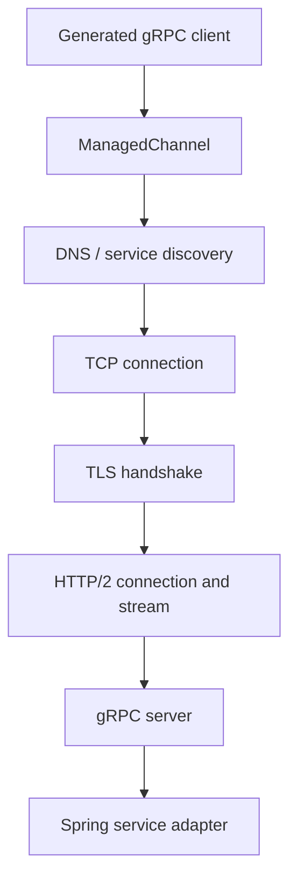

# UNAVAILABLE Due to Connection Reset

In **SPRING_GRPC**, a client may receive status `UNAVAILABLE` with a transport error such as `Connection reset by peer` when the TCP connection is abruptly closed by the server or an intermediary device. This usually indicates the current connection is no longer usable; it is not enough to conclude that the application service failed or that the request was never processed.

You need to trace the RPC's path across DNS, TCP, TLS, HTTP/2, and gRPC. Resets can happen when the server restarts, a proxy closes an idle connection, a load balancer drops a backend, a firewall/NAT expires connection state, or the client uses an already-closed channel. The right fix is to identify when the reset occurred, inspect server/channel lifecycles, and retry only when the operation is safe.

## 1. Understand the Meaning of UNAVAILABLE

`UNAVAILABLE` is a gRPC status indicating the service is currently unable to serve the RPC. It typically fits connection errors or transient conditions, yet does not by itself pinpoint the exact cause.

| Status/Symptom | Common Meaning | Direction to Investigate |
| --- | --- | --- |
| `UNAVAILABLE` + connection reset | Connection abruptly closed or endpoint unavailable | TCP, server, proxy, load balancer |
| `UNAVAILABLE` + connection refused | No process listening at host/port or actively rejected | Server process, port, container mapping |
| `UNAVAILABLE` + DNS failure | Unable to resolve target | DNS/service discovery |
| `DEADLINE_EXCEEDED` | RPC exceeded deadline | Latency, queue, dependency, and budget |
| `UNAUTHENTICATED` | Credentials could not be verified | Metadata, token, TLS identity |
| `INTERNAL` | Server reported an internal error | Application logs and error mapping |

A connection reset does not mean the server process is definitely dead. A proxy, sidecar, firewall, or NAT can also send a TCP reset. An HTTP/2 stream reset also differs from a TCP connection reset; both can fail an RPC, yet their scope of impact differs.

The final status the client receives depends on which layer detected the failure and when it happened. Always examine the status, cause chain, channel state, and endpoint logs at the same timestamp.

## 2. Distinguish the Connection Layers

An RPC traverses multiple layers:



A reset can occur at different places:

- **DNS/service discovery**: target resolves to a stale IP or a removed backend.
- **TCP**: peer or intermediary sends RST; the socket is no longer valid.
- **TLS**: handshake is closed due to incompatible certificates, protocol, or TLS configuration; inspect handshake logs rather than assuming every TLS failure is a connection reset.
- **HTTP/2 connection**: the connection is closed or sends GOAWAY.
- **HTTP/2 stream**: one stream is reset while the connection may still serve other streams.
- **gRPC/application**: the server intentionally returns a status without necessarily triggering a TCP reset.

Do not infer that the entire connection is broken from a single RPC failure. If the HTTP/2 connection remains alive while one stream is reset, other RPCs can continue normally.

## 3. Identify When the Connection Reset Occurs

Timing often narrows down the cause faster than stack traces:

| Timing | Possible Cause | Data to Check |
| --- | --- | --- |
| On the very first call | Wrong host/port, server not started, wrong TLS/proxy route | DNS, listener, handshake, startup logs |
| After deploy/restart | Old connections closed during instance replacement | Deployment events, graceful shutdown |
| After an idle period | Proxy/LB/NAT idle timeout | Idle timeout, keepalive, connection age |
| Under increased load | Backend overload, connection limits, proxy saturation | CPU, queues, active calls, file descriptors |
| Mid-streaming RPC | Server restart, stream reset, proxy timeout, or network interruption | Stream duration, GOAWAY/RST_STREAM, cleanup |
| Only one backend fails | Backend health or inconsistent instance configuration | Backend address, instance ID, rollout |

Record the RPC method, target, timestamp, trace ID, and backend instance. Do not log tokens or raw payloads when enabling transport diagnostics.

## 4. Check Server Restarts and Graceful Shutdown

During deployments, the server must stop accepting new requests and give in-flight requests time to finish. If the process is killed immediately, active connections can be reset.

With the grpc-java Server API, shutdown has two levels:

```java
server.shutdown(); // Stop accepting new RPCs, allow running RPCs to complete.

if (!server.awaitTermination(30, TimeUnit.SECONDS)) {
    server.shutdownNow(); // Force-cancel remaining RPCs after drain timeout.
    server.awaitTermination(5, TimeUnit.SECONDS);
}
```

In a Spring gRPC application, the server is usually managed by the Spring lifecycle. Prefer the graceful shutdown configuration and lifecycle hooks provided by the framework; do not manually create a second Server or manually shut down the instance managed by Spring.

A safe deployment sequence typically includes:

1. Mark the instance not ready so the load balancer stops sending new requests.
2. Wait for readiness/endpoint removal propagation.
3. Request graceful shutdown of the gRPC server.
4. Allow in-flight RPCs to complete within the drain window.
5. After the drain timeout, cancel remaining RPCs and close dependencies.
6. Terminate the process only after lifecycle cleanup completes.

The drain window must align with the maximum RPC deadline and deployment duration. Long-lived streaming RPCs need a specific policy: allow them to finish, send an application signal for clients to reconnect, or bound stream age.

## 5. Use ManagedChannel with the Right Lifecycle

Do not create a new channel per request. A channel is a long-lived resource that manages connections, name resolution, load balancing, and reconnection.

Example of a client gateway holding a channel across the application lifecycle:

```java
public final class InventoryGrpcClient implements AutoCloseable {

    private final ManagedChannel channel;
    private final InventoryServiceGrpc.InventoryServiceBlockingStub stub;

    public InventoryGrpcClient(String target) {
        this.channel = ManagedChannelBuilder
                .forTarget(target)
                .useTransportSecurity()
                .build();

        this.stub = InventoryServiceGrpc
                .newBlockingStub(channel);
    }

    public StockReply getStock(String sku) {
        return stub.withDeadlineAfter(500, TimeUnit.MILLISECONDS)
                .getStock(
                        StockRequest.newBuilder()
                                .setSku(sku)
                                .build());
    }

    @Override
    public void close() throws InterruptedException {
        channel.shutdown();
        if (!channel.awaitTermination(5, TimeUnit.SECONDS)) {
            channel.shutdownNow();
            channel.awaitTermination(5, TimeUnit.SECONDS);
        }
    }
}
```

In Spring, register the channel/client gateway as a singleton bean or use the client integration provided by Spring gRPC. Close the channel when the application context shuts down, not after each method call.

Common lifecycle mistakes:

- Creating a `ManagedChannel` on every RPC call, causing connection churn and thread/socket leaks.
- Calling a channel that has already been `shutdown()`.
- Closing the channel right after starting an async call, before the call completes.
- Keeping a channel pointed at an old endpoint after service discovery/configuration changes without an appropriate refresh mechanism.

A channel can reconnect automatically after transient failures, yet reconnection does not recover an already-failed RPC. The client must decide whether to resend the operation.

## 6. Read Channel Connectivity State

A gRPC channel has states such as `IDLE`, `CONNECTING`, `READY`, `TRANSIENT_FAILURE`, and `SHUTDOWN`. You can observe state during investigation:

```java
ConnectivityState state = channel.getState(true);

log.info("Inventory channel state={}", state);

channel.notifyWhenStateChanged(state, () -> {
    ConnectivityState next = channel.getState(false);
    log.info("Inventory channel state changed: {}", next);
});
```

`getState(true)` can ask the channel to start connecting if it is currently IDLE. `notifyWhenStateChanged` registers a callback when the state leaves the current state; the callback must re-register if you want to keep tracking subsequent transitions.

Connectivity state is an observability signal, not a guarantee that the next RPC will succeed. A channel can be READY and experience a connection reset immediately afterward. Do not use state checks as a substitute for deadlines, error handling, and retry policies.

Avoid continuous polling or overly verbose logging on every state transition in production. Tag state with target/service name and use metrics to observe the fraction of time a channel spends in TRANSIENT_FAILURE.

## 7. Check Proxies, Load Balancers, and Idle Timeouts

A connection can be closed by an intermediary even while the server is healthy. Settings to cross-check:

- Idle timeouts of the load balancer, ingress, API gateway, or service mesh.
- Maximum connection age and grace periods.
- HTTP/2 support on both frontend and upstream.
- GOAWAY and RST_STREAM forwarding policies.
- Backend draining when health checks transition to unhealthy.
- NAT/firewall connection tracking timeouts.
- Concurrent stream limits and connection count limits.

If errors only occur after a nearly fixed idle interval, compare that duration against each layer's idle timeout. Do not enable aggressive keepalives just to mask errors: keepalive traffic may be rate-limited or increase load. Client/server keepalive settings must comply with server and intermediary policies.

If a proxy terminates TLS and opens another TLS connection to the backend, inspect both legs. The client may complete TLS to the proxy successfully while the proxy fails to connect to the gRPC server.

## 8. Distinguish TCP Reset, HTTP/2 GOAWAY, and RST_STREAM

These three signals have different scopes:

| Signal | Scope | Observable Consequence |
| --- | --- | --- |
| TCP RST | Entire TCP connection | All HTTP/2 streams on that connection are affected |
| HTTP/2 GOAWAY | Signals the connection will stop accepting new streams | Existing accepted streams can finish; client opens a new connection |
| HTTP/2 RST_STREAM | A single stream | That RPC ends; the connection may remain usable |

GOAWAY is usually part of controlled shutdown/draining. TCP RST usually indicates an abrupt close. RST_STREAM can result from cancellation, protocol error, or intermediary policy; inspect the error code and corresponding logs.

A gRPC `UNAVAILABLE` status does not reveal exactly which HTTP/2 frame or TCP packet occurred. Use client transport logs, server logs, and proxy telemetry to correlate. When deep analysis is needed, packet captures must be performed in authorized environments and avoid storing sensitive payloads.

## 9. Check TLS and Certificates

Connection resets can appear around TLS handshake timing, yet not all TLS errors share the same cause. Check:

- Server certificate validity and hostname/SAN matching target.
- Client trusting the right CA chain.
- Client and server agreeing on TLS version/cipher policy.
- mTLS client certificate sent and trusted by the server if required.
- Proper configuration of proxy TLS termination and upstream TLS.
- Certificate rotation not creating a window where instances present incompatible certificates.

Use `grpcurl -vv` with the appropriate TLS/CA options to view connection errors from the client. You can use `openssl s_client` to check the TLS handshake to a TLS endpoint, though a successful TLS handshake does not prove the HTTP/2/gRPC service is working.

Do not fix this by disabling certificate validation or switching production to plaintext. If the TLS handshake fails, isolate certificate/protocol errors separately from TCP resets and authentication metadata.

## 10. Reconnect and Retry Are Two Different Things

Channel reconnection establishes a new connection for future RPCs. Retry resends an already-failed RPC. Not every connection reset error can be safely retried.

Several scenarios:

- **Read-only RPC**: usually safe to retry when status and deadline policies allow.
- **Idempotent write**: can be retried if the server guarantees duplicate requests produce no repeated side effects.
- **Non-idempotent write**: a reset can happen after the server committed yet before the client received the response; retrying can duplicate the operation.
- **Streaming RPC**: cannot safely replay an entire stream from the start by default; requires resume tokens, offsets, or an application protocol.

For writes, use an idempotency key or operation ID and store results by key so the client can query status after a connection reset. Do not treat `UNAVAILABLE` as proof that the server never received the request.

## 11. Configure Bounded Retries

Retry policies should bound attempts, backoff, and total time. Illustrative service config example for a read method:

```json
{
  "methodConfig": [{
    "name": [{
      "service": "inventory.v1.InventoryService",
      "method": "GetStock"
    }],
    "retryPolicy": {
      "maxAttempts": 3,
      "initialBackoff": "0.1s",
      "maxBackoff": "1s",
      "backoffMultiplier": 2,
      "retryableStatusCodes": ["UNAVAILABLE"]
    }
  }]
}
```

This is an illustrative policy; retries and service config must be enabled and configured according to your grpc-java version/resolver. Some resolvers or channel setups do not accept service config the same way. Verify the actual retry policy in integration tests rather than assuming the JSON took effect.

Do not apply this retry policy indiscriminately to every method. Preserve the overall deadline, cap attempts, add jitter per policy, and avoid retry storms when an entire fleet loses a backend. For write operations, retry only when idempotency semantics are guaranteed.

## 12. Diagnose with Logs, Metrics, and Tools

When encountering resets, gather the following data points at the same timestamp:

| Data Point | Question to Answer |
| --- | --- |
| RPC full method name | Which method is affected? |
| Client target/backend address | Which instance is the request reaching? |
| Channel connectivity state | Is the channel READY or TRANSIENT_FAILURE? |
| RPC start/end and deadline | Did the reset happen immediately or after waiting? |
| Server instance lifecycle | Was there a restart, rollout, or OOM? |
| Proxy/LB logs | Was there an idle timeout, backend drain, or upstream reset? |
| TLS handshake result | Were there certificate/protocol errors? |
| Concurrent calls/streams | Is one RPC or the entire connection affected? |

Useful commands:

```powershell
Test-NetConnection grpc.example.internal -Port 9090
```

The command above checks TCP reachability from Windows; it does not verify TLS or gRPC methods.

```bash
grpcurl -vv grpc.example.internal:9090 list
```

For internal plaintext endpoints, use `-plaintext`; for TLS, use appropriate CA and client certificate options. Reflection must be enabled for `list` to discover services.

When operationally permitted, correlate packet captures at the client, proxy, and server. If the client sees RST while the server logs no socket close, an intermediary may be issuing the reset. Do not enable full metadata wire logging in production if there is a risk of exposing authorization headers.

## 13. Test Connection Resets Over Real Network Transport

In-process gRPC tests are useful for service behavior, yet they create no TCP sockets and therefore cannot simulate TCP RST, TLS handshakes, or proxy idle timeouts. Those scenarios require network integration tests.

A basic test can:

1. Start a gRPC server on a dynamic port.
2. Create a real `ManagedChannel` pointing to that port.
3. Call a unary RPC successfully to establish a baseline.
4. Abruptly stop the server or use a fault proxy to reset the connection while an RPC is running.
5. Verify the client receives a transport/status error matching the reset timing.
6. Restart the server and verify the channel recovers for new RPCs.
7. Close the channel, server, and proxy in `finally`.

Do not assert a fixed low-level exception string such as `Connection reset by peer`; wording varies across OS, transport implementations, and grpc-java versions. Assert status/category, timing, cleanup, and recovery capability. With a fault proxy, you can simulate resets, latency, or connection drops deterministically; only use tools appropriate for the test environment.

Test server graceful shutdown separately from forced resets. Graceful shutdown may let in-flight RPCs complete or return controlled statuses; forced resets verify behavior when transport drops abruptly.

## 14. Common Mistakes

| Mistake | Consequence | Resolution |
| --- | --- | --- |
| Creating a channel per request | Connection churn, thread/socket leaks | Reuse channels across the application lifecycle |
| Closing the channel after each RPC | Subsequent calls fail | Shut down only when the client bean closes |
| Retrying every `UNAVAILABLE` | Duplicate writes or retry storms | Retry based on method and idempotency |
| Disabling TLS to "fix" resets | Loses transport protection, fails to solve root cause | Check certificates/handshake |
| Ignoring proxy idle timeouts | Old connections reset periodically | Align timeouts and keepalive policies |
| Killing server immediately on deploy | In-flight RPCs get aborted | Readiness removal and graceful drain |
| Using in-process tests to verify TCP resets | Test never traverses TCP | Network integration/fault proxy |
| Relying on channel state to guarantee call success | State can change right after reading | Handle RPC errors and deadlines |
| Retrying non-idempotent writes | Side effects can repeat | Idempotency keys and status lookup |

## 15. Practice Exercises

1. Create a singleton `ManagedChannel` and client gateway within the Spring lifecycle; verify the channel is not recreated per RPC.
2. Log full method, target, status, and channel connectivity state when an RPC fails.
3. Start the server with graceful shutdown; send a long RPC and verify the running request has a chance to finish within the drain window.
4. Stop the server abruptly in a network integration test and observe the client-side error.
5. Restart the server, invoke a new RPC, and verify the channel recovers.
6. Use a test proxy to trigger an idle timeout or connection reset; correlate proxy logs with client/server logs.
7. Check TLS handshake, certificate chain, and hostname on a real endpoint.
8. Test bounded retries for a read RPC with limited max attempts and backoff.
9. For writes, simulate a reset after commit and verify an idempotency key prevents repeated side effects.
10. Verify that in-process tests cover only gRPC service behavior while TCP/TLS/proxy resets are verified with network tests.

### Remember

**`UNAVAILABLE` with a connection reset indicates the RPC could not continue over the current connection; it does not prove the server died or the request went unprocessed.** Identify whether the reset occurred at TCP, TLS, HTTP/2, or a proxy; check server drain/restart and channel lifecycle; reuse `ManagedChannel`; and retry only safe operations with a bounded budget. Verify resets with network integration tests, because in-process transport does not simulate TCP connections.

## References

- [gRPC — Status Codes](https://grpc.io/docs/guides/status-codes/)
- [gRPC — Connectivity Semantics and API](https://github.com/grpc/grpc/blob/master/doc/connectivity-semantics-and-api.md)
- [gRPC — Keepalive](https://grpc.io/docs/guides/keepalive/)
- [gRPC — Retry](https://grpc.io/docs/guides/retry/)
- [gRPC Java — ManagedChannel](https://grpc.github.io/grpc-java/javadoc/io/grpc/ManagedChannel.html)
- [gRPC Java — ConnectivityState](https://grpc.github.io/grpc-java/javadoc/io/grpc/ConnectivityState.html)
- [Spring gRPC — Server](https://docs.spring.io/spring-grpc/reference/server.html)
