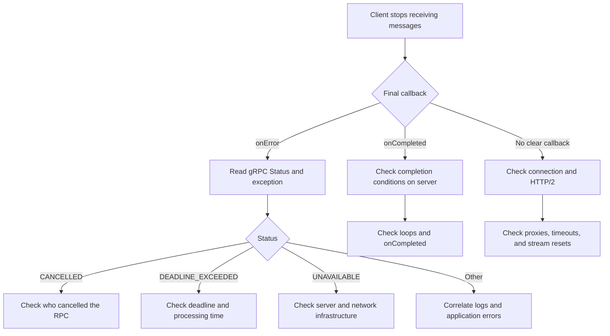

# Streaming Ends Prematurely

In Spring gRPC, a streaming RPC only terminates when one side sends a completion signal, the RPC is cancelled, the deadline expires, or the connection encounters an error. Therefore, when the client receives only partial data before the stream stops, you must determine **who ended the RPC and with which status** before changing configuration.

Spring gRPC uses Protocol Buffers contracts and gRPC Java streaming APIs. Services registered in Spring still follow the `StreamObserver` lifecycle: `onNext` delivers a message, `onCompleted` terminates successfully, and `onError` terminates with an error. These three signals determine how the client perceives the outcome.

## 1. Distinguish Normal Termination from Abnormal Termination

On the receiving side, `onCompleted()` means the RPC ended successfully. It does not mean the stream sent all the messages expected by business logic. If the server only queried one page of data, its data-source loop exited early, or a filter dropped the remaining items, gRPC can still finish the RPC with status `OK`.

`onError(Throwable)` indicates the RPC terminated with an error. For gRPC errors, use `Status.fromThrowable(error)` to retrieve the status code and description. Common codes include:

| Status | Common Symptom | Direction to Check |
|---|---|---|
| `OK` | Client receives `onCompleted()` | Check termination conditions, loops, and data sources on the server |
| `CANCELLED` | One side actively cancelled the RPC | Check UI screen closing, subscription cancellation, separate client timeout, or server handler cancellation |
| `DEADLINE_EXCEEDED` | RPC exceeded the client's deadline | Check deadline, processing duration, and wait time between messages |
| `UNAVAILABLE` | Connection or service temporarily unavailable | Check server restarts, network, load balancer, proxy, and HTTP/2 |
| `RESOURCE_EXHAUSTED` | A resource or size limit was exceeded | Check message size limits, memory, quotas, and system load |
| `INTERNAL` or `UNKNOWN` | Processing error or unmapped error | Correlate server logs with root exception and when the stream stopped |

Do not jump to conclusions from the status code alone. `CANCELLED` can appear when the client closes the connection or when the server cancels work; `UNAVAILABLE` can result from infrastructure dropping the connection without any business exception on the server. Record the status on both sides and the timestamp when it occurred.

## 2. Identify the Streaming Type and Who Can Terminate

Before reading code, identify which RPC pattern is in use. Each pattern has a different request and response lifecycle.

| RPC Type | Request Stream | Response Stream | What to Verify |
|---|---|---|---|
| Server streaming | Client sends one request | Server sends many messages | Did the server stop its loop or call `onCompleted()` too early? |
| Client streaming | Client sends many messages | Server sends one response | Did the client call `onCompleted()` after the last message? Did the server wait to process all requests? |
| Bidirectional streaming | Both sides send many independent messages | Both sides send many independent messages | Did one side close its half while the other still needed to exchange messages? |

With client streaming, `requestObserver.onCompleted()` only signals that the client has finished sending requests. It does not substitute for the server completing the response. With bidirectional streaming, the client can close the request-sending half while the server continues sending responses. If the server calls `responseObserver.onCompleted()`, the response half ends and the client cannot wait for further messages from that RPC.

## 3. Check the `StreamObserver` Lifecycle

Each RPC may emit strictly one terminal signal per stream direction: either `onCompleted()` or `onError()`. After a terminal signal, never call `onNext()`, `onCompleted()`, or `onError()` again. Mistakes that commonly stop a stream early include:

- Calling `onCompleted()` right after the first message because it was placed inside a loop.
- A conditional branch or `return` ending the task before finishing reading the source.
- An exception thrown in an async callback without being converted into `onError()`.
- The client calling `onCompleted()` or `cancel()` while data still needs to be sent or received.
- The server sending the response before finishing processing all requests in a client-streaming or bidirectional RPC.

The example below illustrates server streaming. The service checks for client RPC cancellation, emits messages in a separate task, and completes only after the data source has been fully read. Types `Event`, `WatchEventsRequest`, `EventSource`, and `EventServiceGrpc` are generated from `.proto` or application components.

```java
@GrpcService
public class EventGrpcService extends EventServiceGrpc.EventServiceImplBase {

    private final Executor executor;
    private final EventSource eventSource;

    public EventGrpcService(Executor executor, EventSource eventSource) {
        this.executor = executor;
        this.eventSource = eventSource;
    }

    @Override
    public void watchEvents(
            WatchEventsRequest request,
            StreamObserver<Event> responseObserver) {

        ServerCallStreamObserver<Event> call =
                (ServerCallStreamObserver<Event>) responseObserver;
        AtomicBoolean cancelled = new AtomicBoolean();
        call.setOnCancelHandler(() -> cancelled.set(true));

        executor.execute(() -> {
            try {
                for (Event event : eventSource.read(request)) {
                    if (cancelled.get() || call.isCancelled()) {
                        return;
                    }
                    call.onNext(event);
                }

                if (!cancelled.get() && !call.isCancelled()) {
                    call.onCompleted();
                }
            } catch (Exception ex) {
                if (!cancelled.get() && !call.isCancelled()) {
                    call.onError(Status.INTERNAL
                            .withDescription("Unable to read event stream")
                            .withCause(ex)
                            .asRuntimeException());
                }
            }
        });
    }
}
```

The example requires the corresponding gRPC imports such as `StreamObserver`, `ServerCallStreamObserver`, and `Status`, along with Java's `AtomicBoolean`. `@GrpcService` registers the service with Spring gRPC. In real applications, ensure the data source can stop upon cancellation; checking a flag only after each read is not enough if a read operation blocks for a long time. The executor must also be managed within the application lifecycle and have appropriate load limits.

If a background task throws an exception after the service method has returned, that exception does not automatically become the RPC's error status. Catch exceptions inside the task and call `onError()` while the RPC is still active. Do not call `onError()` after the client has cancelled or after the response has already finished.

## 4. Check Client Deadlines and Cancellation

A deadline limits the total duration an RPC is allowed to run. When the deadline expires, gRPC cancels the RPC and the client typically receives `DEADLINE_EXCEEDED`. The deadline applies to the entire RPC; it does not reset after each message. A multi-minute stream can be cut off even while the server is producing data normally if the client sets too short a deadline.

Example of setting a deadline for an RPC with an expected bounded duration:

```java
EventServiceGrpc.EventServiceStub boundedStub =
        asyncStub.withDeadlineAfter(2, TimeUnit.MINUTES);

boundedStub.watchEvents(request, new StreamObserver<Event>() {
    @Override
    public void onNext(Event event) {
        handle(event);
    }

    @Override
    public void onError(Throwable error) {
        Status status = Status.fromThrowable(error);
        log.warn("Stream failed: code={}, description={}",
                status.getCode(), status.getDescription(), error);
    }

    @Override
    public void onCompleted() {
        log.info("Stream completed successfully");
    }
});
```

Choose the deadline according to valid business processing and wait times. For long-lived streams, avoid short fixed deadlines; define a connection lifetime policy and reconnection mechanism. Log the remaining deadline at RPC start and the actual elapsed time until termination to distinguish deadline expiry from the server finishing on its own.

Cancellation is a separate signal from deadline. A client may cancel when a user leaves a screen, the task no longer needs results, or the application shuts down. The server should register `setOnCancelHandler()` to stop queries, subscriptions, background tasks, or related I/O operations. If only the client closes while the server keeps processing, resources may stay held until the work finishes on its own.

## 5. Check Flow Control and Async Handling

Flow control regulates message sending rates so the receiver is not overwhelmed. It typically pauses stream emission temporarily; running out of send readiness alone does not mean the RPC is finished. However, code can accidentally end a stream if it treats a non-ready state as a loop exit condition.

On the sending side, `CallStreamObserver.isReady()` indicates whether more data can be sent without growing buffers excessively. You can register `setOnReadyHandler()` to resume emitting when gRPC becomes ready. Do not busy-wait on `isReady()` or buffer all results in memory. On an RPC receiving many requests, if automatic inbound flow control is disabled via `disableAutoInboundFlowControl()`, the application must call `request(n)` to request additional messages after processing the received batch; forgetting to call `request(n)` stalls the request stream.

When wiring gRPC with an `Executor`, `CompletableFuture`, reactive publisher, or callbacks from another library, check three points:

1. Are errors from background tasks converted into `responseObserver.onError()`?
2. When the client cancels, do the data source and background task receive a stop signal?
3. Can multiple threads call `onNext()` or terminal signals concurrently on the same observer?

Observers must not be called concurrently from multiple threads unless the application synchronizes message emission itself. A sequential emission source preserves data ordering and avoids races between `onNext()` and `onCompleted()` or `onError()`.

## 6. Check Proxies, Load Balancers, and HTTP/2 Connections

If server code did not emit a terminal signal yet the client still loses the stream, inspect the path between client and server. Ingress, reverse proxy, service mesh, load balancer, or firewall layers can close connections due to idle timeouts, connection lifetime limits, restarts, or HTTP/2 errors. Such cases typically have disconnect or stream reset logs rather than a corresponding business exception.

Correlate the following timestamps across client, server, and infrastructure:

- RPC start time, first message, and last message.
- Gap with no messages before the connection closed.
- Server restart, deploy, scaling, or endpoint shift times.
- HTTP/2 logs such as `RST_STREAM` or `GOAWAY`, if recorded by proxy and client.
- Idle timeouts and connection lifetime limits at each hop along the network path.

HTTP/2 keepalive can help detect dead connections, yet it does not automatically override proxy idle timeouts or connection age limits. Configure keepalive strictly in line with server and infrastructure policies. If business logic requires heartbeats, define a heartbeat message in protobuf with explicit handling rules; do not send ad-hoc messages that alter the API contract.

## 7. Do Not Assume gRPC Resumes a Stream After Reconnect

When a streaming RPC breaks, a new call is a brand-new RPC. Applications should not assume gRPC automatically replays missed messages or resumes from the last position. Automatic retries also cannot guarantee safety for a stream that has already exchanged data or produced side effects.

For event streams or large data transfers, design an application-layer continuation mechanism if business requirements demand it:

- Each message carries a stable sequence number, event ID, or cursor.
- The client persists a checkpoint after successfully processing a message.
- The request reopening the stream carries the last confirmed cursor.
- The server explicitly defines what data can be replayed and how duplicate messages are deduplicated.
- Write operations carry idempotency keys or rules preventing repeated execution.

This design lets clients recover from `UNAVAILABLE`, deployments, or timeouts without relying on the old TCP/HTTP/2 connection staying alive.

## 8. Diagnostic Workflow

Follow this sequence to isolate the root cause:

1. Record the RPC type, method name, start time, number of messages received, and final callback (`onCompleted` or `onError`).
2. If `onCompleted`, inspect loops, filter conditions, pagination, and every code branch calling `onCompleted()` on the server.
3. If `onError`, extract `Status` and correlate root exceptions, deadlines, and cancellations on both sides.
4. If the server recorded no completion, inspect cancellation handlers, connection logs, and proxies or load balancers on the path.
5. If the stream only stops under high load, inspect flow control, executors, queues, message limits, and consumer processing time.
6. Reproduce each scenario separately: normal data source completion, server error emission, client cancellation, deadline expiration, and dropped connection.

Quick decision flow:



In interceptors or service logs, record method name, correlation ID, start/end timestamps, message count, time of last message, gRPC status, and cancellation reason. gRPC metadata is sent at the RPC level, not as a fresh metadata set per message. Never log tokens, credentials, or sensitive data.

## 9. Tests to Prevent Regression

Integration tests should cover both the happy path and the ways a stream can stop:

| Scenario | Outcome to Verify |
|---|---|
| Source has complete data | Client receives all messages per contract and finally receives `onCompleted()` |
| Source ends early | System detects missing count or cursor per business rules; does not confuse `OK` with complete data |
| Source throws exception | Client receives appropriate error status; server logs root exception |
| Client cancels actively | Server receives cancellation and stops background work |
| Deadline expires | Client receives `DEADLINE_EXCEEDED`; server-side resources are released |
| Slow consumer rate | Flow control throttles messages without unintentionally terminating the RPC |
| Connection drops | Client receives appropriate error and application resume mechanism works if applicable |

You can start with in-process tests to verify observer lifecycles and service logic, then run tests over real network configurations to uncover proxy timeouts or limits. When testing long-lived streams, set explicit run durations and stop conditions to avoid hanging tests.

## Quick Troubleshooting Checklist

- [ ] Identify whether the RPC is server streaming, client streaming, or bidirectional.
- [ ] Record the final callback and gRPC status on the client.
- [ ] Verify the server calls only one terminal signal and sends no messages afterward.
- [ ] Check deadlines, cancellation, and background tasks.
- [ ] Check flow control if the stream stops under increased load.
- [ ] Cross-check infrastructure idle timeouts, connection limits, and HTTP/2 logs.
- [ ] If stream recovery is needed, define cursors, sequence numbers, and duplicate message handling.
