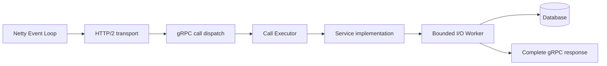

# Blocking the Event Loop with Blocking Calls

## 1. Why does blocking degrade serving capacity?

In **SPRING_GRPC**, a server can handle many concurrent RPCs over HTTP/2. The transport needs to process sockets, frames, flow control, timers, and callbacks to keep serving other calls. If an event loop thread is held by a JDBC query, synchronous HTTP call, file read, or waiting on a `Future`, that thread cannot process other I/O events while waiting.

A blocking call may take only a few hundred milliseconds under normal conditions. Under load, many calls waiting on the database or dependencies simultaneously can exhaust processing threads. New requests queue up, latency rises, deadlines expire, and retries add even more load.

It is important to understand the exact thread model: gRPC Java Netty typically dispatches application callbacks via a call executor; not every service implementation runs directly on the Netty event loop by default. However, if `directExecutor` is configured, code is invoked from an event-loop callback, reactive Netty/WebFlux is used, or callbacks are switched onto the event loop, blocking stalls the I/O thread itself. Even when handlers run on a separate call executor, uncontrolled blocking can still exhaust that executor and build up deep queues.

This article focuses on:

- Distinguishing Netty event loops, the gRPC call executor, and worker executors.
- Identifying blocking operations in services and callbacks.
- Avoiding `directExecutor` when application code contains blocking work.
- Offloading blocking I/O to bounded executors.
- Coordinating executors, connection pools, deadlines, and cancellation.
- Maintaining backpressure for streaming.
- Observing thread starvation and testing under load.

## 2. Distinguishing the event loop from the gRPC call executor

Netty uses a pool of event loops to handle non-blocking I/O. One event loop typically manages multiple channels; if a callback holds the thread too long, every channel assigned to that event loop can be affected.

On the gRPC Java server side, application service callbacks are usually dispatched via an executor managed by the server. You can configure the executor using `ServerBuilder.executor(...)`. If `directExecutor()` is used, application callbacks run directly on the transport thread per gRPC's contract; in that case, service code must avoid blocking.

Conceptual model:



In this model, the Netty event loop handles transport; the call executor runs application callbacks; and a blocking worker handles synchronous I/O operations when needed. This is a conceptual diagram, not a guarantee that every starter creates these exact three thread groups.

Two forms of starvation to distinguish:

- **Event-loop starvation:** the event loop is blocked, causing I/O delays across multiple channels.
- **Call-executor starvation:** the event loop keeps running, but the executor handling service callbacks runs out of threads; new requests wait for dispatch or execution.

Both increase latency, yet the bottleneck and investigation approach differ.

## 3. Identifying blocking operations

The following calls can block the current thread:

| Operation | Why it blocks |
| --- | --- |
| JDBC/JPA repository | Waits for connection, lock, or query completion |
| RestTemplate or synchronous HTTP client | Waits for network response |
| Blocking gRPC stub | Waits for server response |
| Future.get() / CompletableFuture.join() | Waits for another task to finish |
| Thread.sleep() | Holds the thread for the sleep duration |
| Files.readAllBytes()/write() | Waits on filesystem |
| Synchronized lock / lock.lock() | Waits for another thread to release the lock |
| Blocking queue take()/put() | Waits for item or capacity |
| Long-running CPU loop | Fails to yield the thread even without waiting on I/O |

A method named `async` does not automatically make the entire pipeline non-blocking. For example, calling `supplyAsync` and then immediately calling `join` still blocks the thread calling `join`. Likewise, placing a blocking query inside a callback running on the event loop still blocks the event loop.

Inspect helper methods and indirectly called libraries as well. A seemingly short repository method can wait seconds for a connection pool or database lock.

## 4. Anti-pattern: making blocking calls directly from transport callbacks

Dangerous example when a service callback may run on the event loop or an executor that must stay responsive:

```java
@Override
public void getOrder(
        GetOrderRequest request,
        StreamObserver<GetOrderReply> observer) {

    // JDBC call may wait for a connection and the database.
    Order order = orderRepository.findById(request.getOrderId())
        .orElseThrow(OrderNotFoundException::new);

    observer.onNext(toReply(order));
    observer.onCompleted();
}
```

If this callback runs on the event loop, the entire event loop is blocked for the duration of the repository operation. If it runs on a dedicated call executor, the call executor thread is held; concurrent requests can still exhaust the executor.

Not every repository call must move to another executor in every architecture. What is mandatory is knowing which thread callbacks run on, bounding concurrency for blocking work, and ensuring I/O or scheduling threads are never blocked.

## 5. Avoid `directExecutor` when services perform blocking work

gRPC Java allows configuring a direct executor to reduce scheduling overhead:

```java
Server server = NettyServerBuilder
    .forPort(8443)
    .directExecutor()
    .addService(orderService)
    .build();
```

This option imposes strict requirements: service implementations, interceptors, and callbacks must run fast, never block, never wait on locks, and never perform synchronous I/O. If the service calls JDBC/JPA, a blocking HTTP client, or `Future.get()`, `directExecutor` can push those operations onto the transport thread.

In a typical Spring business server, do not enable `directExecutor` just to save one dispatch step without measuring and verifying thread behavior. Use an executor appropriate for the workload and configuration of the Spring gRPC starter in use.

## 6. Offload blocking I/O to a bounded executor

If using JDBC/JPA or synchronous libraries, run the blocking portion on a bounded worker pool. Do not use a cached/unbounded pool that spawns unlimited threads; also do not use an unbounded queue that lets requests wait past their deadlines.

Example executor dedicated to blocking I/O:

```java
@Bean(destroyMethod = "shutdown")
ExecutorService blockingIoExecutor() {
    return new ThreadPoolExecutor(
        16,
        32,
        60,
        TimeUnit.SECONDS,
        new ArrayBlockingQueue<>(200),
        namedThreadFactory("grpc-blocking-"),
        new ThreadPoolExecutor.AbortPolicy()
    );
}
```

These numbers are illustrative only. Sizing must be based on the DB pool, dependency latency, CPU, replica count, and target concurrency.

When the queue is full, `AbortPolicy` throws `RejectedExecutionException` so the application can reject early or apply load shedding. Avoid `CallerRunsPolicy` in the transport path: it executes the rejected task directly on the thread calling `execute()`, which might be the event loop and recreate the blocking bug.

If using a Spring gRPC starter, register the executor through the supported configuration mechanism or inject a separate worker in the service; do not manually build a second server just to swap the executor.

## 7. Completing unary RPCs after offloading

A service can hand off database work to a worker and complete the observer once the result is ready. Conceptual example:

```java
@Override
public void getOrder(
        GetOrderRequest request,
        StreamObserver<GetOrderReply> observer) {

    Context callContext = Context.current();

    try {
        blockingIoExecutor.execute(() -> {
            Context previous = callContext.attach();
            try {
                if (callContext.isCancelled()) {
                    return;
                }

                Order order = orderRepository
                    .findById(request.getOrderId())
                    .orElseThrow(OrderNotFoundException::new);

                if (callContext.isCancelled()) {
                    return;
                }

                observer.onNext(toReply(order));
                observer.onCompleted();
            } catch (Throwable error) {
                observer.onError(exceptionMapper.toStatus(error));
            } finally {
                callContext.detach(previous);
            }
        });
    } catch (RejectedExecutionException rejected) {
        observer.onError(
            Status.RESOURCE_EXHAUSTED
                .withDescription("Server is busy")
                .asRuntimeException()
        );
    }
}
```

This is an illustrative skeleton; production code must ensure the observer receives only one terminal signal, cancellation does not race with the response, and errors are never swallowed. When using `ServerCallStreamObserver`, register an `onCancelHandler` to signal the worker to stop when possible.

`Context` is captured from the call and attached on the worker so deadlines/cancellation and gRPC context values can be read properly. Always detach in `finally` to prevent leaking `Context` to the next task. Do not assume `ThreadLocal` propagates automatically across executors.

If a JDBC operation is already running, cancelling a `Future` via interrupt does not guarantee the driver cancels the query. Separate query timeouts/database-side timeouts and transaction policies are needed.

## 8. Use non-blocking clients when dependencies support them

For HTTP or gRPC downstreams, prefer asynchronous/non-blocking APIs if the architecture permits:

- gRPC async stub instead of blocking stub.
- Non-blocking HTTP client instead of `RestTemplate`.
- R2DBC/reactive driver instead of JDBC when the entire data path fits.
- `CompletionStage`/reactive composition instead of blocking on `get()`/`join()`.

Async stub example:

```java
orderAsyncStub
    .withDeadlineAfter(300, TimeUnit.MILLISECONDS)
    .getOrder(request, new StreamObserver<>() {
        @Override
        public void onNext(OrderReply reply) {
            // Forward the result according to the call lifecycle.
        }

        @Override
        public void onError(Throwable error) {
            // Preserve the status and complete with error exactly once.
        }

        @Override
        public void onCompleted() {
            // Complete the response.
        }
    });
```

Using an async API does not mean callbacks are allowed to do blocking work. If `onNext`/`onError` callbacks run on a latency-sensitive executor, keep them brief and offload blocking work.

Do not call an async API and immediately block with `get()`, `join()`, or `latch.await()`; that only changes code syntax, not thread behavior.

## 9. Choose executors by workload type

Do not dump every kind of work into one undifferentiated pool:

| Workload | Strategy |
| --- | --- |
| Netty transport I/O | Event loop managed by transport; never run blocking business code |
| gRPC application callback | Executor with appropriate concurrency; callbacks should be brief |
| JDBC/JPA blocking | Bounded worker pool coordinated with DB connection pool |
| Blocking HTTP/SDK | Worker pool bounded by downstream capacity |
| CPU-heavy transform | CPU pool sized close to CPU capacity |
| Scheduled cleanup | Dedicated scheduler, never the event loop |
| Async/non-blocking I/O | Event-driven composition, no synchronous waiting |

Separating pools prevents a slow dependency from consuming all threads serving every RPC. However, too many pools also introduce extra queues and context switching. Each pool needs an owner, capacity, queue limit, rejection policy, and metrics.

## 10. Worker pool sizing must align with the database pool

Suppose each replica has 20 JDBC connections. If 200 worker threads call the database concurrently, at most 20 threads get connections; the remaining ones wait in the pool, holding threads and increasing latency.

Sizing should account for:

- Maximum DB connections allocated per instance.
- Average and p95/p99 connection hold times.
- Percentage of RPCs that actually hit the database.
- Concurrent dependency calls per request.
- Maximum replicas and the database's total connection budget.
- Queue capacity and RPC deadlines.

Do not size thread counts solely by CPU cores or concurrent RPCs. For blocking I/O, thread counts can exceed core counts, but must be bounded by downstream resources. If the DB pool is 20, DB work concurrency should not far exceed that capacity without explicit justification and queue control.

## 11. Deadlines must account for time spent in the queue

Offloading does not eliminate wait time. A request can sit in a worker queue for 700 ms before starting its query, leaving only 100 ms of the RPC deadline.

Before enqueueing and before executing a blocking operation:

1. Read the remaining deadline from gRPC `Context`.
2. Reject early if the deadline has expired or is insufficient for the work.
3. When the worker starts, recompute the remaining budget.
4. Set query/statement timeouts lower than the remainder, leaving room for commit/response.
5. If the request was cancelled while queued, skip the task before acquiring a connection.

Do not set a fresh full timeout when the task starts running. The deadline is an end-to-end budget, and time waiting in the executor has already consumed part of that budget.

## 12. Cancellation and cleanup for blocking tasks

When a client cancels an RPC or its deadline expires, the server should stop unnecessary work:

- Check `Context.isCancelled()` before acquiring connections and before subsequent steps.
- Register a cancellation handler on the server call when appropriate.
- Cancel `Future`/tasks when possible.
- Configure JDBC query timeouts and database statement timeouts.
- Ensure transactions roll back if a query fails before commit.
- Never emit a response after terminal cancellation.
- Do not assume an interrupt can always cancel a JDBC/SDK call.

If a task already committed to the database before cancellation arrived, it cannot roll back simply because the client cancelled. For commands with side effects, use idempotency keys and operation status so clients can determine outcomes.

## 13. Backpressure for streaming RPCs

Streaming can keep many messages flowing over long durations. If a producer generates data faster than the client reads, message queues grow and the heap can be exhausted.

With `ServerCallStreamObserver`, you can check `isReady()` and register an `onReadyHandler` to send more only when the transport is ready:

```java
ServerCallStreamObserver<OrderUpdate> serverObserver =
    (ServerCallStreamObserver<OrderUpdate>) observer;

serverObserver.setOnReadyHandler(() -> {
    // Wake up producer; send only when serverObserver.isReady().
});
```

The `onReadyHandler` callback must be brief and non-blocking. If the producer reads from a database or file, use a worker/async source with bounded buffering; never load all data into memory before streaming.

Also ensure:

- Limit the number of concurrent streams.
- Limit in-flight messages and byte buffers.
- Cancel the producer when the client cancels.
- Never hold a database transaction open across the duration of a stream.
- Use cursors/batches when reading from the database.
- Define partial-result and resume semantics if a stream breaks.

HTTP/2 flow control regulates transport bytes, but the application must still control queues and production rate.

## 14. Virtual threads do not turn the event loop into a place for blocking code

Virtual threads can make blocking code easier to manage and reduce thread overhead for some workloads. However, they do not turn a Netty event loop into an environment where blocking is permitted.

Rules:

- Never run blocking JDBC/HTTP directly on the event loop, even with virtual threads.
- Offload blocking operations to an executor creating virtual threads or an appropriate worker.
- Limit concurrency with a semaphore/bulkhead aligned with DB/provider capacity.
- Verify that drivers and libraries behave properly with virtual threads.
- Monitor pinning, memory, and resource pools; virtual threads do not create extra database connections.
- Keep deadlines, cancellation, and bounded admission in place.

Virtual threads help manage many tasks waiting on I/O, but they do not increase the capacity of the database or downstream services.

## 15. Rejection and load shedding under overload

When a worker pool is full, continuing to accept every request only grows queues and lets deadlines expire while waiting. The system should reject early according to policy:

- `RESOURCE_EXHAUSTED` when capacity/quota is reached and the caller can back off.
- `UNAVAILABLE` when the service temporarily cannot serve per contract.
- `RetryInfo`/backoff metadata if supported by the API.
- Bounded retries to avoid creating a retry storm.

Do not return `INTERNAL` merely because the executor rejected a task. Never use `CallerRunsPolicy` if the submitting thread might be the event loop. Rejection handlers must ensure the gRPC call terminates exactly once and leaks no resources.

If a service exposes multiple RPC methods, consider separate bulkheads for heavy workloads so an export/report cannot starve workers needed by small queries.

## 16. Observability: detecting event-loop and executor starvation

Monitor each group separately:

- Event-loop thread utilization/lag and callback duration if instrumented.
- gRPC call executor active threads, queue depth, queue wait, and rejected tasks.
- Blocking worker active count, queue depth, execution time, and rejections.
- JDBC active/idle/pending connections, acquisition time, and query duration.
- RPC latency p50/p95/p99, in-flight calls, deadline exceeded, and cancellations.
- Streaming in-flight bytes, readiness wait, and slow-consumer counts.
- CPU, GC pauses, heap, and thread counts.

Signs of event-loop starvation: transport callback/heartbeat/I/O latency spikes alongside long-occupied event-loop threads. Signs of call-executor starvation: transport still receives traffic, but service dispatch queues and RPC latency climb. Signs of DB saturation: workers wait on connection acquisition or slow queries/locks.

Do not draw conclusions from a single "thread count" metric. Correlate trace spans, executor queues, and database metrics over time.

## 17. Testing to detect blocking

A useful test must prove fast RPCs continue being served while another operation is slow:

| Scenario | What to verify |
| --- | --- |
| One RPC simulates blocking via latch | I/O handling thread is held as expected |
| Fast RPC runs concurrently | Not stalled behind slow RPC when pools are properly isolated |
| Worker queue full | Request rejected early, never runs on event loop |
| Deadline expires while queued | Task does not start query after expiration |
| Client cancels during query | Cancellation propagates; query timeout bounds remainder |
| Slow streaming client | Buffer is bounded and producer pauses |
| Slow downstream dependency | Dedicated pool does not starve executors of other RPCs |
| Server shutdown | Workers stop/drain per policy without hanging tasks indefinitely |
| High-concurrency load test | p99, queue, and rejection rates stay within SLO |

Use a `CountDownLatch` or controllable fake to hold an operation in a waiting state; avoid relying on `Thread.sleep` to manufacture races. Run tests under production-like executor configurations and measure thread/queue metrics. If using `directExecutor`, add tests confirming callbacks contain no blocking calls.

## 18. Review checklist

- Know clearly whether callbacks run on the Netty event loop, gRPC call executor, or worker threads.
- Do not assume every gRPC service implementation runs on the Netty event loop by default.
- Never use `directExecutor` when application callbacks perform blocking work.
- Never call JDBC, blocking HTTP/gRPC, file I/O, or `Future.get()`/`join()` on the event loop.
- Blocking work is offloaded to a bounded executor.
- No unbounded queues or `CallerRunsPolicy` in the transport path.
- Executor sizing aligns with DB pool, downstream capacity, and replica count.
- Deadlines account for queue wait; tasks verify remaining budget when starting.
- Cancellation propagates to tasks and dependencies; JDBC has query timeouts.
- Async APIs are not re-blocked via `get()`/`join()`.
- Streaming implements backpressure, bounded buffers, and cancellation.
- Virtual threads are not used as an excuse to block the event loop.
- Rejections map to overload policy and terminate calls exactly once.
- Metrics distinguish event-loop lag, call executor starvation, and DB saturation.
- Concurrency/load tests verify fast RPCs are not blocked by slow operations.

In **SPRING_GRPC**, blocking operations on the event loop can delay all I/O managed by that thread; blocking on a separate call executor can still exhaust RPC dispatch capacity. Identify your actual thread model, keep callbacks short, offload JDBC/HTTP/file work to bounded worker pools, and coordinate queues with deadlines, cancellation, and database capacity. For streaming, add backpressure and bounded buffering so load never accumulates in the heap.
